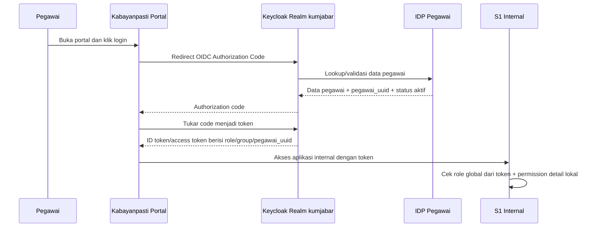
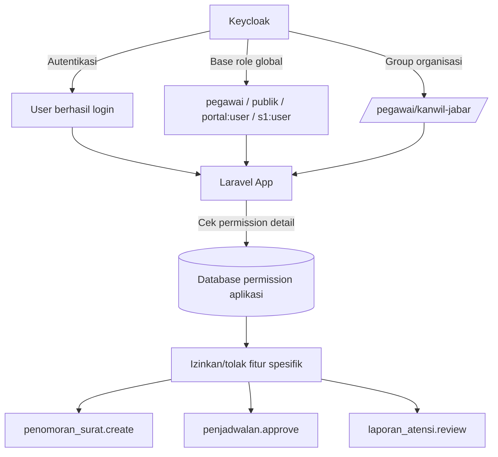

# 01 - Identity & Access Blueprint

Status: Draft brainstorming
Project: kumjabar_ecosystem

Update 2026-08-26/27: dokumen ini adalah draft historis awal. Struktur organisasi, public group, eliminasi UPT, kontrak IDP Pegawai, fallback akses aman, stack Flask + Alembic, freshness hash, kontrak UI/API Tahap 1, dan boundary jabatan sudah dipertajam di dokumen `02` sampai `11`. Untuk bagian yang tumpang tindih, gunakan dokumen terbaru sebagai acuan; asumsi awal seperti group UPT, group publik khusus notaris/magang/pewarganegaraan, group `/pimpinan`, serta role awal yang terlalu luas dianggap superseded.

## 1. Tujuan

Dokumen ini menjadi rancangan awal Keycloak realm/client/group/role untuk ekosistem Kumjabar. Fokusnya bukan konfigurasi final, tetapi pegangan konseptual agar desain SSO, struktur organisasi, dan aplikasi Laravel modular monolith punya arah yang jelas.

## 2. Prinsip Dasar

1. Keycloak menjadi pusat autentikasi dan identitas login.
2. IDP Pegawai menjadi source of truth identitas ASN internal PNS/PPPK, lifecycle/status dan eligibility akses, identity link, serta afiliasi organisasi; jabatan dan historinya bukan domain IDP.
3. Aplikasi Laravel tetap menyimpan permission detail yang sangat spesifik terhadap fitur.
4. Keycloak menyimpan role/group global lintas aplikasi.
5. Setiap aplikasi punya client Keycloak sendiri.
6. Pegawai internal dan pengguna publik dibedakan dari awal.
7. Struktur organisasi menjadi dasar group internal, tetapi jangan semua izin mikro dijadikan role Keycloak.

Analogi:

- Keycloak = pos keamanan pusat.
- IDP Pegawai = buku induk pegawai resmi.
- Group Keycloak = divisi/unit kerja di kartu akses.
- Role Keycloak = jenis akses gedung besar.
- Permission Laravel = izin ruangan/detail aktivitas di dalam gedung.

## 3. Kandidat Realm

Rekomendasi awal:

```text
Realm: kumjabar
```

Alternatif nama:

```text
Realm: kanwil-jabar
Realm: kemenkum-jabar
Realm: kumham-jabar
```

Rekomendasi sementara: `kumjabar` karena lebih ringkas dan tidak terlalu terikat pada perubahan nomenklatur organisasi.

## 4. Client Keycloak Awal

| Client ID | Jenis | Aplikasi | Catatan |
| --- | --- | --- | --- |
| `kabayanpasti-portal` | OIDC confidential/public sesuai frontend | Portal Hub | landing, dashboard, launcher aplikasi |
| `s1-internal` | OIDC confidential | Laravel internal | layanan pegawai/internal |
| `s2-eksternal` | OIDC confidential | Laravel eksternal | layanan publik/eksternal |
| `mobile-app` | OIDC public + PKCE | Mobile native | disiapkan untuk masa depan |
| `admin-console-support` | OIDC confidential | ops/admin terbatas | opsional, jangan dibuka luas |

Catatan awal:

- Untuk Laravel server-rendered/web app, client biasanya confidential.
- Untuk mobile native, gunakan Authorization Code + PKCE, bukan menyimpan client secret di aplikasi mobile.
- Jangan gunakan satu client bersama untuk semua aplikasi karena claim, redirect URI, dan access control akan sulit dirapikan.

## 5. Tipe Pengguna Awal

| Tipe User | Sumber Identitas | Login | Contoh Akses |
| --- | --- | --- | --- |
| ASN internal (PNS/PPPK) | IDP Pegawai | NIP/email internal via Keycloak | Kabayanpasti, S1 Internal |
| Admin/operator internal | IDP Pegawai + role tambahan | Keycloak | Kabayanpasti, S1, sebagian S2 sebagai operator |
| Publik/masyarakat | Keycloak local user atau social login Google | Google/OIDC/social login | Kabayanpasti, S2 Eksternal |
| Super admin teknis | Keycloak local/admin terbatas | Keycloak | administrasi realm/client, bukan user harian |

## 6. Group Internal Berbasis Struktur Organisasi

Struktur organisasi detail perlu menunggu data resmi, tetapi model awalnya bisa seperti ini:

```text
/pegawai
  /kanwil-jabar
    /bagian-tata-usaha
    /divisi-pelayanan-hukum
    /divisi-keimigrasian
    /divisi-pemasyarakatan
    /divisi-administrasi-hukum-umum
    /upt
      /lapas
      /rutan
      /bapas
      /imigrasi

/publik
  /masyarakat
  /notaris
  /pemohon-magang-penelitian
  /pemohon-pewarganegaraan

/admin-teknis
```

Catatan:

- Group sebaiknya mewakili struktur organisasi atau segmentasi user yang relatif stabil.
- Jangan membuat group untuk aksi kecil seperti `boleh-cetak-pdf` atau `boleh-edit-nomor-surat`; itu lebih cocok sebagai permission aplikasi.

## 7. Role Global Keycloak Awal

### 7.1 Realm Roles

Realm role dipakai untuk identitas besar lintas aplikasi.

```text
pegawai
publik
admin_realm_support
operator_lintas_aplikasi
```

### 7.2 Client Roles: Kabayanpasti

```text
portal:user
portal:admin
portal:content_editor
portal:notification_operator
```

### 7.3 Client Roles: S1 Internal

```text
s1:user
s1:operator
s1:verifikator
s1:admin
```

Modul awal S1:

```text
penomoran_surat
penjadwalan
laporan_atensi
```

Role Keycloak untuk S1 sebaiknya tetap global di level aplikasi. Izin detail modul disimpan di S1.

Contoh permission detail di Laravel S1:

```text
penomoran_surat.create
penomoran_surat.verify
penomoran_surat.publish
penjadwalan.create
penjadwalan.approve
laporan_atensi.create
laporan_atensi.submit
laporan_atensi.review
```

### 7.4 Client Roles: S2 Eksternal

```text
s2:user
s2:operator
s2:verifikator
s2:admin
```

Modul awal S2:

```text
perizinan_magang_penelitian
laporan_notaris
pendaftaran_pelantikan_notaris
pendaftaran_pewarganegaraan
informasi_pengaduan
```

Contoh permission detail di Laravel S2:

```text
perizinan_magang_penelitian.submit
perizinan_magang_penelitian.track
laporan_notaris.submit
pendaftaran_pelantikan_notaris.submit
pendaftaran_pewarganegaraan.submit
informasi_pengaduan.submit
informasi_pengaduan.respond
```

## 8. Mapping Sederhana Group ke Role

| Group | Realm Role | Client Role Umum |
| --- | --- | --- |
| `/pegawai/kanwil-jabar/*` | `pegawai` | `portal:user`, `s1:user` |
| `/publik/masyarakat` | `publik` | `portal:user`, `s2:user` |
| `/publik/notaris` | `publik` | `portal:user`, `s2:user` |
| `/admin-teknis` | `admin_realm_support` | terbatas sesuai kebutuhan |

## 9. Claim Token yang Dibutuhkan Laravel

Minimal claim yang berguna:

```json
{
  "sub": "keycloak-user-uuid",
  "preferred_username": "username-or-email",
  "email": "user@example.go.id",
  "name": "Nama Pengguna",
  "user_type": "pegawai|publik",
  "pegawai_uuid": "uuid-dari-idp-pegawai-jika-pegawai",
  "groups": ["/pegawai/kanwil-jabar/bagian-tata-usaha"],
  "realm_access": {
    "roles": ["pegawai"]
  },
  "resource_access": {
    "s1-internal": {
      "roles": ["s1:user", "s1:operator"]
    }
  }
}
```

Catatan:

- `pegawai_uuid` penting untuk menghubungkan user Keycloak dengan data pegawai di IDP.
- Untuk user publik, `pegawai_uuid` kosong/null.
- `groups` dipakai sebagai atribut afiliasi organisasi dan boleh membantu base access; group tidak membuktikan jabatan dan tidak boleh otomatis menghasilkan role pimpinan/operator/verifikator/admin.
- Permission detail tetap dicek di database aplikasi Laravel.

## 10. Relasi dengan Database per Aplikasi

Rancangan database yang disepakati sementara:

```text
PostgreSQL cluster/server
├── db_keycloak
├── db_idp_pegawai
├── db_s1
│   ├── schema: penomoran
│   ├── schema: penjadwalan
│   ├── schema: laporan_atensi
│   └── schema: ... modul berikutnya
└── db_s2
    ├── schema: perizinan_magang_penelitian
    ├── schema: laporan_notaris
    ├── schema: pelantikan_notaris
    ├── schema: pewarganegaraan
    ├── schema: informasi_pengaduan
    └── schema: ... modul berikutnya
```

Implikasi desain:

- S1 hanya memakai database role yang punya akses ke `db_s1`.
- S2 hanya memakai database role yang punya akses ke `db_s2`.
- IDP Pegawai hanya memakai database role yang punya akses ke `db_idp_pegawai`.
- Keycloak memakai database sendiri, idealnya `db_keycloak`.
- Penambahan modul berarti penambahan schema/migration, bukan rebuild database container.

## 11. Visual: Alur Login Pegawai



## 12. Visual: Boundary Keycloak vs Laravel Permission



## 13. Keputusan Sementara

1. Gunakan 1 realm dulu: `kumjabar`.
2. Pisahkan client per aplikasi: portal, s1, s2, mobile.
3. Pegawai dan publik boleh berada dalam realm yang sama, tetapi dibedakan lewat `user_type`, group, dan role.
4. IDP Pegawai menjadi source of truth identitas ASN internal (PNS/PPPK), lifecycle/status dan eligibility, identity link, serta afiliasi organisasi. Jabatan, jenis jabatan, PLT/PLH, dan histori jabatan dimiliki modul kepegawaian consumer.
5. Keycloak menyimpan base access global dan grant lintas aplikasi yang eksplisit; Laravel menyimpan role/permission detail per modul. Role tidak diturunkan otomatis dari jabatan.
6. Struktur organisasi masuk sebagai group Keycloak, bukan permission mikro.
7. Database dipisah per aplikasi, schema dipisah per modul.

Catatan update: keputusan terkait struktur organisasi dan group publik telah diperbarui dalam `02-organization-identity-contract.md` dan ADR `0002-organization-identity-contract.md`.

## 14. Pertanyaan Lanjutan

Status update 2026-08-27: pertanyaan awal di bawah sebagian besar sudah dijawab oleh dokumen lanjutan.

| Pertanyaan Awal | Status Terbaru |
| --- | --- |
| Nama realm final? | Dipilih `kumjabar` pada dokumen 02/03. |
| Struktur organisasi resmi awal? | Mengikuti Kanwil Jabar tanpa UPT: Divisi Yankum, Divisi P3H, dan Bagian TU & Umum/Tum. Detail di dokumen 02/03. |
| Publik cukup Google atau perlu lokal? | Google social login boleh untuk publik; detail persona layanan publik dikelola aplikasi `s2-jabar`, bukan group Keycloak awal. |
| Notaris kategori khusus? | Tidak menjadi group Keycloak awal; diperlakukan sebagai konteks/profil layanan di aplikasi. |
| Pegawai UPT masuk fase awal? | Tidak; UPT dieliminasi dari boundary awal. |

Pertanyaan yang masih dibawa ke review Tahap 1 akan dikonsolidasikan di `10-idp-pegawai-stage-1-review-checklist-open-decisions.md`.
