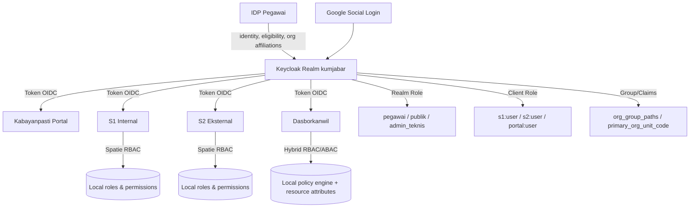

# 02 - Organization Identity Contract

Status: Draft contract brainstorming
Project: kumjabar_ecosystem
Date: 2026-08-26

## 1. Tujuan

Dokumen ini mempertajam dokumen `01-identity-access-blueprint.md`, khususnya bagian struktur organisasi, group Keycloak, tipe user publik/pegawai, kontrak minimal IDP Pegawai, dan pola mapping role/permission ke aplikasi konsumen seperti `s1-jabar`, `s2-jabar`, dan `dasborkanwil`.

Prinsip utamanya:

1. Keycloak tetap menjadi pusat autentikasi dan token identity.
2. IDP Pegawai menjadi source of truth identitas ASN PNS/PPPK, lifecycle/status dan eligibility, identity link, serta struktur/afiliasi organisasi internal; jabatan bukan domain IDP.
3. Group Keycloak mewakili struktur organisasi/segmentasi user yang relatif stabil.
4. Role Keycloak hanya coarse-grained access lintas aplikasi, bukan permission mikro fitur.
5. Permission detail tetap diselesaikan di aplikasi konsumen sesuai karakter masing-masing aplikasi.
6. Struktur publik dibuat ringkas dulu: `/publik/masyarakat`.
7. UPT tidak dimodelkan pada fase awal karena konteks Kementerian Hukum saat ini tidak lagi memasukkan UPT Pemasyarakatan/Imigrasi pada boundary Kanwil Kemenkum Jabar.

## 2. Keputusan Awal yang Disepakati

### 2.1 Realm

Realm awal:

```text
kumjabar
```

Alasan:

- ringkas;
- tidak terlalu terikat perubahan nomenklatur;
- cukup merepresentasikan ekosistem Kanwil Kemenkum Jawa Barat.

### 2.2 Client Keycloak

Client tetap dipisahkan per aplikasi/boundary:

| Client ID | Status Awal | Jenis | Fungsi |
| --- | --- | --- | --- |
| `kabayanpasti-portal` | aktif awal | OIDC confidential/public sesuai implementasi portal | portal hub, dashboard, launcher aplikasi |
| `s1-internal` | aktif awal | OIDC confidential | aplikasi layanan internal/pegawai |
| `s2-eksternal` | aktif awal | OIDC confidential | aplikasi layanan publik/eksternal |
| `mobile-app` | reserved | OIDC public + PKCE | disiapkan untuk mobile native masa depan |
| `admin-console-support` | opsional/terbatas | OIDC confidential | kebutuhan ops/admin terbatas, bukan akses harian luas |

Catatan: `mobile-app` dan `admin-console-support` tidak wajib dibangun sekarang. Keduanya hanya disiapkan sebagai boundary agar rancangan realm tidak perlu dirombak jika kanal mobile atau tooling admin terbatas dibutuhkan nanti.

## 3. Tipe User Awal

Gunakan tipe user yang sedikit dan stabil:

| `user_type` | Sumber Identitas | Keterangan |
| --- | --- | --- |
| `pegawai` | IDP Pegawai + Keycloak | ASN internal Kanwil Kemenkum Jabar: PNS dan PPPK |
| `publik` | Google social login atau Keycloak local user | masyarakat umum/pengguna layanan publik |
| `admin_teknis` | Keycloak local/admin terbatas | admin teknis realm/platform, bukan user operasional harian |

Catatan penting:

- `notaris`, `pemohon_magang_penelitian`, `pemohon_pewarganegaraan`, dan sejenisnya tidak dijadikan group publik awal.
- Mereka lebih tepat diperlakukan sebagai konteks layanan, profil layanan, atau status verifikasi di aplikasi `s2-jabar`, bukan segmentasi identity utama di Keycloak.
- Jika suatu hari ada kebutuhan regulatif yang kuat, misalnya `notaris_terverifikasi`, aplikasi dapat menyimpan status verifikasi lokal dan baru kemudian dipertimbangkan apakah perlu claim khusus dari Keycloak.

## 4. Struktur Group Keycloak

### 4.1 Public Group

Struktur publik diringkas menjadi:

```text
/publik
  /masyarakat
```

Alasan:

- semua pengguna eksternal pada dasarnya masyarakat;
- layanan yang dipakai ditentukan oleh aplikasi, bukan group Keycloak;
- menghindari ledakan group publik sejak awal;
- lebih fleksibel jika kategori layanan publik berubah.

Contoh mapping:

| Group | Realm Role | Client Role Default |
| --- | --- | --- |
| `/publik/masyarakat` | `publik` | `portal:user`, `s2:user` |

### 4.2 Internal Employee Group

Struktur internal mengikuti struktur resmi + pengembangan pokja/tim yang dijelaskan user:

```text
/pegawai
  /kanwil-jabar
    /divisi-yankum
      /bidang-ahu
      /bidang-ki
    /divisi-p3h
      /pokja-suncang
      /pokja-bsk
      /pokja-jdih
      /pokja-bankum
    /tum
      /program-pelaporan
      /kepegawaian
      /humas
      /ti
      /keuangan
      /bmn
      /sekretariat
      /protokoler
      /rb-kerjasama
      /kearsipan
      /pengaduan
```

Keterangan:

- `divisi-yankum` = Divisi Pelayanan Hukum.
- `bidang-ahu` = Bidang Administrasi Hukum Umum.
- `bidang-ki` = Bidang Kekayaan Intelektual.
- `divisi-p3h` = Divisi Peraturan Perundang-undangan dan Pembinaan Hukum.
- `tum` = Bagian Tata Usaha dan Umum.
- `tum` sengaja sejajar dengan divisi di bawah `/pegawai/kanwil-jabar`, karena secara struktur yang dijelaskan user, TU & Umum tidak berada di bawah Divisi Yankum atau Divisi P3H.
- Group UPT tidak dimasukkan pada fase awal.

### 4.3 Catatan Primary Unit vs Additional Assignment

Satu pegawai sebaiknya punya satu `primary_org_unit`, tetapi boleh punya assignment tambahan.

Contoh:

- Pegawai A secara utama berada di `/pegawai/kanwil-jabar/tum/ti`.
- Pegawai A juga menjadi operator pelaporan untuk suatu modul.
- Unit/afiliasi organisasi utama masuk ke group organisasi; ini bukan posisi atau jabatan.
- Tugas operator modul masuk ke role/client role atau permission lokal aplikasi, bukan mengubah primary unit.

Untuk pegawai yang merangkap pokja/tim, IDP Pegawai perlu mendukung assignment tambahan agar Keycloak dapat mengirim claim seperti `org_group_paths` atau `workgroup_codes` tanpa kehilangan unit utama.

## 5. Kontrak Minimal IDP Pegawai

Rekomendasi senior engineering: jangan menyimpan struktur organisasi hanya sebagai JSONB. Gunakan tabel relasional untuk struktur yang sering difilter, dicari, disinkronkan, dan dipakai sebagai authorization attribute. JSONB tetap berguna untuk metadata fleksibel atau source snapshot dalam boundary masing-masing entity, tetapi tidak boleh dipakai untuk menyisipkan jabatan, `jabatan_type`, label jabatan, PLT/PLH, atau histori jabatan ke IDP.

### 5.1 Tabel `org_units`

Minimal field:

| Kolom | Tipe Konseptual | Fungsi |
| --- | --- | --- |
| `id` | integer/bigint PK | efisiensi ORM/internal |
| `uuid` | uuid unique | identitas stabil lintas sistem |
| `parent_id` | FK nullable ke `org_units.id` | relasi parent-child |
| `code` | string unique | kode stabil internal, contoh `TUM_TI` |
| `slug` | string unique/path segment | slug untuk path, contoh `ti` |
| `name` | string | nama unit lengkap |
| `short_name` | string nullable | nama singkat, contoh `TI` |
| `unit_type` | enum/string | `root`, `kanwil`, `divisi`, `bidang`, `bagian`, `pokja`, `tim` |
| `level` | integer | kedalaman hirarki |
| `path` | string | path internal, contoh `/kanwil-jabar/tum/ti` |
| `keycloak_group_path` | string | path group Keycloak, contoh `/pegawai/kanwil-jabar/tum/ti` |
| `sort_order` | integer | urutan tampilan |
| `is_active` | boolean | status aktif unit |
| `effective_from` | date nullable | awal berlaku |
| `effective_to` | date nullable | akhir berlaku |
| `metadata` | jsonb | atribut tambahan/source snapshot |
| `created_at`, `updated_at`, `deleted_at` | timestamp | audit lifecycle |

Kenapa perlu relasional:

- mudah melakukan query pegawai per unit;
- mudah membangun tree organisasi;
- mudah sync ke Keycloak group;
- mudah menjaga unique `code` dan `path`;
- lebih aman untuk ABAC karena resource/actor scope bisa memakai kode stabil.

### 5.2 Tabel `pegawai`

Minimal field:

| Kolom | Fungsi |
| --- | --- |
| `id` | PK internal |
| `uuid` | identitas pegawai stabil untuk claim `pegawai_uuid` |
| `nip` | identitas ASN wajib; tepat 18 karakter digit, berlaku untuk PNS dan PPPK |
| `nama_lengkap` | nama pegawai |
| `email_dinas` | email resmi/dinas bila ada |
| `email_google` | email Google yang dapat dipakai untuk broker login |
| `primary_org_unit_id` | FK ke unit utama |
| `status_pegawai` | contoh `aktif`, `nonaktif`, `mutasi`, `pensiun` |
| `is_active` | boolean untuk eligibility login |
| `metadata` | jsonb untuk atribut tambahan dalam boundary identitas; bukan jabatan/PLT/PLH |
| `created_at`, `updated_at`, `deleted_at` | audit lifecycle |

### 5.3 Tabel `pegawai_org_assignments`

Dipakai untuk assignment tambahan selain unit utama.

| Kolom | Fungsi |
| --- | --- |
| `pegawai_id` | FK pegawai |
| `org_unit_id` | FK unit |
| `assignment_type` | `primary` atau `additional`; hanya afiliasi organisasi, bukan jabatan/role aplikasi |
| `is_active` | status assignment |
| `started_at`, `ended_at` | periode assignment |
| `metadata` | jsonb tambahan untuk afiliasi organisasi; bukan jabatan/PLT/PLH |

Catatan: walaupun `primary_org_unit_id` ada di tabel `pegawai`, assignment primary juga boleh disalin ke tabel ini untuk histori. Yang penting ada satu sumber yang jelas untuk unit utama aktif.

### 5.4 Tabel `pegawai_identity_links`

Dipakai untuk menghubungkan pegawai dengan provider login eksternal seperti Google dan Keycloak.

| Kolom | Fungsi |
| --- | --- |
| `pegawai_id` | FK pegawai |
| `provider` | `keycloak`, `google`, `microsoft`, dll |
| `provider_subject` | subject/id dari provider |
| `email` | email provider saat linking |
| `email_verified` | status verifikasi dari provider |
| `linked_at` | waktu link |
| `last_seen_at` | login terakhir via provider |
| `metadata` | payload ringkas provider bila perlu |

## 6. Claim Token yang Disarankan

Minimal claim dari Keycloak ke aplikasi:

```json
{
  "sub": "keycloak-user-uuid",
  "preferred_username": "username-or-email",
  "email": "user@example.go.id",
  "name": "Nama Pengguna",
  "user_type": "pegawai|publik|admin_teknis",
  "pegawai_uuid": "uuid-dari-idp-pegawai-atau-null",
  "primary_org_unit_code": "TUM_TI",
  "primary_org_unit_path": "/pegawai/kanwil-jabar/tum/ti",
  "org_unit_codes": ["TUM_TI"],
  "org_group_paths": ["/pegawai/kanwil-jabar/tum/ti"],
  "workgroup_codes": [],
  "realm_access": {
    "roles": ["pegawai"]
  },
  "resource_access": {
    "s1-internal": {
      "roles": ["s1:user", "s1:operator"]
    }
  }
}
```

Untuk user publik, claim pegawai dan organisasi boleh `null` atau array kosong:

```json
{
  "user_type": "publik",
  "pegawai_uuid": null,
  "primary_org_unit_code": null,
  "org_group_paths": ["/publik/masyarakat"]
}
```

## 7. Role Global dan Permission Aplikasi

### 7.1 Prinsip Role Keycloak

Role Keycloak jangan disamakan dengan permission detail aplikasi.

Gunakan pembagian ini:

| Layer | Menjawab Pertanyaan | Contoh |
| --- | --- | --- |
| Keycloak Realm Role | user ini kategori besar apa? | `pegawai`, `publik`, `admin_teknis` |
| Keycloak Client Role | user ini boleh masuk aplikasi sebagai apa secara kasar? | `s1:user`, `s1:operator`, `s2:user` |
| App Local Role | di aplikasi ini dia peran operasional apa? | `operator_penomoran`, `verifikator_magang` |
| App Permission | aksi detail apa yang boleh dilakukan? | `penomoran_surat.create`, `laporan_notaris.submit` |
| ABAC Policy | boleh akses resource ini berdasarkan atribut apa? | unit kerja sama, scope wilayah, owner, status dokumen |

### 7.2 Realm Roles Awal

Realm roles yang disarankan tetap sedikit:

```text
pegawai
publik
admin_teknis
```

Opsional, hanya jika benar-benar dibutuhkan lintas aplikasi:

```text
pimpinan
operator_lintas_aplikasi
```

Catatan:

- `pimpinan` tidak boleh diturunkan otomatis dari jabatan atau data IDP. Jika benar-benar dibutuhkan lintas aplikasi, role diberikan melalui governance akses eksplisit.
- IDP Pegawai tidak menyimpan jabatan atau jenis jabatan. Data dan histori jabatan dimiliki modul kepegawaian consumer seperti `s1-jabar`, karena frekuensi perubahan dan workflow-nya merupakan domain aplikasi kepegawaian.

### 7.3 Client Roles Awal

Contoh client roles tetap coarse-grained:

```text
portal:user
portal:admin

s1:user
s1:operator
s1:verifikator
s1:admin

s2:user
s2:operator
s2:verifikator
s2:admin
```

Permission seperti ini tetap berada di aplikasi:

```text
penomoran_surat.create
penomoran_surat.verify
penjadwalan.approve
perizinan_magang_penelitian.submit
laporan_notaris.submit
informasi_pengaduan.respond
```

## 8. Kontrak Adopsi oleh Aplikasi Konsumen

### 8.1 Aplikasi Berbasis Laravel Spatie Permission

Untuk `s1-jabar` dan `s2-jabar` yang memakai `spatie-laravel-permission`:

1. Aplikasi menerima token OIDC dari Keycloak.
2. Aplikasi membaca `sub`, `email`, `user_type`, `pegawai_uuid`, `org_group_paths`, `realm_access.roles`, dan `resource_access.<client>.roles`.
3. Aplikasi membuat atau memperbarui local user shadow record.
4. Aplikasi menjalankan mapping lokal dari Keycloak role/group ke Spatie role.
5. Permission detail tetap dari tabel Spatie `roles`, `permissions`, dan pivot role-permission.

Contoh mapping lokal:

| Kondisi Token | Local Spatie Role |
| --- | --- |
| `resource_access.s1-internal.roles` berisi `s1:operator` | `operator_internal` |
| group `/pegawai/kanwil-jabar/tum/ti` | base scope/role unit lokal bila memang dibutuhkan policy aplikasi; bukan inferensi jabatan `staf_ti` |
| `resource_access.s2-eksternal.roles` berisi `s2:operator` | `operator_layanan_publik` |
| `user_type=publik` | `masyarakat` |

Poin penting: mapping ini milik aplikasi, bukan dipaksa seragam di Keycloak. Mapping berbasis group hanya boleh memakai afiliasi organisasi sebagai atribut/base scope; role operasional atau jabatan memerlukan grant/policy lokal yang eksplisit.

### 8.2 Aplikasi Hybrid RBAC/ABAC seperti Dasborkanwil

Untuk aplikasi yang memakai kontrak hybrid RBAC/ABAC:

1. Realm/client role dari Keycloak dipakai sebagai actor role kasar.
2. Group organisasi dan claim unit dipakai sebagai actor attributes.
3. Resource di aplikasi wajib punya resource attributes yang bisa dicek policy, misalnya `owner_org_unit_code`, `scope_code`, `created_by_pegawai_uuid`, `visibility`, `status`, atau `data_classification`.
4. Policy lokal menentukan apakah actor boleh melihat/mengubah resource tertentu.

Contoh konseptual:

```text
Actor:
- user_type = pegawai
- primary_org_unit_code = TUM_TI
- roles = [pegawai, s1:user]

Resource:
- owner_org_unit_code = TUM_TI
- status = draft
- visibility = unit

Policy:
- pegawai boleh melihat resource visibility=unit jika actor.primary_org_unit_code == resource.owner_org_unit_code
```

Dengan cara ini, aplikasi yang memakai Spatie maupun aplikasi yang memakai ABAC tetap bisa mengonsumsi kontrak identity yang sama, tetapi mapping internalnya tidak dipaksa identik.

## 9. Social Login Google

### 9.1 Publik

Alur publik:

1. User memilih login Google.
2. Keycloak menerima identitas Google.
3. Jika tidak cocok dengan data pegawai aktif di IDP Pegawai, user dianggap `publik`.
4. User diberi group `/publik/masyarakat` dan role `publik`.
5. Aplikasi `s2-jabar` menentukan layanan apa yang dipakai user tersebut.

### 9.2 Pegawai via Google

Alur pegawai via Google:

1. Pegawai memilih login Google.
2. Keycloak menerima claim Google, terutama `email` dan `email_verified`.
3. Keycloak/identity bridge melakukan lookup ke IDP Pegawai berdasarkan email yang sudah dinormalisasi.
4. Jika email terdaftar sebagai pegawai aktif, user ditautkan ke `pegawai_uuid`.
5. Keycloak memberi `user_type=pegawai`, role `pegawai`, dan group organisasi sesuai IDP Pegawai.
6. Jika email tidak ditemukan atau belum terverifikasi, user tidak boleh otomatis mendapat akses internal.

Catatan keamanan:

- Jangan hanya percaya domain email; tetap cocokkan ke IDP Pegawai.
- Untuk Google, hanya gunakan email dengan `email_verified=true`.
- Siapkan proses manual/ops untuk kasus email berubah, pegawai mutasi, atau akun Google berbeda.
- Untuk client internal seperti `s1-internal`, aplikasi harus menolak token dengan `user_type=publik` walaupun login berhasil di realm yang sama.

## 10. Visual Boundary Identity dan Authorization



## 11. Rekomendasi Praktis Fase Berikutnya

1. Finalkan seed `org_units` untuk struktur awal Kanwil Jabar.
2. Buat matriks mapping group -> realm role -> client role default.
3. Tentukan claim final yang wajib ada di token untuk semua aplikasi.
4. Tentukan mekanisme sync IDP Pegawai ke Keycloak:
   - sync terjadwal;
   - event-driven;
   - atau lookup saat login via custom authenticator/broker flow.
5. Untuk fase awal, gunakan pendekatan sederhana:
   - IDP Pegawai menyimpan field identitas ASN, eligibility/status, identity link, dan afiliasi org unit yang menjadi boundary-nya;
   - script/service sync membuat/memperbarui user/group/role di Keycloak;
   - aplikasi konsumen melakukan mapping lokal dari token ke role/permission masing-masing.

Update 2026-08-26: matriks group/role/client/claim, kontrak seed awal `org_units`, dan pola akses aman IDP Pegawai dilanjutkan di `03-keycloak-matrix-and-org-unit-seed.md`.

Update 2026-08-27: detail Tahap 1 IDP Pegawai diperinci lagi pada dokumen `05`-`09`: stack Flask + SQLAlchemy + Alembic, draft Alembic konseptual, model contract mapping, repository/service contract, dan Admin UI/Internal API read-only. IDP menjadi source of truth pada tingkat field untuk identitas ASN, eligibility/status, identity link, dan afiliasi organisasi. Modul consumer seperti `s1-jabar` tetap authoritative untuk jabatan dan workflow kepegawaiannya; kanal freshness/hash hanya berlaku pada field milik IDP.

## 12. Keputusan yang Menggantikan Draft Awal

Dokumen ini menggantikan asumsi awal di `01-identity-access-blueprint.md` untuk hal berikut:

1. Group UPT dieliminasi dari fase awal.
2. Struktur internal disesuaikan menjadi Divisi Yankum, Divisi P3H, dan Bagian TU & Umum.
3. Public group diringkas menjadi `/publik/masyarakat`.
4. Detail persona layanan publik seperti notaris/magang/pewarganegaraan dipindahkan ke aplikasi layanan, bukan group Keycloak awal.
5. IDP Pegawai direkomendasikan memakai model relasional `org_units` + `pegawai` + `pegawai_org_assignments` + `pegawai_identity_links`, dengan JSONB hanya untuk metadata fleksibel.
