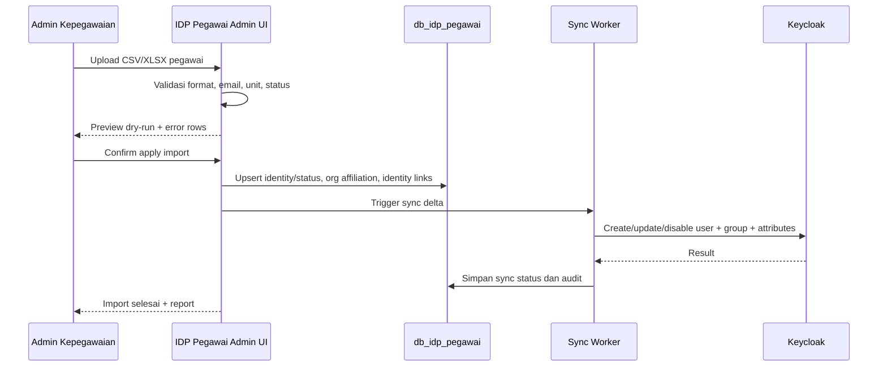
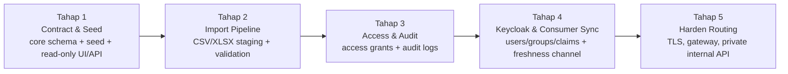

# 03 - Keycloak Access Matrix and Org Unit Seed Contract

Status: Draft contract brainstorming
Project: kumjabar_ecosystem
Date: 2026-08-26

## 1. Tujuan

Dokumen ini melanjutkan `02-organization-identity-contract.md` dengan dua kontrak awal:

1. matriks final tahap awal untuk `group -> realm role -> client role default -> token claims -> aplikasi consumer`;
2. rancangan seed awal `org_units` untuk IDP Pegawai agar bisa menjadi source of truth struktur organisasi dan sinkronisasi Keycloak.

Dokumen ini juga menetapkan pola akses/deployment awal untuk IDP Pegawai: IDP Pegawai tidak boleh diekspos lewat raw port publik. Akses browser admin boleh ada, tetapi harus lewat gateway/reverse proxy, Keycloak login, pembatasan jaringan, role admin yang ketat, dan audit log.

## 2. Domain dan Service Boundary Awal

Rekomendasi domain/service:

| Komponen | Contoh Domain | Eksposur | Fungsi |
| --- | --- | --- | --- |
| Keycloak | `https://sso-jabar.kemenkum.go.id` | publik terbatas via HTTPS | login SSO, broker Google, token OIDC |
| IDP Pegawai Admin UI | `https://idp-pegawai.sso-jabar.kemenkum.go.id` atau domain internal setara | terbatas: VPN/IP allowlist + Keycloak auth | import, validasi, update status pegawai, assignment unit |
| IDP Pegawai Internal API | internal service URL, contoh `http://idp-pegawai:8000/internal` | tidak publik; hanya container/private network | lookup/sync untuk Keycloak/worker |
| Sync Worker | internal service/cron | tidak publik | push data pegawai/org unit ke Keycloak Admin API |
| Database IDP Pegawai | `db_idp_pegawai` | tidak publik | source of truth identitas/status ASN PNS/PPPK, identity link, dan afiliasi org; bukan jabatan |

Keputusan penting:

- Jangan publish container port IDP Pegawai langsung ke internet.
- Kalau butuh browser UI untuk admin Kepegawaian, expose melalui Nginx/Gateway dengan TLS, bukan raw `:8000`.
- API internal untuk Keycloak/sync sebaiknya tidak punya DNS publik.
- Raw container port hanya berada di Docker/internal network.

## 3. Perlu Browser Admin UI atau Console/API Saja?

Rekomendasi senior engineering: gunakan dua jalur, dengan prioritas browser UI untuk operasional manusia dan API/CLI untuk otomasi.

| Jalur | Pengguna | Cocok untuk | Catatan Keamanan |
| --- | --- | --- | --- |
| Browser Admin UI | Admin Kepegawaian, TI terbatas | import pegawai, dry-run validasi, preview error, update status mutasi/pensiun, assignment unit | wajib login via Keycloak, role terbatas, audit log |
| Internal API | Keycloak bridge, sync worker, CLI internal | lookup pegawai, trigger sync, export delta, validasi otomatis | service account, network ACL, mTLS/JWT/API token |
| CLI Console | TI/ops | maintenance, batch fix, re-run sync, emergency tooling | jalan dari server/jump host, tidak untuk admin harian |

Alasannya:

- Admin Kepegawaian biasanya lebih nyaman memakai browser UI daripada console.
- Import pegawai butuh preview, validasi, download error workbook, dan audit trail; ini lebih manusiawi di UI.
- API tetap wajib ada agar sync dan otomasi tidak tergantung klik manual.
- CLI boleh ada, tapi jangan jadi satu-satunya cara operasional.

## 4. Client Keycloak Tambahan untuk IDP Pegawai Admin

Karena IDP Pegawai akan memiliki Admin UI, ia perlu client Keycloak sendiri:

| Client ID | Jenis | Status | Fungsi |
| --- | --- | --- | --- |
| `idp-pegawai-admin` | OIDC confidential | direkomendasikan saat IDP UI dibuat | login Admin UI IDP Pegawai |
| `idp-pegawai-sync` | service account/client credentials | opsional internal | worker sync IDP Pegawai -> Keycloak Admin API |

Catatan:

- `idp-pegawai-admin` berbeda dari `admin-console-support`.
- `admin-console-support` adalah client ops/admin platform umum dan opsional.
- `idp-pegawai-admin` adalah aplikasi administrasi data pegawai yang dipakai admin Kepegawaian/TI.
- Jika fase awal belum membangun UI, client ini boleh disiapkan sebagai reserved client.

## 5. Matriks Group -> Role -> Client Role -> Claim

### 5.1 Prinsip Matrix

1. Group mengikuti struktur organisasi dan segmentasi user stabil.
2. Realm role tetap sedikit: `pegawai`, `publik`, `admin_teknis`.
3. Client role default hanya memberi akses kasar ke aplikasi.
4. Operator/verifikator modul tidak otomatis ditentukan oleh unit struktur, kecuali sudah ada keputusan proses bisnis yang jelas.
5. Permission detail tetap milik aplikasi konsumen.

### 5.2 Matrix Public

| Group Keycloak | Realm Role | Client Role Default | Claim Utama | Consumer |
| --- | --- | --- | --- | --- |
| `/publik/masyarakat` | `publik` | `portal:user`, `s2:user` | `user_type=publik`, `org_group_paths=[/publik/masyarakat]`, `pegawai_uuid=null` | Portal, S2 Eksternal |

Catatan:

- Notaris, pemohon magang/penelitian, dan pemohon pewarganegaraan tidak menjadi group Keycloak awal.
- Profil/status layanan publik dikelola oleh `s2-jabar`.

### 5.3 Matrix Pegawai Umum

| Group Keycloak | Realm Role | Client Role Default | Claim Utama | Consumer |
| --- | --- | --- | --- | --- |
| `/pegawai/kanwil-jabar` | `pegawai` | `portal:user`, `s1:user` | `user_type=pegawai`, `org_group_paths`, `pegawai_uuid`, `primary_org_unit_code` | Portal, S1, aplikasi internal lain |
| `/pegawai/kanwil-jabar/divisi-yankum/*` | inherited `pegawai` | inherited/default `portal:user`, `s1:user` | `primary_org_unit_code=...`, `primary_org_unit_path=...` | Portal, S1, S2 bila diberi role operator lokal |
| `/pegawai/kanwil-jabar/divisi-p3h/*` | inherited `pegawai` | inherited/default `portal:user`, `s1:user` | `primary_org_unit_code=...`, `primary_org_unit_path=...` | Portal, S1, aplikasi internal lain |
| `/pegawai/kanwil-jabar/tum/*` | inherited `pegawai` | inherited/default `portal:user`, `s1:user` | `primary_org_unit_code=...`, `primary_org_unit_path=...` | Portal, S1, aplikasi internal lain |

Catatan implementasi Keycloak:

- Hanya base role `pegawai`, `portal:user`, dan `s1:user` yang boleh ditempel di parent group `/pegawai/kanwil-jabar` agar subgroup mewarisi akses dasar.
- Jika inheritance Keycloak/mapper tidak sesuai ekspektasi saat implementasi, sync worker boleh menempel base role tersebut langsung ke user berdasarkan eligibility dan audience aplikasi. `primary_org_unit_code` tetap claim afiliasi/ABAC, bukan sumber role pimpinan/operator/verifikator/admin.
- Jangan otomatis memberi `s2:operator` hanya karena pegawai berada di Yankum/P3H/Tum. Operator layanan publik adalah assignment/role aplikasi atau client role khusus yang diberikan setelah proses bisnis jelas.

### 5.4 Matrix Admin Kepegawaian dan TI

| Kondisi/Group | Realm Role | Client Role | Fungsi |
| --- | --- | --- | --- |
| `/pegawai/kanwil-jabar/tum/kepegawaian` + assignment admin IDP | `pegawai` | `idp-pegawai-admin:user` atau `idp-pegawai-admin:operator` | mengelola data pegawai sesuai kewenangan |
| `/pegawai/kanwil-jabar/tum/ti` + assignment admin IDP | `pegawai` | `idp-pegawai-admin:admin` | konfigurasi teknis IDP Pegawai, troubleshooting sync |
| `/admin-teknis` | `admin_teknis` | `admin-console-support:user` atau role ops terbatas | administrasi platform/realm terbatas |

Catatan:

- Jangan memberi akses admin IDP otomatis ke semua pegawai Kepegawaian/TI.
- Gunakan assignment/role eksplisit agar prinsip least privilege tetap jalan.
- Semua aksi admin harus masuk audit log.

### 5.5 Matrix Service Account

| Client/Service Account | Role/Scope | Fungsi | Catatan |
| --- | --- | --- | --- |
| `idp-pegawai-sync` | Keycloak Admin API scoped minimal | membuat/update user, group, attribute, enable/disable user | credential disimpan sebagai secret, tidak masuk repo |
| `idp-pegawai-internal-api-consumer` atau setara | internal API read/sync scope | lookup pegawai aktif, validasi email Google, export delta | tidak publik, IP allowlist/private network |

## 6. Token Claims Final Tahap Awal

### 6.1 Pegawai

```json
{
  "sub": "keycloak-user-uuid",
  "preferred_username": "nip-or-email",
  "email": "pegawai@example.go.id",
  "email_verified": true,
  "name": "Nama Pegawai",
  "user_type": "pegawai",
  "pegawai_uuid": "uuid-idp-pegawai",
  "pegawai_status": "aktif",
  "primary_org_unit_code": "TUM_TI",
  "primary_org_unit_path": "/pegawai/kanwil-jabar/tum/ti",
  "org_unit_codes": ["TUM_TI"],
  "org_group_paths": ["/pegawai/kanwil-jabar/tum/ti"],
  "workgroup_codes": [],
  "realm_access": {
    "roles": ["pegawai"]
  },
  "resource_access": {
    "kabayanpasti-portal": {
      "roles": ["portal:user"]
    },
    "s1-internal": {
      "roles": ["s1:user"]
    }
  }
}
```

### 6.2 Publik

```json
{
  "sub": "keycloak-user-uuid",
  "preferred_username": "email-google",
  "email": "masyarakat@example.com",
  "email_verified": true,
  "name": "Nama Masyarakat",
  "user_type": "publik",
  "pegawai_uuid": null,
  "pegawai_status": null,
  "primary_org_unit_code": null,
  "primary_org_unit_path": null,
  "org_unit_codes": [],
  "org_group_paths": ["/publik/masyarakat"],
  "workgroup_codes": [],
  "realm_access": {
    "roles": ["publik"]
  },
  "resource_access": {
    "kabayanpasti-portal": {
      "roles": ["portal:user"]
    },
    "s2-eksternal": {
      "roles": ["s2:user"]
    }
  }
}
```

## 7. Rancangan Seed Awal `org_units`

### 7.1 Konvensi Field Seed

Seed minimal disarankan memakai kolom:

```text
code,parent_code,slug,name,short_name,unit_type,level,path,keycloak_group_path,sort_order,is_active
```

Catatan:

- `code` adalah identifier stabil internal dan cocok untuk ABAC.
- `path` adalah path organisasi internal tanpa prefix `/pegawai`.
- `keycloak_group_path` adalah path group Keycloak lengkap.
- `uuid` sebaiknya di-generate saat seed dijalankan atau dikunci dalam fixture jika dibutuhkan stabil lintas environment.

### 7.2 Seed Rows

| code | parent_code | slug | name | short_name | unit_type | level | path | keycloak_group_path | sort_order |
| --- | --- | --- | --- | --- | --- | --- | --- | --- | --- |
| `KANWIL_JABAR` | null | `kanwil-jabar` | Kantor Wilayah Kementerian Hukum Jawa Barat | Kanwil Jabar | `kanwil` | 0 | `/kanwil-jabar` | `/pegawai/kanwil-jabar` | 10 |
| `DIV_YANKUM` | `KANWIL_JABAR` | `divisi-yankum` | Divisi Pelayanan Hukum | Yankum | `divisi` | 1 | `/kanwil-jabar/divisi-yankum` | `/pegawai/kanwil-jabar/divisi-yankum` | 20 |
| `YANKUM_AHU` | `DIV_YANKUM` | `bidang-ahu` | Bidang Administrasi Hukum Umum | AHU | `bidang` | 2 | `/kanwil-jabar/divisi-yankum/bidang-ahu` | `/pegawai/kanwil-jabar/divisi-yankum/bidang-ahu` | 21 |
| `YANKUM_KI` | `DIV_YANKUM` | `bidang-ki` | Bidang Kekayaan Intelektual | KI | `bidang` | 2 | `/kanwil-jabar/divisi-yankum/bidang-ki` | `/pegawai/kanwil-jabar/divisi-yankum/bidang-ki` | 22 |
| `DIV_P3H` | `KANWIL_JABAR` | `divisi-p3h` | Divisi Peraturan Perundang-undangan dan Pembinaan Hukum | P3H | `divisi` | 1 | `/kanwil-jabar/divisi-p3h` | `/pegawai/kanwil-jabar/divisi-p3h` | 30 |
| `P3H_SUNCANG` | `DIV_P3H` | `pokja-suncang` | Penyusun dan Perancang Peraturan Perundang-undangan | Suncang | `pokja` | 2 | `/kanwil-jabar/divisi-p3h/pokja-suncang` | `/pegawai/kanwil-jabar/divisi-p3h/pokja-suncang` | 31 |
| `P3H_BSK` | `DIV_P3H` | `pokja-bsk` | Badan Strategi Kebijakan | BSK | `pokja` | 2 | `/kanwil-jabar/divisi-p3h/pokja-bsk` | `/pegawai/kanwil-jabar/divisi-p3h/pokja-bsk` | 32 |
| `P3H_JDIH` | `DIV_P3H` | `pokja-jdih` | Jaringan Dokumentasi dan Informasi Hukum | JDIH | `pokja` | 2 | `/kanwil-jabar/divisi-p3h/pokja-jdih` | `/pegawai/kanwil-jabar/divisi-p3h/pokja-jdih` | 33 |
| `P3H_BANKUM` | `DIV_P3H` | `pokja-bankum` | Penyuluh dan Bantuan Hukum | Bankum | `pokja` | 2 | `/kanwil-jabar/divisi-p3h/pokja-bankum` | `/pegawai/kanwil-jabar/divisi-p3h/pokja-bankum` | 34 |
| `TUM` | `KANWIL_JABAR` | `tum` | Bagian Tata Usaha dan Umum | Tum | `bagian` | 1 | `/kanwil-jabar/tum` | `/pegawai/kanwil-jabar/tum` | 40 |
| `TUM_PPL` | `TUM` | `program-pelaporan` | Program dan Pelaporan | PPL | `tim` | 2 | `/kanwil-jabar/tum/program-pelaporan` | `/pegawai/kanwil-jabar/tum/program-pelaporan` | 41 |
| `TUM_KEPEGAWAIAN` | `TUM` | `kepegawaian` | Kepegawaian | Kepegawaian | `tim` | 2 | `/kanwil-jabar/tum/kepegawaian` | `/pegawai/kanwil-jabar/tum/kepegawaian` | 42 |
| `TUM_HUMAS` | `TUM` | `humas` | Hubungan Masyarakat | Humas | `tim` | 2 | `/kanwil-jabar/tum/humas` | `/pegawai/kanwil-jabar/tum/humas` | 43 |
| `TUM_TI` | `TUM` | `ti` | Teknologi dan Informasi | TI | `tim` | 2 | `/kanwil-jabar/tum/ti` | `/pegawai/kanwil-jabar/tum/ti` | 44 |
| `TUM_KEUANGAN` | `TUM` | `keuangan` | Keuangan | Keuangan | `tim` | 2 | `/kanwil-jabar/tum/keuangan` | `/pegawai/kanwil-jabar/tum/keuangan` | 45 |
| `TUM_BMN` | `TUM` | `bmn` | Barang Milik Negara | BMN | `tim` | 2 | `/kanwil-jabar/tum/bmn` | `/pegawai/kanwil-jabar/tum/bmn` | 46 |
| `TUM_SEKRETARIAT` | `TUM` | `sekretariat` | Sekretariat | Sekretariat | `tim` | 2 | `/kanwil-jabar/tum/sekretariat` | `/pegawai/kanwil-jabar/tum/sekretariat` | 47 |
| `TUM_PROTOKOLER` | `TUM` | `protokoler` | Protokoler | Protokoler | `tim` | 2 | `/kanwil-jabar/tum/protokoler` | `/pegawai/kanwil-jabar/tum/protokoler` | 48 |
| `TUM_RB_KERJASAMA` | `TUM` | `rb-kerjasama` | Reformasi Birokrasi dan Kerjasama | RB Kerjasama | `tim` | 2 | `/kanwil-jabar/tum/rb-kerjasama` | `/pegawai/kanwil-jabar/tum/rb-kerjasama` | 49 |
| `TUM_KEARSIPAN` | `TUM` | `kearsipan` | Kearsipan | Kearsipan | `tim` | 2 | `/kanwil-jabar/tum/kearsipan` | `/pegawai/kanwil-jabar/tum/kearsipan` | 50 |
| `TUM_PENGADUAN` | `TUM` | `pengaduan` | Pengaduan | Pengaduan | `tim` | 2 | `/kanwil-jabar/tum/pengaduan` | `/pegawai/kanwil-jabar/tum/pengaduan` | 51 |

## 8. Lifecycle Pegawai dan Efek ke Keycloak

Status pegawai minimal:

| status_pegawai | is_active | Efek ke Keycloak | Catatan |
| --- | --- | --- | --- |
| `aktif` | true | user enabled, group/role aktif | boleh login internal |
| `mutasi_keluar` | false | user disabled atau akses internal dicabut | data histori tetap disimpan |
| `pensiun` | false | user disabled | jangan delete user agar audit tetap utuh |
| `nonaktif` | false | user disabled sementara/permanen sesuai kasus | perlu alasan dan audit |
| `meninggal` | false | user disabled | opsional sesuai kebutuhan data |

Prinsip:

- Jangan menghapus user Keycloak untuk pegawai nonaktif; disable saja.
- Saat mutasi/pensiun, cabut group internal dan/atau disable user.
- Jika user masih perlu akses publik, identitas publik dapat tetap ada, tetapi akses internal harus tidak aktif.
- Semua perubahan status harus tercatat di audit log IDP Pegawai.

## 9. Import dan Sync Flow

### 9.1 Import Pegawai via Admin UI



### 9.2 Sync ke Keycloak

Fase awal yang disarankan:

1. IDP Pegawai menjadi source of truth field identitas ASN, eligibility/status, identity link, dan afiliasi organisasi; bukan jabatan.
2. Admin mengelola data di IDP Pegawai.
3. Sync worker push perubahan ke Keycloak Admin API.
4. Keycloak token mapper mengeluarkan claim sesuai data user attribute/group.
5. Aplikasi konsumen membaca token dan melakukan mapping lokal.

Kenapa bukan live lookup setiap login dulu?

- Lebih sederhana untuk fase awal.
- Lebih sedikit custom Keycloak SPI/authenticator.
- Lebih mudah diuji dan dioperasikan.
- Jika nanti butuh real-time validation, baru tambahkan custom authenticator atau identity bridge.

## 10. Google Login Cross-check Pegawai

Fase awal paling aman:

1. Email Google pegawai disimpan/ditautkan di IDP Pegawai.
2. Sync worker memastikan user Keycloak pegawai memiliki attribute `pegawai_uuid`, `user_type=pegawai`, dan email terkait.
3. Saat user login via Google, Keycloak broker flow tidak boleh otomatis memberi akses internal kecuali akun tersebut sudah terhubung ke pegawai aktif.
4. Jika email Google belum cocok dengan pegawai aktif, user masuk sebagai publik atau perlu verifikasi manual.

Catatan:

- Jangan hanya percaya domain email.
- Gunakan `email_verified=true`.
- Siapkan proses admin untuk linking/unlinking email Google pegawai.
- Untuk fase lanjut, boleh dibuat custom broker flow yang melakukan lookup langsung ke IDP Pegawai.

## 11. Rekomendasi Tahapan Implementasi

Status update 2026-08-27: daftar tahap di bawah adalah versi awal dari dokumen 03. Roadmap yang lebih runut sudah dipertajam pada dokumen `04`-`09`:



Koreksi atas versi awal:

1. Tahap 1 bukan CRUD penuh; Tahap 1 adalah contract, seed, model/repository/service design, Admin UI read-only, dan Internal API read-only.
2. Import CSV/XLSX masuk Tahap 2, bukan bagian dari UI awal Tahap 1.
3. Access grant dan audit penuh masuk Tahap 3 sebelum mutasi data sensitif dibuat nyaman di UI.
4. Sync Keycloak dan kanal consumer sync/freshness masuk Tahap 4 setelah foundation data, import, access, dan audit matang.
5. Hardening routing/gateway final masuk Tahap 5, walaupun prinsip aman sudah ditetapkan sejak awal.

Update 2026-08-26: schema detail IDP Pegawai dan opsi akses fallback jika subdomain berlevel tidak tersedia dilanjutkan di `04-idp-pegawai-schema-and-access-ui.md`.

Update 2026-08-27: detail Tahap 1 dilanjutkan pada dokumen `05`-`09`, dan akan dikunci untuk review pada `10-idp-pegawai-stage-1-review-checklist-open-decisions.md`.
