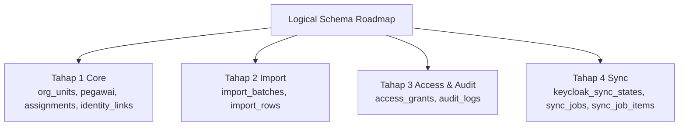

# 04 - IDP Pegawai Schema and Secure Admin UI Access

Status: Draft contract brainstorming
Project: kumjabar_ecosystem
Date: 2026-08-26

## 1. Tujuan

Dokumen ini merinci rancangan schema database IDP Pegawai dan opsi akses aman untuk Admin UI IDP Pegawai bila subdomain seperti `idp-pegawai.sso-jabar.kemenkum.go.id` belum/ tidak bisa disediakan oleh Pusdatin.

Fokus dokumen:

1. opsi routing aman untuk IDP Pegawai Admin UI tanpa raw public port;
2. schema detail untuk data organisasi, pegawai, assignment, identity link, import, sync, dan audit;
3. kontrak lifecycle pegawai terhadap Keycloak;
4. dasar implementasi repo `kumjabar-sso` pada fase berikutnya.

## 2. Prinsip Akses Aman IDP Pegawai

IDP Pegawai berisi data sensitif pegawai. Karena itu:

1. jangan publish raw container port IDP Pegawai ke internet;
2. semua akses browser harus melalui HTTPS reverse proxy/gateway;
3. Admin UI wajib login lewat Keycloak;
4. akses admin dibatasi role/assignment eksplisit;
5. Internal API tidak boleh bisa diakses publik;
6. semua aksi import/update/status/sync dicatat audit log;
7. secret service account tidak masuk repository.

## 3. Opsi Akses Jika Subdomain Berlevel Tidak Tersedia

### 3.1 Opsi A - Subdomain Khusus, Ideal Jika Disetujui

```text
https://sso-jabar.kemenkum.go.id
-> Keycloak

https://idp-pegawai.sso-jabar.kemenkum.go.id
-> IDP Pegawai Admin UI
```

Kelebihan:

- boundary jelas;
- konfigurasi cookie/session lebih sederhana;
- redirect URI OIDC lebih rapi;
- log dan monitoring mudah dibedakan.

Kekurangan:

- tergantung approval DNS/TLS dari Pusdatin;
- wildcard/subdomain berlevel mungkin tidak diizinkan.

### 3.2 Opsi B - Path-Based Routing pada Domain SSO, Rekomendasi Fallback

Jika Pusdatin hanya memberi satu domain, gunakan path di bawah domain SSO:

```text
https://sso-jabar.kemenkum.go.id/
-> Keycloak

https://sso-jabar.kemenkum.go.id/idp-pegawai/
-> IDP Pegawai Admin UI
```

Ini fallback paling realistis selama domain diarahkan dulu ke Nginx/Gateway, bukan langsung ke container Keycloak.

Contoh boundary gateway:

```text
Nginx/Gateway
├── /realms/*             -> Keycloak
├── /admin/*              -> Keycloak Admin Console
├── /resources/*          -> Keycloak static resources
├── /idp-pegawai/*        -> IDP Pegawai Admin UI
└── /idp-pegawai/internal -> DENY from public
```

Catatan implementasi penting:

- IDP Pegawai harus mendukung base path `/idp-pegawai`.
- Redirect URI client `idp-pegawai-admin` menjadi:

```text
https://sso-jabar.kemenkum.go.id/idp-pegawai/auth/callback
```

- Cookie IDP Pegawai harus dibatasi:

```text
Path=/idp-pegawai
Secure=true
HttpOnly=true
SameSite=Lax
```

- Internal API jangan berada di path publik yang sama tanpa proteksi. Jika tetap perlu path publik untuk health check, pisahkan:

```text
/idp-pegawai/healthz -> boleh terbatas
/idp-pegawai/internal/* -> deny publik
```

Kelebihan:

- tidak butuh subdomain tambahan;
- tetap nyaman untuk operator via browser;
- masih bisa HTTPS resmi dari domain SSO;
- cocok untuk keterbatasan kontrol DNS.

Kekurangan:

- perlu disiplin reverse proxy path;
- aplikasi IDP harus aware base path;
- cookie/header/redirect harus dites hati-hati.

### 3.3 Opsi C - Domain Aplikasi Non-Berlevel Jika Pusdatin Lebih Mudah Approve

Jika subdomain berlevel tidak boleh, kadang domain paralel lebih mungkin:

```text
https://sso-jabar.kemenkum.go.id
https://idp-pegawai-jabar.kemenkum.go.id
```

Ini tetap bagus jika Pusdatin mengizinkan satu label subdomain langsung di bawah `kemenkum.go.id`.

### 3.4 Opsi D - VPN/Internal Only

Jika UI benar-benar tidak boleh diakses publik:

```text
https://internal-sso-jabar/idp-pegawai/
atau
https://10.x.x.x/idp-pegawai/
```

Hanya bisa dibuka dari jaringan kantor/VPN Pusdatin.

Kelebihan:

- paling aman dari sisi exposure publik;
- cocok untuk data sensitif.

Kekurangan:

- operator harus berada di jaringan/VPN;
- akses remote lebih sulit;
- perlu dukungan Pusdatin untuk VPN/allowlist.

### 3.5 Rekomendasi Praktis

Urutan rekomendasi:

1. minta subdomain khusus: `idp-pegawai.sso-jabar.kemenkum.go.id`;
2. jika tidak bisa, gunakan path-based routing: `https://sso-jabar.kemenkum.go.id/idp-pegawai/`;
3. jika domain SSO tidak boleh bercampur, minta domain paralel: `idp-pegawai-jabar.kemenkum.go.id`;
4. jika exposure publik dilarang, gunakan VPN/internal-only.

Yang tidak direkomendasikan:

```text
http://server-ip:8000
https://sso-jabar.kemenkum.go.id:8000
```

## 4. Logical Schema Overview

Status update 2026-08-27: logical schema di dokumen ini menggambarkan **roadmap penuh IDP Pegawai**, bukan berarti semua tabel langsung masuk Tahap 1. Pembagian tahap yang lebih runut adalah:



Dokumen `05`-`09` memperinci Tahap 1 sebagai contract & seed berbasis Flask + SQLAlchemy + Alembic, dengan Admin UI/Internal API read-only dan freshness metadata/hash untuk consumer.

Schema IDP Pegawai dibagi menjadi beberapa area:

```text
Core master data:
- org_units
- pegawai
- pegawai_org_assignments
- pegawai_identity_links

Access/admin assignment:
- access_grants

Import pipeline:
- import_batches
- import_rows

Keycloak sync:
- keycloak_sync_states
- sync_jobs
- sync_job_items

Audit:
- audit_logs
```

## 5. Enum / Lookup Konseptual

Tidak wajib langsung memakai PostgreSQL enum. Untuk fleksibilitas migration, fase awal boleh memakai `varchar` + check constraint atau lookup table.

### 5.1 `unit_type`

```text
kanwil
divisi
bidang
bagian
pokja
tim
```

### 5.2 `status_pegawai`

```text
aktif
mutasi_keluar
pensiun
nonaktif
meninggal
```

### 5.3 `assignment_type`

```text
primary
additional
```

`assignment_type` hanya menyatakan afiliasi organisasi. Jabatan, PLT, operator, dan admin aplikasi bukan domain tabel assignment ini.

### 5.4 `access_target_type`

```text
client_role
realm_role
app_capability
```

### 5.5 `import_status`

> **Superseded untuk Tahap 2:** daftar ringkas di bawah adalah arah awal. Lifecycle canonical aktif mengikuti Dokumen 13 §6.3–6.4 yang menambahkan quarantine, registration, mapping, staging, rejection, dan partial-apply state.

```text
uploaded
validating
validated
ready_to_apply
applying
applied
failed
cancelled
```

### 5.6 `sync_status`

```text
pending
running
success
partial_failed
failed
cancelled
```

## 6. Tabel `org_units`

Fungsi: source of truth struktur organisasi internal yang akan disinkronkan menjadi Keycloak group dan dipakai aplikasi consumer sebagai actor attribute.

Kolom:

| Kolom | Tipe Konseptual | Wajib | Catatan |
| --- | --- | --- | --- |
| `id` | bigserial/bigint PK | ya | PK internal ORM |
| `uuid` | uuid unique | ya | identitas stabil lintas sistem |
| `parent_id` | FK `org_units.id` nullable | tidak | parent-child tree |
| `code` | varchar unique | ya | kode stabil, contoh `TUM_TI` |
| `slug` | varchar | ya | segment path, contoh `ti` |
| `name` | varchar | ya | nama lengkap unit |
| `short_name` | varchar nullable | tidak | contoh `TI`, `AHU` |
| `unit_type` | varchar/check | ya | `kanwil`, `divisi`, `bidang`, `bagian`, `pokja`, `tim` |
| `level` | integer | ya | kedalaman tree |
| `path` | varchar unique | ya | `/kanwil-jabar/tum/ti` |
| `keycloak_group_path` | varchar unique | ya | `/pegawai/kanwil-jabar/tum/ti` |
| `sort_order` | integer | ya | urutan tampilan |
| `is_active` | boolean | ya | unit aktif/tidak |
| `effective_from` | date nullable | tidak | awal berlaku |
| `effective_to` | date nullable | tidak | akhir berlaku |
| `metadata` | jsonb | ya, default `{}` | source snapshot struktur organisasi; bukan jabatan/PLT/PLH |
| `created_at` | timestamptz | ya | audit timestamp |
| `updated_at` | timestamptz | ya | audit timestamp |
| `deleted_at` | timestamptz nullable | tidak | soft delete |

Index/constraint:

```text
unique(uuid)
unique(code) where deleted_at is null
unique(path) where deleted_at is null
unique(keycloak_group_path) where deleted_at is null
index(parent_id)
index(unit_type)
index(is_active)
```

Catatan:

- `code` jangan berubah sembarangan karena akan dipakai ABAC dan mapping aplikasi.
- Jika nama unit berubah, `name` boleh berubah, tetapi `code` sebaiknya tetap.
- Jika struktur berubah besar, gunakan `effective_to` dan buat unit baru bila perlu menjaga histori.

## 7. Tabel `pegawai`

Fungsi: source of truth identitas ASN internal (PNS/PPPK), lifecycle/status, dan eligibility akses internal; bukan source jabatan.

Kolom:

| Kolom | Tipe Konseptual | Wajib | Catatan |
| --- | --- | --- | --- |
| `id` | bigserial/bigint PK | ya | PK internal ORM |
| `uuid` | uuid unique | ya | claim `pegawai_uuid` |
| `nip` | varchar(18) | ya | identitas ASN PNS/PPPK; tepat 18 karakter digit |
| `nama_lengkap` | varchar | ya | nama pegawai |
| `gelar_depan` | varchar nullable | tidak | opsional |
| `gelar_belakang` | varchar nullable | tidak | opsional |
| `email_dinas` | varchar nullable | tidak | email resmi |
| `email_google` | varchar nullable | tidak | email Google untuk social login/linking |
| `no_hp` | varchar nullable | tidak | opsional, jangan wajib awal |
| `primary_org_unit_id` | FK `org_units.id` nullable | tidak | unit utama aktif |
| `status_pegawai` | varchar/check | ya | `aktif`, `mutasi_keluar`, `pensiun`, `nonaktif`, `meninggal` |
| `is_active` | boolean | ya | eligibility akses internal |
| `status_reason` | text nullable | tidak | alasan perubahan status |
| `status_effective_at` | date/timestamptz nullable | tidak | tanggal berlaku status |
| `keycloak_user_id` | uuid/varchar nullable | tidak | ID user Keycloak bila sudah tersinkron |
| `metadata` | jsonb | ya, default `{}` | source snapshot identitas; bukan jabatan/PLT/PLH |
| `created_at` | timestamptz | ya | audit timestamp |
| `updated_at` | timestamptz | ya | audit timestamp |
| `deleted_at` | timestamptz nullable | tidak | soft delete |

Index/constraint:

```text
unique(uuid)
unique(nip) where deleted_at is null
check(nip ~ '^[0-9]{18}$')
unique(email_dinas_lower) where email_dinas is not null and deleted_at is null
unique(email_google_lower) where email_google is not null and deleted_at is null
index(primary_org_unit_id)
index(status_pegawai)
index(is_active)
index(keycloak_user_id)
```

Catatan implementasi:

- Simpan email dalam bentuk asli, tapi siapkan normalized/lowercase generated column atau kolom tambahan untuk unique lookup.
- `nip` disimpan sebagai string `varchar(18)`, bukan numeric, dan wajib cocok regex `^[0-9]{18}$`.
- IDP Pegawai hanya mencakup ASN PNS dan PPPK; Non-ASN/PPNPN tidak masuk scope.
- `is_active` diturunkan deterministik dari `status_pegawai`: `aktif -> true`, status lifecycle lain -> `false`.
- `is_active=false` berarti tidak boleh mendapat akses internal aktif.
- User pensiun/mutasi jangan dihapus; disable/cabut akses di Keycloak.

## 8. Tabel `pegawai_org_assignments`

Fungsi: menyimpan histori afiliasi dan assignment tambahan pegawai ke unit/pokja/tim organisasi.

Kolom:

| Kolom | Tipe Konseptual | Wajib | Catatan |
| --- | --- | --- | --- |
| `id` | bigserial/bigint PK | ya | PK internal |
| `uuid` | uuid unique | ya | identitas assignment |
| `pegawai_id` | FK `pegawai.id` | ya | pegawai |
| `org_unit_id` | FK `org_units.id` | ya | unit/pokja/tim |
| `assignment_type` | varchar/check | ya | `primary` atau `additional`; afiliasi organisasi saja |
| `is_primary` | boolean | ya | true untuk unit utama bila dicatat di sini |
| `is_active` | boolean | ya | assignment aktif/tidak |
| `started_at` | date nullable | tidak | mulai berlaku |
| `ended_at` | date nullable | tidak | selesai berlaku |
| `metadata` | jsonb | ya, default `{}` | atribut afiliasi organisasi; bukan jabatan/PLT/PLH |
| `created_at` | timestamptz | ya | audit timestamp |
| `updated_at` | timestamptz | ya | audit timestamp |
| `deleted_at` | timestamptz nullable | tidak | soft delete |

Index/constraint:

```text
index(pegawai_id)
index(org_unit_id)
index(assignment_type)
index(is_active)
unique active primary assignment per pegawai
```

Catatan:

- `pegawai.primary_org_unit_id` tetap menjadi shortcut unit utama saat ini.
- `pegawai_org_assignments` menyimpan histori/assignment tambahan.
- Assignment tambahan hanya mencatat afiliasi ke unit organisasi tambahan. Jabatan, jenis/label jabatan, PLT/PLH, dan historinya dikelola modul kepegawaian consumer. Role operator/admin dikelola terpisah melalui `access_grants` atau policy lokal aplikasi; keduanya bukan domain IDP core assignment.

## 9. Tabel `pegawai_identity_links`

Fungsi: menghubungkan pegawai dengan provider identity seperti Keycloak dan Google.

Kolom:

| Kolom | Tipe Konseptual | Wajib | Catatan |
| --- | --- | --- | --- |
| `id` | bigserial/bigint PK | ya | PK internal |
| `uuid` | uuid unique | ya | identitas link |
| `pegawai_id` | FK `pegawai.id` | ya | pegawai |
| `provider` | varchar | ya | `keycloak`, `google`, `microsoft`, dll |
| `provider_subject` | varchar nullable | tidak | subject/id provider |
| `email` | varchar nullable | tidak | email saat linking |
| `email_normalized` | varchar nullable | tidak | lowercase untuk lookup |
| `email_verified` | boolean | ya | dari provider |
| `is_active` | boolean | ya | link aktif/tidak |
| `linked_at` | timestamptz nullable | tidak | waktu link |
| `last_seen_at` | timestamptz nullable | tidak | login terakhir via provider |
| `metadata` | jsonb | ya, default `{}` | payload ringkas provider |
| `created_at` | timestamptz | ya | audit timestamp |
| `updated_at` | timestamptz | ya | audit timestamp |

Index/constraint:

```text
unique(provider, provider_subject) where provider_subject is not null
unique(provider, email_normalized) where email_normalized is not null and is_active = true
index(pegawai_id)
index(provider)
index(email_normalized)
```

Catatan:

- Google login pegawai harus cocok dengan link aktif dan `email_verified=true`.
- Perubahan email harus audited.
- Jangan otomatis trust domain email tanpa match ke pegawai aktif.

## 10. Tabel `access_grants`

Fungsi: menyimpan assignment eksplisit untuk akses admin/aplikasi yang tidak boleh otomatis diberikan hanya dari unit organisasi.

Contoh pemakaian:

- pegawai Kepegawaian tertentu diberi `idp-pegawai-admin:operator`;
- pegawai TI tertentu diberi `idp-pegawai-admin:admin`;
- operator tertentu diberi client role `s2:operator`.

Kolom:

| Kolom | Tipe Konseptual | Wajib | Catatan |
| --- | --- | --- | --- |
| `id` | bigserial/bigint PK | ya | PK internal |
| `uuid` | uuid unique | ya | identitas grant |
| `pegawai_id` | FK `pegawai.id` | ya | penerima akses |
| `target_type` | varchar/check | ya | `client_role`, `realm_role`, `app_capability` |
| `client_id` | varchar nullable | tidak | contoh `idp-pegawai-admin`, `s2-eksternal` |
| `role_code` | varchar | ya | contoh `idp-pegawai-admin:operator` |
| `scope_org_unit_id` | FK `org_units.id` nullable | tidak | jika grant terbatas unit |
| `is_active` | boolean | ya | status grant |
| `granted_by_pegawai_id` | FK nullable | tidak | pemberi akses |
| `grant_reason` | text nullable | tidak | alasan pemberian |
| `started_at` | timestamptz nullable | tidak | mulai berlaku |
| `expires_at` | timestamptz nullable | tidak | expiry opsional |
| `revoked_at` | timestamptz nullable | tidak | waktu cabut |
| `revoked_by_pegawai_id` | FK nullable | tidak | pencabut |
| `metadata` | jsonb | ya, default `{}` | tambahan |
| `created_at` | timestamptz | ya | audit timestamp |
| `updated_at` | timestamptz | ya | audit timestamp |

Index/constraint:

```text
index(pegawai_id)
index(client_id)
index(role_code)
index(is_active)
unique active grant per pegawai_id + target_type + client_id + role_code + scope_org_unit_id
```

Catatan:

- Unit kerja bukan otomatis admin.
- Akses sensitif harus lewat grant eksplisit.
- Sync worker dapat membaca tabel ini untuk memberi client role tertentu di Keycloak.

## 11. Import Pipeline

Import bukan sekadar upload file. Import harus staging dulu, validasi, baru apply.

### 11.1 Tabel `import_batches`

> **Superseded untuk implementasi Tahap 2:** draft ringkas §11.1–11.2 dipertahankan sebagai konteks roadmap. Kontrak schema aktif dan lebih rinci mengikuti Dokumen 13.

Fungsi: header batch import CSV/XLSX.

Kolom:

| Kolom | Tipe Konseptual | Wajib | Catatan |
| --- | --- | --- | --- |
| `id` | bigserial/bigint PK | ya | PK internal |
| `uuid` | uuid unique | ya | identitas batch |
| `import_type` | varchar | ya | `pegawai`, `org_units`, `identity_links`, dll |
| `status` | varchar/check | ya | lifecycle batch |
| `original_filename` | varchar | ya | nama file upload |
| `stored_file_path` | varchar nullable | tidak | path object/local storage |
| `file_hash_sha256` | varchar | ya | dedupe/audit |
| `uploaded_by_pegawai_id` | FK nullable | tidak | uploader |
| `validated_by_pegawai_id` | FK nullable | tidak | validator bila ada |
| `applied_by_pegawai_id` | FK nullable | tidak | approver/apply |
| `mapping_snapshot` | jsonb | ya, default `{}` | mapping kolom file ke field sistem |
| `summary` | jsonb | ya, default `{}` | total rows, valid, error, insert, update |
| `error_report_path` | varchar nullable | tidak | workbook error bila ada |
| `uploaded_at` | timestamptz | ya | waktu upload |
| `validated_at` | timestamptz nullable | tidak | waktu validasi |
| `applied_at` | timestamptz nullable | tidak | waktu apply |
| `created_at` | timestamptz | ya | audit timestamp |
| `updated_at` | timestamptz | ya | audit timestamp |

Index:

```text
index(import_type)
index(status)
index(uploaded_by_pegawai_id)
index(file_hash_sha256)
```

### 11.2 Tabel `import_rows`

Fungsi: staging row-level data import.

Kolom:

| Kolom | Tipe Konseptual | Wajib | Catatan |
| --- | --- | --- | --- |
| `id` | bigserial/bigint PK | ya | PK internal |
| `batch_id` | FK `import_batches.id` | ya | batch |
| `row_number` | integer | ya | nomor baris file |
| `raw_payload` | jsonb | ya | data mentah per row |
| `normalized_payload` | jsonb | ya, default `{}` | data hasil mapping/normalisasi |
| `validation_status` | varchar | ya | `pending`, `valid`, `error`, `warning` |
| `validation_errors` | jsonb | ya, default `[]` | error detail |
| `detected_action` | varchar nullable | tidak | `insert`, `update`, `disable`, `noop` |
| `target_entity_type` | varchar nullable | tidak | contoh `pegawai` |
| `target_entity_id` | bigint nullable | tidak | target local row jika update |
| `applied_at` | timestamptz nullable | tidak | waktu row diaplikasikan |
| `created_at` | timestamptz | ya | audit timestamp |
| `updated_at` | timestamptz | ya | audit timestamp |

Index/constraint:

```text
unique(batch_id, row_number)
index(batch_id)
index(validation_status)
index(detected_action)
```

Catatan:

- Error workbook dihasilkan dari `import_rows.validation_errors`.
- Date/email/status/unit wajib dinormalisasi eksplisit.
- Apply harus idempotent semampu mungkin berdasarkan identifier stabil seperti `nip` atau `uuid`.

## 12. Keycloak Sync Tables

### 12.1 Tabel `keycloak_sync_states`

Fungsi: menyimpan state mapping local entity ke Keycloak entity agar sync delta efisien.

Kolom:

| Kolom | Tipe Konseptual | Wajib | Catatan |
| --- | --- | --- | --- |
| `id` | bigserial/bigint PK | ya | PK internal |
| `entity_type` | varchar | ya | `pegawai`, `org_unit`, `access_grant` |
| `entity_id` | bigint | ya | local entity id |
| `keycloak_entity_type` | varchar | ya | `user`, `group`, `role_assignment` |
| `keycloak_id` | varchar nullable | tidak | ID dari Keycloak |
| `last_payload_hash` | varchar nullable | tidak | hash payload terakhir yang disync |
| `last_synced_at` | timestamptz nullable | tidak | waktu sync terakhir |
| `sync_status` | varchar | ya | `pending`, `success`, `failed` |
| `last_error` | text nullable | tidak | error terakhir |
| `metadata` | jsonb | ya, default `{}` | tambahan |
| `created_at` | timestamptz | ya | audit timestamp |
| `updated_at` | timestamptz | ya | audit timestamp |

Constraint/index:

```text
unique(entity_type, entity_id, keycloak_entity_type)
index(sync_status)
index(keycloak_id)
```

### 12.2 Tabel `sync_jobs`

Fungsi: header pekerjaan sync ke Keycloak.

Kolom:

| Kolom | Tipe Konseptual | Wajib | Catatan |
| --- | --- | --- | --- |
| `id` | bigserial/bigint PK | ya | PK internal |
| `uuid` | uuid unique | ya | identitas job |
| `job_type` | varchar | ya | `full`, `delta`, `pegawai`, `org_units`, `access_grants` |
| `status` | varchar/check | ya | `pending`, `running`, `success`, `partial_failed`, `failed` |
| `triggered_by` | varchar | ya | `manual`, `import_batch`, `schedule`, `system` |
| `triggered_by_pegawai_id` | FK nullable | tidak | user pemicu |
| `import_batch_id` | FK nullable | tidak | jika dipicu import |
| `summary` | jsonb | ya, default `{}` | count success/error |
| `started_at` | timestamptz nullable | tidak | mulai |
| `finished_at` | timestamptz nullable | tidak | selesai |
| `created_at` | timestamptz | ya | audit timestamp |
| `updated_at` | timestamptz | ya | audit timestamp |

Index:

```text
index(job_type)
index(status)
index(triggered_by)
index(import_batch_id)
```

### 12.3 Tabel `sync_job_items`

Fungsi: detail row-level/entity-level hasil sync.

Kolom:

| Kolom | Tipe Konseptual | Wajib | Catatan |
| --- | --- | --- | --- |
| `id` | bigserial/bigint PK | ya | PK internal |
| `sync_job_id` | FK `sync_jobs.id` | ya | job |
| `entity_type` | varchar | ya | `pegawai`, `org_unit`, `access_grant` |
| `entity_id` | bigint | ya | local entity |
| `operation` | varchar | ya | `create`, `update`, `disable`, `assign_role`, `remove_role`, `noop` |
| `status` | varchar | ya | `pending`, `success`, `failed`, `skipped` |
| `request_payload` | jsonb | ya, default `{}` | payload yang dikirim, jangan simpan secret |
| `response_payload` | jsonb | ya, default `{}` | response ringkas |
| `error_message` | text nullable | tidak | error jika gagal |
| `created_at` | timestamptz | ya | audit timestamp |
| `updated_at` | timestamptz | ya | audit timestamp |

Index:

```text
index(sync_job_id)
index(entity_type, entity_id)
index(status)
index(operation)
```

## 13. Audit Log

### 13.1 Tabel `audit_logs`

Fungsi: jejak audit semua aksi penting operator/sistem.

Kolom:

| Kolom | Tipe Konseptual | Wajib | Catatan |
| --- | --- | --- | --- |
| `id` | bigserial/bigint PK | ya | PK internal |
| `uuid` | uuid unique | ya | audit event id |
| `actor_type` | varchar | ya | `pegawai`, `service_account`, `system` |
| `actor_pegawai_id` | FK nullable | tidak | actor manusia |
| `actor_subject` | varchar nullable | tidak | Keycloak sub/service account |
| `action` | varchar | ya | contoh `pegawai.update_status`, `import.apply` |
| `entity_type` | varchar | ya | target entity |
| `entity_id` | bigint nullable | tidak | target id |
| `before_payload` | jsonb | ya, default `{}` | snapshot sebelum |
| `after_payload` | jsonb | ya, default `{}` | snapshot sesudah |
| `request_id` | varchar nullable | tidak | korelasi request |
| `ip_address` | inet/varchar nullable | tidak | IP operator |
| `user_agent` | text nullable | tidak | browser/client |
| `created_at` | timestamptz | ya | waktu event |

Index:

```text
index(actor_pegawai_id)
index(actor_subject)
index(action)
index(entity_type, entity_id)
index(created_at)
index(request_id)
```

Catatan:

- Jangan simpan password/token/secret di audit payload.
- Untuk perubahan status pegawai, audit wajib menyimpan before/after status.
- Untuk import, audit menyimpan batch id dan summary, bukan seluruh file mentah jika terlalu besar.

## 14. Status Pegawai dan Efek Sync ke Keycloak

| status_pegawai | is_active | Keycloak user | Group internal | Client role internal | Catatan |
| --- | --- | --- | --- | --- | --- |
| `aktif` | true | enabled | sesuai org unit | base role `pegawai`/client user | boleh akses dasar internal; bukan role jabatan |
| `mutasi_keluar` | false | disabled atau internal access revoked | dicabut/disabled | dicabut | histori tetap ada |
| `pensiun` | false | disabled | dicabut | dicabut | jangan delete |
| `nonaktif` | false | disabled | dicabut sesuai kebijakan | dicabut | bisa sementara/permanen |
| `meninggal` | false | disabled | dicabut | dicabut | opsional data lifecycle |

Prinsip:

- disable lebih aman daripada delete;
- jangan hilangkan referensi `created_by`/audit historis;
- jika user yang sama tetap perlu layanan publik, pisahkan akses internal dari status akun publik.
- role pimpinan/operator/verifikator/admin tidak berasal dari `status_pegawai`, org group, atau jabatan; gunakan grant eksplisit yang diaudit/policy lokal consumer.

## 15. Minimal API Contract Internal

Internal API tidak publik. Digunakan sync worker, CLI ops, atau integration bridge.

Endpoint konseptual:

```text
GET  /internal/pegawai/by-email?email=...
GET  /internal/pegawai/{uuid}
GET  /internal/org-units
POST /internal/sync/keycloak/trigger
GET  /internal/sync/jobs/{uuid}
```

Keamanan:

- hanya private network;
- service account/JWT/mTLS/API token;
- rate limit;
- audit log untuk endpoint mutating;
- jangan expose `/internal/*` lewat public reverse proxy.

## 16. Minimal Admin UI Screens

Admin UI fase awal cukup sederhana:

```text
Dashboard
- ringkasan pegawai aktif/nonaktif
- status sync terakhir
- batch import terakhir

Org Units
- tree/list unit
- read-only atau admin-only edit

Pegawai
- list/filter pegawai
- detail pegawai
- edit status dan unit utama
- assignment tambahan
- identity links Google/Keycloak

Import Pegawai
- upload file
- mapping kolom
- dry-run validation
- preview errors
- apply import
- download error workbook

Sync Keycloak
- lihat sync jobs
- trigger delta sync
- retry failed items

Audit Log
- filter actor/action/entity/date
```

## 17. Routing Fallback Nginx Konseptual

Jika memakai path-based fallback:

```nginx
# Konseptual, bukan konfigurasi final produksi.
server {
    listen 443 ssl;
    server_name sso-jabar.kemenkum.go.id;

    location /idp-pegawai/internal/ {
        deny all;
        return 403;
    }

    location /idp-pegawai/ {
        proxy_pass http://idp-pegawai:8000/;
        proxy_set_header Host $host;
        proxy_set_header X-Forwarded-Host $host;
        proxy_set_header X-Forwarded-Proto https;
        proxy_set_header X-Forwarded-Prefix /idp-pegawai;
    }

    location / {
        proxy_pass http://keycloak:8080/;
        proxy_set_header Host $host;
        proxy_set_header X-Forwarded-Host $host;
        proxy_set_header X-Forwarded-Proto https;
    }
}
```

Catatan:

- Ini hanya ilustrasi boundary; konfigurasi final harus disesuaikan standar Pusdatin.
- Pastikan Keycloak dikonfigurasi benar untuk reverse proxy.
- Pastikan IDP Pegawai membaca `X-Forwarded-Prefix` atau config base path.

## 18. Rekomendasi Implementasi Bertahap

Tahap 1 - Contract & Seed:

- migration tabel core: `org_units`, `pegawai`, `pegawai_org_assignments`, `pegawai_identity_links`;
- seed awal `org_units`;
- Admin UI read-only/list/detail minimal;
- Internal API read-only untuk lookup awal;
- freshness metadata/hash konseptual agar aplikasi consumer seperti `s1-jabar` bisa mendeteksi snapshot fresh/stale.

Tahap 2 - Import Pipeline:

- `import_batches`, `import_rows`;
- upload CSV/XLSX;
- dry-run validation;
- apply import;
- error workbook.

Tahap 3 - Access & Audit:

- `access_grants`;
- `audit_logs`;
- capability-aware Admin UI.

Tahap 4 - Keycloak & Consumer Sync:

- `keycloak_sync_states`, `sync_jobs`, `sync_job_items`;
- sync org unit -> group;
- sync pegawai -> user/attributes/groups;
- sync access grants -> client roles;
- kanal sinkronisasi consumer untuk aplikasi seperti `s1-jabar` agar snapshot lokal bisa mendeteksi fresh/stale lewat `payload_hash`, `contract_version`, `source_updated_at`, dan future cursor/delta feed.

Tahap 5 - Harden Routing:

- domain/subdomain/path routing final;
- TLS, security headers, IP allowlist/VPN bila ada;
- block public `/internal/*`;
- monitoring/logging.
