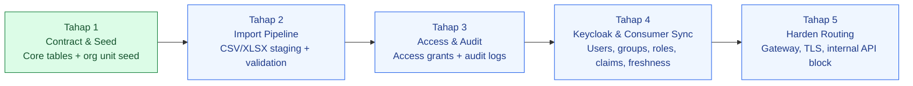
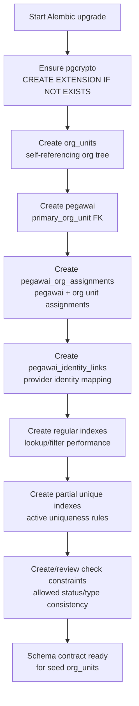
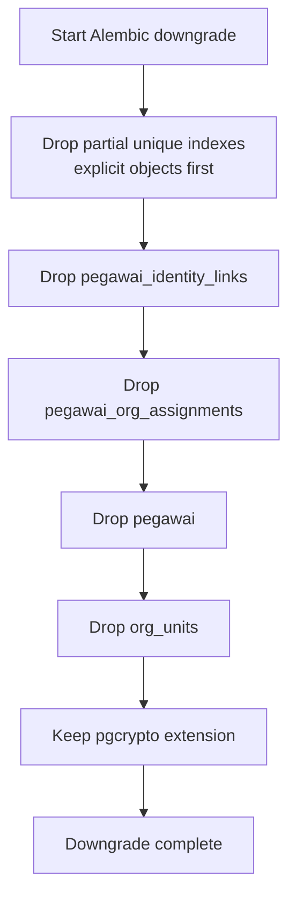
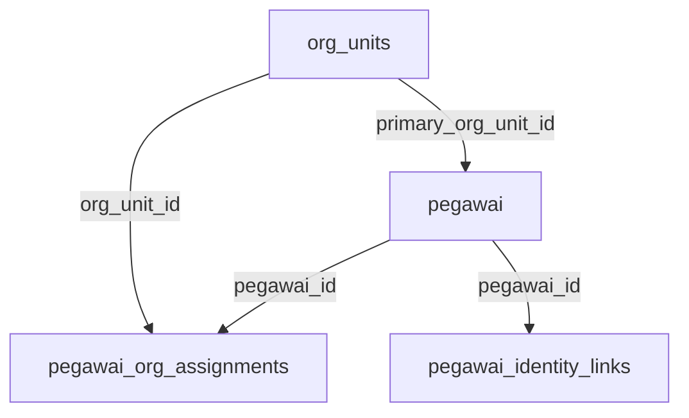
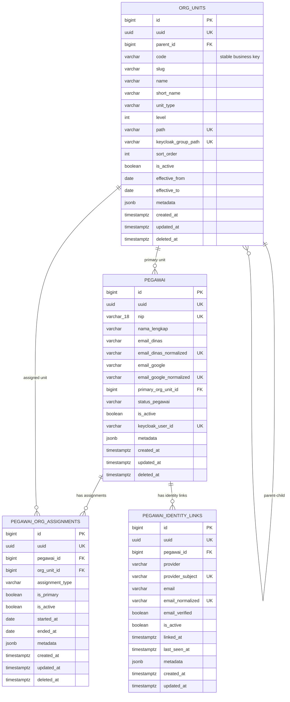
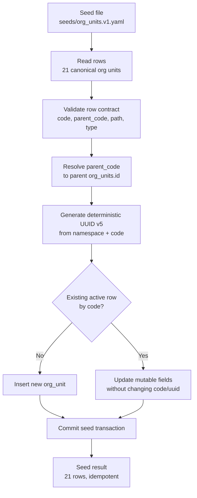
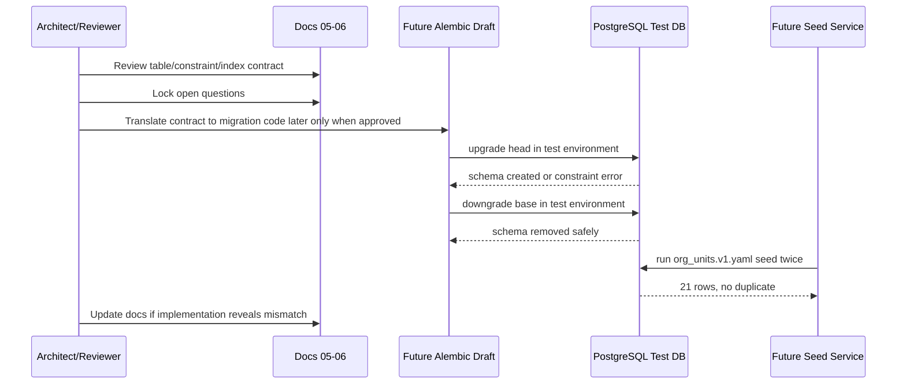

# 06 - IDP Pegawai Stage 1 Alembic Draft

Status: Draft contract brainstorming, **bukan kode implementasi**
Project: kumjabar_ecosystem
Date: 2026-08-26

## 1. Tujuan

Dokumen ini menurunkan `05-idp-pegawai-stage-1-flask-alembic-contract.md` menjadi draft awal rancangan Alembic untuk **Tahap 1 - Contract & Seed** IDP Pegawai.

Catatan penting: sesuai keputusan proyek, tahapan 1-5 saat ini tetap **brainstorming arsitektur dan kontrak desain**. Dokumen ini bukan file migration `.py`, bukan DDL final yang langsung dijalankan, dan bukan instruksi provisioning. Tujuannya adalah menyepakati bentuk migration sebelum nanti masuk fase coding eksplisit.

## 2. Posisi Dokumen Ini dalam Roadmap

```text
Tahap 1 - Contract & Seed
  -> dokumen 05: kontrak Flask + SQLAlchemy + Alembic
  -> dokumen 06: draft awal migration Alembic konseptual

Tahap 2 - Import Pipeline
Tahap 3 - Access & Audit
Tahap 4 - Keycloak Sync
Tahap 5 - Harden Routing
```

Dokumen ini hanya mencakup migration inti Tahap 1:

- `org_units`;
- `pegawai`;
- `pegawai_org_assignments`;
- `pegawai_identity_links`.

Tidak mencakup:

- `import_batches`;
- `import_rows`;
- `access_grants`;
- `audit_logs`;
- `keycloak_sync_states`;
- `sync_jobs`;
- `sync_job_items`.

### 2.1 Visual Roadmap 5 Tahap



Makna visual:

- dokumen ini berada penuh di **Tahap 1**;
- tabel Tahap 2-5 sengaja belum masuk migration pertama;
- desain Tahap 1 harus cukup kuat supaya Tahap 2-5 tidak perlu rombak pondasi.

## 3. Prinsip Alembic Tahap 1

Prinsip yang harus dijaga saat migration nanti benar-benar ditulis:

1. **Migration dibuat manual/reviewed**, bukan percaya penuh ke autogenerate.
2. **PostgreSQL-specific behavior diterima**, karena target production adalah PostgreSQL.
3. **Native PostgreSQL enum ditunda**, pakai `varchar` + `CHECK` agar lifecycle mudah berubah.
4. **Partial unique index wajib eksplisit**, karena autogenerate sering tidak cukup jelas.
5. **Seed tidak dimasukkan ke Alembic migration utama**, seed dibuat sebagai service/CLI idempotent.
6. **Hard delete tidak menjadi workflow normal**, entity utama memakai `deleted_at` soft delete.
7. **Constraint diberi nama stabil** agar error DB bisa dipetakan ke pesan validasi yang ramah.

## 4. Migration Identity

Draft metadata revision:

| Item | Nilai Konseptual |
| --- | --- |
| Revision name | `0001_create_idp_pegawai_core` |
| Revision ID | `0001_create_idp_pegawai_core` atau hash Alembic pendek yang diberi message sama |
| Down revision | `None` untuk repo/service IDP Pegawai baru |
| Branch labels | opsional: `idp_pegawai` |
| Depends on | `None` |
| Version table | `alembic_version_idp_pegawai` |
| Target DB | PostgreSQL |

Jika nanti IDP Pegawai ditempatkan sebagai subfolder service di repo `kumjabar-sso`, Alembic environment tetap sebaiknya milik service IDP Pegawai sendiri agar version table tidak bercampur dengan service lain.

## 5. Upgrade Flow Konseptual

Urutan upgrade yang disarankan:

```text
1. Ensure extension pgcrypto tersedia.
2. Create table org_units.
3. Create table pegawai.
4. Create table pegawai_org_assignments.
5. Create table pegawai_identity_links.
6. Create regular indexes.
7. Create partial unique indexes.
8. Create/check FK dan check constraints jika belum inline.
9. Verify schema contract secara manual/test.
```

Catatan:

- FK boleh dideklarasikan saat create table selama urutan tabel sudah benar.
- Partial unique index biasanya lebih jelas dibuat eksplisit setelah create table.
- `pgcrypto` tidak perlu di-drop saat downgrade karena bisa dipakai service lain dalam database yang sama.

### 5.1 Visual Upgrade Flow



## 6. Downgrade Flow Konseptual

Urutan downgrade reverse:

```text
1. Drop partial unique indexes terlebih dahulu jika dibuat terpisah.
2. Drop pegawai_identity_links.
3. Drop pegawai_org_assignments.
4. Drop pegawai.
5. Drop org_units.
6. Jangan drop extension pgcrypto secara default.
```

Alasan tidak drop `pgcrypto`:

- extension bersifat database-level;
- bisa dipakai migration lain;
- downgrade aplikasi tidak selalu berarti extension harus dicabut.

### 6.1 Visual Downgrade Flow



## 7. Shared Column Defaults

Konvensi default yang disarankan:

| Field | Default DB | Catatan |
| --- | --- | --- |
| `id` | identity/bigserial | PK internal |
| `uuid` | `gen_random_uuid()` | kecuali seed org unit memakai deterministic UUID dari service |
| `metadata` | `'{}'::jsonb` | di SQLAlchemy attribute sebaiknya `meta` |
| `created_at` | `now()` | timestamptz |
| `updated_at` | `now()` | update otomatis ORM di app layer; DB trigger belum wajib Tahap 1 |
| `is_active` | `true` untuk unit/assignment/link; pegawai tergantung status | jangan biarkan ambigu |

Catatan `updated_at`:

- Tahap 1 cukup memakai default DB + update dari ORM/service.
- DB trigger `updated_at` bisa dipertimbangkan nanti, tetapi belum wajib agar migration pertama tetap sederhana.

## 8. Naming Convention Final Draft

Constraint/index naming yang disarankan:

```text
PK: pk_<table>
FK: fk_<table>_<column>_<referred_table>
CHECK: ck_<table>_<meaning>
INDEX: ix_<table>_<column_or_meaning>
UNIQUE INDEX: uq_<table>_<meaning>
```

Contoh:

```text
pk_org_units
fk_org_units_parent_id_org_units
ck_org_units_unit_type_allowed
ix_org_units_parent_id
uq_org_units_code_active
```

Nama eksplisit penting agar:

- error database mudah diterjemahkan ke validation message;
- review migration lebih jelas;
- Alembic downgrade/drop object tidak ambigu.

## 9. Table Draft: `org_units`

### 9.1 Column Contract

| Kolom | Tipe PostgreSQL | Nullable | Default | Catatan |
| --- | --- | --- | --- | --- |
| `id` | `bigint identity` | no | identity | PK |
| `uuid` | `uuid` | no | `gen_random_uuid()` | unique stable ID |
| `parent_id` | `bigint` | yes | null | self FK |
| `code` | `varchar(80)` | no | - | stable business key |
| `slug` | `varchar(120)` | no | - | path segment |
| `name` | `varchar(255)` | no | - | nama lengkap |
| `short_name` | `varchar(120)` | yes | null | nama pendek |
| `unit_type` | `varchar(40)` | no | - | enum-like check |
| `level` | `integer` | no | - | depth tree |
| `path` | `varchar(500)` | no | - | internal org path |
| `keycloak_group_path` | `varchar(500)` | no | - | Keycloak group path |
| `sort_order` | `integer` | no | `0` | urutan UI |
| `is_active` | `boolean` | no | `true` | status unit |
| `effective_from` | `date` | yes | null | awal berlaku |
| `effective_to` | `date` | yes | null | akhir berlaku |
| `metadata` | `jsonb` | no | `'{}'::jsonb` | source snapshot/atribut tambahan |
| `created_at` | `timestamptz` | no | `now()` | lifecycle |
| `updated_at` | `timestamptz` | no | `now()` | lifecycle |
| `deleted_at` | `timestamptz` | yes | null | soft delete |

### 9.2 Constraints

| Nama | Bentuk | Tujuan |
| --- | --- | --- |
| `pk_org_units` | primary key `(id)` | PK internal |
| `uq_org_units_uuid` | unique `(uuid)` | UUID stabil |
| `fk_org_units_parent_id_org_units` | FK `parent_id -> org_units.id` | tree organisasi |
| `ck_org_units_unit_type_allowed` | `unit_type in (...)` | validasi tipe unit |
| `ck_org_units_level_non_negative` | `level >= 0` | depth valid |
| `ck_org_units_path_absolute` | `path like '/%'` | path internal absolut |
| `ck_org_units_keycloak_group_path_employee` | `keycloak_group_path like '/pegawai/%'` | boundary group pegawai |
| `ck_org_units_effective_range` | `effective_to is null or effective_from is null or effective_to >= effective_from` | periode valid |

`unit_type` allowed values:

```text
kanwil, divisi, bidang, bagian, pokja, tim
```

### 9.3 Indexes

| Nama | Kolom/Expression | Catatan |
| --- | --- | --- |
| `ix_org_units_parent_id` | `parent_id` | tree lookup |
| `ix_org_units_unit_type` | `unit_type` | filter UI |
| `ix_org_units_is_active` | `is_active` | filter aktif |
| `ix_org_units_level` | `level` | sort/filter tree |
| `ix_org_units_sort_order` | `sort_order` | urutan UI |

### 9.4 Partial Unique Indexes

| Nama | Kolom | Predicate |
| --- | --- | --- |
| `uq_org_units_code_active` | `code` | `deleted_at is null` |
| `uq_org_units_path_active` | `path` | `deleted_at is null` |
| `uq_org_units_keycloak_group_path_active` | `keycloak_group_path` | `deleted_at is null` |

### 9.5 FK Delete Policy

Untuk hard delete parent unit, gunakan `RESTRICT`/default no action. Secara operasional unit tidak di-hard-delete; gunakan `deleted_at` dan `is_active=false`.

## 10. Table Draft: `pegawai`

### 10.1 Column Contract

| Kolom | Tipe PostgreSQL | Nullable | Default | Catatan |
| --- | --- | --- | --- | --- |
| `id` | `bigint identity` | no | identity | PK |
| `uuid` | `uuid` | no | `gen_random_uuid()` | claim `pegawai_uuid` |
| `nip` | `varchar(18)` | no | - | identitas ASN PNS/PPPK; tepat 18 digit |
| `nama_lengkap` | `varchar(255)` | no | - | nama pegawai |
| `gelar_depan` | `varchar(80)` | yes | null | opsional |
| `gelar_belakang` | `varchar(120)` | yes | null | opsional |
| `email_dinas` | `varchar(255)` | yes | null | email asli |
| `email_dinas_normalized` | `varchar(255)` | yes | null | lower/trim dari service |
| `email_google` | `varchar(255)` | yes | null | email broker Google |
| `email_google_normalized` | `varchar(255)` | yes | null | lower/trim dari service |
| `no_hp` | `varchar(50)` | yes | null | opsional |
| `primary_org_unit_id` | `bigint` | yes | null | FK unit utama |
| `status_pegawai` | `varchar(40)` | no | explicit dari service/import; jangan bergantung pada default | lifecycle |
| `is_active` | `boolean` | no | diturunkan service dari `status_pegawai` | eligibility internal |
| `status_reason` | `text` | yes | null | alasan status |
| `status_effective_at` | `date` | yes | null | tanggal berlaku status |
| `keycloak_user_id` | `varchar(120)` | yes | null | ID user Keycloak |
| `metadata` | `jsonb` | no | `'{}'::jsonb` | source snapshot identitas; bukan jabatan/PLT/PLH |
| `created_at` | `timestamptz` | no | `now()` | lifecycle |
| `updated_at` | `timestamptz` | no | `now()` | lifecycle |
| `deleted_at` | `timestamptz` | yes | null | soft delete |

### 10.2 Constraints

| Nama | Bentuk | Tujuan |
| --- | --- | --- |
| `pk_pegawai` | primary key `(id)` | PK internal |
| `uq_pegawai_uuid` | unique `(uuid)` | UUID pegawai stabil |
| `fk_pegawai_primary_org_unit_id_org_units` | FK `primary_org_unit_id -> org_units.id` | unit utama |
| `ck_pegawai_nip_18_digits` | `nip ~ '^[0-9]{18}$'` | NIP wajib tepat 18 karakter digit |
| `ck_pegawai_status_allowed` | `status_pegawai in (...)` | validasi status |
| `ck_pegawai_active_status_consistency` | `is_active = (status_pegawai = 'aktif')` | eligibility diturunkan deterministik dari status lifecycle |
| `ck_pegawai_active_requires_primary_org_unit` | `is_active = false or primary_org_unit_id is not null` | pegawai aktif harus punya unit utama |

`status_pegawai` allowed values:

```text
aktif, mutasi_keluar, pensiun, nonaktif, meninggal
```

### 10.3 Indexes

| Nama | Kolom/Expression | Catatan |
| --- | --- | --- |
| `ix_pegawai_primary_org_unit_id` | `primary_org_unit_id` | filter per unit |
| `ix_pegawai_status_pegawai` | `status_pegawai` | filter status |
| `ix_pegawai_is_active` | `is_active` | filter aktif |
| `ix_pegawai_keycloak_user_id` | `keycloak_user_id` | lookup sync |
| `ix_pegawai_email_dinas_normalized` | `email_dinas_normalized` | lookup email |
| `ix_pegawai_email_google_normalized` | `email_google_normalized` | lookup email |

### 10.4 Partial Unique Indexes

| Nama | Kolom | Predicate |
| --- | --- | --- |
| `uq_pegawai_nip_active` | `nip` | `deleted_at is null` |
| `uq_pegawai_email_dinas_active` | `email_dinas_normalized` | `email_dinas_normalized is not null and deleted_at is null` |
| `uq_pegawai_email_google_active` | `email_google_normalized` | `email_google_normalized is not null and deleted_at is null` |
| `uq_pegawai_keycloak_user_id_active` | `keycloak_user_id` | `keycloak_user_id is not null and deleted_at is null` |

Catatan: `keycloak_user_id` sebaiknya unique ketika sudah terisi, karena satu akun Keycloak tidak boleh menjadi milik dua pegawai aktif.

### 10.5 FK Delete Policy

Untuk `primary_org_unit_id`, gunakan `RESTRICT`/default no action. Jika unit berubah, histori ditangani via perubahan status/assignment, bukan hard delete unit.

## 11. Table Draft: `pegawai_org_assignments`

### 11.1 Column Contract

| Kolom | Tipe PostgreSQL | Nullable | Default | Catatan |
| --- | --- | --- | --- | --- |
| `id` | `bigint identity` | no | identity | PK |
| `uuid` | `uuid` | no | `gen_random_uuid()` | stable assignment ID |
| `pegawai_id` | `bigint` | no | - | FK pegawai |
| `org_unit_id` | `bigint` | no | - | FK org unit |
| `assignment_type` | `varchar(40)` | no | - | `primary` atau `additional`; afiliasi organisasi |
| `is_primary` | `boolean` | no | `false` | primary marker |
| `is_active` | `boolean` | no | `true` | status assignment |
| `started_at` | `date` | yes | null | mulai |
| `ended_at` | `date` | yes | null | selesai |
| `metadata` | `jsonb` | no | `'{}'::jsonb` | atribut afiliasi organisasi; bukan jabatan/PLT/PLH |
| `created_at` | `timestamptz` | no | `now()` | lifecycle |
| `updated_at` | `timestamptz` | no | `now()` | lifecycle |
| `deleted_at` | `timestamptz` | yes | null | soft delete |

### 11.2 Constraints

| Nama | Bentuk | Tujuan |
| --- | --- | --- |
| `pk_pegawai_org_assignments` | primary key `(id)` | PK internal |
| `uq_pegawai_org_assignments_uuid` | unique `(uuid)` | stable ID |
| `fk_pegawai_org_assignments_pegawai_id_pegawai` | FK `pegawai_id -> pegawai.id` | pemilik assignment |
| `fk_pegawai_org_assignments_org_unit_id_org_units` | FK `org_unit_id -> org_units.id` | unit assignment |
| `ck_pegawai_org_assignments_assignment_type_allowed` | `assignment_type in (...)` | validasi tipe |
| `ck_pegawai_org_assignments_date_range` | `ended_at is null or started_at is null or ended_at >= started_at` | periode valid |
| `ck_pegawai_org_assignments_primary_type_consistency` | `is_primary = false or assignment_type = 'primary'` | marker primary konsisten |

`assignment_type` allowed values:

```text
primary, additional
```

### 11.3 Indexes

| Nama | Kolom/Expression | Catatan |
| --- | --- | --- |
| `ix_pegawai_org_assignments_pegawai_id` | `pegawai_id` | lookup assignment pegawai |
| `ix_pegawai_org_assignments_org_unit_id` | `org_unit_id` | lookup per unit |
| `ix_pegawai_org_assignments_assignment_type` | `assignment_type` | filter tipe |
| `ix_pegawai_org_assignments_is_active` | `is_active` | filter aktif |

### 11.4 Partial Unique Indexes

| Nama | Kolom | Predicate |
| --- | --- | --- |
| `uq_pegawai_org_assignments_active_primary_per_pegawai` | `pegawai_id` | `is_primary = true and is_active = true and deleted_at is null` |
| `uq_pegawai_org_assignments_active_same` | `pegawai_id, org_unit_id, assignment_type` | `is_active = true and deleted_at is null` |

### 11.5 FK Delete Policy

Gunakan `RESTRICT`/default no action untuk FK ke `pegawai` dan `org_units`. Assignment adalah histori afiliasi organisasi, bukan histori otorisasi atau jabatan, sehingga tidak boleh diam-diam hilang karena hard delete parent.

## 12. Table Draft: `pegawai_identity_links`

### 12.1 Column Contract

| Kolom | Tipe PostgreSQL | Nullable | Default | Catatan |
| --- | --- | --- | --- | --- |
| `id` | `bigint identity` | no | identity | PK |
| `uuid` | `uuid` | no | `gen_random_uuid()` | stable link ID |
| `pegawai_id` | `bigint` | no | - | FK pegawai |
| `provider` | `varchar(40)` | no | - | keycloak/google/microsoft/local |
| `provider_subject` | `varchar(255)` | yes | null | subject/id provider |
| `email` | `varchar(255)` | yes | null | email asli dari provider |
| `email_normalized` | `varchar(255)` | yes | null | lower/trim |
| `email_verified` | `boolean` | no | `false` | dari provider |
| `is_active` | `boolean` | no | `true` | link aktif |
| `linked_at` | `timestamptz` | yes | null | waktu link |
| `last_seen_at` | `timestamptz` | yes | null | login terakhir |
| `metadata` | `jsonb` | no | `'{}'::jsonb` | payload ringkas |
| `created_at` | `timestamptz` | no | `now()` | lifecycle |
| `updated_at` | `timestamptz` | no | `now()` | lifecycle |

Catatan: tabel ini tidak memakai `deleted_at` pada Tahap 1. Link lama cukup dibuat `is_active=false` agar histori tetap terbaca. Jika nanti audit/link lifecycle lebih kompleks, `revoked_at` bisa dipertimbangkan pada Tahap 3.

### 12.2 Constraints

| Nama | Bentuk | Tujuan |
| --- | --- | --- |
| `pk_pegawai_identity_links` | primary key `(id)` | PK internal |
| `uq_pegawai_identity_links_uuid` | unique `(uuid)` | stable ID |
| `fk_pegawai_identity_links_pegawai_id_pegawai` | FK `pegawai_id -> pegawai.id` | pemilik identity link |
| `ck_pegawai_identity_links_provider_allowed` | `provider in (...)` | validasi provider |

`provider` allowed values:

```text
keycloak, google, microsoft, local
```

### 12.3 Indexes

| Nama | Kolom/Expression | Catatan |
| --- | --- | --- |
| `ix_pegawai_identity_links_pegawai_id` | `pegawai_id` | lookup link pegawai |
| `ix_pegawai_identity_links_provider` | `provider` | filter provider |
| `ix_pegawai_identity_links_email_normalized` | `email_normalized` | lookup email |
| `ix_pegawai_identity_links_is_active` | `is_active` | filter active link |

### 12.4 Unique Indexes

| Nama | Kolom | Predicate |
| --- | --- | --- |
| `uq_pegawai_identity_links_provider_subject` | `provider, provider_subject` | `provider_subject is not null` |
| `uq_pegawai_identity_links_provider_email_active` | `provider, email_normalized` | `email_normalized is not null and is_active = true` |

Catatan: `provider_subject` unique global per provider walaupun link tidak aktif, karena subject provider seharusnya tidak berpindah antar pegawai tanpa proses audit/koreksi khusus.

## 13. Dependency Graph

### 13.1 Simple Dependency Graph



### 13.2 ERD Konseptual Tahap 1



Catatan ERD:

- Label `UK` pada kolom seperti email/path/keycloak ID merepresentasikan unique atau partial unique sesuai detail tabel, bukan selalu unique unconditional.
- `ORG_UNITS` punya self-reference untuk tree organisasi.
- `PEGAWAI.primary_org_unit_id` adalah shortcut unit utama aktif.
- Histori/afiliasi organisasi tambahan tetap dicatat di `PEGAWAI_ORG_ASSIGNMENTS`; jabatan, PLT/PLH, dan histori jabatan tidak masuk tabel maupun metadata assignment.
- Identity provider tidak langsung menentukan pegawai tanpa validasi link aktif + pegawai aktif.

Urutan create mengikuti arah dependency:

```text
org_units -> pegawai -> pegawai_org_assignments -> pegawai_identity_links
```

Urutan drop kebalikannya:

```text
pegawai_identity_links -> pegawai_org_assignments -> pegawai -> org_units
```

## 14. Seed Relation ke Migration

### 14.1 Visual Seed Flow



Migration hanya membuat struktur. Seed `org_units` tetap berada di layer service/CLI:

```text
flask db upgrade
flask seed org-units --file seeds/org_units.v1.yaml
```

Namun secara arsitektur, migration harus mendukung seed berikut:

- 21 org unit awal;
- deterministic UUID v5 berbasis `code`;
- parent resolved via `parent_code`;
- idempotent upsert by `code`;
- update mutable fields tanpa mengganti `uuid`.

## 15. Review Flow sebelum Implementasi



Makna sequence:

- saat ini kita berhenti di `Docs 05-06`;
- `Future Alembic Draft`, `PostgreSQL Test DB`, dan `Future Seed Service` baru dijalankan ketika user meminta coding/implementasi eksplisit;
- jika nanti implementasi menemukan mismatch, kontrak arsitektur harus ikut diperbarui.

## 16. Open Questions sebelum Implementasi

Sebelum nanti masuk coding, ada beberapa keputusan kecil yang perlu dikunci:

| Pertanyaan | Rekomendasi Awal |
| --- | --- |
| Apakah `status_pegawai` default `aktif` di DB? | Hindari ketergantungan pada default; create/import harus mengirim status lifecycle secara explicit. |
| Apakah `is_active` default `true` di DB untuk pegawai? | Jangan menjadi input independen; service menurunkannya deterministik dari `status_pegawai`. |
| Apakah `keycloak_user_id` perlu unique? | Ya, gunakan partial unique saat tidak null dan belum soft delete. |
| Apakah `pegawai_identity_links` perlu `deleted_at`? | Belum perlu Tahap 1; gunakan `is_active=false`. |
| Apakah hard delete FK pakai cascade? | Tidak. Gunakan restrict/no action agar histori tidak hilang. |
| Apakah perlu DB trigger `updated_at`? | Belum wajib Tahap 1; ORM/service cukup, trigger bisa dipertimbangkan nanti. |
| Apakah seed masuk migration? | Tidak. Seed dipisah agar idempotent dan operasional. |

## 17. Acceptance Checklist Draft Alembic

Saat nanti migration benar-benar dibuat, review checklist-nya:

- [ ] `pgcrypto` tersedia untuk `gen_random_uuid()`.
- [ ] `alembic_version_idp_pegawai` dipakai sebagai version table.
- [ ] Semua PK memakai bigint identity.
- [ ] Semua UUID punya unique constraint.
- [ ] Semua JSONB metadata default `{}`.
- [ ] Partial unique index ditulis eksplisit.
- [ ] Check constraint status/unit/assignment/provider ditulis eksplisit.
- [ ] Active pegawai hanya boleh `status_pegawai='aktif'`.
- [ ] Active pegawai wajib punya `primary_org_unit_id`.
- [ ] Hard delete cascade tidak dipakai untuk histori pegawai/assignment/link.
- [ ] Downgrade drop object dengan urutan dependency terbalik.
- [ ] Seed org unit tetap dipisah dari Alembic migration.

## 18. Kesimpulan Draft

Draft Alembic Tahap 1 ini mengunci bentuk migration pertama IDP Pegawai sebagai kontrak desain:

```text
0001_create_idp_pegawai_core
```

Isi migration konseptual:

```text
pgcrypto
org_units
pegawai
pegawai_org_assignments
pegawai_identity_links
regular indexes
partial unique indexes
check constraints
FK constraints
```

Dengan desain ini, Tahap 1 sudah cukup kuat untuk menjadi pondasi sebelum masuk Tahap 2 Import Pipeline, tanpa mulai coding/provisioning terlebih dahulu.

Draft Alembic ini kemudian diturunkan ke model-level contract pada `07-idp-pegawai-stage-1-model-contract-mapping.md`, tetap sebagai dokumen arsitektur dan belum menjadi kode implementasi.
