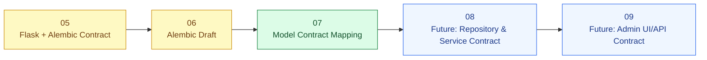
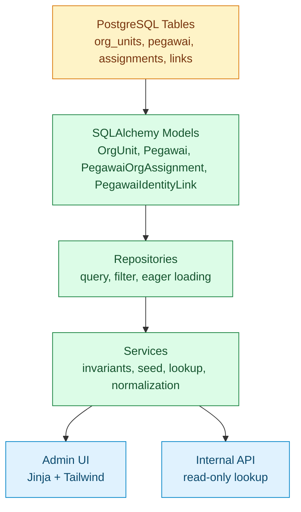
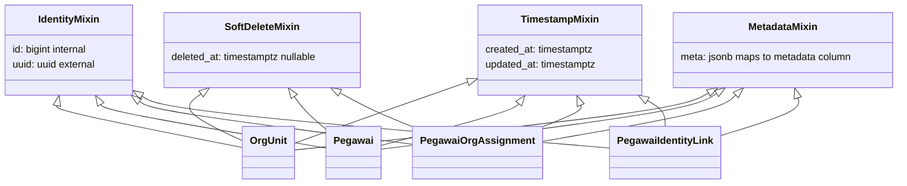
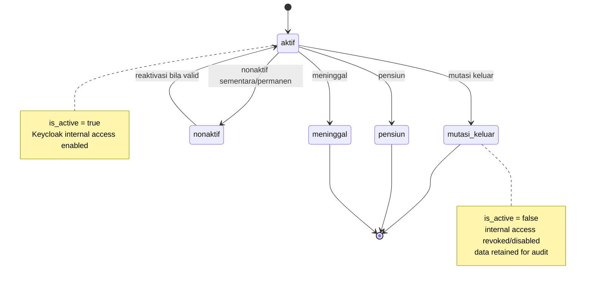
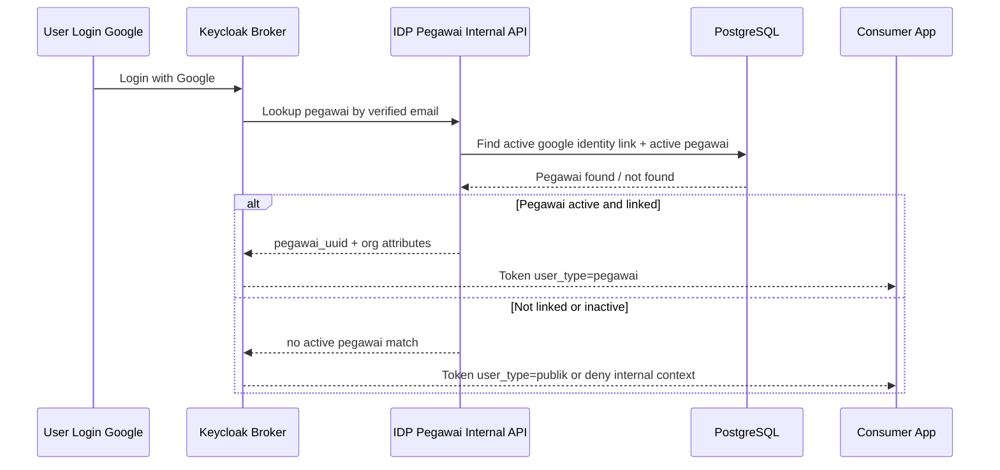
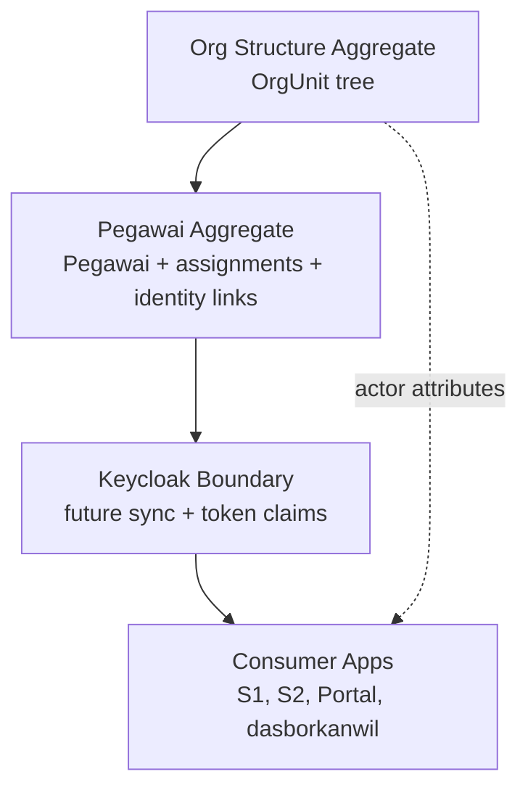
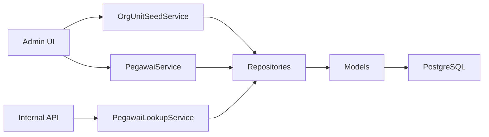

# 07 - IDP Pegawai Stage 1 Model Contract Mapping

Status: Draft contract brainstorming, **bukan kode implementasi**
Project: kumjabar_ecosystem
Date: 2026-08-27

## 1. Tujuan

Dokumen ini melanjutkan:

- `05-idp-pegawai-stage-1-flask-alembic-contract.md`
- `06-idp-pegawai-stage-1-alembic-draft.md`

Fokus dokumen ini adalah menurunkan draft Alembic konseptual menjadi **Model Contract Mapping** untuk Flask + SQLAlchemy, tetapi tetap dalam bentuk desain/arsitektur. Ini belum membuat file Python, belum membuat migration `.py`, dan belum menjalankan implementasi.

Tujuannya agar saat nanti user meminta coding eksplisit, developer sudah punya peta yang jelas:

```text
Table -> SQLAlchemy Model -> Attribute -> Relationship -> Repository -> Service -> UI/API
```

## 2. Posisi dalam Roadmap Dokumen



Makna:

- Dokumen 05 mengunci stack dan boundary.
- Dokumen 06 mengunci rancangan migration/tabel/constraint.
- Dokumen 07 ini mengunci bagaimana tabel itu diterjemahkan menjadi model domain konseptual.
- Dokumen berikutnya bisa turun ke repository/service contract tanpa coding.

## 3. Prinsip Model Contract

Model SQLAlchemy nanti harus diperlakukan sebagai representasi domain, bukan sekadar mirror kolom database.

Prinsip:

1. **Table tetap source of truth struktur data.**
2. **Model memberi nama dan relasi yang enak dibaca developer.**
3. **Business invariant besar tetap di service layer**, bukan ditumpuk semua di model.
4. **Kolom internal `id` tidak diekspos sebagai public identifier.**
5. **UUID dipakai untuk API/UI route dan integrasi lintas sistem.**
6. **Metadata JSONB tetap tambahan, bukan tempat menyimpan struktur utama.**
7. **Relationship dibuat eksplisit agar query tree/pegawai/link mudah dipahami.**
8. **N+1 query harus diantisipasi di repository**, bukan dibiarkan dari template UI.

## 4. Visual Layer Mapping



Interpretasi:

- Model tidak langsung dipakai sembarangan oleh UI/API.
- UI/API sebaiknya bicara ke service atau repository read-only yang jelas.
- Repository bertanggung jawab memilih loading strategy agar halaman list/detail tidak boros query.

## 5. Model Naming Draft

| Table | Model Class Konseptual | Modul Konseptual | Fungsi |
| --- | --- | --- | --- |
| `org_units` | `OrgUnit` | `app.models.org_unit` | Struktur organisasi dan Keycloak group path |
| `pegawai` | `Pegawai` | `app.models.pegawai` | Master identitas ASN dan eligibility internal; bukan master jabatan |
| `pegawai_org_assignments` | `PegawaiOrgAssignment` | `app.models.pegawai_org_assignment` | Assignment/histori unit tambahan |
| `pegawai_identity_links` | `PegawaiIdentityLink` | `app.models.pegawai_identity_link` | Link ke Keycloak/Google/Microsoft/local |

Catatan: nama di atas adalah kontrak konseptual. Belum membuat file/module.

## 6. Shared Model Mixins Konseptual

Agar konsisten, model nanti bisa memakai mixin konseptual berikut.

| Mixin | Field | Dipakai oleh | Catatan |
| --- | --- | --- | --- |
| `IdentityMixin` | `id`, `uuid` | semua model | `id` internal, `uuid` external/public |
| `TimestampMixin` | `created_at`, `updated_at` | semua model | default `now()`, update via ORM/service |
| `SoftDeleteMixin` | `deleted_at` | `OrgUnit`, `Pegawai`, `PegawaiOrgAssignment` | tidak dipakai dulu di `PegawaiIdentityLink` |
| `MetadataMixin` | `meta` -> DB column `metadata` | semua model | Python attr `meta` karena `metadata` reserved di SQLAlchemy |

Visual mixin:



## 7. Model Contract: `OrgUnit`

### 7.1 Tanggung Jawab Domain

`OrgUnit` merepresentasikan unit organisasi internal Kanwil Kemenkum Jawa Barat yang menjadi dasar:

- tree organisasi;
- Keycloak group path;
- actor attribute untuk aplikasi consumer;
- filter/list pegawai;
- seed awal struktur organisasi.

### 7.2 Field Mapping

| Model Attribute | DB Column | Tipe Konseptual | Catatan |
| --- | --- | --- | --- |
| `id` | `id` | bigint | internal only |
| `uuid` | `uuid` | UUID | public identifier |
| `parent_id` | `parent_id` | bigint nullable | FK ke `org_units.id` |
| `code` | `code` | string | stable business key |
| `slug` | `slug` | string | segment path |
| `name` | `name` | string | nama lengkap |
| `short_name` | `short_name` | string nullable | nama ringkas |
| `unit_type` | `unit_type` | string | check constraint |
| `level` | `level` | integer | depth tree |
| `path` | `path` | string | internal path |
| `keycloak_group_path` | `keycloak_group_path` | string | path group Keycloak |
| `sort_order` | `sort_order` | integer | ordering UI |
| `is_active` | `is_active` | boolean | status unit |
| `effective_from` | `effective_from` | date nullable | awal berlaku |
| `effective_to` | `effective_to` | date nullable | akhir berlaku |
| `meta` | `metadata` | JSONB | source snapshot/extra attributes |
| `created_at` | `created_at` | timestamptz | lifecycle |
| `updated_at` | `updated_at` | timestamptz | lifecycle |
| `deleted_at` | `deleted_at` | timestamptz nullable | soft delete |

### 7.3 Relationship Mapping

| Relationship | Arah | Makna |
| --- | --- | --- |
| `parent` | many-to-one `OrgUnit -> OrgUnit` | parent tree |
| `children` | one-to-many `OrgUnit -> OrgUnit` | child units |
| `primary_pegawai` | one-to-many `OrgUnit -> Pegawai` | pegawai dengan unit utama ini |
| `assignments` | one-to-many `OrgUnit -> PegawaiOrgAssignment` | assignment tambahan ke unit ini |

### 7.4 Domain Invariants

- `code` tidak berubah sembarangan setelah dipakai consumer.
- `path` harus absolute dan mulai `/`.
- `keycloak_group_path` harus mulai `/pegawai/`.
- root awal `KANWIL_JABAR` punya `parent_id = null` dan `level = 0`.
- child unit harus punya `parent_id` dan `level = parent.level + 1`.
- perubahan nama unit tidak otomatis mengubah `code`.

## 8. Model Contract: `Pegawai`

### 8.1 Tanggung Jawab Domain

`Pegawai` merepresentasikan identitas ASN internal (PNS/PPPK) dan eligibility akses internal.

Dipakai untuk:

- claim `pegawai_uuid`;
- lookup pegawai by email/NIP/UUID;
- menentukan `user_type=pegawai`;
- status aktif/mutasi/pensiun/nonaktif;
- mapping ke unit organisasi utama;
- referensi assignment dan identity link.

### 8.2 Field Mapping

| Model Attribute | DB Column | Tipe Konseptual | Catatan |
| --- | --- | --- | --- |
| `id` | `id` | bigint | internal only |
| `uuid` | `uuid` | UUID | external identifier |
| `nip` | `nip` | string required | identitas ASN PNS/PPPK; tepat 18 digit |
| `nama_lengkap` | `nama_lengkap` | string | nama pegawai |
| `gelar_depan` | `gelar_depan` | string nullable | opsional |
| `gelar_belakang` | `gelar_belakang` | string nullable | opsional |
| `email_dinas` | `email_dinas` | string nullable | email asli |
| `email_dinas_normalized` | `email_dinas_normalized` | string nullable | lower/trim |
| `email_google` | `email_google` | string nullable | email broker Google |
| `email_google_normalized` | `email_google_normalized` | string nullable | lower/trim |
| `no_hp` | `no_hp` | string nullable | opsional |
| `primary_org_unit_id` | `primary_org_unit_id` | bigint nullable | FK unit utama |
| `status_pegawai` | `status_pegawai` | string | lifecycle status |
| `is_active` | `is_active` | boolean | eligibility internal |
| `status_reason` | `status_reason` | text nullable | alasan status |
| `status_effective_at` | `status_effective_at` | date nullable | tanggal berlaku |
| `keycloak_user_id` | `keycloak_user_id` | string nullable | ID user Keycloak |
| `meta` | `metadata` | JSONB | source snapshot identitas; bukan jabatan/PLT/PLH |
| `created_at` | `created_at` | timestamptz | lifecycle |
| `updated_at` | `updated_at` | timestamptz | lifecycle |
| `deleted_at` | `deleted_at` | timestamptz nullable | soft delete |

### 8.3 Relationship Mapping

| Relationship | Arah | Makna |
| --- | --- | --- |
| `primary_org_unit` | many-to-one `Pegawai -> OrgUnit` | unit utama aktif |
| `assignments` | one-to-many `Pegawai -> PegawaiOrgAssignment` | histori afiliasi organisasi |
| `identity_links` | one-to-many `Pegawai -> PegawaiIdentityLink` | link provider login |

### 8.4 Domain Invariants

- `nip` wajib, panjang tepat 18, dan seluruh karakternya digit.
- Model tetap memperlakukan NIP sebagai string, bukan integer.
- `is_active` diturunkan deterministik: `true` jika dan hanya jika `status_pegawai='aktif'`.
- Pegawai aktif harus punya `primary_org_unit_id`.
- Pegawai pensiun/mutasi/nonaktif/meninggal tidak dihapus; akses internal dicabut/disabled.
- Email lookup memakai normalized column, bukan email raw.
- `keycloak_user_id` satu-satu terhadap pegawai aktif jika sudah terisi.

### 8.5 Status Lifecycle Visual



## 9. Model Contract: `PegawaiOrgAssignment`

### 9.1 Tanggung Jawab Domain

`PegawaiOrgAssignment` menyimpan assignment pegawai ke unit organisasi, baik primary historis maupun assignment tambahan.

Dipakai untuk:

- histori unit pegawai;
- afiliasi unit organisasi tambahan;
- membentuk `org_unit_codes` dan `org_group_paths` di tahap sync nanti.

Jabatan, PLT, serta role operator/admin aplikasi tidak disimpan pada model ini.

### 9.2 Field Mapping

| Model Attribute | DB Column | Tipe Konseptual | Catatan |
| --- | --- | --- | --- |
| `id` | `id` | bigint | internal only |
| `uuid` | `uuid` | UUID | public/stable assignment ID |
| `pegawai_id` | `pegawai_id` | bigint | FK pegawai |
| `org_unit_id` | `org_unit_id` | bigint | FK unit |
| `assignment_type` | `assignment_type` | string | primary/additional; afiliasi organisasi |
| `is_primary` | `is_primary` | boolean | marker primary |
| `is_active` | `is_active` | boolean | aktif/tidak |
| `started_at` | `started_at` | date nullable | mulai |
| `ended_at` | `ended_at` | date nullable | selesai |
| `meta` | `metadata` | JSONB | atribut afiliasi organisasi; bukan jabatan/PLT/PLH |
| `created_at` | `created_at` | timestamptz | lifecycle |
| `updated_at` | `updated_at` | timestamptz | lifecycle |
| `deleted_at` | `deleted_at` | timestamptz nullable | soft delete |

### 9.3 Relationship Mapping

| Relationship | Arah | Makna |
| --- | --- | --- |
| `pegawai` | many-to-one `PegawaiOrgAssignment -> Pegawai` | pemilik assignment |
| `org_unit` | many-to-one `PegawaiOrgAssignment -> OrgUnit` | unit assignment |

### 9.4 Domain Invariants

- Satu pegawai hanya boleh punya satu active primary assignment.
- Jika `is_primary=true`, maka `assignment_type='primary'`.
- Assignment tambahan tidak mengubah `pegawai.primary_org_unit_id`.
- Assignment lama ditutup dengan `ended_at` dan/atau `is_active=false`.
- Periode assignment harus valid: `ended_at >= started_at` jika dua-duanya terisi.

## 10. Model Contract: `PegawaiIdentityLink`

### 10.1 Tanggung Jawab Domain

`PegawaiIdentityLink` menghubungkan pegawai dengan provider identity.

Dipakai untuk:

- Keycloak local user mapping;
- Google social login pegawai;
- Microsoft/local provider jika dibutuhkan nanti;
- validasi bahwa email login benar-benar terhubung ke pegawai aktif.

### 10.2 Field Mapping

| Model Attribute | DB Column | Tipe Konseptual | Catatan |
| --- | --- | --- | --- |
| `id` | `id` | bigint | internal only |
| `uuid` | `uuid` | UUID | stable link ID |
| `pegawai_id` | `pegawai_id` | bigint | FK pegawai |
| `provider` | `provider` | string | keycloak/google/microsoft/local |
| `provider_subject` | `provider_subject` | string nullable | subject provider |
| `email` | `email` | string nullable | email asli provider |
| `email_normalized` | `email_normalized` | string nullable | lower/trim |
| `email_verified` | `email_verified` | boolean | verifikasi provider |
| `is_active` | `is_active` | boolean | link aktif |
| `linked_at` | `linked_at` | timestamptz nullable | waktu link |
| `last_seen_at` | `last_seen_at` | timestamptz nullable | login terakhir |
| `meta` | `metadata` | JSONB | provider payload ringkas |
| `created_at` | `created_at` | timestamptz | lifecycle |
| `updated_at` | `updated_at` | timestamptz | lifecycle |

### 10.3 Relationship Mapping

| Relationship | Arah | Makna |
| --- | --- | --- |
| `pegawai` | many-to-one `PegawaiIdentityLink -> Pegawai` | pemilik identity link |

### 10.4 Domain Invariants

- Google login pegawai harus memenuhi:
  - link provider `google` aktif;
  - `email_verified=true`;
  - `email_normalized` cocok;
  - pegawai aktif;
  - pegawai belum soft deleted.
- Jangan trust domain email saja.
- `provider_subject` tidak boleh berpindah antar pegawai tanpa proses koreksi/audit khusus.
- Link lama cukup `is_active=false` di Tahap 1.

### 10.5 Visual Login Link Resolution



Catatan: sequence ini adalah arah arsitektur masa depan. Tahap 1 baru menyiapkan model/tabel agar lookup seperti ini mungkin dilakukan.

## 11. Aggregate dan Boundary

Untuk menjaga desain tetap bersih, kita bisa berpikir dalam aggregate konseptual:



Interpretasi:

- `OrgUnit` adalah aggregate struktur organisasi.
- `Pegawai` menjadi aggregate utama untuk identitas internal.
- Assignment afiliasi organisasi dan identity links hidup di bawah konteks identitas pegawai. Jabatan dan histori jabatan tetap aggregate/domain modul kepegawaian consumer.
- Keycloak bukan source of truth ASN PNS/PPPK; Keycloak mengonsumsi hasil sync/lookup dari IDP Pegawai.

## 12. Repository Contract Preview

Dokumen detail repository bisa dibuat berikutnya, tetapi mapping awalnya seperti ini.

### 12.1 `OrgUnitRepository`

Tanggung jawab:

- list tree organisasi;
- find by `id`, `uuid`, `code`, `path`;
- list active units;
- list children by parent;
- preload children jika dibutuhkan UI tree.

Query konseptual:

| Method Konseptual | Input | Output | Catatan |
| --- | --- | --- | --- |
| `get_by_uuid` | `uuid` | `OrgUnit/null` | untuk route detail |
| `get_by_code` | `code` | `OrgUnit/null` | untuk seed/service |
| `list_active_tree` | filter optional | list `OrgUnit` | ordered by level/sort_order |
| `list_children` | parent uuid/id | list `OrgUnit` | untuk tree detail |

### 12.2 `PegawaiRepository`

Tanggung jawab:

- find pegawai by uuid;
- find pegawai by normalized email dinas/google;
- list pegawai by org/status;
- preload primary org unit, assignments, identity links untuk detail.

Query konseptual:

| Method Konseptual | Input | Output | Catatan |
| --- | --- | --- | --- |
| `get_by_uuid` | `uuid` | `Pegawai/null` | route detail/API |
| `find_active_by_email` | normalized email | `Pegawai/null` | lookup internal API |
| `list_by_org_unit` | org unit id/code | list `Pegawai` | UI list/filter |
| `list_by_status` | status | list `Pegawai` | dashboard/filter |

## 13. Service Contract Preview

Service menjaga invariant lintas model.

| Service Konseptual | Tanggung Jawab |
| --- | --- |
| `OrgUnitSeedService` | validasi seed, resolve parent, deterministic UUID, idempotent upsert |
| `OrgUnitService` | tree organization, path/keycloak path consistency |
| `PegawaiService` | create/update pegawai, normalize email, status eligibility |
| `IdentityLinkService` | link/unlink provider, verify Google link, update last seen |
| `PegawaiLookupService` | lookup read-only untuk internal API/Keycloak bridge |

Visual service interaction:



## 14. Serialization Contract Preview

Untuk UI/API, jangan expose semua kolom mentah.

### 14.1 `OrgUnit` Public/Internal Shape

```text
uuid
code
slug
name
short_name
unit_type
level
path
keycloak_group_path
sort_order
is_active
parent_uuid
children_count
```

Tidak perlu expose default:

```text
id
metadata penuh
created_at/updated_at/deleted_at kecuali halaman admin detail butuh
```

### 14.2 `Pegawai` Public/Internal Shape

```text
uuid
nip
nama_lengkap
email_dinas
email_google
primary_org_unit: { uuid, code, name, path }
status_pegawai
is_active
keycloak_user_id
assignments summary
identity_links summary
```

Negative contract: shape IDP ini tidak memuat `jabatan`, `jabatan_type`, label jabatan, PLT/PLH, atau histori jabatan, termasuk melalui `assignments summary` maupun metadata.

Hindari expose:

```text
id internal
metadata mentah besar
provider payload sensitif
```

## 15. Loading Strategy Konseptual

| Use Case | Loading Strategy Konseptual | Alasan |
| --- | --- | --- |
| list org units tree | load all active ordered by `level`, `sort_order`, build tree in service | jumlah unit kecil dan mudah dirender |
| detail org unit | load unit + children + primary pegawai count | detail butuh konteks |
| list pegawai | load pegawai + primary org unit saja | hindari berat di list |
| detail pegawai | load primary org unit + assignments + identity links | detail butuh lengkap |
| lookup by email | direct indexed query ke normalized email/link | harus cepat untuk API internal |

## 16. Design Guardrails sebelum Coding

Sebelum nanti dibuat kode, guardrail ini harus tetap dipegang:

- jangan expose `id` internal ke route/API publik;
- route pakai `uuid`;
- email selalu dinormalisasi di service;
- jangan langsung query model dari template Jinja;
- jangan membuat relationship lazy berlebihan yang memicu N+1 di list page;
- jangan menyimpan struktur organisasi utama di JSONB;
- jangan cascade delete histori pegawai/assignment/link;
- jangan menganggap Google email otomatis pegawai hanya karena domainnya resmi.

## 17. Open Questions untuk Review

| Pertanyaan | Rekomendasi Awal |
| --- | --- |
| Apakah `PegawaiIdentityLink` perlu soft delete juga? | Belum di Tahap 1; `is_active=false` cukup. |
| Apakah `OrgUnit.children` perlu default ordering? | Ya, ordered by `sort_order`, lalu `name`. |
| Apakah `Pegawai.assignments` perlu filter active default? | Relationship raw semua; active filtering di service/repository agar histori tetap bisa dilihat. |
| Apakah `metadata` boleh muncul di UI? | Hanya ringkasan/diagnostic admin, bukan default list. |
| Apakah `keycloak_user_id` ditampilkan? | Boleh di detail admin/TI, tidak perlu di list umum. |

## 18. Kesimpulan

Model Contract Mapping Tahap 1 mengunci mapping konseptual berikut:

```text
org_units                  -> OrgUnit
pegawai                    -> Pegawai
pegawai_org_assignments    -> PegawaiOrgAssignment
pegawai_identity_links     -> PegawaiIdentityLink
```

Dokumen ini menjadi jembatan dari draft Alembic menuju desain repository/service berikutnya, tetap dalam mode brainstorming arsitektur tanpa coding.

Desain repository/service tersebut dilanjutkan pada `08-idp-pegawai-stage-1-repository-service-contract.md`, termasuk kanal sinkronisasi konsumen dengan freshness metadata/hash untuk aplikasi seperti `s1-jabar`.
