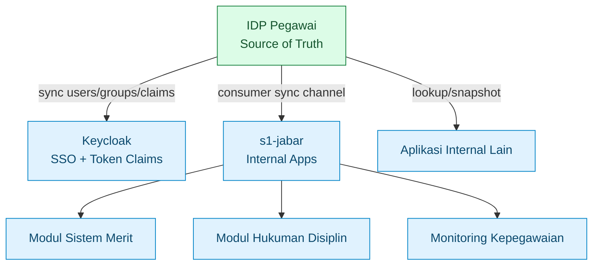
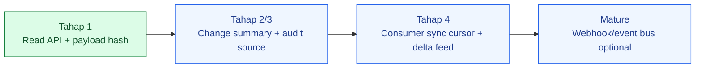
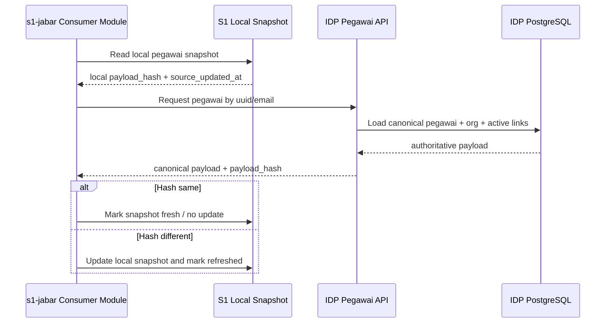
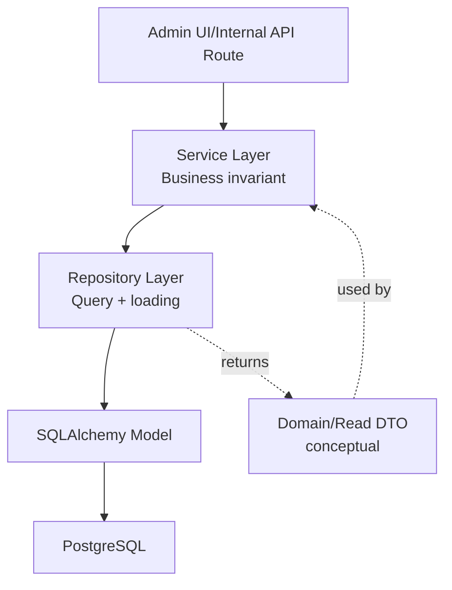
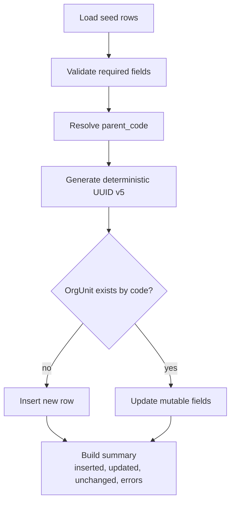
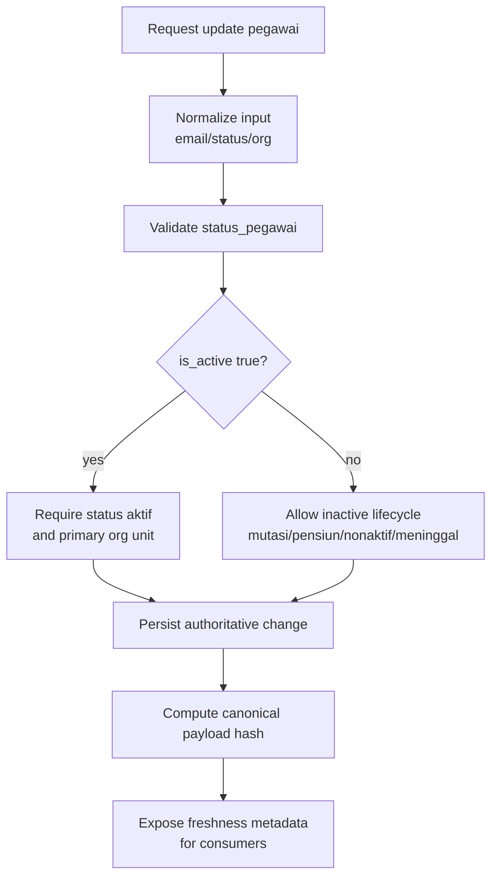
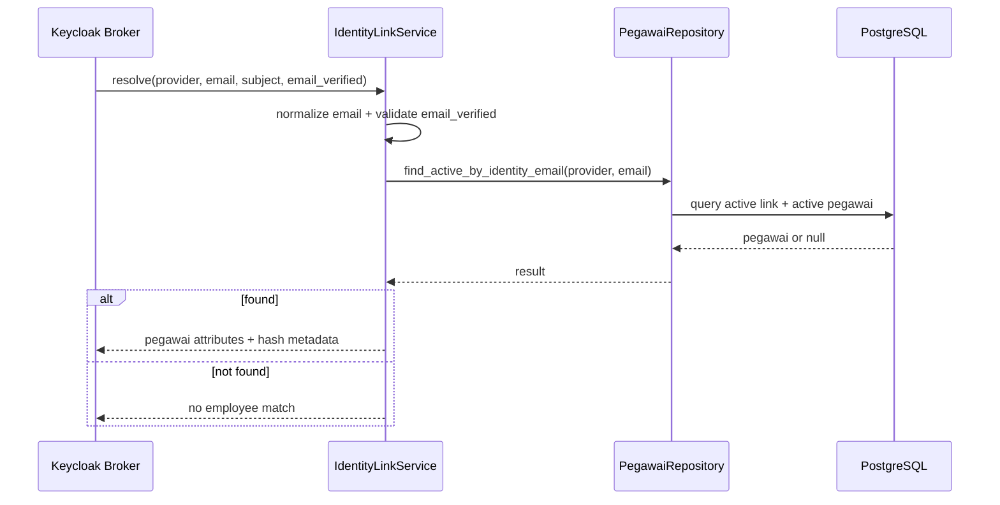
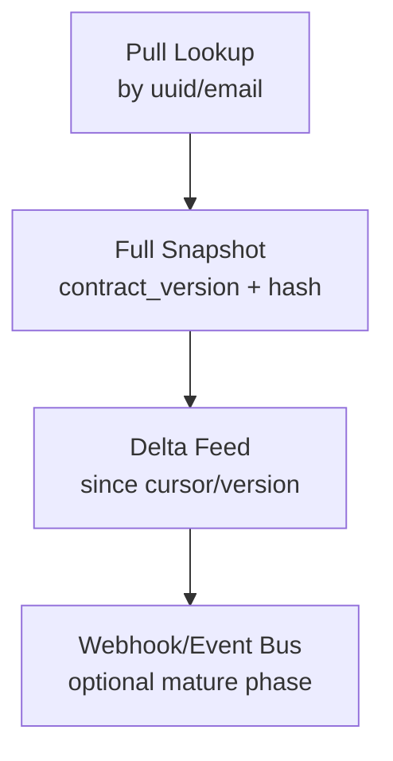
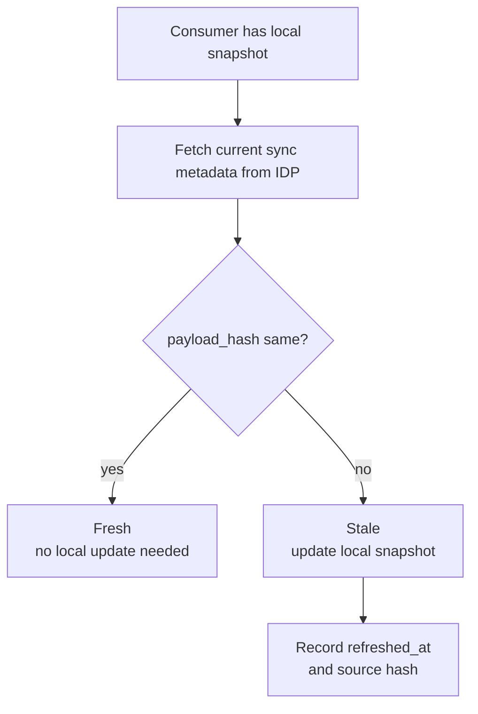

# 08 - IDP Pegawai Stage 1 Repository & Service Contract

Status: Draft contract brainstorming, **bukan kode implementasi**
Project: kumjabar_ecosystem
Date: 2026-08-27

## 1. Tujuan

Dokumen ini melanjutkan:

- `05-idp-pegawai-stage-1-flask-alembic-contract.md`
- `06-idp-pegawai-stage-1-alembic-draft.md`
- `07-idp-pegawai-stage-1-model-contract-mapping.md`

Fokus dokumen ini adalah merancang kontrak **repository** dan **service** untuk IDP Pegawai Tahap 1 dalam gaya Flask + SQLAlchemy, tetap sebagai dokumen arsitektur. Tidak ada kode Python, migration `.py`, atau provisioning.

Dokumen ini juga memasukkan titipan arsitektur penting: **IDP Pegawai tidak hanya melayani Keycloak, tetapi menjadi source of truth pada tingkat field untuk identitas ASN, lifecycle/status dan eligibility, identity link, serta afiliasi organisasi yang dikonsumsi modul seperti `s1-jabar`**. IDP bukan source of truth jabatan atau seluruh domain kepegawaian.

Contoh modul yang dapat mengonsumsi data IDP Pegawai:

- sistem merit pegawai;
- monitoring hukuman disiplin;
- monitoring status/riwayat lifecycle ASN yang dimiliki IDP; histori jabatan tetap di modul kepegawaian;
- dashboard komposisi pegawai;
- aplikasi internal lain yang membutuhkan data pegawai dan struktur organisasi.

## 2. Prinsip Source of Truth untuk Modul Kepegawaian

Ownership harus ditetapkan per field. IDP Pegawai menjadi sumber kebenaran identitas ASN, eligibility/status, identity link, dan afiliasi organisasi agar aplikasi konsumen tidak membuat master identitas sendiri-sendiri. Modul consumer tetap menjadi sumber kebenaran jabatan, jenis/label jabatan, PLT/PLH, histori jabatan, serta workflow perubahannya.



Prinsipnya:

1. `s1-jabar` boleh punya tabel lokal untuk kebutuhan transaksi modul; **master identitas ASN dan afiliasi organisasi** berasal dari IDP, sedangkan jabatan dan histori jabatan authoritative berada di modul kepegawaian S1.
2. Modul sistem merit/hukdis tidak perlu menyimpan ulang struktur organisasi sebagai sumber utama.
3. Aplikasi konsumen boleh menyimpan **snapshot lokal field milik IDP** untuk performa, reporting, dan referensi histori transaksi.
4. Snapshot field milik IDP harus punya penanda apakah masih fresh atau sudah stale; field milik consumer tidak dinilai freshness-nya terhadap IDP.
5. IDP Pegawai perlu menyediakan kanal sinkronisasi yang jelas, bukan hanya endpoint detail satu-satu.

## 3. Konsep Fresh/Stale ala Version Control

User mengusulkan konsep mirip version control: setiap perubahan data punya penanda hash sehingga konsumen tahu data lokalnya masih fresh atau stale. Ini arah yang bagus.

Konsep yang direkomendasikan:

| Konsep | Makna | Contoh |
| --- | --- | --- |
| `canonical_payload` | representasi data pegawai/org unit yang sudah dinormalisasi dan stabil urutannya | JSON canonical |
| `payload_hash` | hash dari `canonical_payload` | SHA-256 |
| `source_updated_at` | waktu terakhir data authoritative berubah di IDP | `pegawai.updated_at` |
| `source_version` | versi logis perubahan, bisa timestamp/cursor/sequence | future `change_seq` |
| `sync_cursor` | penanda posisi terakhir consumer sync | last seen version |
| `fresh` | hash/version consumer sama dengan IDP | tidak perlu update |
| `stale` | hash/version consumer berbeda/lebih lama | perlu re-sync |

Tahap 1 belum wajib membuat tabel event/cursor baru, tetapi repository/service contract harus disiapkan agar nanti bisa berkembang ke model sync yang lebih matang.

## 4. Kanal Sinkronisasi Konsumen

Kanal sinkronisasi yang disarankan bertahap:



### 4.1 Tahap 1: Pull-Based Read API + Hash

Konsumen seperti `s1-jabar` dapat memanggil endpoint read-only:

```text
GET /internal/pegawai/{uuid}
GET /internal/pegawai/by-email?email=...
GET /internal/org-units
```

Response menyertakan metadata freshness konseptual:

```json
{
  "data": {
    "uuid": "...",
    "nama_lengkap": "...",
    "status_pegawai": "aktif",
    "primary_org_unit": {
      "code": "TUM_TI",
      "path": "/kanwil-jabar/tum/ti"
    }
  },
  "sync": {
    "source": "idp-pegawai",
    "source_updated_at": "2026-08-27T07:14:46+07:00",
    "payload_hash": "sha256:...",
    "contract_version": "pegawai.v1"
  },
  "meta": {
    "request_id": "..."
  }
}
```

### 4.2 Tahap 4: Delta Feed / Cursor-Based Sync

Saat sistem makin matang, IDP Pegawai dapat menyediakan channel seperti:

```text
GET /internal/sync/pegawai/changes?since=<cursor>
GET /internal/sync/org-units/changes?since=<cursor>
GET /internal/sync/snapshots/pegawai
```

Konsep ini belum masuk implementasi Tahap 1, tapi repository/service contract perlu tidak menutup pintunya.

## 5. Visual Freshness Check



Makna:

- IDP Pegawai tetap authoritative.
- S1 boleh menyimpan snapshot untuk performa.
- Perbandingan hash mencegah update mubazir dan membantu mendeteksi stale data.

## 6. Repository Layer Principles

Repository bertanggung jawab pada query dan loading strategy, bukan business decision besar.

Prinsip repository:

1. Query harus eksplisit dan mudah diuji.
2. Filter soft delete harus konsisten.
3. Lookup publik/internal menggunakan UUID/kode/email normalized, bukan `id` internal.
4. Loading relationship harus dipilih sesuai use case agar tidak terjadi N+1 query.
5. Repository tidak menentukan apakah user boleh login; itu tugas service.
6. Repository boleh menyediakan canonical read model untuk hashing/sync.



## 7. `OrgUnitRepository` Contract

### 7.1 Tanggung Jawab

`OrgUnitRepository` menyediakan query struktur organisasi.

Tanggung jawab:

- lookup unit by UUID/code/path;
- list unit aktif;
- list tree organisasi;
- resolve `parent_code` saat seed;
- menyediakan canonical org unit payload untuk hashing/sync;
- menghitung jumlah child/pegawai jika dibutuhkan UI.

### 7.2 Method Konseptual

| Method | Input | Output | Catatan |
| --- | --- | --- | --- |
| `get_by_uuid` | `uuid` | `OrgUnit/null` | untuk detail UI/API |
| `get_by_code` | `code` | `OrgUnit/null` | untuk seed dan ABAC mapping |
| `get_by_path` | `path` | `OrgUnit/null` | validasi path |
| `list_active` | filter optional | list `OrgUnit` | ordered by `level`, `sort_order`, `name` |
| `list_tree` | include inactive? | tree/read model | build tree di service atau repository helper |
| `list_children` | parent id/uuid | list `OrgUnit` | detail unit |
| `resolve_parent_map` | list `parent_code` | map code -> id | seed service |
| `canonical_payload_for_unit` | org unit | dict stable | input hash/sync |

### 7.3 Loading Strategy

| Use Case | Strategy |
| --- | --- |
| list tree kecil | load all active ordered, build nested tree di service |
| detail unit | load parent + children + count pegawai |
| seed | lookup by code, batch resolve parent_code |
| sync snapshot | load unit fields only, no heavy relationship |

## 8. `PegawaiRepository` Contract

### 8.1 Tanggung Jawab

`PegawaiRepository` menyediakan query pegawai dan snapshot canonical pegawai.

Tanggung jawab:

- lookup pegawai by UUID;
- lookup by NIP;
- lookup by normalized email dinas/google;
- list pegawai by status/org unit;
- preload primary org unit untuk list/detail;
- preload assignments dan identity links untuk detail;
- menyediakan canonical pegawai payload untuk hash/sync.

### 8.2 Method Konseptual

| Method | Input | Output | Catatan |
| --- | --- | --- | --- |
| `get_by_uuid` | `uuid` | `Pegawai/null` | route detail/API |
| `get_detail_by_uuid` | `uuid` | `Pegawai/null` with relationships | primary org, assignments, links |
| `find_by_nip` | `nip` | `Pegawai/null` | import/sync future |
| `find_by_email_normalized` | normalized email | `Pegawai/null` | direct email columns |
| `find_active_by_identity_email` | provider + normalized email | `Pegawai/null` | Google/Keycloak link lookup |
| `list_by_org_unit` | org unit id/code | list `Pegawai` | list module/UI |
| `list_by_status` | status | list `Pegawai` | dashboard/filter |
| `canonical_payload_for_pegawai` | pegawai | dict stable | hash/sync |

### 8.3 Loading Strategy

| Use Case | Strategy |
| --- | --- |
| list pegawai | load pegawai + primary org unit saja |
| detail pegawai | load primary org unit + assignments + identity links |
| lookup login/email | direct indexed query, minimal payload |
| consumer sync snapshot | load canonical fields + primary org + active assignments + active verified identity links |

## 9. `OrgUnitSeedService` Contract

### 9.1 Tanggung Jawab

`OrgUnitSeedService` menjalankan seed org unit secara idempotent.

Tanggung jawab:

- membaca seed contract `org_units.v1.yaml`;
- validasi field wajib;
- validasi parent-child order;
- generate deterministic UUID v5 dari namespace + `code`;
- insert jika belum ada;
- update mutable fields jika sudah ada;
- tidak mengubah `code` dan `uuid` existing;
- menghasilkan summary seed.

### 9.2 Visual Seed Service Flow



### 9.3 Output Summary Konseptual

```json
{
  "seed_name": "org_units.v1",
  "total_rows": 21,
  "inserted": 0,
  "updated": 0,
  "unchanged": 21,
  "errors": []
}
```

## 10. `OrgUnitService` Contract

### 10.1 Tanggung Jawab

`OrgUnitService` menjaga business meaning struktur organisasi.

Tanggung jawab:

- membangun tree organisasi untuk UI;
- memastikan `path` dan `keycloak_group_path` konsisten;
- menyediakan org unit snapshot untuk aplikasi konsumen;
- menyediakan list unit untuk dropdown/filter;
- memisahkan unit aktif/nonaktif.

### 10.2 Invariant

- `path` harus mengikuti parent path + slug.
- `keycloak_group_path = /pegawai + path`.
- root `KANWIL_JABAR` hanya satu.
- unit nonaktif tidak dipakai sebagai assignment baru kecuali mode histori.

## 11. `PegawaiService` Contract

### 11.1 Tanggung Jawab

`PegawaiService` menjaga lifecycle ASN PNS/PPPK dan normalisasi data.

Tanggung jawab:

- membuat/update pegawai secara konseptual;
- validasi NIP wajib tepat 18 karakter digit;
- normalisasi email;
- validasi status pegawai;
- menurunkan `is_active` secara deterministik dari `status_pegawai` (`aktif -> true`, status lain -> false);
- menjaga primary org unit;
- menyiapkan canonical payload untuk hash;
- memberi sinyal perubahan data untuk future sync channel.

### 11.2 Visual Status Update Flow



### 11.3 Canonical Payload Pegawai

Canonical payload untuk hash harus stabil:

```text
pegawai_uuid
nip
nama_lengkap
email_dinas_normalized
email_google_normalized
status_pegawai
is_active
primary_org_unit.code
primary_org_unit.path
active_assignment_codes sorted
active_identity_providers sorted
updated_at
```

Catatan:

- JSON harus diserialisasi dengan key sorted dan format tanggal konsisten.
- Jangan memasukkan field volatile seperti request_id.
- Jangan memasukkan secret/provider payload sensitif.
- Kontrak `pegawai.v1` sengaja tidak memasukkan `jabatan`, `jabatan_type`, label jabatan, PLT/PLH, atau histori jabatan karena field tersebut bukan milik IDP.

## 12. `IdentityLinkService` Contract

### 12.1 Tanggung Jawab

`IdentityLinkService` mengatur link provider login.

Tanggung jawab:

- link/unlink provider;
- validasi email verified;
- lookup Google login ke pegawai aktif;
- update `last_seen_at` secara konseptual;
- menolak pemindahan `provider_subject` tanpa proses koreksi/audit.

### 12.2 Visual Identity Resolution



## 13. `PegawaiLookupService` Contract

### 13.1 Tanggung Jawab

`PegawaiLookupService` adalah service read-only untuk API internal dan consumer sync awal.

Tanggung jawab:

- lookup pegawai by UUID/email;
- mengembalikan response envelope stabil;
- menyertakan `payload_hash`, `source_updated_at`, dan `contract_version`;
- menyembunyikan `id` internal;
- menyembunyikan metadata/provider payload sensitif;
- menjadi fondasi kanal sync untuk `s1-jabar` dan aplikasi lain.

### 13.2 Response Contract

```json
{
  "data": {
    "uuid": "pegawai-uuid",
    "nip": "199001012020121001",
    "nama_lengkap": "Nama Pegawai",
    "status_pegawai": "aktif",
    "is_active": true,
    "primary_org_unit": {
      "uuid": "org-unit-uuid",
      "code": "TUM_TI",
      "name": "Teknologi dan Informasi",
      "path": "/kanwil-jabar/tum/ti"
    }
  },
  "sync": {
    "source": "idp-pegawai",
    "contract_version": "pegawai.v1",
    "source_updated_at": "2026-08-27T07:14:46+07:00",
    "payload_hash": "sha256:canonical-payload-hash"
  },
  "meta": {
    "request_id": "request-id"
  }
}
```

## 14. Consumer Sync Service Preview

Walaupun belum masuk Tahap 1 implementasi, konsep service berikut perlu dicatat sebagai arah:

| Service Future | Tanggung Jawab |
| --- | --- |
| `ConsumerSyncService` | menyediakan snapshot/delta data pegawai dan org unit untuk aplikasi konsumen |
| `PayloadHashService` | membuat hash canonical payload pegawai/org unit |
| `ChangeCursorService` | mengelola cursor perubahan bila nanti ada change log |
| `ConsumerRegistryService` | mencatat aplikasi konsumen dan scope datanya bila nanti perlu governance |

### 14.1 Pilihan Kanal Sync

| Kanal | Kapan Dipakai | Catatan |
| --- | --- | --- |
| Pull by UUID/email | Tahap 1 | sederhana, cocok untuk lookup on demand |
| Full snapshot endpoint | Tahap 2/3 | cocok untuk bootstrap cache konsumen |
| Delta feed by cursor | Tahap 4 | cocok untuk data cukup besar dan berkala |
| Webhook/event bus | Mature phase | perlu reliability, retry, secret, audit lebih matang |

### 14.2 Mermaid Sync Evolution



## 15. Freshness Metadata Contract

Setiap response yang bisa disimpan consumer sebagai snapshot sebaiknya menyertakan blok `sync`.

| Field | Wajib | Makna |
| --- | --- | --- |
| `source` | ya | nama source, misalnya `idp-pegawai` |
| `contract_version` | ya | versi bentuk payload, misalnya `pegawai.v1` |
| `source_updated_at` | ya | timestamp authoritative terakhir |
| `payload_hash` | ya | SHA-256 canonical payload |
| `cursor` | belum Tahap 1 | posisi delta feed masa depan |
| `snapshot_generated_at` | opsional | kapan response/snapshot dibuat |

Freshness decision di consumer:



## 16. Error Contract Preview

Service harus membedakan error domain, not found, dan forbidden/internal.

| Error Code | HTTP Konseptual | Makna |
| --- | --- | --- |
| `not_found` | 404 | data tidak ditemukan |
| `inactive_pegawai` | 409/422 | pegawai ada tapi tidak aktif untuk konteks internal |
| `invalid_email` | 422 | format email tidak valid |
| `identity_not_verified` | 422 | email provider belum verified |
| `duplicate_active_record` | 409 | melanggar unique active constraint |
| `internal_dependency_error` | 502/503 | dependency internal gagal |

Response error:

```json
{
  "error": {
    "code": "not_found",
    "message": "Pegawai tidak ditemukan",
    "details": {}
  },
  "meta": {
    "request_id": "request-id"
  }
}
```

## 17. Guardrails Repository & Service

- Repository tidak boleh expose `id` internal ke API/UI shape.
- Repository tidak membuat keputusan authorization final.
- Service tidak boleh melakukan query acak tanpa repository kecuali helper internal yang jelas.
- Hash harus berasal dari canonical payload yang stabil.
- Consumer snapshot atas field milik IDP tidak boleh dianggap source of truth. Sebaliknya, consumer memang authoritative untuk jabatan dan domain transaksi lokalnya.
- Jika S1 punya data modul merit/hukdis, relasinya ke pegawai memakai `pegawai_uuid` atau kode stabil, bukan copy master pegawai penuh sebagai kebenaran baru.
- Jika data IDP berubah, consumer harus bisa mendeteksi stale lewat hash/version/timestamp.

## 18. Open Questions untuk Review

| Pertanyaan | Rekomendasi Awal |
| --- | --- |
| Apakah Tahap 1 perlu endpoint metadata-only untuk hash? | Bisa dipertimbangkan: `GET /internal/pegawai/{uuid}/sync-metadata`, tapi belum wajib. |
| Apakah perlu kolom `data_hash` di tabel `pegawai`? | Belum wajib; bisa dihitung service. Jika performa butuh, simpan materialized hash nanti. |
| Apakah perlu `change_seq` dari awal? | Belum untuk Tahap 1. Catat sebagai kandidat Tahap 4 saat delta feed dibuat. |
| Apakah S1 menyimpan snapshot pegawai lokal? | Boleh untuk performa/reporting, tapi harus menyimpan `source_hash` dan `source_updated_at`. |
| Apakah consumer sync channel harus publik? | Tidak. Tetap internal/private/service account. |
| Apakah hash menggantikan audit log? | Tidak. Hash untuk freshness; audit log untuk pertanggungjawaban perubahan. |

## 19. Kesimpulan

Repository & Service Contract Tahap 1 mengunci arah berikut:

1. IDP Pegawai adalah source of truth field identitas ASN, lifecycle/status dan eligibility, identity link, serta afiliasi organisasi; bukan jabatan atau seluruh domain kepegawaian.
2. Repository bertugas query, lookup, loading strategy, dan canonical payload read.
3. Service bertugas invariant, normalisasi, seed, lookup, dan freshness metadata.
4. Aplikasi konsumen seperti `s1-jabar` boleh menyimpan snapshot field milik IDP dan mendeteksi fresh/stale dari `payload_hash`, `contract_version`, dan `source_updated_at`; jabatan dan historinya tetap authoritative di consumer.
5. Delta feed/cursor/webhook adalah evolusi masa depan, bukan implementasi Tahap 1.

Dokumen ini menjadi jembatan ke dokumen berikutnya: **Admin UI & Internal API Contract**, tetap dalam mode brainstorming arsitektur.

Kontrak Admin UI & Internal API dilanjutkan pada `09-idp-pegawai-stage-1-admin-ui-internal-api-contract.md`.
