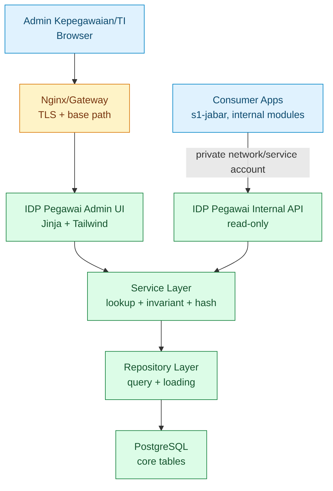
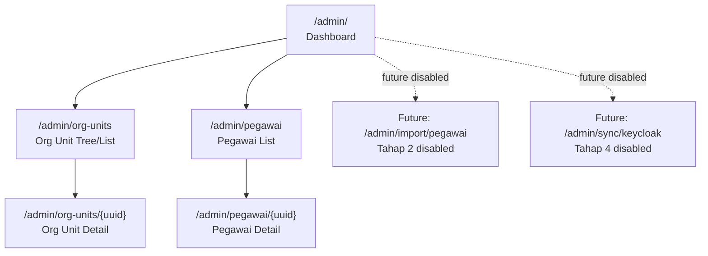
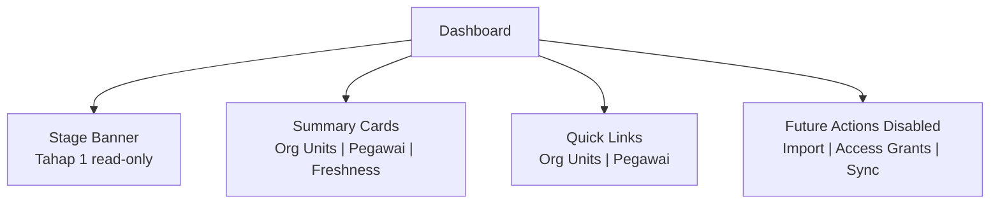
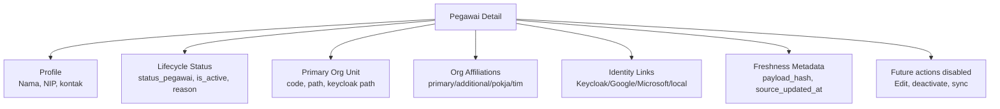
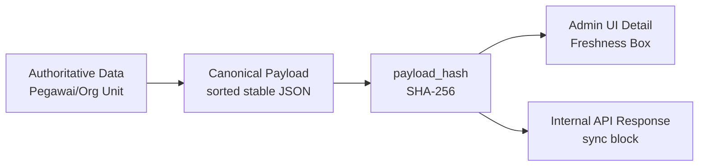
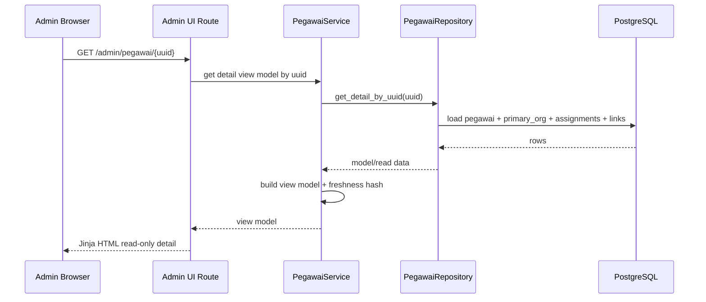
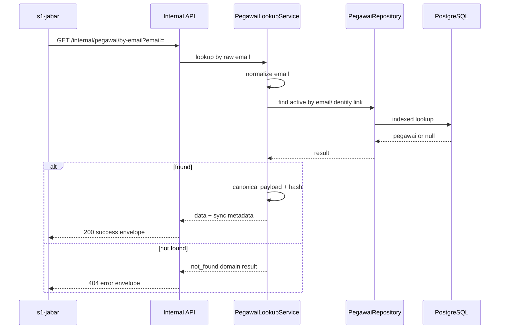

# 09 - IDP Pegawai Stage 1 Admin UI & Internal API Contract

Status: Draft contract brainstorming, **bukan kode implementasi**
Project: kumjabar_ecosystem
Date: 2026-08-27

## 1. Tujuan

Dokumen ini melanjutkan:

- `05-idp-pegawai-stage-1-flask-alembic-contract.md`
- `06-idp-pegawai-stage-1-alembic-draft.md`
- `07-idp-pegawai-stage-1-model-contract-mapping.md`
- `08-idp-pegawai-stage-1-repository-service-contract.md`

Fokus dokumen ini adalah merancang kontrak **Admin UI** dan **Internal API** IDP Pegawai Tahap 1. Semua masih pada level arsitektur/brainstorming. Tidak ada kode Flask, template, route, migration, atau provisioning.

Tahap 1 UI/API bertujuan memastikan pondasi data bisa dilihat, direview, dan dikonsumsi secara read-only sebelum masuk import pipeline, access grant, audit penuh, dan Keycloak sync.

## 2. Boundary Tahap 1

### 2.1 Masuk Scope

Admin UI Tahap 1:

- dashboard ringkas;
- list/tree org unit;
- detail org unit;
- list pegawai;
- detail pegawai;
- tampilan metadata freshness/hash secara konseptual;
- tampilan status read-only bahwa sistem belum masuk tahap import/sync.

Internal API Tahap 1:

- read-only lookup org unit;
- read-only lookup pegawai;
- lookup pegawai by email normalized;
- response envelope stabil;
- metadata `sync` untuk freshness/stale detection.

### 2.2 Tidak Masuk Scope

Belum masuk Tahap 1:

- create/edit/delete pegawai lewat UI;
- upload CSV/XLSX;
- dry-run import;
- apply import;
- error workbook;
- access grant UI;
- audit log penuh;
- trigger sync Keycloak;
- endpoint delta cursor;
- webhook/event bus;
- public exposure.

## 3. Posisi UI/API dalam Arsitektur



Catatan:

- Admin UI untuk manusia/operator.
- Internal API untuk aplikasi konsumen, sync worker masa depan, atau tooling internal.
- Dua jalur ini memakai service/repository yang sama agar kontrak data tidak bercabang.

## 4. Prinsip Admin UI Tahap 1

Admin UI Tahap 1 harus sederhana, cepat direview, dan tidak memberi kesan fitur mutasi data sudah aktif.

Prinsip:

1. **Read-only dulu.** Tahap 1 fokus melihat hasil schema/seed/data, bukan mengubah data.
2. **Jinja + Tailwind minimal.** Tidak perlu SPA berat.
3. **UUID di route.** Jangan expose internal integer `id` sebagai URL utama.
4. **Tampilkan source/freshness metadata bila relevan.** Operator/TI bisa melihat apakah data punya hash/snapshot marker.
5. **Action disabled dengan alasan jelas.** Tombol import/sync/update boleh tampil sebagai future capability, tetapi disabled dan diberi label `Tahap berikutnya`.
6. **Tidak query langsung dari template.** Template menerima view model dari service/controller.
7. **Base path aware.** UI harus siap berjalan di `/idp-pegawai/` jika fallback path-based routing dipakai.

## 5. Visual Admin UI Navigation



## 6. Admin UI Route Contract

| Route | Method | Tujuan | Data Utama | Status Tahap 1 |
| --- | --- | --- | --- | --- |
| `/admin/` | GET | Dashboard ringkas | count org unit, count pegawai, status seed, latest update | aktif read-only |
| `/admin/org-units` | GET | Tree/list organisasi | unit aktif/nonaktif, level, path, keycloak path | aktif read-only |
| `/admin/org-units/{uuid}` | GET | Detail org unit | parent, children, pegawai count, metadata ringkas | aktif read-only |
| `/admin/pegawai` | GET | List pegawai | nama, NIP, email, status, primary unit | aktif read-only |
| `/admin/pegawai/{uuid}` | GET | Detail pegawai | profil, status, unit, assignments, identity links, hash | aktif read-only |
| `/admin/import/pegawai` | GET | Future import | placeholder tahap 2 | disabled/coming soon |
| `/admin/sync/keycloak` | GET | Future sync | placeholder tahap 4 | disabled/coming soon |

Catatan route:

- Jika path-based routing digunakan, public URL konseptual menjadi `https://sso-jabar.kemenkum.go.id/idp-pegawai/admin/...`.
- Aplikasi internal tetap bisa mendefinisikan route lokal `/admin/...`; gateway menambahkan/menghapus prefix sesuai konfigurasi.

## 7. Dashboard Contract

Dashboard Tahap 1 menampilkan status pondasi, bukan operational console lengkap.

### 7.1 Komponen Dashboard

| Komponen | Isi | Catatan |
| --- | --- | --- |
| Status Tahap | `Tahap 1 - Contract & Seed` | jelas bahwa import/sync belum aktif |
| Org Unit Summary | total unit, active unit, inactive unit | validasi seed awal |
| Pegawai Summary | total pegawai, aktif, nonaktif | jika data pegawai belum ada, tampilkan 0 dengan pesan wajar |
| Freshness Summary | latest `source_updated_at`, sample hash status | konseptual untuk consumer sync |
| Future Capability | Import, access grant, sync Keycloak | disabled dengan keterangan tahap |

### 7.2 Dashboard Wireframe Konseptual



## 8. Org Unit UI Contract

### 8.1 List/Tree Page

Route:

```text
GET /admin/org-units
```

Filter konseptual:

| Filter | Tipe | Catatan |
| --- | --- | --- |
| `q` | text | cari code/name/path |
| `unit_type` | dropdown | kanwil/divisi/bidang/bagian/pokja/tim |
| `is_active` | dropdown | all/active/inactive |

Kolom list:

| Kolom | Catatan |
| --- | --- |
| Code | stable business key |
| Name | nama unit |
| Type | unit type |
| Level | depth tree |
| Path | internal path |
| Keycloak Group Path | mapping group |
| Active | status |
| Aksi | detail only |

### 8.2 Detail Page

Route:

```text
GET /admin/org-units/{uuid}
```

Menampilkan:

- identitas unit;
- parent unit;
- children;
- path/keycloak path;
- status aktif;
- effective period;
- count pegawai primary;
- metadata ringkas.

## 9. Pegawai UI Contract

### 9.1 List Page

Route:

```text
GET /admin/pegawai
```

Filter konseptual:

| Filter | Tipe | Catatan |
| --- | --- | --- |
| `q` | text | cari nama/NIP/email |
| `status_pegawai` | dropdown | aktif/mutasi/pensiun/nonaktif/meninggal |
| `org_unit_code` | dropdown/tree select | unit utama |
| `has_keycloak_user` | dropdown | all/yes/no |
| `has_google_link` | dropdown | all/yes/no |

Kolom list:

| Kolom | Catatan |
| --- | --- |
| Nama | nama lengkap + gelar ringkas bila ada |
| NIP | identitas ASN wajib, tepat 18 digit |
| Email Dinas | raw display |
| Email Google | raw display |
| Unit Utama | code + short name |
| Status | badge status |
| Active | badge eligibility |
| Freshness | hash ada/tidak, updated_at |
| Aksi | detail only |

### 9.2 Detail Page

Route:

```text
GET /admin/pegawai/{uuid}
```

Section detail:



## 10. UI Capability Contract

Walaupun Tahap 1 read-only, UI sebaiknya sejak awal menyiapkan konsep capability agar nanti Tahap 3 tidak perlu rombak besar.

| Capability | Tahap 1 | Tahap Berikutnya |
| --- | --- | --- |
| `can_view_dashboard` | true untuk admin login | tetap |
| `can_view_org_units` | true | tetap |
| `can_view_pegawai` | true | tetap |
| `can_import_pegawai` | false/disabled | Tahap 2 |
| `can_update_pegawai` | false/disabled | setelah audit/access siap |
| `can_manage_access_grants` | false/disabled | Tahap 3 |
| `can_trigger_sync` | false/disabled | Tahap 4 |

Prinsip:

- UI tidak hard-code role string langsung di template.
- UI menerima capability flags dari backend/service.
- Jika tombol disabled, tampilkan alasan: `Tersedia mulai Tahap 2 Import Pipeline`.

## 11. Internal API Principles

Internal API Tahap 1 adalah read-only channel untuk:

- Keycloak bridge masa depan;
- aplikasi konsumen seperti `s1-jabar`;
- modul kepegawaian internal;
- tooling TI dalam private network.

Prinsip:

1. **Private only.** Tidak boleh diekspos publik.
2. **Read-only Tahap 1.** Tidak ada mutasi data.
3. **UUID/code/email normalized.** Hindari `id` internal.
4. **Stable envelope.** Response selalu punya `data`/`error`, `sync`, dan `meta` bila relevan.
5. **Freshness metadata.** Payload yang bisa disimpan consumer harus punya `contract_version`, `payload_hash`, dan `source_updated_at`.
6. **No secrets.** Jangan expose provider payload sensitif, token, credential, atau metadata raw besar.

## 12. Internal API Route Contract

### 12.1 Org Unit Endpoints

| Endpoint | Method | Tujuan | Response Data |
| --- | --- | --- | --- |
| `/internal/org-units` | GET | list org unit | array org unit read model + sync summary |
| `/internal/org-units/{uuid}` | GET | detail org unit | org unit detail + children summary |
| `/internal/org-units/by-code/{code}` | GET | lookup by code | org unit detail |

Query filter untuk `/internal/org-units`:

| Query | Catatan |
| --- | --- |
| `is_active` | optional bool |
| `unit_type` | optional |
| `include_children` | optional bool |

### 12.2 Pegawai Endpoints

| Endpoint | Method | Tujuan | Response Data |
| --- | --- | --- | --- |
| `/internal/pegawai/{uuid}` | GET | detail pegawai by UUID | pegawai read model + sync metadata |
| `/internal/pegawai/by-email` | GET | lookup by email | pegawai read model/null |
| `/internal/pegawai/by-nip/{nip}` | GET | lookup by NIP | pegawai read model/null |

Query untuk `/internal/pegawai/by-email`:

| Query | Wajib | Catatan |
| --- | --- | --- |
| `email` | ya | raw email dari consumer/provider, dinormalisasi service |
| `provider` | tidak | optional `google`, `keycloak`, `email_dinas` |
| `active_only` | tidak | default true untuk consumer login/sync |

### 12.3 Freshness Metadata Endpoint Kandidat

Opsional untuk Tahap 1, tapi bagus dicatat:

| Endpoint | Method | Tujuan |
| --- | --- | --- |
| `/internal/pegawai/{uuid}/sync-metadata` | GET | ambil hash/version tanpa payload penuh |
| `/internal/org-units/{uuid}/sync-metadata` | GET | ambil hash/version unit |

Endpoint metadata-only berguna jika consumer hanya ingin cek stale/fresh tanpa menarik payload besar. Namun boleh ditunda jika ingin menjaga Tahap 1 tetap kecil.

## 13. Response Envelope Contract

### 13.1 Success Envelope

```json
{
  "data": {},
  "sync": {
    "source": "idp-pegawai",
    "contract_version": "pegawai.v1",
    "source_updated_at": "2026-08-27T07:26:47+07:00",
    "payload_hash": "sha256:..."
  },
  "meta": {
    "request_id": "..."
  }
}
```

Untuk list endpoint:

```json
{
  "data": [],
  "sync": {
    "source": "idp-pegawai",
    "contract_version": "org_units.v1",
    "snapshot_generated_at": "2026-08-27T07:26:47+07:00",
    "payload_hash": "sha256:list-snapshot-hash"
  },
  "meta": {
    "request_id": "...",
    "count": 21
  }
}
```

### 13.2 Error Envelope

```json
{
  "error": {
    "code": "not_found",
    "message": "Pegawai tidak ditemukan",
    "details": {}
  },
  "meta": {
    "request_id": "..."
  }
}
```

## 14. Read Model Contract

### 14.1 Org Unit Read Model

```json
{
  "uuid": "org-unit-uuid",
  "code": "TUM_TI",
  "slug": "ti",
  "name": "Teknologi dan Informasi",
  "short_name": "TI",
  "unit_type": "tim",
  "level": 2,
  "path": "/kanwil-jabar/tum/ti",
  "keycloak_group_path": "/pegawai/kanwil-jabar/tum/ti",
  "sort_order": 44,
  "is_active": true,
  "parent": {
    "uuid": "parent-uuid",
    "code": "TUM"
  },
  "children_count": 0
}
```

### 14.2 Pegawai Read Model

```json
{
  "uuid": "pegawai-uuid",
  "nip": "199001012020121001",
  "nama_lengkap": "Nama Pegawai",
  "gelar_depan": null,
  "gelar_belakang": "S.Kom.",
  "email_dinas": "pegawai@kemenkum.go.id",
  "email_google": "pegawai@gmail.com",
  "primary_org_unit": {
    "uuid": "org-unit-uuid",
    "code": "TUM_TI",
    "name": "Teknologi dan Informasi",
    "path": "/kanwil-jabar/tum/ti",
    "keycloak_group_path": "/pegawai/kanwil-jabar/tum/ti"
  },
  "status_pegawai": "aktif",
  "is_active": true,
  "keycloak_user_id": "keycloak-user-id-if-available",
  "assignments": [],
  "identity_links": [
    {
      "provider": "google",
      "email": "pegawai@gmail.com",
      "email_verified": true,
      "is_active": true,
      "last_seen_at": null
    }
  ]
}
```

Catatan:

- `id` internal tidak muncul.
- `metadata` raw tidak muncul default.
- `provider_subject` bisa disembunyikan dari response umum karena bisa sensitif; hanya tampil di UI TI/detail khusus bila diperlukan.
- `assignments` hanya berisi afiliasi organisasi. Read model/API IDP tidak memuat `jabatan`, `jabatan_type`, label jabatan, PLT/PLH, atau histori jabatan, termasuk melalui metadata.

## 15. Freshness Display di UI

UI detail pegawai/org unit bisa menampilkan box kecil:

| Label | Contoh |
| --- | --- |
| Source | `idp-pegawai` |
| Contract | `pegawai.v1` |
| Last Source Update | `2026-08-27 07:26:47` |
| Payload Hash | `sha256:abc123...` |
| Consumer Hint | `Gunakan hash ini untuk cek stale/fresh snapshot lokal` |

Visual:



## 16. Security Boundary Contract

### 16.1 Admin UI

Tahap 1 security konseptual:

- wajib berada di belakang gateway/TLS;
- login via Keycloak client `idp-pegawai-admin` saat UI benar-benar dibuat;
- role awal minimal read-only admin/operator;
- session cookie harus secure;
- jika path-based routing, cookie path sebaiknya `/idp-pegawai`.

### 16.2 Internal API

Internal API:

- hanya private network;
- gateway publik harus deny `/idp-pegawai/internal/*`;
- service account/JWT/mTLS bisa dimatangkan di tahap implementasi/hardening;
- rate limit dan request ID disiapkan secara konsep;
- no public CORS.

Visual boundary:

```mermaid
flowchart TD
    Internet["Internet/Public"]
    Gateway["Nginx/Gateway"]
    Keycloak["Keycloak"]
    AdminUI["IDP Admin UI"]
    InternalAPI["IDP Internal API"]
    PrivateNet["Private Container Network"]
    Consumer["s1-jabar/service account"]

    Internet --> Gateway
    Gateway -->|/realms /admin /resources| Keycloak
    Gateway -->|/idp-pegawai/admin| AdminUI
    Gateway -. deny .->|/idp-pegawai/internal/*| InternalAPI
    Consumer --> PrivateNet --> InternalAPI
```

## 17. Request Flow: Admin UI Detail Pegawai



## 18. Request Flow: Consumer Lookup by Email



## 19. UI Loading Strategy

| Page | Loading Strategy | Alasan |
| --- | --- | --- |
| Dashboard | aggregate counts + latest updated_at | cepat, ringkas |
| Org Unit List | load ordered org units; build tree in service | jumlah unit relatif kecil |
| Org Unit Detail | unit + parent + children + pegawai count | cukup untuk konteks |
| Pegawai List | pegawai + primary org unit only | hindari berat/N+1 |
| Pegawai Detail | pegawai + primary org unit + assignments + identity links | detail lengkap |

## 20. Pagination dan Filter

Pegawai list harus disiapkan untuk data besar.

Kontrak awal:

| Parameter | Default | Catatan |
| --- | --- | --- |
| `page` | 1 | pagination |
| `per_page` | 25 | max konseptual 100 |
| `q` | null | nama/NIP/email |
| `status_pegawai` | null | filter status |
| `org_unit_code` | null | filter primary unit |

Response/list view model menyertakan:

```text
items
page
per_page
total
has_next
has_prev
filters_applied
```

## 21. Empty State dan Disabled State

Karena Tahap 1 mungkin belum ada data pegawai, UI harus ramah.

| Situasi | Pesan UI |
| --- | --- |
| belum ada pegawai | `Belum ada data pegawai. Import pegawai akan tersedia pada Tahap 2.` |
| org unit belum seeded | `Seed org unit belum tersedia/terdeteksi.` |
| tombol import disabled | `Import Pegawai dirancang untuk Tahap 2 Import Pipeline.` |
| tombol sync disabled | `Sync Keycloak dirancang untuk Tahap 4.` |
| update disabled | `Update data menunggu Access & Audit agar perubahan tercatat aman.` |

## 22. Open Questions untuk Review

| Pertanyaan | Rekomendasi Awal |
| --- | --- |
| Apakah UI Tahap 1 wajib login Keycloak walau read-only? | Secara arsitektur ya; saat implementasi boleh ada local dev bypass khusus development. |
| Apakah endpoint metadata-only dibuat di Tahap 1? | Opsional. Jika ingin kecil, cukup sync block di endpoint detail/list. |
| Apakah `provider_subject` tampil di UI? | Hanya untuk role TI/admin detail, tidak default. |
| Apakah internal API perlu OpenAPI docs? | Bagus untuk kontrak, tapi docs route jangan publik. Bisa dirancang nanti. |
| Apakah consumer `s1-jabar` memakai push atau pull? | Awal pull-based; delta/webhook nanti. |
| Apakah import/sync menu boleh terlihat? | Boleh sebagai disabled roadmap supaya operator paham arah fitur. |

## 23. Acceptance Criteria Desain Tahap 1 UI/API

Saat nanti masuk implementasi eksplisit, desain ini dianggap terpenuhi bila:

- Admin UI punya dashboard read-only.
- Org unit list/detail bisa membaca struktur seed.
- Pegawai list/detail bisa membaca data jika tersedia.
- UI tidak expose internal `id` di URL.
- Internal API read-only mengembalikan envelope stabil.
- Response pegawai/org unit menyertakan freshness metadata/hash.
- `/internal/*` tidak diekspos publik oleh gateway.
- Tombol fitur Tahap 2-4 disabled dengan alasan jelas.
- Tidak ada mutasi data tanpa audit/access design.

## 24. Kesimpulan

Admin UI & Internal API Tahap 1 dirancang sebagai **read-only verification and consumption layer**.

Perannya:

1. membantu operator/TI melihat pondasi data;
2. membantu developer/reviewer memvalidasi kontrak schema;
3. memberi aplikasi konsumen seperti `s1-jabar` kanal lookup awal;
4. membawa metadata freshness/hash agar snapshot consumer bisa mendeteksi fresh/stale;
5. tidak membuka mutasi data sebelum import, access grant, audit, dan sync dirancang matang.

Dokumen berikutnya adalah `10-idp-pegawai-stage-1-review-checklist-open-decisions.md`, sebagai review gate untuk mengunci keputusan kecil sebelum nanti masuk Tahap 2 brainstorming atau sebelum suatu hari masuk implementasi eksplisit.
