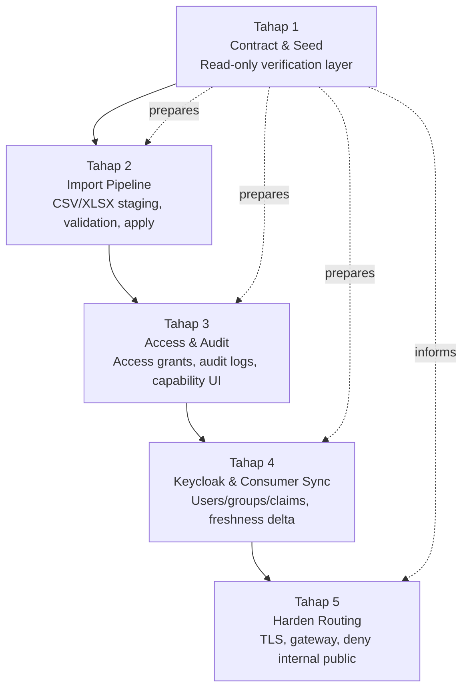
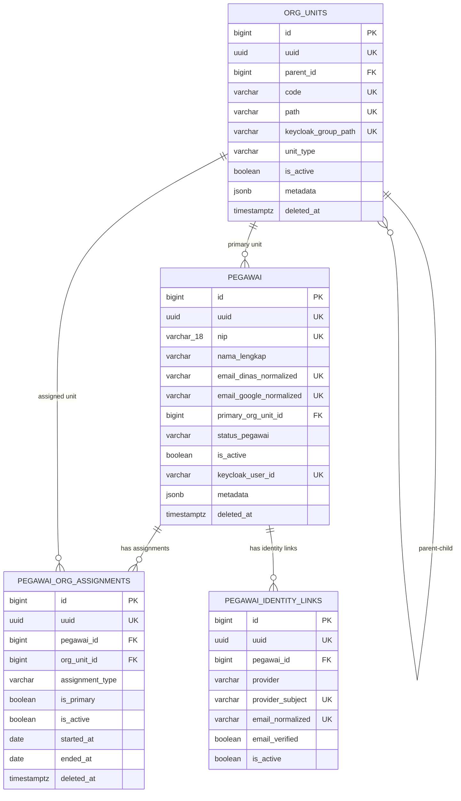
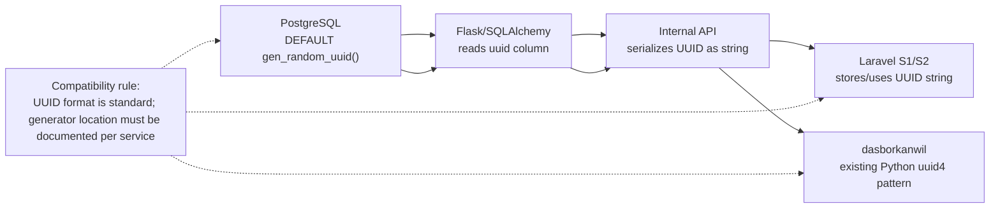
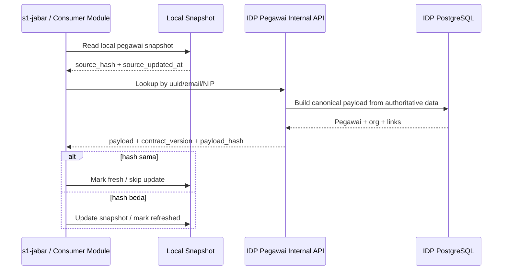
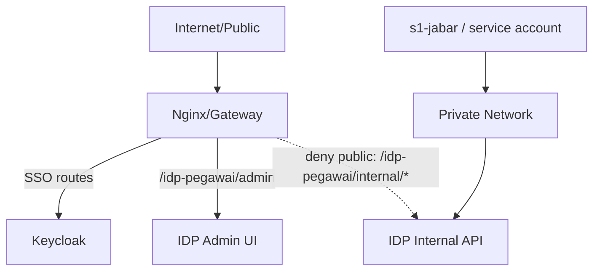
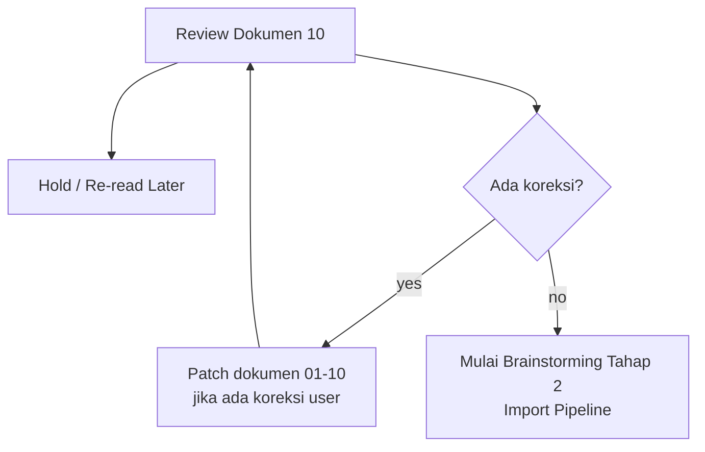

# 10 - IDP Pegawai Stage 1 Review Checklist & Open Decisions

Status: Draft review gate, **bukan kode implementasi**
Project: kumjabar_ecosystem
Date: 2026-08-27

## 1. Tujuan

Dokumen ini menjadi **gerbang review Tahap 1** sebelum proyek masuk brainstorming Tahap 2.

Dokumen ini merangkum, merapikan, dan mengunci hasil dari dokumen:

- `01-identity-access-blueprint.md`
- `02-organization-identity-contract.md`
- `03-keycloak-matrix-and-org-unit-seed.md`
- `04-idp-pegawai-schema-and-access-ui.md`
- `05-idp-pegawai-stage-1-flask-alembic-contract.md`
- `06-idp-pegawai-stage-1-alembic-draft.md`
- `07-idp-pegawai-stage-1-model-contract-mapping.md`
- `08-idp-pegawai-stage-1-repository-service-contract.md`
- `09-idp-pegawai-stage-1-admin-ui-internal-api-contract.md`

Catatan penting: sesuai arahan user, seluruh Tahap 1-5 saat ini masih **brainstorming/perancangan arsitektur**. Dokumen ini bukan approval coding, bukan migration, bukan provisioning, dan bukan task implementasi.

## 2. Hasil Konsolidasi Dokumen 01-09

Update review 2026-08-27: setelah klarifikasi lanjutan user, kontrak identitas kepegawaian disederhanakan menjadi satu kolom `nip`. Kolom alternatif yang sebelumnya diasumsikan untuk membedakan format lama/baru dihapus dari schema, model, repository, API, dan import contract karena NIP diperlakukan sebagai identitas kepegawaian resmi yang stabil/permanen. Dokumen ini juga mempertahankan review khusus UUID generation agar kompatibel lintas Flask/Python dan Laravel.

Setelah membaca ulang dokumen 01-09, ada beberapa tumpang tindih historis yang sudah dirapikan dengan catatan superseded/pointer:

| Area | Kondisi Awal | Keputusan Terbaru | Dokumen Acuan |
| --- | --- | --- | --- |
| Struktur organisasi | Draft awal masih memuat UPT dan struktur lama | Fase awal tanpa UPT; fokus Kanwil Jabar: Divisi Yankum, Divisi P3H, Tum | 02, 03 |
| Public group | Draft awal memuat `/publik/notaris`, `/pemohon-magang-penelitian`, dll | Public group awal cukup `/publik/masyarakat`; persona layanan dikelola aplikasi S2 | 02, 03 |
| Realm | Masih berupa kandidat | Dipilih `kumjabar` | 02, 03 |
| Admin UI IDP | Sempat disebut CRUD/import terlalu awal | Tahap 1 read-only/list/detail; import Tahap 2; mutation menunggu access/audit | 04, 05, 09 |
| Stack IDP Pegawai | Belum jelas Flask/FastAPI/Laravel | Draft arah: Flask + SQLAlchemy + Alembic + PostgreSQL | 05 |
| Schema roadmap | Dokumen 04 memuat semua tabel | Tabel penuh dibagi Tahap 1-4; Tahap 1 hanya core 4 table | 04, 05, 06 |
| Sync | Awalnya fokus Keycloak saja | IDP juga source of truth untuk consumer seperti S1, dengan freshness/hash | 08, 09 |
| Diagram | Belum menjadi aturan eksplisit | Mermaid wajib dipakai bila relevan untuk alur/ERD/sequence/routing | AGENTS, 06-09 |

## 3. Visual Roadmap Konsolidasi

```mermaid
flowchart LR
    D01["01\nDraft awal IAM"]
    D02["02\nOrg Identity Contract"]
    D03["03\nKeycloak Matrix + Seed"]
    D04["04\nFull IDP Schema Roadmap"]
    D05["05\nStage 1 Flask + Alembic"]
    D06["06\nAlembic Draft"]
    D07["07\nModel Mapping"]
    D08["08\nRepository + Service"]
    D09["09\nAdmin UI + API"]
    D10["10\nReview Gate"]

    D01 --> D02 --> D03 --> D04 --> D05 --> D06 --> D07 --> D08 --> D09 --> D10

    classDef historic fill:#fef3c7,stroke:#d97706,color:#78350f
    classDef stage1 fill:#dcfce7,stroke:#15803d,color:#14532d
    classDef review fill:#ede9fe,stroke:#7c3aed,color:#4c1d95
    class D01,D02,D03,D04 historic
    class D05,D06,D07,D08,D09 stage1
    class D10 review
```



Makna:

- Dokumen 01-04 adalah fondasi dan koreksi arsitektur awal.
- Dokumen 05-09 adalah pendalaman Tahap 1.
- Dokumen 10 ini adalah checkpoint sebelum bergerak ke Tahap 2.

## 4. Scope Final Tahap 1

Tahap 1 dinamai:

```text
Contract & Seed
```

### 4.1 Masuk Tahap 1

| Area | Masuk Tahap 1 |
| --- | --- |
| Stack | Flask + SQLAlchemy + Alembic + PostgreSQL sebagai arah desain |
| Schema core | `org_units`, `pegawai`, `pegawai_org_assignments`, `pegawai_identity_links` |
| Migration design | draft Alembic `0001_create_idp_pegawai_core` konseptual |
| Seed | seed `org_units.v1.yaml` konseptual, 21 canonical rows, idempotent |
| Model mapping | `OrgUnit`, `Pegawai`, `PegawaiOrgAssignment`, `PegawaiIdentityLink` |
| Repository | query/read model/canonical payload contract |
| Service | invariant, seed, lookup, normalization, freshness metadata |
| Admin UI | read-only dashboard, org unit list/detail, pegawai list/detail |
| Internal API | read-only lookup org unit/pegawai/email/NIP |
| Freshness | `contract_version`, `source_updated_at`, `payload_hash` konseptual |
| Security principle | Admin UI via gateway/TLS/Keycloak; Internal API private only |

### 4.2 Tidak Masuk Tahap 1

| Area | Ditunda ke |
| --- | --- |
| CSV/XLSX upload | Tahap 2 |
| Dry-run validation | Tahap 2 |
| Apply import | Tahap 2 |
| Error workbook | Tahap 2 |
| `access_grants` | Tahap 3 |
| `audit_logs` penuh | Tahap 3 |
| Mutasi/edit data nyaman via UI | Setelah access + audit siap |
| Keycloak sync worker penuh | Tahap 4 |
| `keycloak_sync_states`, `sync_jobs`, `sync_job_items` | Tahap 4 |
| Delta feed/cursor consumer sync | Tahap 4 |
| Webhook/event bus | Mature phase |
| Hardening routing final | Tahap 5 |

## 5. Visual Boundary Tahap 1-5



## 6. Locked Decisions Tahap 1

| No | Keputusan | Status |
| --- | --- | --- |
| 1 | Realm awal Keycloak adalah `kumjabar` | locked draft |
| 2 | Public group awal cukup `/publik/masyarakat` | locked draft |
| 3 | UPT tidak masuk fase awal | locked draft |
| 4 | Struktur pegawai mengikuti Kanwil Jabar tanpa UPT: Divisi Yankum, Divisi P3H, Tum | locked draft |
| 5 | IDP menjadi source of truth identitas ASN PNS/PPPK, lifecycle/status dan eligibility, identity link, serta struktur/afiliasi organisasi internal; bukan jabatan | locked draft |
| 6 | IDP menjadi source of truth per field untuk identitas ASN, eligibility/status, identity link, dan afiliasi organisasi; consumer seperti `s1-jabar` authoritative untuk jabatan dan workflow kepegawaiannya | locked draft |
| 7 | Keycloak role tetap coarse-grained; permission detail di aplikasi consumer | locked draft |
| 8 | IDP Pegawai memakai relasional-first; JSONB hanya metadata/source snapshot | locked draft |
| 9 | Stack IDP Tahap 1 diarahkan ke Flask + SQLAlchemy + Alembic + PostgreSQL | locked draft |
| 10 | Admin UI Tahap 1 read-only, bukan CRUD/import penuh | locked draft |
| 11 | Internal API Tahap 1 read-only dan private network | locked draft |
| 12 | Consumer snapshot memakai freshness metadata/hash untuk deteksi stale/fresh | locked draft |
| 13 | Seed org units idempotent dan versioned | locked draft |
| 14 | Mermaid dipakai sebagai penguat visual untuk alur/ERD/sequence/routing bila relevan | locked draft |
| 15 | UUID public IDP Pegawai digenerate oleh PostgreSQL `gen_random_uuid()` via `pgcrypto`, sementara `id` integer/bigint tetap PK internal | locked draft |
| 16 | Scope IDP Pegawai hanya ASN PNS dan PPPK; `nip` wajib `varchar(18)`, tepat 18 digit, unique pada record aktif, dan menjadi business key utama | locked draft |
| 17 | IDP tidak menyimpan jabatan/jenis jabatan; jabatan dan historinya dimiliki modul kepegawaian consumer, dan Keycloak role tidak diturunkan otomatis dari jabatan | locked draft |

## 7. Core Schema Review

### 7.1 Table Review

| Table | Fungsi | Tahap |
| --- | --- | --- |
| `org_units` | source of truth struktur organisasi | 1 |
| `pegawai` | source of truth identitas ASN PNS/PPPK, lifecycle/status, dan eligibility internal; bukan jabatan | 1 |
| `pegawai_org_assignments` | histori afiliasi organisasi/assignment unit tambahan pegawai; bukan jabatan | 1 |
| `pegawai_identity_links` | link Keycloak/Google/Microsoft/local | 1 |
| `import_batches` | header batch import | 2 |
| `import_rows` | staging row import | 2 |
| `access_grants` | assignment akses eksplisit | 3 |
| `audit_logs` | jejak audit aksi penting | 3 |
| `keycloak_sync_states` | mapping state local ke Keycloak | 4 |
| `sync_jobs` | header job sync | 4 |
| `sync_job_items` | item/detail sync | 4 |

### 7.2 ERD Tahap 1



Catatan: `UK` pada ERD dapat berarti unique atau partial unique sesuai detail dokumen 06.

## 8. UUID Generation & Cross-Stack Compatibility Review

User memberi catatan penting: project sebelah seperti `dasborkanwil` pernah memakai UUID yang digenerate di code Python dengan `uuid4`, sedangkan rancangan IDP Pegawai mengarah ke UUID yang digenerate PostgreSQL via `gen_random_uuid()`.

Keputusan review untuk IDP Pegawai/Kumjabar SSO:

```text
id        = integer/bigint PK internal untuk ORM/join efisien
uuid      = public stable identifier untuk API/UI/integrasi
source    = PostgreSQL gen_random_uuid() via pgcrypto
consumer  = Flask/Python, Laravel S1/S2, dan aplikasi lain membaca UUID sebagai UUID/string standar
```

### 8.1 Kenapa PostgreSQL-generated UUID Aman untuk Flask dan Laravel

| Stack | Cara Konsumsi UUID | Catatan Kompatibilitas |
| --- | --- | --- |
| Flask/Python | `uuid.UUID` atau string | SQLAlchemy dapat membaca PostgreSQL UUID sebagai object/string sesuai konfigurasi |
| Laravel/PHP | string UUID | Laravel umum memakai UUID sebagai string/char pada model/API |
| PostgreSQL | native `uuid` | Validasi format dan storage lebih konsisten |
| Consumer API | JSON string | Tidak ada gap selama response mengirim UUID sebagai string standar |

Intinya: yang penting bukan UUID dibuat oleh Python atau PostgreSQL, tetapi kontraknya stabil:

- kolom DB bertipe `uuid`;
- API mengirim UUID sebagai string standar;
- aplikasi tidak mengandalkan integer `id` lintas service;
- generator UUID hanya satu sumber saat insert agar tidak membingungkan.

### 8.2 Visual UUID Boundary



### 8.3 Catatan untuk Potensi Perombakan `dasborkanwil`

Tidak perlu otomatis mengubah `dasborkanwil` sekarang. Namun jika suatu hari dilakukan harmonisasi antar project, review hal berikut:

- apakah tabel domain memakai integer PK + UUID public;
- apakah UUID dibuat di app code atau DB default;
- apakah API/foreign integration memakai UUID, bukan integer ID;
- apakah migration Laravel/Python berbeda dalam tipe UUID;
- apakah perlu standardisasi baru: PostgreSQL `gen_random_uuid()` untuk service baru.

Rekomendasi saat ini: untuk **service baru IDP Pegawai/Kumjabar SSO**, gunakan PostgreSQL-generated UUID agar konsisten lintas Flask dan Laravel.

## 9. Freshness & Consumer Sync Review

Keputusan penting dari dokumen 08-09:

```text
IDP Pegawai = source of truth field identitas/status/identity link/afiliasi org
Consumer app = source of truth jabatan/domain lokal; boleh snapshot/cache field IDP
Snapshot field milik IDP = harus bisa cek stale/fresh
Hash = freshness marker, bukan audit log
```

### 9.1 Visual Freshness Contract



### 9.2 Minimum Sync Metadata

| Field | Status Tahap 1 | Catatan |
| --- | --- | --- |
| `source` | wajib konseptual | `idp-pegawai` |
| `contract_version` | wajib konseptual | contoh `pegawai.v1`, `org_units.v1` |
| `source_updated_at` | wajib konseptual | dari authoritative update timestamp |
| `payload_hash` | wajib konseptual | SHA-256 canonical payload |
| `snapshot_generated_at` | opsional | untuk list/snapshot endpoint |
| `cursor` | future | Tahap 4 delta feed |

## 10. Security Review

| Area | Keputusan |
| --- | --- |
| Raw public port | tidak boleh |
| Admin UI | lewat gateway/reverse proxy + TLS + Keycloak login |
| Internal API | private network/service account only |
| `/idp-pegawai/internal/*` | deny publik jika path-based routing |
| Cookie path fallback | `/idp-pegawai` jika memakai path-based routing |
| CORS | no public CORS untuk internal API |
| Secret | tidak masuk repo, tidak muncul di audit/response |



## 11. Open Decisions sebelum Lanjut Tahap 2

Open decisions ini tidak wajib dijawab semua sekarang, tetapi perlu dibawa ke review user.

| No | Pertanyaan | Rekomendasi Awal | Dampak |
| --- | --- | --- | --- |
| 1 | Apakah `status_pegawai` default `aktif` di DB? | Jangan bergantung pada default saat import; input lifecycle wajib explicit | Mencegah pegawai otomatis aktif karena field hilang |
| 2 | Apakah `is_active` default `true` untuk pegawai? | Tidak menjadi input import; service menurunkan deterministik dari `status_pegawai` | Menghilangkan dual source/control konflik |
| 3 | Apakah `pegawai_identity_links` perlu `deleted_at` dari awal? | Tidak, cukup `is_active=false` Tahap 1 | Bisa ditambah nanti jika audit link kompleks |
| 4 | Apakah perlu DB trigger `updated_at`? | Belum wajib; ORM/service dulu | Trigger menambah kompleksitas migration |
| 5 | Apakah metadata-only endpoint dibuat di Tahap 1? | Opsional; cukup sync block di detail/list dulu | Endpoint ekstra vs efisiensi check stale |
| 6 | Apakah `data_hash` disimpan di tabel? | Belum; hitung service dulu | Performa vs kompleksitas invalidasi hash |
| 7 | Apakah `change_seq` dibuat dari awal? | Belum; kandidat Tahap 4 | Delta feed lebih mudah jika ada sequence |
| 8 | Apakah UI Tahap 1 wajib login Keycloak sejak development? | Arsitektur ya; dev bypass boleh saat implementasi | Security vs kemudahan local dev |
| 9 | Apakah provider subject boleh tampil di UI? | Hanya role TI/admin detail | Sensitivitas identity data |
| 10 | Apakah seed UUID org unit deterministic UUID v5? | Ya | Stabil lintas environment |
| 11 | Apakah consumer S1 wajib snapshot lokal? | Tidak wajib, tapi boleh untuk performa/reporting | Menentukan desain integrasi S1 |
| 12 | Apakah consumer sync channel publik? | Tidak, private only | Security boundary |
| 13 | Apakah standar UUID baru perlu diterapkan ulang ke `dasborkanwil`? | Jangan otomatis; cukup jadi bahan review harmonisasi lintas project nanti | Menghindari refactor besar yang tidak perlu sekarang |

## 12. Stage 1 Review Checklist

### 12.1 Identity & Access

- [ ] Realm awal `kumjabar` disetujui.
- [ ] Public group awal `/publik/masyarakat` disetujui.
- [ ] Persona layanan publik tidak masuk group Keycloak awal.
- [ ] UPT tidak masuk boundary fase awal.
- [ ] Role Keycloak tetap coarse-grained.
- [ ] Permission detail tetap di aplikasi consumer.

### 12.2 Organization Contract

- [ ] Struktur Divisi Yankum disetujui.
- [ ] Struktur Divisi P3H disetujui.
- [ ] Struktur Tum disetujui.
- [ ] Kode `org_units` 21 row awal disetujui.
- [ ] `keycloak_group_path` disetujui sebagai `/pegawai/...`.

### 12.3 IDP Pegawai Stage 1 Schema

- [ ] 4 core tables Tahap 1 disetujui.
- [ ] `bigint id + uuid` disetujui.
- [ ] UUID public digenerate PostgreSQL `gen_random_uuid()` dan dikonsumsi Flask/Laravel sebagai UUID/string standar.
- [ ] Scope IDP Pegawai hanya PNS dan PPPK; Non-ASN/PPNPN di luar scope.
- [ ] `nip` wajib `varchar(18)`, tepat 18 digit, disimpan sebagai string, dan unique pada record aktif.
- [ ] Jabatan/jenis jabatan tidak menjadi kolom IDP; data tersebut dimiliki modul kepegawaian consumer.
- [ ] Keycloak role tidak diturunkan otomatis dari jabatan.
- [ ] JSONB hanya metadata/source snapshot dalam boundary IDP; tidak boleh menyimpan jabatan/jenis jabatan/label jabatan/PLT/PLH/historinya.
- [ ] Partial unique index disetujui.
- [ ] Check constraint lifecycle disetujui.
- [ ] Soft delete untuk entity utama disetujui.

### 12.4 Flask + Alembic Contract

- [ ] Flask + SQLAlchemy + Alembic + PostgreSQL disetujui sebagai arah Tahap 1.
- [ ] App factory + blueprint + service/repository disetujui.
- [ ] Alembic migration pertama `0001_create_idp_pegawai_core` disetujui secara konsep.
- [ ] Seed dipisah dari Alembic migration disetujui.
- [ ] Native PostgreSQL enum ditunda; `varchar + CHECK` disetujui.

### 12.5 Repository & Service

- [ ] Repository hanya query/loading/canonical read model.
- [ ] Service menjaga invariant, normalization, seed, lookup, hash.
- [ ] Email normalized dipakai untuk lookup.
- [ ] Primary assignment dan `primary_org_unit_id` harus konsisten.
- [ ] `is_active` diturunkan deterministik dari `status_pegawai`, bukan input terpisah template.
- [ ] Consumer sync/freshness metadata disetujui.

### 12.6 Admin UI & Internal API

- [ ] Admin UI Tahap 1 read-only disetujui.
- [ ] Internal API Tahap 1 read-only disetujui.
- [ ] Route pakai UUID, bukan `id` internal.
- [ ] Response envelope `data/error + sync + meta` disetujui.
- [ ] Future actions disabled dengan alasan tahap disetujui.
- [ ] `/internal/*` private/deny publik disetujui.

## 13. Risiko yang Perlu Diingat

| Risiko | Mitigasi |
| --- | --- |
| Dokumen terlalu banyak dan pembaca bingung | Dokumen 10 menjadi review gate dan indeks keputusan |
| Draft awal 01 terbaca sebagai final | Sudah diberi catatan superseded dan pointer ke 02-09 |
| Tahap 1 melebar jadi CRUD/import | Boundary dikunci read-only + seed contract |
| Hash dianggap audit log | Ditegaskan hash untuk freshness, audit log tetap Tahap 3 |
| Consumer menduplikasi master identitas IDP | Ownership per field ditegaskan: consumer hanya snapshot/cache field IDP, tetapi tetap authoritative untuk jabatan dan domain lokalnya |
| Internal API tidak sengaja publik | Security boundary/gateway deny dicatat sejak awal |
| JSONB jadi tempat struktur utama | Relasional-first dikunci |
| Gap UUID antar stack/project | Standarkan kontrak UUID sebagai PostgreSQL native `uuid`, digenerate DB untuk service baru, dan diserialisasi sebagai string standar untuk Flask/Laravel |

## 14. Rekomendasi Langkah Setelah Review Dokumen 10

Setelah user mereview dokumen ini, ada dua jalur aman:



Rekomendasi: setelah bro review dan tidak ada koreksi besar, kita lanjut ke **Tahap 2 - Import Pipeline** dengan dokumen baru yang membahas:

- import CSV/XLSX sebagai ingestion pipeline;
- template file;
- mapping kolom;
- staging batch/rows;
- validation errors;
- dry-run;
- apply;
- error workbook;
- hubungan import dengan freshness/hash dan audit masa depan.

## 15. Kesimpulan

Tahap 1 sekarang sudah runut:

```text
01-04 = fondasi dan koreksi arsitektur awal
05 = kontrak Flask + Alembic
06 = draft Alembic konseptual
07 = model contract mapping
08 = repository/service + sync freshness
09 = Admin UI/Internal API
10 = review checklist + open decisions
```

Jika dokumen 10 ini disetujui, proyek siap masuk brainstorming **Tahap 2 - Import Pipeline** tanpa kehilangan konteks Tahap 1.

Brainstorming Tahap 2 dimulai pada `11-idp-pegawai-stage-2-import-pipeline-breakdown.md`.
