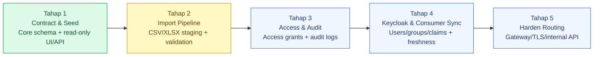
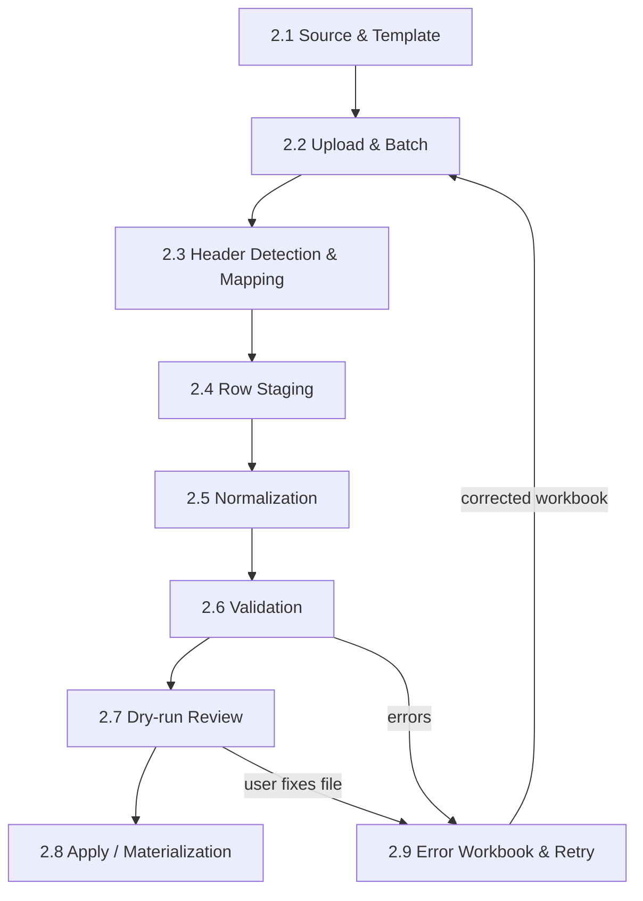
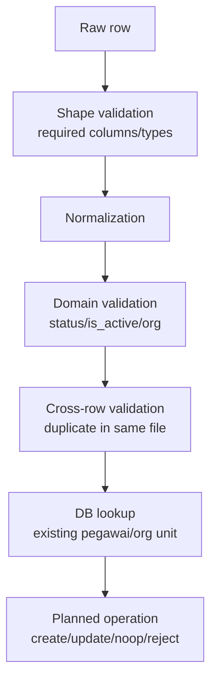
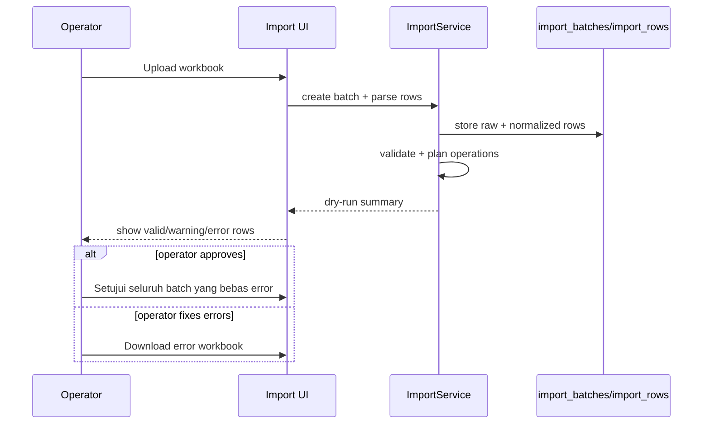
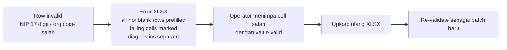
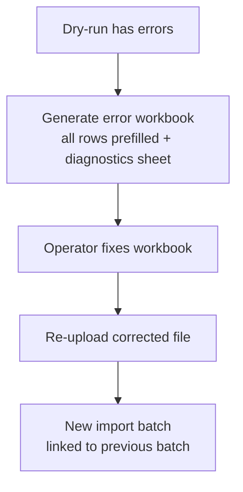
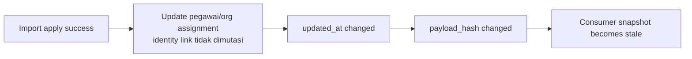

# 11 - IDP Pegawai Stage 2 Import Pipeline Breakdown

Status: Draft brainstorming, **bukan kode implementasi**
Project: kumjabar_ecosystem
Date: 2026-08-27

## 1. Tujuan

Dokumen ini membuka brainstorming **Tahap 2 - Import Pipeline** setelah Tahap 1 dianggap cukup mature secara review.

Tahap 2 belum berarti langsung coding. Fokus dokumen ini adalah memecah import pipeline menjadi tahapan kerja arsitektural agar nanti implementasi tidak berubah menjadi sekadar tombol upload file.

Prinsip dari skill/schema-driven system yang kita ikuti:

```text
Import pipeline = ingestion system
bukan sekadar upload button
```

Tahap 2 akan mengatur bagaimana data pegawai dari CSV/XLSX masuk ke IDP Pegawai dengan aman, bisa divalidasi, bisa diulang, bisa menghasilkan error workbook, dan tidak merusak source of truth.

## 2. Posisi Tahap 2 dalam Roadmap



Tahap 2 bergantung pada Tahap 1:

- tabel core sudah jelas;
- `org_units` sudah punya seed/canonical code;
- `pegawai` punya NIP/email/status/unit utama;
- repository/service sudah punya invariant;
- Admin UI dan Internal API sudah punya arah read-only;
- freshness/hash sudah menjadi konsep untuk consumer.

## 3. Ringkasan Breakdown Tahap 2

Rekomendasi awal: Tahap 2 dipecah menjadi **9 sub-tahap**.

| No | Sub-Tahap | Fokus | Output Review |
| --- | --- | --- | --- |
| 2.1 | Import Source & Template Contract | sumber file, format CSV/XLSX, template resmi | template contract |
| 2.2 | Upload & Batch Registration | upload file sebagai batch, metadata, checksum | `import_batches` design |
| 2.3 | Header Detection & Column Mapping | deteksi header, mapping kolom file ke field domain | mapping contract |
| 2.4 | Row Staging | simpan raw row + normalized preview, tanpa apply | `import_rows` design |
| 2.5 | Normalization | email, NIP, tanggal, status, org code | normalization rules |
| 2.6 | Validation | validasi per row + cross-row + DB lookup | validation matrix |
| 2.7 | Dry-run Review | ringkasan valid/error/warning sebelum apply | dry-run UI/API contract |
| 2.8 | Apply / Materialization | insert/update domain table secara idempotent | apply strategy |
| 2.9 | Error Workbook & Retry Loop | workbook error mirip template + retry batch | operator feedback loop |

Visual:



## 4. Prinsip Utama Tahap 2

Klarifikasi identitas pegawai 2026-08-27:

```text
Scope IDP: ASN PNS dan PPPK saja
Header/domain field resmi: nip
Hanya ada satu kolom NIP
NIP wajib, tepat 18 karakter digit
Primary match import pegawai ASN: nip
Email bukan fallback otomatis untuk menggantikan NIP
Jabatan dan jenis jabatan tidak masuk template IDP; domain tersebut dimiliki modul kepegawaian consumer
```

1. **Stage first, apply second.** File tidak boleh langsung mengubah tabel `pegawai`.
2. **Dry-run wajib sebelum apply.** Operator harus melihat error/warning dulu.
3. **Validasi harus row-level dan batch-level.** Jangan hanya validasi file berhasil dibaca.
4. **Error workbook harus ramah operator.** Seluruh row nonblank diprefill pada sheet canonical; failing cells ditandai dan diagnostics berada pada sheet terpisah.
5. **Import harus idempotent.** Re-run batch tidak boleh membuat duplikasi liar.
6. **Mapping harus terekam.** Kalau header file beda, hasil mapping tetap bisa diaudit.
7. **Tanggal harus explicit.** Jangan tebak format tanggal/datetime diam-diam.
8. **Source of truth field milik IDP tetap IDP Pegawai.** Import adalah kanal masuk identitas/status/afiliasi organisasi, bukan master jabatan baru.
9. **Freshness/hash harus berubah setelah apply berhasil.** Consumer tahu snapshot field IDP menjadi stale bila data authoritative berubah.
10. **Allowlist field IDP wajib.** Kolom jabatan/jenis jabatan/label jabatan/PLT/PLH tidak boleh dimaterialisasi atau dipindahkan ke JSONB metadata/staging normalized payload.

## 5. Sub-Tahap 2.1 - Import Source & Template Contract

### 5.1 Tujuan

Menentukan bentuk file yang diterima.

Kandidat format:

| Format | Pros | Cons | Rekomendasi |
| --- | --- | --- | --- |
| CSV | ringan, mudah dibuat sistem lain, streaming friendly | encoding/delimiter sering bermasalah, tidak bisa styling error workbook | didukung untuk sistem/technical import |
| XLSX | familiar untuk operator, bisa punya sheet/template/instruksi/error style | parsing lebih berat, ukuran file lebih besar | format utama untuk operator |
| Google Sheets export | familiar, kolaboratif | perlu integrasi tambahan/API/permission | future optional |

Rekomendasi awal:

```text
Tahap 2 support XLSX sebagai format operator utama,
dan CSV sebagai format alternatif teknis.
```

### 5.2 Template Minimal Pegawai

Kolom awal template pegawai:

| Kolom Template | Target Field | Wajib | Catatan |
| --- | --- | --- | --- |
| `nip` | `pegawai.nip` | ya | identitas PNS/PPPK; tepat 18 digit; unique active |
| `nama_lengkap` | `pegawai.nama_lengkap` | ya | trim whitespace |
| `email_dinas` | `pegawai.email_dinas` | tidak | dinormalisasi ke lowercase/trim |
| `email_google` | `pegawai.email_google` | tidak | untuk identity link Google |
| `org_unit_code` | `pegawai.primary_org_unit_id` | ya untuk aktif | lookup ke `org_units.code` |
| `status_pegawai` | `pegawai.status_pegawai` | ya | aktif/mutasi/pensiun/nonaktif/meninggal |

Update Dokumen 12: `is_active` tetap field domain penting, tetapi **tidak menjadi kolom template v1**; service menurunkannya secara deterministik dari `status_pegawai`. `status_reason` juga tidak masuk template minimal v1 dan dipertimbangkan untuk template lifecycle/UI khusus setelah access grant dan audit lebih matang.

Negative contract template:

```text
Forbidden domain columns:
jabatan, jabatan_type, jenis_jabatan, nama_jabatan, label_jabatan, plt, plh

Jika ditemukan pada file nonconforming:
- jangan map ke tabel core atau metadata;
- tampilkan warning/error boundary yang jelas;
- minta operator mengelolanya di modul kepegawaian consumer seperti s1-jabar.
```

## 6. Sub-Tahap 2.2 - Upload & Batch Registration

### 6.1 Tujuan

Setiap upload dibuat sebagai batch yang bisa dilacak.

Konsep `import_batches`:

| Field | Fungsi |
| --- | --- |
| `uuid` | public batch id |
| `import_type` | contoh `pegawai` |
| `status` | uploaded, mapped, staged, validated, ready_to_apply, applied, failed |
| `original_filename` | nama file asli |
| `file_hash` | hash file upload untuk dedup/check integrity |
| `uploaded_by` | actor/operator |
| `uploaded_at` | waktu upload |
| `mapping_snapshot` | JSON mapping header -> domain field |
| `summary` | jumlah row, valid, error, warning |

### 6.2 Pros/Cons Simpan File Mentah

| Opsi | Pros | Cons | Rekomendasi |
| --- | --- | --- | --- |
| Simpan file mentah di storage private | bisa audit/retry/diagnosis | perlu storage policy, privasi data | boleh, private only, retention jelas |
| Simpan hanya parsed rows | lebih sederhana | sulit rekonstruksi file asli | minimal wajib |
| Simpan file dalam DB bytea | backup mudah satu tempat | DB cepat membesar | hindari untuk file besar |

Rekomendasi awal:

```text
Simpan file di private storage/local volume terkontrol,
DB menyimpan metadata path/hash, bukan blob besar.
```

## 7. Sub-Tahap 2.3 - Header Detection & Column Mapping

### 7.1 Tujuan

Membuat import tidak rapuh terhadap nama header yang sedikit berbeda.

Contoh alias:

| Domain Field | Alias Header |
| --- | --- |
| `nip` | `NIP` (header resmi; pencocokan teknis boleh case-insensitive) |
| `nama_lengkap` | `Nama`, `Nama Lengkap`, `Pegawai` |
| `email_dinas` | `Email Dinas`, `Email Kantor` |
| `email_google` | `Email Google`, `Akun Google` |
| `org_unit_code` | `Kode Unit`, `Unit Kerja`, `Org Code` |

### 7.2 Strict Template vs Flexible Mapping

| Pendekatan | Pros | Cons | Rekomendasi |
| --- | --- | --- | --- |
| Strict template saja | sederhana, validasi mudah | operator mudah gagal jika header berubah | bagus untuk awal |
| Flexible mapping manual | toleran file lama | UI lebih kompleks | siapkan setelah strict stabil |
| Alias auto-detect | membantu operator | butuh aturan alias jelas | gunakan sebagai bantuan, bukan magic |

Rekomendasi awal:

```text
Tahap 2 awal: strict template + alias auto-detect sederhana.
Mapping manual bisa masuk sub-dokumen berikutnya bila diperlukan.
```

Auto-detect dan mapping manual hanya bekerja terhadap allowlist field IDP. Unknown column tidak boleh otomatis masuk `metadata`; forbidden domain column di atas harus ditolak atau diabaikan secara eksplisit dengan pesan yang dapat diaudit.

## 8. Sub-Tahap 2.4 - Row Staging

### 8.1 Tujuan

Menyimpan setiap baris import ke staging sebelum menyentuh tabel domain.

Konsep `import_rows`:

| Field | Fungsi |
| --- | --- |
| `batch_id` | relasi ke import batch |
| `row_number` | nomor baris file |
| `raw_payload` | nilai mentah scalar kolom allowlist saja; forbidden/unknown value tidak dipersistenkan. Jika audit ingestion wajib, simpan metadata header/hash minimum, bukan nilai cell forbidden |
| `normalized_payload` | hasil normalisasi field milik IDP; tidak boleh mengandung jabatan/PLT/PLH |
| `validation_status` | pending, valid, warning, error |
| `errors` | array error row-level |
| `warnings` | array warning row-level |
| `target_pegawai_uuid` | jika match existing pegawai |
| `planned_operation` | create, update, noop, reject |

### 8.2 Kenapa Staging Penting

| Alasan | Dampak |
| --- | --- |
| File bisa dicek tanpa apply | operator aman mereview |
| Error bisa dikembalikan per baris | feedback jelas |
| Apply bisa idempotent | batch tidak liar jika retry |
| Audit masa depan lebih mudah | batch dan row punya jejak |

## 9. Sub-Tahap 2.5 - Normalization

### 9.1 Normalization Rules Awal

| Field | Rule |
| --- | --- |
| `nip` | trim, simpan sebagai string, wajib tepat 18 digit (`^[0-9]{18}$`), jangan numeric |
| `nama_lengkap` | trim, collapse whitespace berlebih |
| `email_dinas`, `email_google` | trim + lowercase untuk normalized column |
| `status_pegawai` | map alias ke enum-like value resmi |
| `org_unit_code` | uppercase/trim, lookup ke seed `org_units.code` |
| tanggal | format harus explicit, normalize ke ISO |

### 9.2 Tanggal Jangan Ditebak Diam-diam

Ini penting untuk menghindari data ambigu:

| Input | Risiko |
| --- | --- |
| `01/02/2026` | bisa 1 Feb atau 2 Jan |
| serial Excel date | perlu interpretasi workbook |
| teks bebas | rawan salah parsing |

Rekomendasi:

```text
Template menentukan format tanggal eksplisit, misalnya YYYY-MM-DD.
Jika beda format, operator harus memilih mapping format.
Jika parse gagal, row error — jangan silently convert.
```

## 10. Sub-Tahap 2.6 - Validation

### 10.1 Validation Layer



### 10.2 Validation Matrix Awal

| Rule | Level | Severity | Catatan |
| --- | --- | --- | --- |
| `nip` wajib tepat 18 digit | row | error | berlaku untuk seluruh PNS/PPPK; simpan sebagai string |
| `nama_lengkap` wajib | row | error | tidak bisa apply tanpa nama |
| `status_pegawai` valid | row | error | harus enum-like resmi |
| aktif wajib punya `org_unit_code` valid | row + DB | error | sesuai invariant Tahap 1 |
| email format valid jika diisi | row | error/warning | tergantung kebijakan |
| duplicate `nip` dalam file | cross-row | error | mencegah operasi ambigu |
| duplicate email normalized dalam file | cross-row | error/warning | tergantung field |
| `org_unit_code` tidak ditemukan | DB lookup | error | seed harus sudah ada |
| existing pegawai ditemukan by `nip` | DB lookup | info | planned update/noop |
| payload sama dengan existing hash | service | info | planned noop |

## 11. Sub-Tahap 2.7 - Dry-run Review

Dry-run adalah titik operator melihat rencana perubahan sebelum apply.

Output dry-run:

| Metric | Contoh |
| --- | --- |
| total rows | 250 |
| valid rows | 230 |
| warning rows | 15 |
| error rows | 20 |
| planned create | 30 |
| planned update | 190 |
| planned noop | 10 |
| planned reject | 20 |

Visual flow:



## 12. Sub-Tahap 2.8 - Apply / Materialization

### 12.1 Tujuan

Mengubah staging rows yang valid menjadi data authoritative di tabel core Tahap 1.

Target utama:

- `pegawai`;
- `pegawai_org_assignments` untuk primary assignment;
- import apply state, materialization ledger, dan transactional outbox.

`pegawai_identity_links` **tidak** dibuat, dipindah, atau dipercaya otomatis dari email import. Linking provider memerlukan workflow terpisah yang diaudit.

### 12.2 Strategy Create/Update/Noop

| Planned Operation | Kondisi | Aksi |
| --- | --- | --- |
| create | tidak ada pegawai existing by `nip`/identifier terkontrol | insert pegawai baru |
| update | existing ditemukan dan payload berubah | update field authoritative |
| noop | existing ditemukan dan canonical payload sama | tidak ubah domain row |
| reject | error validasi | tidak apply |

### 12.3 Pros/Cons Upsert Otomatis

| Opsi | Pros | Cons | Rekomendasi |
| --- | --- | --- | --- |
| auto upsert semua valid rows | cepat | risiko update massal tidak sengaja | boleh setelah dry-run eksplisit |
| create only | aman untuk awal | sulit update data lama | terlalu terbatas |
| update only | aman untuk koreksi existing | tidak bisa onboarding pegawai baru | mode khusus saja |
| explicit operation per row | kontrol tinggi | UI lebih kompleks | future enhancement |

Rekomendasi awal:

```text
Gunakan upsert terkontrol: create/update/noop/reject dihitung saat dry-run,
lalu apply hanya setelah operator approve.
```

## 13. Sub-Tahap 2.9 - Error Workbook & Retry Loop

Error workbook harus membantu operator memperbaiki data, bukan hanya memberi pesan teknis.

Isi error workbook:

| Sheet | Isi |
| --- | --- |
| `pegawai` | **seluruh row nonblank** dari validation snapshot sumber, mengikuti canonical headers template resmi; failing cell ditandai dan seluruh file dapat diedit/re-upload |
| `diagnostics` | kode error/warning per row/cell; system-generated dan bukan input domain |
| `summary` | total rows, valid, warning, error |
| `reference_org_units` | daftar `org_unit_code` valid |
| `instructions` | aturan format tanggal/email/status |

Prinsip:

- output error utama menggunakan XLSX karena mendukung sheet, style, comment, dan cell highlighting;
- sheet `pegawai` mirror template resmi IDP dan menjadi satu-satunya sumber row saat re-upload; sheet `diagnostics` tidak dibaca sebagai field domain;
- karena UI v1 all-or-nothing bila ada error, seluruh row nonblank dibawa agar child retry tetap self-contained; failing cell ditandai, scalar allowlist diprefill, dan forbidden column/value tidak diteruskan ke workbook resmi IDP;
- kode/pesan `error_messages` dan `warning_messages` ditempatkan pada sheet `diagnostics` dengan korelasi row/cell, misalnya `NIP wajib tepat 18 digit` atau `org_unit_code tidak ditemukan`;
- cell sumber yang bermasalah boleh diberi highlight/comment sebagai bantuan visual, tetapi pesan tekstual tetap wajib agar tidak bergantung pada warna;
- kolom data tetap editable sehingga operator dapat langsung menimpa value lama dengan value baru yang valid pada baris yang sama;
- diagnostics bersifat output sistem: saat re-upload, parser hanya membaca sheet canonical `pegawai` dan mengabaikan sheet `diagnostics` setelah metadata/profile workbook tervalidasi;
- operator bisa upload ulang XLSX yang sudah diperbaiki sebagai batch baru yang mereferensikan batch sebelumnya.

### 13.1 Visual Editable Error Workbook





## 14. Data Freshness Setelah Apply

Setelah apply berhasil, IDP Pegawai harus menganggap data authoritative berubah.

Konsekuensi:

- `pegawai.updated_at` berubah untuk row update;
- monotonic `pegawai.source_version` dialokasikan/increment untuk setiap create/update dan tidak berubah pada noop;
- canonical payload berubah;
- `payload_hash` berubah;
- consumer seperti `s1-jabar` bisa mendeteksi snapshot stale;
- Tahap 3 audit log akan mencatat before/after secara lebih formal.



## 15. UI Screens Kandidat Tahap 2

| Screen | Tujuan | Catatan |
| --- | --- | --- |
| Import Dashboard | daftar batch dan status | operator melihat histori import |
| Upload Workbook | upload file + pilih tipe import | Tahap awal pegawai saja |
| Mapping Review | tampilkan header dan mapping | bisa strict dulu |
| Dry-run Summary | ringkasan valid/error/warning | wajib sebelum apply |
| Row Error Detail | filter baris error | bantu perbaikan |
| Apply Confirmation | konfirmasi seluruh batch yang bebas error | butuh capability |
| Batch Detail | status batch, file hash, summary | read/review |
| Error Workbook Download | download file perbaikan | operator loop |

## 16. Internal API / Service Contract Preview

Tahap 2 bisa punya route/admin action konseptual, tetapi tetap private/admin-only.

```text
GET  /admin/import/pegawai
GET  /admin/import/pegawai/template.xlsx
POST /admin/import/pegawai/upload
GET  /admin/import/pegawai/batches/{uuid}
POST /admin/import/pegawai/batches/{uuid}/validate
POST /admin/import/pegawai/batches/{uuid}/apply
GET  /admin/import/pegawai/batches/{uuid}/error-workbook
```

Catatan:

- route ini belum coding;
- apply harus protected capability;
- POST apply harus idempotent;
- mutasi final idealnya makin kuat setelah audit Tahap 3, tapi minimal batch record Tahap 2 harus sudah menyimpan summary perubahan.

## 17. Pros/Cons Keputusan Besar Tahap 2

| Keputusan | Opsi A | Opsi B | Rekomendasi Awal |
| --- | --- | --- | --- |
| Format utama | XLSX | CSV | XLSX utama, CSV alternatif |
| Template | strict | flexible mapping | strict + alias sederhana dulu |
| Apply | direct apply | staging + dry-run | staging + dry-run wajib |
| Error feedback | text list | workbook mirror template | workbook mirror template |
| Hash | hitung setelah apply | simpan per row sejak staging | hitung domain hash setelah apply; staging boleh simpan row hash opsional |
| Existing match | by NIP | by email | primary by `nip`; fallback email tidak otomatis |
| Audit | penuh di Tahap 2 | batch summary dulu, audit penuh Tahap 3 | batch summary dulu, jangan klaim audit penuh |

## 18. Open Questions Awal Tahap 2

| No | Pertanyaan | Rekomendasi Awal |
| --- | --- | --- |
| 1 | Format template utama XLSX atau CSV? | XLSX utama, CSV alternatif |
| 2 | Apakah `nip` wajib untuk semua row? | Ya; scope IDP hanya PNS/PPPK dan keduanya memiliki NIP 18 digit |
| 3 | Bagaimana jika NIP kosong, bukan 18 karakter, atau mengandung non-digit? | Reject sebagai error; jangan otomatis match memakai email |
| 4 | Apakah row warning boleh di-apply? | Boleh jika tidak melanggar invariant, tapi tampil jelas |
| 5 | Apakah apply valid rows boleh jalan jika masih ada error rows? | **Dikunci Dokumen 14 untuk UI v1: tidak.** Batch harus bebas error/fatal; partial apply hanya kemungkinan versi lanjut dengan kontrak terpisah. |
| 6 | Apakah file asli disimpan permanen? | Simpan private dengan retention policy, jangan public |
| 7 | Apakah import boleh mengubah status pegawai menjadi nonaktif/mutasi? | Boleh, tapi perlu summary jelas dan audit Tahap 3 |
| 8 | Apakah identity link Google dibuat otomatis dari `email_google`? | Tidak. `email_google` hanya candidate profile; imported email + verified email saja tidak cukup. Linking memerlukan issuer/provider subject stabil, conflict check, dan workflow bootstrap yang diaudit. |
| 9 | Apakah import organisasi juga masuk Tahap 2? | Fokus awal pegawai; org unit seed tetap controlled, bukan import bebas |
| 10 | Apakah batch apply perlu approval dua orang? | Belum Tahap 2 awal; bisa masuk governance lanjut |

## 19. Rekomendasi Dokumen Lanjutan Tahap 2

Agar pelan-pelan dan tidak lompat ke coding, rekomendasi dokumen berikutnya:

```text
12 - Import Template & Field Mapping Contract
13 - Import Batch/Row Schema Draft
14 - Import Validation & Dry-run Contract
15 - Error Workbook & Retry Loop Contract
16 - Import Apply/Materialization Contract
17 - Stage 2 Review Checklist & Open Decisions
```

Visual:


## 20. Kesimpulan

Tahap 2 sebaiknya dipahami sebagai pipeline ingestion yang aman:

```text
Template
-> Upload batch
-> Mapping
-> Staging rows
-> Normalization
-> Validation
-> Dry-run
-> Apply
-> Error workbook/retry
```

Keputusan paling penting: **jangan direct apply dari upload file ke tabel pegawai**. Semua harus lewat staging, validasi, dan dry-run agar operator bisa review sebelum data authoritative berubah.

Dokumen ini hanya breakdown awal. Jika disetujui, langkah berikutnya adalah memperinci `12 - Import Template & Field Mapping Contract`.
