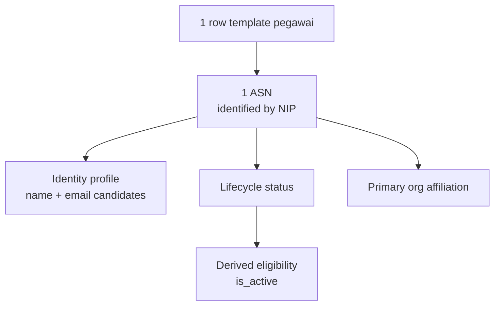
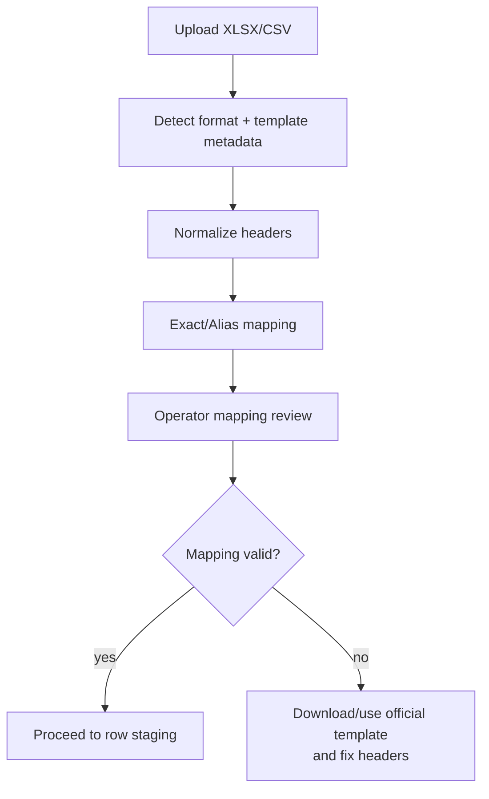

# 12 - IDP Pegawai Import Template & Field Mapping Contract

Status: Draft brainstorming, **bukan kode implementasi**
Project: kumjabar_ecosystem
Date: 2026-08-27
Depends on: `11-idp-pegawai-stage-2-import-pipeline-breakdown.md`

## 1. Tujuan

Dokumen ini memperinci **Sub-Tahap 2.1 dan 2.3** dari Tahap 2:

1. kontrak template resmi import pegawai;
2. kontrak field yang boleh dimiliki IDP Pegawai;
3. aturan header detection dan mapping;
4. aturan normalisasi awal;
5. batas antara data identitas, afiliasi organisasi, dan identity link;
6. perlakuan terhadap kolom tidak dikenal atau kolom yang bukan domain IDP.

Dokumen ini masih berupa rancangan arsitektur. Belum ada file XLSX, parser, model, migration, route, atau kode Flask yang dibuat.

## 2. Keputusan Domain yang Menjadi Dasar

### 2.1 Identitas Minimum yang Dimiliki IDP

Kontrak inti yang disepakati:

```text
nip
nama
email / identity link
status_pegawai
is_active
```

Interpretasi teknisnya:

| Konsep Bisnis | Representasi IDP | Ownership |
| --- | --- | --- |
| NIP | `pegawai.nip` | IDP authoritative |
| Nama | `pegawai.nama_lengkap` | IDP authoritative |
| Email dinas | `pegawai.email_dinas` | IDP authoritative untuk profil identitas |
| Email Google | `pegawai.email_google` | kandidat identity-link, belum otomatis trusted |
| Status lifecycle | `pegawai.status_pegawai` | IDP authoritative |
| Eligibility akses | `pegawai.is_active` | IDP authoritative, **diturunkan sistem dari status** |
| Unit utama | `pegawai.primary_org_unit_id` + primary org assignment | IDP authoritative sebagai afiliasi organisasi, bukan jabatan |

### 2.2 Data yang Bukan Domain IDP

IDP Pegawai tidak menyimpan atau mengimpor:

```text
jabatan
jabatan_type
jenis_jabatan
nama_jabatan
label_jabatan
PLT
PLH
histori jabatan
SK jabatan
workflow perpindahan jabatan
```

Semua itu dimiliki modul kepegawaian consumer seperti `s1-jabar`.

### 2.3 `is_active` Penting, tetapi Bukan Input Bebas

`is_active` tetap field penting karena menjawab:

> Apakah ASN ini masih eligible memperoleh akses internal?

Namun operator tidak perlu mengisi `status_pegawai` dan `is_active` sebagai dua sumber kebenaran terpisah. Pada template resmi v1, operator hanya mengisi `status_pegawai`; service menghitung `is_active` secara deterministik.

| `status_pegawai` | `is_active` hasil sistem |
| --- | --- |
| `aktif` | `true` |
| `mutasi_keluar` | `false` |
| `pensiun` | `false` |
| `nonaktif` | `false` |
| `meninggal` | `false` |

Prinsip:

```text
status_pegawai = source input lifecycle
is_active      = derived eligibility flag
```

Dengan ini tidak ada konflik seperti:

```text
status_pegawai = pensiun
is_active      = true
```

Keputusan deterministik ini memperketat draft constraint Tahap 1 yang sebelumnya hanya menjamin implikasi satu arah (`is_active=true -> status_pegawai=aktif`). Kontrak schema konseptual Dokumen 05/06 telah diselaraskan menjadi ekuivalensi penuh:

```text
is_active = (status_pegawai = 'aktif')
```

atau bentuk check PostgreSQL yang ekuivalen saat implementasi. Dengan demikian tidak ada record `status_pegawai=aktif` tetapi `is_active=false` tanpa workflow khusus yang memang mengubah kontrak lifecycle.

## 3. Posisi Dokumen 12 dalam Import Pipeline


Dokumen 12 hanya mengunci **bentuk input dan mapping**. Bentuk tabel `import_batches`/`import_rows`, validasi menyeluruh, dry-run, error workbook, dan apply akan diperinci pada dokumen berikutnya.

## 4. Format File Resmi

### 4.1 Format yang Didukung

| Format | Posisi | Catatan |
| --- | --- | --- |
| XLSX | format utama operator | punya sheet instruksi/reference, cell style, dan validasi data |
| CSV UTF-8 | format alternatif teknis | satu file data, tanpa sheet instruksi/reference |
| XLS | tidak didukung | format lama dan parsing lebih berisiko |
| XLSM | tidak didukung | macro tidak diperlukan dan memperluas attack surface |
| Google Sheets langsung | belum didukung | export ke XLSX/CSV terlebih dahulu |

### 4.2 MIME, Extension, dan Signature

Parser tidak boleh hanya percaya nama file.

Minimal check:

- extension sesuai format;
- MIME type sesuai jika tersedia;
- XLSX harus lolos ZIP/container signature dan struktur OPC/OOXML minimum, bukan sekadar file ZIP;
- ukuran file mengikuti limit konfigurasi;
- jumlah ZIP entry, total uncompressed size, compression ratio, jumlah sheet, row, dan column dibatasi untuk mencegah zip bomb/resource exhaustion;
- path ZIP entry harus aman dan tidak boleh keluar dari container extraction boundary;
- file terenkripsi/password-protected ditolak;
- workbook dengan macro ditolak;
- formula pada cell data ditolak sebagai structural workbook error dengan lokasi sheet/cell yang eksplisit; server tidak mengevaluasi formula dan tidak menerima cached formula value sebagai data.

### 4.3 Kontrak Transport CSV

Karena CSV tidak memiliki sheet `metadata`, metadata transport wajib dikirim bersama upload melalui form/API dan disimpan pada batch:

```text
template_type     = pegawai
template_version  = pegawai-import.v1
contract_version  = pegawai.v1
source_as_of      = 2026-08-27T00:00:00+07:00
encoding          = UTF-8
header_row        = 1
delimiter         = comma
```

Aturan CSV v1:

- UTF-8 dengan atau tanpa BOM;
- delimiter default koma; delimiter lain harus dipilih eksplisit dan direkam, tidak ditebak diam-diam;
- tepat satu header row pada row 1;
- line ending LF atau CRLF diterima;
- quoted comma/newline mengikuti RFC 4180;
- jumlah field setiap row setelah parse harus konsisten dengan jumlah header;
- file tanpa metadata transport yang cocok ditolak sebelum staging;
- tidak ada sheet reference, sehingga operator/technical consumer harus memperoleh status dan `org_unit_code` resmi dari endpoint/template referensi terpisah.

## 5. Workbook XLSX Resmi

### 5.1 Sheet Contract

| Sheet | Wajib | Fungsi |
| --- | --- | --- |
| `pegawai` | ya | data yang diisi operator |
| `instructions` | ya | aturan pengisian dan versi template |
| `reference_status` | ya | nilai resmi `status_pegawai` |
| `reference_org_units` | ya | daftar kode unit organisasi aktif |
| `metadata` | ya | identitas template dan versi kontrak |

Urutan sheet direkomendasikan seperti tabel di atas, tetapi parser mengenali sheet dari nama canonical, bukan posisi tab.

### 5.2 Metadata Template

Sheet `metadata` menggunakan pasangan key/value:

| Key | Contoh | Tujuan |
| --- | --- | --- |
| `template_type` | `pegawai` | jenis import |
| `template_version` | `pegawai-import.v1` | versi bentuk template |
| `contract_version` | `pegawai.v1` | versi payload domain tujuan |
| `generated_at` | `2026-08-27T20:30:00+07:00` | waktu template dibuat |
| `generated_by` | `idp-pegawai` | pembuat template |
| `org_units_version` | `org_units.v1` | referensi seed unit yang digunakan |
| `source_as_of` | diisi/dikonfirmasi saat upload | waktu keadaan sumber yang diwakili file; bukan waktu upload/apply |

Aturan:

- `template_type` dan `template_version` wajib cocok;
- template versi tidak dikenal ditolak sebelum row staging;
- `generated_at` bukan freshness data pegawai;
- `org_units_version` dipakai sebagai petunjuk staleness referensi, bukan menggantikan lookup DB saat validasi;
- `source_as_of` wajib dikonfirmasi saat upload dan disimpan pada batch; `uploaded_at`/`applied_at` tidak boleh dipakai sebagai tanggal efektif bisnis.

### 5.3 Template Resmi yang Dapat Diunduh

Admin UI wajib menyediakan tombol **Download Template Pegawai (.xlsx)**. Operator tidak perlu merakit workbook dari nol atau menyalin header dari dokumentasi.

Kontrak delivery konseptual:

```text
GET /admin/import/pegawai/template.xlsx
```

Template dihasilkan atau disediakan oleh IDP Pegawai sendiri dan minimal harus:

- mengikuti `template_version=pegawai-import.v1` dan `contract_version=pegawai.v1`;
- memiliki seluruh sheet resmi pada §5.1;
- memformat kolom `nip` sebagai Text;
- menyediakan dropdown `status_pegawai` dan referensi `org_unit_code` untuk membantu operator;
- menampilkan instruksi bahwa paste dari workbook lain tetap divalidasi server;
- tidak membawa contoh pegawai nyata, macro, formula, external link, hidden data, atau embedded object;
- memuat versi template secara terlihat pada sheet `instructions` dan secara machine-readable pada sheet `metadata`;
- dibangun dari canonical contract dan referensi `org_units` aktif agar tidak drift dari parser;
- tetap divalidasi penuh saat di-upload; file dari endpoint resmi bukan berarti otomatis dipercaya.

Saat implementasi dimulai, pola export/template XLSX yang pernah dikembangkan pada project `dasborkanwil` boleh dipelajari sebagai referensi teknis. Kontrak field, security boundary, naming, dan ownership tetap mengikuti dokumen IDP Pegawai ini; jangan menyalin domain/schema project lain secara buta.

### 5.4 Struktur Sheet `pegawai`

Kontrak bentuk sheet data:

- tepat satu header row canonical, default row 1;
- tidak boleh ada merged cell pada header atau data area;
- header kosong di tengah data area adalah error;
- duplicate header, termasuk yang baru duplikat setelah normalization, adalah mapping error;
- hidden row/column di data area harus ditolak atau diwajibkan dibuka sebelum upload;
- hidden/very-hidden sheet selain sheet resmi tidak boleh diam-diam diproses; keberadaannya menjadi structural workbook error sampai dihapus atau dibuat visible dan direview;
- cell formula, external link, defined name yang menunjuk sumber eksternal, dan embedded object tidak menjadi sumber data;
- parser berhenti berdasarkan batas data nyata, bukan hanya worksheet `max_row`/`max_column` yang dapat membesar karena formatting kosong;
- seluruh cell data diperlakukan sebagai value, bukan instruksi eksekusi.
- nama sheet canonical dibandingkan case-sensitive setelah trim; nama yang tampak sama setelah Unicode normalization menjadi structural error, bukan dipilih salah satu.

Header row selain row 1 hanya dapat dipilih melalui mapping review dan harus terekam di `mapping_snapshot`; parser tidak boleh menebak header dari row dengan skor kemiripan secara diam-diam.

## 6. Grain Template

Satu row pada sheet `pegawai` berarti:

> Satu ASN PNS/PPPK yang diidentifikasi secara unik oleh satu NIP 18 digit.

Bukan:

- satu jabatan;
- satu riwayat jabatan;
- satu role Keycloak;
- satu provider identity link;
- satu transaksi layanan.



## 7. Canonical Header Template v1

### 7.1 Kolom Resmi

Urutan canonical:

| No | Header | Target | Wajib | Keterangan |
| --- | --- | --- | --- | --- |
| 1 | `nip` | `pegawai.nip` | ya | tepat 18 digit, disimpan sebagai string |
| 2 | `nama_lengkap` | `pegawai.nama_lengkap` | ya | nama identitas ASN |
| 3 | `email_dinas` | `pegawai.email_dinas` | tidak | email dinas/profil bila tersedia |
| 4 | `email_google` | `pegawai.email_google` | tidak | kandidat linking Google, bukan bukti link trusted |
| 5 | `org_unit_code` | resolve ke `pegawai.primary_org_unit_id` dan primary org assignment | kondisional | wajib jika status `aktif` |
| 6 | `status_pegawai` | `pegawai.status_pegawai` | ya | lifecycle ASN |

`is_active` **tidak menjadi kolom template v1**, tetapi tetap dipersistenkan sebagai field penting hasil derivasi service dari `status_pegawai`.

### 7.2 Kenapa `org_unit_code` Tetap Ada?

`org_unit_code` bukan jabatan. Kolom ini menyatakan afiliasi organisasi utama yang diperlukan untuk:

- group organisasi Keycloak;
- claim `primary_org_unit_code`;
- ABAC atau pembatasan data berbasis unit;
- konsistensi invariant pegawai aktif.

Contoh:

```text
org_unit_code = TUM_TI
```

Maknanya:

> ASN berafiliasi utama dengan unit Teknologi Informasi.

Bukan:

> ASN memiliki jabatan Pranata Komputer, Kepala Tim, atau jabatan lainnya.

### 7.3 Kenapa `status_reason` Tidak Masuk Template Minimal v1?

`status_reason` tetap boleh ada di model domain, tetapi tidak menjadi kolom template minimal agar import identity tidak berkembang menjadi workflow kepegawaian lengkap.

Jika nanti diperlukan, `status_reason` dan `status_effective_at` dapat masuk **template lifecycle khusus** atau UI perubahan status yang sudah dilindungi access grant dan audit lebih kuat.

## 8. Kontrak Nilai per Field

### 8.1 `nip`

| Aspek | Aturan |
| --- | --- |
| Tipe domain | string |
| Panjang | tepat 18 karakter |
| Karakter | digit ASCII `0-9` saja |
| Regex | `^[0-9]{18}$` |
| Trim | whitespace kiri/kanan dibuang sebelum validasi |
| Business key | primary match create/update/noop |
| Fallback | email tidak boleh menjadi fallback NIP |

#### Perlindungan terhadap Excel Numeric Precision

NIP 18 digit tidak boleh disimpan sebagai numeric cell karena Excel dapat kehilangan presisi pada angka lebih dari 15 digit.

Template XLSX wajib:

- memformat kolom `nip` sebagai **Text**;
- memberi instruksi agar operator tidak mengubahnya menjadi Number/Scientific;
- menolak **setiap** numeric/formula cell pada kolom NIP, tanpa mencoba menilai apakah presisinya tampak masih utuh;
- tidak mencoba “memperbaiki” scientific notation secara diam-diam.

Contoh:

```text
Benar : "199001012020121001" sebagai text
Salah : 1.99001E+17 sebagai numeric/scientific
```

### 8.2 `nama_lengkap`

Normalization awal:

1. trim kiri/kanan;
2. collapse whitespace berulang menjadi satu spasi;
3. pertahankan kapitalisasi yang diberikan operator;
4. jangan otomatis mengubah seluruh nama menjadi title case;
5. string kosong setelah trim adalah error.

Contoh:

```text
"  Rina   Nurhayati  "
-> "Rina Nurhayati"
```

### 8.3 `email_dinas`

Aturan:

- opsional;
- trim;
- normalized lookup memakai lowercase;
- raw/original display boleh dipertahankan;
- harus lolos validasi format bila diisi;
- bukan pengganti NIP;
- konflik dengan email normalized milik pegawai aktif lain adalah error keamanan data.

### 8.4 `email_google`

Aturan:

- opsional;
- trim + lowercase untuk normalized lookup;
- harus lolos validasi format bila diisi;
- tidak wajib ber-domain Gmail; Google Workspace domain tetap mungkin;
- tidak otomatis berarti `email_verified=true`;
- tidak otomatis membuat identity link aktif/trusted;
- trusted link hanya terbentuk setelah verifikasi dari provider/broker atau proses admin yang diaudit.

```mermaid
sequenceDiagram
    participant Import as Import Pegawai
    participant IDP as IDP Pegawai
    participant KC as Keycloak/Google Broker
    participant Link as Identity Link Service

    Import->>IDP: email_google candidate
    IDP->>IDP: simpan candidate email
    Note over IDP: belum trusted identity link
    KC->>Link: login callback + verified email + provider subject
    Link->>IDP: cocokkan candidate + pegawai aktif
    alt cocok dan verified
        Link->>IDP: buat/aktifkan identity link trusted
    else tidak cocok/tidak verified
        Link-->>KC: tolak akses internal otomatis
    end
```

### 8.5 `org_unit_code`

Aturan:

- trim;
- uppercase untuk canonical lookup;
- lookup ke `org_units.code` aktif;
- wajib untuk `status_pegawai=aktif`;
- unit tidak ditemukan atau tidak aktif adalah error;
- tidak boleh memuat path, nama unit, atau nama jabatan sebagai pengganti kode.

### 8.6 `status_pegawai`

Canonical values:

```text
aktif
mutasi_keluar
pensiun
nonaktif
meninggal
```

Alias eksplisit yang boleh dinormalisasi:

| Input Alias | Canonical |
| --- | --- |
| `AKTIF` | `aktif` |
| `mutasi keluar` | `mutasi_keluar` |
| `purna tugas` | `pensiun` |
| `tidak aktif` | `nonaktif` |

Alias di luar kamus resmi tidak boleh ditebak. Nilai tersebut menjadi row error dan operator mendapat daftar nilai yang didukung.

Alias generik `mutasi` sengaja tidak diterima karena ambigu antara perpindahan unit internal dan mutasi keluar organisasi. Mutasi internal mempertahankan `status_pegawai=aktif` dan hanya mengubah afiliasi organisasi melalui kontrak apply.

## 9. Header Detection Contract

### 9.1 Normalisasi Header untuk Pencocokan

Header matching boleh melakukan:

1. hapus UTF-8 BOM;
2. trim whitespace;
3. lowercase;
4. ubah spasi/hyphen menjadi underscore;
5. collapse underscore berulang.

Contoh:

```text
" Nama Lengkap " -> nama_lengkap
"Email-Dinas"    -> email_dinas
"ORG UNIT CODE"  -> org_unit_code
```

Nilai data tidak mengikuti seluruh aturan header tersebut; masing-masing field mempunyai normalizer sendiri.

### 9.2 Alias Header yang Diizinkan

| Canonical Target | Alias yang Dikenali |
| --- | --- |
| `nip` | `NIP` |
| `nama_lengkap` | `nama`, `nama pegawai`, `pegawai` |
| `email_dinas` | `email kantor`, `email resmi` |
| `email_google` | `akun google`, `google email` |
| `org_unit_code` | `kode unit`, `kode unit kerja`, `org code` |
| `status_pegawai` | `status`, `status asn` |

Alias adalah bantuan operator, bukan izin membuat target field baru.

### 9.3 Tingkat Hasil Mapping

| Status Mapping | Kondisi | Aksi |
| --- | --- | --- |
| `exact` | header canonical cocok | otomatis diterima |
| `alias` | cocok dengan alias resmi | otomatis dipetakan, tampil di review |
| `manual_required` | tidak cocok tetapi mungkin field IDP | operator memilih target dari allowlist; hanya bila fitur manual mapping diaktifkan |
| `forbidden` | cocok dengan field di luar boundary IDP | file-level mapping error |
| `unknown` | tidak diketahui | file-level mapping error pada strict template v1 |
| `duplicate_header` | dua source header sama setelah normalization | file-level mapping error |
| `duplicate_target` | dua source header menuju target sama | file-level mapping error |
| `missing_required` | target wajib tidak tersedia | file-level mapping error |

### 9.4 Manual Mapping Guardrails

Jika manual mapping diaktifkan setelah strict flow stabil:

- target hanya boleh dipilih dari allowlist canonical;
- satu source header hanya ke satu target;
- satu target hanya menerima satu source header;
- required target tidak boleh dibiarkan kosong;
- forbidden field tidak pernah muncul sebagai pilihan target;
- mapping harus direview operator sebelum staging;
- mapping final disimpan sebagai `mapping_snapshot` pada batch;
- mapping preset tidak boleh otomatis dipakai lintas `template_version` tanpa revalidation.

## 10. Allowlist, Forbidden, dan Unknown Columns

### 10.1 Allowlist v1

```text
nip
nama_lengkap
email_dinas
email_google
org_unit_code
status_pegawai
```

### 10.2 Forbidden Domain Columns

```text
jabatan
jabatan_type
jenis_jabatan
nama_jabatan
label_jabatan
plt
plh
sk_jabatan
tanggal_mulai_jabatan
tanggal_selesai_jabatan
role
roles
permission
permissions
keycloak_role
```

Jika ditemukan:

- batch boleh diregistrasikan untuk jejak upload;
- mapping diberi status gagal;
- row belum dimaterialisasi ke domain;
- forbidden field tidak masuk normalized payload atau metadata;
- operator mendapat pesan bahwa field dikelola di modul consumer/access governance.

### 10.3 Unknown Columns

Strict template v1 memilih **fail closed**:

```text
unknown column -> mapping error
```

Alasannya:

- mencegah salah ketik header diam-diam diabaikan;
- mencegah data sensitif masuk tanpa ownership;
- mencegah JSONB menjadi tempat pembuangan field liar;
- membuat kontrak mudah diuji.

Kolom kosong bawaan spreadsheet di sebelah kanan data dapat diabaikan jika benar-benar tidak memiliki header dan tidak memiliki value.

## 11. Mapping Snapshot Contract

Setiap batch menyimpan snapshot mapping konseptual seperti:

```json
{
  "template_type": "pegawai",
  "template_version": "pegawai-import.v1",
  "contract_version": "pegawai.v1",
  "header_row": 1,
  "mappings": [
    {
      "source_header": "NIP",
      "normalized_header": "nip",
      "target_field": "nip",
      "match_type": "exact"
    },
    {
      "source_header": "Nama Pegawai",
      "normalized_header": "nama_pegawai",
      "target_field": "nama_lengkap",
      "match_type": "alias"
    }
  ],
  "forbidden_headers": [],
  "unknown_headers": [],
  "confirmed_by": "operator-keycloak-sub",
  "confirmed_at": "2026-08-27T20:30:00+07:00"
}
```

Snapshot ini berguna untuk:

- reproduksi hasil parse;
- audit mengapa header dipetakan ke field tertentu;
- error workbook;
- retry/re-upload;
- membedakan perubahan template dan perubahan data.

## 12. Semantik Blank Cell dan Update

Blank cell harus memiliki arti yang konsisten.

Staging wajib mempertahankan tiga state per field:

```text
absent   = source header tidak dipetakan
blank    = header ada, tetapi cell kosong setelah trim
provided = nilai nonblank diberikan
```

State tersebut disimpan sebagai `field_presence`/`provided_fields` atau bentuk ekuivalen. Jangan mereduksinya menjadi `null` tunggal, karena dry-run/apply harus dapat membedakan intent operator.

### 12.1 Create Row

| Kondisi | Arti |
| --- | --- |
| required field blank | row error |
| optional email blank | simpan `null`/tidak ada candidate link |
| active + `org_unit_code` blank | row error |
| inactive + `org_unit_code` blank | boleh, sesuai invariant domain |

### 12.2 Update Existing Row

Untuk mencegah penghapusan massal tidak sengaja:

```text
blank optional cell pada update = preserve existing value
```

Tahap 2 awal tidak memakai blank sebagai instruksi `clear`.

Untuk update v1, `absent` maupun `blank` berarti preserve; hanya `provided` yang mengganti nilai. Candidate domain state dan canonical hash dihitung **setelah** payload parsial digabungkan dengan state authoritative yang ada, bukan langsung dari `normalized_payload` parsial.

Pengosongan email atau pemutusan identity link adalah operasi sensitif. Lakukan melalui UI/proses khusus yang diaudit, bukan melalui cell kosong pada bulk import.

### 12.3 Absence of Row

Pegawai yang tidak muncul di suatu file **tidak otomatis**:

- dinonaktifkan;
- dianggap mutasi;
- dianggap pensiun;
- dihapus;
- dicabut identity link-nya.

Perubahan lifecycle harus dinyatakan oleh row pegawai yang bersangkutan dengan `status_pegawai` eksplisit.

### 12.4 Temporal Semantics

Template pegawai v1 adalah **current-state snapshot**, bukan import histori atau effective-dated event.

- batch menyimpan `source_as_of`;
- `uploaded_at` dan `applied_at` adalah waktu teknis;
- waktu upload/apply tidak boleh mengisi `status_effective_at`, assignment `started_at`, atau `ended_at`;
- file yang lebih lama tidak boleh menimpa authoritative state yang lebih baru tanpa conflict review;
- perubahan record setelah dry-run membuat approval stale dan wajib divalidasi ulang;
- histori/tanggal efektif kelak menggunakan template lifecycle/assignment khusus.

## 13. Contoh Template Valid

| nip | nama_lengkap | email_dinas | email_google | org_unit_code | status_pegawai |
| --- | --- | --- | --- | --- | --- |
| `199001012020121001` | Rina Nurhayati | rina.nurhayati@kemenkum.go.id | rina.nurhayati@gmail.com | `TUM_TI` | `aktif` |
| `198505052010011002` | Budi Santoso | budi.santoso@kemenkum.go.id |  | `YANKUM_AHU` | `aktif` |
| `196806121990031003` | Siti Aminah | siti.aminah@kemenkum.go.id |  |  | `pensiun` |

Hasil derivasi:

| nip | status_pegawai | is_active |
| --- | --- | --- |
| `199001012020121001` | `aktif` | `true` |
| `198505052010011002` | `aktif` | `true` |
| `196806121990031003` | `pensiun` | `false` |

## 14. Contoh Error Mapping dan Row

### 14.1 File-Level Mapping Error

Header upload:

```text
NIP, Nama Pegawai, Jabatan, Unit Kerja, Status
```

Hasil:

| Source Header | Hasil |
| --- | --- |
| `NIP` | exact -> `nip` |
| `Nama Pegawai` | alias -> `nama_lengkap` |
| `Jabatan` | forbidden domain column |
| `Unit Kerja` | unknown; gunakan `Kode Unit`/`org_unit_code`, bukan nama bebas |
| `Status` | alias -> `status_pegawai` |

Batch tidak lanjut ke row staging sampai kontrak header diperbaiki.

### 14.2 Row-Level Errors

| Row | Error |
| --- | --- |
| NIP 17 digit | `nip_length_invalid` |
| NIP numeric kehilangan presisi | `nip_excel_numeric_precision_risk` |
| nama kosong | `nama_lengkap_required` |
| email salah format | `email_invalid` |
| email profil dipakai pegawai aktif lain | `email_conflict` |
| candidate email bertabrakan dengan trusted identity link/NIP lain | `identity_email_conflict` |
| trusted link NIP sama berbeda dari candidate baru | `trusted_identity_link_review_required` |
| status tidak dikenal | `status_pegawai_invalid` |
| status aktif tanpa unit | `active_pegawai_requires_org_unit` |
| kode unit tidak ditemukan | `org_unit_code_not_found` |

## 15. Identity Link Boundary

### 15.1 Separasi Email Profil dan Identity Link

`pegawai.email_google` pada template v1 hanya **candidate email profil**. Ia bukan credential, bukan provider subject, dan bukan bukti kepemilikan akun.

Aturan konflik yang dikunci:

- email candidate tidak pernah menjadi fallback NIP;
- create/update pegawai berdasarkan NIP diselesaikan lebih dulu;
- jika candidate email cocok dengan trusted active identity link milik NIP yang sama, tidak ada perubahan link otomatis;
- jika candidate email cocok dengan pegawai/identity link aktif milik NIP lain, row menjadi `identity_email_conflict` dan tidak boleh auto-merge/relink;
- jika NIP yang sama sudah mempunyai trusted Google link dengan email/provider subject berbeda, perubahan `email_google` hanya memperbarui candidate profile setelah review; trusted link lama tidak dicabut atau dipindah otomatis;
- imported email + `email_verified=true` saja **tidak cukup** untuk membuat trusted identity link;
- linking baru memerlukan issuer/tenant yang diizinkan, `provider_subject` stabil, tepat satu candidate match, tidak ada conflict, dan workflow bootstrap yang eksplisit serta diaudit;
- satu normalized email tidak boleh memberikan akses internal ke dua pegawai aktif.

### 15.2 Larangan Direct Import Identity Link

Template pegawai tidak melakukan arbitrary import langsung ke `pegawai_identity_links`.

Alasannya:

- satu pegawai dapat memiliki lebih dari satu provider identity;
- provider subject bersifat sensitif dan harus berasal dari provider tepercaya;
- `email_verified` tidak boleh diklaim operator workbook;
- link/unlink memerlukan audit dan kontrol lebih kuat;
- perubahan email tidak identik dengan perubahan provider subject.

Kontrak Tahap 2 awal:

```text
email_dinas  -> profile identity email
email_google -> candidate Google email
trusted identity link -> dibuat/diaktifkan oleh verified provider flow atau admin audited flow
```

Field berikut dilarang pada template pegawai v1:

```text
provider_subject
email_verified
identity_link_is_active
keycloak_user_id
```

`keycloak_user_id` adalah hasil sinkronisasi sistem, bukan input operator.

## 16. Security dan Privacy Guardrails

- File disimpan private, bukan public URL.
- Access upload/download memakai capability, bukan hard-coded role string di UI.
- Log tidak mencetak seluruh row pegawai atau workbook.
- Error message menyebut row/field tanpa membocorkan data berlebihan.
- File hash digunakan untuk integritas/dedup, bukan sebagai pengganti audit.
- Formula, macro, external link, dan embedded object tidak dipercaya.
- CSV dibaca sebagai UTF-8; encoding lain harus menghasilkan error atau pilihan konversi eksplisit.
- CSV parser harus mempertahankan trailing empty field dan quoted delimiter/newline sesuai RFC 4180 agar posisi kolom tidak bergeser.
- CSV export/error workbook kelak harus mencegah formula injection pada value yang setelah trim kiri diawali `=`, `+`, `-`, `@`, tab, carriage return, line feed, atau karakter kontrol lain; gunakan escaping/encoding aman sesuai format output tanpa mengubah canonical domain value dan tanpa mengandalkan satu prefix apostrophe sebagai satu-satunya pertahanan.
- Filename, original sheet name, dan metadata workbook dianggap input tidak tepercaya serta harus disanitasi sebelum ditampilkan/logging.
- Retention file mentah ditentukan sebelum implementasi produksi.
- Jika forbidden header terdeteksi, batch audit hanya menyimpan metadata minimum (hash, actor, waktu, nama header pelanggar). File boleh berada sementara di quarantine untuk pemeriksaan, tetapi tidak masuk retention storage normal IDP dan nilai forbidden tidak boleh masuk `raw_payload`, `normalized_payload`, preview, log, atau error workbook.

### 16.1 Retry/Error Workbook Compatibility

Error workbook yang dapat di-upload ulang wajib menggunakan profile/version yang dikenali sistem. Kontrak v1 memilih bentuk berikut:

- sheet editable canonical tetap bernama `pegawai` dan hanya berisi canonical headers v1 serta seluruh row nonblank yang diprefill; failing cells ditandai. Dokumen 15 mengubah arah awal failing-rows-only agar retry self-contained dan konsisten dengan kebijakan all-or-nothing UI v1;
- `summary`, `instructions`, `reference_status`, `reference_org_units`, dan `metadata` tetap tersedia;
- diagnostics ditempatkan pada sheet terpisah `diagnostics`, bukan sebagai kolom domain di sheet `pegawai`;
- parser hanya membaca sheet `pegawai`; sheet `diagnostics` system-generated diabaikan sebagai input domain setelah metadata/profile workbook tervalidasi;
- error workbook dibangun ulang dari scalar allowlist, bukan menyalin formula/object/relationship workbook sumber;
- retry selalu membuat batch baru yang mereferensikan batch sebelumnya.

Dengan kontrak ini, retry loop tidak melanggar strict unknown-column policy. Detail styling dan korelasi diagnostics diperinci pada Dokumen 15.

## 17. UI Mapping Review Contract

UI review minimal menampilkan:

1. nama file dan hash ringkas;
2. template type/version;
3. jumlah header terdeteksi;
4. source header;
5. normalized header;
6. mapped target;
7. match type (`exact`, `alias`, `manual`);
8. warning/error;
9. preview 3-5 row yang sudah dimasking seperlunya;
10. tombol lanjut hanya jika seluruh required mapping valid.



## 18. Pros/Cons Keputusan Utama

| Keputusan | Kelebihan | Kekurangan | Rekomendasi |
| --- | --- | --- | --- |
| `is_active` derived, bukan kolom input | tidak ada dual source/control konflik | operator tidak bisa override langsung | pilih; override harus workflow khusus |
| Strict unknown-column policy | aman dan kontrak jelas | file lama lebih sering ditolak | pilih untuk v1 |
| Alias mapping terbatas | membantu operator tanpa magic berlebihan | kamus alias harus dipelihara | pilih |
| NIP wajib text di XLSX | mencegah kehilangan presisi 18 digit | operator harus mengikuti format | wajib |
| Blank update = preserve | mencegah data terhapus massal | bulk clear tidak tersedia | pilih untuk tahap awal |
| Email Google sebagai candidate | aman terhadap account takeover | linking perlu tahap verifikasi lain | wajib |
| Jabatan forbidden | ownership domain jelas | data kepegawaian butuh pipeline lain | pilih; pipeline itu milik S1 |

## 19. Keputusan Draft yang Dikunci Dokumen 12

1. Template operator utama adalah XLSX; CSV UTF-8 menjadi alternatif teknis.
2. Grain satu row adalah satu ASN PNS/PPPK berdasarkan NIP.
3. Canonical headers v1 adalah:

   ```text
   nip
   nama_lengkap
   email_dinas
   email_google
   org_unit_code
   status_pegawai
   ```

4. `is_active` tetap field domain penting tetapi diturunkan dari `status_pegawai`, bukan diisi terpisah pada template.
5. `org_unit_code` adalah afiliasi organisasi, bukan jabatan.
6. NIP wajib 18 digit dan harus diperlakukan sebagai text di XLSX.
7. Email tidak pernah menjadi fallback pengganti NIP.
8. `email_google` hanya candidate identity link sampai diverifikasi provider.
9. XLSX wajib mempunyai metadata sheet resmi; CSV wajib membawa metadata transport bersama upload.
10. Unknown column, forbidden domain column, duplicate header/target, atau missing required target membuat mapping gagal pada strict template v1.
11. Jabatan/PLT/PLH/role/permission tidak boleh masuk tabel core, metadata, normalized staging payload, claim, atau mapping target.
12. Blank optional cell pada update berarti preserve existing value.
13. Pegawai yang tidak ada dalam file tidak otomatis dinonaktifkan.
14. Mapping snapshot wajib terekam pada batch.
15. Admin UI menyediakan template XLSX resmi yang dapat diunduh.
16. Staging mempertahankan presence semantics `absent`/`blank`/`provided`.
17. Batch membawa `source_as_of`; timestamp teknis tidak dipalsukan sebagai business-effective timestamp.
18. Error workbook re-upload memakai sheet canonical `pegawai` dan diagnostics terpisah.

## 20. Open Questions untuk Review

| No | Pertanyaan | Rekomendasi Awal |
| --- | --- | --- |
| 1 | Apakah pegawai aktif wajib memiliki minimal satu email? | Belum wajib; beri warning jika keduanya kosong, karena NIP tetap business key. Kebijakan dapat diperketat setelah kesiapan email dinas dipastikan. |
| 2 | Apakah email dinas harus dibatasi domain tertentu? | Jangan hard-code dulu; gunakan allowlist domain konfigurabel bila kebijakan resmi tersedia. |
| 3 | Apakah alias header harus menerima `Unit Kerja`? | Tidak otomatis karena value bisa nama bebas; alias hanya aman bila isi tetap canonical `org_unit_code`. |
| 4 | Apakah manual mapping langsung dibuat pada implementasi pertama? | Tidak wajib; exact + alias + strict official template lebih aman untuk MVP. |
| 5 | Apakah template perlu kolom `status_effective_at` sejak v1? | Belum untuk template minimal; pertimbangkan template lifecycle khusus setelah audit/access matang. |
| 6 | Berapa retention file mentah? | Tentukan bersama kebijakan keamanan/privasi sebelum produksi; jangan permanen tanpa alasan. |
| 7 | Apakah import boleh memperbarui `email_google` jika sudah ada trusted link berbeda? | Jangan otomatis; jadikan conflict yang memerlukan review/audited link workflow. |
| 8 | Apakah warning row boleh lanjut apply? | Dibahas final di Dokumen 14; error tidak boleh apply. |
| 9 | Berapa batas ukuran file, row/column, ZIP entry, dan compression ratio? | Harus berupa konfigurasi dengan default aman; angka final ditentukan melalui sizing test sebelum produksi. |
| 10 | Apakah hidden row/column boleh otomatis di-unhide oleh sistem? | Tidak; structural error harus diperbaiki operator agar tidak ada data tersembunyi yang diproses tanpa review. |
| 11 | Apakah `status_pegawai=aktif` selalu identik dengan `is_active=true`, atau kelak ada suspend akses sementara? | Untuk kontrak v1 identik/deterministik. Jika suspend akses dibutuhkan, modelkan status akses/grant terpisah; jangan membebani `is_active` dengan dua makna. |

## 21. Acceptance Checklist Dokumen 12

### Domain Boundary

- [ ] Identitas minimum IDP disetujui.
- [ ] Jabatan/jenis jabatan/PLT/PLH tetap di luar IDP.
- [ ] `org_unit_code` dipahami sebagai afiliasi organisasi, bukan jabatan.
- [ ] Identity link trusted tidak dapat diklaim lewat workbook.

### Template

- [ ] XLSX utama dan CSV UTF-8 alternatif disetujui.
- [ ] Sheet contract disetujui.
- [ ] Canonical headers v1 disetujui.
- [ ] NIP text-format guardrail disetujui.
- [ ] `is_active` derived dari status disetujui.

### Mapping

- [ ] Exact/alias/manual mapping states disetujui.
- [ ] Strict unknown-column policy disetujui.
- [ ] Forbidden domain column policy disetujui.
- [ ] Mapping snapshot disetujui.

### Update Semantics

- [ ] Blank optional pada update berarti preserve.
- [ ] Absence of row tidak berarti deactivate/delete.
- [ ] Email conflict dan identity-link conflict tidak diselesaikan otomatis.

## 22. Langkah Berikutnya

Setelah Dokumen 12 direview dan disepakati, lanjut ke:

```text
13 - Import Batch/Row Schema Draft
```

Dokumen 13 akan memperinci:

- `import_batches`;
- `import_rows`;
- status lifecycle batch;
- raw vs normalized payload;
- mapping snapshot storage;
- relasi retry batch;
- checksum/idempotency key;
- index dan constraint konseptual;
- retention pointer file mentah.

## 23. Kesimpulan

Kontrak template v1 sengaja kecil dan ketat:

```text
nip
nama_lengkap
email_dinas
email_google
org_unit_code
status_pegawai
```

Kemudian sistem menurunkan:

```text
is_active
```

Template tidak menjadi pintu masuk semua data kepegawaian. Ia hanya membawa identitas ASN, lifecycle/eligibility, candidate email identity, dan afiliasi organisasi yang memang dimiliki IDP.

Dengan kontrak ini:

- operator tidak mengelola jabatan di dua tempat;
- Keycloak tidak memperoleh role dari jabatan;
- NIP tetap satu-satunya business key import;
- email linking tetap melalui verifikasi tepercaya;
- status dan eligibility tidak memiliki dua kontrol yang saling bertentangan;
- mapping dapat diaudit dan diulang dengan aman.
