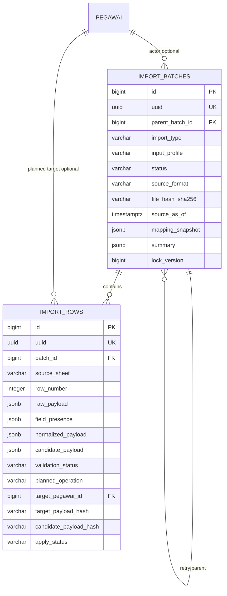
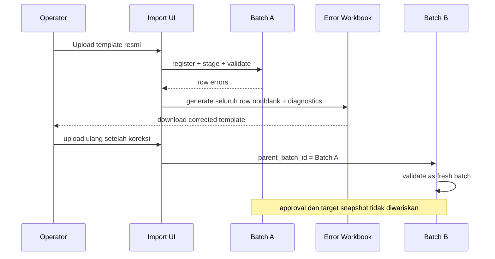

# 13 - IDP Pegawai Import Batch/Row Schema Draft

Status: Draft brainstorming, **bukan migration atau kode implementasi**
Project: kumjabar_ecosystem
Date: 2026-08-27
Depends on:

- `11-idp-pegawai-stage-2-import-pipeline-breakdown.md`
- `12-idp-pegawai-import-template-field-mapping-contract.md`

## 1. Tujuan

Dokumen ini memperinci schema konseptual untuk **Sub-Tahap 2.2 Upload & Batch Registration** dan **Sub-Tahap 2.4 Row Staging**.

Fokus utamanya:

1. tabel `import_batches` sebagai aggregate root satu proses ingestion;
2. tabel `import_rows` sebagai staging row-level;
3. lifecycle batch dan row;
4. provenance file, template, parser, mapping, dan sumber data;
5. pemisahan raw allowlist, normalized partial payload, presence semantics, dan candidate domain state;
6. retry lineage;
7. idempotency dan optimistic conflict detection;
8. retention/quarantine file mentah;
9. index, constraint, serta transaction boundary konseptual.

Dokumen ini belum membuat model SQLAlchemy, migration Alembic, parser XLSX/CSV, file template aktual, atau endpoint Flask.

## 2. Keputusan dari Dokumen 12 yang Dibawa Masuk

### 2.1 Canonical Input v1

```text
nip
nama_lengkap
email_dinas
email_google
org_unit_code
status_pegawai
```

`is_active` bukan input workbook. Untuk kontrak v1, service menurunkannya dari `status_pegawai`:

```text
aktif          -> true
mutasi_keluar  -> false
pensiun        -> false
nonaktif       -> false
meninggal      -> false
```

Jika kelak dibutuhkan suspend akses sementara untuk pegawai berstatus aktif, status/grant akses tersebut dimodelkan terpisah dan diaudit; jangan membuat bulk import lifecycle diam-diam membuka kembali akses yang sedang disuspend.

### 2.2 Boundary yang Tidak Boleh Dilanggar

`import_batches` dan `import_rows` bukan tempat menyimpan domain di luar IDP.

Forbidden:

```text
jabatan
jabatan_type
jenis/nama/label jabatan
PLT/PLH
histori/SK jabatan
role/permission
provider_subject
email_verified
keycloak_user_id sebagai input operator
```

Jika forbidden header ditemukan:

- nama header pelanggar boleh dicatat sebagai metadata audit minimum;
- nilai cell forbidden tidak boleh masuk `raw_payload`, `normalized_payload`, preview, log, error workbook, atau metadata domain;
- file berada sementara di quarantine dan tidak masuk normal retention storage IDP.

### 2.3 Template yang Dapat Diunduh

Admin UI wajib menyediakan template XLSX resmi:

```text
GET /admin/import/pegawai/template.xlsx
```

Template mengikuti Dokumen 12. Saat implementasi, pola XLSX pada project `dasborkanwil` boleh dipelajari sebagai referensi teknis, tetapi schema/field/security contract tidak disalin lintas domain secara buta.

## 3. Posisi Dokumen 13


Dokumen 13 mengunci bentuk persistence staging. Severity validation, dry-run UX, error workbook styling, dan apply algorithm tetap diperinci pada Dokumen 14–16.

## 4. Prinsip Schema

1. **Batch adalah aggregate root.** Row tidak boleh berdiri tanpa batch.
2. **Stage first, apply second.** Tidak ada upload yang langsung menulis ke tabel `pegawai`.
3. **Raw bukan berarti unrestricted.** `raw_payload` hanya menyimpan scalar dari allowlist yang dipetakan.
4. **Intent harus dipertahankan.** `absent`, `blank`, dan `provided` tidak boleh dilebur menjadi satu `null`.
5. **Partial payload bukan candidate state penuh.** Hash/noop dihitung dari state setelah merge dengan authoritative record.
6. **Approval terikat snapshot.** Mapping, row plan, dan target freshness yang berubah membatalkan approval lama.
7. **Retry adalah batch baru.** Batch lama immutable secara historis setelah terminal state.
8. **Idempotent bukan berarti hash file langsung di-apply.** Duplicate hash hanya sinyal dedup/review.
9. **File time bukan business-effective time.** `source_as_of`, `uploaded_at`, dan `applied_at` berbeda makna.
10. **PII minimum.** Jangan menyalin data pegawai ke terlalu banyak JSONB/log/file.

## 5. Logical ERD



Catatan ERD:

- actor upload bisa merupakan admin teknis/service account yang tidak selalu mempunyai row `pegawai`; karena itu actor subject disimpan selain FK opsional ke `pegawai`;
- `parent_batch_id` hanya untuk retry/re-upload lineage;
- `target_pegawai_id` baru terisi jika NIP cocok dengan record existing;
- `candidate_payload` adalah state penuh hasil merge yang dipakai dry-run, bukan input mentah.

## 6. Table Contract: `import_batches`

### 6.1 Fungsi

`import_batches` menyimpan identitas, lifecycle, provenance, mapping, agregat hasil, file-retention state, dan concurrency state untuk satu ingestion attempt.

### 6.2 Identity dan Lineage

| Kolom | Tipe Konseptual | Null | Default | Fungsi |
| --- | --- | --- | --- | --- |
| `id` | `bigserial/bigint` | tidak | identity | PK internal ORM |
| `uuid` | `uuid` | tidak | `gen_random_uuid()` | ID public lintas service |
| `parent_batch_id` | bigint FK self | ya | `null` | batch sumber retry langsung |
| `retry_reason` | varchar(80) | ya | `null` | `corrected_errors`, `mapping_fix`, `manual_retry` |
| `root_batch_uuid` | uuid | tidak | own UUID untuk root | root lineage ID agar query chain tidak recursive setiap saat |
| `retry_depth` | integer | tidak | `0` | kedalaman retry chain untuk guard operasional |
| `import_type` | varchar(40) | tidak | — | v1 hanya `pegawai` |
| `input_profile` | varchar(60) | tidak | `pegawai_standard_v1` | standard XLSX, retry XLSX, atau CSV teknis |

Allowed `input_profile` awal:

```text
pegawai_standard_v1
pegawai_error_retry_v1
pegawai_csv_v1
```

Aturan lineage:

- parent dan child harus mempunyai `import_type` yang sama;
- child selalu file/batch baru dengan UUID baru;
- root mempunyai `root_batch_uuid=uuid` dan `retry_depth=0`; child mewarisi root UUID serta memakai `parent.retry_depth + 1`;
- karena `root_batch_uuid` merujuk UUID batch yang sama, implementasi migration dapat memakai FK deferrable atau mengisinya setelah insert root dalam transaksi yang sama; alternatifnya gunakan `root_batch_id` nullable lalu kunci setelah insert—pilih satu strategi eksplisit saat Dokumen 13 diturunkan menjadi migration;
- parent terminal state tidak dibuka ulang;
- self-parent dan cycle ditolak service;
- retry tidak mewarisi approval/apply state;
- mapping preset boleh disalin sebagai candidate, tetapi wajib direvalidasi terhadap template/parser version child.

### 6.3 Lifecycle

| Kolom | Tipe | Null | Default | Fungsi |
| --- | --- | --- | --- | --- |
| `status` | varchar(40) check | tidak | `received` | lifecycle batch |
| `failure_code` | varchar(100) | ya | `null` | machine-readable terminal error |
| `failure_message` | text | ya | `null` | pesan aman untuk operator |
| `lock_version` | bigint | tidak | `0` | optimistic concurrency batch |
| `received_at` | timestamptz | tidak | `now()` | request upload diterima |
| `mapped_at` | timestamptz | ya | `null` | mapping valid/confirmed |
| `staged_at` | timestamptz | ya | `null` | seluruh row staging selesai |
| `validated_at` | timestamptz | ya | `null` | validation plan terakhir selesai |
| `approved_at` | timestamptz | ya | `null` | dry-run disetujui |
| `cancelled_at` | timestamptz | ya | `null` | pembatalan terminal |
| `applied_at` | timestamptz | ya | `null` | apply terminal selesai |
| `failed_at` | timestamptz | ya | `null` | gagal terminal |
| `created_at` | timestamptz | tidak | `now()` | audit teknis |
| `updated_at` | timestamptz | tidak | `now()` | perubahan teknis terakhir |

Status canonical awal:

```text
received
quarantined
rejected
registered
mapped
staging
staged
validating
validated
ready_to_apply
applying
applied
stale
failed
cancelled
```

### 6.4 State Machine Batch

```mermaid
stateDiagram-v2
    [*] --> received
    received --> quarantined
    quarantined --> rejected: unsafe/forbidden/invalid structure
    quarantined --> registered: security + structure pass
    registered --> mapped: mapping confirmed
    mapped --> staging
    staging --> staged
    staged --> validating
    validating --> validated
    validated --> ready_to_apply: eligible plan approved
    validated --> failed: validation engine failure
    ready_to_apply --> applied: Dokumen 16 Transaction B atomic commit via transient applying state
    ready_to_apply --> stale: final preflight conflict; approval invalid
    stale --> validating: full revalidation
    ready_to_apply --> failed: non-retryable failure finalized after rollback
    received --> cancelled
    registered --> cancelled
    mapped --> cancelled
    staged --> cancelled
    validated --> cancelled
    rejected --> [*]
    applied --> [*]
    failed --> [*]
    cancelled --> [*]
```



Catatan:

- `rejected` berarti input/file/contract tidak diterima sebelum domain staging yang valid;
- `failed` berarti proses internal gagal setelah batch diregistrasikan;
- Dokumen 16 mengunci batch-level atomic all-or-nothing; `applied_partial` tidak masuk status v1;
- `stale` berarti final preflight menemukan target/reference/plan tidak lagi cocok; approval batal dan batch wajib divalidasi ulang;
- `applying` tetap allowed state persistence untuk guard/observability, tetapi Dokumen 16 menulisnya hanya sebagai state transien di atomic Transaction B; persistent `applying` setelah crash adalah invariant breach, bukan recovery normal;
- transition dijalankan melalui service method, bukan update status bebas;
- full append-only audit log masuk Tahap 3, tetapi actor dan timestamp kritis tetap disimpan sejak Tahap 2.

### 6.5 File dan Quarantine Provenance

| Kolom | Tipe | Null | Fungsi |
| --- | --- | --- | --- |
| `original_filename` | varchar(255) | tidak | nama display yang sudah disanitasi |
| `source_format` | varchar(20) check | tidak | `xlsx` atau `csv` |
| `declared_mime_type` | varchar(150) | ya | MIME dari client; tidak dipercaya tunggal |
| `detected_media_type` | varchar(150) | ya | hasil pemeriksaan server |
| `file_size_bytes` | bigint | tidak | ukuran upload |
| `file_hash_sha256` | char(64) | tidak | integritas/dedup bytes |
| `storage_state` | varchar(30) check | tidak | quarantine/retained/purged/not_stored |
| `storage_key` | varchar(500) | ya | opaque key private storage, bukan public URL |
| `quarantine_reason` | varchar(100) | ya | alasan tertahan/ditolak |
| `retention_until` | timestamptz | ya | batas normal retention |
| `purged_at` | timestamptz | ya | bukti file sudah dimusnahkan |

Allowed `storage_state`:

```text
quarantined
retained
purged
not_stored
```

Aturan:

- DB menyimpan opaque storage key, bukan blob file dan bukan filesystem path publik;
- file harus melalui quarantine/structural validation sebelum normal retention;
- forbidden header batch hanya menyimpan metadata minimum; file dimusnahkan setelah rejection kecuali kebijakan hukum eksplisit menyatakan lain;
- `purged` mewajibkan `purged_at` dan `storage_key=null`;
- purge file tidak menghapus batch/row metadata yang masih diperlukan untuk audit;
- file hash tidak dianggap approval atau authorization token.

### 6.6 Template, Parser, dan Source Provenance

| Kolom | Tipe | Null | Fungsi |
| --- | --- | --- | --- |
| `template_type` | varchar(40) | tidak | `pegawai` |
| `template_version` | varchar(60) | tidak | contoh `pegawai-import.v1` |
| `contract_version` | varchar(60) | tidak | contoh `pegawai.v1` |
| `org_units_version` | varchar(60) | ya | versi referensi saat template dibuat |
| `source_as_of` | timestamptz | tidak | waktu current-state sumber yang diwakili file |
| `parser_version` | varchar(60) | tidak | versi parser deterministic |
| `normalizer_version` | varchar(60) | tidak | versi normalisasi field |
| `alias_dictionary_version` | varchar(60) | tidak | versi kamus alias header/value |
| `canonicalization_version` | varchar(60) | tidak | versi serialisasi canonical untuk hash/fingerprint |
| `source_encoding` | varchar(30) | ya | wajib untuk CSV |
| `source_delimiter` | varchar(10) | ya | wajib untuk CSV |
| `header_row_number` | integer | tidak | v1 default 1 |

Aturan temporal:

- `source_as_of` berbeda dari `received_at`, `uploaded_at`, dan `applied_at`;
- waktu teknis tidak dipakai mengarang `status_effective_at` atau assignment history;
- batch lama tidak boleh menimpa target yang lebih fresh tanpa conflict review;
- timezone harus eksplisit; persistence menggunakan `timestamptz`/UTC dan UI menampilkan zona operator.

### 6.7 Actor dan Approval

| Kolom | Tipe | Null | Fungsi |
| --- | --- | --- | --- |
| `uploaded_by_subject` | varchar(255) | tidak | Keycloak `sub`/service subject uploader |
| `uploaded_by_pegawai_id` | bigint FK | ya | link actor jika subject adalah pegawai |
| `mapped_by_subject` | varchar(255) | ya | confirmer mapping |
| `validated_by_subject` | varchar(255) | ya | actor trigger validation |
| `approved_by_subject` | varchar(255) | ya | approver dry-run |
| `applied_by_subject` | varchar(255) | ya | actor apply |
| `approval_fingerprint` | char(64) | ya | hash plan yang disetujui |
| `approval_lock_version` | bigint | ya | batch version saat approval |

Prinsip:

- actor identity memakai immutable subject, bukan nama/email display;
- FK pegawai bersifat pelengkap dan nullable karena service account/admin teknis mungkin bukan pegawai;
- approval tidak valid bila `lock_version`, mapping, rows, target snapshot, atau candidate plan berubah;
- capability authorization diperiksa service; schema tidak menurunkan hak dari unit/jabatan.

Seluruh hash JSON/payload menggunakan canonical JSON yang deterministic dan versioned; jangan mengandalkan urutan key atau format serialisasi bawaan library yang dapat berubah lintas runtime.

### 6.8 Mapping, Summary, dan Output

| Kolom | Tipe | Null | Default | Fungsi |
| --- | --- | --- | --- | --- |
| `mapping_snapshot` | jsonb | tidak | `{}` | mapping raw header ke canonical field |
| `mapping_hash` | char(64) | ya | `null` | hash canonical mapping snapshot |
| `summary` | jsonb | tidak | `{}` | aggregate counter/cache UI |
| `error_workbook_storage_key` | varchar(500) | ya | `null` | output retry XLSX private |
| `error_workbook_hash` | char(64) | ya | `null` | integritas output |
| `error_workbook_generated_at` | timestamptz | ya | `null` | waktu generation |
| `error_workbook_retention_until` | timestamptz | ya | `null` | batas umur output retry |
| `error_workbook_purged_at` | timestamptz | ya | `null` | bukti output dimusnahkan |

> **Superseded oleh Dokumen 15 untuk implementasi artifact:** kolom tunggal `error_workbook_*` cukup sebagai draft awal. Karena regeneration/versioning/concurrent generation memerlukan lifecycle sendiri, implementasi direkomendasikan memakai tabel `import_artifacts`; `import_batches` tetap aggregate owner.

`summary` adalah denormalized cache, bukan source of truth. Minimal shape:

```json
{
  "total_rows": 250,
  "pending_rows": 0,
  "valid_rows": 220,
  "warning_rows": 10,
  "error_rows": 20,
  "planned_create": 30,
  "planned_update": 180,
  "planned_noop": 20,
  "planned_reject": 20,
  "applied_rows": 0
}
```

Counter authoritative dihitung dari `import_rows`; summary di-refresh transactionally atau direkonsiliasi sebelum approval/apply.

## 7. Table Contract: `import_rows`

### 7.1 Fungsi

Satu `import_rows` merepresentasikan satu physical/logical data row dari source file yang sudah lolos file/header boundary dan masuk staging.

### 7.2 Identity dan Source Locator

| Kolom | Tipe | Null | Default | Fungsi |
| --- | --- | --- | --- | --- |
| `id` | bigserial/bigint | tidak | identity | PK internal |
| `uuid` | uuid | tidak | `gen_random_uuid()` | ID public row |
| `batch_id` | bigint FK | tidak | — | aggregate owner |
| `source_sheet` | varchar(120) | ya | `null` | `pegawai` untuk XLSX; null untuk CSV |
| `row_number` | integer | tidak | — | physical XLSX row atau logical CSV record |
| `source_locator` | varchar(180) | tidak | — | contoh `pegawai!17` atau `csv:17` |
| `source_row_hash` | char(64) | tidak | — | hash canonical raw allowlist row |

Aturan:

- `row_number > header_row_number`;
- blank row tidak menghentikan parser;
- row yang seluruh allowlist value-nya blank boleh dilewati dan tidak perlu menjadi `import_rows`, tetapi jumlah skipped dicatat di batch summary;
- locator tetap menunjuk posisi sumber agar operator dapat memperbaiki file;
- unique `(batch_id, source_locator)`.

### 7.3 Source Cell Metadata dan Raw Allowlist

| Kolom | Tipe | Null | Default | Fungsi |
| --- | --- | --- | --- | --- |
| `raw_payload` | jsonb | tidak | `{}` | scalar raw value dari allowlist saja |
| `source_metadata` | jsonb | tidak | `{}` | tipe cell, source header/index, locator per field |
| `field_presence` | jsonb | tidak | `{}` | `absent`, `blank`, `provided` per canonical field |

Contoh:

```json
{
  "raw_payload": {
    "nip": "199001012020121001",
    "nama_lengkap": "  Rina   Nurhayati  ",
    "email_dinas": "",
    "org_unit_code": "tum_ti",
    "status_pegawai": "AKTIF"
  },
  "field_presence": {
    "nip": "provided",
    "nama_lengkap": "provided",
    "email_dinas": "blank",
    "email_google": "absent",
    "org_unit_code": "provided",
    "status_pegawai": "provided"
  }
}
```

Rules:

- JSON key hanya canonical allowlist;
- `provided_fields` diturunkan saat runtime dari `field_presence`; jangan menyimpan dua representasi intent yang dapat drift;
- forbidden/unknown cell value tidak pernah disimpan;
- scalar length dibatasi sebelum JSON persistence;
- NIP XLSX numeric/formula ditolak pada structural/row boundary dan tidak dinormalisasi menjadi string palsu;
- `raw_payload` tidak dipakai langsung untuk materialization;
- `source_metadata` tidak membawa formula body, hyperlink target, comment, atau object.

### 7.4 Normalized Partial Payload

| Kolom | Tipe | Null | Default | Fungsi |
| --- | --- | --- | --- | --- |
| `normalized_payload` | jsonb | tidak | `{}` | field provided setelah normalisasi |
| `normalization_warnings` | jsonb array | tidak | `[]` | warning normalization |
| `normalization_hash` | char(64) | ya | `null` | hash canonical normalized partial payload |

Contoh:

```json
{
  "nip": "199001012020121001",
  "nama_lengkap": "Rina Nurhayati",
  "org_unit_code": "TUM_TI",
  "status_pegawai": "aktif"
}
```

`normalized_payload` tetap partial. Blank update tidak ditulis sebagai `null` instruction. Presence intent berada di `field_presence`.

### 7.5 Match dan Target Snapshot

| Kolom | Tipe | Null | Fungsi |
| --- | --- | --- | --- |
| `match_status` | varchar(30) check | tidak | unmatched/matched/conflict |
| `matched_by` | varchar(30) | ya | v1 hanya `nip` |
| `target_pegawai_id` | bigint FK | ya | existing target internal |
| `target_pegawai_uuid` | uuid | ya | public target snapshot |
| `target_source_updated_at` | timestamptz | ya | freshness target saat validation |
| `target_payload_hash` | char(64) | ya | canonical target hash saat validation |

Aturan:

- email bukan fallback match;
- NIP duplicate dalam batch menjadi validation error;
- target ID/UUID/hash adalah snapshot plan, bukan izin apply permanen;
- sebelum apply, target `updated_at`/hash dibandingkan ulang;
- perubahan target menghasilkan `stale_target_conflict` dan row kembali perlu validation/review.

### 7.6 Candidate State dan Planned Operation

| Kolom | Tipe | Null | Default | Fungsi |
| --- | --- | --- | --- | --- |
| `candidate_payload` | jsonb | tidak | `{}` | full candidate state allowlist IDP setelah merge; bukan seluruh model/relationship |
| `candidate_payload_hash` | char(64) | ya | `null` | canonical hash candidate |
| `planned_operation` | varchar(30) check | tidak | `undetermined` | create/update/noop/reject |
| `change_set` | jsonb | tidak | `{}` | before/after field-level untuk review |
| `operation_fingerprint` | char(64) | ya | `null` | stable plan fingerprint |

Candidate merge:

```text
create:
  candidate = defaults terkontrol + normalized provided values

update:
  candidate = authoritative existing state
              + replacement hanya untuk provided fields
              + derived is_active/status invariant
```

Canonical hash/noop menggunakan `candidate_payload`, bukan partial input.

`candidate_payload` hanya memuat canonical materialization allowlist (`nip`, nama, email profile candidate, primary org code/resolution, status, dan derived eligibility) serta identifier yang dibutuhkan. Ia tidak memuat metadata liar, assignment history, identity-link subject, jabatan, role, atau relationship graph.

`change_set` tidak perlu menggandakan semua PII; hanya field berubah dengan masking sesuai UI/API policy.

### 7.7 Validation Contract Storage

| Kolom | Tipe | Null | Default | Fungsi |
| --- | --- | --- | --- | --- |
| `validation_status` | varchar(30) check | tidak | `pending` | row validation state |
| `validation_errors` | jsonb array | tidak | `[]` | machine-readable errors |
| `validation_warnings` | jsonb array | tidak | `[]` | machine-readable warnings |
| `validated_at` | timestamptz | ya | `null` | validation terakhir |
| `validation_version` | varchar(60) | ya | `null` | ruleset version |

Allowed `validation_status`:

```text
pending
valid
warning
error
stale
```

Error shape minimum:

```json
{
  "code": "org_unit_code_not_found",
  "severity": "error",
  "scope": "cell",
  "source_locator": "pegawai!17",
  "field": "org_unit_code",
  "cell": "E17",
  "human_message": "Kode unit tidak ditemukan.",
  "suggested_action": "Pilih kode dari reference_org_units."
}
```

Rules:

- stack trace, SQL, filesystem path, dan secret tidak masuk error payload;
- validation engine exception adalah batch `failed`, bukan business row error massal;
- error array mempunyai size/count limit;
- full validation matrix dikunci pada Dokumen 14.

### 7.8 Apply State

| Kolom | Tipe | Null | Default | Fungsi |
| --- | --- | --- | --- | --- |
| `apply_status` | varchar(30) check | tidak | `not_applied` | row apply state |
| `apply_attempt_count` | integer | tidak | `0` | jumlah attempt terkontrol |
| `applied_at` | timestamptz | ya | `null` | sukses apply |
| `applied_entity_uuid` | uuid | ya | `null` | target result public ID |
| `apply_error_code` | varchar(100) | ya | `null` | safe machine code |
| `apply_error_message` | text | ya | `null` | safe operator message |
| `created_at` | timestamptz | tidak | `now()` | audit teknis |
| `updated_at` | timestamptz | tidak | `now()` | perubahan terakhir |

Allowed `apply_status`:

```text
not_applied
applying
applied
skipped
conflict
failed
```

Idempotency:

- `operation_fingerprint` mengikat batch UUID, source locator, target UUID/NIP, target snapshot hash, candidate hash, dan planned operation;
- successful fingerprint tidak dijalankan dua kali;
- `noop` menjadi `skipped`, bukan domain write;
- retry transport/network tidak boleh menghasilkan duplicate pegawai;
- detail transaction/apply strategy dikunci Dokumen 16.

Karena domain `pegawai` dan staging berada pada PostgreSQL yang sama, perubahan domain row, primary org affiliation yang terkait, dan transition row ke `apply_status=applied` harus berada dalam **satu database transaction**. Dengan demikian crash tidak boleh menghasilkan domain write sukses tetapi row staging masih terlihat belum diterapkan. Jika kelak apply melintasi database/service boundary, pola outbox/idempotency ledger wajib ditambahkan dan partial unique fingerprint lokal saja tidak cukup.

`operation_fingerprint` mengikat attempt/row di dalam satu batch. Untuk mencegah replay lintas retry batch, Dokumen 16 wajib membentuk `materialization_key` yang **tidak** bergantung pada batch UUID/source locator, minimal dari `import_type`, business key NIP/target UUID, target snapshot hash, candidate hash, planned operation, dan `canonicalization_version`. Domain uniqueness NIP tetap menjadi guard terakhir untuk create.

## 8. Mapping Snapshot v2

Dokumen 12 memberi contoh mapping minimum. Schema persistence memperluasnya agar parse dapat direproduksi:

```json
{
  "input_profile": "pegawai_standard_v1",
  "file_hash_sha256": "<sha256>",
  "template_version": "pegawai-import.v1",
  "contract_version": "pegawai.v1",
  "parser_version": "xlsx-parser.v1",
  "normalizer_version": "pegawai-normalizer.v1",
  "alias_dictionary_version": "pegawai-alias.v1",
  "source_sheet": "pegawai",
  "header_row": 1,
  "csv_dialect": null,
  "mappings": [
    {
      "source_column_index": 1,
      "source_cell": "A1",
      "source_header": "NIP",
      "normalized_header": "nip",
      "target_field": "nip",
      "mapping_status": "mapped",
      "match_type": "exact"
    }
  ],
  "forbidden_headers": [],
  "unknown_headers": [],
  "confirmed_by_subject": "keycloak-sub",
  "confirmed_at": "2026-08-27T21:30:00+07:00"
}
```

Terminologi:

```text
mapping_status = mapped | manual_required | error
match_type     = exact | alias | manual
```

`exact` berarti header **setelah header normalization** sama dengan canonical header; raw header tetap disimpan.

## 9. Constraint dan Index Draft

### 9.1 `import_batches`

```text
PK (id)
UNIQUE (uuid)
FK parent_batch_id -> import_batches.id ON DELETE RESTRICT
FK uploaded_by_pegawai_id -> pegawai.id ON DELETE SET NULL
CHECK import_type IN ('pegawai')
CHECK source_format IN ('xlsx', 'csv')
CHECK file_size_bytes > 0
CHECK file_hash_sha256 ~ '^[0-9a-f]{64}$'
CHECK parent_batch_id IS NULL OR parent_batch_id <> id
CHECK retry_depth >= 0
CHECK ((parent_batch_id IS NULL AND retry_depth = 0) OR (parent_batch_id IS NOT NULL AND retry_depth > 0))
CHECK header_row_number >= 1
CHECK lock_version >= 0
CHECK source_as_of IS NOT NULL
CHECK storage_state IN (...)
CHECK status IN (...)
INDEX (status, created_at)
INDEX (import_type, created_at)
INDEX (file_hash_sha256)
INDEX (parent_batch_id)
INDEX (root_batch_uuid, retry_depth)
INDEX (uploaded_by_subject, created_at)
INDEX (retention_until) WHERE storage_state = 'retained'
CHECK (status <> 'applied' OR applied_at IS NOT NULL)
CHECK (status <> 'failed' OR failed_at IS NOT NULL)
CHECK (status <> 'cancelled' OR cancelled_at IS NOT NULL)
CHECK (storage_state <> 'purged' OR (purged_at IS NOT NULL AND storage_key IS NULL))
```

`file_hash_sha256` tidak unique karena file sama boleh di-upload ulang sebagai retry/review. Service menampilkan duplicate warning dan lineage/history sebelum operator lanjut.

### 9.2 `import_rows`

```text
PK (id)
UNIQUE (uuid)
UNIQUE (batch_id, source_locator)
FK batch_id -> import_batches.id ON DELETE RESTRICT
FK target_pegawai_id -> pegawai.id ON DELETE RESTRICT
CHECK row_number >= 1
CHECK validation_status IN (...)
CHECK match_status IN (...)
CHECK planned_operation IN (...)
CHECK apply_status IN (...)
CHECK apply_attempt_count >= 0
CHECK ((match_status = 'matched') = (target_pegawai_id IS NOT NULL))
CHECK (planned_operation <> 'create' OR target_pegawai_id IS NULL)
CHECK (planned_operation NOT IN ('update', 'noop') OR target_pegawai_id IS NOT NULL)
CHECK (apply_status <> 'applied' OR applied_at IS NOT NULL)
INDEX (batch_id, row_number)
INDEX (batch_id, validation_status)
INDEX (batch_id, planned_operation)
INDEX (batch_id, apply_status)
INDEX (target_pegawai_id)
INDEX (source_row_hash)
INDEX (operation_fingerprint) WHERE operation_fingerprint IS NOT NULL
UNIQUE (operation_fingerprint) WHERE operation_fingerprint IS NOT NULL AND apply_status = 'applied'
```

Tidak direkomendasikan membuat GIN index luas pada payload JSONB v1 karena:

- query utama batch-scoped dan sudah mempunyai relational columns;
- GIN menambah write/storage cost;
- JSONB membawa PII;
- arbitrary payload querying dapat mendorong schema drift.

## 10. Transaction Boundaries

### 10.1 Register Batch

Satu transaksi:

1. insert `import_batches` status `received`;
2. simpan provenance/hash/actor;
3. commit;
4. file security/structure scan berjalan dengan resource budget;
5. transition ke `quarantined`, `rejected`, atau `registered`.

File storage dan DB bukan satu transaction manager. Compensation wajib:

- DB insert gagal setelah file ditulis -> hapus quarantine object;
- file write gagal -> batch `failed`/request gagal tanpa berpura-pura tersimpan;
- purge job idempotent.

### 10.2 Stage Rows

Staging boleh chunked untuk file besar, tetapi batch tidak boleh terlihat `staged` sampai:

- seluruh row sukses diparse;
- unique locator terjaga;
- row count direkonsiliasi;
- mapping hash tidak berubah;
- no forbidden/unknown value memasuki payload.

Jika chunk gagal:

- batch `failed`;
- partial staging rows tidak boleh di-apply;
- cleanup dapat menghapus partial rows selama batch belum mencapai terminal audit retention yang mengharuskan jejak lain.

### 10.3 Validate/Plan

Validation menghasilkan dalam satu logical run:

- match target;
- target snapshot/hash;
- candidate merge;
- candidate hash;
- change set;
- planned operation;
- validation diagnostics;
- batch summary dan plan/approval fingerprint.

Jika target berubah di tengah run, row menjadi `stale` atau run diulang.

### 10.4 Apply Preview

Dokumen 13 belum mengizinkan domain apply, tetapi schema menyiapkan guard:

```text
recheck batch lock_version
recheck approval_fingerprint
recheck target hash/updated_at
recheck row operation_fingerprint
then apply transactionally
```

Perubahan `org_unit_code` kelak harus memperbarui `pegawai.primary_org_unit_id` dan primary `pegawai_org_assignments` secara atomik dalam satu row transaction.

## 11. Immutability dan Mutation Rules

| State | Mutasi yang Boleh |
| --- | --- |
| `received`/`registered` | provenance teknis dan scan result |
| `mapped` | mapping snapshot locked untuk staging run |
| `staging`/`staged` | row insert oleh staging service; tidak diedit manual |
| `validating`/`validated` | validation/candidate/summary refresh oleh service |
| `ready_to_apply` | hanya cancel atau apply dengan fingerprint cocok |
| terminal | metadata retention/output boleh berubah; input/mapping/row plan tidak diubah |

Koreksi operator tidak mengedit `raw_payload` langsung di DB. Operator memperbaiki file/template lalu meng-upload batch baru yang mereferensikan parent.

## 12. Retention dan Data Minimization

### 12.1 Kategori Data

| Data | Retention Arah Awal |
| --- | --- |
| rejected forbidden/malicious file | quarantine sangat singkat, lalu purge |
| accepted raw file | private, retention konfigurabel |
| raw allowlist row | lebih singkat dari authoritative domain bila kebijakan memungkinkan |
| normalized/candidate payload | sampai review/audit retention terpenuhi |
| diagnostics | selama diperlukan untuk retry/audit |
| batch metadata/hash/actor/summary | lebih panjang sebagai audit teknis |
| error workbook | private dan berumur pendek |

### 12.2 Prinsip

- jangan menyimpan file permanen tanpa alasan;
- retention job wajib idempotent dan mencatat `purged_at`;
- backup/restore policy harus menghormati klasifikasi PII;
- access download file/error workbook memakai capability dan audit;
- log tidak berisi payload row;
- masking diterapkan pada preview/API sesuai capability;
- hard delete batch tidak dilakukan oleh operator biasa.

Angka hari retention belum dikunci sampai kebijakan keamanan/privasi tersedia.

## 13. Retry dan Error Workbook Lineage



Error workbook profile `pegawai_error_retry_v1`:

- data editable seluruh row nonblank ada di sheet canonical `pegawai`; failing cells ditandai agar child retry self-contained;
- diagnostics ada di sheet terpisah;
- parser membaca data hanya dari `pegawai`;
- system sheets diterima hanya bila metadata/profile valid;
- retry file mendapatkan hash dan batch baru;
- parent batch tetap immutable.

## 14. API/Service Contract Preview

Konseptual, private/admin-only:

```text
GET  /admin/import/pegawai/template.xlsx
POST /admin/import/pegawai/batches
GET  /admin/import/pegawai/batches/{uuid}
GET  /admin/import/pegawai/batches/{uuid}/rows
POST /admin/import/pegawai/batches/{uuid}/mapping/confirm
POST /admin/import/pegawai/batches/{uuid}/stage
POST /admin/import/pegawai/batches/{uuid}/validate
POST /admin/import/pegawai/batches/{uuid}/approve
GET  /admin/import/pegawai/batches/{uuid}/error-workbook
POST /admin/import/pegawai/batches/{uuid}/cancel
```

Apply route tetap diperinci Dokumen 16.

Semua mutating command membawa expected `lock_version` atau `If-Match` equivalent untuk mencegah double click/race.

## 15. Security Threat-to-Control Matrix

| Threat | Control Schema/Service |
| --- | --- |
| ZIP bomb/resource exhaustion | provenance + configured limits sebelum staging |
| formula/macro/external content | structural rejection; tidak simpan cached formula sebagai data |
| hidden/merged ambiguous data | file-level structural rejection |
| forbidden domain exfiltration ke IDP | header-only audit, no values, quarantine purge |
| NIP precision loss | XLSX NIP harus storage type string; numeric/formula reject |
| duplicate apply | operation fingerprint + apply status + target uniqueness |
| stale overwrite | target hash/updated_at + source_as_of + approval invalidation |
| email account takeover | email bukan match key; no automatic trusted linking |
| direct DB row edit | service-only mutation + immutable terminal batch |
| PII leakage | private storage, payload minimization, no broad logs/GIN |
| actor spoofing | immutable Keycloak/service subject from authenticated context |

## 16. Decisions Proposed to Lock

1. Dua tabel persistence utama Tahap 2 adalah `import_batches` dan `import_rows`.
2. Batch memakai integer PK + UUID public yang dihasilkan PostgreSQL.
3. Retry selalu batch baru dengan `parent_batch_id`.
4. File disimpan private memakai opaque storage key, bukan blob DB/public path.
5. Forbidden file tidak masuk normal retention; nilai forbidden tidak disimpan.
6. `source_as_of` wajib dan terpisah dari waktu teknis.
7. `raw_payload` hanya canonical allowlist scalar.
8. Presence semantics disimpan eksplisit.
9. `normalized_payload` adalah partial payload; `candidate_payload` adalah full merged state.
10. Noop/hash dihitung dari candidate state setelah merge.
11. Email tidak menjadi fallback match; NIP satu-satunya match key v1.
12. Target snapshot/hash dan approval fingerprint wajib sebelum apply.
13. Summary JSONB adalah cache, bukan authoritative counter.
14. Tidak ada broad GIN index pada payload JSONB v1.
15. Terminal batch tidak diedit; koreksi melalui retry child batch.
16. Template XLSX resmi harus dapat diunduh dari Admin UI.

## 17. Open Questions

| No | Pertanyaan | Rekomendasi Awal |
| --- | --- | --- |
| 1 | Apakah valid rows boleh di-apply ketika batch masih punya error rows? | **Dikunci Dokumen 14–16: tidak.** Seluruh batch harus bebas error/fatal dan apply v1 atomic all-or-nothing; `applied_partial` tidak masuk status v1. |
| 2 | Apakah validator dan approver harus dua orang berbeda? | Belum wajib MVP; siapkan actor fields agar four-eyes dapat diaktifkan policy. |
| 3 | Berapa retention file/raw rows/error workbook? | Konfigurabel; kunci setelah kebijakan privasi dan sizing. |
| 4 | Perlukah tabel append-only `import_batch_events` sejak Tahap 2? | Audit penuh Tahap 3; untuk MVP timestamp/actor kritis cukup, tetapi event table layak bila governance meminta jejak setiap transition. |
| 5 | Apakah `source_as_of` cukup tanggal atau harus timestamp? | Gunakan timestamptz agar tidak ambigu; UI boleh menerima tanggal lalu menetapkan cutoff eksplisit. |
| 6 | Apakah `candidate_payload` menyimpan email raw penuh? | Simpan hanya jika dibutuhkan dry-run; masking di API dan retention lebih pendek. |
| 7 | Apakah raw rows dihapus setelah apply? | Jangan langsung; ikuti retention policy dan kebutuhan error retry/audit. |
| 8 | Berapa maximum row per batch? | Konfigurabel berdasarkan sizing test; jangan hard-code tanpa benchmark. |
| 9 | Apakah template download dinamis atau file statis versioned? | Rekomendasi dinamis/versioned dari contract + current org references, dengan cache dan deterministic test. |

## 18. Acceptance Checklist

### Batch

- [ ] Identity/UUID dan retry lineage disetujui.
- [ ] Lifecycle/status transition disetujui.
- [ ] File quarantine/storage/retention contract disetujui.
- [ ] Template/parser/source provenance disetujui.
- [ ] Actor dan optimistic lock disetujui.
- [ ] Mapping/summary/output contract disetujui.

### Row

- [ ] Source locator dan row hash disetujui.
- [ ] Raw allowlist boundary disetujui.
- [ ] `field_presence` disetujui; `provided_fields` hanya derivasi runtime, bukan kolom persistence.
- [ ] Partial normalized vs full candidate payload disetujui.
- [ ] Target snapshot/freshness guard disetujui.
- [ ] Validation diagnostics shape disetujui.
- [ ] Apply state/idempotency fields disetujui sebagai persiapan Dokumen 16.

### Security dan Operasional

- [ ] Forbidden file purge contract disetujui.
- [ ] PII retention/minimization disetujui.
- [ ] Error workbook retry lineage disetujui.
- [ ] Template XLSX downloadable requirement disetujui.
- [ ] Tidak ada derivasi role/jabatan melalui import.

## 19. Langkah Berikutnya

Setelah Dokumen 13 direview:

```text
14 - Import Validation & Dry-run Contract
```

Dokumen 14 akan mengunci:

- validation layers dan machine-readable error catalog;
- cross-row/DB/identity conflict matrix;
- severity error/warning/info;
- candidate merge dan change-set rules;
- stale target/source handling;
- summary dan review UI;
- approval fingerprint;
- warning/error eligibility untuk apply.

## 20. Kontrak Translasi UI Operator

Dokumen 13 adalah kontrak backend. Operator tidak boleh dipaksa memahami istilah teknisnya.

| Istilah Backend | Bahasa UI Operator |
| --- | --- |
| `import_batches` | Proses import / riwayat unggahan |
| `import_rows` | Baris pegawai |
| staging | File sedang diperiksa; data pegawai belum diubah |
| validation | Pemeriksaan data |
| dry-run | Ringkasan perubahan sebelum disimpan |
| `source_as_of` | Data ini menggambarkan keadaan per tanggal |
| `planned_create` | Pegawai baru |
| `planned_update` | Data pegawai akan diperbarui |
| `planned_noop` | Tidak ada perubahan |
| `planned_reject` | Perlu diperbaiki |
| stale target | Data berubah setelah pemeriksaan; periksa ulang |
| approval fingerprint | Ringkasan yang tadi disetujui sudah berubah |
| retry child batch | Upload ulang file yang sudah diperbaiki |
| lock conflict | Proses ini sudah berubah/dibuka di tempat lain; muat ulang halaman |

Aturan UI:

- alur utama cukup: **Download template → Isi file → Upload → Periksa hasil → Simpan perubahan**;
- jangan tampilkan JSON, hash, UUID, lock version, fingerprint, state machine, storage key, atau nama constraint pada tampilan operator;
- tampilkan pesan yang menjawab tiga hal: **apa yang salah, ada di mana, dan harus berbuat apa**;
- istilah teknis tersedia dalam panel "Detail teknis" yang tertutup secara default untuk TI/audit;
- status tidak hanya memakai warna; selalu sertakan ikon dan teks;
- tombol utama menggunakan kata kerja yang jelas, misalnya `Download Template`, `Pilih File`, `Periksa Data`, `Download File Perbaikan`, dan `Simpan Perubahan`;
- jika proses gagal, data authoritative tetap tidak berubah dan UI menyatakannya secara eksplisit;
- sebelum apply, operator melihat ringkasan jumlah pegawai baru, diperbarui, tetap, dan perlu diperbaiki tanpa membaca struktur schema.

Kontrak UI operator dan dry-run diperinci pada Dokumen 14. Prinsipnya sederhana: **backend boleh rumit agar aman; pengalaman operator harus tetap mudah.**

## 21. Kesimpulan

Schema staging yang aman tidak cukup hanya mempunyai dua JSONB:

```text
raw_payload
normalized_payload
```

Ia perlu memisahkan:

```text
source intent
-> raw allowlist
-> presence semantics
-> normalized partial payload
-> target snapshot
-> merged candidate state
-> validation plan
-> approval fingerprint
-> idempotent apply state
```

Dengan rancangan ini:

- template resmi dapat diunduh dan tetap versioned;
- data jabatan tidak bocor ke staging;
- blank update tidak menghapus data diam-diam;
- file lama tidak menimpa state baru tanpa review;
- retry mempunyai lineage yang jelas;
- hash/noop membandingkan state penuh yang benar;
- duplicate apply dan race condition mempunyai guard;
- Dokumen 14–16 dapat dibangun tanpa mengubah fondasi persistence secara besar.
