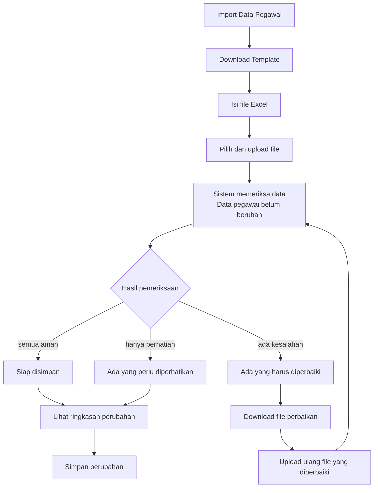
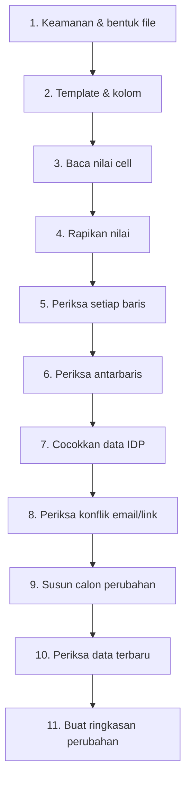

# 14 - IDP Pegawai Import Validation & Dry-run Contract

Status: Draft brainstorming, **bukan kode implementasi**
Project: kumjabar_ecosystem
Date: 2026-08-27
Depends on:

- `11-idp-pegawai-stage-2-import-pipeline-breakdown.md`
- `12-idp-pegawai-import-template-field-mapping-contract.md`
- `13-idp-pegawai-import-batch-row-schema-draft.md`

## 1. Tujuan

Dokumen ini memperinci **Sub-Tahap 2.5 Normalization**, **2.6 Validation**, dan **2.7 Dry-run Review**.

Tujuannya ada dua dan keduanya sama penting:

1. backend memeriksa file secara ketat sebelum data authoritative berubah;
2. operator memahami hasil pemeriksaan tanpa harus mengerti schema database, JSONB, hash, fingerprint, staging, atau state machine.

Prinsip UX:

> Backend boleh rumit agar aman. Layar operator harus tetap sederhana.

Dokumen ini belum membuat parser, validation engine, halaman Flask/Jinja, workbook, atau route aktual.

## 2. Hasil yang Harus Dicapai Operator

Operator cukup memahami alur berikut:

```text
1. Download template
2. Isi data pegawai
3. Upload file
4. Periksa hasil
5. Perbaiki jika ada masalah
6. Simpan perubahan
```

Pada Dokumen 14, langkah keenam berarti operator menyetujui rencana dan melanjutkan ke proses apply Dokumen 16. Dry-run sendiri belum menulis ke tabel authoritative. UI boleh memakai tombol `Lanjutkan ke Simpan Perubahan`, tetapi tidak boleh memberi pesan sukses "tersimpan" sebelum transaction apply benar-benar selesai.

Operator tidak perlu mengetahui proses internal berikut:

```text
quarantine
mapping snapshot
raw payload
candidate payload
canonical hash
optimistic lock
approval fingerprint
materialization key
```

Sistem tetap menjalankan semuanya, tetapi UI menerjemahkannya ke bahasa sehari-hari.

## 3. Posisi Dokumen 14


Dokumen 14 berhenti pada persetujuan rencana perubahan. Transaction apply dan recovery dibahas pada Dokumen 16.

## 4. Kamus Bahasa Operator

| Istilah Backend | Jangan Tampilkan sebagai Label Utama | Bahasa UI Operator |
| --- | --- | --- |
| validation | Validation engine | Periksa data |
| dry-run | Dry-run | Ringkasan perubahan |
| staging | Staging | File sedang diperiksa; data belum disimpan |
| `planned_create` | INSERT | Pegawai baru |
| `planned_update` | UPDATE | Data akan diperbarui |
| `planned_noop` | NOOP | Tidak ada perubahan |
| `planned_reject` | REJECT | Perlu diperbaiki |
| warning | Warning severity | Perlu diperhatikan |
| error | Validation error | Harus diperbaiki |
| stale target | Stale hash | Data berubah; periksa ulang |
| `source_as_of` | Source timestamp | Keadaan data per tanggal |
| approval fingerprint | Plan fingerprint | Ringkasan berubah; mohon periksa lagi |
| retry child batch | Child batch | Upload ulang file perbaikan |
| lock conflict | Optimistic lock conflict | Proses ini sudah berubah; muat ulang halaman |

Tabel di atas adalah kamus dokumentasi/desain, bukan isi yang ditampilkan utuh kepada operator. Kode teknis tetap tersedia pada panel **Detail teknis** yang tertutup secara default dan hanya terlihat untuk capability TI/audit yang sesuai.

## 5. Alur UI Operator



Pada setiap langkah, tampilkan kalimat keamanan yang relevan:

```text
File sedang diperiksa. Belum ada data pegawai yang berubah.
```

atau:

```text
Pemeriksaan selesai. Perubahan belum disimpan.
```

## 6. Tahapan Pemeriksaan Backend

Pemeriksaan berjalan berurutan. Tahap berikutnya tidak boleh menganggap tahap sebelumnya berhasil bila statusnya gagal.



### 6.1 File dan Security Validation

Mencakup:

- format XLSX/CSV yang didukung;
- ukuran/resource limit;
- OOXML structure;
- macro, formula, external link, embedded object;
- hidden/very-hidden sheet, hidden row/column, merged cell;
- file terenkripsi;
- binary/NUL pada CSV;
- quarantine scan.

Kegagalan tahap ini adalah **file-level error**. Row tidak di-stage sebagai data yang dapat di-apply.

### 6.2 Template dan Mapping Validation

Mencakup:

- template/profile/version compatibility;
- sheet dan metadata wajib;
- canonical headers;
- duplicate/blank/unknown/forbidden header;
- missing required target;
- satu source column menuju satu target;
- satu target menerima satu source column;
- CSV envelope/dialect.

### 6.3 Cell and Shape Validation

Mencakup:

- tipe cell sesuai kontrak;
- NIP XLSX harus string, bukan numeric/formula;
- value length limit;
- control/NUL character;
- row field count CSV;
- physical source locator tersedia;
- blank/provided intent terdeteksi.

### 6.4 Normalization

Normalization hanya memperbaiki bentuk yang aman dan dapat diprediksi. Ia tidak menebak data bisnis.

| Field | Normalization yang Boleh | Yang Tidak Boleh |
| --- | --- | --- |
| `nip` | trim luar | scientific notation, `.0`, padding, menebak digit |
| `nama_lengkap` | trim, collapse whitespace | title case otomatis, menghapus diacritic |
| email | trim, lowercase untuk lookup | menghapus dot/plus tag Gmail, mengganti domain |
| `org_unit_code` | trim, uppercase | fuzzy match nama unit |
| `status_pegawai` | alias eksplisit | menebak alias ambigu `mutasi` |

Unicode/control rules:

- display text dapat dinormalisasi NFC jika keputusan implementasi dikunci dan versioned;
- NUL dan control character yang tidak diizinkan menjadi error;
- kapitalisasi dan diacritic nama dipertahankan;
- normalized email tidak boleh memakai aturan provider-specific tanpa kontrak eksplisit.

### 6.5 Row Validation

Validasi shape dan invariant satu pegawai:

- NIP wajib tepat 18 digit;
- nama wajib;
- status wajib dan canonical;
- pegawai aktif wajib mempunyai `org_unit_code` valid;
- email harus valid jika diberikan;
- blank update berarti preserve;
- `is_active` diturunkan dari status untuk kontrak v1;
- jabatan/role/permission bukan input.

### 6.6 Cross-row Validation

Mencakup seluruh row dalam batch:

- duplicate NIP;
- duplicate normalized email;
- candidate email yang muncul pada beberapa NIP;
- operasi bertentangan untuk pegawai yang sama;
- source locator duplikat;
- jumlah row dan summary reconciliation.

Duplicate NIP dalam satu file selalu error. Sistem tidak boleh memilih "baris terakhir menang".

### 6.7 Database and Reference Validation

Mencakup:

- lookup NIP existing;
- lookup `org_units.code` aktif;
- target record tidak soft-deleted secara ambigu;
- primary org invariant;
- target UUID/updated_at/hash snapshot;
- uniqueness domain;
- source/reference version.

### 6.8 Identity Conflict Validation

Mencakup seluruh record non-deleted dan trusted/active identity link yang relevan, bukan hanya pegawai aktif.

- email profile tidak boleh direbut dari pegawai lain melalui bulk import;
- collision lintas `email_dinas` dan `email_google` perlu diperiksa;
- collision terhadap `pegawai_identity_links.email_normalized` adalah error;
- imported email tidak menciptakan trusted identity link;
- email berbeda dari trusted link existing memerlukan workflow review terpisah;
- tidak ada auto-merge atau auto-relink antar-NIP.

### 6.9 Candidate, Freshness, dan Plan Validation

Service menggabungkan authoritative existing state dengan field yang benar-benar `provided`.

```text
existing state
+ provided fields
+ derived invariant
= candidate state
```

Kemudian sistem:

- menghitung candidate hash;
- membandingkan target hash;
- membentuk change set;
- menentukan create/update/noop/reject;
- memastikan source/current-state tidak stale;
- membentuk plan fingerprint.

## 7. Severity dan Dampaknya

| Severity Internal | Bahasa Operator | Ikon + Warna | Dampak |
| --- | --- | --- | --- |
| `info` | Informasi | ℹ biru + teks | tidak menghalangi |
| `warning` | Perlu diperhatikan | ⚠ kuning + teks | boleh lanjut setelah dilihat |
| `error` | Harus diperbaiki | ⛔ merah + teks | row/batch tidak boleh disimpan |
| `fatal` | File tidak dapat diproses | ✖ merah tua + teks | batch ditolak sebelum apply |

Warna tidak boleh menjadi satu-satunya penanda. Semua status memiliki ikon, teks, dan penjelasan.

### 7.1 Policy Apply v1

Untuk UX awal yang paling aman dan mudah dipahami:

```text
Jika masih ada error/fatal:
seluruh batch belum boleh disimpan.
```

Operator mengunduh file perbaikan dan meng-upload ulang. Ini menghindari pertanyaan membingungkan seperti "sebagian sudah masuk, sebagian belum".

Row warning boleh dilanjutkan setelah operator membuka ringkasan warning dan memberi konfirmasi eksplisit.

`applied_partial` tidak masuk kontrak status v1. Jika kelak dibuka, kebijakannya harus mempunyai kontrak, UX, audit, migration, dan recovery terpisah.

Keputusan ini mempersempit open question Dokumen 11 dan 13: untuk MVP/operator UI v1, batch dengan satu error sekalipun tidak boleh masuk `ready_to_apply`.

## 8. Machine-readable Diagnostic Contract

Setiap diagnostic minimal mempunyai:

```json
{
  "code": "org_unit_code_not_found",
  "severity": "error",
  "scope": "cell",
  "source_locator": "pegawai!17",
  "field": "org_unit_code",
  "cell": "E17",
  "operator_title": "Kode unit tidak ada di daftar unit",
  "operator_message": "Baris 17 memakai kode unit yang belum terdaftar.",
  "suggested_action": "Pilih kode dari daftar unit pada template.",
  "technical_context": {
    "reference_version": "org_units.v1"
  }
}
```

Aturan:

- `code` stabil untuk test, API, workbook, dan analytics;
- pesan operator boleh diperbaiki tanpa mengubah code;
- judul/pesan diambil dari catalog server, bukan dirangkai langsung dari formula/raw input yang tidak tepercaya;
- technical context dimasking dan tidak memuat stack trace, SQL, path server, secret, atau payload penuh;
- nilai source yang perlu ditampilkan harus di-escape sesuai konteks HTML/XLSX/CSV dan dipotong pada panjang aman;
- UI menunjukkan lokasi dengan istilah manusia, misalnya `Baris 17, kolom Kode Unit`;
- detail cell seperti `E17` membantu operator tetapi bukan satu-satunya petunjuk.

## 9. Error Catalog v1

### 9.1 File/Workbook

| Code | Severity | Pesan Operator | Tindakan |
| --- | --- | --- | --- |
| `file_format_not_supported` | fatal | Format file belum didukung | Gunakan template XLSX resmi atau CSV UTF-8 |
| `file_too_large` | fatal | File terlalu besar | Bagi file sesuai batas yang ditampilkan |
| `workbook_structure_invalid` | fatal | File Excel tidak dapat dibaca dengan aman | Download template baru dan salin data sebagai nilai |
| `workbook_formula_not_allowed` | fatal | File berisi rumus yang tidak diperbolehkan | Ubah rumus menjadi nilai biasa |
| `workbook_hidden_data_not_allowed` | fatal | Ada baris, kolom, atau sheet tersembunyi | Tampilkan/hapus data tersembunyi lalu upload ulang |
| `workbook_merged_cells_not_allowed` | fatal | Ada cell gabungan pada area data | Pisahkan cell gabungan |
| `workbook_external_content_not_allowed` | fatal | File memiliki tautan atau objek eksternal | Gunakan template bersih |
| `encrypted_file_not_supported` | fatal | File menggunakan password/enkripsi | Upload file tanpa password |

### 9.2 Template/Header

| Code | Severity | Pesan Operator | Tindakan |
| --- | --- | --- | --- |
| `template_version_not_supported` | fatal | Versi template sudah tidak didukung | Download template terbaru |
| `required_sheet_missing` | fatal | Sheet wajib tidak ditemukan | Gunakan template resmi |
| `required_header_missing` | fatal | Kolom wajib belum ada | Tambahkan kolom dari template resmi |
| `duplicate_header` | fatal | Ada nama kolom ganda | Sisakan satu kolom untuk setiap data |
| `unknown_header` | fatal | Ada kolom yang tidak dikenali | Gunakan nama kolom dari template |
| `forbidden_header` | fatal | File berisi kolom yang dikelola di sistem lain | Hapus kolom tersebut dan kelola di modul yang sesuai |
| `duplicate_target_mapping` | fatal | Dua kolom mengarah ke data yang sama | Pilih satu kolom sumber |

Pesan `forbidden_header` boleh memberi contoh ramah:

```text
Kolom "Jabatan" tidak dikelola di IDP Pegawai.
Hapus kolom ini dari file. Data jabatan dikelola di modul kepegawaian S1.
```

Nilai cell forbidden tidak ditampilkan atau disimpan.

### 9.3 NIP dan Identitas Dasar

| Code | Severity | Pesan Operator | Tindakan |
| --- | --- | --- | --- |
| `nip_required` | error | NIP belum diisi | Isi NIP 18 digit |
| `nip_format_invalid` | error | NIP harus terdiri dari tepat 18 angka | Periksa kembali sumber NIP |
| `nip_numeric_cell_not_allowed` | error | NIP tersimpan sebagai angka Excel dan berisiko berubah | Salin ulang dari sumber ke kolom Text |
| `duplicate_nip_in_file` | error | NIP muncul lebih dari sekali dalam file | Sisakan satu baris yang benar |
| `nama_lengkap_required` | error | Nama pegawai belum diisi | Isi nama lengkap |
| `text_too_long` | error | Isi kolom terlalu panjang | Sesuaikan dengan batas yang ditampilkan |
| `control_character_not_allowed` | error | Ada karakter yang tidak dapat diproses | Ketik ulang nilai sebagai teks biasa |

### 9.4 Status dan Organisasi

| Code | Severity | Pesan Operator | Tindakan |
| --- | --- | --- | --- |
| `status_pegawai_required` | error | Status pegawai belum dipilih | Pilih status dari daftar |
| `status_pegawai_invalid` | error | Status pegawai tidak dikenali | Gunakan nilai pada `reference_status` |
| `status_mutasi_ambiguous` | error | Nilai "mutasi" belum jelas | Pilih `aktif` untuk pindah unit internal atau `mutasi_keluar` untuk keluar organisasi |
| `active_pegawai_requires_org_unit` | error | Pegawai aktif belum memiliki unit utama | Pilih kode unit |
| `inactive_status_with_active_eligibility` | error | Status pegawai dan kelayakan akses tidak sesuai | Periksa status; sistem akan menurunkan akses sesuai kontrak v1 |
| `org_unit_code_not_found` | error | Kode unit tidak ada di daftar unit | Pilih dari daftar unit |
| `org_unit_inactive` | error | Unit sudah tidak aktif | Pilih unit aktif |
| `org_reference_version_differs` | warning | Daftar unit pada file berbeda dari versi terbaru, tetapi semua kode kandidat masih valid | Periksa ringkasan; sistem memakai referensi server terbaru |
| `org_reference_changed_conflict` | error | Daftar unit berubah dan memengaruhi data pada file | Download template terbaru atau periksa ulang data unit |

### 9.5 Email dan Identity

| Code | Severity | Pesan Operator | Tindakan |
| --- | --- | --- | --- |
| `email_format_invalid` | error | Format email belum benar | Periksa penulisan email |
| `duplicate_email_in_file` | error | Email digunakan oleh lebih dari satu NIP dalam file | Periksa pemilik email |
| `email_profile_conflict` | error | Email sudah tercatat pada pegawai lain | Jangan pindahkan email melalui import; ajukan review |
| `identity_email_conflict` | error | Email terhubung dengan akun login pegawai lain | Hubungi pengelola akses untuk pemeriksaan |
| `trusted_identity_link_review_required` | error | Email berbeda dari akun login yang sudah terverifikasi | Gunakan workflow link/unlink yang diaudit |
| `email_domain_not_allowed` | error | Domain email tidak termasuk daftar yang diizinkan | Gunakan domain resmi sesuai jenis email atau ajukan pengecualian melalui proses terpisah |
| `active_pegawai_without_email` | warning | Pegawai aktif belum memiliki email | Boleh lanjut jika kebijakan belum mewajibkan email |

Allowlist domain belum dikunci pada Dokumen 14. Jika organisasi belum mempunyai daftar authoritative untuk `email_dinas` dan `email_google`, rule `email_domain_not_allowed` tetap nonaktif; sistem hanya menjalankan validasi format dan konflik. Jangan hard-code satu domain berdasarkan asumsi.

### 9.6 Freshness dan Concurrency

| Code | Severity | Pesan Operator | Tindakan |
| --- | --- | --- | --- |
| `source_as_of_older_than_target_business_time` | error | File ini lebih lama daripada perubahan bisnis terakhir pada data pegawai | Gunakan file terbaru atau minta review |
| `source_as_of_in_future` | error | Tanggal keadaan data berada di masa depan melewati toleransi jam sistem | Pilih tanggal yang benar; toleransi clock skew dikonfigurasi server |
| `source_as_of_missing` | error | Tanggal keadaan data belum diisi | Isi "Keadaan data per tanggal" |
| `stale_target_conflict` | error | Data pegawai berubah setelah pemeriksaan | Periksa ulang data terbaru |
| `batch_changed_reload_required` | error | Proses import sudah berubah | Muat ulang halaman |
| `approval_expired` | error | Ringkasan yang disetujui sudah berubah | Jalankan pemeriksaan ulang |
| `reference_changed_revalidate` | error | Daftar referensi berubah | Periksa ulang file |

`source_as_of` hanya boleh dibandingkan dengan timestamp/version **business-source** yang setara bila tersedia. Jangan menyimpulkan file stale hanya karena `pegawai.updated_at` lebih baru; timestamp teknis itu bisa berubah akibat proses yang tidak mengubah keadaan bisnis. Jika business-source timestamp belum tersedia, gunakan target canonical hash/`updated_at` untuk concurrency sejak validation, dan arahkan kasus file lama yang meragukan ke review tanpa mengarang urutan temporal.

## 10. Conflict Matrix Email v1

| Input | Dibandingkan Dengan | Hasil jika Pemilik Berbeda |
| --- | --- | --- |
| `email_dinas` | `pegawai.email_dinas_normalized` seluruh non-deleted | error |
| `email_google` | `pegawai.email_google_normalized` seluruh non-deleted | error |
| `email_dinas` | `pegawai.email_google_normalized` | error identity ambiguity |
| `email_google` | `pegawai.email_dinas_normalized` | error identity ambiguity |
| kedua email | active/trusted identity-link normalized email | error |
| candidate baru NIP sama | trusted link email berbeda | review-required error |

Sampai kebijakan transfer email dikunci:

```text
collision = error
bukan warning
bukan auto-transfer
```

Pegawai nonaktif tidak membuat emailnya otomatis bebas dipakai ulang. Reassignment memerlukan workflow eksplisit dan audit.

## 11. Candidate Merge Rules

### 11.1 Create

```text
candidate = controlled defaults + provided normalized values
```

- NIP, nama, dan status wajib provided;
- pegawai aktif wajib unit utama;
- blank email menjadi null;
- `is_active` diturunkan dari status;
- tidak ada arbitrary metadata dari file.

### 11.2 Update

```text
candidate = current authoritative state
          + only provided normalized fields
          + derived invariants
```

| Presence | Hasil Update |
| --- | --- |
| `absent` | nilai lama dipertahankan |
| `blank` | nilai lama dipertahankan |
| `provided` | nilai diganti setelah validasi |

Penghapusan email, unlink login, atau clear unit tidak dilakukan melalui blank cell.

### 11.3 Noop

Jika candidate canonical hash sama dengan target canonical hash:

```text
planned_operation = noop
```

UI cukup mengatakan:

```text
Tidak ada perubahan pada baris ini.
```

Canonical candidate untuk noop wajib memasukkan seluruh field authoritative milik kontrak import yang dapat terdampak, termasuk hasil resolusi unit utama dan derived `is_active`. Field sementara seperti timestamp validasi, diagnostic, actor, atau urutan key JSON tidak ikut dibandingkan.

## 12. Risk Classification untuk Perubahan

Dry-run mengelompokkan perubahan agar operator fokus pada dampak, bukan field teknis.

| Kategori | Contoh | Perlakuan UI |
| --- | --- | --- |
| biasa | perbaikan nama, pengisian email kosong | tampilkan ringkas |
| perlu perhatian | perubahan unit utama, perubahan email | tampilkan pada bagian khusus |
| berdampak akses | aktif menjadi pensiun/nonaktif/mutasi keluar | tampilkan paling atas + konfirmasi |
| terlarang/konflik | email milik orang lain, stale data | blokir |

Perubahan status yang membuat `is_active=false` harus mempunyai card tersendiri:

```text
3 pegawai akan kehilangan akses internal
```

Operator dapat membuka daftar nama/NIP sebelum menyetujui.

## 13. Dry-run Summary Contract

### 13.1 Ringkasan Utama

Contoh bahasa UI:

```text
Pemeriksaan selesai

250 baris diperiksa
30 pegawai baru
180 data akan diperbarui
20 tidak berubah
20 harus diperbaiki

Belum ada data pegawai yang berubah.
```

Backend counter:

```json
{
  "source_data_rows": 252,
  "skipped_blank_rows": 2,
  "total_rows": 250,
  "planned_create": 30,
  "planned_update": 180,
  "planned_noop": 20,
  "planned_reject": 20,
  "warning_rows": 10,
  "access_revocation_rows": 3,
  "email_change_rows": 8,
  "org_change_rows": 25
}
```

Summary JSONB adalah cache. Sebelum approval, counter direkonsiliasi dari `import_rows`.

`source_data_rows` menghitung physical/logical data rows setelah header, sedangkan `total_rows` hanya row nonblank yang benar-benar diperiksa/staged. Blank row tidak menjadi pegawai palsu dan tidak menghentikan parser.

Invariant counter:

```text
total_rows = planned_create
           + planned_update
           + planned_noop
           + planned_reject
```

`warning_rows` boleh overlap dengan create/update/noop, sehingga tidak dijumlahkan lagi ke total. Jika invariant tidak cocok, batch dianggap gagal secara internal dan tidak boleh disetujui.

### 13.2 Struktur Layar

Urutan layar direkomendasikan:

1. judul hasil pemeriksaan;
2. kalimat "Belum ada data pegawai yang berubah";
3. empat card: Baru, Diperbarui, Tidak berubah, Harus diperbaiki;
4. card khusus dampak akses;
5. filter sederhana;
6. tabel perubahan;
7. tombol tindakan;
8. detail teknis tertutup.

### 13.3 Filter Operator

Gunakan label:

```text
Semua
Pegawai baru
Akan diperbarui
Tidak berubah
Perlu diperhatikan
Harus diperbaiki
Akses akan dinonaktifkan
```

Jangan gunakan label utama:

```text
create
update
noop
reject
warning severity
```

### 13.4 Empty, Loading, dan Large-result States

- loading menampilkan progress sederhana dan tidak menghilangkan konteks file;
- jika filter tidak menemukan row, tampilkan `Tidak ada data pada kategori ini`, bukan tabel kosong tanpa penjelasan;
- jika hasil sangat besar, gunakan pagination/server-side filter; jangan render ribuan row sekaligus;
- summary selalu mencakup seluruh batch, bukan hanya page yang sedang terlihat;
- export ringkasan/detail mengikuti capability dan masking yang sama dengan layar;
- pilihan filter dan page tidak boleh mengubah approval plan.

## 14. Row Review Table

Kolom utama:

| Kolom UI | Isi |
| --- | --- |
| Baris | nomor row file |
| NIP | NIP pegawai |
| Nama | nama hasil candidate |
| Hasil | Baru / Diperbarui / Tetap / Perlu diperbaiki |
| Yang berubah | ringkasan field manusiawi |
| Tindakan | Lihat detail |

Contoh perubahan:

```text
Unit utama:
Teknologi Informasi → Kepegawaian
```

```text
Status pegawai:
Aktif → Pensiun
Dampak: akses internal akan dinonaktifkan
```

```text
Email dinas:
Belum ada → rina@kemenkum.go.id
```

Untuk nilai sensitif, masking mengikuti capability. Jangan tampilkan payload JSON.

## 15. Row Detail Drawer/Modal

Bagian operator:

```text
Apa yang terjadi?
Di baris 17, kode unit TUM_TII tidak ditemukan.

Cara memperbaiki
Gunakan salah satu kode pada sheet reference_org_units.

Data yang terpengaruh
NIP: 199001012020121001
Nama: Rina Nurhayati
```

Bagian teknis tertutup:

```text
Detail teknis
Code: org_unit_code_not_found
Cell: E17
Batch: <uuid masked/copyable for TI>
Reference version: org_units.v1
```

Operator biasa tidak melihat stack trace, SQL, filesystem path, hash penuh, atau storage key.

## 16. Action and Button Contract

Untuk tindakan yang membatalkan proses atau berdampak akses, gunakan confirmation dialog yang menyebut akibatnya secara spesifik. Jangan memakai dialog generik `Apakah Anda yakin?`.

### 16.1 Ketika Semua Aman

Primary:

```text
Lanjutkan ke Simpan Perubahan
```

Setelah tombol ditekan, UI masuk ke layar konfirmasi akhir, bukan langsung menyatakan berhasil. Apply aktual tetap mengikuti Dokumen 16.

Secondary:

```text
Kembali
Download Ringkasan
Batalkan Import
```

### 16.2 Ketika Hanya Ada Warning

Primary:

```text
Saya Sudah Memeriksa, Lanjutkan
```

Operator harus membuka ringkasan warning terlebih dahulu. Sistem mencatat actor dan timestamp konfirmasi.

### 16.3 Ketika Ada Error

Primary:

```text
Download File Perbaikan
```

Secondary:

```text
Lihat Baris Bermasalah
Batalkan Import
```

Tombol simpan tidak ditampilkan/disabled dengan alasan jelas:

```text
Perubahan belum dapat disimpan karena masih ada 20 baris yang harus diperbaiki.
```

Jangan hanya membuat tombol abu-abu tanpa penjelasan.

## 17. Approval Contract

Approval adalah persetujuan terhadap satu plan yang spesifik, bukan izin umum untuk batch.

Approval fingerprint minimal mengikat:

- batch UUID;
- mapping hash;
- validation/canonicalization version;
- ordered row operation fingerprints;
- target/candidate hashes;
- summary counters;
- source/reference freshness.

Ketika operator menyetujui:

- sistem merekonsiliasi summary;
- memastikan tidak ada error/fatal;
- memastikan warning sudah dibuka dan dikonfirmasi;
- menyimpan `approved_by_subject`, `approved_at`, fingerprint, dan lock version;
- mengubah batch menjadi `ready_to_apply`.

Endpoint approval wajib idempotent untuk fingerprint dan expected lock version yang sama. Double-click/refresh tidak boleh membuat dua approval atau dua apply command.

Jika plan berubah sesudah approval:

```text
approval invalid
-> batch tidak dapat di-apply
-> periksa ulang
```

Bahasa UI:

```text
Data berubah sejak terakhir diperiksa.
Silakan periksa ulang sebelum menyimpan.
```

## 18. Freshness and Revalidation Rules

Revalidation wajib bila:

- mapping berubah;
- file/row berubah;
- target pegawai berubah;
- org reference berubah;
- validation/normalizer/canonicalization version berubah;
- warning policy berubah;
- approval lock version tidak cocok;
- batas waktu review terlewati jika policy menetapkan TTL.

Apply service pada Dokumen 16 tetap wajib mengulang freshness, authorization, fingerprint, dan lock check tepat sebelum domain transaction. Approval bukan bypass untuk pemeriksaan akhir.

`source_as_of` bukan satu-satunya conflict guard. Target `updated_at` dan canonical hash tetap dibandingkan ulang.

## 19. Accessibility and Low-friction Rules

- bahasa utama Bahasa Indonesia;
- satu primary action per layar;
- judul tombol berupa tindakan nyata;
- teks error tidak menyalahkan operator;
- status memakai ikon + warna + teks;
- pesan dapat dibaca screen reader;
- focus diarahkan ke error summary setelah pemeriksaan;
- tabel dapat difilter tanpa kehilangan state;
- input pencarian tidak memicu rerender yang membuat kursor meloncat;
- filter berasal dari dropdown/chip, bukan key teknis yang harus diketik;
- source-of-truth control tidak dibuat ganda/redundan;
- progress panjang menampilkan tahap sederhana, bukan status internal;
- mobile boleh untuk monitoring, tetapi upload/review massal dioptimalkan untuk desktop.

Contoh progress:

```text
Mengunggah file
Membaca data
Memeriksa 250 baris
Menyiapkan ringkasan
```

Bukan:

```text
quarantined -> registered -> mapped -> staging -> validating
```

## 20. Permission-aware UI

Capability konseptual:

```text
can_download_import_template
can_upload_pegawai_import
can_view_pegawai_import
can_validate_pegawai_import
can_approve_pegawai_import
can_download_import_error_workbook
can_view_import_technical_detail
can_cancel_pegawai_import
```

UI membaca capability backend, bukan role string hard-coded.

| Capability Tidak Ada | Respons UI |
| --- | --- |
| upload | tombol upload tidak tersedia, alasan ditampilkan |
| approve | review-only; tidak ada tombol lanjut simpan |
| technical detail | panel teknis disembunyikan |
| error workbook | tombol download tidak tersedia |
| cancel | hanya dapat melihat status |

API tetap melakukan authorization. Menyembunyikan tombol bukan security boundary.

## 21. UI Screen Contract

### 21.1 Import Dashboard

Menampilkan:

- tombol `Download Template`;
- tombol `Import Data Pegawai`;
- riwayat dengan status manusiawi;
- siapa meng-upload dan kapan;
- jumlah baris;
- tindakan `Lihat`.

Status history:

| Backend | UI |
| --- | --- |
| received/quarantined/registered/mapped/staging/validating | Sedang diperiksa |
| staged/validated | Pemeriksaan selesai |
| ready_to_apply | Siap disimpan |
| applied | Selesai |
| rejected/failed | Tidak dapat diproses |
| cancelled | Dibatalkan |

### 21.2 Upload Screen

Isi minimal:

- link download template;
- drag-and-drop/file picker;
- field `Keadaan data per tanggal` untuk `source_as_of`;
- penjelasan format;
- warning CSV untuk jalur teknis;
- tombol `Periksa Data`.

Jangan meminta operator memilih parser version, contract version, delimiter, atau mapping bila official XLSX digunakan.

Helper text tanggal menggunakan bahasa sederhana:

```text
Tanggal ini menjelaskan kapan isi file menggambarkan keadaan pegawai,
bukan tanggal Anda meng-upload file.
```

Jika file tidak berasal dari template resmi atau memakai CSV teknis, opsi tambahan dibuka secara progressive disclosure dan hanya jika capability/operator context sesuai. Default tetap jalur XLSX resmi.

### 21.3 Checking Screen

Menampilkan progress dan:

```text
Anda boleh meninggalkan halaman ini.
Belum ada data pegawai yang berubah.
```

Polling harus bounded/backoff. UI tidak membuat duplicate validation command karena refresh/double-click.

Status `rejected` dan `failed` diterjemahkan berbeda di isi pesan walaupun keduanya memakai heading ramah "Tidak dapat diproses":

- `rejected`: file/format/data awal tidak memenuhi kontrak; operator mendapat cara memperbaiki;
- `failed`: terjadi gangguan sistem; operator mendapat correlation ID dan anjuran mencoba lagi/menghubungi TI.

Jangan meminta operator memperbaiki file jika penyebabnya kegagalan internal sistem.

### 21.4 Review Screen

Mengikuti §13–17.

### 21.5 Correction Screen

Menampilkan:

- jumlah baris bermasalah;
- tiga error paling sering;
- tombol download file perbaikan;
- instruksi singkat;
- hubungan dengan file sebelumnya tanpa istilah parent/child batch.

Bahasa UI:

```text
Setelah file diperbaiki, upload kembali di sini.
Sistem akan memeriksanya sebagai proses baru dan tetap menghubungkannya dengan riwayat sebelumnya.
```

## 22. Example End-to-end Operator Journey

### Kasus: 100 Row, 3 Error

1. Operator download template.
2. Operator mengisi 100 pegawai.
3. Operator upload dan memilih "Keadaan data per 27 Agustus 2026".
4. UI menampilkan "Memeriksa 100 baris".
5. Hasil:

   ```text
   10 pegawai baru
   85 akan diperbarui
   2 tidak berubah
   3 harus diperbaiki
   ```

6. Tombol simpan belum tersedia.
7. Operator membuka error:
   - baris 17: NIP tersimpan sebagai angka Excel;
   - baris 45: kode unit tidak ditemukan;
   - baris 71: email sudah dimiliki pegawai lain.
8. Operator download file perbaikan.
9. Operator mengoreksi dan upload ulang.
10. Hasil kedua tidak memiliki error, tetapi ada satu warning pegawai aktif tanpa email.
11. Operator membaca warning dan memilih `Saya Sudah Memeriksa, Lanjutkan`.
12. Sistem menyiapkan approval plan. Perubahan tetap belum disimpan sampai proses apply Dokumen 16 dijalankan.

## 23. Observability Tanpa Membebani Operator

Backend mencatat:

- duration setiap validation stage;
- count row per result;
- diagnostic code frequency;
- parser/normalizer version;
- actor command;
- stale/revalidation count;
- correlation ID;
- failure code aman.

Operator hanya melihat:

- progress;
- hasil;
- tindakan berikutnya;
- correlation ID jika perlu bantuan.

Log tidak menyimpan full row payload atau email/NIP tanpa masking sesuai policy.

## 24. Decisions Proposed to Lock

1. Validation berjalan berlapis dari file hingga candidate/freshness plan.
2. Diagnostic code stabil dan terpisah dari pesan operator.
3. UI operator menggunakan bahasa sehari-hari dengan progressive disclosure.
4. Panel teknis tertutup dan capability-gated.
5. Unknown/forbidden/duplicate/missing-required header adalah fatal.
6. NIP numeric/formula XLSX selalu error.
7. Alias `mutasi` ambigu dan tidak dinormalisasi otomatis.
8. Duplicate NIP file selalu error; tidak ada last-row-wins.
9. Email collision yang menimbulkan ambiguity selalu error sampai ada transfer workflow.
10. Blank update berarti preserve.
11. Candidate state dibentuk setelah merge dengan authoritative state.
12. Noop dihitung dari canonical candidate hash.
13. V1 tidak mengizinkan apply parsial jika masih ada error/fatal.
14. Warning boleh dilanjutkan setelah dibuka dan dikonfirmasi.
15. Dry-run menampilkan card Baru, Diperbarui, Tidak berubah, Harus diperbaiki.
16. Perubahan berdampak akses tampil terpisah dan menonjol.
17. Approval terikat fingerprint plan dan batal jika data berubah.
18. UI membaca capability backend, bukan role hard-coded.
19. Data authoritative tidak berubah selama upload/validation/dry-run.
20. Template/download/correction journey tidak meminta operator memahami schema Dokumen 13.

## 25. Open Questions

| No | Pertanyaan | Rekomendasi Awal |
| --- | --- | --- |
| 1 | Berapa lama approval tetap berlaku? | Konfigurabel; invalidate segera jika target/reference/plan berubah, TTL tambahan dapat ditetapkan setelah pola operasional diketahui. |
| 2 | Apakah pegawai aktif tanpa email warning atau error? | Warning pada v1 sampai kesiapan email dinas diketahui. |
| 3 | Apakah perubahan status yang mencabut akses memerlukan approver kedua? | Siapkan capability/policy; belum wajib MVP, tetapi card dampak akses dan konfirmasi wajib. |
| 4 | Apakah semua warning harus dibuka satu per satu? | Cukup per kategori + daftar row; high-risk warning dapat membutuhkan detail review. |
| 5 | Berapa row maksimal untuk preview tabel? | Pagination/server-side filter; summary tetap seluruh batch. |
| 6 | Apakah download ringkasan PDF diperlukan? | Belum; XLSX error dan halaman review cukup untuk awal. |
| 7 | Apakah `source_as_of` boleh hanya tanggal pada UI? | Ya, UI tanggal sederhana; backend mengubah ke cutoff timezone eksplisit dan menyimpan timestamptz. |
| 8 | Apakah partial apply dibutuhkan kelak? | Evaluasi setelah operasional v1; default tetap all-or-nothing per batch bila ada error. |

## 26. Acceptance Checklist

### Validation

- [ ] Layer validation disetujui.
- [ ] Severity dan apply eligibility disetujui.
- [ ] Diagnostic shape/code catalog disetujui.
- [ ] Email conflict matrix disetujui.
- [ ] Candidate merge/noop rules disetujui.
- [ ] Freshness/revalidation rules disetujui.

### Dry-run

- [ ] Summary counters disetujui.
- [ ] Risk classification disetujui.
- [ ] Row table/detail disetujui.
- [ ] Approval fingerprint contract disetujui.
- [ ] V1 no-partial-apply policy disetujui.

### UI Operator

- [ ] Lima langkah utama mudah dipahami.
- [ ] Istilah backend tidak muncul sebagai label utama.
- [ ] Pesan menjawab apa, di mana, dan cara memperbaiki.
- [ ] Warna tidak menjadi satu-satunya penanda.
- [ ] Tombol disabled selalu punya alasan.
- [ ] Technical detail tertutup/capability-gated.
- [ ] Perubahan berdampak akses ditampilkan khusus.
- [ ] Operator selalu tahu apakah data authoritative sudah berubah atau belum.

## 27. Langkah Berikutnya

Setelah Dokumen 14 direview:

```text
15 - Error Workbook & Retry Loop Contract
```

Dokumen 15 akan mengunci:

- bentuk sheet `pegawai` dan `diagnostics`;
- workbook retry self-contained yang membawa seluruh row nonblank karena UI v1 all-or-nothing bila ada error;
- korelasi source row/cell;
- style/highlight/comment;
- formula-safe output;
- seluruh row nonblank diprefill; failing cells ditandai;
- retry profile metadata;
- retention/download authorization;
- UX upload ulang file perbaikan.

## 28. Kesimpulan

Dokumen 13 menjaga data di belakang layar. Dokumen 14 memastikan operator tidak harus memikirkan kerumitan itu.

Pengalaman operator cukup:

```text
Download
-> Isi
-> Upload
-> Periksa
-> Perbaiki bila perlu
-> Simpan
```

Sistem bertanggung jawab menjaga:

```text
security
mapping
normalization
validation
identity conflict
freshness
candidate merge
approval integrity
```

Dengan kontrak ini, bahasa UI tetap sederhana tanpa mengurangi satu pun guardrail teknis yang sudah disepakati.
