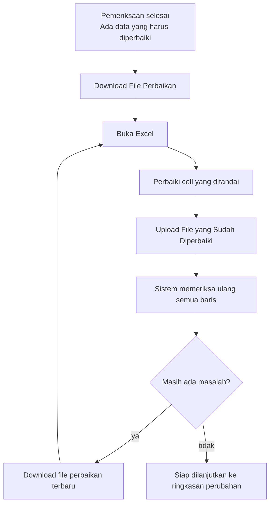
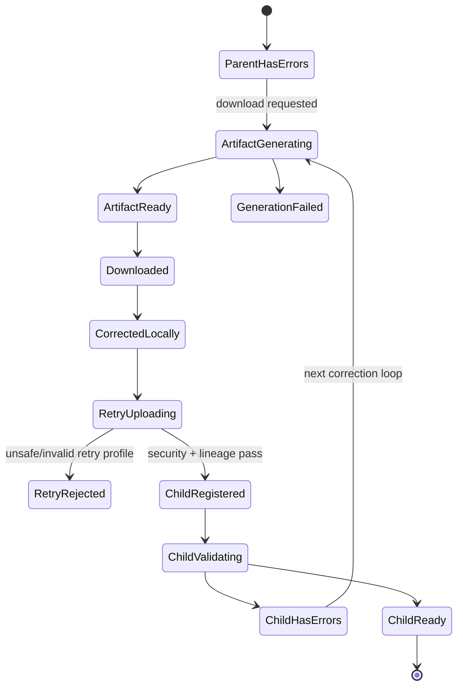

# 15 - IDP Pegawai Error Workbook & Retry Loop Contract

Status: Draft brainstorming, **bukan kode implementasi**
Project: kumjabar_ecosystem
Date: 2026-08-28
Depends on:

- `11-idp-pegawai-stage-2-import-pipeline-breakdown.md`
- `12-idp-pegawai-import-template-field-mapping-contract.md`
- `13-idp-pegawai-import-batch-row-schema-draft.md`
- `14-idp-pegawai-import-validation-dry-run-contract.md`

## 1. Tujuan

Dokumen ini memperinci **Sub-Tahap 2.9 Error Workbook & Retry Loop**.

Error workbook bukan sekadar laporan kesalahan. File ini harus menjadi alat kerja yang memungkinkan operator:

1. menemukan data yang salah;
2. memahami cara memperbaikinya;
3. mengoreksi data langsung di file;
4. meng-upload kembali file yang sudah diperbaiki;
5. menjalani pemeriksaan baru tanpa mengubah histori batch sebelumnya.

Prinsip utama:

> Operator memperbaiki data, bukan membedah pesan teknis.

Dokumen ini belum membuat generator XLSX, endpoint Flask, storage object, atau halaman Admin UI aktual.

## 2. Keputusan Penting: Retry Workbook Harus Self-contained

Arah awal historis Dokumen 11–13 pernah mempertimbangkan workbook yang hanya membawa failing rows. Dokumen 11–13 versi terkini sudah diselaraskan dengan keputusan Dokumen 14 berikut:

```text
Jika masih ada satu error/fatal,
seluruh batch belum boleh di-apply.
```

Karena itu, workbook retry v1 harus membawa **seluruh row nonblank yang diperiksa**, bukan hanya row gagal.

Alasannya sederhana:

- row yang sebelumnya valid belum pernah di-apply;
- jika child batch hanya berisi row gagal, row valid dari parent akan hilang dari rencana apply;
- menyusun child batch dari campuran parent-valid + child-corrected state akan membuat operator sulit memahami file mana yang authoritative;
- workbook lengkap dapat di-upload sebagai batch baru dan divalidasi dari nol.

Kontrak v1:

```text
sheet pegawai = semua row nonblank dari batch
                 dalam urutan canonical retry workbook

diagnostics   = hanya error/warning yang perlu diketahui
```

Row valid tetap dibawa agar retry file menjadi satu sumber yang utuh. Row valid tidak harus diubah.

## 3. Posisi Dokumen 15


Dokumen 15 berhenti pada pembentukan child batch dan validasi ulang. Apply domain tetap milik Dokumen 16.

## 4. Alur Operator



Bahasa UI utama:

```text
Ada 3 baris yang harus diperbaiki.
Download file perbaikan, koreksi cell yang ditandai,
lalu upload kembali di halaman ini.
```

Jangan tampilkan istilah `child batch`, `parent_batch_id`, `retry_depth`, atau `artifact fingerprint` pada alur operator.

## 5. Kapan Error Workbook Boleh Dibuat

### 5.1 Eligible

Error workbook dapat dibuat bila:

- file sudah lolos pemeriksaan keamanan dan struktur;
- canonical mapping sudah valid;
- row sudah dapat di-stage dengan aman;
- validation run selesai;
- terdapat minimal satu row berstatus `error`;
- validation snapshot yang menjadi sumber artifact masih tersedia;
- operator mempunyai capability download.

### 5.2 Tidak Eligible

Jangan membangun error workbook dari source content bila:

- file rusak atau tidak dapat dibuka;
- workbook mengandung macro, formula terlarang, external content, object, atau hidden structure yang menyebabkan fatal rejection;
- forbidden header ditemukan sebelum safe row staging;
- parser/validation engine mengalami internal failure;
- batch dibatalkan sebelum validation selesai;
- staging payload sudah dipurge sehingga artifact tidak dapat direproduksi dengan benar.

Untuk kasus fatal sebelum safe staging, UI menawarkan:

```text
Download Template Baru
```

bukan error workbook yang berisiko menyalin content tidak tepercaya.

### 5.3 Warning-only

Jika batch hanya memiliki warning dan tidak memiliki error:

- error workbook tidak wajib;
- UI dry-run sudah menjadi tempat review utama;
- ringkasan dapat diekspor sebagai report terpisah bila kelak dibutuhkan;
- operator tidak dipaksa menjalani retry loop.

## 6. Workbook Profile

Profile resmi:

```text
pegawai_error_retry_v1
```

Format:

```text
XLSX saja
```

CSV tidak digunakan sebagai error workbook operator karena tidak dapat membawa sheet instruksi, diagnostics, style, comment, reference list, dan metadata secara aman dalam satu artifact.

Filename display:

```text
perbaikan-import-pegawai-<tanggal>-<short-id>.xlsx
```

Contoh:

```text
perbaikan-import-pegawai-2026-08-28-a1b2c3d4.xlsx
```

Aturan filename:

- server membentuk filename; jangan memakai filename source mentah;
- karakter dibatasi pada ASCII aman untuk fallback;
- response boleh menyediakan `filename*` RFC 5987 untuk display Unicode;
- batch UUID lengkap, NIP, nama pegawai, unit, email, dan storage key tidak dimasukkan ke filename.

## 7. Sheet Contract dan Urutan

| Urutan | Sheet | Tujuan | Dibaca sebagai Input Domain saat Retry? |
| --- | --- | --- | --- |
| 1 | `instructions` | langkah perbaikan singkat | tidak |
| 2 | `summary` | jumlah data dan jenis masalah | tidak |
| 3 | `pegawai` | seluruh row nonblank yang dapat diedit | **ya, satu-satunya source row** |
| 4 | `diagnostics` | daftar masalah + cara memperbaiki | tidak |
| 5 | `reference_status` | nilai status resmi | tidak |
| 6 | `reference_org_units` | kode unit terbaru saat artifact dibuat | tidak authoritative saat retry |
| 7 | `metadata` | profile/version/lineage integrity | tidak |

Semua sheet visible. Hidden atau very-hidden sheet tidak diperlukan.

Parser retry:

```text
membaca data domain hanya dari sheet pegawai
```

Sheet lain tetap divalidasi sebagai system-sheet contract, tetapi nilainya tidak dimaterialisasi sebagai pegawai.

## 8. Sheet `instructions`

Instruksi harus ringkas. Operator tidak perlu membaca manual panjang sebelum bekerja.

Isi minimum:

```text
FILE PERBAIKAN IMPORT PEGAWAI

1. Buka sheet "pegawai".
2. Cari cell berlabel atau berkomentar "Harus diperbaiki". Garis/warna hanya bantuan visual; daftar lengkap ada pada sheet "diagnostics".
3. Perbaiki data pada cell tersebut.
4. Jangan menghapus atau mengganti nama header.
5. Jangan menambahkan kolom jabatan, role, atau data lain.
6. Jangan menambah, menghapus, atau mengurutkan ulang baris pegawai.
7. Simpan sebagai file .xlsx.
8. Upload kembali melalui halaman import yang sama.

Sistem akan memeriksa ulang seluruh baris.
Belum ada data pegawai yang berubah.
```

Tambahkan catatan:

- row yang tidak ditandai tetap ikut dalam retry dan tidak perlu dihapus;
- bila perlu menambah/menghapus pegawai, mulai import baru memakai template standar;
- reference sheet adalah bantuan, bukan sumber kebenaran final;
- jangan menyalin formula; paste sebagai nilai biasa;
- bila operator ingin memakai data yang lebih baru, gunakan template baru dan mulai import baru.

## 9. Sheet `summary`

### 9.1 Isi Operator

Contoh:

```text
250 baris dibawa ke file perbaikan
20 baris harus diperbaiki
10 baris perlu diperhatikan
220 baris sudah lolos pemeriksaan sebelumnya

Semua 250 baris akan diperiksa ulang setelah file di-upload.
```

### 9.2 Counter

| Counter | Arti |
| --- | --- |
| `source_data_rows` | jumlah row sumber setelah header, termasuk blank yang terdeteksi |
| `skipped_blank_rows` | blank row yang tidak menjadi data pegawai |
| `retry_data_rows` | row nonblank pada sheet `pegawai` |
| `error_rows` | row dengan minimal satu error |
| `warning_rows` | row dengan minimal satu warning; boleh overlap dengan error |
| `previously_clear_rows` | row tanpa error pada validation snapshot sumber |
| `error_diagnostics` | jumlah diagnostic severity error |
| `warning_diagnostics` | jumlah diagnostic severity warning |

Invariant:

```text
retry_data_rows = error_rows + previously_clear_rows
```

`warning_rows` tidak ditambahkan ke total karena dapat overlap.

Summary adalah bantuan operator. Retry upload tetap menghitung ulang dari sheet `pegawai` dan tidak mempercayai counter di workbook.

## 10. Sheet `pegawai`

### 10.1 Header Canonical

Hanya enam canonical headers v1:

```text
nip
nama_lengkap
email_dinas
email_google
org_unit_code
status_pegawai
```

Tidak ada kolom diagnostics, source row ID, UUID, jabatan, role, permission, identity subject, atau metadata teknis di sheet ini.

### 10.2 Isi Row

- membawa seluruh row nonblank dari validation snapshot sumber;
- urutan row deterministic mengikuti `parent import_rows.row_number ASC`; generator tidak mengurutkan berdasarkan NIP, nama, status, atau severity;
- nilai allowlist diprefill dari raw scalar aman agar operator melihat isi yang perlu dikoreksi;
- forbidden/unknown value tidak pernah disalin;
- formula/object/comment/hyperlink dari source tidak pernah disalin;
- jika cell NIP source bertipe numeric, scientific, atau formula, nilainya dianggap tidak dapat dipercaya karena presisi mungkin telah hilang;
- generator **tidak boleh** mengubah numeric/display value/cached formula result tersebut menjadi string NIP yang tampak valid;
- cell NIP retry ditulis sebagai blank explicit string berformat Text dan diberi diagnostic `nip_numeric_cell_not_allowed`;
- operator wajib mengisi ulang NIP 18 digit dari sumber authoritative; tipe dan lokasi source boleh dicatat sebagai diagnostic, tetapi numeric value yang berpotensi korup tidak dipromosikan menjadi canonical data;
- blank/provided intent dibentuk ulang saat retry parse; workbook tidak menyimpan instruksi backend tersembunyi.

### 10.3 Formatting

| Elemen | Contract |
| --- | --- |
| freeze panes | `A2` |
| autofilter | aktif pada canonical range |
| NIP number format | Text (`@`) |
| email/status/org | Text |
| header | bold, kontras tinggi, wrap text |
| error cell | border merah + fill lembut + comment sistem |
| warning cell | border kuning + fill lembut + comment sistem |
| valid cell | tidak diberi warna sukses massal |
| row height/width | cukup dibaca, tidak memotong pesan penting |

Warna hanya bantuan. Diagnostics dan comment tetap menyediakan teks.

### 10.4 Sorting dan Editing

Retry workbook v1 adalah jalur koreksi **nilai**, bukan jalur mengubah populasi batch. Operator boleh mengubah nilai pada enam canonical columns, tetapi tidak boleh menambah atau menghapus row pegawai. Jika perlu menambah/menghapus pegawai, gunakan template standar dan mulai import baru.

Operator juga tidak boleh menyortir atau memindahkan row jika tindakan tersebut membuat korelasi dengan parent ambigu.

Jika operator menyortir atau memindahkan row:

- diagnostics lama dapat menunjuk posisi yang sudah berubah;
- retry parser tetap membaca current sheet order;
- seluruh row tetap divalidasi dari nol;
- diagnostics lama tidak pernah dipercaya sebagai input.

## 11. Sheet `diagnostics`

### 11.1 Kolom

| Kolom | Fungsi |
| --- | --- |
| `status` | `Harus diperbaiki` / `Perlu diperhatikan` |
| `baris_file_perbaikan` | row pada sheet `pegawai` saat artifact dibuat |
| `lokasi_sumber_awal` | contoh `pegawai!17`, hanya sebagai jejak |
| `kolom` | label manusia, contoh `Kode Unit` |
| `cell_file_perbaikan` | contoh `E9` |
| `masalah` | pesan operator |
| `cara_memperbaiki` | tindakan konkret |
| `kode_teknis` | diagnostic code stabil, diletakkan terakhir |

Tidak perlu menggandakan full value pegawai pada diagnostics. Operator dapat membuka cell terkait.

### 11.2 Satu Diagnostic per Row

Jika satu cell mempunyai dua error, diagnostics menyimpan dua row. Jika satu row mempunyai masalah pada tiga field, diagnostics menyimpan minimal tiga row yang dapat difilter.

### 11.3 Link Internal

`cell_file_perbaikan` boleh diberi hyperlink internal menuju sheet `pegawai`.

Aturan:

- hanya internal workbook link;
- tidak ada URL eksternal;
- target dibentuk server dari sheet/cell yang sudah divalidasi;
- display text tetap dapat dipahami tanpa membuka link.

### 11.4 Diagnostics Setelah File Diedit

Diagnostics adalah snapshot dari pemeriksaan sebelumnya. Setelah operator mengedit data:

- diagnostics mungkin tidak lagi sesuai;
- operator tidak perlu menghapus diagnostics;
- parser mengabaikannya sebagai input domain;
- hasil upload ulang menghasilkan diagnostics baru dari validation run baru.

## 12. Reference Sheets

### 12.1 `reference_status`

Berisi canonical status dan penjelasan singkat:

| Value | Bahasa Operator |
| --- | --- |
| `aktif` | Pegawai aktif di organisasi |
| `mutasi_keluar` | Keluar dari organisasi karena mutasi |
| `pensiun` | Pensiun |
| `nonaktif` | Tidak aktif |
| `meninggal` | Meninggal dunia |

Alias generik `mutasi` tidak dimasukkan.

### 12.2 `reference_org_units`

Berisi minimal:

```text
code
name
status
```

Aturan:

- hanya unit yang boleh dipilih sesuai reference policy saat generation;
- code tetap authoritative key;
- daftar dapat menjadi stale setelah workbook di-download;
- retry validation selalu lookup ke reference server terbaru;
- versi referensi dicatat pada metadata;
- operator mendapat pesan jelas bila unit berubah setelah file dibuat.

Reference sheet membantu operator. Ia bukan cara menyuntikkan org unit baru.

## 13. Sheet `metadata`

### 13.1 Field Minimum

| Key | Fungsi |
| --- | --- |
| `profile` | `pegawai_error_retry_v1` |
| `template_version` | versi layout workbook |
| `contract_version` | `pegawai.v1` |
| `generator_version` | versi generator XLSX |
| `diagnostic_catalog_version` | versi pesan/code |
| `canonicalization_version` | versi canonical serialization |
| `source_as_of` | keadaan data sumber yang dipertahankan |
| `generated_at` | waktu artifact dibuat |
| `artifact_retention_until` | informasi kedaluwarsa download server |
| `parent_batch_uuid` | lineage public ID |
| `root_batch_uuid` | root lineage public ID |
| `source_validation_fingerprint` | snapshot yang menghasilkan workbook |
| `retry_lineage_token` | token server-signed untuk integritas lineage |
| `correlation_id` | ID bantuan TI |

Jangan menyimpan:

- secret/signing key;
- storage key/path;
- internal database integer ID;
- access token/session cookie;
- provider subject;
- role/permission;
- full actor profile;
- raw JSON payload.

### 13.2 Retry Lineage Token

`retry_lineage_token` ditandatangani server dan minimal mengikat:

```text
token_version
issuer
audience = idp-pegawai-import-retry
purpose = retry-lineage
artifact_uuid
profile
parent_batch_uuid
root_batch_uuid
source_validation_fingerprint
artifact_manifest_fingerprint
contract_version
source_as_of
issued_at
expires_at
key_id
```

Token ini:

- membuktikan metadata lineage tidak diubah sembarangan;
- bukan authorization token;
- tidak memberi hak download, upload, view, atau apply;
- diverifikasi setelah user login dan lolos capability check;
- tidak boleh memuat secret;
- menggunakan format/version/signature algorithm yang dapat dirotasi.

Verifier hanya menerima algorithm dari allowlist konfigurasi server dan tidak mempercayai `alg`, `jku`, `x5u`, atau arbitrary key reference dari token. Key dipilih melalui `key_id` yang dikenal server. Verifier memeriksa issuer, audience, purpose, expiry, profile, artifact state, batas ukuran token, serta membandingkan parent/root/`source_as_of` dengan database authoritative. Token valid tetap ditolak jika artifact/parent expired, purged, cancelled, tidak accessible, atau capability actor tidak cocok. Token mentah tidak dicatat ke log; bila perlu korelasi, gunakan hash token.

Preferred upload dari halaman correction tetap mengikat parent batch dari server-side route/session context. Token workbook menjadi integrity hint dan mendukung upload ulang dari dashboard.

Jika token hilang/rusak:

- jangan percaya parent/root UUID dari workbook;
- jangan diam-diam menghubungkannya ke lineage;
- tampilkan `File perbaikan tidak dapat dikenali`;
- operator dapat download ulang artifact atau memilih memulai import baru dengan template standar setelah konfirmasi.

## 14. Formula-safe XLSX Generation

Generator membuat workbook **baru dari nol**. Jangan membuka workbook source lalu memodifikasinya.

### 14.1 Cell Value Rules

Untuk setiap scalar source yang ditulis:

- tetapkan cell sebagai explicit string/number sesuai canonical output contract;
- field canonical v1 aman ditulis sebagai string; NIP selalu string;
- string yang diawali `=`, `+`, `-`, `@`, tab, CR, LF, atau control prefix tidak boleh menjadi formula/DDE;
- writer wajib menghasilkan string cell (`inlineStr`/shared string), bukan `<f>` formula;
- leading apostrophe bukan satu-satunya pertahanan karena dapat mengubah nilai canonical;
- control character yang tidak valid untuk XML ditolak atau disanitasi sesuai diagnostic contract, bukan diteruskan diam-diam.

### 14.2 Dilarang Disalin dari Source

```text
formula
cached formula result sebagai authoritative value
macro/VBA
external link
hyperlink source
comment source
defined name source
conditional formatting source
embedded object/image
custom XML/relationship source
sheet protection source
hidden state
```

### 14.3 OOXML Verification

Setiap artifact menjalani **runtime post-generation verification** sebelum state berubah menjadi `ready`. Automated test juga harus membuktikan verifier bekerja. Runtime verifier melakukan bounded ZIP inspection, parse XML tanpa DTD/external entity, dan allowlist Content-Type/Relationship Type sesuai profile.

Verifier dan automated test memastikan:

- tidak ada `vbaProject.bin`;
- tidak ada `externalLinks/`;
- tidak ada relationship mode eksternal;
- tidak ada cell formula `<f>`;
- tidak ada OLE/object embedding;
- hanya sheet/relationship yang diizinkan;
- semua XML dapat diparse;
- workbook dapat dibuka ulang oleh parser yang digunakan aplikasi.

Cell formula `<f>` dan external defined name dilarang. Internal formula/range yang hanya dipakai untuk data validation/dropdown buatan generator boleh diizinkan secara sempit melalui allowlist profile. Jika verification gagal, temporary object dihapus, artifact tidak dapat di-download, dan service menghasilkan `error_workbook_generation_failed`.

## 15. Style, Comment, dan Accessibility

### 15.1 Style Tokens

| Status | Visual | Teks Wajib |
| --- | --- | --- |
| error | merah lembut + border tebal | `Harus diperbaiki` |
| warning | kuning lembut + border | `Perlu diperhatikan` |
| info | biru lembut | `Informasi` |

Gunakan kontras yang terbaca dan jangan hanya mengandalkan merah/hijau.

### 15.2 Cell Comment

Comment dibuat sistem, bukan disalin dari source.

Contoh:

```text
Harus diperbaiki
Kode unit tidak ada di daftar unit.
Pilih kode dari sheet reference_org_units.
```

Batas:

- maksimum panjang per comment;
- maksimum jumlah diagnostics yang diringkas per cell;
- jika terlalu banyak, comment mengatakan `Lihat sheet diagnostics`;
- tidak memuat stack trace, SQL, raw payload, atau secret;
- pesan berasal dari diagnostic catalog server;
- value tidak tepercaya di-escape/dipotong sebelum masuk comment.

### 15.3 Sheet Protection

Sheet `instructions`, `summary`, `diagnostics`, reference, dan `metadata` boleh diproteksi untuk mencegah edit tidak sengaja. Pada sheet `pegawai`, canonical data cells dibuka untuk editing.

Protection XLSX adalah bantuan UX, **bukan security boundary**. Retry parser tetap memperlakukan seluruh workbook sebagai input tidak tepercaya.

## 16. Data Validation dan Dropdown

Sheet `pegawai` dapat menyediakan:

- dropdown `status_pegawai` dari `reference_status`;
- dropdown `org_unit_code` dari `reference_org_units`;
- input message pendek;
- error prompt yang tidak mengunci pengguna dari koreksi valid.

Aturan:

- server tidak mempercayai Excel data validation;
- pasted value dapat melewati dropdown dan tetap divalidasi backend;
- range reference harus internal workbook;
- tidak ada external named range;
- daftar panjang unit harus diuji terhadap limit/behavior Excel;
- jika dropdown unit tidak praktis, reference sheet + search/filter tetap tersedia.

## 17. Row Correlation Contract

### 17.1 Identifier Assistive

Karena sheet `pegawai` tidak boleh mempunyai kolom teknis tambahan, korelasi UI/workbook memakai:

```text
retry row number
+ original source locator
+ server-side row reference/fingerprint pada artifact manifest
```

`row_ref` server-side tidak menjadi domain input dan tidak bergantung pada NIP karena NIP dapat kosong, salah, atau duplikat.

### 17.2 Operator Mengubah Urutan

Jika urutan berubah, old diagnostics hanya bersifat bantuan. Retry parser membangun source locator, row hash, presence state, dan diagnostics baru.

Tidak ada apply atau merge berdasarkan nomor baris workbook lama.

### 17.3 Lineage Diff dan Row-set Guard

Saat retry upload, service membandingkan safe parsed row set dengan artifact manifest sumber:

- `retry_data_rows` harus sama dengan expected row count;
- previously-clear row dicocokkan memakai NIP valid yang unik dan parent row reference;
- row dengan NIP kosong/salah/duplikat memakai korelasi posisi dan server-side row reference;
- row hilang, tambahan, atau korelasi ambigu menghasilkan `retry_row_set_changed`;
- sistem tidak boleh menganggap row hilang sebagai keputusan operator.

Pesan operator:

```text
Jumlah atau susunan pegawai pada file perbaikan berubah.
Gunakan file tanpa menambah/menghapus baris,
atau mulai import baru jika perubahan tersebut memang disengaja.
```

## 18. Artifact Manifest dan Persistence

Satu validation snapshot dapat mempunyai beberapa generation version, tetapi hanya satu artifact aktif per `generation_key`.

Jika endpoint regenerate dipertahankan, rekomendasi schema bergeser ke tabel `import_artifacts`, bukan menambah terus kolom tunggal pada `import_batches`. Minimal state:

```text
generating -> verified -> ready -> superseded/purged
             \-> failed
```

`generation_key` adalah canonical hash parent batch UUID, source validation fingerprint, profile, contract/generator/catalog/canonicalization version, serta reference snapshot/version.

Metadata artifact minimum:

```text
id + uuid
batch_id
artifact_type + profile
generation_key + semantic_fingerprint
storage_key + file_hash
state
generator/catalog/reference versions
generated_at + retention_until + purged_at
```

`error_workbook_semantic_fingerprint` minimal mengikat:

```text
batch UUID
source validation fingerprint
ordered canonical row snapshots
ordered diagnostics
contract/template/generator/catalog versions
reference versions
```

File SHA-256 menjaga integritas bytes. Semantic fingerprint menjaga identitas logical content. XLSX ZIP metadata dapat membuat byte hash berbeda walaupun logical content sama; jangan memakai byte hash sendirian untuk memutuskan kesetaraan rencana.

### 18.1 Generation Idempotency

Untuk semantic fingerprint yang sama:

- request berulang mengembalikan artifact aktif yang sama bila masih tersedia;
- concurrent generation memakai lock/single-flight;
- jangan membuat banyak object orphan;
- jika generation gagal setelah object ditulis, compensation menghapus object;
- jika DB update gagal, object baru dibersihkan;
- artifact lama yang superseded dijadwalkan purge.

Object ditulis ke temporary private key, diverifikasi, lalu dipublikasikan atomik bersama state DB `ready`. Artifact tidak boleh dapat di-download sebelum state `ready`.

## 19. Download Contract

Route konseptual:

```text
GET /admin/import/pegawai/batches/{uuid}/error-workbook
```

Prerequisite:

- authenticated Keycloak session;
- capability `can_download_import_error_workbook`;
- batch visibility/scope check;
- artifact masih aktif dan belum dipurge;
- CSRF tidak menggantikan authorization; download GET tidak mengubah domain state;
- download event diaudit.

Authorization memiliki dua lapis:

1. **artifact/batch scope**: actor boleh melihat parent batch dan mengunduh seluruh PII pada artifact;
2. **row/domain scope**: seluruh candidate/target row harus berada dalam scope import actor.

Parent visibility tidak otomatis memberi izin untuk seluruh pegawai. Scope tidak boleh diturunkan dari `org_unit_code`, jabatan, role, atau nilai workbook karena semuanya input tidak tepercaya. Authorization diulang pada generation, download, retry registration, display result, approval, dan apply. Row di luar scope menghasilkan error aman `import_row_not_authorized` tanpa membocorkan record, dan batch diblokir sesuai policy v1.

Response minimum:

```text
Content-Type: application/vnd.openxmlformats-officedocument.spreadsheetml.sheet
Content-Disposition: attachment; filename="..."; filename*=UTF-8''...
X-Content-Type-Options: nosniff
Cache-Control: private, no-store
Pragma: no-cache
```

Delivery preference:

1. stream melalui authorized application route; atau
2. short-lived signed object URL yang dibuat setelah authorization.

Signed URL:

- TTL pendek;
- tidak disimpan di log/UI permanen;
- tidak dianggap authorization jangka panjang;
- tidak dapat menebak storage key lain;
- redirect/download event tetap memiliki audit correlation.

Jangan kirim workbook berisi PII sebagai attachment email otomatis.

## 20. Retention dan Purge

Rekomendasi default awal:

```text
error workbook retention = 7 hari sejak generation
```

Effective expiry:

```text
min(generated_at + configured_retention,
    batch/raw-staging retention boundary)
```

Aturan:

- angka final tetap tunduk pada kebijakan privasi/arsip;
- download tidak memperpanjang retention;
- regeneration hanya boleh bila validation snapshot sumber masih tersedia dan actor berwenang;
- regeneration tidak boleh melewati maximum batch retention;
- purge job idempotent;
- setelah purge: storage object hilang, storage key null, `purged_at` terisi;
- metadata audit minimum dan artifact hash dapat dipertahankan sesuai policy;
- backup lifecycle harus mengikuti klasifikasi PII yang sama;
- UI menampilkan tanggal ketersediaan artifact dalam bahasa sederhana.

Karena workbook membawa PII seluruh batch, artifact diklasifikasikan sebagai **bulk PII export**: storage dienkripsi at rest, object ACL private/service-only, bucket tidak public/listable, backup mempunyai expiry/purge lifecycle setara, dan legal hold hanya melalui workflow khusus yang diaudit.

Early purge dilakukan bila child correction pengganti sudah valid dan artifact parent tidak lagi diperlukan, batch dibatalkan, batch selesai di-apply, atau incident/access revocation mengharuskan pemusnahan. Audit metadata minimum boleh dipertahankan tanpa workbook bytes.

UI setelah purge:

```text
File perbaikan sudah tidak tersedia.
Jalankan pemeriksaan ulang jika data sumber masih tersedia,
atau mulai import baru dengan template terbaru.
```

File yang sudah di-download ke perangkat operator berada di luar kontrol server. UI mengingatkan operator untuk menyimpan di lokasi resmi dan menghapus salinan lokal setelah selesai.

## 21. Retry Upload Contract

### 21.1 Preferred Entry Point

```text
POST /admin/import/pegawai/batches/{parent_uuid}/retry
```

UI label:

```text
Upload File yang Sudah Diperbaiki
```

### 21.2 Prerequisite

- authenticated actor;
- capability `can_upload_pegawai_import` dan visibility parent;
- parent import type `pegawai`;
- parent mempunyai validation errors yang eligible;
- retry file profile/version dikenali;
- server-side parent context dan signed lineage metadata cocok;
- file menjalani security validation seperti upload baru.
- setelah safe parse, row/domain scope authorization diperiksa untuk setiap candidate/target; parent visibility saja tidak cukup.

### 21.3 Child Batch

Retry selalu membuat batch baru:

```text
parent_batch_id = parent.id
root_batch_uuid = parent.root_batch_uuid
retry_depth = parent.retry_depth + 1
input_profile = pegawai_error_retry_v1
```

Child batch:

- memiliki UUID dan file hash baru;
- memakai `child.source_as_of = parent.source_as_of` dari database;
- tidak mewarisi approval;
- tidak mewarisi target snapshot;
- tidak mewarisi validation status;
- parse/mapping/normalization/validation dijalankan ulang;
- seluruh row pada sheet `pegawai` diperiksa ulang;
- parent tetap immutable.

Jika operator sebenarnya membawa snapshot bisnis baru, jangan gunakan retry lineage lama. Mulai import standar baru dan isi `source_as_of` yang baru.

Nilai `source_as_of` pada workbook/token hanya consistency check dan tidak boleh menimpa parent. Mismatch menghasilkan `retry_lineage_invalid`; field untuk mengubah tanggal tidak ditampilkan pada retry flow.

## 22. Upload Idempotency dan Duplicate Handling

Double-click, refresh, atau retry network tidak boleh membuat dua child batch.

Mutating request membawa command idempotency key yang mengikat:

```text
actor_subject
parent_batch_uuid
idempotency_key
```

UI membuat satu key per tindakan upload dan memakai key yang sama untuk seluruh network retry/double-click. Uniqueness scope adalah `(actor_subject, parent_batch_uuid, idempotency_key)`. Request pertama menyimpan file hash; key sama + hash sama mengembalikan child yang sama, sedangkan key sama + hash berbeda menghasilkan conflict. Klaim key dan registrasi child dilakukan atomik, dan record dipertahankan minimal sepanjang retry window.

Behavior:

- request identik yang masih diproses mengembalikan child batch yang sama;
- request identik yang sudah selesai mengarahkan ke hasil child yang sama;
- semantic retry payload sama dengan parent correction artifact diberi pesan `Belum ada perubahan pada file`; deteksi memakai canonical payload fingerprint setelah safe parse, bukan byte hash XLSX saja;
- deliberate re-run dengan bytes sama tidak otomatis di-apply; operator harus memahami alasan dan service tetap menjaga lineage/freshness;
- file hash bukan authorization token.

## 23. Retry State Machine



`Downloaded` dan `CorrectedLocally` adalah konsep UX/audit assistive, bukan bukti bahwa file lokal benar-benar dibuka atau diperbaiki.

## 24. Error Handling

| Code | Bahasa Operator | Tindakan |
| --- | --- | --- |
| `error_workbook_not_available` | File perbaikan belum tersedia | Coba lagi setelah pemeriksaan selesai |
| `error_workbook_generation_failed` | File perbaikan belum berhasil dibuat | Coba lagi atau hubungi TI dengan correlation ID |
| `error_workbook_expired` | File perbaikan sudah tidak tersedia | Periksa ulang atau mulai import baru |
| `retry_profile_invalid` | File ini bukan file perbaikan yang dikenali | Download ulang file perbaikan |
| `retry_lineage_invalid` | Hubungan file dengan proses sebelumnya tidak dapat diverifikasi | Upload dari halaman proses asal atau mulai import baru |
| `retry_parent_not_accessible` | Proses sebelumnya tidak dapat diakses | Hubungi pengelola akses |
| `retry_file_unchanged` | Belum ada perubahan pada file | Perbaiki cell yang ditandai lalu upload kembali |
| `retry_row_set_changed` | Jumlah atau susunan pegawai berubah | Gunakan file tanpa menambah/menghapus baris, atau mulai import baru |
| `import_row_not_authorized` | Ada data yang tidak dapat diproses dengan hak akses Anda | Hubungi pengelola akses tanpa menampilkan detail record |
| `retry_file_unsafe` | File tidak dapat diproses dengan aman | Gunakan file perbaikan yang bersih tanpa formula/object |
| `retry_contract_outdated` | Versi file perbaikan sudah tidak didukung | Download template terbaru dan mulai import baru |
| `retry_upload_conflict` | Proses ini sudah berubah | Muat ulang halaman |

Pesan tidak membocorkan apakah batch lain yang tidak berhak dilihat actor benar-benar ada.

## 25. Permission-aware UI

Capability konseptual:

```text
can_download_import_error_workbook
can_upload_pegawai_import
can_view_pegawai_import
can_view_import_technical_detail
can_regenerate_import_error_workbook
```

UI behavior:

| Kondisi | Respons |
| --- | --- |
| tidak boleh download | tombol tidak tersedia + alasan singkat |
| boleh lihat tapi tidak boleh upload | review-only |
| artifact sedang dibuat | tombol disabled dengan progress |
| artifact expired | tampilkan opsi yang diizinkan |
| tidak boleh detail teknis | token/hash/version disembunyikan |
| parent tidak visible | jangan tampilkan lineage/history |

Backend selalu mengulang authorization. Sheet protection, signed metadata, dan tombol tersembunyi bukan pengganti authorization.

## 26. Audit dan Observability

Audit minimum:

```text
artifact generation requested/succeeded/failed
artifact downloaded
artifact regenerated
artifact purged
retry upload received/rejected/registered
parent-child lineage established
```

Event membawa:

- actor subject;
- batch/artifact public identifier;
- timestamp;
- safe result/error code;
- semantic/file hash bila sesuai policy;
- correlation ID;
- request context minimum sesuai privacy policy.

Jangan log:

- full row payload;
- full NIP/email tanpa masking;
- signed URL;
- lineage token;
- storage key;
- workbook bytes.

Metrics:

- generation duration/failure rate;
- download count;
- retry success rate;
- average correction cycles;
- top diagnostic codes;
- expired-before-download count;
- orphan cleanup count.

## 27. API/Service Preview

```text
GET  /admin/import/pegawai/batches/{uuid}/error-workbook
POST /admin/import/pegawai/batches/{uuid}/error-workbook/regenerate
POST /admin/import/pegawai/batches/{uuid}/retry
GET  /admin/import/pegawai/batches/{uuid}/retry-history
```

Service seams konseptual:

```text
ErrorWorkbookEligibilityService
ErrorWorkbookBuilder
ErrorWorkbookArtifactService
RetryLineageSigner
RetryUploadService
ImportArtifactRetentionService
```

Nama implementasi belum dikunci. Pemisahan seam mencegah route handler memegang parsing, signing, storage, dan authorization sekaligus.

## 28. Test Matrix

### 28.1 Workbook Content

- sheet order/names tepat;
- `pegawai` hanya enam canonical headers;
- seluruh row nonblank dibawa;
- diagnostics hanya system output;
- forbidden/unknown value tidak pernah muncul;
- NIP tetap string dan tidak berubah presisi;
- summary invariant benar;
- reference version tercatat;
- metadata tidak membawa secret/internal ID.

### 28.2 XLSX Security

- source string `=CMD(...)`, `+1`, `-1`, `@x`, tab/CR/LF tidak menjadi formula;
- setiap artifact lulus runtime OOXML post-generation verification sebelum state `ready`;
- ZIP tidak berisi VBA, external links, OLE, atau external relationship;
- source formula/comment/hyperlink/style tidak tersalin;
- numeric/scientific/formula NIP source menjadi blank Text dan wajib diisi ulang, bukan dipromosikan menjadi string 18 digit;
- cached formula result tidak pernah dipakai untuk merekonstruksi NIP;
- XML escaping benar;
- long/control value menghasilkan diagnostic aman;
- internal diagnostics link hanya menuju cell yang diizinkan.

### 28.3 Retry

- child lineage benar;
- cycle/self-parent ditolak;
- signed token tamper ditolak;
- missing token tidak dipercaya;
- source_as_of dipertahankan;
- approval/target snapshot tidak diwariskan;
- semua row divalidasi ulang;
- duplicate request menghasilkan child yang sama;
- bytes unchanged mendapat feedback jelas;
- sorting/editing row tidak membuat old diagnostics dipercaya.
- row hilang/tambahan/ambigu menghasilkan `retry_row_set_changed`;
- row di luar actor scope menghasilkan error aman tanpa existence leak;

### 28.4 Authorization dan Retention

- actor tanpa capability tidak dapat download/regenerate/retry;
- actor di luar batch scope tidak memperoleh existence leak;
- response headers aman;
- signed URL TTL pendek;
- download diaudit;
- expired/purged artifact tidak dapat diambil;
- purge idempotent;
- regeneration tidak melewati batch retention.

### 28.5 Operator UX

- instruksi dapat dipahami tanpa istilah backend;
- error menjawab apa, di mana, dan cara memperbaiki;
- warna bukan satu-satunya penanda;
- button disabled mempunyai alasan;
- status generation/retry jelas;
- operator selalu tahu bahwa data authoritative belum berubah.

## 29. Decisions Proposed to Lock

1. Error workbook v1 memakai XLSX profile `pegawai_error_retry_v1`.
2. Karena apply v1 all-or-nothing bila ada error, retry workbook membawa seluruh row nonblank, bukan hanya failing rows.
3. Sheet `pegawai` menjadi satu-satunya source row saat retry.
4. Sheet `pegawai` hanya mempunyai enam canonical headers.
5. Diagnostics berada di sheet terpisah dan tidak dibaca sebagai input domain.
6. Workbook dibuat baru dari safe staged scalar; source workbook tidak dimodifikasi/disalin.
7. Formula, macro, external content, object, source comment, dan source hyperlink tidak diteruskan.
8. Error styling selalu disertai teks diagnostics/comment.
9. All sheets visible; protection hanya guard UX.
10. Reference sheets tidak authoritative saat retry.
11. Metadata membawa signed lineage token tetapi token bukan authorization.
12. Retry selalu menghasilkan child batch baru dan full revalidation.
13. Approval, target snapshot, dan validation state parent tidak diwariskan.
14. Retry upload command idempotent terhadap double-click/network retry.
15. Error workbook private, capability-gated, audited, dan berumur pendek.
16. Rekomendasi retention awal adalah 7 hari, dibatasi batch/raw staging retention.
17. Error workbook tidak dibuat dari file fatal/unsafe sebelum safe staging.
18. File SHA-256 dan semantic fingerprint mempunyai fungsi berbeda.
19. Artifact generation idempotent/single-flight dan mempunyai compensation cleanup.
20. Numeric/scientific/formula NIP tidak pernah dicuci menjadi string valid; operator wajib mengisi ulang dari sumber authoritative.
21. Retry hanya mengoreksi nilai; perubahan populasi row menghasilkan error dan diarahkan ke import baru.
22. Authorization berlaku pada artifact scope dan setiap candidate/target row.
23. Runtime OOXML verification wajib lulus sebelum artifact `ready`.
24. Operator dapat menyelesaikan loop tanpa memahami schema/lineage backend.

## 30. Open Questions

| No | Pertanyaan | Rekomendasi Awal |
| --- | --- | --- |
| 1 | Apakah retention 7 hari cukup? | Jadikan default konfigurabel; ukur expired-before-download sebelum mengubah. |
| 2 | Apakah signed lineage token perlu expiry sendiri? | **Dikunci Dokumen 15:** ya, claim `expires_at` wajib. Expiry tidak menggantikan parent/artifact state check maupun authorization. |
| 3 | Apakah workbook harus memakai password protection? | Tidak sebagai security control; sheet protection tanpa klaim kerahasiaan sudah cukup untuk accidental edit. |
| 4 | Apakah valid rows perlu warna hijau? | Tidak; noise visual tinggi. Fokuskan highlight pada masalah. |
| 5 | Apakah diagnostics menyimpan preview value? | Tidak pada v1; hindari duplikasi PII, operator dapat melihat cell. |
| 6 | Apakah retry boleh dari standalone upload page? | Boleh dengan signed lineage token + capability; preferred tetap halaman parent agar lebih mudah. |
| 7 | Apakah operator boleh mengubah `source_as_of` pada retry? | Tidak; bila snapshot bisnis berubah, mulai import standar baru. |
| 8 | Berapa maksimum comment/diagnostic per cell? | Konfigurabel dan diuji; overflow diarahkan ke sheet diagnostics. |
| 9 | Apakah artifact perlu tabel terpisah jika kelak banyak jenis output? | **Dikunci Dokumen 15:** ya bila regeneration endpoint/versioning dipertahankan; gunakan `import_artifacts` agar lifecycle dan supersession eksplisit. |

## 31. Acceptance Checklist

### Workbook

- [ ] Full self-contained retry workbook disetujui.
- [ ] Sheet order dan contract disetujui.
- [ ] Canonical headers `pegawai` disetujui.
- [ ] Diagnostics columns/correlation disetujui.
- [ ] Reference/metadata contract disetujui.
- [ ] Styling/comment/accessibility disetujui.

### Security

- [ ] Fresh-build/formula-safe generation disetujui.
- [ ] Forbidden/unsafe source exclusion disetujui.
- [ ] Signed lineage metadata disetujui sebagai integrity, bukan authorization.
- [ ] Download authorization/headers/audit disetujui.
- [ ] Retention/purge contract disetujui.

### Retry

- [ ] Parent-child lineage disetujui.
- [ ] Full revalidation disetujui.
- [ ] `source_as_of` preservation disetujui.
- [ ] Request idempotency disetujui.
- [ ] Unchanged/tampered/expired behavior disetujui.
- [ ] Operator wording disetujui.

## 32. Langkah Berikutnya

Setelah Dokumen 15 direview:

```text
16 - Import Apply / Materialization Contract
```

Dokumen 16 akan mengunci:

- apply eligibility;
- final freshness/authorization checks;
- transaction boundary per batch/row;
- create/update/noop materialization;
- primary org assignment atomis;
- status/access impact;
- idempotency/materialization key;
- failure recovery;
- final confirmation dan result UI.

## 33. Kesimpulan

Error workbook v1 bukan potongan laporan berisi baris salah saja. Ia adalah file koreksi lengkap yang aman untuk menjalankan ulang seluruh batch.

```text
validation errors
-> build fresh safe workbook
-> operator corrects highlighted cells
-> upload as new linked batch
-> full security check + full validation
-> new dry-run result
```

Dengan kontrak ini:

- row valid tidak hilang saat retry;
- operator tidak perlu menyatukan file secara manual;
- diagnostics tidak mencemari canonical input;
- source formula/object tidak ikut terbawa;
- lineage dapat diverifikasi tanpa menjadi authorization shortcut;
- artifact PII tetap private, audited, dan berumur pendek;
- parent batch tetap immutable;
- apply tetap menunggu Dokumen 16.
