# 16 - IDP Pegawai Import Apply & Materialization Contract

Status: Draft brainstorming, **bukan kode implementasi**
Project: kumjabar_ecosystem
Date: 2026-08-28
Depends on:

- `11-idp-pegawai-stage-2-import-pipeline-breakdown.md`
- `12-idp-pegawai-import-template-field-mapping-contract.md`
- `13-idp-pegawai-import-batch-row-schema-draft.md`
- `14-idp-pegawai-import-validation-dry-run-contract.md`
- `15-idp-pegawai-error-workbook-retry-loop-contract.md`

## 1. Tujuan

Dokumen ini memperinci **Sub-Tahap 2.8 Apply / Materialization**, yaitu satu-satunya tahap Stage 2 yang boleh mengubah tabel authoritative IDP Pegawai.

Tujuan utama:

1. memastikan rencana yang disetujui masih sama dan masih aman;
2. menulis perubahan pegawai dan primary organization secara atomik;
3. mencegah double apply, replay, lost update, dan partial batch;
4. mencatat hasil yang dapat diaudit tanpa menyalin seluruh PII;
5. menerjemahkan proses final yang kompleks menjadi UI operator yang sederhana.

Prinsip:

> Klik operator boleh sederhana. Commit database tidak boleh ceroboh.

Dokumen ini belum membuat service Flask, repository, migration, worker, outbox publisher, atau halaman Admin UI aktual.

## 2. Scope dan Non-scope

### 2.1 Yang Dimaterialisasi

Kontrak import v1 hanya mengubah:

```text
pegawai.nip
pegawai.nama_lengkap
pegawai.email_dinas
pegawai.email_dinas_normalized
pegawai.email_google
pegawai.email_google_normalized
pegawai.primary_org_unit_id
pegawai.status_pegawai
pegawai.is_active
pegawai.source_version
pegawai.updated_at

pegawai_org_assignments primary current-state/history

import_batches / import_rows apply state
materialization ledger
transactional outbox event
```

### 2.2 Yang Tidak Dimaterialisasi

```text
jabatan
jabatan_type
label jabatan
PLT/PLH
histori/SK jabatan
role/permission/access grant
provider_subject
email_verified
trusted identity link
Keycloak user/group/role secara langsung
status_reason atau status_effective_at dari timestamp upload/apply
```

Email profile tidak otomatis membuat atau memindahkan `pegawai_identity_links`.

## 3. Posisi Dokumen 16


## 4. Bahasa UI Operator

| Istilah Backend | Bahasa UI |
| --- | --- |
| apply/materialization | Simpan perubahan |
| `ready_to_apply` | Siap disimpan |
| preflight | Pemeriksaan akhir |
| fingerprint mismatch | Ringkasan berubah; periksa ulang |
| stale target | Data berubah; periksa ulang |
| lock conflict | Proses sedang/baru saja diproses; muat ulang |
| outbox/sync pending | Data IDP tersimpan; pembaruan akses sedang diproses |
| commit success | Perubahan berhasil disimpan |
| rollback | Tidak ada perubahan yang disimpan |
| noop | Tidak ada perubahan |

Operator tidak melihat SQL transaction, row lock, materialization key, savepoint, isolation level, outbox ID, atau stack trace.

## 5. Apply Policy v1

Stage 2 memilih kebijakan berikut:

```text
Batch-level atomic all-or-nothing
```

Artinya:

- satu error/fatal membuat batch tidak eligible;
- satu conflict/failure saat apply membuat **seluruh transaction rollback**;
- tidak ada `applied_partial` pada UI/backend v1;
- tidak ada savepoint per row yang mengubah keberhasilan menjadi parsial;
- retry dilakukan setelah revalidation, bukan melanjutkan setengah batch.

`applied_partial` pada draft schema lama dinonaktifkan dan direkomendasikan tidak masuk CHECK status v1. Jika kelak dibutuhkan, ia memerlukan kontrak, UX, audit, dan recovery terpisah.

## 6. Apply Eligibility Gate

Batch hanya boleh masuk apply bila seluruh kondisi berikut benar:

### 6.1 Batch dan Plan

- `import_type = pegawai`;
- `status = ready_to_apply`;
- tidak cancelled/rejected/failed/applied;
- `total_rows > 0`;
- `error_rows = 0` dan tidak ada row `error/stale`;
- warning acknowledgement lengkap;
- summary counter direkonsiliasi dari rows;
- approval belum expired;
- approval fingerprint cocok;
- approval lock version cocok;
- mapping/validation/normalizer/canonicalization version didukung;
- source/reference snapshot masih memenuhi policy.

Approval context yang wajib persisted dan cocok saat apply minimal mencakup `approved_by_subject`, `approved_at`, `approval_fingerprint`, `approval_lock_version`, serta warning acknowledgement yang terikat pada fingerprint plan. Nilai acknowledgement tidak boleh berupa boolean lepas yang tetap valid setelah plan berubah.

### 6.2 Row Plan

Setiap row harus mempunyai:

- `validation_status in (valid, warning)`;
- `planned_operation in (create, update, noop)`;
- canonical candidate hash;
- operation fingerprint;
- target snapshot untuk update/noop;
- tidak pernah sukses dimaterialisasi melalui materialization key yang sama.

### 6.3 Authorization

Actor wajib:

- authenticated;
- mempunyai capability `can_apply_pegawai_import`;
- masih berhak melihat dan memproses batch;
- masih berhak memproses setiap candidate/target row;
- berhak melakukan perubahan berdampak akses bila policy memerlukan capability tambahan.

Approval actor tidak otomatis menjadi apply actor. Authorization selalu dihitung ulang dari authoritative policy, bukan dari role/claim yang disimpan di workbook atau snapshot lama.

Scope row ditentukan dari data authoritative, bukan string mentah workbook:

- update/noop harus mengotorisasi target existing dan, bila unit berpindah, unit asal **serta** destination `org_units` yang sudah di-resolve server;
- create harus mengotorisasi destination unit authoritative yang sudah di-resolve;
- create nonaktif tanpa unit hanya boleh dilakukan actor dengan scope global/khusus yang eksplisit; actor yang hanya memiliki scope unit ditolak secara fail-closed;
- perubahan nilai workbook tidak boleh memperluas scope actor.

## 7. Final Confirmation UI

### 7.1 Ringkasan

Contoh:

```text
Simpan perubahan ini?

30 pegawai baru
180 data pegawai akan diperbarui
20 tidak berubah
25 pindah unit utama
3 akan kehilangan akses internal
1 akan dipulihkan kelayakan akses internal

Setelah disimpan, data IDP Pegawai akan berubah.
```

Primary button:

```text
Simpan 210 Perubahan
```

`noop` tidak dihitung sebagai perubahan.

Secondary:

```text
Kembali Periksa
Batalkan Import
```

### 7.2 High-impact Confirmation

Jika ada revocation **atau restoration/reactivation** akses:

```text
3 pegawai akan dinonaktifkan dan 1 pegawai akan dipulihkan kelayakan akses internal.
Saya sudah memeriksa daftar pegawai yang terdampak.
```

Checkbox bukan pengganti authorization. Sistem mencatat actor, timestamp, plan fingerprint, dan jumlah high-impact rows yang dikonfirmasi.

Jika seluruh row `noop`, layar tidak memakai tombol `Simpan 0 Perubahan`. Gunakan `Selesaikan Import` dan jelaskan bahwa data IDP tidak akan diubah.

### 7.3 Double-submit Guard

Setelah primary button ditekan:

- tombol disabled;
- UI menampilkan `Sedang menyimpan perubahan`;
- browser mengirim satu idempotency key;
- refresh/network retry memakai key yang sama;
- UI mem-poll apply command/result dengan bounded backoff.

## 8. Apply Command Contract

Route konseptual:

```text
POST /admin/import/pegawai/batches/{uuid}/apply
```

Request minimum:

```json
{
  "expected_lock_version": 8,
  "approval_fingerprint": "<sha256>",
  "idempotency_key": "<opaque-client-key>",
  "high_impact_acknowledged": true
}
```

Server mengambil actor subject/capability dari authenticated context. Request tidak boleh mengirim actor ID, role, target IDs, candidate payload, atau operation list sebagai authoritative input.

Idempotency scope:

```text
(actor_subject, batch_uuid, idempotency_key)
```

Behavior:

- key sama + request fingerprint sama mengembalikan command/result yang sama;
- key sama + request berbeda menghasilkan conflict;
- key berbeda pada batch yang sedang/sudah applied tidak memulai apply kedua;
- command reservation dilakukan dalam transaction pendek dan tidak mengubah batch ke `applying`;
- transition batch dan domain materialization dilakukan pada transaction apply setelah reservation berhasil.

`idempotency_key` harus opaque, berentropi cukup, dibatasi panjang/karakternya, tidak berisi PII, dan dipertahankan minimal sepanjang umur batch serta jendela ambiguous-response recovery. Endpoint dapat mengembalikan `202 Accepted` + command UUID saat proses masih berjalan, `200` untuk hasil terminal idempotent, dan `409` untuk key/request mismatch atau command batch lain yang aktif.

## 9. Apply Command / Materialization Ledger

Agar hasil tidak bergantung pada HTTP request atau row status saja, direkomendasikan dua persistence concept:

### 9.1 `import_apply_commands`

| Field | Fungsi |
| --- | --- |
| `uuid` | public command ID |
| `batch_id` | owner batch |
| `actor_subject` | pemicu |
| `idempotency_key` | duplicate request guard |
| `request_fingerprint` | expected version + approval fingerprint + ack |
| `status` | claimed/running/succeeded/rejected/failed/conflict |
| `started_at` | mulai |
| `finished_at` | selesai |
| `lease_owner` | worker pemilik lease aktif |
| `heartbeat_at` | heartbeat terakhir |
| `lease_expires_at` | batas takeover aman |
| `safe_error_code` | kegagalan aman |
| `result_summary` | counter non-PII |

Unique:

```text
(actor_subject, batch_id, idempotency_key)
one active/succeeded apply command per batch
```

DB juga memerlukan partial unique index konseptual:

```text
unique(batch_id) where status in ('claimed', 'running')
unique(batch_id) where status = 'succeeded'
```

Pisahkan constraint active dan terminal agar command `failed/conflict` lama tidak menghalangi command baru setelah batch direvalidasi, tetapi sebuah batch yang sudah sukses tetap tidak pernah mempunyai sukses kedua. Status command lama append-only secara semantik; takeover lease tidak membuat command baru bila request idempotent yang sama masih dapat dilanjutkan.

Pola v1 dikunci:

1. **Transaction A — command reservation:** authorize request awal, insert/claim command secara idempotent, set lease, lalu commit. Batch tetap `ready_to_apply`.
2. **Transaction B — apply:** ambil coordination lock, lock command + batch/rows/targets, ulang seluruh preflight, ubah command ke `running` dan batch ke `applying`, lalu materialize. Commit yang sama menulis hasil command `succeeded`, batch `applied`, domain, ledger, dan outbox.

Jika process mati setelah Transaction A, domain belum berubah. Lease expiry membolehkan reconciler mengambil alih **command yang sama** secara aman. Transaction B tidak boleh dijalankan oleh dua lease owner sekaligus. Karena PostgreSQL transaction bersifat atomik, process mati sebelum commit Transaction B meninggalkan batch `ready_to_apply` dan command tetap/turun kembali ke state recoverable; process mati setelah commit meninggalkan batch `applied` dan command `succeeded`. Status batch `applying` tidak diharapkan persisten setelah rollback transaction normal.

### 9.2 `import_materializations`

| Field | Fungsi |
| --- | --- |
| `uuid` | ledger public ID |
| `batch_id` / `import_row_id` | provenance |
| `materialization_key` | cross-retry idempotency |
| `operation` | create/update/noop |
| `target_pegawai_uuid` | target/result |
| `target_before_hash` | target snapshot |
| `candidate_hash` | intended state |
| `result_hash` | committed state |
| `source_version` | versi aggregate yang committed |
| `status` | applied/skipped |
| `applied_at` | commit time |

Ledger ditulis dalam transaction domain yang sama. Jangan membuat remote service call di dalam transaction.

Constraint konseptual:

```text
unique(materialization_key)
unique(import_row_id)
```

`import_row_id` unique memastikan satu staging row hanya mempunyai satu hasil ledger.

`materialization_key` harus `NOT NULL`. Untuk replay yang menemukan key sama, service membandingkan full tuple canonical (`operation`, business key, target UUID, before hash, candidate hash, contract version). Hash collision atau tuple berbeda selalu fail-closed sebagai conflict; unique hash bukan satu-satunya bukti kesetaraan.

## 10. Materialization Key

`operation_fingerprint` mengikat row/attempt. `materialization_key` mencegah replay lintas retry batch.

Canonical input minimal:

```text
materialization_contract_version
import_type
business_key_nip
planned_operation
target_pegawai_uuid for update/noop
target_before_hash
candidate_hash
canonicalization_version
```

Before-state dan operation sengaja ikut dalam key agar perubahan bisnis yang sah dari state baru kembali ke candidate lama tidak salah dianggap replay. Cross-retry dedup tetap bekerja untuk exact same intended mutation: target snapshot, candidate, dan operation yang sama menghasilkan key yang sama walaupun batch/file berbeda.

Tidak memasukkan:

```text
batch UUID
source locator
HTTP request ID
actor/session ID
applied_at
```

Alasannya: batch/file berbeda dengan perubahan domain yang sama tidak boleh menyebabkan create/update identik dijalankan dua kali tanpa evaluasi ulang.

Aturan:

- unique successful `materialization_key`;
- create tetap dijaga DB unique NIP;
- key sama + result hash sama menjadi idempotent success **hanya untuk replay command/row yang sama**;
- key sama + intended/result tuple berbeda menjadi conflict;
- noop dapat dicatat `skipped` tanpa domain update.

`noop` hanya boleh mendeduplikasi replay bila authoritative result hash masih sama. Key lama bukan alasan untuk melewati freshness/preflight terhadap target saat ini.

Jika key yang sama ditemukan dari **batch/import row berbeda**, jangan menandai row baru `applied/skipped` dengan meminjam ledger lama. Hasilnya adalah replay conflict yang memaksa revalidation; setelah revalidation operasi normalnya berubah menjadi `noop` dengan target snapshot baru. Dengan demikian setiap row sukses tetap mempunyai ledger miliknya sendiri dan `unique(import_row_id)` tidak dilanggar.

## 11. Locking dan Transaction Boundary

### 11.1 Coordination Lock

Apply mengambil transaction-scoped advisory lock berdasarkan batch ID/UUID hash untuk menahan command concurrent sebelum row domain diketahui.

Lock bukan satu-satunya guard. Tetap gunakan:

- expected batch `lock_version`;
- `SELECT ... FOR UPDATE` pada batch;
- materialization ledger uniqueness;
- DB domain constraints.

Jika lock tidak tersedia, response aman:

```text
Proses ini sedang disimpan di tempat lain. Muat ulang untuk melihat hasilnya.
```

Advisory-lock key dibentuk dengan fungsi hash 64-bit yang stabil dan namespaced untuk import. Jangan memakai runtime `hash()` bahasa pemrograman yang berubah antarprocess. Collision advisory lock hanya boleh mengurangi concurrency, bukan menentukan correctness; constraints dan row locks tetap authoritative.

### 11.2 Satu Database Transaction

Karena staging dan domain berada pada PostgreSQL yang sama:

```text
batch state
+ pegawai rows
+ primary org assignments
+ import row apply state
+ materialization ledger
+ transactional outbox
= satu database transaction
```

Tidak ada commit per row.

### 11.3 Lock Order

Untuk mengurangi deadlock:

1. lock batch;
2. lock import rows menurut `import_rows.id ASC`;
3. ambil transaction advisory locks untuk seluruh normalized email candidate/current yang relevan dalam urutan bytewise canonical;
4. lock referenced `org_units` menurut `id ASC`;
5. lock existing/conflicting pegawai menurut `pegawai.id ASC`;
6. lock identity links yang conflict-relevant menurut `pegawai_identity_links.id ASC`;
7. lock active primary assignments menurut `(pegawai_id, id) ASC`;
8. lock materialization keys yang relevan;
9. apply deterministic create/update/noop order.

Create NIP collision tetap ditangani oleh DB unique constraint dan diterjemahkan menjadi safe conflict.

Email/identity conflict scan pada preflight belum cukup menghindari TOCTOU. Stage 1 memiliki unique index per kolom/provider, tetapi belum mempunyai satu constraint lintas `pegawai.email_dinas_normalized`, `pegawai.email_google_normalized`, dan `pegawai_identity_links.email_normalized`. Karena itu seluruh writer email/identity v1 wajib memakai namespaced PostgreSQL advisory lock yang sama per normalized email, lalu melakukan recheck setelah lock. Unique constraints per tabel/kolom tetap menjadi guard authoritative lokal. Jika writer non-import tidak dapat mengikuti protokol ini, Stage 2 harus menambah identity-email claim table/registry dengan unique normalized email; validation scan saja tidak cukup.

Email lock key memakai canonical normalized email + namespace/version dan fungsi hash 64-bit stabil yang sama di seluruh process/writer; jangan memakai runtime `hash()`. Collision hanya boleh mengurangi concurrency. Correctness tetap berasal dari protocol lock + recheck + unique constraints/claim registry.

### 11.4 Transaction Timeout

- lock timeout dan statement timeout dikonfigurasi;
- transaction panjang tidak menunggu remote network;
- batch maksimum mengikuti sizing benchmark;
- timeout/deadlock menyebabkan rollback penuh;
- automatic retry hanya untuk transient DB error dan memakai command/materialization idempotency guard;
- setelah batas retry, operator melihat safe failure dan dapat menjalankan pemeriksaan ulang.

## 12. Preflight di Dalam Transaction

Setelah semua lock diperoleh, service mengulang:

1. batch status dan lock version;
2. apply command/idempotency state;
3. approval fingerprint;
4. warning/high-impact acknowledgement;
5. authoritative capability dan row/domain scope;
6. row count serta summary invariant;
7. validation/operation fingerprint;
8. target existence/deleted state;
9. target canonical hash dan freshness;
10. org unit existence/active state;
11. NIP/email uniqueness dan identity-link conflict setelah email coordination locks;
12. materialization key conflict;
13. lifecycle-to-`is_active` invariant;
14. primary assignment consistency.

Jika satu check gagal, transaction tidak menulis perubahan domain.

Preflight membaca locked import rows dan authoritative tables, bukan mempercayai summary/cache. Reference dan policy yang berubah saat apply menghasilkan conflict/authorization failure. Jika conflict terdeteksi, Transaction B tidak menulis domain rows; ia menghapus approval fields/acknowledgements, menulis batch `stale` + command `conflict`, lalu commit hasil conflict secara atomik. Authorization failure tidak mengubah batch dan hanya menutup command sebagai rejected/conflict melalui transaction finalization terpisah yang tidak membawa PII.

Jika exception internal/constraint muncul setelah domain mutation dimulai, Transaction B rollback penuh. Setelah rollback, transaction finalization kecil mengambil coordination lock lagi, memverifikasi bahwa batch belum `applied`, lalu menutup command dengan safe failure dan—hanya untuk defect non-retryable—mengubah batch ke `failed`. Ia tidak boleh menandai `stale/failed` bila outcome commit masih ambigu; status command harus dibaca ulang dahulu.

## 13. Create Materialization

Untuk `planned_operation=create`:

1. lookup NIP termasuk soft-deleted; pastikan tidak ada row non-deleted dan tolak NIP soft-deleted dengan workflow restore/review terpisah;
2. pastikan candidate email tidak conflict;
3. resolve `org_unit_code` ke active `org_units.id`;
4. derive `is_active` dari status;
5. insert `pegawai` dengan UUID PostgreSQL;
6. jika aktif, insert active primary assignment;
7. set `pegawai.primary_org_unit_id` selaras;
8. alokasikan `pegawai.source_version = 1`;
9. hitung committed canonical result hash;
10. insert materialization ledger;
11. set import row `applied` dan result UUID/hash;
12. enqueue outbox event.

Untuk status nonaktif pada create:

- bila `org_unit_code` provided dan valid, `primary_org_unit_id` boleh menyimpan last-known affiliation; bila tidak provided, nilainya null;
- v1 merekomendasikan tidak membuat active primary assignment untuk pegawai nonaktif;
- status lifecycle bukan alasan menghapus histori.

Tidak membuat identity link atau Keycloak user secara langsung.

## 14. Update Materialization

Untuk `planned_operation=update`:

1. target UUID/ID dan NIP harus cocok dengan snapshot;
2. target belum soft-deleted;
3. target before hash cocok;
4. recheck email/identity conflict;
5. apply hanya field canonical candidate;
6. derive `is_active` dari status;
7. sinkronkan primary assignment secara atomik;
8. increment `pegawai.source_version` tepat satu kali untuk aggregate mutation ini;
9. update `pegawai.updated_at` untuk perubahan domain nyata;
10. hitung result hash;
11. tulis ledger, import row result, dan outbox.

### 14.1 Blank/Absent

Apply tidak menginterpretasikan file lagi. Candidate sudah dibentuk saat validation:

```text
absent -> preserve
blank -> preserve
provided -> candidate replacement
```

Apply menggunakan candidate yang fingerprint-nya disetujui, bukan raw/normalized payload.

### 14.2 NIP

NIP adalah business identity key v1. Update NIP pada existing target **tidak diizinkan melalui bulk import v1** kecuali candidate NIP sama dengan target NIP.

Koreksi NIP existing memerlukan workflow khusus karena memengaruhi identity, audit, consumer snapshot, dan materialization keys.

## 15. Noop Materialization

Untuk `planned_operation=noop`:

- target hash harus masih sama dengan snapshot;
- tidak ada update domain;
- `pegawai.source_version` dan `pegawai.updated_at` tidak berubah;
- materialization ledger dapat mencatat `skipped`;
- import row menjadi `skipped`;
- tidak membuat outbox domain-change event.

Jika target berubah menjadi state yang kebetulan sama dengan candidate tetapi hash snapshot berbeda, jangan diam-diam menganggap noop lama masih valid. Batch perlu revalidation agar approval tetap jujur.

`source_version` adalah monotonic bigint per aggregate pegawai, bukan timestamp dan bukan urutan batch. Satu row import yang mengubah beberapa field/assignment menghasilkan satu versi baru. Nilai versi dialokasikan di transaction domain yang sama dan dipakai oleh ledger, outbox, serta internal read contract. Jika kolom ini belum ada pada Stage 1, Stage 2 migration wajib menambahkannya sebelum publisher outbox diaktifkan.

## 16. Primary Organization Materialization

`pegawai.primary_org_unit_id` dan active primary assignment harus selalu selaras setelah commit.

### 16.1 Create Aktif

```text
insert pegawai.primary_org_unit_id = target unit
insert primary assignment active
```

### 16.2 Update Unit Utama

Jika primary unit berubah:

1. lock active primary assignment;
2. tutup assignment lama (`is_active=false`; `ended_at` hanya diisi dari business-effective date yang sah);
3. buat assignment primary baru;
4. update `pegawai.primary_org_unit_id`;
5. pastikan hanya satu active primary assignment.

`applied_at` atau `source_as_of` tidak otomatis menjadi `started_at`/`ended_at`. Bila effective date bisnis belum tersedia pada contract v1, row lama ditutup memakai `is_active=false` dengan `ended_at=null`, sedangkan row baru memakai `started_at=null`. Nullable date berarti effective date tidak diketahui, bukan assignment masih aktif; current state dibaca dari `is_active` + partial unique constraint, bukan dari null date saja. Gunakan audit/outbox timestamp teknis terpisah.

### 16.3 Menjadi Nonaktif

Ketika status menjadi nonaktif:

- `is_active=false`;
- active primary assignment ditutup dengan `is_active=false`; `ended_at` tetap null bila tanggal efektif bisnis tidak tersedia;
- keputusan apakah `primary_org_unit_id` dipertahankan sebagai last known affiliation atau dibuat null harus konsisten.

Rekomendasi v1:

```text
pegawai.primary_org_unit_id = last known unit (boleh dipertahankan)
active primary assignment = false
```

Namun constraint Stage 1 harus dibaca sebagai "pegawai aktif wajib primary unit", bukan "pegawai nonaktif wajib null".

Keputusan v1 dikunci: pegawai nonaktif boleh mempertahankan shortcut last-known primary unit, tetapi tidak mempunyai active primary assignment.

### 16.4 Reactivation

Reactivation dari status nonaktif ke `aktif` melalui bulk import boleh hanya jika:

- unit utama provided/valid;
- tidak ada access suspension/grant policy terpisah yang melarang;
- candidate dan high-impact review menyatakan reactivation;
- identity/access conflict selesai.

Import lifecycle tidak boleh diam-diam membuka kembali akses yang disuspend melalui mekanisme terpisah.

## 17. Status dan Dampak Akses

Mapping tetap:

```text
aktif          -> is_active=true
mutasi_keluar  -> false
pensiun        -> false
nonaktif       -> false
meninggal      -> false
```

Apply hanya mengubah eligibility IDP. Efek Keycloak/consumer terjadi melalui outbox/sync setelah commit.

| Perubahan | Domain Commit | Efek Lanjutan |
| --- | --- | --- |
| aktif -> nonaktif lifecycle | `is_active=false` | revoke/disable internal access |
| nonaktif -> aktif | `is_active=true` bila eligible | enable/reconcile sesuai policy |
| primary unit berubah | primary assignment berubah | reconcile group/snapshot |
| email berubah | profile email berubah | identity link tidak dipindah otomatis |

Akses tidak boleh menunggu remote Keycloak call di dalam DB transaction. Sebaliknya, commit domain tanpa durable outbox juga tidak boleh dianggap selesai secara operasional.

## 18. Transactional Outbox Boundary

Stage 2 membutuhkan durable handoff ke tahap sync tanpa remote call dalam transaction.

Outbox event minimum:

```text
id / uuid
event_type
aggregate_type = pegawai
aggregate_uuid
import_batch_uuid
materialization_uuid
contract_version
payload_hash
source_version
source_updated_at
occurred_at
payload minimum
status/attempt metadata
```

Payload minimum harus cukup agar consumer dapat mengambil canonical snapshot terbaru melalui internal API atau memakai version/hash sebagai cursor. Event tidak membawa seluruh profile PII. Payload default berisi aggregate UUID, `source_version`, `payload_hash`, changed-field names/classification, dan reference UUID/code minimum; NIP/email/nama hanya disertakan bila ada consumer contract yang benar-benar memerlukan dan field-level disclosure policy mengizinkan.

Event types v1:

```text
pegawai.created
pegawai.changed
```

Satu mutation aggregate menghasilkan tepat satu event authoritative dengan `source_version` unik dan `change_kinds`, misalnya `profile_updated`, `primary_org_changed`, dan/atau `eligibility_changed`. Jangan membuat beberapa authoritative events dengan `source_version` sama karena consumer yang memakai version cursor dapat membuang event saudara sebagai duplicate. Specialized events boleh menjadi projection turunan publisher, bukan tambahan row authoritative di transaction domain.

Aturan:

- outbox insert satu transaction dengan domain change;
- payload minimum, tidak membawa jabatan/role/secret;
- event identity unique/idempotent;
- ordering key per `aggregate_uuid` dan monotonic `pegawai.source_version` disediakan agar consumer dapat menolak event lama yang tiba terlambat;
- publisher at-least-once;
- consumer/sync wajib idempotent;
- publish failure setelah commit tidak rollback domain; outbox tetap pending dan diretry;
- UI membedakan `Data IDP tersimpan` dari `Pembaruan akses selesai`.

Detail Keycloak sync tetap Stage 4. Dokumen 16 hanya mengunci durable boundary.

## 19. Batch and Row State Transition

### 19.1 Batch

```mermaid
stateDiagram-v2
    ready_to_apply --> applied: Transaction B atomic commit melalui transient applying state
    ready_to_apply --> stale: preflight conflict; approval invalid
    ready_to_apply --> failed: non-retryable internal failure finalized after rollback
    ready_to_apply --> ready_to_apply: transient DB retry under same command
    stale --> validating: operator menjalankan pemeriksaan ulang
    applied --> [*]
```



Status `stale` dikunci untuk preflight conflict yang membatalkan approval. State ini berarti data authoritative berubah atau guard akhir tidak lagi cocok; operator harus menjalankan pemeriksaan ulang sebelum batch dapat disetujui kembali. Transition konseptual `applying -> stale/failed` pada Dokumen 13 disempurnakan di sini: karena `applying` ditulis di Transaction B yang sama dengan domain mutation, rollback mengembalikan batch ke `ready_to_apply`; state terminal conflict/failure kemudian dicatat secara aman tanpa menyisakan partial domain state.

### 19.2 Row

| Planned | Success State | Domain Write |
| --- | --- | --- |
| create | applied | insert pegawai + primary assignment bila aktif |
| update | applied | update pegawai/assignment |
| noop | skipped | tidak ada |

Pada rollback, tidak ada row yang tetap `applied`.

## 20. Failure Classification dan Recovery

| Kategori | Contoh | Batch/Command | Operator |
| --- | --- | --- | --- |
| conflict/revalidation | target/hash/reference berubah | batch stale, command conflict, approval invalid | Periksa ulang |
| authorization | capability/scope berubah | command rejected, batch tidak berubah | Hubungi pengelola akses |
| transient DB | deadlock/serialization/temporary timeout | bounded auto-retry | Tunggu hasil |
| domain constraint | unique NIP/email/primary assignment | rollback + conflict | Periksa ulang |
| internal defect | invariant/unknown exception | rollback + failed | Hubungi TI dengan correlation ID |
| outbox publish | publisher gagal setelah commit | batch applied; outbox pending | Data tersimpan, akses sedang diproses |

Command `failed` tidak selalu membuat batch `failed`. Authorization failure meninggalkan batch tanpa mutation; preflight conflict mengubah batch ke `stale` dan membatalkan approval; hanya internal non-retryable defect yang boleh membawa batch ke `failed`.

Error response tidak memuat SQL, stack trace, raw payload, secret, atau existence detail di luar scope.

### 20.1 Ambiguous HTTP Outcome

Jika client timeout setelah server commit:

- operator mengulang dengan idempotency key yang sama;
- server mengembalikan command/result sebelumnya;
- jangan membuat apply kedua;
- UI memuat status command melalui GET result.

Lookup status sebaiknya memakai command UUID yang dikembalikan saat reservation (`GET /admin/import/pegawai/apply-commands/{command_uuid}`), bukan hanya batch UUID, agar client dapat mengorelasikan request tanpa membuka command actor lain. Endpoint result wajib mengulang authentication, batch/command visibility, dan capability; response non-owner tidak membocorkan keberadaan command.

### 20.2 Recovery Command

Tidak ada tombol `lanjutkan dari row terakhir` pada v1. Recovery hanya:

```text
same command idempotent result
atau
revalidate whole batch
atau
retry whole transaction after transient DB failure
```

## 21. Result UI

### 21.1 Sukses

```text
Perubahan berhasil disimpan

30 pegawai baru
180 data diperbarui
20 tidak berubah
3 pegawai dinonaktifkan dari akses internal

Data IDP Pegawai sudah tersimpan.
Pembaruan akses sedang diproses.
```

Tindakan:

```text
Lihat Hasil
Kembali ke Riwayat Import
```

### 21.2 Tidak Ada Perubahan

Jika seluruh rows noop:

```text
Tidak ada perubahan yang perlu disimpan.
Data IDP Pegawai tetap sama.
```

Batch tetap dapat berakhir `applied` dengan summary noop, atau status khusus `completed_no_changes`. Rekomendasi v1: tetap `applied` agar state machine sederhana, dengan `applied_rows=0` dan `skipped_rows=total_rows`.

Untuk all-noop: `outbox_events=0` dan `sync_state=not_required`; UI tidak menampilkan seolah-olah pembaruan akses sedang diproses.

### 21.3 Perlu Pemeriksaan Ulang

```text
Data berubah sejak terakhir diperiksa.
Belum ada perubahan dari proses ini yang disimpan.

Periksa ulang data sebelum melanjutkan.
```

### 21.4 Gangguan Sistem

```text
Perubahan belum berhasil disimpan.
Tidak ada perubahan dari proses ini yang disimpan.

Coba lagi atau hubungi TI dengan ID bantuan: ABC-123.
```

Jangan menjanjikan rollback jika transaction outcome belum diketahui; untuk ambiguous outcome UI terlebih dahulu memuat command result memakai idempotency key.

## 22. Result Summary Contract

```json
{
  "total_rows": 230,
  "created_rows": 30,
  "updated_rows": 180,
  "skipped_rows": 20,
  "failed_rows": 0,
  "org_changed_rows": 25,
  "eligibility_revoked_rows": 3,
  "eligibility_restored_rows": 1,
  "outbox_events": 210,
  "sync_state": "pending"
}
```

Invariant success:

```text
total_rows = created_rows + updated_rows + skipped_rows
failed_rows = 0
batch status = applied
outbox_events = created_rows + updated_rows
```

Summary adalah cache/result convenience. Ledger dan domain rows tetap source of truth.

## 23. Audit Contract

Stage 2 mencatat event minimum walau full audit table baru Stage 3:

```text
import.apply.requested
import.apply.rejected
import.apply.started
import.apply.committed
import.apply.failed
import.apply.stale
```

Audit minimum:

- actor subject;
- batch/apply command UUID;
- approval/materialization contract version;
- request/plan fingerprint;
- summary before intent dan committed result;
- high-impact acknowledgement;
- timestamps;
- correlation ID;
- safe failure code.

Event audit `requested` harus durable walau Transaction B rollback. Simpan pada command reservation/append-only audit sink, sedangkan `committed` ditulis hanya setelah/bersama hasil commit yang dapat dibuktikan. Audit payload tidak memuat full row list; daftar high-impact ditelusuri melalui batch/ledger dengan capability yang sama.

Row-level audit menggunakan materialization ledger dengan before/candidate/result hash dan target UUID. Jangan menyalin seluruh file atau full payload ke audit log.

## 24. Observability

Metrics:

- apply command count/status;
- preflight conflict by code;
- transaction duration;
- rows per transaction;
- lock wait/deadlock/serialization retry;
- create/update/noop count;
- rollback count;
- constraint conflict count;
- outbox pending age/publish failure;
- ambiguous HTTP recovery count.

Logs:

- correlation ID, batch/command UUID, safe code;
- tidak memuat NIP/email penuh, candidate payload, SQL parameter, token, role claim dump, atau PII list.

Alert:

- repeated apply internal failures;
- outbox backlog melewati SLO;
- expired command lease;
- persistent batch `applying` sebagai invariant breach;
- materialization ledger/domain mismatch;
- impossible partial state after rollback.

## 25. Expired Lease & Apply Reconciliation

Yang realistis tertinggal setelah process crash adalah command `claimed/running` dengan lease kedaluwarsa, bukan partial domain transaction. Batch `applying` persisten merupakan invariant breach karena status itu berada di Transaction B yang sama dan ikut rollback/commit bersama domain.

Reconciler membaca database, bukan menebak dari process memory:

1. pilih command `claimed/running` yang lease-nya expired;
2. ambil coordination lock yang sama dengan apply normal;
3. lock command dan batch, lalu baca status batch, ledger, dan outbox;
4. bila batch `applied` + ledger/outbox konsisten, finalize command/result sebagai `succeeded` tanpa mengulang mutation;
5. bila batch masih `ready_to_apply` dan tidak ada ledger, ambil alih command yang sama lalu ulang Transaction B dari preflight;
6. bila batch `stale/failed/cancelled`, tutup command sesuai state tanpa domain mutation;
7. bila batch benar-benar persisten `applying` atau ledger/domain tidak konsisten, fail closed, alert TI, dan jangan menebak hasil;
8. jangan menandai applied hanya berdasarkan log.

Command `running` mempunyai `lease_owner`, `heartbeat_at`, dan `lease_expires_at`; process lain tidak boleh mengambil alih sebelum lease expired. Reconciler menangani lease/projection/ambiguous response, bukan menyelesaikan setengah domain transaction.

## 26. API/Service Preview

```text
POST /admin/import/pegawai/batches/{uuid}/apply
GET  /admin/import/pegawai/apply-commands/{command_uuid}
GET  /admin/import/pegawai/batches/{uuid}/result
POST /internal/import/apply-commands/{uuid}/reconcile
```

Service seams konseptual:

```text
ImportApplyEligibilityService
ImportApplyCommandService
ImportApplyPreflightService
PegawaiMaterializationService
PrimaryOrgMaterializationService
ImportMaterializationLedgerService
ImportOutboxService
ImportApplyReconciler
```

## 27. Permission-aware UI

Capability konseptual:

```text
can_view_pegawai_import
can_approve_pegawai_import
can_apply_pegawai_import
can_apply_high_impact_pegawai_import
can_view_import_technical_detail
```

Aturan:

- approver tidak otomatis applier;
- high-impact capability dapat dipisahkan;
- UI review-only bila apply capability tidak ada;
- backend selalu menghitung ulang policy;
- actor yang kehilangan capability setelah klik tetapi sebelum commit ditolak;
- service account apply jika kelak dipakai harus mempunyai capability/scope eksplisit dan audit subject.

## 28. Test Matrix

### 28.1 Eligibility dan Authorization

- batch bukan `ready_to_apply` ditolak;
- error/stale row ditolak;
- warning belum acknowledged ditolak;
- approval/lock/fingerprint mismatch ditolak;
- capability hilang sebelum transaction ditolak;
- row di luar scope memblokir batch tanpa existence leak;
- high-impact apply memerlukan capability/ack policy;
- create nonaktif tanpa unit ditolak untuk actor unit-scoped;
- perpindahan unit memeriksa scope target, unit asal, dan unit tujuan authoritative;
- ack/fingerprint plan lama tidak dapat dipakai setelah revalidation.

### 28.2 Atomicity

- failure row pertama/tengah/terakhir rollback semua;
- pegawai + primary assignment + import row + ledger + outbox commit bersama;
- tidak ada row `applied` setelah rollback;
- unique NIP/email conflict rollback batch;
- concurrent cross-column/profile-vs-identity email claim tidak lolos meski writer berbeda;
- primary assignment invariant selalu selaras;
- no remote call dalam transaction;
- persistent `applying` setelah crash dianggap invariant breach, bukan normal recovery state.

### 28.3 Create/Update/Noop

- create aktif membuat pegawai + active primary assignment;
- create nonaktif tidak membuat active primary assignment;
- update hanya canonical candidate fields;
- blank/absent preserve;
- existing NIP tidak dapat diubah via bulk v1;
- noop tidak mengubah `updated_at` dan tidak membuat domain-change outbox;
- status selalu menurunkan `is_active` deterministik.

### 28.4 Concurrency dan Idempotency

- double-click menghasilkan satu command/transaction;
- same key/same request mengembalikan result sama;
- same key/different request conflict;
- concurrent different key pada batch yang sama hanya satu menang;
- ambiguous HTTP retry tidak double apply;
- materialization key mencegah replay lintas retry batch;
- deadlock/serialization retry bounded dan idempotent;
- expired lease takeover melanjutkan command yang sama dan tidak mengulang committed mutation;
- command reservation crash sebelum Transaction B meninggalkan domain unchanged;
- crash sebelum/after Transaction B commit dapat dibedakan dari DB state;
- materialization hash collision/tuple mismatch fail-closed;
- key sama dari row/batch berbeda menjadi replay conflict lalu revalidation, bukan meminjam ledger lama;
- NIP soft-deleted tidak direcreate sebagai pegawai baru.

### 28.5 Freshness

- target hash berubah setelah approval -> rollback/revalidate;
- org unit inactive/reference changed -> revalidate;
- identity/email conflict muncul setelah approval -> rollback;
- target deleted -> rollback;
- target berubah menjadi candidate yang sama tetap perlu revalidation;
- source_as_of tidak digunakan untuk mengarang effective dates.

### 28.6 Outbox dan Result

- event ditulis atomik dengan domain;
- publisher failure tidak menghilangkan event;
- duplicate publish aman di consumer;
- out-of-order event ditolak memakai `source_version` per aggregate;
- create menghasilkan `source_version=1`, update increment sekali, noop tidak increment;
- event minimum tidak membawa full profile PII;
- result membedakan domain applied dan sync pending;
- summary invariant benar;
- audit/log tidak membawa PII penuh.

### 28.7 UI Operator

- confirmation menyebut jumlah perubahan dan dampak akses;
- satu primary action;
- button disabled setelah submit;
- conflict menyatakan belum ada perubahan yang disimpan;
- ambiguous outcome melakukan status lookup;
- success tidak mengklaim Keycloak sudah selesai bila sync pending;
- detail teknis capability-gated;
- all-noop memakai `Selesaikan Import`, bukan `Simpan 0 Perubahan`, dengan `sync_state=not_required`;
- command status endpoint mengulang visibility/capability dan tidak membocorkan command actor lain.

## 29. Decisions Proposed to Lock

1. Apply v1 atomic all-or-nothing per batch.
2. `applied_partial` tidak digunakan pada v1.
3. Apply hanya dari `ready_to_apply` dengan approval valid.
4. Authorization, scope, freshness, reference, identity conflict, dan fingerprint diperiksa lagi di dalam transaction.
5. Request tidak membawa authoritative candidate/operation list.
6. Apply command idempotent dan persisten.
7. Materialization ledger menjadi cross-retry replay guard.
8. Materialization key tidak memasukkan batch UUID/source locator.
9. Domain, assignments, import state, ledger, dan outbox satu PostgreSQL transaction.
10. Tidak ada remote Keycloak/consumer call di dalam transaction.
11. Deterministic lock order dan bounded transient retry wajib.
12. Create/update/noop menggunakan candidate yang telah disetujui.
13. Existing NIP tidak dapat diubah lewat bulk import v1.
14. Noop tidak menyentuh domain `updated_at` dan tidak membuat domain-change event.
15. `is_active` selalu diturunkan dari status.
16. Primary unit shortcut dan active primary assignment harus selaras.
17. Business-effective dates tidak diisi dari upload/apply timestamp.
18. Nonaktif mempertahankan last-known `primary_org_unit_id`, tetapi active primary assignment ditutup.
19. Reactivation harus menghormati suspension/access policy terpisah.
20. Transactional outbox menjadi durable handoff ke sync.
21. Domain success dan downstream sync success adalah dua status berbeda.
22. Result/audit tidak menggandakan full PII.
23. Preflight conflict mengubah batch ke `stale` dan membatalkan approval.
24. Apply memakai dua transaction: command reservation terpisah, lalu satu atomic Transaction B untuk domain + import state + ledger + outbox + command success.
25. Expired command lease direkonsiliasi dari database state dengan coordination lock; persistent batch `applying` adalah invariant breach.
26. Cross-column/profile-vs-identity email uniqueness dijaga oleh shared advisory-lock protocol atau identity-email claim registry, bukan scan saja.
27. Setiap domain mutation menaikkan monotonic `pegawai.source_version`; noop tidak menaikkannya.
28. Scope create/move dihitung dari target/unit authoritative dan fail-closed untuk create nonaktif tanpa unit oleh actor unit-scoped.
29. UI final tetap sederhana dan selalu menjelaskan apakah perubahan sudah tersimpan.

## 30. Open Questions

| No | Pertanyaan | Rekomendasi Awal |
| --- | --- | --- |
| 1 | Apakah approver dan applier harus berbeda? | Belum wajib MVP; actor fields/capability dipisah agar four-eyes dapat diaktifkan. |
| 2 | Apakah high-impact revocation/reactivation wajib approver kedua? | Belum wajib MVP; capability + explicit confirmation wajib, four-eyes direkomendasikan untuk governance lanjut. |
| 3 | Berapa maksimum row per atomic transaction? | Tentukan lewat PostgreSQL sizing benchmark; jika sangat besar, pecah menjadi beberapa batch sebelum approval, bukan partial commit dalam satu batch. |
| 4 | Isolation level apa? | Mulai `READ COMMITTED` + explicit locks/constraints/advisory lock; benchmark `REPEATABLE READ` bila invariant membutuhkan. |
| 5 | Apakah create pegawai nonaktif mempertahankan primary unit? | **Dikunci Dokumen 16:** bila `org_unit_code` provided dan valid, simpan sebagai last-known affiliation tanpa active primary assignment; bila absent, null. |
| 6 | Apakah `import_apply_commands`, `import_materializations`, dan outbox dibuat pada Stage 2 migration? | Ya untuk correctness apply; publisher/sync penuh dapat menyusul Stage 4. |
| 7 | Apa status conflict setelah apply preflight? | **Dikunci Dokumen 16:** `stale` + approval invalid; jangan kembali `ready_to_apply`. |
| 8 | Berapa transient retry? | Konfigurabel kecil dengan jitter/backoff dan command idempotency; jangan retry domain conflict. |
| 9 | Apakah all-noop batch status khusus? | Tidak perlu v1; gunakan `applied` + skipped summary. |
| 10 | Apakah semua writer email/identity dapat memakai advisory-lock protocol yang sama? | Wajib dibuktikan sebelum implementasi; jika tidak, tambahkan identity-email claim registry dengan unique normalized email. |
| 11 | Berapa TTL lease dan retention apply command/idempotency record? | Konfigurabel dari benchmark; retention minimal melampaui batch retention dan jendela ambiguous HTTP recovery. |

## 31. Acceptance Checklist

### Apply Gate

- [ ] All-or-nothing policy disetujui.
- [ ] Eligibility/preflight checks disetujui.
- [ ] Final authorization/scope disetujui.
- [ ] Final confirmation/high-impact UX disetujui.

### Persistence

- [ ] Apply command table disetujui.
- [ ] Materialization ledger/key disetujui.
- [ ] Transactional outbox boundary disetujui.
- [ ] Lock order/timeout/retry disetujui.
- [ ] Lease/takeover dan command retention disetujui.
- [ ] Cross-store email claim concurrency guard disetujui.

### Domain

- [ ] Create/update/noop rules disetujui.
- [ ] NIP immutability v1 disetujui.
- [ ] Primary assignment invariant disetujui.
- [ ] Nonactive last-known primary policy disetujui.
- [ ] Reactivation/suspension guard disetujui.
- [ ] Monotonic `pegawai.source_version` disetujui.

### Result dan Operasional

- [ ] Result summary/invariant disetujui.
- [ ] Domain applied vs sync pending wording disetujui.
- [ ] Failure/recovery contract disetujui.
- [ ] Audit/observability/reconciliation disetujui.

## 32. Langkah Berikutnya

Setelah Dokumen 16 direview:

```text
17 - Stage 2 Import Pipeline Review Checklist & Open Decisions
```

Dokumen 17 akan:

- mengaudit Dokumen 11–16 sebagai satu sistem;
- menutup kontradiksi dan superseded draft;
- mengunci tabel/migration Stage 2;
- mengunci status state machine;
- menilai kesiapan implementasi;
- menyusun urutan coding/TDD ketika user memberi izin implementasi.

## 33. Kesimpulan

Apply bukan sekadar loop `for row in rows: save()`.

```text
approved plan
-> idempotent apply command
-> coordination lock
-> transaction preflight
-> deterministic materialization
-> primary org invariant
-> ledger + import state + outbox
-> one commit
-> clear operator result
```

Dengan kontrak ini:

- satu kegagalan tidak meninggalkan setengah batch;
- double-click dan ambiguous timeout tidak membuat double apply;
- target yang berubah tidak ditimpa diam-diam;
- NIP, email, dan primary assignment tetap dijaga DB/service;
- eligibility akses berubah secara eksplisit;
- Keycloak tidak dipanggil di dalam transaction;
- downstream sync dapat tertunda tanpa kehilangan event;
- operator selalu tahu apakah data IDP sudah tersimpan atau belum.
