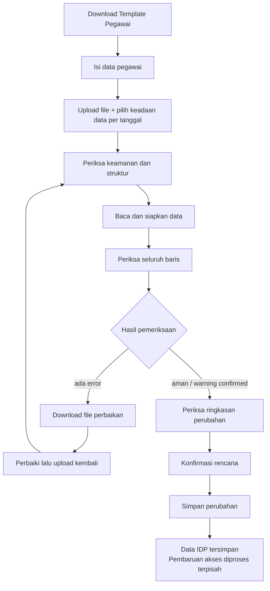
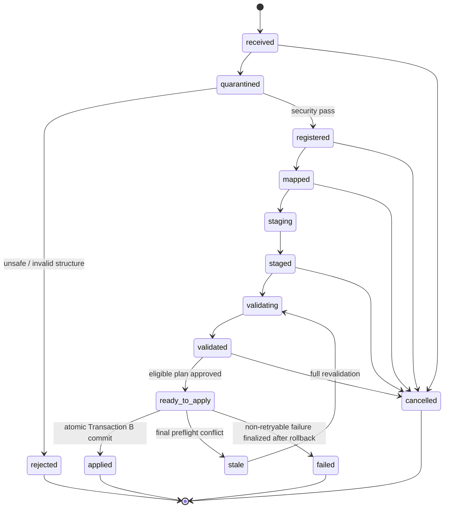

# 17 - IDP Pegawai Stage 2 Review Checklist & Open Decisions

Status: **Stage 2 architecture review gate approved**, bukan izin coding/provisioning
Project: kumjabar_ecosystem
Date: 2026-08-28
Reviews:

- `11-idp-pegawai-stage-2-import-pipeline-breakdown.md`
- `12-idp-pegawai-import-template-field-mapping-contract.md`
- `13-idp-pegawai-import-batch-row-schema-draft.md`
- `14-idp-pegawai-import-validation-dry-run-contract.md`
- `15-idp-pegawai-error-workbook-retry-loop-contract.md`
- `16-idp-pegawai-import-apply-materialization-contract.md`

## 1. Tujuan

Dokumen ini menjadi **gerbang penutup perancangan Stage 2 - Import Pipeline** sebelum proyek bergerak ke Stage 3 atau, bila kelak diberi izin eksplisit, menyusun implementation plan/TDD Stage 2.

Dokumen ini:

1. mengaudit Dokumen 11-16 sebagai satu sistem;
2. menetapkan precedence ketika draft awal dan kontrak rinci berbeda;
3. mengunci boundary, tabel, state machine, transaction, security, dan UX v1;
4. mengklasifikasikan open questions menjadi blocker, konfigurasi, governance, atau future scope;
5. menilai implementation readiness tanpa menganggap brainstorming sebagai izin coding.

Prinsip review:

> Stage 2 dinyatakan lengkap jika satu file dapat bergerak dari upload hingga hasil akhir tanpa celah ownership, partial write, replay, atau kebingungan operator.

## 2. Hasil Gate

Keputusan review final:

```text
Stage 2 architecture completeness = APPROVED
Stage 2 contract consistency      = APPROVED
Stage 2 implementation readiness  = READY WITH PRE-IMPLEMENTATION GATES
Coding/provisioning authorization = NOT GRANTED BY THIS DOCUMENT
Production readiness              = NOT YET; requires policy, sizing, security, and operational evidence
```

Maknanya:

- arsitektur Stage 2 tidak memerlukan perombakan fundamental;
- Dokumen 11-16 cukup untuk diturunkan menjadi migration/service/UI/test plan;
- implementasi belum dimulai karena aturan proyek masih full brainstorming;
- parameter kapasitas, retention, lease, timeout, dan governance harus diputuskan sebelum production rollout, tetapi tidak mengubah bentuk arsitektur inti.

## 3. Posisi Dokumen 17

```mermaid
flowchart LR
    D10["10\nStage 1 Review"]
    D11["11\nStage 2 Breakdown"]
    D12["12\nTemplate + Mapping"]
    D13["13\nBatch + Row Schema"]
    D14["14\nValidation + Dry-run"]
    D15["15\nError Workbook + Retry"]
    D16["16\nApply + Materialization"]
    D17["17\nStage 2 Review Gate"]
    T3["Stage 3\nAccess + Audit"]

    D10 --> D11 --> D12 --> D13 --> D14 --> D15 --> D16 --> D17 --> T3

    classDef done fill:#dcfce7,stroke:#15803d,color:#14532d
    classDef review fill:#ede9fe,stroke:#7c3aed,color:#4c1d95
    classDef future fill:#eff6ff,stroke:#2563eb,color:#1e3a8a
    class D10,D11,D12,D13,D14,D15,D16 done
    class D17 review
    class T3 future
```



## 4. Precedence dan Cara Membaca Dokumen

Jika ada detail berbeda, gunakan urutan precedence berikut:

```text
Dokumen 17 review decision
> Dokumen 16 apply/materialization
> Dokumen 15 error workbook/retry
> Dokumen 14 validation/dry-run
> Dokumen 13 staging schema
> Dokumen 12 template/mapping
> Dokumen 11 breakdown awal
```

Aturan:

- dokumen rinci yang lebih baru mempersempit draft awal;
- catatan `superseded` wajib diikuti;
- Dokumen 17 tidak menghapus histori keputusan, tetapi menentukan contract v1 yang harus dipakai implementer;
- Dokumen Stage 1 tetap authoritative untuk core domain, kecuali delta Stage 2 dinyatakan eksplisit di sini.

## 5. Boundary Final Stage 2

### 5.1 Masuk Scope

| Area | Contract v1 |
| --- | --- |
| import type | pegawai ASN PNS/PPPK |
| operator format | XLSX resmi |
| technical format | CSV UTF-8 terkontrol |
| template | versioned dan dapat di-download |
| mapping | exact + alias terbatas; strict fail-closed |
| staging | batch + row, raw allowlist, presence, normalized partial, full candidate |
| validation | file, mapping, cell, row, cross-row, DB, identity, freshness |
| dry-run | create/update/noop/reject + warning/high-impact review |
| retry | self-contained correction XLSX sebagai child batch baru |
| apply | atomic all-or-nothing per batch |
| downstream handoff | transactional outbox, tanpa remote call dalam transaction |
| operator UI | Bahasa Indonesia nonteknis dengan progressive disclosure |

### 5.2 Di Luar Scope

```text
jabatan / jenis atau label jabatan
PLT / PLH / histori atau SK jabatan
role / permission / access grant
provider_subject atau verified identity-link import
org unit import bebas
partial apply
bulk clear melalui blank cell
NIP correction existing
status-effective history import
Keycloak remote sync di dalam apply
full Stage 3 audit/access governance
full Stage 4 publisher/consumer sync implementation
```

## 6. Canonical Operator Journey



Kalimat invariant UI:

```text
Sebelum apply:
Belum ada data pegawai yang berubah.

Setelah commit:
Data IDP Pegawai sudah tersimpan.
Pembaruan akses sedang diproses.
```

## 7. Canonical Input Contract

Satu row berarti satu ASN yang diidentifikasi oleh satu NIP.

Canonical headers v1:

```text
nip
nama_lengkap
email_dinas
email_google
org_unit_code
status_pegawai
```

Locked rules:

- `nip` wajib string tepat 18 digit;
- email tidak pernah menjadi fallback match;
- `status_pegawai` wajib;
- `is_active` bukan input dan selalu diturunkan dari status;
- pegawai aktif wajib unit utama valid;
- `org_unit_code` adalah afiliasi organisasi, bukan jabatan;
- unknown/forbidden/duplicate/missing-required headers adalah fatal;
- formula, macro, external content, hidden ambiguous data, dan embedded objects ditolak;
- blank update berarti preserve;
- absence of row tidak berarti deactivate/delete.

## 8. Field Ownership dan Identity Boundary

| Field/Concern | Owner | Perilaku Import |
| --- | --- | --- |
| NIP | IDP Pegawai | primary business key; existing immutable via bulk v1 |
| nama lengkap | IDP Pegawai | create/update |
| email dinas/Google profile | IDP Pegawai | candidate profile; conflict checked |
| status lifecycle | IDP Pegawai | explicit input |
| eligibility | IDP Pegawai | derived dari status |
| primary org affiliation | IDP Pegawai | atomically materialized |
| trusted identity link | Identity-link workflow | tidak dibuat/dipindah import |
| jabatan/histori | consumer kepegawaian | forbidden |
| role/permission | access governance/consumer | forbidden |

Email profile tidak menjadi credential, verified claim, atau bukti ownership provider.

## 9. Canonical Persistence Delta Stage 2

Stage 2 mengunci persistence berikut.

| Table / Delta | Status | Fungsi |
| --- | --- | --- |
| `pegawai.source_version` | wajib ditambah | monotonic aggregate version |
| `import_batches` | wajib | aggregate root upload/validation/apply |
| `import_rows` | wajib | staging dan row plan |
| `import_artifacts` | wajib untuk retry workbook lifecycle | private artifact generation/version/retention |
| `import_apply_commands` | wajib | persistent request idempotency + lease/result |
| `import_materializations` | wajib | row outcome/replay ledger |
| `transactional_outbox` | wajib | durable post-commit handoff |

`identity_email_claims` tidak menjadi default table v1 bila seluruh writer email/identity terbukti memakai shared advisory-lock protocol. Jika bukti itu tidak dapat diberikan sebelum coding, table claim registry menjadi **required migration**, bukan enhancement opsional.

## 10. Core Table Contract Review

### 10.1 `import_batches`

Minimum concern groups:

- identity: integer PK + PostgreSQL UUID;
- lineage: parent/root/retry depth;
- file provenance: format, size, hash, storage state;
- contract provenance: template/parser/normalizer/canonicalization versions;
- source time: `source_as_of`;
- actor fields: upload/map/validate/approve/apply subjects;
- plan integrity: mapping hash, approval fingerprint, approval lock version;
- lifecycle timestamps and optimistic `lock_version`;
- denormalized `summary` cache.

Approval context harus mencakup warning/high-impact acknowledgement yang terikat plan fingerprint, bukan boolean lepas.

### 10.2 `import_rows`

Minimum concern groups:

- batch owner + source locator;
- raw canonical allowlist scalar;
- source metadata tanpa formula body/link/object;
- `field_presence` (`absent`, `blank`, `provided`);
- normalized partial payload;
- target ID/UUID/hash/freshness snapshot;
- full merged candidate payload/hash;
- validation diagnostics;
- planned operation/fingerprint;
- apply status/result UUID/error code.

`summary` batch bukan source of truth. Counter selalu dapat direkonsiliasi dari rows.

### 10.3 `import_artifacts`

Wajib memisahkan artifact lifecycle dari kolom tunggal batch karena generation dapat diretry, diregenerate, superseded, gagal, atau dipurge.

Lifecycle:

```text
generating -> verified -> ready -> superseded/purged
             \-> failed
```

Artifact tidak boleh dapat di-download sebelum `ready`.

### 10.4 Apply Command, Ledger, dan Outbox

- command reservation terpisah dari transaction domain;
- materialization ledger ditulis satu transaction dengan domain;
- outbox ditulis satu transaction dengan domain;
- one successful command per batch;
- one ledger per import row;
- one authoritative outbox event per aggregate mutation/source version;
- noop tidak membuat domain-change event.

## 11. Canonical Batch State Machine



`applying` tetap boleh menjadi DB check value/internal transient state, tetapi tidak diharapkan persisten setelah normal crash/rollback. Persistent `applying` adalah invariant breach dan harus di-alert, bukan dianggap resume point.

`applied_partial` tidak ada pada v1.

## 12. Row State Review

### 12.1 Validation

```text
pending
valid
warning
error
stale
```

### 12.2 Planned Operation

```text
undetermined
create
update
noop
reject
```

### 12.3 Apply Result

```text
not_applied
applying (transaction-local/transient)
applied
skipped
conflict
failed
```

Pada rollback tidak boleh ada row yang bertahan `applied`.

## 13. Validation and Approval Gate

Apply eligibility mewajibkan:

- batch `ready_to_apply`;
- total rows lebih dari nol;
- tidak ada error/fatal/stale row;
- warning sudah dibuka dan dikonfirmasi;
- summary telah direkonsiliasi;
- approval belum expired/invalid;
- fingerprint dan lock version cocok;
- parser/normalizer/validation/canonicalization version didukung;
- setiap row memiliki operation fingerprint dan target snapshot yang diperlukan;
- actor masih memiliki capability dan row/domain scope.

Approval bukan authorization cache. Apply menghitung ulang policy dari authoritative context.

## 14. Atomic Apply Contract

```mermaid
sequenceDiagram
    participant UI as Admin UI
    participant C as Apply Command Service
    participant DB as PostgreSQL
    participant O as Outbox Publisher
    participant K as Keycloak/Consumer

    UI->>C: apply(batch, expected version, fingerprint, idempotency key)
    C->>DB: Transaction A reserve command + lease
    DB-->>C: command UUID
    C->>DB: Transaction B locks + final preflight
    alt conflict
        DB-->>C: batch stale + command conflict; no domain mutation
    else success
        C->>DB: pegawai + assignment + import state + ledger + outbox + command success
        DB-->>C: atomic commit
        C-->>UI: Data IDP tersimpan; sync pending
        O->>DB: claim pending outbox
        O->>K: at-least-once publish/reconcile
    end
```

No remote Keycloak/consumer call occurs inside Transaction B.

## 15. Create / Update / Noop Review

| Operation | Domain Rule |
| --- | --- |
| create active | insert pegawai + active primary assignment + source version 1 |
| create inactive | optional last-known unit; no active assignment |
| update | candidate allowlist only; source version increment once |
| unit move | close old active assignment; create new active assignment |
| lifecycle inactive | derive false; close active assignment; preserve last-known shortcut |
| reactivation | require valid unit + separate suspension/access policy pass |
| noop | no domain update, timestamp/version change, or outbox event |

NIP soft-deleted tidak direcreate lewat bulk import; arahkan ke restore/review workflow khusus.

## 16. Primary Organization Invariant

After every successful commit:

```text
pegawai aktif
=> primary_org_unit_id non-null
=> exactly one active primary assignment
=> shortcut and assignment point to same org unit

pegawai nonaktif
=> zero active primary assignment
=> primary_org_unit_id may preserve last-known unit
```

`source_as_of`, upload timestamp, dan apply timestamp tidak digunakan untuk mengarang assignment `started_at`/`ended_at`.

## 17. Freshness and Source Version

Stage 2 menambah monotonic `pegawai.source_version`:

```text
create = 1
update = previous + 1
noop   = unchanged
```

Satu aggregate mutation, walaupun mengubah profile + org + eligibility, menaikkan versi tepat satu kali.

Consumer freshness contract menggunakan:

```text
contract_version
source_version
source_updated_at
payload_hash
```

Hash bukan audit log dan timestamp bukan pengganti version ordering.

## 18. Outbox Boundary

Authoritative event v1:

```text
pegawai.created
pegawai.changed
```

Satu mutation menghasilkan satu event dengan:

- aggregate UUID;
- source version;
- payload hash;
- change kinds;
- reference minimum;
- import/materialization provenance minimum.

Full NIP, nama, dan email tidak menjadi default payload. Consumer mengambil canonical snapshot melalui internal API bila diperlukan.

Publisher Stage 4 bersifat at-least-once; consumer wajib idempotent dan menolak event lama berdasarkan aggregate UUID + source version.

## 19. Concurrency and Idempotency Review

Correctness guards berlapis:

1. request idempotency key;
2. one active/succeeded apply command per batch;
3. stable namespaced advisory lock per batch;
4. expected lock version;
5. `SELECT FOR UPDATE` deterministic order;
6. shared normalized-email coordination locks;
7. materialization key + full canonical tuple comparison;
8. domain unique/check constraints;
9. one atomic Transaction B.

Materialization ledger lama tidak dipinjam oleh row batch baru. Exact mutation dari row/batch berbeda menghasilkan replay conflict lalu full revalidation; operasi terbaru biasanya menjadi noop dengan snapshot baru.

## 20. Email and Identity Concurrency Gate

Collision harus diperiksa lintas:

```text
pegawai.email_dinas_normalized
pegawai.email_google_normalized
pegawai_identity_links.email_normalized
```

Keputusan v1:

- semua writer email/identity memakai namespace, canonicalizer, hash function, advisory-lock order, dan recheck protocol yang sama;
- runtime language `hash()` dilarang;
- lock collision hanya mengurangi concurrency, bukan menjadi correctness proof tunggal;
- unique constraints lokal tetap berlaku;
- jika shared protocol tidak dapat dibuktikan sebelum coding, buat `identity_email_claims` dengan unique normalized email.

Ini adalah **pre-implementation technical gate**.

## 21. Retry Contract Review

Retry selalu:

```text
new child batch
+ same root lineage
+ source_as_of from authoritative parent DB
+ full security validation
+ full parsing/mapping/normalization/validation
+ no inherited approval/target snapshot
```

Correction workbook membawa seluruh row nonblank agar child tetap self-contained. Retry hanya untuk koreksi nilai, bukan menambah/menghapus populasi.

## 22. Artifact Security Review

Error workbook merupakan bulk PII export.

Wajib:

- private/service-only storage;
- encryption at rest;
- capability-gated generation/download/retry;
- artifact and row/domain scope authorization;
- audited access;
- no public/listable bucket;
- short retention and idempotent purge;
- runtime OOXML post-generation verification;
- signed lineage token sebagai integrity hint, bukan authorization;
- no automatic email attachment.

Default awal error workbook tetap 7 hari, tetapi final production retention menunggu privacy/records policy.

## 23. Operator UX Review

Locked UX principles:

- satu primary action per screen;
- istilah backend tidak menjadi label utama;
- warna selalu disertai ikon dan teks;
- error menjelaskan apa, di mana, dan cara memperbaiki;
- disabled action mempunyai alasan;
- high-impact revocation/reactivation tampil menonjol;
- filters menggunakan pilihan/dropdown/chip, bukan key teknis;
- input tidak boleh kehilangan cursor karena full rerender;
- technical detail tertutup dan capability-gated;
- ambiguous HTTP outcome selalu status lookup, bukan asumsi gagal/sukses.

All-noop menggunakan `Selesaikan Import`, `outbox_events=0`, dan `sync_state=not_required`.

## 24. Security Threat-to-Control Closure

| Threat | Control Final |
| --- | --- |
| ZIP bomb/resource exhaustion | bounded ZIP/OOXML parser + size/count/ratio limits |
| formula/macro/external content | fail-closed structural validation |
| forbidden domain injection | header rejection; values never persisted |
| NIP precision laundering | numeric/formula NIP rejected/blanked in correction workbook |
| duplicate/replay apply | command idempotency + ledger + constraints |
| stale overwrite | approval fingerprint + target hash/version + locked preflight |
| cross-email account takeover | shared email lock/recheck or claim registry |
| row scope escalation | authoritative target/org scope, not workbook values |
| partial batch | one atomic Transaction B |
| remote inconsistency | transactional outbox; no remote call in transaction |
| PII leak | minimization, masking, capability, private storage, no-store headers |
| token misuse | signed lineage token is integrity only; authorization repeated |

## 25. Supersession Register

| Draft Lama | Final Contract |
| --- | --- |
| error workbook hanya failing rows | seluruh row nonblank, self-contained |
| diagnostics inline sebagai domain columns | diagnostics sheet terpisah; `pegawai` hanya enam headers |
| kolom tunggal `error_workbook_*` di batch | `import_artifacts` lifecycle table |
| `applied_partial` sebagai kemungkinan status | tidak ada pada v1 |
| direct `applying -> stale/failed` sebagai persisted recovery path | conflict/failure finalized safely after rollback; persistent applying = breach |
| apply idempotency hanya operation fingerprint | persistent command + materialization ledger + DB guards |
| multiple authoritative events per changed aspect | one aggregate event per source version + change kinds |
| email conflict hanya validation scan | shared email concurrency lock/recheck atau claim registry |
| retry child dapat mewarisi parent context | approval/target/validation never inherited |
| file timestamp sebagai effective date | source/upload/apply time tidak mengarang business-effective dates |

## 26. Migration Slice Recommendation

Nama revision masih konseptual, tetapi urutan dependency dikunci:

```text
0002_add_pegawai_source_version
0003_create_import_staging
0004_create_import_artifacts
0005_create_import_apply_ledger_outbox
0006_create_identity_email_claims   # conditional gate only
```

### Slice A - Core Delta

- add `pegawai.source_version bigint not null`;
- backfill existing rows to a documented baseline, recommended `1`;
- add check `source_version >= 1`;
- update canonical read/sync contract.

Backfill `1` berarti baseline awal, bukan bukti bahwa record telah berubah satu kali. Consumer/delta feed harus memulai dari snapshot bootstrap; event history sebelum kolom dibuat tidak direkonstruksi. Setelah migration, mutation pertama menaikkan existing row dari `1` ke `2`, sedangkan create baru dimulai dari `1`.

### Slice B - Staging

- create `import_batches`;
- create `import_rows`;
- add explicit short constraint/index names;
- add status checks and parent/root lineage constraints.

### Slice C - Artifact

- create `import_artifacts`;
- generation key uniqueness;
- state/storage/retention checks.

### Slice D - Apply Reliability

- create `import_apply_commands`;
- create `import_materializations`;
- create `transactional_outbox`;
- add partial unique indexes for active/succeeded commands;
- add materialization/row uniqueness;
- add outbox event identity/version uniqueness.

Every PostgreSQL identifier must remain safely below 63 characters. Upgrade/downgrade names must be explicit and symmetrical.

## 27. Constraint and Index Review Checklist

### `import_batches`

- UUID unique;
- parent FK restrict;
- status check excludes `applied_partial`;
- file hash format check;
- source_as_of non-null;
- retry lineage/depth check;
- lifecycle timestamp consistency;
- storage purge consistency;
- indexes for status/time, actor/time, parent/root, retention.

### `import_rows`

- unique batch + source locator;
- target/create/update/noop consistency checks;
- validation/planned/apply status checks;
- indexes for batch + row/status/operation;
- no broad GIN payload index v1.

### Commands / Ledger / Outbox

- actor + batch + idempotency key unique;
- one active command per batch;
- one succeeded command per batch;
- one ledger per import row;
- materialization key not null/unique;
- outbox event UUID unique;
- aggregate UUID + source version uniqueness for authoritative mutation events.

## 28. API Surface Review

Conceptual admin/private routes:

```text
GET  /admin/import/pegawai
GET  /admin/import/pegawai/template.xlsx
POST /admin/import/pegawai/batches
GET  /admin/import/pegawai/batches/{batch_uuid}
GET  /admin/import/pegawai/batches/{batch_uuid}/rows
POST /admin/import/pegawai/batches/{batch_uuid}/mapping/confirm
POST /admin/import/pegawai/batches/{batch_uuid}/validate
POST /admin/import/pegawai/batches/{batch_uuid}/approve
GET  /admin/import/pegawai/batches/{batch_uuid}/error-workbook
POST /admin/import/pegawai/batches/{batch_uuid}/error-workbook/regenerate
POST /admin/import/pegawai/batches/{batch_uuid}/retry
POST /admin/import/pegawai/batches/{batch_uuid}/apply
GET  /admin/import/pegawai/apply-commands/{command_uuid}
GET  /admin/import/pegawai/batches/{batch_uuid}/result
POST /admin/import/pegawai/batches/{batch_uuid}/cancel
```

Every route repeats authentication, capability, visibility, scope, and safe no-existence-leak behavior where applicable.

## 29. Test Strategy Gate

Implementation plan must include at least:

1. model/migration contract tests;
2. real PostgreSQL constraint tests;
3. parser security/resource-limit tests;
4. template/mapping tests;
5. presence/normalization tests;
6. validation and identity conflict tests;
7. candidate/noop/fingerprint tests;
8. warning/approval/high-impact tests;
9. error workbook content and OOXML verifier tests;
10. retry lineage/row-set/idempotency tests;
11. apply atomicity failure injection at first/middle/last row;
12. concurrent apply/email claim tests;
13. crash/lease/ambiguous-response recovery tests;
14. outbox ordering/idempotency/privacy tests;
15. operator UI/accessibility/capability tests.

SQLite alone tidak menjadi bukti schema/apply correctness. Constraint, partial index, JSONB, advisory lock, row lock, dan transaction tests wajib memakai PostgreSQL.

## 30. Open Decisions Classification

### 30.1 Locked for v1

| Decision | Final |
| --- | --- |
| XLSX vs CSV | XLSX operator utama; CSV UTF-8 teknis |
| active without email | warning, bukan error |
| partial apply | tidak ada |
| warning apply | boleh setelah explicit review/ack |
| identity link from import | tidak boleh |
| blank update | preserve |
| source_as_of UI | date-friendly UI -> explicit timezone cutoff timestamptz |
| all-noop state | batch `applied`, zero outbox, sync not required |
| create inactive unit | optional last-known unit, no active assignment |
| apply conflict | batch stale + approval invalid |
| isolation baseline | READ COMMITTED + explicit locks/constraints/advisory locks |
| error workbook retention default | 7 hari, configurable and policy-capped |
| artifact table | required when regeneration/versioning endpoint exists |

### 30.2 Pre-Implementation Technical Gates

| Gate | Required Evidence |
| --- | --- |
| email writer coordination | all writers use shared protocol, or add claim registry migration |
| source version backfill | deterministic migration baseline + read contract tests |
| file/resource limits | safe defaults from adversarial/sizing test |
| max rows per batch | PostgreSQL transaction and UI benchmark |
| command lease/heartbeat | TTL, takeover, retention, crash tests |
| timeout/retry | lock/statement timeout + bounded jitter/backoff values |
| canonicalization versions | fixtures proving stable hashes/fingerprints |
| object storage semantics | temporary write, verify, atomic publish, compensation test |

These gates block coding completion/production claims, not Stage 2 architectural closure.

### 30.3 Governance Before Production

- raw file/staging/diagnostic/command/audit retention;
- approved email-domain policy, if any;
- whether approver and applier must differ;
- whether high-impact revocation/reactivation requires second approver;
- PII masking/export policy;
- operational SLO and alert thresholds;
- legal hold and backup purge behavior.

### 30.4 Future / Not MVP

- partial apply;
- manual flexible mapping beyond controlled allowlist;
- lifecycle/effective-date import template;
- NIP correction workflow;
- bulk clear semantics;
- PDF review export;
- org unit free import;
- automatic trusted identity-link creation;
- full Keycloak/consumer sync worker;
- report/event bus beyond transactional outbox boundary.

## 31. Implementation Readiness Checklist

### Architecture - Passed

- [x] Domain and ownership boundary consistent.
- [x] Template and mapping contract complete.
- [x] Staging schema contract complete.
- [x] Validation, diagnostics, candidate, and approval contract complete.
- [x] Retry workbook and lineage contract complete.
- [x] Apply atomicity/idempotency/recovery contract complete.
- [x] Outbox boundary complete.
- [x] Operator UX language contract complete.
- [x] Security/privacy threat controls identified.
- [x] Superseded drafts registered.

### Required Before Coding Completion

- [ ] Final migration column lengths and short constraint names reviewed.
- [ ] Shared email writer protocol proven or claim table selected.
- [ ] Canonicalization/hash fixtures frozen.
- [ ] PostgreSQL test environment and concurrency harness available.
- [ ] Object storage interface/atomic publish semantics selected.
- [ ] Config defaults for limits/timeouts/leases documented.

### Required Before Production

- [ ] Privacy/retention policy approved.
- [ ] Governance/four-eyes policy approved.
- [ ] Security/adversarial parser tests pass.
- [ ] Load/sizing tests establish maximum batch size.
- [ ] Backup/purge/restore controls verified.
- [ ] Monitoring, alert, and runbook verified.
- [ ] Keycloak/internal API routing hardening completed in later stage.

## 32. Recommended Implementation Order When Authorized

Jika user kelak memberi izin coding, jangan mulai dari UI. Urutan yang direkomendasikan:

```text
1. PostgreSQL migration + constraints
2. models and canonicalization primitives
3. repositories and state transition guards
4. template generator + secure parser
5. staging and validation services
6. dry-run + approval
7. artifact/error workbook + retry
8. apply command + materialization + outbox
9. Admin UI workflow
10. concurrency/failure/security/load verification
```

Setiap slice mengikuti TDD dan commit kecil. Implementation plan terpisah harus dibuat sebelum coding.

## 33. Stage 2 Acceptance Checklist

### Domain and Input

- [x] Scope hanya ASN PNS/PPPK.
- [x] NIP 18 digit adalah match key tunggal.
- [x] Six canonical headers dikunci.
- [x] Jabatan/role/provider claims forbidden.
- [x] Presence semantics dan blank-preserve dikunci.

### Pipeline

- [x] Stage-first/apply-second dikunci.
- [x] File/mapping/row/DB/identity/freshness validation lengkap.
- [x] Dry-run dan fingerprint approval dikunci.
- [x] Self-contained retry workbook dikunci.
- [x] Full revalidation child batch dikunci.

### Apply

- [x] All-or-nothing batch transaction dikunci.
- [x] Create/update/noop behavior dikunci.
- [x] Primary organization invariant dikunci.
- [x] Persistent command/lease/idempotency dikunci.
- [x] Materialization ledger/replay behavior dikunci.
- [x] Source version and one-event outbox contract dikunci.
- [x] No remote call inside transaction dikunci.

### Security and UX

- [x] Artifact classified as bulk PII export.
- [x] Authorization at batch/artifact and row/domain scope dikunci.
- [x] Email TOCTOU guard dikunci.
- [x] Operator language/progressive disclosure dikunci.
- [x] Ambiguous outcome recovery dikunci.

## 34. Risks Carried Forward

| Risk | Classification | Mitigation |
| --- | --- | --- |
| retention policy belum resmi | governance | configurable TTL + production gate |
| batch size belum dibenchmark | operational | sizing before default limit |
| all email writers may not share lock protocol | technical gate | prove protocol or add claim registry |
| Stage 3 audit belum ada | roadmap | command/ledger/outbox minimum now; full audit next |
| Stage 4 publisher belum ada | roadmap | durable outbox now; sync later |
| operator laptop retains downloaded PII | operational/privacy | warning, official storage procedure, short server retention |
| source_as_of lacks comparable business timestamp | domain data quality | canonical hash/locked freshness + review; do not invent time ordering |

## 35. Decision on Moving Forward

Dokumen 11-16 dinyatakan lengkap sebagai Stage 2 architecture package.

```text
Stage 2 design = CLOSED / APPROVED
Next architecture stage = Stage 3 Access & Audit
Optional alternative = hold architecture and later write Stage 2 implementation plan
```

Perpindahan ke Stage 3 tidak mengizinkan coding Stage 2 secara implisit. Coding hanya dimulai setelah user memberi instruksi eksplisit dan pre-implementation gates dijadikan implementation plan.

## 36. Next Document Recommendation

Jalur arsitektur berikutnya:

```text
18 - IDP Pegawai Stage 3 Access & Audit Breakdown
```

Dokumen 18 sebaiknya membahas:

- capability model dan policy evaluation;
- `access_grants` lifecycle;
- actor/resource/action/scope contract;
- separation of duties/four-eyes;
- append-only audit events/logs;
- PII-safe before/after audit representation;
- audit retention/export;
- hubungan audit dengan import commands, materialization ledger, dan outbox;
- Admin UI access/audit flow.

## 37. Kesimpulan

Stage 2 bukan tombol upload. Ia adalah satu ingestion system yang tertutup dari ujung ke ujung:

```text
versioned template
-> secure upload
-> deterministic mapping
-> allowlisted staging
-> layered validation
-> human dry-run
-> self-contained retry
-> fingerprint approval
-> atomic materialization
-> ledger + outbox
-> clear operator result
```

Dengan review ini:

- data forbidden tidak masuk IDP;
- file tidak langsung mengubah domain;
- operator selalu memahami apakah data sudah tersimpan;
- error tidak menghasilkan partial batch;
- retry tidak menghapus row valid;
- replay/concurrency tidak menghasilkan double apply;
- identity link tidak direbut oleh email import;
- consumer mendapat freshness ordering yang durable;
- Stage 3 dapat membangun access dan audit di atas fondasi yang stabil.
