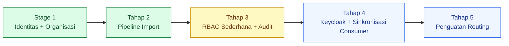
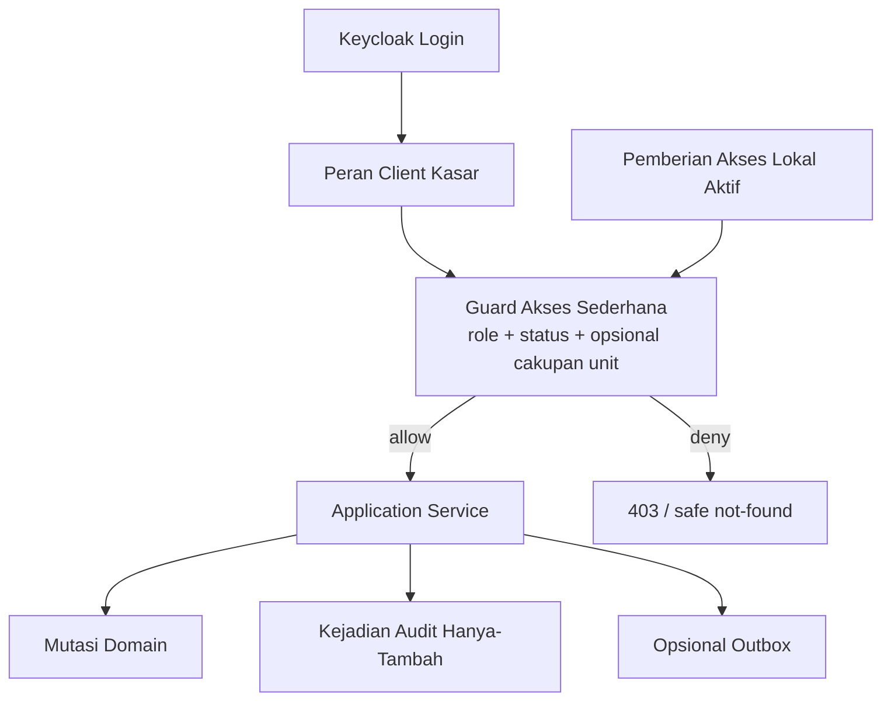
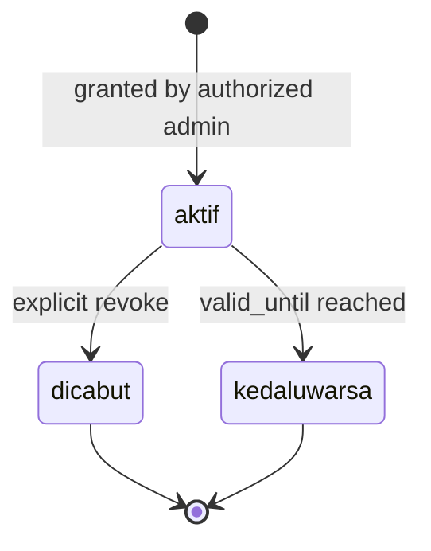
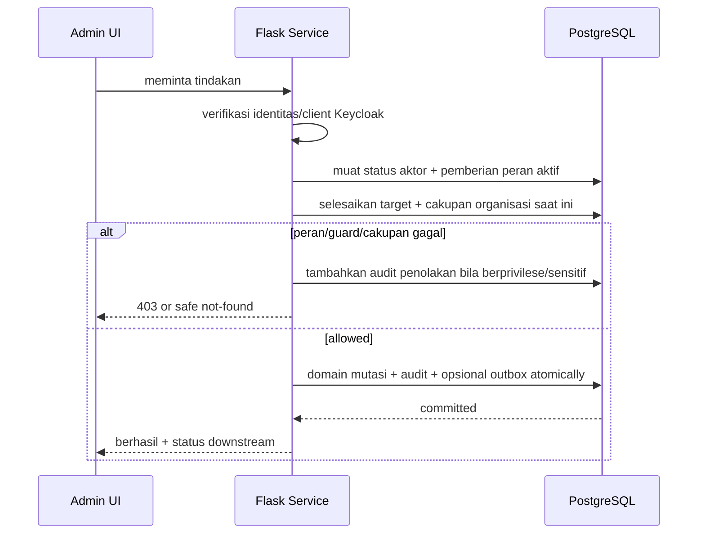
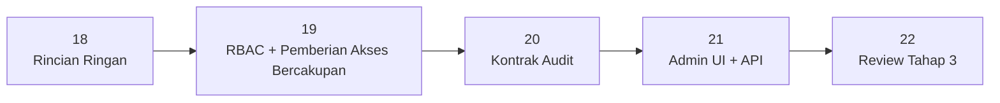

# 18 - IDP Pegawai Tahap 3 Rincian Akses & Audit

Status: Draf curah gagasan revisi, **bukan kode implementasi**
Proyek: kumjabar_ecosystem
Tanggal: 2026-08-29
Catatan revisi: disederhanakan setelah review user agar IDP tetap **ringan, tangguh, dan kuat**, tanpa membawa pola ABAC generik dari `dasborkanwil`.
Bergantung pada:

- `03-keycloak-matrix-and-org-unit-seed.md`
- `04-idp-pegawai-schema-and-access-ui.md`
- `09-idp-pegawai-stage-1-admin-ui-internal-api-contract.md`
- `17-idp-pegawai-stage-2-review-checklist-open-decisions.md`

## 1. Tujuan

Dokumen ini membuka **Tahap 3 - Akses & Audit** setelah Tahap 2 Pipeline Import ditutup secara arsitektural.

Tahap 3 menjawab dua pertanyaan:

1. siapa boleh memakai fungsi administrasi IDP;
2. bagaimana tindakan penting dicatat secara aman dan dapat dipertanggungjawabkan.

Prinsip proporsionalitas:

> IDP Pegawai adalah sumber kebenaran identitas pegawai, bukan platform authorization serbaguna. Gunakan model paling sederhana yang memenuhi kebutuhan nyata dan standar keamanan minimum.

Dokumen ini belum membuat migration, model SQLAlchemy, route Flask, Keycloak client, atau provisioning.

## 2. Keputusan Senior Engineering

Rekomendasi final untuk IDP ini adalah:

```text
RBAC sederhana
+ explicit berprivilese assignment
+ dua cakupan tetap: global atau subtree unit
+ beberapa guard bisnis wajib
+ audit hanya-tambah
```

Bukan:

```text
mesin ABAC generik
bahasa ekspresi kebijakan
titik keputusan kebijakan terpisah
kondisi JSON bebas
kerangka risiko resource generik
aljabar cakupan kompleks
```

Secara akademis, pemeriksaan cakupan unit dan status aktor dapat disebut pemeriksaan atribut. Namun implementasinya tetap berupa guard sederhana di layanan, **bukan framework ABAC**.

## 3. Karakter Sasaran Sistem

| Sasaran | Arti Praktis |
| --- | --- |
| Ringan | sedikit peran, sedikit tabel, sedikit status, tanpa DSL/mesin kebijakan |
| Tangguh | constraint DB, transaksi atomik, idempotency, explicit lifecycle |
| Kuat | tolak-secara-default, privilese minimum, tanpa eskalasi mandiri, audit wajib |
| Mudah dijelaskan | operator memahami siapa mendapat akses dan mengapa |
| Mudah dipelihara | aturan dapat dibaca langsung dari kode/config dan diuji tanpa evaluator generik |

## 4. Posisi Tahap 3



## 5. Batas Tahap 3

### 5.1 Masuk Cakupan

- peran Admin UI IDP yang kecil dan tetap;
- pemetaan peran ke kapabilitas internal;
- penugasan peran berprivilese eksplisit;
- cakupan opsional global atau satu subtree organisasi;
- masa berlaku dan pencabutan assignment;
- pemisahan operator dan penyetuju untuk aksi berisiko;
- hanya-tambah kejadian audits;
- PII-safe change summary;
- Admin UI pemberian akses dan audit sederhana;
- outbox handoff untuk sinkronisasi Keycloak Tahap 4.

### 5.2 Di Luar Cakupan

```text
ABAC engine/OPA/Casbin-style generic evaluator
policy DSL atau arbitrary policy JSON
pembangun peran kustom
custom capability builder
nested boolean policy conditions
risk scoring framework
multi-dimensional aljabar cakupan
user-defined delegation rules
general impersonation feature
full recertification campaign platform
SIEM/WORM implementation
Keycloak remote sync di dalam transaction
consumer-local permission management
```

## 6. Arsitektur Minimum



Tidak ada lompatan jaringan ke layanan kebijakan. Guard berjalan di aplikasi Flask dan memakai database lokal authoritative.

## 7. Sumber Kebenaran Akses

Pembagian tanggung jawab:

| Aspek | Sumber Kebenaran |
| --- | --- |
| identitas terautentikasi | Keycloak subject/session |
| kelayakan dasar pegawai | `pegawai.status_pegawai` + `is_active` |
| akses masuk kasar Admin UI | peran client Keycloak |
| penugasan IDP berprivilese | local `access_grants` |
| cakupan unit | pemberian akses lokal + authoritative `org_units` hierarchy |
| izin rinci consumer | aplikasi consumer masing-masing |
| riwayat audit | local hanya-tambah `audit_logs` |

Keycloak token bukan cache authorization final untuk aksi sensitif. Service tetap mengecek pemberian akses lokal/status pada saat permintaan.

## 8. Katalog Peran v1

Peran dibuat sedikit dan tetap:

| Kode Peran | Fungsi |
| --- | --- |
| `viewer` | melihat dashboard, organisasi, dan pegawai sesuai cakupan |
| `import_operator` | unggah, validasi, workbook koreksi, apply batch yang sudah disetujui |
| `import_approver` | review dan menyetujui rencana import, termasuk berdampak tinggi |
| `access_admin` | membuat/mencabut penugasan peran sesuai aturan |
| `auditor` | membaca audit sesuai penyamaran dan cakupan |
| `security_admin` | bootstrap/recovery/pengaturan keamanan sangat terbatas |

Tidak ada pembangun peran kustom v1.

## 9. Pemetaan Kapabilitas Internal

Backend boleh memakai flag kapabilitas agar rute/UI tidak menulis peran secara hard-code berulang kali. Katalog tetap statis dalam kode/konfigurasi berversi.

```text
viewer
  -> dashboard.view
  -> org_unit.view
  -> pegawai.view

import_operator
  -> import.view
  -> import.template.download
  -> import.upload
  -> import.validate
  -> import.error_workbook.download
  -> import.apply_approved

import_approver
  -> import.view
  -> import.approve
  -> import.approve_high_impact

access_admin
  -> access_grant.view
  -> access_grant.create
  -> access_grant.revoke

 auditor
  -> audit.view
  -> audit.export_masked

security_admin
  -> security.bootstrap_recover
  -> audit.verify_integrity
```

Peran-ke-kapabilitas mapping bukan tabel editable pada v1. Perubahannya melalui review kode/konfigurasi agar mudah diaudit dan diuji.

## 10. Model Cakupan v1

Hanya dua cakupan penugasan berprivilese:

```text
global
org_unit_subtree
```

| Cakupan | Arti |
| --- | --- |
| `global` | seluruh resource IDP yang diizinkan peran |
| `org_unit_subtree` | satu unit dan seluruh turunan dari hierarki otoritatif saat ini |

Tidak ada `specific_org_units`, aljabar resource milik sendiri, kondisi tag bebas, atau ekspresi cakupan pada v1.

Jika kebutuhan nyata kelak tidak dapat direpresentasikan oleh dua cakupan ini, desain diperluas berdasarkan kasus penggunaan konkret—bukan secara prematur.

## 11. Guard Bisnis Wajib

**Tolak secara default:** jika peran/pemberian akses/guard yang diperlukan tidak terbukti, tindakan ditolak.

Selain peran dan cakupan unit, service memeriksa guard tetap berikut:

1. aktor terautentikasi untuk client/audience yang diharapkan;
2. aktor pegawai masih aktif/eligible;
3. pemberian akses lokal aktif dan belum kedaluwarsa/dicabut;
4. resource target berada dalam cakupan pemberian akses;
5. batch/resource berada pada status yang mengizinkan tindakan;
6. aktor tidak melakukan eskalasi mandiri yang dilarang;
7. import berdampak tinggi sudah disetujui aktor lain bila policy mewajibkan;
8. audit dapat ditulis untuk mutasi berprivilese.

Guard tersebut adalah invariant aplikasi, bukan aturan ABAC generik.

## 12. Aktor Types

V1 mengenali:

```text
pegawai
service_account
system
```

Aturan:

- `actor_subject` selalu dari authenticated/runtime context, tidak dari permintaan body;
- pegawai nonaktif tidak dapat memakai pemberian akses berprivilese;
- akun layanan tidak dibuat sebagai pegawai palsu;
- akun layanan memakai cakupan internal/otorisasi client yang tetap, bukan Admin UI role bebas;
- aktor sistem hanya untuk pekerjaan internal dengan correlation/job ID;
- general impersonation tidak tersedia pada v1.

## 13. `access_grants` yang Disederhanakan

Satu baris berarti satu penugasan peran kepada satu subject.

### 13.1 Kolom Minimum

| Kolom | Kontrak |
| --- | --- |
| `id` | bigint PK internal |
| `uuid` | UUID publik PostgreSQL |
| `subject_type` | `pegawai` atau `service_account` |
| `subject_pegawai_id` | FK nullable untuk pegawai |
| `subject_key` | immutable Keycloak subject/client ID |
| `role_code` | peran katalog tetap |
| `scope_type` | `global` atau `org_unit_subtree` |
| `scope_org_unit_id` | wajib hanya untuk subtree |
| `status` | `aktif`, `revoked`, `expired` |
| `valid_from` | nullable timestamptz |
| `valid_until` | nullable timestamptz |
| `reason` | alasan bisnis wajib |
| `granted_by_subject` | aktor pemberi |
| `granted_at` | timestamp |
| `revoked_by_subject` | nullable |
| `revoked_at` | nullable |
| `revocation_reason` | nullable |
| `lock_version` | optimistic concurrency |
| timestamp | dibuat/diperbarui |

### 13.2 Yang Sengaja Dihapus dari Rancangan Awal

```text
target_type generik
arbitrary target_code
conditions_json
policy_version per grant
risk_tier framework
permintaan/menunggu/ditolak state machine penuh
generic delegable authority graph
scope_snapshot JSONB sebagai runtime rule
```

Alur persetujuan memakai catatan perintah/audit sederhana, bukan membuat pemberian akses menjadi mesin alur kerja.

## 14. Siklus Hidup Pemberian Akses



Untuk pemberian akses berprivilese tertentu:

```text
permintaan/approval command
-> validate second aktor
-> create aktif grant atomically
-> append kejadian audit
-> opsional outbox
```

Baris pemberian akses tidak perlu membawa seluruh state permintaan alur kerja. Bila catatan persetujuan diperlukan, gunakan audit/command record terpisah yang kecil.

## 15. Invarian Pemberian Akses

- subject reference sesuai `subject_type`;
- `role_code` wajib ada pada tetap catalog;
- cakupan hanya global atau subtree;
- subtree wajib unit aktif/valid;
- `valid_until > valid_from` bila keduanya ada;
- pemberian akses aktif ekuivalen yang persis sama tidak boleh duplikat;
- kedaluwarsa/dicabut pemberian akses tidak efektif;
- aktor pegawai nonaktif membuat pemberian akses tidak efektif;
- peran kritis tidak boleh diberikan kepada diri sendiri;
- pemberi akses hanya dapat memberi peran yang diizinkan matriks pemberian statis;
- pencabutan local berlaku segera setelah commit;
- operasi normal tidak menghapus permanen pemberian akses.

## 16. Matriks Administrasi Pemberian Akses

Static matrix contoh:

| Pemberi Akses | Boleh Memberi |
| --- | --- |
| `access_admin` | viewer, import_operator, import_approver, auditor |
| `security_admin` | access_admin dan recovery assignment; tidak pemberian ke diri sendiri |
| peran lain | tidak boleh memberi peran |

Cakupan yang diberikan tidak boleh lebih luas dari cakupan pemberi akses.

Ini cukup untuk mencegah privilege escalation tanpa membangun generic delegation engine.

## 17. Pemisahan Tugas Minimum

Minimum wajib v1:

| Tindakan | Aturan |
| --- | --- |
| menyetujui import berdampak tinggi | penyetuju tidak sama dengan operator yang meminta persetujuan |
| pemberian `access_admin` | tidak boleh pemberian ke diri sendiri; aktor kedua/admin keamanan |
| pemberian `security_admin` | prosedur bootstrap/pemulihan + aktor lain |
| audit export | kapabilitas auditor terpisah + alasan |
| pemberian akses biasa berisiko rendah | satu admin akses berwenang cukup |

Four-eyes tidak diterapkan ke seluruh tindakan secara membabi buta. Hanya aksi dengan dampak nyata yang membutuhkannya.

## 18. Break-glass Lite

V1 tidak memerlukan modul break-glass lengkap.

Cukup prosedur operasional:

- secure deployment allowlist/offline recovery;
- subject explicit;
- TTL pendek;
- alasan insiden/tiket;
- penggunaan dicatat sebagai audit kritis;
- tidak dapat mengubah/menghapus audit;
- dinonaktifkan kembali setelah recovery;
- post-incident review.

Jika frekuensinya meningkat atau governance menuntut, baru dibuat alur kerja aplikasi khusus.

## 19. Alur Otorisasi



Tidak ada policy decision API, obligations array, challenge state, atau policy cache framework v1.

## 20. Kontrak Kapabilitas UI

UI menerima flags sederhana:

```json
{
  "can_view_pegawai": true,
  "can_import_pegawai": true,
  "can_approve_import": false,
  "can_manage_access": false,
  "can_view_audit": false
}
```

Aturan:

- flags berasal dari backend;
- template tidak membaca string peran secara langsung;
- disabled action mempunyai alasan;
- service tetap recheck setiap action;
- flag sesi/UI lama tidak memberi akses setelah pemberian dicabut.

## 21. Model Audit Minimum

`audit_logs` adalah tabel kejadian hanya-tambah untuk aksi keamanan dan perubahan bisnis penting.

### 21.1 Kolom Minimum

| Kolom | Kontrak |
| --- | --- |
| `id` | bigint PK/order internal |
| `uuid` | event UUID |
| `occurred_at` | event timestamp |
| `event_type` | kode kejadian stabil |
| `outcome` | berhasil/ditolak/gagal/konflik |
| `actor_type` | pegawai/service_account/system |
| `actor_subject` | immutable subject |
| `actor_pegawai_uuid` | nullable reference |
| `action` | kode tindakan/kapabilitas stabil |
| `resource_type` | stable type |
| `resource_uuid` | nullable UUID |
| `scope_org_unit_uuid` | nullable safe snapshot |
| `request_id` | permintaan correlation |
| `correlation_id` | cross-step correlation |
| `reason_code` | alasan hasil stabil |
| `changed_fields` | small allowlisted array |
| `before_hash` | nullable canonical hash |
| `after_hash` | nullable canonical hash |
| `change_summary` | minimized/masked JSONB |
| `provenance` | referensi UUID aman ke batch/command/outbox |

V1 tidak memerlukan generic policy decision ID, obligations, causation graph penuh, atau event risk framework.

## 22. Kejadian Audit v1

```text
access_grant.created
access_grant.revoked
access_grant.expired
security.authorization.denied
security.recovery_used
pegawai.lifecycle_changed
pegawai.primary_org_changed
identity_link.linked
identity_link.unlinked
import.uploaded
import.validation_completed
import.approved
import.apply.committed
import.apply.stale
import.apply.failed
import.artifact.downloaded
audit.exported
```

Tidak setiap tampilan halaman disimpan sebagai baris audit persisten. Pembacaan rutin menjadi telemetri aplikasi. Akses/ekspor detail sensitif dan tindakan berprivilese yang ditolak tetap diaudit.

## 23. Audit Aman PII

Audit tidak menjadi database pegawai kedua.

Representasi default:

```json
{
  "changed_fields": ["status_pegawai", "is_active"],
  "changes": {
    "status_pegawai": {"before": "aktif", "after": "pensiun"}
  },
  "pegawai_uuid": "...",
  "nip_masked": "**************1001"
}
```

Audit tidak menyimpan:

```text
password/token/client secret/session cookie
signed URL/raw lineage token
full workbook or file
full import raw/candidate row
body permintaan/respons tanpa batas
provider credential payload
stack trace/SQL
```

Masking dilakukan sebelum persistence.

## 24. Batas Transaksi Audit

Untuk mutasi lokal:

```text
perubahan domain/akses
+ kejadian audit
+ opsional transactional outbox
= transaksi PostgreSQL yang sama
```

Jika audit insert gagal, berprivilese mutasi rollback.

Permintaan yang ditolak tidak mempunyai mutasi domain. Penolakan berisiko/sensitif dicatat melalui penulis audit berbatas; kegagalan audit tidak pernah mengubah penolakan menjadi izin.

## 25. Minimum Hanya-Tambah

Minimum keamanan v1:

- peran aplikasi boleh `INSERT` audit;
- pelihat berwenang boleh `SELECT` sesuai cakupan/penyamaran;
- peran aplikasi tidak boleh `UPDATE`/`DELETE`;
- retention job memakai principal terpisah;
- baris audit mempunyai UUID dan timestamp;
- cadangan dan akses DB dilindungi.

Rantai hash, checkpoint bertanda tangan, bukti-perubahan berpartisi, dan arsip WORM ditunda sampai ada kebutuhan regulasi atau model ancaman yang membenarkannya.

Istilah `tamper-proof` tidak digunakan.

## 26. Jembatan Audit Tahap 2

Tahap 2 kebenaran operasional tidak digandakan.

Audit import menyimpan referensi minimum:

```text
batch_uuid
apply_command_uuid
summary counts
before/after aggregate hashes
outbox event UUIDs when needed
```

Tidak menyimpan ulang seluruh `import_rows`, tuple materialisasi, atau workbook.

Keberhasilan palsu dilarang:

- rollback apply tidak menghasilkan `import.apply.committed`;
- stale/konflik menghasilkan hasil kejadian sesuai hasil;
- unduhan artefak dicatat, bukan isi artefak lengkap.

## 27. Batas Keycloak

Kebenaran akses lokal di-commit lebih dahulu:

```text
mutasi pemberian akses
+ audit
+ outbox
= transaksi lokal

outbox
-> sinkronisasi Tahap 4
-> proyeksi peran client Keycloak
```

Pencabutan berlaku lokal segera walaupun token/proyeksi Keycloak belum berubah. Aksi sensitif selalu memeriksa ulang pemberian akses lokal.

UI:

```text
Akses lokal sudah dicabut.
Pembaruan akses Keycloak sedang diproses.
```

## 28. Admin UI Ringan

Navigasi:

```text
Admin IDP
├── Dashboard
├── Pegawai
├── Organisasi
├── Import Pegawai
├── Akses
│   ├── Daftar akses
│   ├── Berikan akses
│   └── Cabut akses
└── Audit
    ├── Riwayat aktivitas
    └── Export terbatas
```

Form pemberian akses hanya meminta:

```text
subject
role
cakupan (global atau unit)
masa berlaku
alasan
```

Tidak ada editor ekspresi kebijakan, penyusun kapabilitas, editor kondisi JSON, atau UI matriks risiko.

## 29. Bahasa Operator

| Technical | UI |
| --- | --- |
| Istilah teknis: pemberian akses | Pemberian akses |
| kode peran | Jenis akses |
| cakupan | Cakupan unit |
| revoke | Cabut akses |
| valid until | Berlaku sampai |
| kejadian audit | Riwayat aktivitas |
| ID permintaan | ID bantuan |

Operator tidak perlu memahami RBAC, evaluator kebijakan, JSONB, hash, atau UUID.

## 30. Pratinjau API/Layanan

Rute konseptual:

```text
GET  /admin/access-grants
POST /admin/access-grants
GET  /admin/access-grants/{uuid}
POST /admin/access-grants/{uuid}/revoke
GET  /admin/audit-events
GET  /admin/audit-events/{uuid}
POST /admin/audit-exports
```

Batas layanan minimum:

```text
CurrentActorService
AccessGuardService
AccessGrantRepository
AccessGrantService
AuditEventWriter
AuditQueryService
AuditExportService
GrantExpiryReconciler
```

Tidak ada generic `PolicyDecisionService`, policy repository, conditions evaluator, atau delegation graph service v1.

## 31. Kedaluwarsa dan Pencabutan

Pemberian akses efektif:

```text
status = active
AND now >= valid_from if present
AND now < valid_until if present
AND actor eligible
```

Enforcement tidak menunggu cron. Reconciler hanya:

- menandai `expired` untuk query/kejelasan operasional;
- tambahkan satu kejadian audit;
- create one outbox event bila perlu;
- idempotent dan retry-safe.

Pencabutan memakai penguncian optimistis dan audit dalam-transaksi-yang-sama.

## 32. Bootstrap dan Pencegahan Terkunci Keluar

- bootstrap security-admin subject disimpan dalam konfigurasi deployment aman;
- hanya untuk membuat assignment awal/recovery;
- setiap penggunaan kritis-audited;
- allowlist dinonaktifkan setelah governed admin aktif;
- tidak berdasarkan org unit atau jabatan;
- cabut admin keamanan terakhir membutuhkan peringatan/kesiapan pemulihan;
- tidak ada hidden permanent bypass.

## 33. Retensi dan Ekspor

Retensi tetap berbeda menurut kelas kejadian, tetapi tidak perlu retention engine generik.

Kelas minimum:

```text
kejadian keamanan/akses
kejadian mutasi bisnis
import/artifact events
telemetri rutin (di luar tabel audit)
```

Sebelum produksi, tata kelola menetapkan TTL tiap kelas dan perilaku legal hold.

Ekspor audit:

- kapabilitas terpisah;
- alasan wajib;
- artefak privat berumur pendek;
- disamarkan secara default;
- tindakan ekspor juga diaudit;
- asinkron hanya jika hasil besar.

## 34. Observabilitas Minimum

Metrik:

- tindakan berprivilese yang ditolak;
- pemberian akses aktif/kedaluwarsa;
- kegagalan pemberian/pencabutan;
- kegagalan penulisan audit;
- persetujuan import berdampak tinggi;
- keterlambatan proyeksi akses ke Keycloak.

Peringatan:

- kegagalan audit saat mutasi berprivilese;
- percobaan eskalasi mandiri berulang;
- perubahan admin keamanan tak terduga;
- penggunaan bootstrap/pemulihan;
- risiko penghapusan admin terakhir;
- backlog proyeksi pencabutan.

Log hanya memuat referensi aman, tindakan, hasil, alasan, dan permintaan/correlation ID.

## 35. Matriks Ancaman dan Pengendalian

| Ancaman | Pengendalian Minimum |
| --- | --- |
| unit/jabatan auto-admin | pemberian peran tetap eksplisit |
| eskalasi privilese mandiri | matriks pemberian statis + tanpa admin mandiri |
| token stale setelah pencabutan | pemeriksaan ulang pemberian akses lokal |
| cakupan palsu | hierarki target/organisasi yang diselesaikan server |
| bug kebijakan yang terlalu rumit | tanpa ABAC/DSL generik; guard tetap |
| pemberian akses duplikat | constraint DB + penguncian transaksi |
| mutasi berprivilese yang tidak terlihat | audit dalam-transaksi-yang-sama |
| duplikasi PII audit | allowlist, penyamaran, hash |
| perubahan audit | privilese aplikasi DB hanya-INSERT |
| gangguan Keycloak | commit lokal + outbox |
| ekspor audit massal tidak sengaja | kapabilitas terpisah + artefak privat |

## 36. Matriks Pengujian Minimum

### Akses

- tolak secara default;
- pemberian peran menghasilkan kapabilitas yang diharapkan;
- aktor nonaktif ditolak;
- pemberian akses kedaluwarsa/dicabut langsung ditolak;
- cakupan global vs subtree organisasi;
- cakupan target diselesaikan sisi server;
- kapabilitas UI tidak dapat melewati guard layanan;
- tanpa pemberian ke diri sendiri untuk peran kritis;
- cakupan pemberian tidak boleh melebihi cakupan pemberi;
- duplikat pemberian akses persis ditolak.

### Audit

- mutasi berprivilese dan audit di-commit bersama;
- kegagalan insert audit me-rollback mutasi;
- rollback tidak menghasilkan kejadian commit;
- penolakan dicatat dengan aman bila wajib;
- secret/payload penuh tidak disimpan;
- penyamaran dilakukan sebelum persistensi;
- peran DB aplikasi tidak dapat memperbarui/menghapus audit;
- otorisasi ekspor audit dan jejak audit.

### Tahap 2 / Tahap 4 Bridge

- peran approval/apply import dipisahkan untuk dampak tinggi;
- Provenance Tahap 2 mereferensikan UUID yang benar;
- tidak ada duplikasi baris penuh dalam audit;
- outbox pemberian/pencabutan bersifat idempoten;
- pencabutan lokal ditegakkan sebelum proyeksi Keycloak selesai.

## 37. Keputusan yang Diusulkan untuk Dikunci

1. IDP Tahap 3 menggunakan RBAC sederhana, bukan kerangka RBAC+ABAC generik.
2. Guard layanan tetap boleh memeriksa status aktor, status resource, dan cakupan subtree organisasi opsional tanpa menjadi mesin ABAC.
3. Katalog peran v1 bersifat tetap: viewer, operator import, penyetuju import, admin akses, auditor, admin keamanan.
4. Pemetaan peran-ke-kapabilitas memakai kode/konfigurasi berversi, bukan data peran kustom runtime.
5. Peran berprivilese memerlukan pemberian akses lokal eksplisit; unit/status/jabatan tidak pernah otomatis memberikan akses admin.
6. Cakupan v1 hanya mendukung global dan subtree unit organisasi.
7. Otorisasi akun layanan tetap eksplisit dan sempit; akun layanan bukan pegawai palsu.
8. `access_grants` adalah tabel penugasan tipis, bukan platform kebijakan/alur kerja.
9. Kondisi JSON bebas, DSL kebijakan, tingkat risiko generik, dan aljabar cakupan tidak masuk v1.
10. Matriks administrasi pemberian statis mencegah eskalasi privilese.
11. Pemberian akses kritis kepada diri sendiri dilarang.
12. Empat-mata wajib hanya untuk tindakan berdampak tinggi terpilih, bukan semuanya.
13. Break-glass tetap berupa prosedur operasional terkendali sampai kebutuhan modul aplikasi terbukti.
14. Kejadian audit bersifat hanya-tambah, diminimalkan, dan aman PII.
15. Mutasi lokal + audit + outbox opsional di-commit secara atomik.
16. Kerangka rantai hash/WORM/bukti-perubahan ditunda; privilese DB hanya-INSERT merupakan minimum v1.
17. Tahap 2 catatan operasional direferensikan, bukan diduplikasi.
18. Pencabutan langsung memengaruhi otorisasi lokal; proyeksi Keycloak pada Tahap 4 bersifat asinkron.
19. Pembacaan rutin menggunakan telemetri; pembacaan/ekspor sensitif dan penolakan berprivilese menggunakan audit persisten.
20. Setiap perpindahan ke ABAC di masa depan memerlukan kasus nyata yang belum terpenuhi dan review arsitektur baru.

## 38. Resolusi Final yang Diperinci Dokumen 19–21

Pertanyaan awal Dokumen 18 telah ditutup oleh kontrak yang lebih rinci.

| Nomor | Keputusan Final | Sumber Otoritatif |
| --- | --- | --- |
| 1 | `idp-pegawai-admin:user` hanya pintu kasar; pembacaan wajib berasal dari `viewer(global)` atau `viewer(org_unit_subtree)` | Dokumen 19 |
| 2 | Penyetuju berbeda wajib hanya untuk import berdampak tinggi | Dokumen 19 |
| 3 | `access_admin` boleh bercakupan subtree | Dokumen 19 |
| 4 | Pemberian kritis maksimum 365 hari | Dokumen 19 |
| 5 | Retensi baseline audit 5/5/2/5 tahun | Dokumen 20 |
| 6 | Ekspor audit hanya tersamarkan, CSV UTF-8; XLSX tidak tersedia | Dokumen 20–21 |
| 7 | Hash-chain/WORM/Merkle tidak digunakan pada v1 | Dokumen 20 |
| 8 | Bootstrap/pemulihan tetap runbook terkendali; tidak ada UI break-glass v1 | Dokumen 19–21 |

Dokumen 18 adalah breakdown arah. Jika detailnya berbeda, Dokumen 22 dan kontrak rinci terbaru mempunyai precedence.

## 39. Urutan Dokumen Tahap 3 yang Disederhanakan

```text
18 - Tahap 3 Akses & Audit Breakdown (revised lite)
19 - Kontrak Peran RBAC, Pemberian Akses Bercakupan & Guard Layanan
20 - Kontrak Kejadian Audit, Privasi & Retensi
21 - Kontrak Admin UI & API Akses/Audit
22 - Daftar Periksa Review & Keputusan Terbuka Tahap 3
```



Dokumen policy/scope dan access grant schema yang sebelumnya dipisah digabung menjadi Dokumen 19 agar tidak menciptakan lapisan abstraksi yang tidak dibutuhkan.

## 40. Daftar Periksa Penerimaan Dokumen 18

### Proportionality

- [x] IDP tetap ringan dan tidak menjadi platform otorisasi generik.
- [x] RBAC sederhana disetujui sebagai dasar.
- [x] ABAC generik/DSL kebijakan dikeluarkan secara eksplisit.
- [x] Hanya guard layanan minimum keamanan yang dipertahankan.

### Akses

- [x] Katalog peran tetap disetujui.
- [x] Pemetaan kapabilitas statis disetujui.
- [x] Cakupan global dan subtree organisasi disetujui.
- [x] Kontrak tipis `access_grants` disetujui.
- [x] Aturan tanpa eskalasi mandiri dan pemisahan tugas terpilih disetujui.

### Audit

- [x] Minimum hanya-tambah disetujui.
- [x] Audit dalam transaksi yang sama disetujui.
- [x] Minimalisasi dan penyamaran PII disetujui.
- [x] Jembatan hanya-referensi Tahap 2 disetujui.
- [x] Penundaan rantai hash/WORM disetujui.

### Operations

- [x] Prosedur break-glass ringan disetujui.
- [x] Batas proyeksi Keycloak asinkron disetujui.
- [x] Urutan Dokumen 19-22 yang disederhanakan disetujui.

## 41. Langkah Berikutnya

Setelah revisi Dokumen 18 disetujui:

```text
19 - IDP Pegawai Kontrak Peran RBAC, Pemberian Akses Bercakupan & Guard Layanan
```

Dokumen 19 hanya memperinci hal yang benar-benar diperlukan:

- enam peran tetap;
- static peran-ke-kapabilitas map;
- cakupan global vs subtree organisasi;
- thin `access_grants` columns/constraints;
- transaksi pemberian/pencabutan;
- selected berdampak tinggi empat-mata;
- matriks tanpa eskalasi mandiri;
- matriks uji guard rute/layanan.

## 42. Kesimpulan

Arah yang dipilih:

```text
Keycloak authentication
+ tetap RBAC roles
+ thin explicit grants
+ opsional org-subtree restriction
+ guard keamanan bisnis berkode tetap
+ hanya-tambah minimized audit
+ proyeksi Keycloak asinkron
```

Bukan generic ABAC platform.

Dengan revisi ini, IDP tetap:

- **ringan** karena tidak memiliki mesin kebijakan, DSL, pembangun peran kustom, atau aljabar cakupan;
- **tangguh** karena siklus hidup pemberian akses, constraint DB, transaction, kedaluwarsa, dan pencabutan tetap jelas;
- **kuat** karena deny-by-default, pemeriksaan ulang lokal, tanpa eskalasi mandiri, empat-mata terpilih, dan dalam-transaksi-yang-sama audit tidak dikurangi;
- **terfokus** sebagai sumber kebenaran identitas pegawai dan akses administrasi IDP saja, bukan pusat izin seluruh ekosistem.
