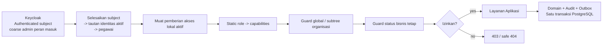
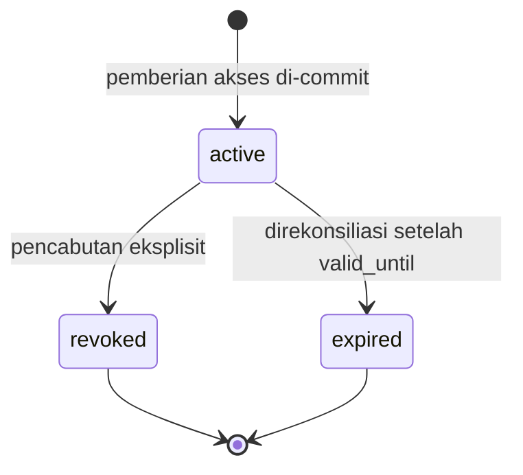
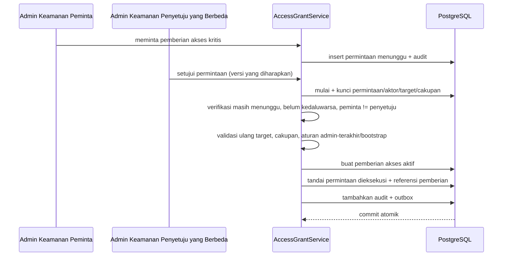

# 19 - IDP Pegawai Kontrak Peran RBAC, Pemberian Akses Bercakupan & Guard Layanan

Status: Draf curah gagasan, **bukan kode implementasi**
Proyek: kumjabar_ecosystem
Tanggal: 2026-08-29
Bergantung pada:

- `18-idp-pegawai-stage-3-access-audit-breakdown.md`
- `17-idp-pegawai-stage-2-review-checklist-open-decisions.md`
- `09-idp-pegawai-stage-1-admin-ui-internal-api-contract.md`
- `04-idp-pegawai-schema-and-access-ui.md`

## 1. Tujuan

Dokumen ini memperinci sisi **pemberian akses** Tahap 3 dengan karakter yang sudah disepakati:

```text
lite
robust
strong
```

Fokusnya terbatas pada:

1. peran RBAC tetap;
2. pemetaan peran-ke-kapabilitas statis;
3. thin local `access_grants`;
4. cakupan `global` atau `org_unit_subtree`;
5. guard layanan tetap;
6. empat-mata terpilih untuk pemberian akses kritis dan import berdampak tinggi;
7. transaksi pemberian/pencabutan/kedaluwarsa;
8. jembatan audit dan outbox.

Dokumen ini tidak membuat generic ABAC engine, policy DSL, peran kustom builder, atau permission platform untuk seluruh aplikasi consumer.

## 2. Prinsip Proporsionalitas

Keputusan senior engineering:

> Untuk Admin IDP yang kecil, RBAC tetap + pemberian akses eksplisit + dua cakupan + guard bisnis berkode tetap sudah cukup. Kompleksitas baru hanya ditambahkan setelah ada kebutuhan nyata yang tidak dapat dipenuhi model ini.

Yang dipertahankan:

- deny-by-default;
- least privilege;
- backend authorization;
- local revocation check;
- tanpa eskalasi mandiri;
- selected separation of duties;
- database constraints;
- dalam-transaksi-yang-sama audit;
- asynchronous Keycloak projection.

Yang tidak dibuat:

- runtime policy authoring;
- arbitrary condition evaluator;
- peran/kapabilitas buatan pengguna;
- ekspresi cakupan bebas;
- generic delegation graph;
- layanan keputusan kebijakan jarak jauh.

## 3. Kontrak yang Diwarisi dari Dokumen 18

| Area | Dasar yang Dikunci |
| --- | --- |
| authorization | simple RBAC tetap |
| peran | viewer, operator import, penyetuju import, admin akses, auditor, admin keamanan |
| cakupan | global atau satu subtree unit organisasi |
| pemberian akses | penugasan lokal eksplisit |
| kelayakan aktor | pegawai aktif + identitas terautentikasi tepercaya |
| aturan bisnis | guard layanan tetap |
| self-escalation | dilarang untuk pemberian berprivilese |
| empat-mata | hanya tindakan berdampak tinggi terpilih |
| audit | hanya-tambah, diminimalkan, aman PII |
| Keycloak | autentikasi/pintu masuk kasar; detail lokal tetap otoritatif |
| sinkronisasi | outbox setelah commit lokal; tanpa panggilan jarak jauh dalam transaksi |

## 4. Arsitektur Akses v1



Tidak ada panggilan jaringan menuju layanan kebijakan. Seluruh keputusan menggunakan konteks terautentikasi, konfigurasi tetap, dan database lokal authoritative.

## 5. Keycloak Entry vs Local Authorization

Tahap 3 membedakan:

```text
Keycloak = siapa aktor dan boleh masuk pintu Admin UI secara kasar
IDP lokal = fungsi apa yang boleh dilakukan dan pada scope mana
```

### 5.1 Peran Client Kasar

Rekomendasi v1 hanya memakai satu peran client kasar:

```text
idp-pegawai-admin:user
```

Peran tersebut:

- mengizinkan login/entry ke Admin UI;
- bukan izin otomatis melihat seluruh pegawai;
- bukan operator/penyetuju import/admin akses;
- tidak menggantikan pemberian akses lokal check.

Draf lama `idp-pegawai-admin:operator` dan `idp-pegawai-admin:admin` dianggap digantikan untuk detail otorisasi. Detail peran disimpan lokal pada `access_grants`.

### 5.2 Aturan Proyeksi

Tahap 4 boleh memproyeksikan peran kasar jika pegawai mempunyai minimal satu pemberian akses lokal efektif. Saat seluruh pemberian efektif berakhir/dicabut, peran kasar dapat dicabut secara asinkron.

Aksi sensitif tetap memeriksa pemberian akses lokal sehingga token lama tidak mempertahankan privilege.

## 6. Katalog Peran v1

| Kode Peran | Tujuan | Cakupan yang Diizinkan |
| --- | --- | --- |
| `viewer` | hanya-baca pegawai dan organisasi | global/subtree |
| `import_operator` | unggah, validasi, koreksi, apply batch yang disetujui | global/subtree |
| `import_approver` | review dan menyetujui import | global/subtree |
| `access_admin` | mengelola pemberian peran nonkritis | global/subtree |
| `auditor` | membaca audit dan ekspor tersamarkan | global/subtree |
| `security_admin` | bootstrap/recovery dan administrasi peran kritis | hanya global |

Tidak ada peran kustom v1. Menambah peran baru memerlukan perubahan kode/konfigurasi, pengujian, dan review arsitektur kecil—bukan input operator.

## 7. Penamaan Kapabilitas

Kapabilitas internal menggunakan kode bernamespace yang stabil:

```text
idp.dashboard.view
idp.org_unit.view
idp.pegawai.view
idp.import.view
idp.import.template.download
idp.import.upload
idp.import.validate
idp.import.error_workbook.download
idp.import.apply_disetujui
idp.import.approve
idp.import.approve_high_impact
idp.access_grant.view
idp.access_grant.create
idp.access_grant.revoke
idp.access_grant.kritis.permintaan
idp.access_grant.kritis.approve
idp.audit.view
idp.audit.export_masked
idp.audit.verify_integrity
idp.security.bootstrap_recover
```

Kapabilitas adalah kontrak internal untuk layanan/UI/pengujian. Operator memilih peran, bukan menyusun kapabilitas satu per satu.

## 8. Matriks Statis Peran-ke-Kapabilitas

| Kapabilitas | viewer | import_operator | import_approver | access_admin | auditor | security_admin |
| --- | :---: | :---: | :---: | :---: | :---: | :---: |
| dashboard view | ✓ | ✓ | ✓ | ✓ | ✓ | ✓ |
| org unit view | ✓ | ✓ | ✓ | ✓ | — | ✓ |
| pegawai view | ✓ | ✓ | ✓ | ✓ | — | ✓ |
| import view | — | ✓ | ✓ | — | — | — |
| template/download/upload/validate | — | ✓ | — | — | — | — |
| error workbook download | — | ✓ | — | — | — | — |
| apply batch yang disetujui | — | ✓ | — | — | — | — |
| approve biasa/berdampak tinggi import | — | — | ✓ | — | — | — |
| lihat/buat/cabut pemberian nonkritis | — | — | — | ✓ | — | ✓ |
| permintaan/persetujuan/pencabutan pemberian kritis | — | — | — | — | — | ✓ |
| audit view/ekspor tersamarkan | — | — | — | — | ✓ | hanya kejadian keamanan |
| audit integrity/pemulihan bootstrap | — | — | — | — | — | ✓ |

Catatan:

- `security_admin` tidak otomatis mendapat import kapabilitas operator/penyetuju;
- `auditor` tidak otomatis mendapat detail pegawai lengkap; audit menampilkan masked references;
- peran dapat ditumpuk melalui beberapa pemberian akses bila seseorang memang mempunyai beberapa fungsi;
- mapping aktual disimpan dalam code/config versioned dan diuji sebagai fixture contract.

## 9. Gabungan Kapabilitas tanpa Pencucian Cakupan

Beberapa pemberian akses menghasilkan gabungan kapabilitas, tetapi cakupan tetap melekat pada pemberian akses yang memberikan capability tersebut.

Contoh:

```text
viewer(global)
+ access_admin(org_unit_subtree=TUM)
```

Hasil:

```text
pegawai.view             = global
access_grant.create      = TUM hanya subtree
access_grant.revoke      = TUM hanya subtree
```

Cakupan viewer global tidak boleh “dipinjam” untuk memperluas `access_admin` menjadi global.

Evaluasi kapabilitas harus mencari pemberian akses yang benar-benar memetakan ke kapabilitas itu, lalu menghitung gabungan cakupan hanya dari pemberian tersebut.

## 10. Model Cakupan v1

```text
global
org_unit_subtree
```

### 10.1 Global

Kapabilitas berlaku ke seluruh bounded context IDP sejauh guard bisnis action terpenuhi.

### 10.2 Org Unit Subtree

Kapabilitas berlaku pada:

```text
scope root unit
+ seluruh descendant berdasarkan otoritatif saat ini org hierarchy
```

Cakupan tidak ditentukan dari string/unit code permintaan tanpa lookup database.

### 10.3 Tidak Didukung

```text
specific-org-unit arrays
arbitrary allow/deny lists
owned-resource scope
attribute tags
policy expression
scope composition DSL
```

## 11. Evaluasi Hierarki

Repository menyediakan operasi domain yang jelas:

```text
is_same_or_descendant(candidate_org_unit_id, scope_root_org_unit_id)
```

Implementasi direkomendasikan memakai CTE rekursif terhadap `org_units.parent_id` karena jumlah unit kecil dan ketepatan lebih penting daripada membuat tabel closure baru.

Guardrails:

- unit harus authoritative dan belum soft-deleted;
- path/string prefix tidak boleh digunakan secara naif;
- akar cakupan nonaktif membuat pemberian akses tidak dapat dipakai untuk mutasi baru sampai direview;
- audit menyimpan snapshot UUID/kode cakupan untuk kemudahan penjelasan;
- perubahan hierarki memengaruhi cakupan runtime pada permintaan berikutnya.

## 12. Penyelesai Cakupan Resource

Layanan tidak menerima `scope_org_unit_id` dari frontend sebagai kebenaran. Cakupan target diselesaikan dari resource otoritatif.

| Resource | Jejak Cakupan |
| --- | --- |
| aktif pegawai | unit organisasi utama saat ini |
| inaktif pegawai | unit organisasi utama terakhir diketahui jika ada |
| pegawai tanpa unit | hanya aktor global |
| org unit | unit itu sendiri |
| pemberian akses subtree | unit cakupan diminta/diberikan + unit subject saat ini |
| pemberian akses global | aktor hanya global |
| import batch | gabungan cakupan unit lama/saat ini dan tujuan kandidat seluruh baris |
| import artifact | mengikuti otorisasid batch footprint |
| kejadian audit | snapshot cakupan kejadian; null/global hanya global auditor |

Satu resource dapat membutuhkan lebih dari satu unit check, misalnya perpindahan pegawai dari unit lama ke unit baru.

## 13. Guard Cakupan Batch Import

Tahap 2 tetap atomik per batch. Karena itu operator/penyetuju/penerap bercakupan hanya boleh memproses batch jika **seluruh jejak cakupan** batch berada dalam cakupan pemberiannya.

Footprint minimal mencakup:

- unit saat ini untuk target pembaruan/tanpa perubahan;
- unit tujuan untuk create/move/reactivation;
- old dan new unit pada perpindahan;
- last-known unit untuk lifecycle inaktif bila relevan;
- seluruh rows, bukan hanya preview page.

Aturan:

- satu row di luar cakupan membuat batch tidak eligible bagi aktor tersebut;
- tidak ada otorisasi sebagian/apply sebagian;
- response tidak boleh membocorkan apakah NIP di luar cakupan ada di database;
- gunakan diagnostik aman seperti `row_not_permitted_or_unavailable` tanpa detail target;
- apply mengulang pemeriksaan cakupan dari status otoritatif yang dikunci, tidak percaya dry-run.

## 14. Resolusi Aktor

Alur Admin UI manusia:

```text
Keycloak subject
-> aktif tautan identitas tepercaya / keycloak mapping
-> pegawai
-> pegawai aktif/eligible
-> pemberian akses efektif
```

Persyaratan:

- subject berasal dari konteks terautentikasi yang ditandatangani;
- issuer/audience/client yang diharapkan diverifikasi;
- tepat satu aktif trusted mapping ke pegawai;
- pegawai harus aktif untuk berprivilese access;
- pemetaan hilang/ambigu = deny;
- email tidak menjadi fallback authorization;
- body permintaan tidak boleh memilih aktor sendiri.

`access_grants` diberikan kepada pegawai, sehingga akses mengikuti identitas orang. Audit tetap menyimpan immutable subject yang benar-benar melakukan permintaan.

## 15. Batas Akun Layanan

Akun layanan tidak memakai peran Admin UI manusia di `access_grants` v1.

Otorisasi akun layanan tetap kecil dan statis melalui Keycloak cakupan client/layanan, misalnya:

```text
idp-pegawai-internal:read
idp-pegawai-sync:consume-outbox
```

Aturan:

- tidak boleh login ke Admin UI browser;
- tidak menjadi pegawai palsu;
- cakupan endpoint tetap per client;
- kredensial berada di secret manager/Keycloak;
- operasi sensitif dan penolakan tetap diaudit sebagai `actor_type=service_account`;
- jika kelak akun layanan memerlukan pemberian akses lokal dinamis, itu menjadi review terpisah.

## 16. Fungsi `access_grants`

Satu baris `access_grants` berarti:

> Pegawai tertentu mempunyai satu peran tetap dalam cakupan global atau satu org-unit subtree selama pemberian tersebut efektif.

Tabel ini bukan:

- katalog peran;
- katalog kapabilitas;
- mesin kebijakan;
- mesin alur persetujuan;
- cache token Keycloak;
- histori audit pengganti `audit_logs`.

Baris pemberian akses dapat berubah hanya untuk transisi status/versi terkendali; seluruh perubahan penting mempunyai hanya-tambah kejadian audit.

## 17. `access_grants` Kontrak Kolom

| Kolom | Tipe Konseptual | Wajib | Catatan |
| --- | --- | :---: | --- |
| `id` | bigint PK | ✓ | internal |
| `uuid` | uuid unique | ✓ | ID publik buatan PostgreSQL |
| `pegawai_id` | FK `pegawai.id` | ✓ | orang target |
| `role_code` | varchar/check | ✓ | enam peran tetap |
| `scope_type` | varchar/check | ✓ | global/subtree |
| `scope_org_unit_id` | FK nullable | kondisional | wajib untuk subtree |
| `status` | varchar/check | ✓ | active/revoked/expired |
| `valid_from` | timestamptz | ✓ | awal berlaku |
| `valid_until` | timestamptz nullable | opsional/kondisional | wajib untuk peran kritis |
| `reason` | text | ✓ | alasan bisnis tidak kosong |
| `granted_by_subject` | varchar | ✓ | subject aktor immutable |
| `granted_by_pegawai_id` | FK nullable | opsional | referensi bantuan |
| `granted_at` | timestamptz | ✓ | waktu commit pemberian |
| `revoked_by_subject` | varchar nullable | kondisional | provenance pencabutan |
| `revoked_by_pegawai_id` | FK nullable | opsional | referensi bantuan |
| `revoked_at` | timestamptz nullable | kondisional | waktu pencabutan |
| `revocation_reason` | text nullable | kondisional | wajib saat dicabut |
| `idempotency_key` | varchar | ✓ | identitas permintaan pembuatan langsung |
| `intent_hash` | char(64) | ✓ | mendeteksi pemakaian ulang kunci dengan niat berbeda |
| `source_version` | bigint | ✓ | create=1; bertambah saat mutasi status |
| `lock_version` | integer | ✓ | konkruensi perintah optimistis |
| `created_at` | timestamptz | ✓ | timestamp teknis |
| `updated_at` | timestamptz | ✓ | timestamp teknis |

Tidak ada `deleted_at`; operasi normal tidak menghapus permanen pemberian akses.

## 18. Constraint Pemeriksaan

Constraint konseptual:

```text
role_code in (
  viewer,
  import_operator,
  import_approver,
  access_admin,
  auditor,
  security_admin
)

scope_type in (global, org_unit_subtree)

scope_type = global
  => scope_org_unit_id is null

scope_type = org_unit_subtree
  => scope_org_unit_id is not null

status in (active, revoked, expired)

valid_until is null or valid_until > valid_from

status = revoked
  => revoked_at, revoked_by_subject, revocation_reason tidak null

status != revoked
  => revoked_at and revoked_by_subject are null

source_version >= 1
lock_version >= 0
trim(reason) <> ''
```

Aturan Layanan + DB:

```text
security_admin scope must be global
access_admin/security_admin valid_until must be non-null
```

Jika aturan lintas tabel tidak cocok sebagai DB `CHECK`, validasi layanan dan pengujian integrasi PostgreSQL wajib membuktikannya.

## 19. Indeks Unik dan Indeks Pencarian

### 19.1 Keunikan Pemberian Akses Aktif Persis

Global:

```text
unique(pegawai_id, role_code)
where status = 'active' and scope_type = 'global'
```

Subtree:

```text
unique(pegawai_id, role_code, scope_org_unit_id)
where status = 'active' and scope_type = 'org_unit_subtree'
```

Duplikat persis tidak diizinkan. Dua pemberian berbeda dengan cakupan tumpang tindih dapat ada bila memang berasal dari penugasan berbeda, tetapi mencabut satu pemberian tidak menghapus hak pemberian lain.

### 19.2 Idempotensi

```text
unique(granted_by_subject, idempotency_key)
```

Key yang sama dengan `intent_hash` berbeda ditolak sebagai konflik idempotensi.

### 19.3 Indeks Kueri

```text
index(pegawai_id, status)
index(role_code, status)
index(scope_org_unit_id, status)
index(valid_until) where status = 'active'
index(updated_at)
```

Tidak ada indeks GIN JSONB luas karena tabel tidak membutuhkan JSON kebijakan.

## 20. Kontrak Pemberian Akses Efektif

Pemberian akses efektif jika:

```text
status = active
AND current_time >= valid_from
AND (valid_until is null OR current_time < valid_until)
AND target pegawai is aktif/eligible
AND target identity mapping remains trusted/unambiguous
AND role/scope tetap guard remains valid
```

Pemeriksaan runtime tidak menunggu rekonsiliator kedaluwarsa.

Akar cakupan organisasi nonaktif membuat pemberian subtree tidak efektif untuk mutasi. Perilaku baca/audit dapat menampilkan pemberian sebagai `needs_review`, tetapi tidak memperluas akses.

## 21. Siklus Hidup dan Pemberian Versi



Aturan versi:

```text
create  -> source_version = 1, lock_version = 0
revoke  -> source_version + 1, lock_version + 1
expire  -> source_version + 1, lock_version + 1
noop/retry observation -> versions unchanged
```

Baris kedaluwarsa/dicabut bersifat terminal. Perpanjangan membuat pemberian baru agar provenance mudah dipahami.

## 22. Matriks Statis Administrasi Pemberian Akses

| Peran Pemberi | Boleh Memberi Langsung | Boleh Mencabut | Aturan Cakupan |
| --- | --- | --- | --- |
| `access_admin` | viewer, import_operator, import_approver, auditor | peran yang sama | cakupan yang diminta berada dalam pemberi akses cakupan access_admin |
| `security_admin` | peran biasa untuk pemulihan; peran kritis melalui permintaan/persetujuan | semua peran | admin keamanan bersifat global; tanpa pemberian ke diri sendiri |
| peran lain | tidak ada | melepas akses sendiri hanya jika aman | tanpa kewenangan administratif |

Aturan tambahan:

- pemberi tidak boleh memberi akses kepada diri sendiri;
- `access_admin` bercakupan target pegawai harus berada dalam cakupan pemberi akses;
- akar subtree yang diminta harus berada dalam cakupan pemberi akses;
- pemberian global membutuhkan kewenangan administrasi global;
- `access_admin` tidak boleh membuat/mencabut `access_admin` atau `security_admin`;
- pencabutan yang efektif terakhir `security_admin` diblokir kecuali kesiapan pemulihan terkendali terbukti.

## 23. Transaksi Pemberian Akses Langsung

Alur langsung hanya untuk peran nonkritis.

```mermaid
sequenceDiagram
    participant UI as Admin UI
    participant S as AccessGrantService
    participant DB as PostgreSQL

    UI->>S: buat pemberian akses + kunci idempotensi
    S->>DB: begin
    S->>DB: kunci pemberi + pegawai target + unit cakupan
    S->>S: otorisasi ulang peran, cakupan, kelayakan, tanpa pemberian ke diri sendiri
    S->>DB: periksa idempotensi + duplikat aktif persis
    S->>DB: insert access_grant(version=1)
    S->>DB: insert kejadian audit
    S->>DB: insert outbox perubahan-hak
    DB-->>S: commit
    S-->>UI: akses aktif secara lokal; pembaruan Keycloak menunggu
```

Tidak ada panggilan Keycloak jarak jauh dalam transaksi.

## 24. `access_grant_requests` untuk Peran Kritis

Empat-mata terpilih membutuhkan niat menunggu yang persisten kecil. Tabel ini hanya dipakai untuk:

```text
access_admin
security_admin
```

Kolom minimum:

| Kolom | Kontrak |
| --- | --- |
| `id`, `uuid` | identitas internal/publik |
| `target_pegawai_id` | penerima |
| `role_code` | hanya access_admin/security_admin |
| `scope_type`, `scope_org_unit_id` | cakupan yang diminta |
| `valid_from`, `valid_until` | masa berlaku yang diminta |
| `reason` | wajib |
| `status` | menunggu/dieksekusi/ditolak/dibatalkan/kedaluwarsa |
| `requested_by_subject`, `requested_by_pegawai_id` | peminta |
| `requested_at` | timestamp |
| `expires_at` | jendela persetujuan |
| `decided_by_subject`, `decided_by_pegawai_id` | penyetuju/penolak nullable |
| `decided_at` | nullable timestamp |
| `rejection_reason` | wajib saat ditolak |
| `access_grant_id` | diisi saat dieksekusi |
| `idempotency_key`, `intent_hash` | guard percobaan ulang/perubahan |
| `lock_version` | konkruensi optimistis |
| timestamp | created/updated |

Bukan mesin persetujuan generik. Ia tidak dipakai untuk import approval atau alur kerja consumer lain.

## 25. Alur Persetujuan Pemberian Akses Kritis



Tidak ada status antara `approved` yang persisten. Persetujuan dan pembuatan akses terjadi secara atomik, menghasilkan `executed`.

Aturan:

- subject peminta dan penyetuju harus berbeda;
- kedaluwarsa permintaan persetujuan dapat dikonfigurasi; default awal yang direkomendasikan 24 jam;
- perubahan niat memerlukan permintaan baru;
- pemberian peran kritis wajib memiliki `valid_until`;
- admin keamanan pertama memakai prosedur bootstrap, bukan persetujuan diri palsu.

## 26. Batas Empat-Mata Import

Pemisahan import berdampak tinggi tetap dimiliki oleh Tahap 2 catatan approval/apply, bukan `access_grant_requests`.

Aturan:

- `import_approver` menyetujui rencana;
- `import_operator` menerapkan batch yang disetujui;
- untuk rencana berdampak tinggi, penyetuju subject harus berbeda dari peminta/operator sesuai kontrak Tahap 2;
- batch biasa dapat mengizinkan satu pegawai memegang kedua peran jika tata kelola mengizinkannya;
- apply mengulang pemeriksaan peran lokal, cakupan, fingerprint, freshness, dan pemisahan aktor;
- pemberian peran `import_approver` sendiri merupakan pemberian nonkritis yang dikelola admin akses.

## 27. Kontrak Pencabutan

Pencabutan mengutamakan pembatasan dampak dan tidak memerlukan persetujuan kedua.

Transaksi:

1. autentikasi dan otorisasi pencabut;
2. kunci baris pemberian akses dan `lock_version` yang diharapkan;
3. evaluasi ulang matriks/cakupan pemberi akses;
4. cegah yang tidak aman penghapusan admin keamanan terakhir;
5. jika sudah dicabut, kembalikan hasil terminal saat ini tanpa audit/outbox duplikat;
6. isi field pencabutan;
7. naikkan versi sumber/penguncian;
8. tambahkan audit;
9. tambahkan outbox;
10. commit.

Pelepasan akses sendiri boleh untuk peran nonkritis. Pencabutan mandiri peran kritis/admin terakhir mengikuti guard pemulihan.

Otorisasi lokal mencerminkan pencabutan langsung pada permintaan berikutnya, tanpa bergantung pada status token Keycloak.

## 28. Rekonsiliator Kedaluwarsa

Otorisasi runtime sudah menganggap waktu `valid_until` sebagai tidak efektif.

Rekonsiliator hanya ada untuk membuat status tersimpan dan proyeksi downstream menjadi eksplisit:

```text
select active grants with valid_until <= now
-> lock deterministically
-> mark expired
-> increment versions
-> append one kejadian audit
-> append one outbox event
-> commit
```

Sifat:

- idempotent;
- aman dicoba ulang;
- ukuran batch terbatas;
- tanpa panggilan jarak jauh;
- duplikat audit/outbox dicegah oleh keunikan UUID agregat + versi sumber.

## 29. Idempotensi dan Konkruensi

Lapisan ketepatan:

1. pemanggil `Idempotency-Key`;
2. aktor + kunci unik;
3. perbandingan hash niat kanonis;
4. penguncian baris pada pemberi akses/target/permintaan/grant sesuai kebutuhan;
5. indeks unik parsial untuk pemberian aktif persis;
6. `lock_version` yang diharapkan untuk persetujuan/pencabutan;
7. dalam-transaksi-yang-sama audit/outbox;
8. urutan penguncian deterministik.

Pemakaian ulang kunci dengan niat berbeda menghasilkan `idempotency_conflict`.

Percobaan ulang respons ambigu dengan kunci sama mengembalikan hasil pemberian/permintaan yang ada. Percobaan itu tidak boleh membuat pemberian atau kejadian audit kedua.

## 30. `source_version` dan Outbox

Setiap pemberian akses adalah agregat:

```text
agregat_type = access_grant
agregat_uuid = grant UUID
source_version = versi pemberian monotonik
```

Keluarga kejadian outbox:

```text
access_grant.created
access_grant.revoked
access_grant.expired
```

Payload minimum:

```text
grant_uuid
pegawai_uuid
role_code
status
scope_type
scope_org_unit_uuid (nullable)
source_version
kode_alasan_perubahan
```

Secara default, tanpa NIP, nama lengkap, email, teks alasan pemberian akses, atau payload audit.

Tahap 4 mengonsumsi kejadian setidaknya-sekali, lalu menghitung ulang apakah pegawai masih memiliki pemberian akses lokal efektif sebelum menambah/menghapus peran kasar Keycloak. Satu pemberian yang dicabut tidak boleh menghapus peran masuk jika pemberian efektif lain masih ada.

## 31. Kontrak `AccessGuardService`

Pertahankan layanan kecil dan eksplisit:

```text
get_current_actor()
get_effective_capabilities(actor)
require_capability(actor, capability)
require_org_scope(actor, capability, org_unit_ids)
require_import_batch_scope(actor, capability, batch)
require_can_administer_grant(actor, target, role, scope)
require_distinct_actor(first_subject, second_subject)
```

Tidak ada:

```text
evaluate_policy(expression)
evaluate_conditions(json)
register_dynamic_rule(...)
remote PDP call
```

Metode guard khusus boleh memanggil repository tetapi tidak memutasi data domain.

## 32. Penegakan di Rute dan Layanan

Otorisasi dilakukan dua lapis:

### Lapisan Rute/UI

- memerlukan client Admin terautentikasi;
- menyembunyikan/menonaktifkan affordance berdasarkan flag backend;
- menolak kapabilitas yang jelas tidak ada;
- tidak pernah memercayai aktor/cakupan/peran kiriman di luar allowlist.

### Lapisan Layanan Aplikasi

- otorisasi otoritatif;
- memuat ulang aktor/pemberian/target;
- memeriksa status bisnis dan cakupan;
- menjalankan transaksi mutasi/audit/outbox;
- tetap aman bila endpoint dipanggil langsung.

Repository tidak mengambil keputusan peran; repository hanya kueri/kunci/simpan.

## 33. Semantik Tanpa Kebocoran Keberadaan

Perilaku respons yang direkomendasikan:

```text
belum terautentikasi                         -> 401
kapabilitas umum tidak ada                -> 403
kapabilitas ada tetapi resource tidak ditemukan     -> 404
kapabilitas ada tetapi resource di luar cakupan  -> bentuk 404 yang sama
versi yang diharapkan sudah stale                    -> 409
status/invarian tidak valid                   -> 422 atau kode konflik domain
```

Kueri daftar/pencarian memfilter cakupan di sisi server. Admin akses bercakupan tidak dapat mencari atau melakukan pelengkapan otomatis pegawai di luar cakupan.

Diagnostik import tidak membedakan NIP yang tidak ada dari NIP yang ada tetapi tidak dapat diakses apabila pembedaan itu membocorkan data identitas.

## 34. Flag Kapabilitas UI

Contoh model tampilan:

```json
{
  "can_view_pegawai": true,
  "can_upload_import": true,
  "can_approve_import": false,
  "can_apply_import": true,
  "can_manage_access": false,
  "can_view_audit": false,
  "effective_scope": {
    "type": "org_unit_subtree",
    "org_unit_uuid": "...",
    "org_unit_code": "TUM"
  }
}
```

Flag adalah kontrak UI sebagai petunjuk. Setiap mutasi tetap memeriksa ulang pemberian akses di database.

Tidak ada cache izin Redis pada v1. Pemberian efektif hanya boleh di-cache dalam satu permintaan. Ini menjaga semantik pencabutan tetap sederhana dan menghindari privilese stale.

## 35. Bootstrap dan Pemulihan

`security_admin` pertama tidak dapat dibuat melalui alur pemberian biasa.

Prosedur bootstrap:

1. secure deployment config contains explicit Keycloak subject/pegawai UUID;
2. perintah bootstrap memverifikasi identitas tepercaya target yang aktif;
3. membuat pemberian `security_admin` global berbatas waktu;
4. menulis audit kritis dan outbox secara atomik;
5. allowlist konfigurasi dinonaktifkan/dihapus setelah admin yang dikelola tersedia;
6. setiap pemberian kritis berikutnya menggunakan dua aktor.

Pemulihan mengikuti jalur operasional terkendali yang sama dengan alasan insiden/tiket. Tidak ada seed database tersembunyi berdasarkan unit/jabatan.

## 36. Jembatan Audit

Operasi pemberian akses menghasilkan kejadian hanya-tambah:

```text
access_grant.requested
access_grant.request_rejected
access_grant.created
access_grant.revoked
access_grant.expired
security.authorization.denied
security.bootstrap_recovery_used
```

Provenance audit minimum:

- subject aktor dan UUID pegawai opsional;
- target pegawai UUID;
- UUID pemberian/permintaan;
- kode peran;
- tipe cakupan + UUID/kode unit aman;
- kode tindakan/hasil/alasan;
- versi sumber;
- ID permintaan/korelasi;
- field yang berubah;
- hash sebelum/sesudah.

`reason` dari manusia boleh disimpan pada pemberian/permintaan, sedangkan audit menyimpan ringkasan terbatas/tersamarkan atau hash/referensi untuk menghindari duplikasi yang tidak perlu.

## 37. Aturan Privasi

UI akses dan audit dapat mengekspos data otorisasi sensitif.

Aturan:

- daftar menampilkan nama, NIP tersamarkan, peran, cakupan, status, masa berlaku;
- subject aktor disembunyikan dari admin akses biasa kecuali diperlukan;
- detail audit lengkap memerlukan kapabilitas auditor/keamanan;
- tanpa token, secret, payload penyedia identitas, atau baris import lengkap;
- ekspor disamarkan secara default dan diaudit;
- header respons memakai `Cache-Control: no-store` pada halaman/unduhan sensitif;
- log menggunakan UUID/ID permintaan, bukan NIP/email lengkap.

## 38. Pratinjau API

Rute konseptual:

```text
GET  /admin/access-grants
POST /admin/access-grants
GET  /admin/access-grants/{grant_uuid}
POST /admin/access-grants/{grant_uuid}/revoke

GET  /admin/access-grant-requests
POST /admin/access-grant-requests
GET  /admin/access-grant-requests/{request_uuid}
POST /admin/access-grant-requests/{request_uuid}/approve
POST /admin/access-grant-requests/{request_uuid}/reject
POST /admin/access-grant-requests/{request_uuid}/cancel
```

Permintaan menggunakan rute UUID dan versi yang diharapkan. Identitas aktor/penyetuju tidak pernah diterima dari body.

## 39. Kode Kesalahan

```text
access_denied
actor_identity_unresolved
actor_not_eligible
capability_missing
resource_not_found
resource_not_permitted_or_unavailable
grant_not_effective
grant_already_exists
grant_idempotency_conflict
grant_scope_invalid
grant_scope_exceeds_authority
grant_role_not_delegable
critical_grant_requires_request
self_grant_forbidden
second_actor_required
grant_request_expired
grant_request_not_pending
grant_stale
last_security_admin_protected
```

Pesan operator tetap memakai Bahasa Indonesia sederhana dan tidak boleh mengungkap keberadaan target tersembunyi.

## 40. Penutupan Ancaman dan Pengendalian

| Ancaman | Pengendalian |
| --- | --- |
| Peran Keycloak dianggap sebagai kewenangan penuh | pemberian lokal wajib untuk akses data/tindakan |
| unit/jabatan otomatis menjadi admin | hanya pemberian eksplisit |
| eskalasi privilese mandiri | tanpa pemberian ke diri sendiri + matriks administrasi statis |
| pencucian cakupan global | cakupan pemberian khusus kapabilitas |
| ID unit palsu | penyelesai resource otoritatif |
| privilese browser/token stale | pemeriksaan ulang DB pada setiap permintaan sensitif |
| duplikat pemberian akibat klik ganda | idempotensi + indeks unik |
| niat persetujuan berubah | hash niat kanonis + permintaan menunggu immutable |
| pemberian kritis oleh satu orang | peminta/penyetuju berbeda |
| pencabutan tertunda oleh Keycloak | pencabutan lokal langsung + proyeksi asinkron |
| terkunci keluar karena admin terakhir | guard perlindungan admin-keamanan-terakhir + pemulihan bootstrap |
| akun layanan memperoleh peran UI | otorisasi layanan tetap yang terpisah |
| perluasan tak terkendali platform otorisasi | peran/cakupan/guard tetap; tanpa DSL/mesin ABAC |

## 41. Matriks Pengujian

### 41.1 Peran dan Kapabilitas

- hanya katalog peran tetap;
- pemetaan peran cocok dengan fixture kapabilitas yang diharapkan;
- admin keamanan tidak mewarisi peran import;
- auditor tidak mendapat tampilan pegawai lengkap;
- beberapa peran menggabungkan kapabilitas;
- viewer global tidak melebarkan cakupan admin-akses subtree.

### 41.2 Aktor dan Cakupan

- subject tidak dikenal/ambigu ditolak;
- pegawai nonaktif ditolak;
- email tidak dapat dipakai untuk resolusi otorisasi;
- unit yang sama dan turunannya lolos;
- unit sejajar/di luar subtree ditolak;
- akar cakupan nonaktif memblokir mutasi;
- pegawai tanpa unit membutuhkan aktor global;
- resource di luar cakupan mengembalikan respons aman.

### 41.3 Persistensi Pemberian Akses

- pemeriksaan field cakupan global/subtree;
- pemeriksaan peran/status tetap;
- kewajiban valid-until untuk peran kritis;
- duplikat aktif persis diblokir;
- pemutaran ulang kunci idempotensi mengembalikan hasil yang sama;
- pemakaian ulang kunci dengan niat berbeda ditolak;
- pencabutan/kedaluwarsa menaikkan versi;
- pemberian terminal tidak dapat diaktifkan kembali; perpanjangan membuat pemberian baru.

### 41.4 Administrasi dan Pemisahan Tugas

- admin akses hanya memberi peran biasa;
- cakupan diminta tidak boleh melebihi cakupan pemberi;
- subject target harus berada dalam cakupan pemberi;
- pemberian ke diri sendiri ditolak;
- pemberian kritis langsung ditolak;
- permintaan kritis membutuhkan penyetuju berbeda;
- permintaan kedaluwarsa/stale ditolak;
- bootstrap awal membuat pemberian berbatas dan diaudit;
- perlindungan admin keamanan terakhir.

### 41.5 Integrasi Import

- batch bercakupan mewajibkan seluruh baris dalam cakupan;
- unit lama dan baru diperiksa saat perpindahan;
- target di luar cakupan tidak membocorkan keberadaan;
- pemisahan peminta/penyetuju berdampak tinggi;
- apply memeriksa ulang pemberian lokal saat ini dan jejak cakupan terkunci;
- operator yang dicabut tidak dapat apply memakai status UI stale.

### 41.6 Transaksi dan Konkruensi

- pemberian + audit + outbox di-commit bersama;
- kegagalan audit/outbox me-rollback pemberian;
- pembuatan duplikat konkuren menghasilkan satu pemberian;
- persetujuan konkuren menghasilkan satu permintaan/pemberian dieksekusi;
- pencabutan vs kedaluwarsa deterministik dalam penguncian baris;
- percobaan ulang HTTP ambigu tidak menduplikasi audit/outbox.

### 41.7 Proyeksi Keycloak

- pembuatan akses menerbitkan kejadian minimal;
- mencabut satu dari beberapa pemberian tetap mempertahankan peran kasar efektif;
- mencabut pemberian efektif terakhir menjadwalkan penghapusan peran kasar;
- penolakan lokal terjadi sebelum proyeksi selesai;
- tidak ada panggilan Keycloak jarak jauh dalam transaksi lokal.

Indeks parsial, penguncian baris, dan perilaku transaksi khusus PostgreSQL wajib diuji pada PostgreSQL, bukan hanya SQLite.

## 42. Keputusan Final yang Dikunci

1. Satu peran masuk kasar Keycloak `idp-pegawai-admin:user`; pemberian akses lokal tetap menjadi kewenangan rinci.
2. Setiap kapabilitas mutasi/operasional Admin UI manusia memerlukan pemberian akses lokal efektif atau konteks bootstrap terkendali; pembacaan dasar mengikuti pengecualian `viewer` pada Keputusan 6.
3. Enam peran lokal tetap digunakan; tanpa pembangun peran kustom pada v1.
4. Pemetaan peran-ke-kapabilitas berupa kode/konfigurasi statis berversi.
5. `security_admin` tidak otomatis mewarisi kapabilitas operasional import.
6. Kapabilitas beberapa peran boleh bergabung, tetapi cakupan tidak pernah tercuci lintas pemberian peran yang tidak terkait.
7. Hanya cakupan global dan subtree unit organisasi yang tersedia pada v1.
8. Hierarki otoritatif saat ini menentukan keanggotaan subtree.
9. Penyelesai cakupan memakai status domain sisi server; nilai cakupan frontend tidak otoritatif.
10. Import bercakupan mewajibkan seluruh jejak batch berada dalam cakupan.
11. Pemberian untuk manusia menargetkan `pegawai`; akun layanan memakai otorisasi client tetap yang terpisah.
12. `access_grants` bersifat tipis dan tidak memiliki kondisi bebas/JSON kebijakan.
13. Baris pemberian membawa hash niat idempotensi, versi sumber, dan versi penguncian optimistis.
14. Pemberian aktif yang ekuivalen persis dicegah oleh indeks unik parsial.
15. Otorisasi efektif memeriksa waktu dan kelayakan aktor pada setiap permintaan, bukan hanya status rekonsiliator.
16. Perpanjangan membuat pemberian baru; pemberian yang dicabut/kedaluwarsa tetap terminal.
17. Admin akses hanya mengelola peran biasa dalam cakupan kewenangannya.
18. Pemberian access-admin/security-admin memerlukan permintaan kritis persisten dan penyetuju berbeda.
19. Pemberian kritis langsung kepada diri sendiri dilarang; bootstrap bersifat eksplisit dan sementara.
20. Pencabutan tidak menunggu persetujuan kedua dan langsung berlaku lokal.
21. Penghapusan admin keamanan efektif terakhir dilindungi guard pemulihan.
22. Pemisahan import berdampak tinggi tetap pada catatan Tahap 2, bukan tabel permintaan pemberian akses.
23. Pemberian/audit/outbox di-commit secara atomik; tidak ada panggilan Keycloak jarak jauh di dalam transaksi.
24. Tahap 4 hanya memproyeksikan pintu masuk kasar Admin UI; peran/cakupan rinci tetap lokal.
25. Tidak ada cache otorisasi Redis pada v1; hanya cache per permintaan.
26. Pencarian resource tanpa izin mengikuti semantik tanpa kebocoran keberadaan.
27. ABAC/kebijakan dinamis di masa depan memerlukan kasus nyata yang belum terpenuhi dan review arsitektur baru.

## 43. Resolusi Final Delapan Keputusan

Delapan pertanyaan arsitektur Dokumen 19 telah diselesaikan dan tidak lagi berstatus terbuka.

| Nomor | Keputusan Final | Kontrak yang Dikunci |
| --- | --- | --- |
| 1 | Durasi maksimum pemberian kritis adalah **365 hari** | `valid_until` wajib untuk `access_admin` dan `security_admin`; service menolak rentang di atas 365 hari. |
| 2 | Empat-mata import wajib **hanya untuk batch berdampak tinggi** | Import biasa boleh dijalankan satu operator berwenang; batch berdampak tinggi wajib membedakan penyetuju dan operator. |
| 3 | TTL `access_grant_requests` adalah **24 jam** | `expires_at = requested_at + 24 jam`; guard runtime memperlakukan permintaan lewat waktu sebagai kedaluwarsa tanpa menunggu rekonsiliator. |
| 4 | Auditor boleh memakai `org_unit_subtree` | Auditor subtree hanya melihat kejadian yang seluruh jejak cakupannya berada di dalam subtree; kejadian global/tanpa cakupan hanya terlihat auditor global. |
| 5 | `access_admin` boleh memberikan peran `auditor` | Target dan cakupan auditor tidak boleh melebihi cakupan pemberian `access_admin` milik pemberi. |
| 6 | Pintu masuk Keycloak hanya proyeksi kasar; pembacaan selalu memerlukan `viewer` lokal | `viewer(global)` memberi kapabilitas baca global dan `viewer(org_unit_subtree)` memberi baca subtree. Keputusan ini diamendemen dan dikunci Dokumen 23–24 agar pencabutan lokal langsung konsisten. |
| 7 | Pencabutan peran kasar Keycloak bersifat asinkron | Penolakan lokal berlaku pada permintaan HTTP berikutnya; proyeksi Keycloak diproses melalui outbox Tahap 4. |
| 8 | Pemberian dinamis akun layanan dilarang pada v1 | Akun layanan memakai Keycloak Client Scopes statis seperti `idp-pegawai-internal:read`, bukan `access_grants` manusia. |

### 43.1 Aturan Khusus Pembacaan Dasar dan `viewer`

Keputusan nomor 6 merupakan pengecualian eksplisit terhadap aturan umum bahwa seluruh kapabilitas manusia memerlukan pemberian lokal:

```text
viewer(global)
-> kapabilitas baca dasar berlaku global

viewer(org_unit_subtree=X)
-> kapabilitas baca dasar berlaku pada subtree X

tanpa viewer efektif
-> tidak ada kapabilitas baca dasar
```

Guard wajib memakai scope `viewer` yang efektif dan mencegah pencucian cakupan. Peran operasional tetap memberi capability-nya sendiri, bukan pembacaan dasar implisit. Coarse role Keycloak tidak menjadi authority baca.

### 43.2 Parameter Waktu yang Dikunci

```text
MAX_CRITICAL_GRANT_DURATION = 365 hari
CRITICAL_GRANT_REQUEST_TTL  = 24 jam
```

Perhitungan memakai waktu database dan interval half-open `[valid_from, valid_until)`. Nilai tersebut merupakan kontrak v1, bukan sekadar default konfigurasi.

## 44. Daftar Periksa Penerimaan Dokumen 19

### Ringan

- [x] Satu peran masuk Keycloak kasar dan pembacaan berbasis `viewer` lokal disetujui.
- [x] Enam peran lokal tetap disetujui.
- [x] Pemetaan kapabilitas statis disetujui.
- [x] Model dua cakupan disetujui.
- [x] Tanpa mesin kebijakan/DSL/peran dinamis disetujui.
- [x] Akun layanan tetap terpisah dari pemberian untuk manusia.

### Tangguh

- [x] Kolom/constraint/indeks `access_grants` disetujui.
- [x] Idempotensi dan pemberian versi optimistis disetujui.
- [x] Keunikan pemberian aktif persis disetujui.
- [x] Pemberian efektif dan siklus terminal disetujui.
- [x] Transaksi pemberian/pencabutan/kedaluwarsa disetujui.
- [x] Pengurutan versi sumber/outbox disetujui.

### Kuat

- [x] Tolak-secara-default/pemeriksaan ulang lokal disetujui.
- [x] Tanpa pencucian cakupan disetujui.
- [x] Matriks administrasi pemberian statis disetujui.
- [x] Tanpa pemberian ke diri sendiri dan alur kritis dua orang disetujui.
- [x] Perlindungan admin-terakhir/bootstrap disetujui.
- [x] Perilaku tanpa kebocoran keberadaan disetujui.
- [x] Audit/outbox dalam transaksi yang sama disetujui.

### Integration

- [x] Jejak cakupan batch Tahap 2 disetujui.
- [x] Batas pemisahan tugas import berdampak tinggi disetujui.
- [x] Batas proyeksi peran kasar Tahap 4 disetujui.
- [x] Flag kapabilitas UI tetap bersifat petunjuk disetujui.

## 45. Langkah Berikutnya

Setelah Dokumen 19 direview, lanjut ke:

```text
20 - IDP Pegawai Kontrak Kejadian Audit, Privasi & Retensi
```

Dokumen 20 akan memperinci:

- taksonomi kejadian yang benar-benar dibutuhkan;
- privilese PostgreSQL hanya-tambah;
- field aktor/resource/provenance;
- PII masking dan field allowlist;
- penulis audit dalam transaksi yang sama;
- penanganan percobaan yang ditolak;
- strategi kueri/indeks;
- kelas retensi dan batas legal hold;
- siklus ekspor tersamarkan;
- integrasi audit Tahap 1-3.

## 46. Kesimpulan

Access control IDP v1 cukup dirumuskan sebagai:

```text
subject Keycloak tepercaya
-> aktif pegawai
-> satu atau lebih pemberian peran lokal tetap
-> cakupan global/subtree khusus kapabilitas
-> guard bisnis tetap
-> izinkan atau tolak
```

Mutasi akses dirumuskan sebagai:

```text
otorisasi
-> kunci dan validasi ulang
-> beri/cabut/kedaluwarsakan
-> tambahkan audit
-> tambahkan outbox
-> commit atomik
```

Kontrak ini menjaga IDP:

- **ringan:** peran tetap, dua cakupan, tanpa mesin kebijakan generik;
- **robust:** constraints, idempotency, versioning, locking, atomic transaction;
- **kuat:** deny-by-default, pemeriksaan ulang lokal, tanpa pencucian cakupan, tanpa eskalasi mandiri, empat-mata terpilih, dan pencabutan lokal langsung.
