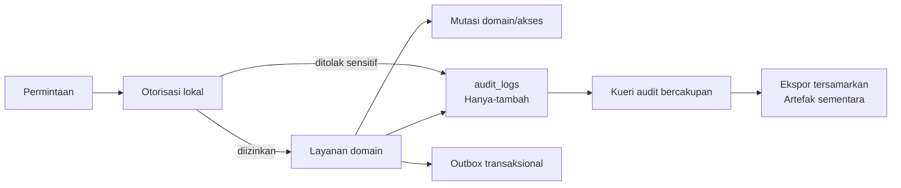
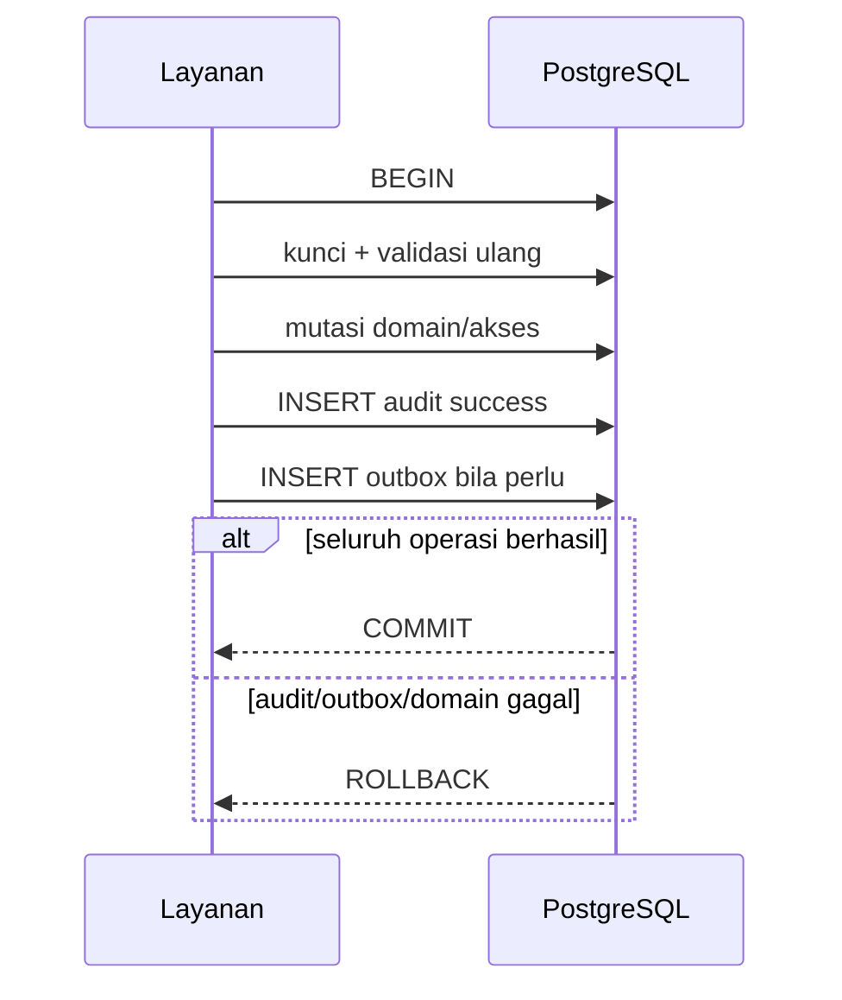
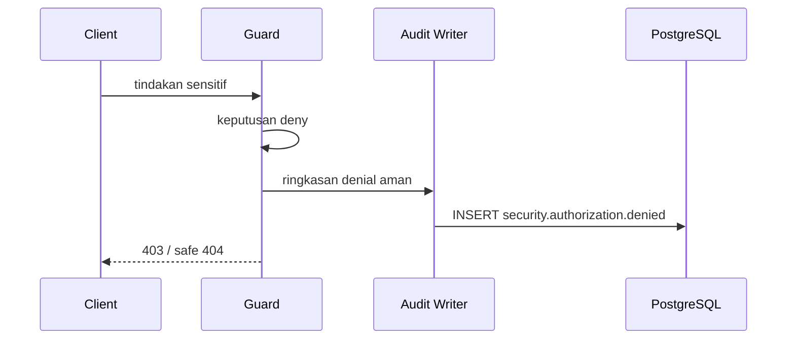
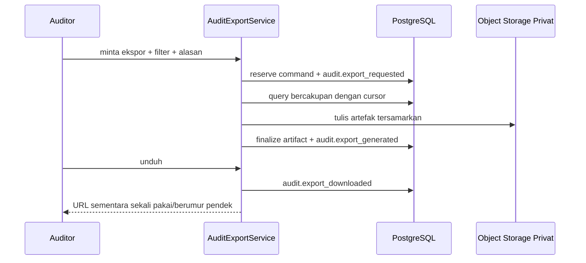

# 20 - IDP Pegawai Kontrak Kejadian Audit, Privasi & Retensi

Status: Draf curah gagasan untuk dikunci, **bukan kode implementasi**
Proyek: kumjabar_ecosystem
Tanggal: 2026-08-29
Bergantung pada:

- `18-idp-pegawai-stage-3-access-audit-breakdown.md`
- `19-idp-pegawai-rbac-scoped-grants-service-guards-contract.md`
- `17-idp-pegawai-stage-2-review-checklist-open-decisions.md`
- `16-idp-pegawai-import-apply-materialization-contract.md`
- `09-idp-pegawai-stage-1-admin-ui-internal-api-contract.md`

## 1. Tujuan

Dokumen ini mengunci sisi **audit** Tahap 3 dengan sasaran:

```text
ringan
+ dapat dipertanggungjawabkan
+ aman terhadap PII
+ konsisten secara transaksional
+ dapat dicari dan diekspor secara terbatas
```

Audit IDP bukan SIEM, bukan event store untuk membangun ulang seluruh domain, dan bukan salinan kedua database pegawai.

Dokumen ini menetapkan:

1. jenis tindakan yang wajib diaudit;
2. kontrak tabel `audit_logs`;
3. kode kejadian dan hasil;
4. batas transaksi untuk mutasi berhasil;
5. pola pencatatan penolakan/kegagalan;
6. minimalisasi, penyamaran, dan hash PII;
7. pencarian bercakupan;
8. kelas retensi dan legal hold;
9. ekspor audit tersamarkan;
10. privilese PostgreSQL hanya-tambah.

## 2. Prinsip Arsitektur

Prinsip yang dikunci:

- **hanya kejadian bermakna**: tidak setiap tampilan halaman menjadi audit persisten;
- **hanya-tambah**: aplikasi tidak boleh mengubah atau menghapus baris audit;
- **audit bukan sumber kebenaran domain**: domain/command/ledger tetap otoritatif;
- **mutasi berhasil dan audit commit bersama**;
- **penolakan tidak pernah berubah menjadi izin jika audit gagal**;
- **minim PII**: UUID, kode, hash, dan daftar field lebih diutamakan daripada payload penuh;
- **cakupan saat kejadian dipertahankan** untuk investigasi historis;
- **retensi berbasis kelas**, bukan satu TTL untuk semua;
- **ekspor adalah artefak privat sementara**;
- **tidak mengklaim tamper-proof**.

## 3. Batas Sistem Audit

### 3.1 Masuk Cakupan

- mutasi identitas, lifecycle, organisasi, identity link, import, dan pemberian akses;
- keputusan keamanan berdampak tinggi;
- penolakan otorisasi sensitif;
- unduhan artefak PII;
- ekspor audit;
- penggunaan bootstrap/pemulihan;
- korelasi dengan batch, command, ledger, request, dan outbox.

### 3.2 Di Luar Cakupan

```text
SIEM ingestion platform
full distributed tracing platform
generic event sourcing
full request/response capture
raw workbook storage inside audit
full row-by-row domain snapshots
hash-chain/WORM implementation
user-configurable audit rules
unmasked bulk export by default
consumer application audit ownership
```

Consumer tetap memiliki audit domainnya sendiri. IDP hanya mengaudit tindakan dalam bounded context IDP.

## 4. Posisi dalam Alur Tahap 3



## 5. Keputusan tentang Granularitas

Tiga tingkat pencatatan:

| Tingkat | Media | Contoh |
| --- | --- | --- |
| Audit persisten | `audit_logs` | pemberian akses, perubahan lifecycle, apply import, ekspor |
| Ledger operasional | tabel domain/command/ledger | row hasil materialisasi, retry command, outbox delivery |
| Telemetri | log/metric/trace aplikasi | tampilan halaman biasa, latency, internal retry |

Aturan:

- jangan memindahkan seluruh ledger operasional ke `audit_logs`;
- jangan mengandalkan log aplikasi sebagai bukti mutasi domain;
- kejadian audit dapat mereferensikan ledger dengan UUID aman;
- telemetry boleh berumur lebih pendek daripada audit persisten.

## 6. Kapan Audit Persisten Wajib

Audit persisten wajib untuk:

1. setiap mutasi authoritative pegawai;
2. setiap perubahan primary assignment;
3. setiap link/unlink identity;
4. setiap approval/apply/retry penting import;
5. setiap pemberian, pencabutan, atau kedaluwarsa akses;
6. setiap permintaan dan keputusan akses kritis;
7. setiap unduhan workbook/error artifact berisi PII massal;
8. setiap ekspor audit;
9. penggunaan bootstrap/recovery;
10. penolakan tindakan berprivilese/sensitif;
11. kegagalan mutation command yang sudah mempunyai durable intent;
12. aksi purge/legal hold oleh principal tata kelola.

Audit persisten tidak wajib untuk pembacaan daftar/dashboard biasa yang tidak sensitif. Pembacaan detail sensitif, ekspor, dan unduhan massal tetap wajib diaudit.

## 7. Model Aktor

`actor_type` v1:

```text
pegawai
service_account
system
```

Kontrak:

| Aktor | Identitas Utama | Referensi Tambahan |
| --- | --- | --- |
| pegawai | Keycloak `sub` pada `actor_subject` | `actor_pegawai_uuid` nullable tetapi diupayakan terisi |
| service account | client/service subject stabil | client ID aman pada `actor_subject` |
| system | nama job tetap | `job_id` pada provenance |

Aturan:

- aktor berasal dari konteks runtime terautentikasi, bukan request body;
- nama/email/NIP aktor bukan identitas audit utama;
- perubahan profil aktor tidak mengubah kejadian lama;
- impersonation umum tidak tersedia pada v1;
- penggunaan bootstrap dicatat sebagai kejadian kritis dengan alasan insiden.

## 8. Model Resource

Audit menyimpan referensi aman:

```text
resource_type
resource_uuid
scope_org_unit_uuid
```

`resource_type` adalah katalog kode tetap, antara lain:

```text
pegawai
org_unit
pegawai_org_assignment
pegawai_identity_link
import_batch
import_artifact
import_apply_command
access_grant
access_grant_request
audit_export
security_recovery
```

Tidak ada resource type buatan pengguna pada v1.

## 9. Kontrak Cakupan Historis

`scope_org_unit_uuid` merupakan **snapshot cakupan aman saat kejadian**, bukan foreign key runtime yang menentukan ulang histori.

Untuk resource dengan beberapa unit:

- `scope_org_unit_uuid` menyimpan root cakupan utama bila tunggal;
- `scope_footprint` menyimpan array kecil UUID unit lama/baru yang sudah diurutkan dan dideduplikasi;
- audit query actor subtree hanya boleh melihat kejadian jika seluruh footprint berada di subtree actor;
- kejadian global atau footprint kosong hanya terlihat auditor global;
- perubahan hierarki kemudian tidak menulis ulang audit lama.

Batas `scope_footprint` mengikuti operasi IDP yang kecil; full daftar unit batch tidak disalin. Untuk batch besar, audit mereferensikan batch/ledger dan menyimpan aggregate scope hash.

## 10. Tabel `audit_logs`

Satu baris berarti satu fakta audit yang sudah final untuk satu tindakan/hasil.

### 10.1 Kolom Identitas dan Waktu

| Kolom | Tipe Konseptual | Kontrak |
| --- | --- | --- |
| `id` | bigint PK | urutan internal |
| `uuid` | UUID unique | ID publik kejadian, PostgreSQL generated |
| `occurred_at` | timestamptz | waktu kejadian dari database |
| `recorded_at` | timestamptz | waktu insert, umumnya sama/dekat dengan `occurred_at` |
| `event_type` | varchar(120) | kode kejadian stabil |
| `event_version` | smallint | versi struktur semantik, mulai 1 |
| `outcome` | varchar(20) | success/denied/failed/conflict |
| `severity` | varchar(20) | info/warning/critical |

### 10.2 Kolom Aktor

| Kolom | Tipe Konseptual | Kontrak |
| --- | --- | --- |
| `actor_type` | varchar(30) | pegawai/service_account/system |
| `actor_subject` | varchar(255) | subject stabil |
| `actor_pegawai_uuid` | UUID nullable | referensi aman pegawai |
| `actor_scope_type` | varchar(30) nullable | global/org_unit_subtree bila relevan |
| `actor_scope_org_unit_uuid` | UUID nullable | scope grant saat keputusan |

### 10.3 Kolom Tindakan dan Resource

| Kolom | Tipe Konseptual | Kontrak |
| --- | --- | --- |
| `action` | varchar(120) | kode capability/tindakan stabil |
| `resource_type` | varchar(80) | katalog tetap |
| `resource_uuid` | UUID nullable | target kejadian |
| `scope_org_unit_uuid` | UUID nullable | cakupan utama saat kejadian |
| `scope_footprint` | UUID[] nullable | daftar kecil unit lama/baru |
| `scope_footprint_hash` | char(64) nullable | hash footprint lengkap bila tidak disalin |

### 10.4 Kolom Korelasi dan Provenance

| Kolom | Tipe Konseptual | Kontrak |
| --- | --- | --- |
| `request_id` | varchar(100) | korelasi satu HTTP/request |
| `correlation_id` | varchar(100) | korelasi lintas langkah |
| `causation_uuid` | UUID nullable | kejadian/command penyebab langsung |
| `batch_uuid` | UUID nullable | referensi import batch |
| `command_uuid` | UUID nullable | apply/grant/export command |
| `outbox_event_uuid` | UUID nullable | referensi outbox bila ada |
| `source_version` | bigint nullable | versi aggregate setelah mutasi |

### 10.5 Kolom Perubahan Aman

| Kolom | Tipe Konseptual | Kontrak |
| --- | --- | --- |
| `reason_code` | varchar(100) | kode alasan stabil |
| `changed_fields` | text[] nullable | nama field allowlist, terurut |
| `before_hash` | char(64) nullable | hash state kanonis sebelum |
| `after_hash` | char(64) nullable | hash state kanonis setelah |
| `change_summary` | JSONB nullable | ringkasan kecil, tersamarkan, tervalidasi |
| `metadata` | JSONB nullable | metadata teknis allowlist, bukan payload bebas |

Tidak ada kolom raw request/response, token, full employee payload, atau full workbook.

## 11. Constraint Utama `audit_logs`

Constraint konseptual:

```text
event_version >= 1
outcome IN (success, denied, failed, conflict)
severity IN (info, warning, critical)
actor_type IN (pegawai, service_account, system)
trim(event_type) <> ''
trim(actor_subject) <> ''
trim(action) <> ''
trim(resource_type) <> ''

actor_scope_type IS NULL
OR actor_scope_type IN (global, org_unit_subtree)

actor_scope_type = global
=> actor_scope_org_unit_uuid IS NULL

actor_scope_type = org_unit_subtree
=> actor_scope_org_unit_uuid IS NOT NULL

before_hash IS NULL OR before_hash ~ '^[0-9a-f]{64}$'
after_hash IS NULL OR after_hash ~ '^[0-9a-f]{64}$'
scope_footprint_hash IS NULL OR scope_footprint_hash ~ '^[0-9a-f]{64}$'
```

`change_summary` dan `metadata` wajib berupa JSON object bila tidak null, mempunyai batas ukuran, dan melewati validator allowlist sebelum insert.

## 12. Indeks Audit

Indeks minimum:

```text
UNIQUE (uuid)
INDEX (occurred_at DESC, id DESC)
INDEX (event_type, occurred_at DESC)
INDEX (actor_subject, occurred_at DESC)
INDEX (actor_pegawai_uuid, occurred_at DESC)
INDEX (resource_type, resource_uuid, occurred_at DESC)
INDEX (scope_org_unit_uuid, occurred_at DESC)
INDEX (request_id)
INDEX (correlation_id)
INDEX (batch_uuid)
INDEX (command_uuid)
INDEX (outcome, severity, occurred_at DESC)
```

Tidak ada GIN umum pada seluruh JSONB v1. Jika query nyata membuktikan kebutuhan, buat expression index pada key allowlist tertentu setelah benchmark.

## 13. Partisi Tabel

Rekomendasi v1:

- mulai tanpa partisi bila volume masih kecil;
- siapkan migration path ke partisi bulanan berdasarkan `occurred_at`;
- aktifkan partisi hanya setelah proyeksi volume/benchmark menunjukkan manfaat;
- desain primary/unique constraint harus mempertimbangkan syarat partisi PostgreSQL;
- jangan menambah partisi hanya karena audit “mungkin besar”.

Dokumen ini tidak mewajibkan partisi pada migration pertama.

## 14. Katalog Hasil

`outcome`:

| Kode | Arti |
| --- | --- |
| `success` | tindakan final berhasil |
| `denied` | otorisasi/guard menolak sebelum mutasi |
| `failed` | command valid tetapi eksekusi gagal |
| `conflict` | stale version/fingerprint/idempotency/uniqueness conflict |

Tidak ada `requested` sebagai outcome. “Requested” adalah jenis kejadian dengan outcome `success` karena pembuatan intent berhasil.

## 15. Katalog Severity

| Severity | Pemakaian |
| --- | --- |
| `info` | operasi normal berhasil |
| `warning` | denial/conflict/expiry yang perlu observasi tetapi bukan insiden |
| `critical` | perubahan security admin, bootstrap, indikasi eskalasi, kegagalan audit pada mutasi kritis |

Severity bukan skor risiko generik dan bukan policy engine.

## 16. Taksonomi Kejadian Akses

```text
access_grant.requested
access_grant.request_rejected
access_grant.request_cancelled
access_grant.request_expired
access_grant.created
access_grant.revoked
access_grant.expired
security.authorization.denied
security.bootstrap_recovery_used
security.last_admin_removal_blocked
```

Kontrak:

- `access_grant.created/revoked/expired` memakai `resource_type=access_grant`;
- permintaan kritis memakai `resource_type=access_grant_request`;
- `security.authorization.denied` hanya persisten untuk endpoint/tindakan sensitif atau pola abuse;
- denial biasa tetap menghasilkan metric/log aman untuk menghindari audit flood.

## 17. Taksonomi Kejadian Pegawai dan Organisasi

```text
pegawai.created
pegawai.profile_changed
pegawai.lifecycle_changed
pegawai.primary_org_changed
org_unit.created
org_unit.changed
org_unit.deactivated
identity_link.linked
identity_link.unlinked
identity_link.trust_changed
```

Aturan:

- `pegawai.profile_changed` hanya menyimpan `changed_fields` dan hash;
- `pegawai.lifecycle_changed` boleh menyimpan enum status sebelum/sesudah karena bukan secret;
- NIP hanya tampil tersamarkan bila benar-benar dibutuhkan;
- email lengkap tidak disalin ke audit;
- perubahan organisasi menyimpan UUID unit lama/baru pada summary allowlist.

## 18. Taksonomi Kejadian Import

```text
import.uploaded
import.rejected
import.validation_completed
import.plan_ready
import.approved
import.approval_invalidated
import.apply.requested
import.apply.committed
import.apply.stale
import.apply.failed
import.retry_created
import.artifact.generated
import.artifact.downloaded
import.artifact.purged
```

Audit import mereferensikan:

```text
batch_uuid
command_uuid
summary counts
aggregate before/after hash
source_version range bila relevan
```

Audit tidak menyalin seluruh `import_rows`, row error, candidate payload, atau workbook. Row-level outcome tetap berada di materialization ledger.

## 19. Taksonomi Kejadian Audit dan Tata Kelola

```text
audit.viewed_sensitive_detail
audit.export_requested
audit.export_generated
audit.export_downloaded
audit.export_expired
audit.export_purged
audit.legal_hold_applied
audit.legal_hold_released
audit.retention_purged
```

Melihat daftar audit biasa tidak wajib menghasilkan audit persisten agar tidak menciptakan recursive noise. Pembukaan detail sensitif dan seluruh ekspor wajib dicatat.

## 20. Penamaan dan Versi Kejadian

Aturan kode:

```text
<bounded_object>.<past_tense_action>
```

- lowercase snake/dot namespace;
- nama stabil setelah dipublikasikan;
- perubahan struktur kompatibel menaikkan `event_version` hanya bila pembaca perlu membedakan;
- jangan menyisipkan versi ke `event_type` seperti `.v2`;
- perubahan istilah UI tidak mengganti kode kejadian;
- event lama tidak ditulis ulang.

## 21. Batas Transaksi Mutasi Berhasil

Untuk mutasi domain/akses lokal:

```text
mutasi domain/akses
+ audit success
+ outbox opsional
= satu transaksi PostgreSQL
```



Jika insert audit wajib gagal, mutasi rollback. Tidak ada “mutasi berhasil tetapi audit nanti menyusul” untuk mutasi lokal.

## 22. Audit Requested dan Failed pada Command Dua-Transaksi

Untuk command yang memakai reservation transaction seperti apply import:

```text
Transaksi A
-> reserve durable command
-> audit import.apply.requested
-> commit

Transaksi B
-> lock/revalidate
-> domain mutation + ledger + audit committed + outbox
-> commit atau rollback
```

Jika Transaksi B rollback:

- jangan menulis `import.apply.committed`;
- command terminal dapat dicatat sebagai failed/conflict pada transaksi recovery/finalization yang terpisah;
- kejadian `requested` tetap benar karena intent memang dibuat;
- provenance menghubungkan kejadian melalui `command_uuid` dan `correlation_id`.

## 23. Penolakan Otorisasi

Penolakan tidak mempunyai mutasi domain. Pencatatannya memakai bounded autonomous transaction setelah keputusan deny.



Aturan fail-closed:

- kegagalan audit denial tidak pernah mengubah deny menjadi allow;
- kegagalan writer menghasilkan metric/alert dan log darurat aman;
- writer dibatasi timeout pendek dan payload allowlist;
- endpoint publik/noisy tidak menulis setiap denial ke audit persisten;
- repeated denial dapat diagregasi pada telemetry/SIEM di masa depan.

## 24. Kegagalan dan Konflik

Kejadian failed/conflict wajib final dan jujur:

- rollback mutasi tidak boleh menghasilkan outcome success;
- exception mentah/SQL/stack trace tidak masuk audit;
- `reason_code` memakai katalog stabil;
- pesan operator dapat berubah tanpa mengubah reason code;
- transient retry internal tidak menghasilkan banyak kejadian final;
- idempotent replay mengembalikan hasil lama tanpa kejadian duplikat.

Contoh reason code:

```text
actor_not_eligible
capability_missing
resource_not_permitted_or_unavailable
stale_source_version
fingerprint_mismatch
idempotency_conflict
duplicate_active_grant
second_actor_required
last_security_admin_protected
audit_write_failed
```

## 25. Canonical Hash

`before_hash` dan `after_hash` memakai canonical JSON yang sama untuk semua writer:

1. field allowlist dan urutan key stabil;
2. UUID/string dinormalisasi;
3. datetime UTC format tetap;
4. null berbeda dari absent;
5. JSON diserialisasi deterministik UTF-8;
6. SHA-256 lowercase hex.

Hash membantu membuktikan perbedaan state tanpa menyimpan payload. Hash bukan tanda tangan digital dan bukan bukti anti-perubahan mandiri.

## 26. Kontrak `changed_fields`

`changed_fields`:

- berasal dari katalog field domain;
- unik dan diurutkan;
- jumlah elemen dapat dikonfigurasi dengan batas maksimum aman;
- tidak menerima path bebas dari request;
- tidak memuat nilai;
- field forbidden tidak boleh dicatat meskipun muncul di input.

Contoh:

```json
["is_active", "status_pegawai"]
```

## 27. `change_summary` Allowlist

`change_summary` hanya untuk nilai kecil yang membantu manusia memahami kejadian.

Contoh yang diizinkan:

```json
{
  "status_pegawai": {
    "before": "aktif",
    "after": "pensiun"
  },
  "org_unit": {
    "before_uuid": "...",
    "after_uuid": "..."
  },
  "nip_masked": "**************1001"
}
```

Yang dilarang:

```text
full pegawai payload
full before/after JSON
email lengkap
full NIP
raw/candidate import row
workbook content
OAuth/OIDC token
cookie/session/client secret
signed URL/storage credential
exception/stack trace/SQL
arbitrary request metadata
```

## 28. Penyamar PII

Penyamaran dilakukan **sebelum persistence**.

| Data | Representasi Audit Default |
| --- | --- |
| pegawai | `pegawai_uuid` |
| NIP | tidak disimpan; jika wajib, hanya 4 digit terakhir |
| nama | tidak disimpan pada row audit; resolve terbatas saat UI bila masih tersedia |
| email | tidak disimpan; gunakan identity-link UUID/hash bila diperlukan |
| unit | UUID + kode/label aman snapshot |
| file | artifact UUID + checksum, bukan isi/nama path mentah |
| IP | tidak masuk `audit_logs` v1 kecuali governance menetapkan kebutuhan; telemetry terpisah |
| user agent | tidak masuk audit persisten v1 |

Penyamaran bukan enkripsi. Data yang tidak perlu tetap tidak boleh disimpan.

## 29. Metadata Teknis Aman

`metadata` memakai allowlist per `event_type`, misalnya:

```json
{
  "row_count": 125,
  "success_count": 120,
  "warning_count": 5,
  "artifact_uuid": "...",
  "idempotency_replay": false
}
```

Validator menolak:

- key tidak dikenal;
- nested object tidak diizinkan;
- string/array terlalu besar;
- key yang menyerupai token/secret/password;
- full payload yang diselundupkan;
- nilai binary/base64 panjang.

## 30. Audit Writer

Batas layanan minimum:

```text
AuditEventFactory
AuditEventValidator
AuditEventWriter
AuditDenialWriter
AuditQueryService
AuditExportService
AuditRetentionService
```

`AuditEventWriter` menerima event object typed/internal, bukan dict bebas dari route.

Pola:

```text
service domain
-> AuditEventFactory.from_domain_result(...)
-> validator event_type-specific
-> INSERT dengan session/transaksi yang sama
```

Route tidak membuat payload audit bebas.

## 31. Idempotensi Audit

Mutasi idempoten tidak boleh menduplikasi kejadian final.

Rekomendasi uniqueness semantik:

```text
(resource_type, resource_uuid, event_type, source_version)
```

untuk kejadian aggregate-versioned, atau:

```text
(command_uuid, event_type)
```

untuk command/import/export.

Karena beberapa event boleh memiliki `source_version` null, implementasi memakai partial unique indexes sesuai keluarga kejadian. Jangan memaksakan satu universal unique constraint yang salah.

## 32. Kueri Audit

Filter v1:

```text
rentang waktu
event_type
outcome
severity
actor pegawai UUID
resource_type + resource UUID
scope unit
batch UUID
command UUID
request/correlation ID
```

Tidak ada pencarian full-text bebas terhadap JSONB v1.

Pagination memakai keyset:

```text
(occurred_at, id) < (:cursor_occurred_at, :cursor_id)
ORDER BY occurred_at DESC, id DESC
```

Offset pagination tidak dipakai untuk ekspor besar.

## 33. Otorisasi Baca Audit

- `auditor(global)` dapat membaca semua kejadian IDP dengan masking default;
- `auditor(org_unit_subtree=X)` hanya membaca kejadian yang seluruh footprint-nya berada dalam X;
- kejadian global/null-scope hanya untuk auditor global;
- `security_admin` hanya melihat kejadian keamanan yang diperlukan untuk recovery, bukan audit bisnis penuh;
- `access_admin` tidak otomatis mendapat akses audit;
- operator import melihat status operasional dari batch/command, bukan browser audit umum;
- query selalu difilter server-side sebelum pagination/count.

UI tidak boleh mengambil seluruh data lalu memfilter di browser.

## 34. No-Existence-Leak

Untuk auditor bercakupan:

- detail kejadian di luar scope mengembalikan bentuk 404 yang sama dengan tidak ditemukan;
- autocomplete actor/resource hanya dari scope yang diizinkan;
- count/facet tidak membocorkan kejadian global/out-of-scope;
- pencarian NIP/email bukan fitur audit v1;
- UUID yang diketahui tidak melewati guard scope.

## 35. Retensi Berbasis Kelas

V1 menggunakan empat kelas:

| Kelas | Contoh | Retensi Operasional |
| --- | --- | --- |
| `security_access` | grant, revoke, denial kritis, bootstrap | 5 tahun |
| `identity_business` | lifecycle, org assignment, identity link | 5 tahun |
| `import_governance` | approval/apply/artifact access | 2 tahun |
| `audit_export_governance` | ekspor, legal hold, purge | 5 tahun |

Angka tersebut merupakan baseline arsitektur v1 dan masih tunduk pada kebijakan arsip/regulasi resmi yang lebih ketat. Kebijakan resmi boleh memperpanjang, tetapi pemendekan di bawah baseline memerlukan review keamanan, privasi, dan records management.

Telemetri rutin berada di luar tabel audit dan memiliki retensi terpisah yang lebih pendek.

## 36. Retensi Bukan Hard Delete Operator

Operator aplikasi biasa tidak dapat menghapus audit.

Purge hanya dilakukan oleh principal tata kelola terpisah setelah:

1. row melewati `retention_until`;
2. tidak terkena legal hold;
3. backup policy telah diperhitungkan;
4. batch purge dibatasi dan diurutkan;
5. manifest purge ditulis;
6. hasil purge dicatat dalam audit governance terpisah.

Jika tabel belum dipartisi, purge memakai bounded batches. Bila sudah dipartisi, drop partition hanya setelah seluruh baris dalam partisi eligible.

## 37. `retention_until`

Rekomendasi menyimpan `retention_class` dan `retention_until` pada setiap audit row agar keputusan purge dapat dibuktikan.

| Kolom | Kontrak |
| --- | --- |
| `retention_class` | class code tetap |
| `retention_until` | dihitung saat insert dari policy version |
| `retention_policy_version` | versi konfigurasi yang menghasilkan tanggal |
| `legal_hold` | boolean default false |
| `legal_hold_reference` | nullable ticket/case reference aman |

Perubahan kebijakan tidak diam-diam memendekkan row lama. Extension boleh memperpanjang `retention_until` melalui principal governance dan kejadian audit, bukan update aplikasi biasa.

Catatan: perubahan metadata retensi oleh principal governance merupakan pengecualian terkendali terhadap prinsip hanya-tambah pada baris utama. Rekomendasi lebih kuat adalah menyimpan legal hold/perpanjangan pada tabel pendamping hanya-tambah agar `audit_logs` tetap immutable.

## 38. Tabel Pendamping Legal Hold

Gunakan tabel hanya-tambah/terminal:

```text
audit_legal_holds
audit_retention_extensions
```

`audit_legal_holds` minimum:

```text
uuid
audit_event_uuid atau filter manifest UUID
status = active/released
reason
case_reference
applied_by_subject
applied_at
released_by_subject
released_at
```

Purge query melakukan anti-join terhadap hold aktif. Legal hold tidak mengubah isi kejadian audit asli.

## 39. Manifest Purge

Purge tidak membuat satu audit row per row yang dihapus. Buat satu manifest per batch:

```text
purge_manifest_uuid
retention_class
range_start/range_end
row_count
aggregate_hash
policy_version
executed_by
executed_at
```

Manifest disimpan lebih lama dari data yang dipurge dan tidak mengandung PII payload.

## 40. Backup dan Legal Hold

Batas penting:

- purge database tidak otomatis menghapus backup lama;
- jadwal backup expiry harus konsisten dengan kebijakan retensi;
- restore dari backup harus menjalankan retention catch-up sebelum sistem dibuka;
- legal hold harus tercakup dalam prosedur backup/restore;
- dokumen ini tidak menjanjikan immediate physical erasure dari seluruh media tanpa prosedur infrastruktur.

## 41. Ekspor Audit

Ekspor adalah command + artefak privat, bukan response sinkron tanpa jejak.



## 42. Tabel `audit_exports`

Minimum:

| Kolom | Kontrak |
| --- | --- |
| `id`, `uuid` | identitas internal/publik |
| `requested_by_subject` | aktor peminta |
| `requested_by_pegawai_uuid` | referensi aman |
| `reason` | wajib |
| `filter_snapshot` | JSONB allowlist, sudah scope-resolved |
| `status` | requested/generating/ready/failed/expired/purged |
| `row_count` | nullable sampai ready |
| `storage_key` | opaque private key |
| `content_hash` | SHA-256 file |
| `masked` | selalu true pada v1 |
| `requested_at`, `ready_at` | waktu lifecycle |
| `expires_at` | batas unduh |
| `purged_at` | bukti purge |
| `idempotency_key`, `intent_hash` | retry safety |
| `lock_version` | optimistic concurrency |

Ekspor tidak memakai tabel `import_artifacts` karena lifecycle dan capability berbeda, tetapi pola storage safety-nya sama.

## 43. Format Ekspor

V1 cukup satu format:

```text
CSV UTF-8
```

Kolom ekspor:

```text
occurred_at
event_type
outcome
severity
actor_type
actor_reference_masked
action
resource_type
resource_uuid
scope_reference
reason_code
changed_fields
request_id
correlation_id
```

`change_summary` penuh tidak masuk ekspor default. Detail dapat dilihat melalui UI bercapability jika diperlukan.

## 44. Keamanan Artefak Ekspor

- bucket/container privat dan tidak listable;
- `storage_key` opaque;
- enkripsi at rest dan TLS in transit;
- signed URL berumur sangat pendek atau streaming terautorisasi;
- `Cache-Control: no-store`;
- nama file disanitasi dan tidak memuat NIP/nama;
- checksum diverifikasi setelah generate;
- unduhan diaudit;
- tidak dikirim otomatis melalui email;
- TTL artefak ekspor v1 adalah **24 jam**;
- purge idempoten dan mencatat `purged_at`.

Retensi row `audit_exports` governance lebih panjang daripada file hasilnya.

## 45. Filter Snapshot Ekspor

`filter_snapshot` hanya memuat:

```text
rentang waktu
event types
outcomes
resource type
scope resolved UUID
masked=true
```

Tidak menyimpan query string mentah, token, atau arbitrary JSON. Scope filter server-side ditulis ke snapshot agar isi ekspor dapat dipertanggungjawabkan.

## 46. Batas Ukuran Ekspor

- ekspor selalu asynchronous;
- maksimum 50.000 baris per artefak;
- hasil di atas cap dipecah deterministik menjadi beberapa CSV dan satu ZIP privat dengan manifest;
- query memakai keyset cursor dan snapshot waktu batas atas;
- timeout tidak boleh menghasilkan file parsial sebagai `ready`;
- publish object storage harus atomik atau memakai temporary key lalu promote.

## 47. Privilese PostgreSQL

Pisahkan principal:

```text
idp_app_writer
idp_audit_reader
idp_audit_retention
migration_owner
```

### 47.1 `idp_app_writer`

Boleh:

```text
INSERT audit_logs
SELECT audit_logs hanya melalui service/query yang dibutuhkan aplikasi
```

Tidak boleh:

```text
UPDATE audit_logs
DELETE audit_logs
TRUNCATE audit_logs
ALTER audit_logs
```

### 47.2 `idp_audit_reader`

- SELECT saja;
- digunakan oleh query/export worker;
- tetap melalui application scope guard;
- bukan akses langsung end user ke database.

### 47.3 `idp_audit_retention`

- principal terpisah;
- hanya job purge/legal-hold terkontrol;
- tidak dipakai web request;
- kredensial terpisah dan diaudit;
- hak DELETE terbatas pada prosedur/fungsi atau tabel/partisi yang diperlukan.

### 47.4 `migration_owner`

Mempunyai DDL saat migration, bukan runtime aplikasi.

## 48. Perlindungan Database Tambahan

- revoke default privilege UPDATE/DELETE dari runtime role;
- ownership tabel bukan milik role aplikasi;
- gunakan function/procedure `SECURITY DEFINER` hanya jika benar-benar dibutuhkan dan harden `search_path`;
- audit koneksi DBA melalui kontrol infrastruktur terpisah;
- backup dienkripsi;
- migration yang mengubah audit schema wajib direview keamanan;
- jangan menyatakan database admin secara absolut tidak dapat mengubah data.

Jaminan v1 adalah **tamper-resistant secara operasional**, bukan tamper-proof kriptografis.

## 49. Migrasi dan Kompatibilitas Event

- migration tidak menulis ulang payload historis kecuali ada kebutuhan wajib dan prosedur khusus;
- kolom baru nullable/default aman sebelum backfill;
- event reader memahami `event_version`;
- perubahan allowlist memiliki fixtures versi lama/baru;
- purge tidak berjalan selama migration yang memengaruhi partisi/retensi;
- rollback migration tidak menghapus jejak audit yang sudah valid.

## 50. Observabilitas

Metrik minimum:

```text
audit_insert_success_total
audit_insert_failure_total
audit_denial_write_failure_total
audit_query_latency
audit_export_requested_total
audit_export_failed_total
audit_export_rows
audit_retention_eligible_rows
audit_retention_purged_rows
audit_legal_hold_active_total
```

Peringatan:

- audit wajib gagal saat mutasi kritis;
- lonjakan denial berprivilese;
- ekspor audit berulang/tidak biasa;
- artefak melewati TTL tetapi belum dipurge;
- retention backlog;
- perubahan legal hold;
- principal runtime mencoba UPDATE/DELETE audit.

## 51. Test Matrix - Transaksi

- mutasi dan audit success commit bersama;
- audit insert failure me-rollback mutasi;
- outbox failure me-rollback mutasi dan audit;
- rollback tidak menghasilkan event success;
- command reservation mempertahankan requested event saat transaksi domain gagal;
- replay idempoten tidak menggandakan audit;
- concurrent same-version mutation menghasilkan satu event final;
- denial tetap deny ketika audit denial writer gagal.

## 52. Test Matrix - Privasi

- token, cookie, secret, signed URL tidak dapat lolos validator;
- NIP penuh/email lengkap tidak tersimpan;
- masking terjadi sebelum SQL INSERT;
- unknown JSON key ditolak;
- oversized summary ditolak;
- changed_fields hanya katalog allowlist;
- canonical hash stabil lintas urutan key;
- absent berbeda dari null;
- logs/metrics tidak memuat payload sensitif.

## 53. Test Matrix - Scope dan Query

- auditor global melihat semua kejadian;
- auditor subtree hanya melihat full-contained footprint;
- footprint lintas subtree ditolak;
- null/global event tidak terlihat auditor subtree;
- hierarchy change tidak mengubah snapshot audit lama;
- UUID detail out-of-scope memberi safe 404;
- count/facet tidak bocor;
- keyset pagination stabil untuk timestamp sama;
- filter ekspor sama dengan filter UI/query service.

## 54. Test Matrix - Retensi dan Ekspor

- retention class menghitung tanggal benar;
- legal hold mencegah purge;
- release hold diaudit;
- purge bounded dan idempoten;
- manifest row count/hash benar;
- restore backup menjalankan catch-up retention;
- ekspor selalu masked;
- idempotency replay tidak membuat file kedua;
- file parsial tidak menjadi ready;
- checksum diverifikasi;
- signed URL/stream authorization berumur pendek;
- file dipurge setelah 24 jam;
- download dan purge diaudit.

## 55. Threat-to-Control Closure

| Ancaman | Pengendalian |
| --- | --- |
| mutasi tanpa jejak | audit dalam transaksi yang sama |
| audit menjadi salinan PII | UUID/hash/field list + masking sebelum persistence |
| operator mengubah audit | role aplikasi tanpa UPDATE/DELETE |
| DBA dianggap mustahil mengubah data | klaim dibatasi; kontrol infrastruktur/backup terpisah |
| stale hierarchy mengubah histori | scope snapshot immutable |
| auditor subtree melihat kejadian global | full-footprint containment + deny |
| denial flood memenuhi DB | selective durable denial + telemetry aggregation |
| retry menggandakan event | uniqueness per aggregate version/command |
| ekspor bocor | hanya tersamarkan, privat, no-store, TTL 24 jam, unduhan diaudit |
| purge melanggar legal hold | hold hanya-tambah + anti-join saat purge |
| backup menghidupkan data expired | retention catch-up setelah restore |
| JSONB menjadi jalur payload bebas | event-specific allowlist + size/type validator |

## 56. Keputusan Final yang Dikunci

1. `audit_logs` adalah tabel fakta audit hanya-tambah, bukan event store domain.
2. Audit persisten hanya untuk kejadian penting; pembacaan rutin memakai telemetry.
3. Mutasi lokal berhasil, audit success, dan outbox opsional commit dalam transaksi yang sama.
4. Command dua-transaksi mempertahankan requested event di reservation transaction dan hanya menulis committed setelah mutasi terbukti.
5. Penolakan sensitif memakai bounded denial writer; kegagalannya tidak pernah mengubah deny menjadi allow.
6. Katalog outcome tetap: success, denied, failed, conflict.
7. Katalog severity tetap: info, warning, critical.
8. Event type dan resource type berasal dari katalog kode versioned.
9. Audit menyimpan actor subject stabil, UUID resource, scope snapshot, provenance UUID, changed fields, dan canonical hashes.
10. Audit tidak menyimpan full payload, token, secret, full NIP/email, workbook, atau stack trace.
11. `change_summary` dan `metadata` memakai validator allowlist per event type.
12. Auditor subtree hanya melihat kejadian yang seluruh scope footprint-nya berada di subtree.
13. Kejadian global/null-scope hanya terlihat auditor global.
14. Query memakai keyset pagination; tidak ada full-text JSONB search v1.
15. Partisi bulanan tidak wajib pada migration pertama dan hanya diaktifkan berdasarkan volume/benchmark.
16. Retensi baseline: security/access 5 tahun, identity/business 5 tahun, import governance 2 tahun, audit/export governance 5 tahun.
17. Legal hold dan perpanjangan memakai tabel pendamping hanya-tambah agar baris audit utama immutable.
18. Purge hanya oleh principal tata kelola terpisah dan menghasilkan manifest aman.
19. Backup/restore wajib menghormati retensi dan legal hold.
20. Ekspor v1 hanya CSV UTF-8 tersamarkan, asynchronous, private, dan TTL file 24 jam.
21. Unduhan/generate/purge ekspor semuanya diaudit.
22. Role aplikasi hanya INSERT audit dan tidak mempunyai UPDATE/DELETE/TRUNCATE.
23. Audit v1 bersifat tamper-resistant operasional, bukan tamper-proof kriptografis.
24. Hash chain/WORM ditunda sampai regulasi atau threat model konkret mewajibkan.

## 57. Resolusi Final Delapan Keputusan

Delapan pertanyaan arsitektur Dokumen 20 telah diselesaikan dan tidak lagi berstatus terbuka.

| Nomor | Keputusan Final | Kontrak yang Dikunci |
| --- | --- | --- |
| 1 | Baseline retensi **5/5/2/5 tahun** dikunci untuk v1 | Kebijakan resmi boleh memperpanjang melalui legal hold/perpanjangan; pemendekan memerlukan review keamanan, privasi, dan records management. |
| 2 | IP address tidak masuk `audit_logs` v1 | IP berada pada telemetri gateway/reverse proxy; jangan memercayai `X-Forwarded-For` kecuali gateway tepercaya menormalisasi dan menimpa header tersebut. |
| 3 | Pembacaan detail sensitif wajib menghasilkan `audit.viewed_sensitive_detail` | Tampilan daftar tersamarkan tidak diaudit persisten; pembukaan detail berprivilese wajib dicatat dengan UUID/resource aman. |
| 4 | Tabel `audit_legal_holds` wajib pada migration Tahap 3 | MVP boleh mengoperasikannya melalui runbook/script terkontrol; UI legal hold tidak wajib pada v1. |
| 5 | Tabel `audit_logs` tidak dipartisi pada migration pertama | Partisi bulanan dipertimbangkan bila benchmark/proyeksi melampaui **10 juta baris** atau menunjukkan kebutuhan operasional nyata. |
| 6 | Format XLSX dilarang untuk ekspor audit v1 | Format tunggal adalah CSV UTF-8; setiap sel wajib dilindungi dari formula injection. |
| 7 | Maksimum **50.000 baris per artefak** | Hasil lebih besar dipecah deterministik menjadi beberapa CSV, kemudian dibungkus dalam satu ZIP privat dengan manifest dan checksum per bagian. |
| 8 | Hash-chain/Merkle tree tidak digunakan pada v1 | Privilese hanya-INSERT memenuhi baseline tamper-resistant operasional; tinjau ulang hanya jika ada mandat WORM/regulasi konkret. |

### 57.1 Keamanan CSV terhadap Formula Injection

“CSV lebih sederhana” tidak otomatis berarti aman. Sebelum menulis sel:

- semua nilai diperlakukan sebagai string data;
- nilai yang setelah trim awal diawali `=`, `+`, `-`, `@`, tab, carriage return, atau line feed diberi prefix apostrof (`'`);
- quoting RFC 4180 tetap diterapkan;
- nama file tidak membawa input mentah;
- manifest mencatat bahwa sanitasi formula aktif;
- pengujian mencakup payload seperti `=HYPERLINK(...)`, `+CMD`, `-1+1`, dan `@SUM(...)`.

### 57.2 Pemecahan Ekspor Besar

```text
<= 50.000 baris
-> satu CSV UTF-8

> 50.000 baris
-> beberapa CSV, masing-masing <= 50.000 baris
-> satu ZIP privat
-> manifest urutan bagian + row count + SHA-256 tiap bagian
```

ZIP hanya container; isi tetap CSV tersamarkan. Batas total ekspor, jumlah bagian, dan ukuran byte tetap harus dibuktikan melalui benchmark sebelum implementasi.

### 57.3 Koreksi terhadap Draf DDL

DDL yang diberikan dalam review diterima sebagai masukan konseptual, **bukan migration final**. Implementasi wajib memperbaiki hal berikut:

- `ALTER` bukan table privilege yang valid untuk pola `REVOKE ... ON TABLE`; kontrol perubahan schema dilakukan melalui ownership dan pemisahan `migration_owner`;
- sequence `BIGSERIAL` memerlukan privilege sequence yang sesuai atau gunakan identity column;
- tabel legal hold memerlukan lifecycle constraint released fields dan mendukung target event maupun manifest/filter hold;
- `change_summary`, `metadata`, `filter_snapshot`, `intent_hash`, `content_hash`, dan status lifecycle memerlukan constraint/validator lengkap;
- `audit_exports` tidak boleh dianggap siap hanya dengan UPDATE bebas; mutasi harus melalui service transition yang diotorisasi dan diaudit;
- pemisahan principal reader, retention, runtime writer, dan migration owner tetap wajib;
- seluruh DDL/Alembic baru dibuat ketika user memberi izin implementasi eksplisit.

## 58. Daftar Periksa Penerimaan Dokumen 20

### Audit Inti

- [x] Batas audit vs ledger vs telemetry disetujui.
- [x] Tabel `audit_logs` dan katalog event disetujui.
- [x] Outcome/severity/version contract disetujui.
- [x] Transaction boundary mutasi berhasil disetujui.
- [x] Command dua-transaksi dan denial writer disetujui.

### Privasi

- [x] UUID/hash/changed-fields default disetujui.
- [x] PII masking sebelum persistence disetujui.
- [x] JSONB allowlist dan size cap disetujui.
- [x] Forbidden payload list disetujui.
- [x] Scope snapshot dan subtree query disetujui.

### Retensi

- [x] Kelas dan baseline retensi 5/5/2/5 tahun disetujui.
- [x] Tabel pendamping legal hold wajib pada migration Tahap 3 disetujui.
- [x] Principal purge terpisah dan manifest disetujui.
- [x] Backup/restore catch-up disetujui.

### Ekspor

- [x] CSV UTF-8 tersamarkan saja, dengan sanitasi formula, disetujui.
- [x] Artefak privat asinkron dan TTL 24 jam disetujui.
- [x] Download/generate/purge audit disetujui.
- [x] Maksimum 50.000 baris per artefak dan pemecahan ZIP ber-manifest disetujui.

### Database

- [x] Peran runtime hanya-INSERT disetujui.
- [x] Reader/retention/migration principals terpisah disetujui.
- [x] Klaim tamper-resistant, bukan tamper-proof, disetujui.
- [x] Non-partitioned v1; evaluasi ulang setelah 10 juta baris/benchmark disetujui.

## 59. Langkah Berikutnya

Setelah Dokumen 20 direview, lanjut ke:

```text
21 - IDP Pegawai Kontrak Admin UI & API Akses/Audit
```

Dokumen 21 akan menerjemahkan kontrak Dokumen 19-20 menjadi:

- daftar dan form pemberian akses;
- alur permintaan/persetujuan peran kritis;
- riwayat aktivitas audit yang ramah operator;
- filter bercakupan;
- detail masked dan progressive disclosure;
- ekspor audit asynchronous;
- capability flags;
- endpoint, request/response, error, idempotency, dan concurrency contract.

## 60. Kesimpulan

Audit IDP v1 dirumuskan sebagai:

```text
kejadian penting
-> referensi aman + scope snapshot
-> changed fields + canonical hashes
-> summary tersamarkan
-> insert hanya-tambah
-> query bercakupan
-> retensi per kelas
-> ekspor privat sementara
```

Kontrak ini menjaga IDP:

- **ringan**: tanpa SIEM/event sourcing/hash-chain framework;
- **tangguh**: transaction boundary, idempotensi, provenance, retensi, dan purge manifest jelas;
- **kuat**: PII diminimalkan, audit tidak dapat diubah role aplikasi, scope query fail-closed, legal hold dihormati, dan ekspor selalu tersamarkan.
