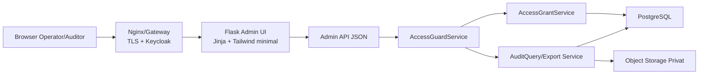
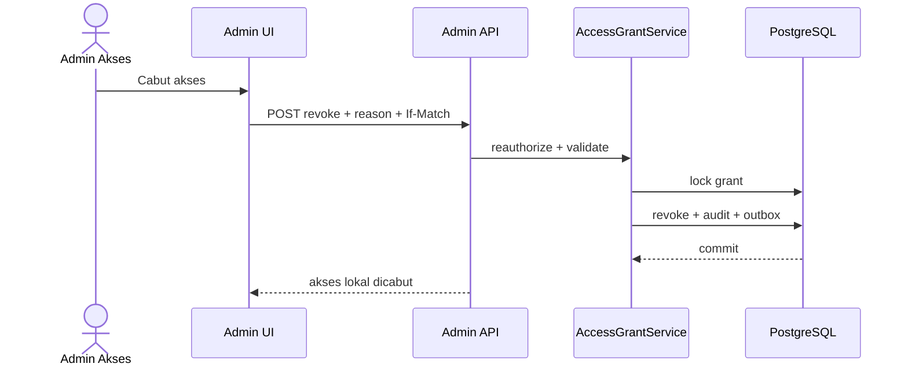
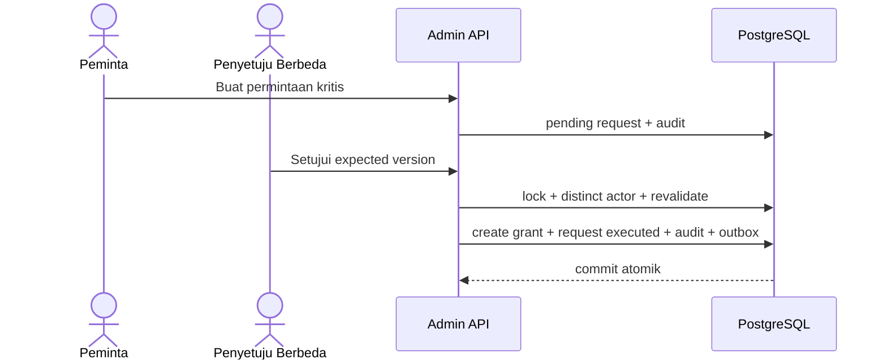

# 21 - IDP Pegawai Kontrak Admin UI & API Akses/Audit

Status: Draf curah gagasan untuk dikunci, **bukan kode implementasi**
Proyek: kumjabar_ecosystem
Tanggal: 2026-08-29
Bergantung pada:

- `19-idp-pegawai-rbac-scoped-grants-service-guards-contract.md`
- `20-idp-pegawai-audit-event-privacy-retention-contract.md`
- `16-idp-pegawai-import-apply-materialization-contract.md`
- `09-idp-pegawai-stage-1-admin-ui-internal-api-contract.md`

## 1. Tujuan

Dokumen ini menerjemahkan kontrak otorisasi dan audit Tahap 3 menjadi:

1. navigasi dan halaman Admin UI;
2. alur pemberian/pencabutan akses biasa;
3. alur permintaan dan persetujuan peran kritis;
4. riwayat audit bercakupan dan tersamarkan;
5. ekspor audit asinkron;
6. kontrak REST API;
7. idempotensi dan optimistic concurrency;
8. keyset pagination;
9. format error Bahasa Indonesia;
10. capability-aware UI yang tidak menggantikan backend guard.

Sasaran tetap:

```text
ringan untuk operator
+ jelas untuk auditor
+ ketat pada backend
+ tanpa SPA/policy editor/workflow builder
```

## 2. Batas Tahap 3 UI/API

### 2.1 Masuk Cakupan

- daftar akses efektif dan historis;
- pemberian peran biasa;
- pencabutan akses;
- permintaan/persetujuan/reject/cancel critical roles;
- status expiry dan proyeksi Keycloak;
- daftar/detail audit masked;
- detail sensitif yang diaudit;
- permintaan/status/download ekspor audit;
- capability flags dan effective scope;
- error envelope dan no-existence-leak.

### 2.2 Di Luar Cakupan

```text
custom role builder
policy/ABAC expression editor
arbitrary capability composer
generic workflow designer
full SIEM dashboard
unmasked audit export
XLSX audit export
legal-hold UI v1
service-account grant UI
Keycloak admin console replacement
mobile application
public API exposure
```

Legal hold wajib tersedia di schema/migration Tahap 3, tetapi operasi MVP boleh melalui runbook terkontrol.

## 3. Arsitektur UI/API



Admin UI boleh server-rendered dengan progressive enhancement. API tetap menjadi kontrak backend otoritatif; JavaScript tidak menyimpan authority.

## 4. Prinsip UX

1. Bahasa utama Bahasa Indonesia sehari-hari.
2. Identifier teknis hanya pada “Detail teknis”.
3. Tindakan berisiko selalu memiliki halaman konfirmasi/ringkasan.
4. Disabled action menjelaskan alasan, bukan sekadar berwarna abu-abu.
5. Warna selalu disertai ikon dan teks.
6. Filter tidak menampilkan pilihan di luar scope actor.
7. Tombol tidak menyatakan sukses sebelum server commit.
8. Status proyeksi Keycloak dipisahkan dari status akses lokal.
9. Tidak ada editor JSON/policy/capability.
10. UI tetap ramah keyboard, fokus yang terlihat, label eksplisit, dan status pembaca layar.

## 5. Navigasi Admin UI

```text
Admin IDP
├── Dashboard
├── Pegawai
├── Organisasi
├── Import Pegawai
├── Akses
│   ├── Daftar Akses
│   ├── Berikan Akses
│   ├── Permintaan Kritis
│   └── Riwayat Perubahan Akses
└── Audit
    ├── Riwayat Aktivitas
    ├── Detail Kejadian
    └── Ekspor Audit
```

Menu hanya ditampilkan jika actor mempunyai capability yang relevan. URL langsung tetap dijaga backend.

## 6. Matriks Halaman dan Capability

| Halaman | Capability Minimum | Catatan |
| --- | --- | --- |
| `/admin/access-grants` | `idp.access_grant.view` | scope-filtered |
| `/admin/access-grants/new` | `idp.access_grant.create` | hanya peran biasa |
| `/admin/access-grants/{uuid}` | `idp.access_grant.view` | safe 404 bila out-of-scope |
| `/admin/access-grant-requests` | `idp.access_grant.critical.request` atau kapabilitas persetujuan | hanya peran kritis |
| `/admin/access-grant-requests/new` | `idp.access_grant.critical.request` | security admin |
| `/admin/audit-events` | `idp.audit.view` | masked list |
| `/admin/audit-events/{uuid}` | `idp.audit.view` | detail sensitif diaudit |
| `/admin/audit-exports` | `idp.audit.export_masked` | status/history |
| `/admin/audit-exports/new` | `idp.audit.export_masked` | reason wajib |

Template tidak hard-code role string untuk menentukan capability.

## 7. Header Konteks Actor

Setiap halaman keamanan menampilkan ringkasan:

```text
Masuk sebagai: Nama Tersamarkan/Display Aman
Cakupan efektif: Global / Subtree TUM
Akses lokal diperiksa: sekarang
Status Keycloak: sinkron / sedang diproses
ID bantuan: request_id
```

Tidak menampilkan token, provider subject penuh, atau detail identity provider.

## 8. Daftar Akses

Kolom default:

| Kolom UI | Sumber |
| --- | --- |
| Pegawai | display resolver aman |
| NIP | masked |
| Jenis akses | role label Bahasa Indonesia |
| Cakupan | Global / nama unit root |
| Status | Aktif/Dicabut/Kedaluwarsa |
| Berlaku mulai | `valid_from` |
| Berlaku sampai | `valid_until` |
| Sinkronisasi Keycloak | proyeksi lokal/downstream |
| Aksi | Lihat/Cabut jika diizinkan |

Default filter adalah grant aktif. Historical row dapat dilihat melalui filter status.

## 9. Filter Daftar Akses

```text
status
role_code
scope root
pegawai UUID/autocomplete bercakupan
validity window
created_at range
```

Aturan:

- autocomplete hanya mengembalikan pegawai dalam authority scope;
- pencarian NIP pada UI menggunakan input terproteksi dan response masked;
- server selalu mengulang scope filter;
- tidak ada filter arbitrary JSON;
- URL query boleh dibagikan hanya bila tidak berisi NIP/email/nama sensitif.

## 10. Form Pemberian Akses Biasa

Field operator:

```text
Pegawai
Jenis akses
Cakupan
Unit akar (jika subtree)
Berlaku mulai
Berlaku sampai
Alasan
```

Peran biasa:

```text
viewer
import_operator
import_approver
auditor
```

`access_admin` dan `security_admin` tidak tersedia di form langsung; UI mengarahkan ke “Permintaan Akses Kritis”.

## 11. Validasi Form Pemberian Akses

Validasi client-side hanya membantu UX. Backend authoritative memeriksa:

- actor aktif dan capability masih efektif;
- target pegawai valid/aktif dan berada dalam scope;
- role termasuk katalog biasa;
- scope tidak melebihi authority actor;
- subtree root valid;
- rentang waktu valid;
- exact active duplicate tidak ada;
- self-grant dilarang;
- reason tidak kosong dan dibatasi panjangnya;
- idempotency intent cocok.

Error field menggunakan kalimat yang dapat ditindaklanjuti.

## 12. Konfirmasi Pemberian Akses

Sebelum submit:

```text
Anda akan memberikan:
Jenis akses : Operator Import
Kepada      : Pegawai ****1001
Cakupan     : Subtree Tata Usaha
Berlaku     : 29 Agu 2026 - 29 Agu 2027
Alasan      : Penugasan operator import
```

Operator mencentang:

```text
Saya telah memeriksa pegawai, jenis akses, cakupan, dan masa berlaku.
```

Checkbox bukan kontrol keamanan; backend tetap melakukan seluruh guard.

## 13. Hasil Pemberian Akses

Setelah commit lokal:

```text
Akses berhasil diberikan dan sudah berlaku di IDP.
Pembaruan akses masuk Keycloak sedang diproses.
```

Response menyertakan:

```text
grant UUID
source_version
status lokal
status proyeksi
request_id
```

UI tidak menunggu remote Keycloak call.

## 14. Alur Pencabutan

Pencabutan memakai halaman/modal konfirmasi dengan:

- pegawai masked;
- role dan cakupan;
- masa berlaku;
- dampak lokal langsung;
- status Keycloak asinkron;
- `revocation_reason` wajib;
- nilai ETag/`If-Match`.



Second approval tidak diperlukan untuk containment, kecuali last-security-admin guard yang memblokir tindakan tidak aman.

## 15. Permintaan Akses Kritis

Form hanya menyediakan:

```text
pegawai target
role = access_admin / security_admin
scope
valid_from
valid_until <= 365 hari
reason
```

TTL permintaan selalu 24 jam dan ditampilkan eksplisit.

UI menampilkan:

> Permintaan ini harus disetujui admin keamanan lain dan akan kedaluwarsa dalam 24 jam.

## 16. Daftar Permintaan Kritis

Tab:

```text
Menunggu Persetujuan
Sudah Dieksekusi
Ditolak
Dibatalkan
Kedaluwarsa
```

Kolom:

```text
target masked
role
scope
requested_by
requested_at
expires_at
status
aksi yang tersedia
```

Actor tidak boleh melihat/mengambil keputusan request di luar kewenangannya.

## 17. Persetujuan Empat-Mata

Halaman persetujuan menampilkan intent immutable:

- peminta;
- target;
- role;
- scope;
- validity;
- reason;
- request UUID;
- requested_at/expires_at;
- nilai ETag/`If-Match`.

Approver tidak dapat mengedit intent. Bila ada perubahan, request lama dibatalkan/ditolak dan dibuat request baru.



## 18. Reject dan Cancel Permintaan

Reject:

- hanya approver berwenang;
- `rejection_reason` wajib;
- header `If-Match` wajib;
- menghasilkan audit event;
- terminal.

Cancel:

- requester boleh cancel request sendiri selama pending;
- security admin berwenang dapat cancel jika diperlukan;
- `cancellation_reason` wajib;
- tidak membuat grant;
- terminal.

Expired ditentukan runtime; rekonsiliator hanya merapikan persistence/outbox/audit secara idempoten.

## 19. Dashboard Akses

Kartu ringkas:

```text
Akses aktif
Akan kedaluwarsa <= 30 hari
Permintaan kritis menunggu
Proyeksi Keycloak tertunda
Pencabutan hari ini
```

Count selalu scope-filtered. Security metrics tidak boleh membocorkan global counts kepada actor subtree.

## 20. Daftar Riwayat Audit

Kolom masked default:

```text
waktu
jenis aktivitas
hasil
severity
aktor masked/reference
aksi
resource
cakupan
reason code berlabel Indonesia
ID bantuan
```

Tidak menampilkan `change_summary` penuh di list.

## 21. Filter Audit

```text
rentang waktu
event_type group
outcome
severity
actor pegawai UUID/autocomplete scoped
resource type
scope unit
batch UUID
command UUID
request/correlation ID
```

Tidak ada full-text JSONB search, email search, atau NIP search v1.

## 22. Keyset Pagination Audit

Request:

```text
GET /admin/api/v1/audit-events?limit=50&cursor=<opaque>
```

Cursor merepresentasikan:

```text
occurred_at
id
filter_hash
scope_hash
version
```

Cursor ditandatangani/HMAC atau dienkode secara authenticated agar tidak dapat dimodifikasi actor.

Aturan:

- default 50, maksimum 100;
- order `occurred_at DESC, id DESC`;
- cursor terikat pada filter dan effective scope;
- cursor dari filter/scope berbeda ditolak;
- tidak ada offset/page pada audit timeline;
- response memuat `next_cursor`, bukan total global yang mahal/bocor.

## 23. Detail Kejadian Audit

Detail menampilkan:

```text
event_type + label
occurred_at
outcome/severity
actor reference masked
action
resource reference
scope snapshot
reason label
changed_fields
before/after hash
provenance UUID
request/correlation ID
change_summary allowlist
```

Pembukaan detail sensitif wajib menulis `audit.viewed_sensitive_detail`.

Guard anti-recursion:

- event `audit.viewed_sensitive_detail` tidak memicu audit detail baru hanya karena event itu ditampilkan dalam daftar masked;
- membuka detail event tersebut tetap dapat memakai telemetry atau bounded governance event sesuai implementasi;
- jangan membuat infinite audit recursion.

## 24. Progressive Disclosure Audit

Level UI:

1. **Ringkasan**: bahasa operator, masked.
2. **Detail perubahan**: field allowlist dan status sebelum/sesudah aman.
3. **Detail teknis**: UUID, hash, request/correlation ID.

Tidak pernah ada tombol “lihat raw payload” pada v1.

## 25. Ekspor Audit

Form:

```text
filter yang sama dengan daftar audit
alasan ekspor
konfirmasi masked-only
```

UI menampilkan:

```text
Format: CSV UTF-8 tersamarkan
Maksimum per bagian: 50.000 baris
Hasil besar: ZIP berisi beberapa CSV + manifest
Masa unduh: 24 jam
```

XLSX tidak tersedia.

## 26. Status Ekspor

```text
requested
generating
ready
failed
expired
purged
```

UI tidak menganggap request berhasil sebagai file ready.

Saat `ready`:

- tampilkan row count;
- jumlah bagian;
- checksum manifest;
- `expires_at` countdown;
- tombol Download bila capability masih efektif.

Authorization diulang saat download; URL lama tidak menjadi authority.

TTL artefak adalah 24 jam, sedangkan signed URL maksimum 5 menit. Keduanya tidak boleh disamakan.

## 27. CSV Formula Injection Guard

Setiap sel yang setelah trim awal diawali karakter berikut harus diberi prefix apostrof:

```text
=
+
-
@
tab
carriage return
line feed
```

Aturan tambahan:

- gunakan quoting RFC 4180;
- UTF-8 dengan header stabil;
- jangan menambahkan BOM kecuali compatibility test mewajibkan;
- nama file disanitasi;
- manifest mencatat formula sanitization aktif;
- test wajib mencakup formula berbahaya.

## 28. REST API Namespace

Admin API v1:

```text
/admin/api/v1
```

Rute UI server-rendered tetap di `/admin/...`. Jika gateway memakai base path:

```text
/idp-pegawai/admin/...
/idp-pegawai/admin/api/v1/...
```

Prefix publik tidak boleh di-hard-code; gunakan URL generation/config base path.

## 29. Header Request

| Header | Pemakaian |
| --- | --- |
| `Authorization`/session | autentikasi Keycloak sesuai mode UI |
| `Content-Type: application/json` | mutation API |
| `Accept: application/json` | JSON response |
| `Idempotency-Key` | wajib untuk POST command/mutation tertentu |
| `If-Match` | versi penguncian/sumber yang diharapkan bila sesuai |
| `X-Request-ID` | diterima hanya setelah sanitasi atau dibuat server |

Actor identity tidak pernah diterima dari payload/header buatan client.

## 30. Response Envelope Sukses

```json
{
  "data": {},
  "meta": {
    "request_id": "req_...",
    "timestamp": "2026-08-29T08:00:00Z"
  }
}
```

List keyset:

```json
{
  "data": [],
  "meta": {
    "request_id": "req_...",
    "page_size": 50,
    "next_cursor": "opaque-or-null"
  }
}
```

Tidak ada field `success=true` yang redundan dengan HTTP status.

## 31. Response Envelope Error

```json
{
  "error": {
    "code": "grant_scope_exceeds_authority",
    "message": "Cakupan akses melebihi kewenangan Anda.",
    "field_errors": {
      "scope_org_unit_uuid": [
        "Pilih unit yang berada dalam cakupan Anda."
      ]
    },
    "retryable": false
  },
  "meta": {
    "request_id": "req_..."
  }
}
```

`message` Bahasa Indonesia aman. Detail internal, SQL, stack trace, dan target tersembunyi tidak dikirim.

## 32. HTTP Status Contract

| Status | Pemakaian |
| ---: | --- |
| 200 | read/update command selesai atau idempotent replay |
| 201 | grant/request berhasil dibuat |
| 202 | export command diterima, belum ready |
| 204 | tidak digunakan untuk mutation yang perlu result/version |
| 400 | malformed request/cursor/header |
| 401 | belum terautentikasi/session invalid |
| 403 | capability umum tidak ada |
| 404 | resource tidak ada atau out-of-scope |
| 409 | stale version, duplicate, idempotency conflict, invalid state |
| 422 | field/domain validation |
| 428 | precondition `If-Match` wajib tetapi hilang |
| 429 | rate limit |
| 500 | kegagalan tak terduga dengan request ID aman |
| 503 | dependency sementara tidak tersedia; tidak dipakai untuk local commit yang sudah sukses |

## 33. Error Code Catalog Akses

```text
access_denied
actor_identity_unresolved
actor_not_eligible
capability_missing
resource_not_found
resource_not_permitted_or_unavailable
grant_not_effective
grant_already_exists
grant_idempotency_conflict
grant_scope_invalid
grant_scope_exceeds_authority
grant_role_not_delegable
critical_grant_requires_request
critical_grant_duration_exceeded
self_grant_forbidden
second_actor_required
grant_request_expired
grant_request_not_pending
grant_stale
precondition_required
precondition_invalid
last_security_admin_protected
```

## 34. Error Code Catalog Audit/Ekspor

```text
audit_event_not_found
audit_scope_denied
audit_cursor_invalid
audit_cursor_filter_mismatch
audit_sensitive_detail_denied
audit_export_filter_invalid
audit_export_idempotency_conflict
audit_export_not_ready
audit_export_expired
audit_export_purged
audit_export_too_large
audit_export_generation_failed
audit_export_download_denied
```

Pesan operator dipetakan dari code; code stabil dan tidak bergantung pada wording UI.

## 35. Idempotency Contract

`Idempotency-Key` wajib untuk:

```text
POST access-grants
POST access-grant-requests
POST approve/reject/cancel
POST revoke
POST audit-exports
```

Kontrak:

- unique per actor + command family;
- key opaque 16-255 karakter;
- canonical intent hash disimpan;
- same key + same intent mengembalikan hasil lama;
- same key + different intent menghasilkan 409;
- replay tidak menulis audit/outbox/file kedua;
- retention idempotency record melampaui retry window;
- response replay menandai `meta.idempotent_replay=true`.

## 36. Optimistic Concurrency

Mutation terhadap aggregate existing memakai:

```text
expected_lock_version
```

Boleh dikirim sebagai:

```text
If-Match: "<lock_version>"
```

dan tidak pernah dikirim sebagai field JSON. Satu-satunya sumber versi mutasi existing adalah header tersebut.

Stale version menghasilkan:

```text
409 grant_stale
```

UI me-refresh detail dan meminta operator meninjau ulang; tidak auto-retry mutation dengan intent lama.

## 37. API Access Grants

### 37.1 Daftar

```text
GET /admin/api/v1/access-grants
```

Query:

```text
status
role_code
scope_org_unit_uuid
pegawai_uuid
valid_at
limit
cursor
```

### 37.2 Detail

```text
GET /admin/api/v1/access-grants/{grant_uuid}
```

### 37.3 Buat Pemberian Akses Biasa

```text
POST /admin/api/v1/access-grants
Idempotency-Key: ...
```

```json
{
  "pegawai_uuid": "...",
  "role_code": "import_operator",
  "scope": {
    "type": "org_unit_subtree",
    "org_unit_uuid": "..."
  },
  "valid_from": "2026-08-29T08:00:00Z",
  "valid_until": "2027-08-29T08:00:00Z",
  "reason": "Penugasan operator import"
}
```

### 37.4 Cabut

```text
POST /admin/api/v1/access-grants/{grant_uuid}/revoke
Idempotency-Key: ...
If-Match: "3"
```

```json
{
  "revocation_reason": "Penugasan telah berakhir"
}
```

## 38. Response Access Grant

```json
{
  "data": {
    "uuid": "...",
    "pegawai": {
      "uuid": "...",
      "display_name": "Nama Aman",
      "nip_masked": "**************1001"
    },
    "role_code": "import_operator",
    "role_label": "Operator Import",
    "scope": {
      "type": "org_unit_subtree",
      "org_unit_uuid": "...",
      "org_unit_label": "Tata Usaha"
    },
    "status": "active",
    "valid_from": "...",
    "valid_until": "...",
    "source_version": 1,
    "lock_version": 0,
    "projection_status": "pending"
  },
  "meta": {
    "request_id": "..."
  }
}
```

Reason text hanya terlihat pada detail actor yang berwenang; list dapat menampilkan reason code/summary.

## 39. API Critical Grant Requests

```text
GET  /admin/api/v1/access-grant-requests
POST /admin/api/v1/access-grant-requests
GET  /admin/api/v1/access-grant-requests/{request_uuid}
POST /admin/api/v1/access-grant-requests/{request_uuid}/approve
POST /admin/api/v1/access-grant-requests/{request_uuid}/reject
POST /admin/api/v1/access-grant-requests/{request_uuid}/cancel
```

Create body sama dengan grant tetapi role hanya `access_admin`/`security_admin` dan `valid_until` maksimum 365 hari.

Approve body tidak membawa actor atau editable intent:

```http
If-Match: "0"
```

```json
{
  "acknowledgement": true
}
```

Reject/cancel membawa reason wajib.

## 40. Response Critical Request

```json
{
  "data": {
    "uuid": "...",
    "status": "pending",
    "target_pegawai": {
      "uuid": "...",
      "nip_masked": "**************1001"
    },
    "role_code": "access_admin",
    "scope": {
      "type": "global"
    },
    "requested_at": "...",
    "expires_at": "...",
    "requested_by": {
      "pegawai_uuid": "...",
      "display_name": "Nama Aman"
    },
    "lock_version": 0
  },
  "meta": {
    "request_id": "..."
  }
}
```

## 41. API Audit Events

```text
GET /admin/api/v1/audit-events
GET /admin/api/v1/audit-events/{audit_event_uuid}
```

List selalu masked. Detail memanggil guard sensitif dan menulis `audit.viewed_sensitive_detail` jika sukses.

Response list tidak memuat full `change_summary`, subject provider penuh, atau PII mentah.

## 42. API Audit Exports

```text
GET  /admin/api/v1/audit-exports
POST /admin/api/v1/audit-exports
GET  /admin/api/v1/audit-exports/{export_uuid}
POST /admin/api/v1/audit-exports/{export_uuid}/download
```

Create:

```json
{
  "filters": {
    "occurred_from": "2026-08-01T00:00:00Z",
    "occurred_until": "2026-09-01T00:00:00Z",
    "event_types": ["access_grant.created", "access_grant.revoked"],
    "outcomes": ["success"]
  },
  "reason": "Pemeriksaan akses bulanan"
}
```

Server menyelesaikan dan menyimpan scope snapshot sendiri.

## 43. Response 202 Ekspor

```json
{
  "data": {
    "uuid": "...",
    "status": "requested",
    "format": "csv_utf8",
    "masked": true,
    "max_rows_per_part": 50000,
    "requested_at": "...",
    "expires_at": null
  },
  "meta": {
    "request_id": "...",
    "poll_after_seconds": 3
  }
}
```

`expires_at` baru ada setelah artifact ready. Client melakukan polling bounded dengan backoff; tidak perlu WebSocket v1.

## 44. Download Ekspor

Download endpoint:

1. reauthenticate session;
2. reauthorize `idp.audit.export_masked`;
3. recheck scope dan export owner/authority;
4. memastikan status ready dan belum expired/purged;
5. menulis `audit.export_downloaded`;
6. mengirim stream atau signed URL maksimum 5 menit;
7. memakai `Cache-Control: no-store`.

GET object-storage URL langsung tidak menjadi kontrak API publik.

## 45. Capability Context Endpoint

```text
GET /admin/api/v1/me/capabilities
```

Response:

```json
{
  "data": {
    "capabilities": [
      "idp.pegawai.view",
      "idp.access_grant.view"
    ],
    "read_scope": {
      "type": "org_unit_subtree",
      "org_unit_uuid": "..."
    },
    "capability_scopes": {
      "idp.access_grant.create": {
        "type": "org_unit_subtree",
        "org_unit_uuid": "..."
      }
    },
    "checked_at": "..."
  },
  "meta": {
    "request_id": "..."
  }
}
```

Scope tidak boleh diringkas menjadi satu global flag jika capability scopes berbeda.

## 46. CSRF, CORS, dan Session

Untuk Admin UI browser:

- gunakan Authorization Code Flow + PKCE atau server-side OIDC session sesuai arsitektur final;
- mutation dengan cookie session wajib CSRF token;
- SameSite, Secure, HttpOnly cookie;
- cookie path mengikuti `/idp-pegawai` bila path-based;
- CORS default same-origin, tidak wildcard;
- redirect target allowlist;
- session expiry tidak mengubah local grant status.

API service-account berada pada jalur internal terpisah dan tidak memakai Admin UI endpoints ini.

## 47. Cache dan Data Sensitif

Response sensitif:

```text
Cache-Control: no-store
Pragma: no-cache
```

Tidak menyimpan audit/grant payload di localStorage. Frontend state bersifat singkat dan dibersihkan saat navigation/logout.

Tidak ada Redis authorization cache v1; request-local cache saja.

## 48. Rate Limit

Rate limit minimum:

- login di gateway/Keycloak;
- autocomplete/search;
- denial-prone mutation;
- export creation;
- export download;
- sensitive audit detail.

Rate-limit key memakai subject/client + route family, bukan IP saja. Response 429 membawa `Retry-After` dan request ID.

## 49. No-Existence-Leak UI/API

- out-of-scope detail dan missing resource memakai 404 shape sama;
- autocomplete tidak memperlihatkan actor/pegawai di luar scope;
- count tidak menunjukkan global total kepada subtree actor;
- field error tidak mengonfirmasi keberadaan NIP/email tersembunyi;
- audit export tidak menyatakan jumlah out-of-scope yang dikeluarkan;
- frontend tidak membedakan berdasarkan timing/message yang disengaja.

## 50. Aksesibilitas

- status tidak bergantung warna;
- setiap input mempunyai label dan error association;
- modal mengelola focus trap dan restore focus;
- tabel dapat dinavigasi keyboard;
- loading/status export memakai aria-live;
- waktu memakai format lokal dengan ISO pada detail teknis;
- destructive action mempunyai nama spesifik, misalnya “Cabut akses Operator Import”.

## 51. Logging dan Audit UI

Log aplikasi UI/API hanya menyimpan:

```text
request_id
route family
HTTP status
action code
resource UUID aman
latency
```

Tidak menyimpan request body sensitif, reason bebas secara penuh, NIP/email, filter mentah, token, atau signed URL.

## 52. Observabilitas

Metrik:

```text
access_grant_create_total
access_grant_revoke_total
critical_grant_request_total
critical_grant_approval_total
audit_query_latency
audit_sensitive_detail_view_total
audit_export_requested_total
audit_export_generation_duration
audit_export_download_total
idempotency_replay_total
authorization_denied_total
```

Alert:

- repeated self-grant attempts;
- critical request approval anomaly;
- last-admin removal attempts;
- audit detail scraping pattern;
- export spike/failure/backlog;
- artefak kedaluwarsa belum dipurge;
- repeated stale/idempotency conflict.

## 53. Test Matrix - UI Capability

- menu/CTA mengikuti capability context;
- disabled action menjelaskan alasan;
- forced HTTP request tetap ditolak backend;
- `viewer(global)` dan `viewer(org_unit_subtree)` menghasilkan scope baca yang tepat; coarse role tanpa viewer tidak memberi pembacaan;
- capability-specific scope tidak tercuci;
- revoked grant menghilangkan action pada request berikutnya;
- stale browser tidak dapat mutate;
- no out-of-scope autocomplete/count.

## 54. Test Matrix - Access API

- pembuatan pemberian biasa menghasilkan 201;
- critical role direct create 409/422 dengan code stabil;
- self-grant ditolak;
- scope exceed ditolak;
- exact duplicate ditolak/idempotent replay benar;
- revoke commit bersama audit/outbox;
- stale If-Match menghasilkan 409;
- last security admin terlindungi;
- request TTL 24 jam;
- duration maksimum 365 hari;
- distinct approver enforced;
- concurrent approval menghasilkan satu grant.

## 55. Test Matrix - Audit API

- list masked dan scoped;
- keyset ordering stabil;
- cursor filter/scope mismatch ditolak;
- safe 404 out-of-scope;
- sensitive detail menghasilkan audit event satu kali;
- recursion guard bekerja;
- raw payload tidak tampil;
- cache headers benar;
- role security admin tidak otomatis membaca seluruh audit bisnis.

## 56. Test Matrix - Export

- POST menghasilkan 202, bukan ready palsu;
- scope snapshot server-side;
- idempotent replay tidak membuat job/file kedua;
- <=50.000 row satu CSV;
- >50.000 row beberapa CSV dalam ZIP ber-manifest;
- tiap bagian <=50.000 row;
- formula injection disanitasi;
- CSV quoting/UTF-8 benar;
- checksum/manifest cocok;
- file parsial tidak ready;
- authorization diulang saat download;
- TTL 24 jam dan purge idempoten;
- XLSX ditolak/tidak tersedia.

## 57. Test Matrix - Error dan Keamanan

- envelope konsisten;
- pesan Bahasa Indonesia aman;
- request ID selalu ada;
- SQL/stack trace tidak bocor;
- CSRF mutation ditolak;
- CORS wildcard tidak ada;
- header spoofing actor diabaikan;
- pembatasan laju menghasilkan 429 + `Retry-After`;
- no-store pada respons sensitif;
- localStorage tidak menyimpan payload;
- logging tidak membawa PII/token.

## 58. Threat-to-Control Closure

| Ancaman | Pengendalian |
| --- | --- |
| UI menyembunyikan tombol tetapi API terbuka | service reauthorization |
| global viewer memperluas admin subtree | capability-specific narrowest scope |
| double click membuat grant ganda | Idempotency-Key + intent hash |
| stale modal mencabut perubahan baru | If-Match/lock version |
| critical approver mengubah intent | intent immutable + new request |
| self-approval | distinct subject guard |
| audit list bocor | server-side scope + masked projection |
| cursor dipalsukan | signed cursor + filter/scope hash |
| export dianggap siap terlalu dini | command lifecycle + 202 |
| formula CSV dieksekusi | dangerous-prefix neutralization + quoting |
| file besar membebani worker | 50k-part split + streaming + ZIP manifest |
| signed URL menjadi authority | reauthorization + short TTL + audited download |
| stale Keycloak role | local DB recheck |
| error membocorkan target | safe 404 + generic field message |

## 59. Keputusan Final yang Dikunci

1. Admin UI tetap server-rendered ringan dengan progressive enhancement; tidak perlu SPA.
2. API namespace adalah `/admin/api/v1` dan gateway base path aware.
3. Backend service guard selalu authoritative; capability flags hanya kontrak UX.
4. UI akses terdiri dari daftar, pemberian peran biasa, pencabutan, dan permintaan peran kritis.
5. Critical request intent immutable, TTL 24 jam, duration maksimum 365 hari, dan distinct approver.
6. Revoke lokal langsung dan tidak menunggu Keycloak.
7. Audit list selalu masked; sensitive detail view wajib diaudit.
8. Audit query memakai signed keyset cursor yang terikat filter dan scope.
9. Tidak ada full-text JSONB/NIP/email search pada audit v1.
10. Export v1 hanya CSV UTF-8 masked; XLSX tidak tersedia.
11. Maksimum 50.000 row per CSV; hasil lebih besar menjadi ZIP privat ber-manifest.
12. Formula injection CSV wajib dinetralkan sebelum serialization.
13. Export creation asynchronous dan mengembalikan 202 command UUID.
14. Download mengulang autentikasi/otorisasi dan diaudit; signed URL maksimum 5 menit, terpisah dari TTL artefak 24 jam.
15. Artifact TTL 24 jam dan no-store.
16. Idempotency-Key wajib untuk seluruh command mutation/export.
17. Mutasi aggregate existing menggunakan satu kontrak versi yang diharapkan/If-Match per endpoint.
18. Error envelope stabil dengan message Bahasa Indonesia dan request ID.
19. Out-of-scope dan missing resource memakai bentuk 404 sama.
20. Response sensitif tidak di-cache dan tidak disimpan di localStorage.
21. Legal hold UI tidak masuk v1; schema wajib dan operasi awal melalui runbook.
22. Service account tidak memakai Admin UI/API manusia.

## 60. Resolusi Final Delapan Keputusan

Delapan pertanyaan arsitektur Dokumen 21 telah diselesaikan dan tidak lagi berstatus terbuka.

| Nomor | Keputusan Final | Kontrak yang Dikunci |
| --- | --- | --- |
| 1 | Versi mutasi hanya melalui header `If-Match` | Endpoint mutasi terhadap resource existing tidak menerima `expected_lock_version` dari JSON body. Nilai ETag/`If-Match: "<lock_version>"` menjadi satu-satunya sumber versi yang diharapkan; versi stale menghasilkan 409. |
| 2 | Interval polling berasal dari `meta.poll_after_seconds` | Respons 202 memulai pada 3 detik; client memakai bounded exponential backoff antara 3–30 detik serta menghormati `Retry-After` bila ada. |
| 3 | ZIP hanya untuk hasil lebih dari 50.000 baris | Hasil ≤50.000 baris berupa satu CSV murni; hasil >50.000 berupa ZIP privat berisi beberapa CSV dan manifest. |
| 4 | Nama pegawai memakai masked display resolver | `audit_logs` tetap hanya menyimpan UUID/reference aman; nama diselesaikan saat query sesuai scope dan tidak dipersist sebagai snapshot audit. |
| 5 | `access_admin` boleh melihat alasan lengkap dalam scope | Hanya pada halaman detail grant yang diotorisasi, response `Cache-Control: no-store`; list cukup menampilkan ringkasan. |
| 6 | `audit.viewed_sensitive_detail` dideduplikasi per request/navigation intent | Satu pembukaan detail menghasilkan paling banyak satu event persisten; deduplikasi tidak melintasi request independen dan recursion guard tetap berlaku. |
| 7 | SSE/WebSocket tidak digunakan pada v1 | Polling HTTP bounded terhadap status export sudah cukup dan menghindari koneksi stateful. |
| 8 | Rentang waktu default audit adalah 24 jam terakhir | Actor dapat memperluas rentang hingga data yang masih tersedia menurut scope dan retensi; server tetap menerapkan batas query/export. |

### 60.1 Kontrak `If-Match` Eksklusif

Contoh:

```http
If-Match: "3"
```

- response detail mutation resource mengirim ETag yang merepresentasikan `lock_version`;
- header hilang pada mutation existing menghasilkan `428 precondition_required`;
- header malformed menghasilkan `400 precondition_invalid`;
- versi tidak cocok menghasilkan `409 grant_stale`/kode stale resource terkait;
- JSON body tidak memiliki field `expected_lock_version`;
- `Idempotency-Key` tetap orthogonal: idempotensi mengikat command intent, sedangkan `If-Match` mencegah write atas state stale.

### 60.2 Kontrak Polling Bounded

```text
202 response: poll_after_seconds = 3
retry berikutnya: 3, 6, 12, 24, 30, 30, ... detik
terminal state: berhenti polling
401/403/404: berhenti dan tampilkan pesan aman
429/503: hormati Retry-After, tetap maksimum 30 detik untuk rekomendasi client
```

Polling dihentikan saat halaman ditinggalkan atau tab tidak lagi membutuhkan status aktif.

## 61. Daftar Periksa Penerimaan Dokumen 21

### UI

- [x] Navigasi dan halaman akses/audit disetujui.
- [x] Alur biasa vs kritis disetujui.
- [x] Progressive disclosure dan Bahasa Indonesia disetujui.
- [x] Disabled explanation/accessibility disetujui.

### API

- [x] Namespace dan route catalog disetujui.
- [x] Success/error envelope disetujui.
- [x] Idempotency dan concurrency contract disetujui.
- [x] HTTP status/error codes disetujui.
- [x] Keyset cursor contract disetujui.

### Security

- [x] Backend authority/no-existence-leak disetujui.
- [x] CSRF/CORS/session/no-store disetujui.
- [x] Scope-filtered autocomplete/count disetujui.
- [x] Sensitive-detail audit recursion guard disetujui.

### Export

- [x] 202 async lifecycle disetujui.
- [x] CSV saja + sanitasi formula disetujui.
- [x] 50k split + ZIP manifest disetujui.
- [x] Download reauthorization + TTL disetujui.

## 62. Langkah Berikutnya

Setelah Dokumen 21 direview, lanjut ke:

```text
22 - IDP Pegawai Daftar Periksa Review Tahap 3 & Keputusan Terbuka
```

Dokumen 22 akan:

- mengonsolidasikan persistence delta Tahap 3;
- memastikan Dokumen 18-21 tidak kontradiktif;
- menutup keputusan Dokumen 21;
- menyusun pre-implementation gates;
- menetapkan PostgreSQL/security/concurrency/privacy test harness;
- menentukan apakah Tahap 3 architecture-complete dan implementation-ready.

## 63. Kesimpulan

Kontrak UI/API Tahap 3 adalah:

```text
UI ramah operator
-> capability-aware
-> backend guard authoritative
-> command idempoten + versioned
-> audit masked + scoped
-> ekspor asinkron aman
-> error Bahasa Indonesia + request ID
```

Dokumen ini menjaga IDP:

- **ringan**: Jinja/Tailwind, polling bounded, tanpa SPA/workflow builder;
- **tangguh**: idempotency, lock version, keyset cursor, command lifecycle;
- **kuat**: scope fail-closed, four-eyes kritis, sensitive-read audit, CSV sanitization, no-store, dan download reauthorization.
