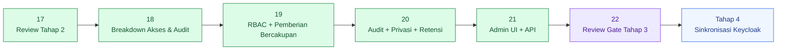
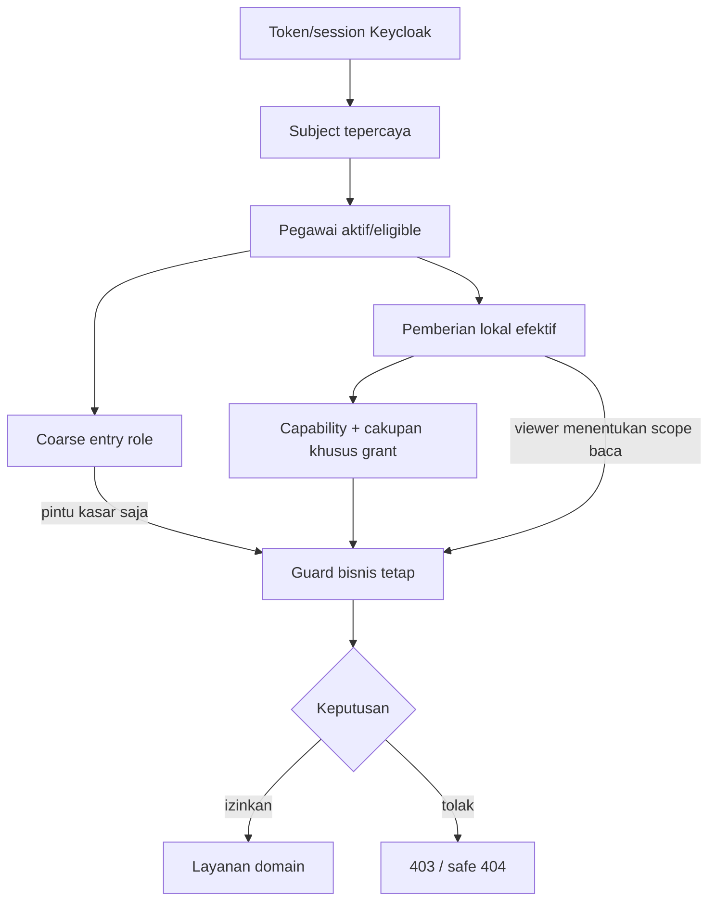
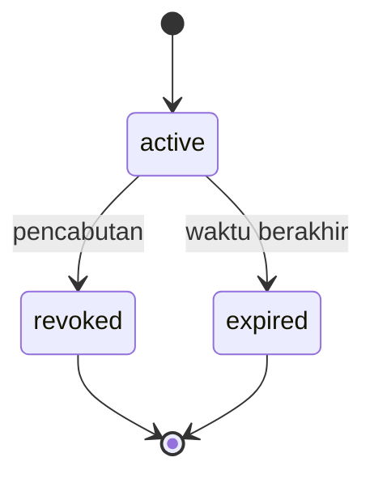

# 22 - IDP Pegawai Daftar Periksa Review Tahap 3 & Keputusan Final

Status: **Gerbang review arsitektur Tahap 3 disetujui**, bukan izin coding/provisioning
Proyek: kumjabar_ecosystem
Tanggal: 2026-08-29
Mereview:

- `18-idp-pegawai-stage-3-access-audit-breakdown.md`
- `19-idp-pegawai-rbac-scoped-grants-service-guards-contract.md`
- `20-idp-pegawai-audit-event-privacy-retention-contract.md`
- `21-idp-pegawai-access-audit-admin-ui-api-contract.md`

## 1. Tujuan

Dokumen ini menjadi gerbang penutup perancangan **Tahap 3 - Akses & Audit**.

Dokumen ini:

1. mengaudit Dokumen 18–21 sebagai satu sistem;
2. menetapkan precedence ketika breakdown awal dan kontrak rinci berbeda;
3. mengunci boundary otorisasi, audit, privasi, retensi, UI, dan API v1;
4. mengonsolidasikan persistence delta Tahap 3;
5. mengklasifikasikan seluruh keputusan sebagai final, pre-implementation gate, production gate, atau future scope;
6. menetapkan PostgreSQL/security/concurrency/privacy test harness;
7. menilai implementation readiness tanpa menganggap review ini sebagai izin coding.

Prinsip penutup:

> Tahap 3 lengkap jika akses dapat diberikan, dibatasi, disetujui, dicabut, diaudit, dicari, dan diekspor tanpa pencucian cakupan, eskalasi mandiri, kehilangan jejak transaksi, atau kebocoran PII.

## 2. Hasil Gate

```text
Tahap 3 architecture completeness = DISETUJUI
Tahap 3 contract consistency      = DISETUJUI
Tahap 3 implementation readiness  = SIAP DENGAN PRE-IMPLEMENTATION GATES
Izin coding/provisioning          = TIDAK DIBERIKAN OLEH DOKUMEN INI
Production readiness              = BELUM; memerlukan bukti policy, sizing, security, backup, dan operasi
```

Maknanya:

- tidak diperlukan perombakan fundamental terhadap Dokumen 18–21;
- paket arsitektur cukup untuk diturunkan menjadi implementation plan/TDD ketika user mengizinkan;
- DDL/route/model contoh tetap konseptual, bukan migration atau kode final;
- parameter teknis yang tersisa diselesaikan melalui bukti benchmark/test, bukan brainstorming arsitektur baru;
- Tahap 4 boleh mulai dibahas tanpa mengizinkan implementasi Tahap 3 secara implisit.

## 3. Posisi Dokumen 22



## 4. Precedence dan Cara Membaca

Jika detail berbeda, gunakan urutan:

```text
Dokumen 22 review decision
> Dokumen 21 Admin UI/API
> Dokumen 20 audit/privacy/retention
> Dokumen 19 RBAC/grants/guards
> Dokumen 18 breakdown awal
```

Untuk import:

```text
Dokumen 17 review Tahap 2
> Dokumen 16 apply/materialization
> Dokumen 15 retry/error workbook
> Dokumen 14 validation/dry-run
> Dokumen 13 staging schema
> Dokumen 12 template/mapping
> Dokumen 11 breakdown
```

Aturan:

- kontrak rinci yang lebih baru mempersempit breakdown awal;
- Dokumen 22 mengonsolidasikan, bukan menghapus sejarah keputusan;
- bila Tahap 3 menyentuh import, kontrak domain/apply Tahap 2 tetap otoritatif dan Tahap 3 menambahkan authorization/audit;
- perubahan setelah gate ini memerlukan amendment eksplisit, bukan perubahan diam-diam.

## 5. Boundary Final Tahap 3

### 5.1 Masuk Cakupan

| Area | Kontrak v1 |
| --- | --- |
| autentikasi manusia | Keycloak subject tepercaya + coarse entry role |
| otorisasi operasional | enam peran lokal tetap + capability map statis |
| pembacaan dasar | global dari `idp-pegawai-admin:user`, dipersempit local viewer subtree |
| cakupan | `global` dan `org_unit_subtree` |
| pemberian manusia | `access_grants` tipis dan eksplisit |
| pemberian kritis | `access_grant_requests` + empat-mata |
| pencabutan | langsung efektif lokal; proyeksi Keycloak asinkron |
| akun layanan | fixed Keycloak client scopes, bukan grant manusia |
| audit | hanya-tambah, PII-minimized, scope snapshot |
| retensi | kelas 5/5/2/5 tahun + legal hold companion |
| ekspor audit | CSV tersamarkan, asinkron, 50k per bagian, ZIP multipart |
| Admin UI | Jinja + Tailwind, server-rendered, progressive enhancement |
| Admin API | `/admin/api/v1`, idempoten, versioned, safe errors |

### 5.2 Di Luar Cakupan

```text
custom role/capability builder
generic RBAC/ABAC/policy engine
arbitrary JSON conditions atau policy DSL
risk scoring framework
scope algebra umum
generic workflow/approval engine
SIEM/compliance platform
event sourcing
hash-chain/Merkle/WORM framework
unmasked atau XLSX audit export
legal-hold Admin UI
service-account dynamic grants
Redis authorization cache
WebSocket/SSE export status
general impersonation
Keycloak remote call dalam transaksi lokal
```

## 6. Model Kepercayaan Final



Invariant:

- token tidak menjadi authority rinci;
- email/NIP tidak digunakan sebagai actor credential resolution;
- role/cakupan selalu diperiksa ulang oleh service;
- UI flags hanya petunjuk;
- browser tidak menentukan target scope;
- pencabutan lokal berlaku pada request berikutnya.

## 7. Katalog Peran Final

```text
viewer
import_operator
import_approver
access_admin
auditor
security_admin
```

Keputusan:

- katalog fixed dan berversi dalam code/config;
- role baru memerlukan perubahan kode, test, dan review arsitektur kecil;
- unit, status, jabatan, PLT/PLH, atau label organisasi tidak auto-grant role;
- `security_admin` tidak otomatis mendapat capability import;
- `access_admin` hanya mengelola peran biasa dalam cakupan;
- `access_admin` dan `security_admin` tidak dapat diberikan langsung.

## 8. Kontrak Pembacaan Dasar dan Viewer

```text
viewer(global)
-> pembacaan dasar global

viewer(org_unit_subtree=X)
-> pembacaan dasar subtree X

tanpa viewer efektif
-> tidak ada pembacaan dasar
```

Ini pengecualian eksplisit terhadap local-grant requirement. Pengecualian hanya berlaku pada capability baca dasar.

```text
viewer(global) + access_admin(TUM)
!= access_admin(global)
```

Scope tidak boleh tercuci antar-capability.

## 9. Kontrak Cakupan Final

Cakupan hanya:

```text
global
org_unit_subtree
```

Guard subtree:

- memakai hierarchy authoritative saat request;
- target resource diselesaikan server-side;
- perpindahan memeriksa unit lama dan baru;
- target out-of-scope memakai safe 404;
- capability scope union hanya dari grants yang memetakan capability tersebut;
- audit menyimpan historical scope footprint, bukan menghitung ulang histori dari hierarchy terbaru.

## 10. Siklus Hidup `access_grants`



Invariant:

- terminal row tidak diaktifkan ulang;
- perpanjangan membuat row baru;
- exact active equivalent dicegah partial unique index;
- `valid_until` wajib untuk role kritis dan maksimum 365 hari;
- status actor/resource/waktu diperiksa runtime;
- normal operation tidak hard-delete grant;
- create/revoke/expire menulis audit dan outbox dalam transaksi yang sama.

## 11. Pemberian Kritis dan Empat-Mata

```text
access_admin
security_admin
```

memakai `access_grant_requests`:

- intent immutable;
- TTL request 24 jam;
- requester dan approver berbeda;
- approver tidak mengedit intent;
- approval mengunci request dan memvalidasi ulang target/scope/role/waktu;
- request executed + grant create + audit + outbox commit atomik;
- reject/cancel/expire terminal;
- critical self-grant/self-approval dilarang;
- last effective security admin dilindungi.

Empat-mata import hanya wajib untuk batch berdampak tinggi dan tetap mengikuti contract Tahap 2, bukan tabel request grant.

## 12. Idempotensi dan Konkruensi

Mutasi command membawa:

```text
Idempotency-Key
canonical intent hash
```

Mutation existing hanya memakai:

```http
If-Match: "<lock_version>"
```

Kontrak final:

- JSON body tidak menerima versi yang diharapkan;
- header hilang menghasilkan 428 `precondition_required`;
- malformed menghasilkan 400 `precondition_invalid`;
- stale menghasilkan 409;
- same key + same intent mengembalikan hasil lama;
- same key + different intent menghasilkan 409;
- replay tidak menggandakan domain/audit/outbox/file;
- lock/unique constraint tetap menjadi lapisan correctness terakhir.

## 13. Batas Transaksi Final

Mutasi akses:

```text
BEGIN
-> reauthorize
-> lock + revalidate
-> mutate access aggregate
-> INSERT audit success
-> INSERT outbox
-> COMMIT
```

Jika domain/audit/outbox gagal, seluruh transaksi rollback.

Tidak ada:

```text
remote Keycloak call
object storage upload
consumer HTTP call
```

di dalam transaksi database mutasi akses.

## 14. Pencabutan dan Proyeksi Keycloak

```text
revoke local grant
-> effective deny pada request berikutnya
-> transactional outbox
-> Tahap 4 memproyeksikan coarse role secara asinkron
```

- browser/session/token stale tidak menghidupkan kembali akses lokal;
- revoke tidak menunggu approval kedua;
- proyeksi gagal tidak membatalkan revoke lokal;
- status lokal dan status proyeksi ditampilkan terpisah.

## 15. Audit Persis yang Wajib

Audit persisten wajib untuk:

- mutasi pegawai/organisasi/identity link;
- import intent/approval/apply terminal/artifact access;
- grant request/decision/create/revoke/expire;
- denial sensitif/berprivilese;
- bootstrap/recovery;
- sensitive detail view;
- export requested/generated/downloaded/expired/purged;
- legal hold/retention purge governance.

Pembacaan daftar rutin yang masked memakai telemetry dan tidak menghasilkan audit persisten.

## 16. Audit vs Ledger vs Telemetri

| Lapisan | Fungsi | Contoh |
| --- | --- | --- |
| `audit_logs` | fakta tindakan penting | grant revoked, sensitive detail viewed |
| domain/command ledger | state/provenance operasional | import materialization, export command |
| telemetri | operasi rutin/performa | list view, latency, gateway IP |

Audit tidak menyalin full ledger, workbook, request, response, atau domain payload.

## 17. Kontrak PII Audit

Audit mengutamakan:

```text
actor subject stabil
pegawai/resource UUID
scope snapshot
reason code
changed_fields
before/after canonical hash
provenance UUID
allowlisted masked summary
```

Dilarang:

```text
full NIP atau email
raw/full employee payload
workbook atau import rows
OAuth/OIDC token
cookie/session/client secret
signed URL/storage credential
stack trace/SQL
arbitrary JSON metadata
```

Nama pegawai diselesaikan melalui masked display resolver saat query, bukan dipersist dalam audit row.

## 18. Scope Footprint Audit

- `scope_org_unit_uuid` menyimpan scope utama saat event;
- `scope_footprint` menyimpan array kecil unit lama/baru;
- batch besar memakai reference + footprint hash;
- auditor subtree hanya melihat event jika seluruh footprint berada dalam subtree;
- event global/null-scope hanya auditor global;
- perubahan hierarchy tidak mengubah histori.

## 19. Retensi Final

| Retention Class | Baseline |
| --- | ---: |
| `security_access` | 5 tahun |
| `identity_business` | 5 tahun |
| `import_governance` | 2 tahun |
| `audit_export_governance` | 5 tahun |

Aturan:

- kebijakan resmi boleh memperpanjang;
- pemendekan memerlukan security/privacy/records review;
- legal hold/perpanjangan memakai companion table;
- purge memakai principal terpisah dan manifest;
- backup/restore wajib menjalankan retention catch-up;
- IP address berada di gateway telemetry, bukan `audit_logs` v1.

## 20. Ekspor Audit Final

```text
format                 = CSV UTF-8 tersamarkan
XLSX                   = tidak tersedia
maksimum per CSV       = 50.000 baris
hasil <= 50.000        = satu CSV
hasil > 50.000         = ZIP berisi multipart CSV + manifest
artifact TTL           = 24 jam
signed URL TTL maksimum= 5 menit
```

Kontrol:

- asinkron 202;
- scope snapshot server-side;
- keyset query;
- formula-prefix neutralization + RFC 4180 quoting;
- private object storage;
- temporary write + verify + atomic publish;
- checksum tiap part dan manifest;
- reauthorization setiap download;
- generate/download/purge diaudit;
- file parsial tidak menjadi ready.

## 21. Keamanan CSV

Sel yang setelah trim awal diawali:

```text
= + - @ tab CR LF
```

diberi prefix apostrof dan tetap di-quote sesuai RFC 4180.

Fixtures wajib mencakup:

```text
=HYPERLINK(...)
+CMD
-1+1
@SUM(...)
leading tab/CR/LF
quote/comma/newline
UTF-8 text
```

## 22. Admin UI Final

```text
Jinja + Tailwind minimal
server-rendered
progressive enhancement
Bahasa Indonesia nonteknis
```

Halaman:

- daftar/detail/pemberian/pencabutan akses;
- request/approve/reject/cancel peran kritis;
- masked audit list/detail;
- export request/status/download;
- capability context.

Tidak ada SPA, policy editor, workflow builder, raw JSON viewer, unmasked export, atau legal-hold UI v1.

## 23. Admin API Final

Namespace:

```text
/admin/api/v1
```

Keluarga endpoint:

```text
/access-grants
/access-grant-requests
/audit-events
/audit-exports
/me/capabilities
```

Kontrak:

- UUID route, bukan integer ID;
- actor identity dari trusted session/token;
- stable success/error envelope;
- request ID selalu ada;
- message Bahasa Indonesia aman;
- SQL/stack trace/secret tidak bocor;
- 404 identik untuk missing/out-of-scope;
- CSRF untuk cookie mutation;
- CORS same-origin;
- response sensitif no-store;
- payload sensitif tidak di-localStorage.

## 24. Keyset Pagination Final

Audit timeline:

```text
ORDER BY occurred_at DESC, id DESC
```

Cursor authenticated/HMAC memuat:

```text
occurred_at
id
filter_hash
scope_hash
cursor_version
```

- default 50, maksimum 100;
- terikat filter dan effective scope;
- mismatch ditolak;
- tidak ada offset pagination;
- tidak ada global total leak;
- rentang waktu default 24 jam terakhir.

## 25. Polling Ekspor Final

```text
poll_after_seconds awal = 3
bounded backoff          = 3, 6, 12, 24, 30, 30, ...
SSE/WebSocket            = tidak ada v1
```

- terminal state menghentikan polling;
- `Retry-After` dihormati;
- polling berhenti ketika page/navigation tidak memerlukan status;
- 401/403/404 tidak dicoba ulang tanpa tindakan user.

## 26. No-Existence-Leak

- missing dan out-of-scope detail memakai status/body aman yang sama;
- autocomplete/count/facet scope-filtered server-side;
- NIP/email tersembunyi tidak dikonfirmasi error;
- cursor scope-bound;
- export tidak menyebut jumlah row out-of-scope;
- timing/message tidak sengaja membedakan hidden target.

## 27. Persistence Delta Tahap 3

### 27.1 Tabel Wajib

| Tabel | Status | Fungsi |
| --- | --- | --- |
| `access_grants` | wajib | thin local human grant aggregate |
| `access_grant_requests` | wajib | four-eyes critical grant request |
| `audit_logs` | wajib | fakta audit hanya-tambah |
| `audit_legal_holds` | wajib | active/released legal hold companion |
| `audit_retention_extensions` | wajib | perpanjangan retensi hanya-tambah |
| `audit_exports` | wajib | async masked export command/artifact lifecycle |
| `audit_purge_manifests` | wajib | proof summary untuk bounded purge |

### 27.2 Delta Tabel Existing

| Tabel | Delta |
| --- | --- |
| `transactional_outbox` | event families akses/audit/export bila belum generic |
| `pegawai` | tidak ada role/jabatan/policy JSON; hanya relasi/UUID yang sudah dikontrak |
| Stage 2 command/ledger | referensi UUID audit; jangan menyalin payload |

### 27.3 Tabel yang Tidak Dibuat

```text
roles
capabilities
role_capabilities
policies
policy_conditions
risk_rules
scope_expressions
service_account_grants
audit_hash_chain
audit_merkle_nodes
impersonation_sessions
```

Role/capability catalog berada pada code/config statis berversi.

## 28. Column/Constraint Review Wajib

Sebelum migration final, kunci:

- integer PK + PostgreSQL-generated UUID;
- panjang varchar dan nama constraint pendek;
- enum/check catalog role, status, scope, event/outcome/severity;
- conditional scope constraints;
- valid range dan critical max duration;
- lifecycle timestamp consistency;
- partial unique exact-active grants;
- idempotency key + canonical intent hash;
- source/lock version;
- request distinct actors;
- legal hold active/released consistency;
- export state/storage/hash/expiry consistency;
- JSONB object/allowlist/size validators;
- array cardinality/dedup/order contract;
- retention class/until/policy version;
- sequence/identity privileges.

## 29. Database Principal Matrix

| Principal | Hak Utama | Larangan |
| --- | --- | --- |
| `migration_owner` | DDL/ownership saat migration | bukan runtime web role |
| `idp_app_writer` | domain DML + INSERT `audit_logs` | UPDATE/DELETE/TRUNCATE audit |
| `idp_audit_reader` | SELECT masked/query worker | tidak menerima end-user connection |
| `idp_audit_retention` | bounded purge/hold operation | tidak dipakai request web |
| export worker | read scoped projection + export lifecycle | tidak bypass app authorization contract |

`ALTER` dikendalikan ownership/DDL role, bukan dianggap table privilege DML runtime.

## 30. Index Review

Minimum review:

- exact active grant partial uniqueness;
- active/effective grant lookup by pegawai/role/time;
- request status/expiry;
- audit timeline `(occurred_at DESC, id DESC)`;
- actor/resource/scope/batch/command/correlation indexes;
- export actor/idempotency/status/expiry;
- legal hold target/filter active lookup;
- retention eligible partial/range lookup.

Tidak ada broad GIN JSONB index tanpa query evidence. `audit_logs` non-partitioned v1; review partisi setelah benchmark/proyeksi melampaui 10 juta rows atau kebutuhan operasional terbukti.

## 31. Transaction Boundary Matrix

| Operasi | Satu Transaksi | Di Luar Transaksi |
| --- | --- | --- |
| grant create/revoke/expire | aggregate + audit + outbox | Keycloak projection |
| critical approve | request executed + grant + audit + outbox | Keycloak projection |
| critical reject/cancel | request terminal + audit | notification opsional |
| sensitive detail | authorized read + bounded audit semantics | UI render |
| export reserve | command + requested audit | file generation |
| export finalize | export state + generated audit | object publish sudah diverifikasi |
| audit purge | manifest + bounded controlled deletion sesuai runbook | backup expiry coordination |

Object storage tidak dimasukkan ke transaksi PostgreSQL. Gunakan temporary object, checksum verification, atomic promote, dan compensation/idempotent cleanup.

## 32. Pre-Implementation Technical Gates

| Gate | Bukti yang Wajib |
| --- | --- |
| PostgreSQL schema harness | check/partial index/FK/array/JSONB/privilege tests |
| grant concurrency | duplicate create, approve race, revoke-vs-expire, last-admin race |
| canonical intent/hash | stable fixtures lintas key order/time/UUID normalization |
| authorization fixtures | role-capability map + capability-specific scope cases |
| subtree resolver | same/descendant/sibling/move/inactive-root tests |
| audit transaction failure injection | domain/audit/outbox rollback evidence |
| denial writer | fail-closed + timeout/alert evidence |
| cursor signing | tamper/filter/scope/version/expiry tests |
| CSV safety | formula/quoting/UTF-8/split/manifest/checksum tests |
| export storage | temporary write, verify, atomic publish, purge/retry tests |
| database privileges | runtime UPDATE/DELETE/TRUNCATE audit denied |
| retention/legal hold | anti-join, release, purge manifest, restore catch-up tests |
| UI security | CSRF/CORS/no-store/no-localStorage/safe-404 tests |
| sizing | audit query, 50k CSV streaming, multipart ZIP, worker memory benchmark |

Gate ini memblokir klaim coding selesai, bukan penutupan arsitektur.

## 33. PostgreSQL Test Harness

Wajib memakai PostgreSQL nyata untuk:

```text
partial unique indexes
row locks dan lock ordering
READ COMMITTED behavior
advisory locks yang diwarisi Tahap 2
JSONB constraints/validators
UUID[] scope footprint
DB privileges/ownership
transaction rollback injection
concurrent approve/revoke/expire
retention purge queries
```

SQLite tidak menjadi bukti correctness Tahap 3.

## 34. Authorization Test Matrix

- unknown/ambiguous subject ditolak;
- inactive pegawai ditolak;
- coarse entry tanpa local grant efektif tidak dapat membaca atau mutate;
- viewer subtree memberi pembacaan hanya pada subtree;
- viewer global tidak mencuci access-admin subtree;
- capability union hanya dari grants terkait;
- inactive subtree root memblokir mutation;
- old/new unit footprint diperiksa;
- self-grant/self-approval ditolak;
- distinct approver enforced;
- critical duration >365 hari ditolak;
- request lewat 24 jam expired;
- last security admin protected;
- revoke langsung deny sebelum projection.

## 35. Konkruensi dan Idempotensi Test Matrix

- duplicate active grant concurrent menghasilkan satu row;
- same key/same intent mengembalikan result lama;
- same key/different intent 409;
- approve race menghasilkan satu grant;
- approve vs expiry deterministik;
- revoke vs expiry deterministik;
- missing `If-Match` 428;
- malformed `If-Match` 400;
- stale `If-Match` 409;
- replay tidak menggandakan audit/outbox/export file;
- failure injection sebelum/di antara/setelah writes rollback sesuai boundary.

## 36. Audit dan Privasi Test Matrix

- event catalog/version/outcome/severity valid;
- audit success commit bersama mutasi;
- denied tetap denied ketika writer gagal;
- full NIP/email/token/secret/workbook ditolak validator;
- changed fields allowlist dan canonical hash stabil;
- unknown/oversized JSON metadata ditolak;
- auditor subtree hanya full-contained footprint;
- global/null-scope event hanya auditor global;
- hierarchy change tidak mengubah historical scope;
- sensitive detail menulis maksimum satu event per request intent;
- recursion guard tidak membuat event loop;
- masked display resolver tidak mempersist nama.

## 37. Ekspor Test Matrix

- hasil 0–50.000 row menjadi satu CSV;
- hasil 50.001+ row menjadi ZIP multipart;
- setiap part maksimum 50.000 row;
- manifest urutan/row count/checksum benar;
- CSV formula injection dinetralkan;
- RFC 4180 quoting dan UTF-8 benar;
- file generation streaming tidak membengkakkan memory;
- file parsial tidak berstatus ready;
- signed URL maksimum 5 menit;
- artifact expiry 24 jam;
- download reauthorization dan audit;
- expired/purged export ditolak;
- idempotent retry tidak menggandakan artifact;
- XLSX endpoint/format tidak tersedia.

## 38. UI/API Test Matrix

- capability menu/CTA benar tetapi forced request tetap dijaga backend;
- error envelope/message Indonesia/request ID konsisten;
- missing/out-of-scope shape identik;
- filter/autocomplete/count tidak bocor;
- cursor HMAC tamper ditolak;
- cursor filter/scope mismatch ditolak;
- default audit range 24 jam;
- 202 memberi `poll_after_seconds=3`;
- polling bounded 3–30 detik dan berhenti pada terminal;
- no SSE/WebSocket dependency;
- CSRF/CORS/session/cookie/base-path behavior;
- no-store dan tidak ada localStorage payload;
- keyboard/focus/label/status accessibility.

## 39. Governance sebelum Production

- records management mengesahkan atau memperpanjang baseline 5/5/2/5;
- legal hold authority, case reference, release, dan runbook disahkan;
- bootstrap/recovery runbook dan credential custody disahkan;
- role assignment/delegation governance disahkan;
- high-impact import classification disahkan;
- export acceptable-use dan workstation handling disahkan;
- database role credentials/rotation disahkan;
- backup expiry/restore retention catch-up disahkan;
- monitoring/alert thresholds/on-call escalation disahkan;
- object storage lifecycle/encryption/key management disahkan.

## 40. Production Evidence Gates

- migration rehearsal dan rollback procedure;
- privilege penetration test;
- concurrency/adversarial test pass;
- load/sizing test pass;
- backup/purge/restore/legal-hold drill;
- export memory/storage/failure test;
- security review CSRF/CORS/OIDC/session/gateway headers;
- operator usability/accessibility review;
- monitoring dashboards/alerts/runbooks;
- Stage 4 Keycloak projection behavior dan reconciliation evidence.

## 41. Future / Bukan MVP

- generic ABAC/policy engine;
- custom role/capability builder;
- dynamic service-account grant;
- legal-hold UI;
- unmasked/XLSX/PDF audit export;
- SIEM integration platform;
- hash-chain/Merkle/WORM;
- partisi tabel audit sebelum ada bukti ambang kebutuhan;
- Redis authorization cache;
- SSE/WebSocket export progress;
- generalized impersonation;
- mesin alur kerja yang dapat dikonfigurasi;
- cross-ecosystem centralized permission service.

## 42. Risiko yang Dibawa ke Implementasi

| Risiko | Klasifikasi | Mitigasi/Gate |
| --- | --- | --- |
| DDL column lengths/constraint names belum final | teknis | migration review + PostgreSQL harness |
| role-capability fixture drift | teknis | versioned fixtures + contract tests |
| subtree query performa/hierarchy change | teknis | resolver tests + indexes/benchmark |
| audit volume mencapai 10 juta rows | operasional | monitor growth + partition review threshold |
| denial flood | keamanan/operasional | selective durable audit + telemetry/rate limit |
| laptop operator menyimpan ekspor | privasi | peringatan, SOP, hanya tersamarkan, TTL server 24 jam |
| signed URL leakage | keamanan | 5-minute max + no-store + reauthorization |
| object storage partial publish | reliability | temporary key + verify + atomic promote |
| backup mempertahankan expired data | governance/infra | expiry alignment + restore catch-up |
| bootstrap misuse | keamanan | time-bound allowlist + incident ticket + audit |
| Stage 4 belum ada | roadmap | local enforcement authoritative + outbox durable |

Tidak satu pun risiko tersebut memerlukan perombakan arsitektur Tahap 3, tetapi gate terkait wajib dipenuhi sebelum klaim coding/production selesai.

## 43. Keputusan Final Dokumen 21

| Nomor | Keputusan |
| --- | --- |
| 1 | `If-Match` header eksklusif untuk mutation existing |
| 2 | `poll_after_seconds=3` + bounded backoff 3–30 detik |
| 3 | ZIP hanya jika hasil lebih dari 50.000 row |
| 4 | Nama pegawai via masked display resolver, bukan audit persistence |
| 5 | `access_admin` boleh melihat reason grant lengkap dalam scope dan no-store |
| 6 | sensitive detail audit dedup per request/navigation intent |
| 7 | tanpa SSE/WebSocket v1 |
| 8 | default audit query 24 jam terakhir |

Tidak ada pertanyaan arsitektur Tahap 3 yang masih terbuka setelah keputusan ini.

## 44. Status Persistence Readiness

| Area | Status |
| --- | --- |
| tabel/delta yang diperlukan | dikunci |
| lifecycle/status utama | dikunci |
| transaction boundaries | dikunci |
| uniqueness/idempotency/versioning | dikunci |
| authorization/scope semantics | dikunci |
| audit/privacy/retention semantics | dikunci |
| Admin UI/API behavior | dikunci |
| exact migration syntax/names/lengths | pre-implementation review |
| performance limits selain 50k export | benchmark gate |
| production policy/runbook | governance gate |

## 45. Implementation Readiness Checklist

### Arsitektur - Lulus

- [x] Boundary Tahap 3 konsisten.
- [x] Enam peran dan capability map statis lengkap.
- [x] Dua cakupan dan anti-scope-laundering lengkap.
- [x] Grant lifecycle dan critical request lengkap.
- [x] Revoke lokal/Keycloak async boundary lengkap.
- [x] Audit taxonomy/transaction/privacy lengkap.
- [x] Retention/legal hold/export lengkap.
- [x] Admin UI/API/idempotency/keyset/error lengkap.
- [x] Keputusan Dokumen 18–21 ditutup.
- [x] Future overengineering dikeluarkan eksplisit.

### Wajib sebelum Coding Completion

- [ ] Final migration lengths/names/constraints direview.
- [ ] PostgreSQL privilege/schema/concurrency harness tersedia.
- [ ] Role-capability/scope/canonical hash fixtures dibekukan.
- [ ] Cursor signing key rotation/version contract ditetapkan.
- [ ] Object storage atomic publish/streaming interface ditetapkan.
- [ ] Export sizing/memory benchmark dan total cap ditetapkan.
- [ ] Retention/legal hold/purge runbook diuji.
- [ ] UI security/accessibility test harness tersedia.

### Wajib sebelum Production

- [ ] Governance role/four-eyes/bootstrap disahkan.
- [ ] Privacy/retention/legal hold policy disahkan.
- [ ] Database role/credential rotation disahkan.
- [ ] Backup/purge/restore drill lulus.
- [ ] Security/adversarial/concurrency/load tests lulus.
- [ ] Monitoring/alert/on-call/runbook lulus.
- [ ] Gateway/OIDC/CSRF/CORS/session hardening lulus.
- [ ] Stage 4 projection/reconciliation lulus.

## 46. Urutan Implementasi Ketika Diizinkan

Jangan mulai dari UI.

```text
1. implementation plan TDD terpisah
2. PostgreSQL roles/extensions/schema migration
3. access grant/request models + constraints
4. role-capability fixtures + scope resolver
5. access repositories/services/guards
6. audit schema/writer/validator/query
7. retention/legal-hold/purge services
8. export command/storage/CSV safety
9. Admin API contracts
10. Jinja/Tailwind operator UI
11. concurrency/failure/security/privacy/load verification
12. Stage 4 projection integration
```

Setiap slice harus mempunyai RED-GREEN-REFACTOR, PostgreSQL proof, dan commit kecil. Dokumen ini tidak memberikan izin menjalankan urutan tersebut.

## 47. Keputusan Penutupan Tahap 3

```text
Tahap 3 design                  = CLOSED / APPROVED
Dokumen 18–21                   = ARCHITECTURE-COMPLETE
Implementation plan eligibility = YES, WHEN EXPLICITLY REQUESTED
Coding authorization            = NO
Next architecture stage         = TAHAP 4 KEYCLOAK SYNC & PROJECTION
```

Perpindahan ke Tahap 4 tidak mengizinkan coding Tahap 1–3 secara implisit.

## 48. Rekomendasi Dokumen Berikutnya

Jalur arsitektur berikutnya:

```text
23 - IDP Pegawai Tahap 4 Sinkronisasi Keycloak & Proyeksi Breakdown
```

Dokumen 23 sebaiknya membahas:

- coarse role projection `idp-pegawai-admin:user`;
- identity link prerequisite;
- transactional outbox consumer;
- idempotent Keycloak Admin API commands;
- create/link/disable/unlink boundaries;
- local-vs-Keycloak source of truth;
- retry/backoff/dead-letter/reconciliation;
- revoke projection lag dan observability;
- service-account/private-network contract;
- tanpa remote call dalam transaksi domain.

## 49. Kesimpulan

Tahap 3 bukan sekadar halaman role dan tabel log. Ia adalah sistem governance tertutup:

```text
trusted identity
-> fixed local RBAC
-> capability-specific scope
-> fixed business guards
-> idempotent/versioned mutation
-> atomic domain + audit + outbox
-> immediate local revoke
-> scoped masked audit
-> governed retention/export
-> operator-friendly UI/API
```

Paket ini tetap:

- **ringan**: fixed catalog, dua scope, Jinja/Tailwind, tanpa policy/SIEM/workflow engine;
- **tangguh**: constraint, transaction, locking, idempotency, cursor, retention, dan recovery boundary;
- **kuat**: tolak-secara-default, anti-pencucian-cakupan, empat-mata terpilih, audit hanya-tambah, minimalisasi PII, ekspor aman, dan pencabutan lokal langsung.

Dengan Dokumen 22, **Tahap 3 Akses & Audit resmi architecture-complete dan ditutup secara arsitektural**.
