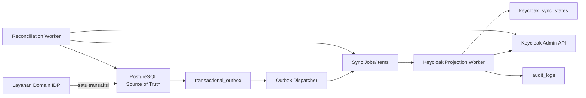
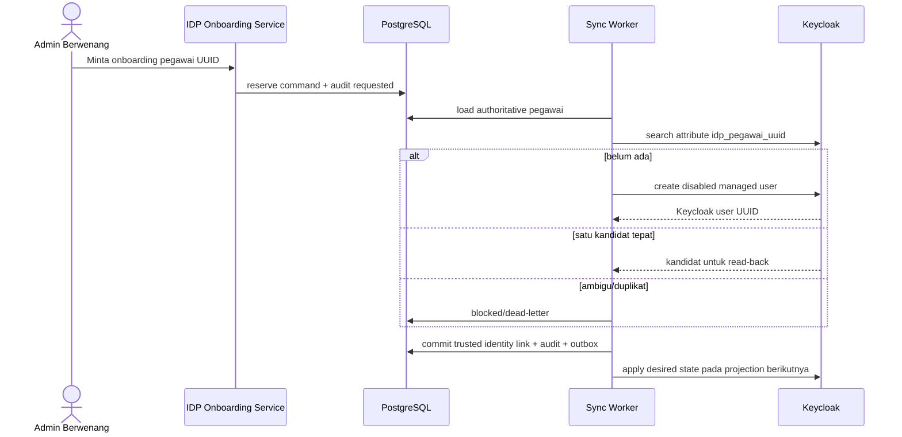
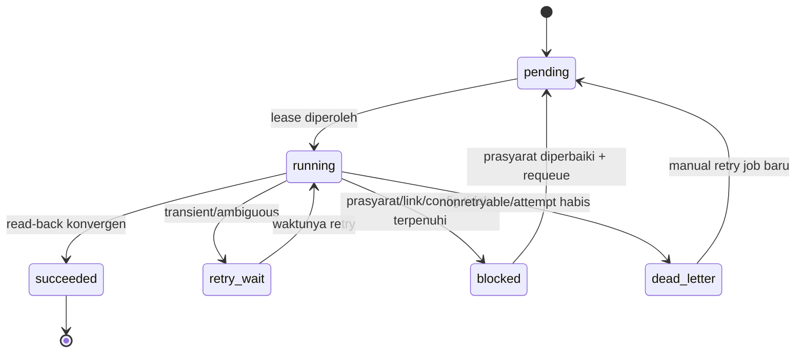
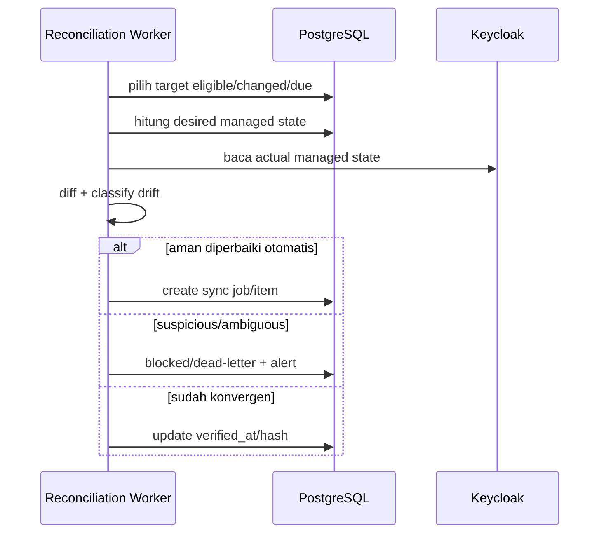

# 23 - IDP Pegawai Tahap 4 Sinkronisasi Keycloak & Proyeksi Breakdown

Status: Draf curah gagasan arsitektur, **bukan kode implementasi**
Proyek: kumjabar_ecosystem
Tanggal: 2026-08-29
Bergantung pada:

- `22-idp-pegawai-stage-3-review-checklist-open-decisions.md`
- `21-idp-pegawai-access-audit-admin-ui-api-contract.md`
- `20-idp-pegawai-audit-event-privacy-retention-contract.md`
- `19-idp-pegawai-rbac-scoped-grants-service-guards-contract.md`
- `17-idp-pegawai-stage-2-review-checklist-open-decisions.md`
- `16-idp-pegawai-import-apply-materialization-contract.md`
- `08-idp-pegawai-stage-1-repository-service-contract.md`
- `07-idp-pegawai-stage-1-model-contract-mapping.md`
- `03-keycloak-matrix-and-org-unit-seed.md`

## 1. Tujuan

Dokumen ini membuka perancangan **Tahap 4 - Sinkronisasi Keycloak & Proyeksi**.

Sasaran utamanya:

1. memproyeksikan identitas ASN yang dikelola IDP ke Keycloak secara aman;
2. memproyeksikan eligibility, atribut, group organisasi, dan coarse roles yang dikelola;
3. memproyeksikan client role `idp-pegawai-admin:user` tanpa menjadikan Keycloak authority otorisasi rinci;
4. mengonsumsi transactional outbox secara at-least-once;
5. membuat seluruh operasi remote retry-safe dan konvergen;
6. membedakan akun Keycloak yang dikelola IDP dari akun existing/shared;
7. menangani ambiguous HTTP outcome, drift, dead-letter, dan rekonsiliasi;
8. mempertahankan immediate local enforcement dari Tahap 3;
9. mencegah PII, secret, dan admin credential bocor ke event/log;
10. tetap ringan tanpa message-broker platform atau generic identity-governance engine.

Prinsip utama:

> PostgreSQL IDP menyatakan **desired state**. Keycloak menyimpan **projection state**. Worker membuat actual state Keycloak berkonvergensi ke desired state tanpa memindahkan source of truth.

## 2. Hasil yang Diharapkan

```text
Domain commit lokal
-> transactional outbox
-> dispatcher durable
-> sync job/item
-> desired-state resolution
-> Keycloak Admin API
-> read-back verification
-> projection state
-> audit + observability
-> periodic reconciliation
```

Tahap 4 bukan dual-write sinkron antara PostgreSQL dan Keycloak.

## 3. Batas Tahap 4

### 3.1 Masuk Cakupan

- Keycloak service account untuk sync worker;
- konsumsi event outbox pegawai/akses/organisasi;
- provisioning user terkontrol;
- linking menggunakan immutable Keycloak user ID;
- enable/disable atau pencabutan internal entitlement sesuai mode pengelolaan akun;
- atribut claim yang dikelola IDP;
- group organisasi dalam namespace yang dikelola;
- realm/base roles yang diizinkan;
- client role kasar `idp-pegawai-admin:user`;
- projection state, sync job, sync item, lease, retry, dead-letter;
- rekonsiliasi event-driven dan berkala;
- Admin UI status sinkronisasi sederhana;
- audit tindakan administratif dan pemulihan manual.

### 3.2 Di Luar Cakupan

```text
permission rinci aplikasi consumer
role builder Keycloak umum
sinkronisasi seluruh realm tanpa allowlist
password management portal
credential reset massal
social identity auto-link berdasarkan email
penghapusan permanen user Keycloak
sinkronisasi dua arah Keycloak -> IDP domain
full IAM governance suite
SCIM server umum
Kafka/RabbitMQ wajib
workflow engine generik
SIEM platform
consumer delta feed penuh selain kebutuhan projection Keycloak
```

Delta feed aplikasi consumer dapat menjadi dokumen Tahap 4 lanjutan, tetapi tidak dicampurkan ke worker Keycloak pertama.

## 4. Keputusan Dasar Source of Truth

| Concern | Source of Truth | Keycloak |
| --- | --- | --- |
| identitas ASN | IDP `pegawai` | projection profile/claim |
| lifecycle/eligibility | IDP `status_pegawai` + `is_active` | enabled/internal entitlement projection |
| afiliasi organisasi | IDP assignments + `org_units` | managed group membership/claims |
| identity link | IDP `pegawai_identity_links` | remote user ID yang direferensikan |
| akses rinci Admin IDP | local `access_grants` | tidak diproyeksikan rinci |
| pintu Admin IDP | local desired-entry decision | client role kasar |
| jabatan/PLT/PLH | consumer kepegawaian | tidak diproyeksikan IDP |
| password/MFA/session | Keycloak | authority autentikasi |
| actual remote state | Keycloak | dibaca untuk verifikasi/drift |
| projection status | IDP sync tables | status operasional, bukan authority bisnis |

Keycloak tidak boleh menulis balik status pegawai, unit, grant, atau identity-link ownership ke domain IDP secara otomatis.

## 5. Arsitektur Tingkat Tinggi



## 6. Invariant Utama

1. Tidak ada Keycloak HTTP call di dalam transaksi domain.
2. Domain commit tanpa durable outbox tidak dianggap lengkap secara operasional.
3. Worker boleh menerima event duplikat.
4. Event lama tidak boleh menurunkan desired version terbaru.
5. Worker selalu menghitung ulang desired state dari database saat eksekusi.
6. Payload event hanya menjadi trigger/provenance, bukan authority state lengkap.
7. Keycloak user ID immutable menjadi remote identity key.
8. Email tidak pernah menjadi identity-link authority.
9. Worker hanya mengubah atribut/group/role dalam managed allowlist.
10. Drift pada artifact unmanaged tidak diperbaiki atau dihapus.
11. Pencabutan lokal tidak menunggu Keycloak.
12. Tidak ada hard-delete user Keycloak pada v1.
13. Retry remote tidak membuat user/link/group/role duplikat.
14. Ambiguous outcome selalu diselesaikan dengan read-back/reconciliation.
15. Semua error persisten memakai safe error code, bukan raw response body.

## 7. Dua Jenis State

### 7.1 Desired State

Dihitung dari data IDP terkini:

```text
pegawai eligibility
identity link
management mode
primary/additional org assignments
managed attribute map
managed group paths
managed realm roles
managed client roles
local access-grant summary
```

### 7.2 Actual State

Dibaca dari Keycloak:

```text
user exists/enabled
managed attributes
managed group memberships
managed realm roles
managed client roles
```

Worker menghitung:

```text
diff = desired_managed_state - actual_managed_state
```

Diff tidak mencakup data di luar managed namespace.

## 8. Event sebagai Petunjuk, Bukan Snapshot Penuh

Outbox event membawa minimum:

```text
event_uuid
event_type
aggregate_type
aggregate_uuid
source_version
contract_version
payload_hash
change_kinds
occurred_at
correlation/provenance UUID
```

Ketika item dijalankan:

1. muat aggregate authoritative terbaru;
2. muat trusted Keycloak identity link;
3. hitung desired state terbaru;
4. bandingkan desired version/hash dengan projection state;
5. abaikan event lama bila state lebih baru sudah diterapkan;
6. lakukan minimal remote diff;
7. verifikasi hasil.

Pola ini membuat worker aman terhadap duplicate dan out-of-order delivery.

## 9. Keluarga Event Ingress

### 9.1 Pegawai

```text
pegawai.created
pegawai.changed
```

`change_kinds` dapat memuat:

```text
profile_updated
eligibility_changed
primary_org_changed
additional_org_changed
identity_link_changed
```

Satu mutation pegawai tetap menghasilkan satu authoritative event per `source_version` sesuai Dokumen 16.

### 9.2 Akses

```text
access_grant.created
access_grant.revoked
access_grant.expired
```

Event ini memicu perhitungan ulang coarse Admin UI entry role untuk target pegawai. Role rinci tidak dikirim ke Keycloak.

### 9.3 Organisasi

```text
org_unit.created
org_unit.changed
org_unit.deactivated
```

Event organisasi memicu provisioning/rekonsiliasi managed group dan membership pegawai terdampak. Fan-out harus dibatasi dan menjadi job terukur, bukan satu transaksi besar.

## 10. Projection Target v1

Target projection pegawai:

```text
Keycloak user linkage
account enabled policy
managed user attributes
managed organization groups
managed base realm/client roles
idp-pegawai-admin:user coarse role
```

Tidak diproyeksikan:

```text
access_admin/auditor/import_operator detail
org_unit_subtree scope
jabatan atau label jabatan
PLT/PLH
full audit payload
reason grant
NIP sebagai arbitrary log metadata
```

## 11. Managed Namespace

Worker harus mempunyai allowlist eksplisit.

### 11.1 Managed Attributes

Rekomendasi awal:

```text
idp_pegawai_uuid
idp_source_version
user_type
pegawai_status
primary_org_unit_code
primary_org_unit_path
org_unit_codes
org_group_paths
```

Aturan:

- nilai berasal dari canonical serializer;
- tidak ada jabatan/PLT/PLH;
- atribut di luar prefix/catalog managed tidak disentuh;
- source version disimpan untuk troubleshooting, bukan authorization consumer final;
- ukuran array mempunyai cap aman.

### 11.2 Managed Groups

Hanya path di bawah:

```text
/pegawai/kanwil-jabar
```

Worker tidak mengubah group publik atau group aplikasi lain.

### 11.3 Managed Roles

Allowlist awal:

```text
realm: pegawai
client: portal:user
client: s1:user
client: idp-pegawai-admin:user
```

Role aplikasi lain tidak boleh diberikan hanya karena unit organisasi.

## 12. Kontrak Group Organisasi

`org_units.keycloak_group_path` adalah desired path.

Aturan v1:

- group dibuat parent-first;
- lookup memakai managed path dan remote immutable group ID setelah terikat;
- membership primary dan additional mengikuti policy final;
- rename label aman tidak mengubah `org_units.code`;
- move/path change adalah operasi berdampak tinggi dan direkonsiliasi terukur;
- group tidak otomatis dihapus ketika unit nonaktif;
- unit nonaktif berhenti menerima membership baru;
- removal membership hanya untuk managed organization groups;
- unmanaged group membership tidak disentuh.

## 13. Identity Link sebagai Prasyarat

Canonical link Keycloak menggunakan:

```text
pegawai_identity_links.provider = keycloak
pegawai_identity_links.provider_subject = Keycloak user UUID
```

Kontrak:

- `provider_subject` immutable selama link aktif;
- satu Keycloak subject hanya boleh terhubung ke satu pegawai;
- satu pegawai maksimal satu active Keycloak link v1;
- link harus trusted/approved dan diaudit;
- email hanya data bantu display, bukan match authority;
- `pegawai.keycloak_user_id` bila masih ada diperlakukan sebagai denormalized compatibility cache, bukan sumber kedua;
- mismatch antara cache dan identity link menjadi reconciliation error;
- implementasi sebaiknya memilih satu writer yang menurunkan cache dari link atau mendeprekasi cache melalui migration terpisah.

## 14. Mode Pengelolaan Akun

Identity link memerlukan mode eksplisit:

```text
idp_managed
linked_existing
```

### 14.1 `idp_managed`

- user dibuat melalui onboarding IDP terkendali;
- IDP boleh mengelola enabled state;
- IDP boleh mengelola managed attributes/groups/roles;
- IDP tetap tidak hard-delete user.

### 14.2 `linked_existing`

- user sudah ada atau dipakai konteks lain;
- IDP hanya mengelola internal managed attributes/groups/roles;
- ineligibility mencabut managed internal entitlement;
- worker tidak men-disable seluruh account secara otomatis karena dapat memutus akses publik/konteks lain;
- perubahan di luar managed namespace tidak disentuh.

Mode harus berupa field relasional/check constraint atau kontrak typed yang mudah difilter; jangan menyembunyikannya hanya dalam JSONB bebas.

## 15. Batas Create User

Auto-create dari file import, NIP, atau email saja **dilarang**.

Controlled onboarding:



Remote create dilakukan di luar transaksi PostgreSQL.

## 16. Idempotensi Create dan Ambiguous Outcome

Keycloak Admin API tidak diasumsikan menyediakan idempotency key end-to-end.

Guard create:

1. satu active onboarding command per pegawai;
2. server-generated stable `idp_pegawai_uuid` attribute;
3. preflight exact search dalam managed realm;
4. create awal dalam keadaan disabled;
5. setelah timeout/connection reset, jangan langsung create ulang;
6. cari kembali user dengan stable attribute;
7. jika tepat satu ditemukan, verify dan lanjutkan link;
8. jika nol, retry bounded;
9. jika lebih dari satu, dead-letter + manual recovery;
10. local identity link commit memakai uniqueness constraints.

Create response yang ambigu tidak boleh menghasilkan user kedua hanya karena worker tidak menerima HTTP response.

## 17. Batas Link Existing User

Link existing wajib melalui workflow berwenang:

- operator memilih/menyediakan immutable Keycloak user UUID;
- service membaca user dari Keycloak;
- service memverifikasi realm, status, dan absence of conflicting link;
- email/name boleh membantu manusia, tidak menjadi auto-match;
- intent menampilkan target pegawai dan remote user secara aman;
- local link commit + audit + outbox atomik;
- remote managed attribute tagging dilakukan worker setelah commit;
- ambiguous/multiple candidate tidak pernah dipilih otomatis.

Tidak ada “link by matching email domain”.

## 18. Batas Unlink

Unlink berarti memutus hubungan IDP, bukan menghapus account remote.

Alur:

```text
local identity link -> inactive/terminal
+ audit
+ outbox
-> commit lokal
-> worker mencabut managed internal roles/groups/attributes
-> idp_managed account boleh dinonaktifkan
-> linked_existing account tetap hidup untuk konteks lain
```

Worker tidak menghapus credential, social link, session history, atau unmanaged role.

## 19. Lifecycle dan Eligibility

| IDP State | `idp_managed` | `linked_existing` |
| --- | --- | --- |
| aktif/eligible | enabled + managed entitlements | managed entitlements, tidak mengambil alih account ownership |
| mutasi_keluar | disable + cabut managed entitlements | cabut managed internal entitlements |
| pensiun | disable + cabut managed entitlements | cabut managed internal entitlements |
| nonaktif | disable + cabut managed entitlements | cabut managed internal entitlements |
| meninggal | disable + cabut managed entitlements | cabut managed internal entitlements |
| soft-deleted/invariant breach | fail-closed + manual review | fail-closed + manual review |

Tidak ada remote delete otomatis.

## 20. Coarse Admin UI Role Projection

Target:

```text
client = idp-pegawai-admin
role   = user
```

Role tersebut hanya pintu kasar. Backend IDP tetap memeriksa local authority.

Desired assignment secara umum:

```text
pegawai aktif/eligible
AND trusted active Keycloak link
AND local Admin UI entry entitlement masih efektif
=> role harus ada
```

Jika false:

```text
local request langsung ditolak
+ role removal diproyeksikan asinkron
```

## 21. Catatan Integrasi Penting: Sumber Entry Entitlement

Dokumen 19 mengizinkan coarse Keycloak role memberi pembacaan dasar global tanpa `viewer(global)`, sedangkan `viewer(org_unit_subtree)` mempersempitnya. Tahap 4 membutuhkan **sumber lokal eksplisit** untuk menentukan kapan coarse role harus ditambahkan/dicabut dan untuk menolak token stale.

Pilihan:

1. **Rekomendasi terkuat:** setiap hak masuk direpresentasikan oleh pemberian lokal; pembacaan global memakai `viewer(global)`.
2. Tambahkan local entry-assignment aggregate terpisah.
3. Biarkan Keycloak role menjadi authority read dasar—tidak direkomendasikan karena melemahkan immediate local revoke.

Rekomendasi Dokumen 23 adalah opsi 1 karena paling sederhana dan konsisten dengan local-authority principle. Keputusan ini merupakan integration amendment yang harus dikunci saat review Dokumen 23 sebelum migration plan dibuat.

Sampai keputusan dikunci, worker tidak boleh mengarang entry entitlement dari unit/jabatan atau token lama.

## 22. Desired Projection Pegawai

Contoh bentuk internal typed object:

```json
{
  "pegawai_uuid": "...",
  "source_version": 14,
  "identity_link_uuid": "...",
  "keycloak_user_id": "...",
  "management_mode": "idp_managed",
  "enabled": true,
  "attributes": {
    "idp_pegawai_uuid": ["..."],
    "idp_source_version": ["14"],
    "user_type": ["pegawai"],
    "pegawai_status": ["aktif"],
    "primary_org_unit_code": ["TUM_TI"]
  },
  "group_paths": [
    "/pegawai/kanwil-jabar/tum/ti"
  ],
  "realm_roles": ["pegawai"],
  "client_roles": {
    "portal": ["user"],
    "s1-internal": ["user"],
    "idp-pegawai-admin": ["user"]
  }
}
```

Object ini dibangun server-side, tervalidasi, dikanonisasi, dan di-hash. Ia tidak diterima dari browser atau event payload bebas.

## 23. Canonical Desired Hash

`desired_hash` mencakup hanya managed projection fields:

```text
contract version
pegawai UUID
source version
identity link UUID/subject
management mode
enabled policy
sorted managed attributes
sorted managed group IDs/paths
sorted managed realm roles
sorted managed client roles
```

Hash:

- canonical JSON UTF-8;
- key dan array terurut;
- null berbeda dari absent;
- SHA-256 lowercase;
- fixtures versioned;
- bukan tanda tangan digital;
- membantu no-op detection dan drift evidence.

## 24. Minimal Diff, Bukan Full Replace

Worker tidak boleh mengirim full user representation secara buta bila itu dapat menghapus unmanaged data.

Pola:

1. GET actual user;
2. extract managed subset;
3. compute managed diff;
4. PATCH/PUT field yang diizinkan sesuai API behavior;
5. add/remove managed memberships/roles secara eksplisit;
6. read back managed subset;
7. compare dengan desired hash;
8. tandai sukses hanya setelah konvergen.

## 25. Keycloak Client dan Service Account

Client internal:

```text
idp-pegawai-sync
```

Kontrak:

- confidential service account/client credentials;
- private network;
- TLS certificate verification wajib;
- credential dari secret manager/runtime secret;
- tidak masuk repository, event, audit payload, atau log;
- minimal fine-grained admin permissions;
- tidak memakai realm-admin penuh bila permission sempit tersedia;
- credential rotation tanpa mengubah domain state;
- token di-cache hanya sampai sebelum expiry dengan safety margin;
- 401/403 berulang menghentikan worker dari retry agresif dan memicu alert kritis.

## 26. Minimal Keycloak Admin Permissions

Worker hanya membutuhkan operasi yang dikontrak, misalnya:

```text
query/view users
manage users tertentu
view managed groups
manage managed group memberships
view managed clients/roles
map managed realm/client roles
```

Jika fine-grained admin permission tidak dapat membatasi target namespace secara cukup, risiko wajib dicatat dan dikompensasi dengan:

- dedicated service account;
- network isolation;
- allowlist di worker;
- audit;
- secret rotation;
- alert atas operasi di luar catalog;
- integration tests melawan realm khusus test.

## 27. Outbox Dispatcher

Dispatcher memindahkan event durable menjadi sync work.

Transaction dispatcher:

```text
BEGIN
-> claim eligible outbox rows dengan FOR UPDATE SKIP LOCKED
-> upsert keycloak_sync_job keyed by event UUID/consumer
-> create/deduplicate job item target
-> mark delivery dispatched untuk consumer Keycloak
-> COMMIT
```

Remote Keycloak call tidak dilakukan saat transaction dispatcher.

Jika proses crash:

- sebelum commit: event tetap eligible;
- setelah commit: job tetap durable;
- duplicate dispatch tertahan uniqueness key.

## 28. Consumer-Specific Delivery State

Satu outbox event mungkin kelak mempunyai beberapa consumer. Jangan memakai satu boolean `published` universal jika Keycloak dan consumer lain berbeda.

Rekomendasi:

```text
outbox event
+ consumer delivery record
```

atau status ekuivalen yang menjaga:

```text
consumer_code
outbox_event_uuid
status
attempt_count
next_attempt_at
lease_owner/lease_until
last_error_code
dispatched_job_uuid
```

Bentuk migration final ditentukan dokumen schema Tahap 4, tetapi delivery per consumer wajib secara semantik.

## 29. Persistence Delta Awal Tahap 4

Tabel konseptual:

| Tabel | Fungsi |
| --- | --- |
| `keycloak_sync_states` | satu current projection state per pegawai/link |
| `keycloak_sync_jobs` | aggregate satu event/manual/reconciliation run |
| `keycloak_sync_job_items` | target item, lease, retry, result, dead-letter state |
| outbox consumer delivery | delivery state khusus consumer Keycloak |

Tidak wajib membuat separate dead-letter table. `keycloak_sync_job_items.status=dead_letter` menjadi logical database DLQ dengan lineage tetap utuh.

## 30. `keycloak_sync_states`

Concern minimum:

```text
id / uuid
pegawai_id / pegawai_uuid reference
identity_link_uuid
keycloak_user_id
management_mode
status
last_desired_source_version
last_desired_hash
last_applied_source_version
last_applied_hash
last_verified_at
last_success_at
last_error_code
last_error_at
consecutive_failures
next_reconcile_at
lock_version
created_at / updated_at
```

Status:

```text
unlinked
pending
syncing
in_sync
retry_wait
blocked
dead_letter
drifted
```

Projection state bukan authority untuk memberi akses. Ia hanya observability dan convergence state.

## 31. `keycloak_sync_jobs`

Job source:

```text
outbox
reconciliation
manual_retry
onboarding
link
unlink
```

Concern:

```text
uuid
source_type
source_event_uuid / parent_job_uuid
triggered_by_subject nullable
reason_code
status
item counts
created_at / started_at / finished_at
```

Job summary adalah cache; item rows tetap source of truth operasional.

## 32. `keycloak_sync_job_items`

Concern:

```text
uuid
job_id
target_type = pegawai / org_unit
target_uuid
desired_source_version
desired_hash
status
attempt_count
next_attempt_at
lease_owner
lease_until
last_http_status
last_error_code
last_error_summary_masked
started_at / finished_at
```

Jangan menyimpan access token, raw Keycloak response, full pegawai payload, NIP/email, atau secret.

## 33. Job dan Item State Machine



Manual retry tidak menghapus sejarah item lama. Ia membuat job/item baru dengan `parent_job_uuid` dan alasan.

## 34. Lease dan Worker Concurrency

Item claim:

```text
SELECT ... FOR UPDATE SKIP LOCKED
status IN (pending, retry_wait)
next_attempt_at <= now()
lease absent/expired
```

Aturan:

- lease memakai waktu database;
- worker ID opaque;
- heartbeat hanya untuk operasi panjang;
- remote call selalu mempunyai connect/read/total timeout;
- expired lease dapat diambil alih;
- result commit memeriksa lease owner/version;
- satu target pegawai tidak dieksekusi paralel untuk desired version berbeda tanpa coordination lock;
- stale item boleh collapse ke desired state terbaru.

## 35. Locking per Target

Gunakan salah satu:

```text
row lock pada keycloak_sync_states
atau
namespaced PostgreSQL advisory lock pegawai UUID hash
```

Tujuan:

- create/link/unlink tidak race;
- role add/remove tidak saling menimpa;
- event source version lama tidak selesai setelah versi baru dan menurunkan state;
- reconciliation dan event-driven worker tidak mengubah target bersamaan.

Lock database tidak ditahan selama remote HTTP call jika menyebabkan transaksi panjang. Gunakan lease/fencing token/lock version yang diverifikasi sebelum menyimpan result.

## 36. Fencing dan Stale Completion

Setiap attempt mempunyai:

```text
item UUID
attempt number
lease generation/fencing token
desired source version/hash
```

Sebelum finalizing success:

- pastikan item/lease masih current;
- pastikan desired state belum berubah;
- bila berubah, jangan tandai projection current sebagai versi lama;
- enqueue/collapse ke desired terbaru;
- remote state yang sudah telanjur diterapkan tetap akan dikoreksi attempt terbaru.

## 37. Strategi Retry

Klasifikasi:

| Kategori | Contoh | Perilaku |
| --- | --- | --- |
| transient network | timeout, reset, DNS sementara | retry dengan jitter |
| rate limit | 429 | hormati `Retry-After` |
| server | 500/502/503/504 | retry bounded |
| auth/config | 401/403 | pause/blocked + alert kritis |
| validation | 400/422 | nonretryable/dead-letter |
| tidak ditemukan | user tertaut menghasilkan 404 | diblokir; rekonsiliasi link, jangan membuat tanpa verifikasi |
| conflict | 409 | read-back lalu retry/reconcile |
| ambiguous | timeout setelah mutation | read-back sebelum mutation ulang |
| duplicate candidate | >1 user stable attribute | dead-letter + manual recovery |

## 38. Backoff

Rekomendasi awal, belum final:

```text
base delay    = 5 detik
multiplier    = 2
max delay     = 15 menit
jitter        = penuh/terbatas
max attempts  = 8
```

`Retry-After` dari Keycloak mengalahkan delay lokal bila lebih panjang dalam cap operasional yang aman. Nilai final harus dibuktikan melalui integration/load test dan batas rate Keycloak.

## 39. Dead-Letter Queue Logis

Item masuk `dead_letter` bila:

- error nonretryable;
- max attempts habis;
- duplicate/ambiguous remote identity;
- managed catalog/config tidak cocok;
- invariant identity link rusak;
- response Keycloak tidak dapat divalidasi aman.

DLQ menyimpan:

```text
safe error code
HTTP status nullable
attempt count
first/last failure time
correlation/job/item UUID
target UUID
masked summary
```

Tidak menyimpan raw response, HTML error page, token, secret, atau full PII.

## 40. Manual Retry dan Recovery

Manual action memerlukan capability security/ops khusus, alasan, dan audit.

Operator boleh:

```text
lihat safe diagnostics
retry setelah prasyarat diperbaiki
recompute desired state
jalankan reconcile target
acknowledge external/manual repair
```

Operator tidak boleh:

```text
mengedit raw event payload
mengganti Keycloak user ID tanpa link workflow
memaksa sukses tanpa read-back
mengabaikan uniqueness conflict
menghapus sejarah failure
```

## 41. Reconciliation

Reconciliation membandingkan desired IDP dengan actual Keycloak.

Mode:

1. target tunggal setelah error/aksi operator;
2. incremental scheduled scan;
3. full managed population scan terjadwal;
4. managed group catalog scan;
5. dead-letter follow-up.

Reconciliation menggunakan pagination dan rate limit. Ia tidak memuat seluruh realm ke memori.

## 42. Reconciliation Flow



## 43. Klasifikasi Drift

| Drift | Auto-Heal? | Catatan |
| --- | --- | --- |
| managed attribute stale | ya | apply desired |
| managed group missing | ya | add membership |
| obsolete managed group membership | ya | remove hanya managed |
| managed base/client role missing | ya | add |
| obsolete managed role | ya | remove hanya allowlist |
| enabled mismatch `idp_managed` | ya | sesuai eligibility |
| enabled mismatch `linked_existing` | terbatas | jangan disable account |
| Keycloak user missing | tidak otomatis create | blocked/onboarding decision |
| duplicate remote candidates | tidak | dead-letter |
| unmanaged role/group drift | tidak | telemetry saja |
| identity link conflict | tidak | security review |

## 44. Orphan Detection

Orphan managed user adalah remote user dengan `idp_pegawai_uuid` tetapi tidak ada valid local link.

Perilaku:

- jangan delete;
- jangan link otomatis;
- tandai blocked/suspicious;
- jika created-disabled dari ambiguous onboarding, recovery boleh menyelesaikan exact command lineage;
- selain itu memerlukan manual review dua-sumber;
- audit tindakan recovery.

## 45. Group Provisioning dan Drift

Managed group desired state berasal dari `org_units`.

- create parent-first;
- simpan remote group ID mapping setelah read-back;
- exact path/code binding;
- duplicate path/name ambiguity blocked;
- rename/move tidak dianggap create-delete biasa;
- deactivation tidak delete group v1;
- group dengan unmanaged members tidak dihapus;
- fan-out membership update memakai bounded job items.

## 46. Coarse Role Removal Lag

Metrik utama:

```text
local_revoked_at
outbox_occurred_at
job_started_at
keycloak_role_removed_at
projection_lag_seconds
```

Security guarantee:

```text
local authorization deny = request berikutnya
remote token/role cleanup = eventual projection
```

Alert remote lag tidak mengubah local deny menjadi allow.

## 47. Internal API untuk Worker

Worker boleh memakai repository/service langsung jika satu deployable, atau private internal API jika proses terpisah.

Jika API:

```text
GET /internal/v1/keycloak-projections/pegawai/{uuid}/desired
GET /internal/v1/keycloak-projections/org-units/{uuid}/desired
```

Kontrak:

- private network;
- service account fixed scope;
- mTLS atau JWT audience khusus sesuai infra;
- no browser exposure;
- response canonical/versioned/minimized;
- no full audit or raw metadata;
- gateway publik menolak `/internal/*`.

## 48. Keycloak API Adapter

Batas layanan:

```text
KeycloakTokenProvider
KeycloakUserAdapter
KeycloakGroupAdapter
KeycloakRoleAdapter
KeycloakProjectionService
KeycloakDesiredStateResolver
KeycloakReconciliationService
```

Business service tidak menyusun URL/curl raw. Adapter menerjemahkan:

- auth token;
- URL encoding;
- pagination;
- status code;
- timeout;
- retry classification;
- safe errors;
- read-back model.

## 49. Circuit Breaker dan Pause

Untuk outage/config failure:

- 401/403 massal membuka circuit/pauses consumer;
- 429 global menurunkan concurrency;
- 5xx tinggi memicu backoff/circuit;
- pending jobs tetap durable;
- operator melihat backlog/age;
- setelah recovery, half-open probe terbatas;
- tidak ada thundering herd.

Circuit state bersifat operasional dan tidak mengubah domain eligibility.

## 50. Rate dan Concurrency Control

Konfigurasi awal ditentukan melalui benchmark:

```text
worker concurrency
requests per second
per-target serialization
batch claim size
HTTP pool size
timeout
backoff caps
```

Prioritas queue:

1. disable/remove internal entitlement;
2. unlink/security recovery;
3. coarse role revoke;
4. create/link/enable;
5. profile/group attribute update;
6. periodic reconciliation.

Prioritas tidak boleh melanggar per-target ordering/fencing.

## 51. Audit Tahap 4

Audit persisten minimum:

```text
keycloak.onboarding_requested
keycloak.user_created
keycloak.identity_linked
keycloak.identity_unlinked
keycloak.user_disabled
keycloak.managed_entitlements_removed
keycloak.projection_succeeded
keycloak.projection_dead_lettered
keycloak.manual_retry_requested
keycloak.reconciliation_repaired
keycloak.recovery_applied
```

Jangan menulis satu audit success untuk setiap no-op reconciliation. No-op cukup metric/projection verification timestamp.

## 52. Audit Payload Aman

Simpan:

```text
actor/service subject
pegawai UUID
identity link UUID
Keycloak user UUID bila policy mengizinkan
job/item/outbox UUID
source version
desired/applied hash
managed change kinds
safe result/error code
timestamps/correlation ID
```

Jangan simpan:

```text
admin access token
client secret
raw Keycloak request/response
password/reset token
full NIP/email/name
full user representation
unmanaged roles/groups list
stack trace/HTML error page
```

## 53. Observabilitas

Metrik:

```text
keycloak_outbox_backlog
keycloak_oldest_pending_age
keycloak_job_items_by_status
keycloak_projection_success_total
keycloak_projection_retry_total
keycloak_projection_dead_letter_total
keycloak_projection_lag_seconds
keycloak_reconciliation_drift_total
keycloak_reconciliation_repair_total
keycloak_http_requests_by_status
keycloak_rate_limit_total
keycloak_circuit_state
```

Log:

```text
request/correlation/job/item UUID
target UUID
operation family
HTTP status
safe error code
latency/attempt
```

Tanpa PII/secret/raw payload.

## 54. Alert Minimum

- outbox oldest pending melebihi SLO;
- disable/revoke projection lag tinggi;
- 401/403 dari service account;
- 429/5xx sustained;
- dead-letter bertambah;
- duplicate remote identity;
- identity link mismatch;
- orphan managed user;
- reconciliation drift melonjak;
- group/client/role mapping hilang;
- circuit terbuka terlalu lama;
- lease recovery berulang.

## 55. Admin UI Tahap 4

UI minimum, bukan Keycloak console replacement:

```text
status projection per pegawai
last success / last verified
pending/retry/blocked/dead-letter
safe error code + ID bantuan
manual retry/reconcile beralasan
job summary/backlog untuk TI
```

Tidak ada:

```text
raw token viewer
arbitrary role/group editor
raw Keycloak JSON editor
credential management
realm/client configuration UI
force-success button
```

## 56. Security Boundary

- worker hanya berada di jaringan privat;
- Keycloak Admin API via HTTPS tervalidasi;
- service account least privilege;
- secret rotation;
- outbound egress allowlist;
- internal API audience validation;
- no public worker endpoint;
- no shell command dari payload;
- URL/realm/client IDs dari trusted config;
- user-supplied URL dilarang;
- SSRF guard;
- response size cap;
- safe JSON parser;
- rate/concurrency cap;
- audit manual recovery.

## 57. Failure Matrix

| Failure | Local Domain | Projection | Operator |
| --- | --- | --- | --- |
| Keycloak down | committed | pending/retry | data tersimpan, sinkronisasi tertunda |
| timeout ambiguous | committed | read-back/retry | tunggu/verifikasi |
| invalid service credential | committed | blocked/circuit | TI memperbaiki secret/permission |
| linked user missing | committed | blocked | periksa link/onboarding |
| validation response | committed | dead-letter | perbaiki data/config |
| duplicate candidate | committed | dead-letter | security review |
| group mapping missing | committed | blocked | perbaiki managed catalog |
| stale event | committed | no-op/collapse | tidak ada aksi |
| worker crash | committed | lease takeover | otomatis pulih |
| audit write worker gagal | local authorization tetap | job result tidak dinyatakan sukses sebelum persistence final | alert/retry finalization |

## 58. Test Matrix - Desired State

- active managed account menghasilkan enabled true;
- inactive managed account menghasilkan disabled;
- linked existing inactive mencabut managed entitlement tanpa disable global;
- role/capability rinci tidak masuk Keycloak;
- unit/jabatan tidak auto-grant admin role;
- viewer/subtree decision tidak bocor sebagai Keycloak fine-grained role;
- attributes/group/roles sorted canonical;
- hash stabil lintas key order;
- source version baru mengalahkan event lama;
- no-op desired hash tidak remote write.

## 59. Test Matrix - Identity Link dan Onboarding

- email exact match tidak auto-link;
- provider subject unique;
- one active Keycloak link per pegawai;
- create disabled lalu local link commit;
- timeout setelah create ditemukan via stable attribute;
- duplicate candidates dead-letter;
- local link failure meninggalkan disabled orphan yang dapat direcover;
- unlink tidak delete remote user;
- linked-existing tidak dinonaktifkan global;
- keycloak_user_id cache mismatch blocked.

## 60. Test Matrix - Outbox dan Worker

- domain + outbox commit atomik;
- duplicate dispatch menghasilkan satu consumer job;
- dispatcher crash sebelum/selesai commit aman;
- at-least-once duplicate aman;
- out-of-order source version tidak menurunkan projection;
- SKIP LOCKED worker parallel aman;
- lease expiry takeover;
- stale completion tertolak fencing;
- per-target serialization;
- retry schedule memakai DB time;
- manual retry menjaga lineage.

## 61. Test Matrix - Keycloak Adapter

- token refresh safety margin;
- TLS verification;
- URL encoding dan realm/client ID resolution;
- 200/201/204 success mapping;
- 400 nonretryable;
- 401/403 circuit/alert;
- 404 blocked sesuai operation;
- 409 read-back;
- 429 `Retry-After`;
- 5xx/timeouts bounded retry;
- response size/JSON failure aman;
- raw response/secret tidak masuk log.

## 62. Test Matrix - Projection Safety

- pembaruan atribut managed tidak menghapus atribut unmanaged;
- group removal hanya managed namespace;
- role removal hanya allowlist;
- profile update tidak mengubah credential/social link;
- deactivated org group tidak auto-delete;
- no hard-delete user endpoint digunakan;
- remote call tidak terjadi dalam DB transaction;
- read-back wajib sebelum success;
- local revoke tetap deny saat Keycloak unavailable.

## 63. Test Matrix - Reconciliation

- in-sync target hanya update verified timestamp;
- safe drift auto-heal;
- suspicious drift blocked;
- orphan tidak auto-link/delete;
- full scan paginated/bounded;
- reconciliation dan event worker tidak race;
- group fan-out bounded;
- actual state lebih baru/unmanaged tidak ditimpa di luar catalog;
- dead-letter retry setelah prasyarat fixed;
- no-op reconciliation tidak membanjiri audit.

## 64. Test Matrix - Security dan Operasional

- service account privilege minimal;
- private routing dan public deny;
- secret tidak ada di repo/log/audit;
- SSRF/user URL input ditolak;
- circuit breaker mencegah retry storm;
- disable/revoke priority;
- backlog/lag/dead-letter alerts;
- restart/crash recovery;
- credential rotation;
- Keycloak test realm isolation;
- load test sesuai rate limit.

## 65. Threat-to-Control Closure

| Ancaman | Pengendalian |
| --- | --- |
| dual-write partial | transactional outbox + remote outside transaction |
| duplicate user saat timeout | stable UUID attribute + read-back + onboarding uniqueness |
| auto-link salah orang | immutable subject workflow; email bukan authority |
| stale event menimpa state baru | recompute desired + source version + fencing |
| worker menghapus role/group lain | managed allowlist diff |
| nonaktif shared account kehilangan akses publik | `linked_existing` tidak global-disable |
| remote revoke terlambat | local authority deny langsung |
| retry storm | bounded backoff + circuit breaker + concurrency cap |
| poison item menghentikan queue | logical DLQ per item |
| manual recovery menghapus jejak | new job lineage + audit |
| secret/PII bocor | minimized payload + safe logger/error codes |
| drift tak terlihat | periodic reconciliation + lag/drift metrics |
| group rename membuat duplikat | immutable remote ID binding + blocked ambiguity |
| realm-admin compromise blast radius | dedicated least-privilege service account |

## 66. Persistence yang Tidak Dibuat

```text
generic message broker metadata platform
arbitrary IAM policies
password vault tables
raw Keycloak payload archive
full remote response log
user deletion queue
dynamic service-account grants
role/group builder tables
cross-realm identity graph
```

## 67. Pre-Implementation Gates Tahap 4

| Gate | Bukti Wajib |
| --- | --- |
| entry entitlement source | keputusan final tanpa authority gap |
| identity-link model | unique active link + management mode + cache strategy |
| Keycloak test realm | isolated realm/client/groups/roles fixtures |
| service account permissions | least privilege tested end-to-end |
| outbox delivery | consumer-specific delivery + dedup/crash harness |
| fixture desired state | fixture hash kanonis dan managed diff |
| onboarding ambiguity | timeout/read-back/orphan recovery tests |
| worker concurrency | lease/fencing/per-target race tests |
| retry/circuit | 429/5xx/timeout/401/403 scenarios |
| reconciliation | safe auto-heal vs blocked drift tests |
| routing/security | private network/TLS/secret/SSRF checks |
| load sizing | worker concurrency/rate/backlog recovery benchmark |

## 68. Governance sebelum Production

- siapa yang boleh onboarding/link/unlink/manual retry;
- ownership akun `idp_managed` vs `linked_existing`;
- approved username/email profile policy;
- service-account credential custody/rotation;
- Keycloak admin-event logging/retention;
- reconciliation cadence dan maintenance window;
- dead-letter response SLO;
- disable/revoke projection lag SLO;
- incident recovery dan orphan handling;
- group move/rename approval;
- backup/restore behavior untuk projection state;
- disaster recovery jika Keycloak dipulihkan dari snapshot lama.

## 69. Urutan Dokumen Tahap 4 yang Direkomendasikan

```text
23 - Tahap 4 Sinkronisasi Keycloak & Proyeksi Breakdown
24 - Kontrak Desired State, Identity Link & Projection Mapping
25 - Kontrak Outbox Consumer, Sync Jobs, Retry & Dead-Letter
26 - Kontrak Keycloak Admin API Adapter & Reconciliation
27 - Kontrak Admin UI/API Operasional Sinkronisasi
28 - Daftar Periksa Review Tahap 4 & Keputusan Final
```

Jumlah dokumen dapat disederhanakan bila review berikutnya menunjukkan beberapa kontrak cukup digabung.

## 70. Keputusan Final yang Dikunci

1. IDP PostgreSQL adalah source of truth; Keycloak hanya projection/authentication platform.
2. Worker tidak melakukan remote call dalam transaksi domain/dispatcher.
3. Outbox at-least-once dan worker idempotent/convergent.
4. Event menjadi trigger; desired state selalu dihitung ulang dari DB terkini.
5. Keycloak identity link memakai immutable remote user UUID, bukan email.
6. `pegawai_identity_links` menjadi canonical link; `pegawai.keycloak_user_id` hanya compatibility cache/deprecation candidate.
7. Account mempunyai mode `idp_managed` atau `linked_existing`.
8. Shared existing account tidak global-disable akibat ineligibility IDP.
9. Auto-create/import auto-link dilarang; onboarding user adalah command terkontrol.
10. Create awal disabled + stable pegawai UUID attribute + read-back recovery.
11. Tidak ada hard-delete user Keycloak v1.
12. Worker hanya mengubah managed attributes/groups/roles allowlist.
13. Coarse `idp-pegawai-admin:user` tidak menggantikan local authorization.
14. Sumber hak masuk lokal dikunci sebagai `access_grants`; `viewer(global)` memberi pembacaan global dan coarse role hanya proyeksi.
15. `keycloak_sync_states`, jobs, items, dan consumer delivery menjadi persistence minimum.
16. Dead-letter berupa status item durable; tidak perlu broker/DLQ platform.
17. Retry bounded, menghormati `Retry-After`, dan memakai circuit breaker.
18. Reconciliation mengauto-heal hanya safe managed drift.
19. Manual retry/recovery membuat lineage baru dan diaudit.
20. Keycloak service account private, least-privilege, dan secret-managed.
21. Projection lag selalu terpisah dari immediate local deny.
22. Tahap 4 tetap ringan; Kafka/SCIM/IAM suite tidak diperlukan v1.

## 71. Resolusi Final Delapan Keputusan

Delapan pertanyaan arsitektur Dokumen 23 telah diselesaikan dan tidak lagi berstatus terbuka.

| Nomor | Keputusan Final | Kontrak yang Dikunci |
| --- | --- | --- |
| 1 | Coarse `idp-pegawai-admin:user` wajib mempunyai dasar pemberian lokal | Minimal satu `access_grants` lokal aktif memberi hak masuk. Pembacaan global memakai `viewer(global)`; pembacaan subtree memakai `viewer(org_unit_subtree)`. Tanpa grant efektif, backend menolak dan role kasar dijadwalkan dicabut. |
| 2 | Auto-create dari import dilarang | User baru hanya dibuat melalui controlled onboarding command, memakai stable `idp_pegawai_uuid`, dimulai disabled, lalu diverifikasi read-back. |
| 3 | `linked_existing` hanya kehilangan managed entitlements | IDP tidak men-disable seluruh akun shared; managed groups/roles/attributes internal saja yang dicabut sesuai lifecycle. |
| 4 | Group organisasi utama wajib | Afiliasi tambahan aktif hanya diproyeksikan jika ada kontrak claim consumer yang disetujui; default v1 hanya unit utama. |
| 5 | Retry maksimum 8 attempts | Exponential backoff mulai 5 detik, multiplier 2, cap 15 menit, full jitter; `Retry-After` mengalahkan jadwal lokal. |
| 6 | Rekonsiliasi berlapis | Event-driven utama, incremental setiap 15 menit, full managed scan harian di luar jam puncak. |
| 7 | Tidak ada UI DLQ kompleks pada v1 | UI TI hanya menampilkan status, safe diagnostics, dan manual retry/reconcile beralasan; detail teknis tetap melalui runbook. |
| 8 | Hard-delete Keycloak user dilarang pada v1 | `idp_managed` dapat dinonaktifkan; `linked_existing` hanya dicabut managed entitlements-nya. |

### 71.1 Amendment Hak Masuk Lokal

Keputusan nomor 1 secara eksplisit menggantikan kontrak lama yang menjadikan coarse Keycloak role sebagai sumber pembacaan global tanpa grant lokal.

```text
viewer(global) aktif
-> backend membaca global
-> coarse role harus ada

viewer(org_unit_subtree=X) aktif
-> backend membaca subtree X
-> coarse role harus ada

tidak ada local access grant efektif
-> backend deny
-> coarse role harus dicabut secara asinkron
```

Coarse role tetap hanya pintu browser; local `access_grants` adalah authority seluruh pembacaan dan operasi Admin IDP.

### 71.2 Jadwal Retry Final

```text
attempt 1 = segera
attempt 2 = sekitar 5 detik + full jitter
attempt 3 = sekitar 10 detik + full jitter
attempt 4 = sekitar 20 detik + full jitter
attempt 5 = sekitar 40 detik + full jitter
attempt 6 = sekitar 80 detik + full jitter
attempt 7 = sekitar 160 detik + full jitter
attempt 8 = sekitar 320 detik + full jitter
cap per penundaan = 15 menit
```

`Retry-After` tetap otoritatif bila lebih panjang dalam batas operasional yang aman. Setelah attempt kedelapan gagal, item menjadi dead-letter.

### 71.3 Jadwal Rekonsiliasi Final

```text
event-driven            = jalur utama
incremental due/drift    = setiap 15 menit
full managed population = sekali sehari di luar jam puncak
```

Full scan memakai cursor/pagination, rate limit, lease, dan dapat dilanjutkan; bukan satu job monolitik dalam memori.

## 72. Daftar Periksa Penerimaan Dokumen 23

### Boundary

- [x] IDP-local source of truth dan Keycloak projection boundary disetujui.
- [x] Managed vs unmanaged namespace disetujui.
- [x] `idp_managed` vs `linked_existing` disetujui.
- [x] No hard-delete/no auto-link disetujui.

### Identity dan Projection

- [x] Canonical Keycloak identity-link contract disetujui.
- [x] Controlled onboarding/read-back recovery disetujui.
- [x] User/group/attribute/role projection scope disetujui.
- [x] Coarse Admin role projection dan entry-authority gap ditutup.

### Reliability

- [x] Outbox dispatcher dan consumer delivery disetujui.
- [x] Sync states/jobs/items disetujui.
- [x] Lease/fencing/per-target serialization disetujui.
- [x] Retry/circuit/dead-letter disetujui.
- [x] Reconciliation safe-drift contract disetujui.

### Security dan Operasional

- [x] Service account least privilege/private network disetujui.
- [x] PII/secret-safe payload/log/audit disetujui.
- [x] Observability/alert/manual recovery disetujui.
- [x] Pre-implementation dan production gates disetujui.

## 73. Langkah Berikutnya

Setelah Dokumen 23 direview, lanjut ke:

```text
24 - IDP Pegawai Kontrak Desired State, Identity Link & Projection Mapping
```

Dokumen 24 akan memperinci:

- schema delta identity link dan management mode;
- canonical desired state/version/hash;
- user/group/attribute/realm-role/client-role mapping;
- source local untuk coarse entry entitlement;
- managed namespace;
- create/link/unlink/disable transition;
- privacy-aware serialization;
- exact constraint/index dan test contract konseptual.

## 74. Kesimpulan

Tahap 4 dirumuskan sebagai:

```text
local source of truth
-> atomic outbox
-> durable consumer delivery
-> desired-state resolver
-> idempotent managed diff
-> Keycloak Admin API
-> read-back verification
-> projection state
-> retry/dead-letter/reconciliation
```

Desain ini menjaga IDP:

- **ringan**: PostgreSQL queue/state, tanpa broker/IAM suite wajib;
- **tangguh**: at-least-once, idempotensi, lease, fencing, read-back, retry, dan reconciliation;
- **kuat**: immutable identity link, no email auto-link, managed allowlist, least-privilege service account, no hard-delete, dan immediate local deny tetap authoritative.

Dokumen 23 membuka Tahap 4 secara terarah tanpa mengubah penutupan arsitektur Tahap 3 dan tanpa memberikan izin coding/provisioning.
