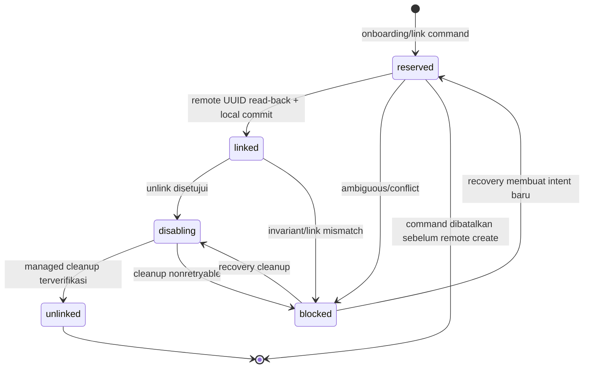
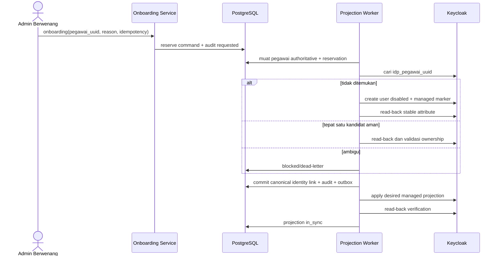
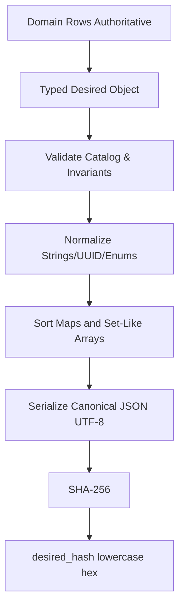
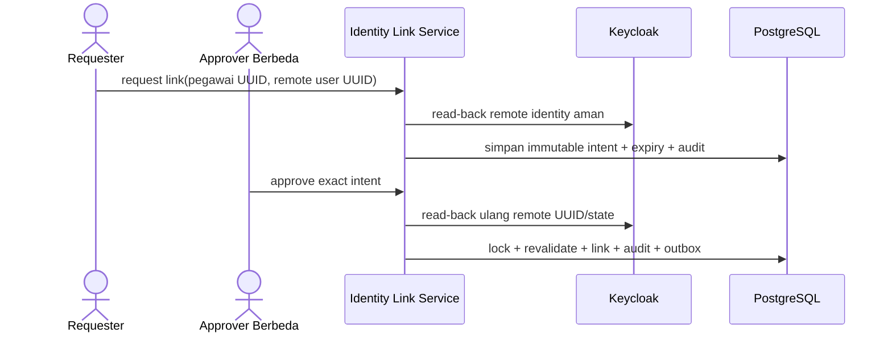

# 24 - IDP Pegawai Kontrak Desired State, Identity Link & Projection Mapping

Status: Draf kontrak rinci arsitektur, **bukan migration atau kode implementasi**  
Proyek: kumjabar_ecosystem  
Tanggal: 2026-08-29  
Bergantung pada:

- `23-idp-pegawai-stage-4-keycloak-sync-projection-breakdown.md`
- `22-idp-pegawai-stage-3-review-checklist-open-decisions.md`
- `19-idp-pegawai-rbac-scoped-grants-service-guards-contract.md`
- `16-idp-pegawai-import-apply-materialization-contract.md`
- `08-idp-pegawai-stage-1-repository-service-contract.md`
- `07-idp-pegawai-stage-1-model-contract-mapping.md`
- `03-keycloak-matrix-and-org-unit-seed.md`

## 1. Tujuan

Dokumen ini memperinci kontrak Tahap 4 untuk:

1. bentuk kanonis **desired state** pegawai yang akan diproyeksikan ke Keycloak;
2. authority dan siklus hidup identity link Keycloak;
3. pembedaan akun `idp_managed` dan `linked_existing`;
4. pemetaan atribut, group organisasi, realm role, dan client role yang dikelola;
5. pembentukan `desired_hash` SHA-256 yang deterministik;
6. aturan minimal-diff dan read-back verification;
7. perlindungan privasi data ASN di Keycloak, event, log, dan state table;
8. schema delta konseptual beserta constraint dan index yang harus dibuktikan pada PostgreSQL;
9. amendment hak masuk lokal untuk `idp-pegawai-admin:user`;
10. test contract sebelum implementation plan.

Prinsip:

> Desired state adalah representasi terketik, tervalidasi, diminimalkan, dan dikanonisasi dari data authoritative PostgreSQL. Ia bukan salinan seluruh record pegawai dan bukan payload bebas dari browser atau event.

## 2. Hasil Kontrak

```text
PostgreSQL domain state
-> DesiredStateResolver
-> typed desired object
-> canonical JSON
-> SHA-256 desired_hash
-> managed subset diff
-> Keycloak projection
-> read-back managed subset
-> applied_hash / projection state
```

Kontrak ini berhenti pada **apa** yang harus diproyeksikan. Lease, retry, dead-letter, dan dispatcher diperinci pada Dokumen 25.

## 3. Boundary Source of Truth

| Concern | Authority | Projection/Cache |
| --- | --- | --- |
| identitas ASN | `pegawai` | managed user attributes |
| lifecycle/eligibility | `pegawai.status_pegawai`, `pegawai.is_active` | enabled/managed entitlement |
| organisasi | `org_units`, active assignments | managed groups/claims |
| trusted Keycloak link | `pegawai_identity_links` | remote user UUID reference |
| hak masuk Admin IDP | effective local `access_grants` | `idp-pegawai-admin:user` |
| scope pembacaan/operasi | local `access_grants` | tidak diproyeksikan |
| password/MFA/session | Keycloak | tidak dibaca/ditulis IDP |
| jabatan/PLT/PLH | consumer kepegawaian | dilarang masuk projection IDP |
| desired hash/version | IDP projection resolver/state | troubleshooting/convergence |
| actual remote state | Keycloak | read-back snapshot terbatasi |

Keycloak tidak pernah menjadi authority bagi role rinci, scope, atau eligibility IDP.

## 4. Amendment Hak Masuk Lokal

Keputusan final Dokumen 23 menggantikan pola lama yang memberi pembacaan global langsung dari coarse role.

```text
viewer(global) efektif
-> local read scope = global
-> desired coarse role = present

viewer(org_unit_subtree=X) efektif
-> local read scope = subtree X
-> desired coarse role = present

hanya role operasional lokal efektif
-> hak masuk ada karena minimal satu access grant efektif
-> capability/scope tetap berasal dari grant masing-masing

tidak ada access grant manusia efektif
-> local deny
-> desired coarse role = absent
```

Kontrak:

- minimal satu `access_grants` manusia yang efektif menjadi dasar coarse entry role;
- `viewer(global)` adalah sumber pembacaan global;
- `viewer(org_unit_subtree)` adalah sumber pembacaan subtree;
- role operasional tidak otomatis memberi `viewer`; ia hanya memberi capability yang dipetakan role tersebut;
- backend tidak pernah menganggap coarse role cukup;
- role Keycloak stale tidak menghidupkan akses lokal;
- pencabutan grant terakhir langsung menyebabkan local deny dan event untuk menghapus coarse role.

## 5. Desired State Aggregate

Desired state per pegawai dibangun dari:

```text
Pegawai
+ canonical active Keycloak identity link
+ management mode
+ primary active org assignment
+ additional affiliations yang explicitly approved
+ effective local access grants
+ versioned managed catalog
+ fixed projection policy
```

Desired state tidak memuat:

```text
full NIP
email sebagai identity key
nomor HP
jabatan/jenis jabatan/PLT/PLH
reason grant
scope access grant
full audit metadata
password/credential
unmanaged Keycloak state
```

## 6. Model Objek Desired State v1

```json
{
  "contract_version": "keycloak-projection.v1",
  "aggregate_type": "pegawai",
  "aggregate_uuid": "018f2d8d-8ef0-7d36-b8e1-2f5e40eb56ce",
  "source_version": 14,
  "identity": {
    "identity_link_uuid": "018f2d8d-a04a-7aaa-9a38-780f8ee5050d",
    "keycloak_user_id": "a9362239-03ad-40c0-a939-d4c58a7e8296",
    "management_mode": "idp_managed"
  },
  "account": {
    "enabled": true
  },
  "managed_attributes": {
    "idp_pegawai_uuid": ["018f2d8d-8ef0-7d36-b8e1-2f5e40eb56ce"],
    "idp_source_version": ["14"],
    "user_type": ["pegawai"],
    "pegawai_status": ["aktif"],
    "primary_org_unit_code": ["TUM_TI"],
    "primary_org_unit_path": ["/kanwil-jabar/tum/ti"],
    "org_unit_codes": ["TUM_TI"],
    "org_group_paths": ["/pegawai/kanwil-jabar/tum/ti"]
  },
  "managed_groups": [
    {
      "org_unit_uuid": "018f2d8d-bb68-72ea-b013-82bd5f901d5e",
      "code": "TUM_TI",
      "path": "/pegawai/kanwil-jabar/tum/ti",
      "membership_kind": "primary"
    }
  ],
  "managed_realm_roles": ["pegawai"],
  "managed_client_roles": {
    "idp-pegawai-admin": ["user"],
    "kabayanpasti-portal": ["user"],
    "s1-internal": ["user"]
  }
}
```

Contoh UUID hanya ilustrasi dan bukan fixture produksi.

## 7. JSON Schema Konseptual

```json
{
  "type": "object",
  "additionalProperties": false,
  "required": [
    "contract_version",
    "aggregate_type",
    "aggregate_uuid",
    "source_version",
    "identity",
    "account",
    "managed_attributes",
    "managed_groups",
    "managed_realm_roles",
    "managed_client_roles"
  ],
  "properties": {
    "contract_version": {"const": "keycloak-projection.v1"},
    "aggregate_type": {"const": "pegawai"},
    "aggregate_uuid": {"type": "string", "format": "uuid"},
    "source_version": {"type": "integer", "minimum": 1},
    "identity": {
      "type": "object",
      "additionalProperties": false,
      "required": ["identity_link_uuid", "keycloak_user_id", "management_mode"]
    },
    "account": {
      "type": "object",
      "additionalProperties": false,
      "required": ["enabled"]
    },
    "managed_attributes": {"type": "object"},
    "managed_groups": {"type": "array"},
    "managed_realm_roles": {"type": "array"},
    "managed_client_roles": {"type": "object"}
  }
}
```

Implementasi wajib memakai typed DTO/model, bukan dictionary tanpa validator.

## 8. Versi Kontrak dan Katalog

Gunakan identifier terpisah:

```text
contract_version       = keycloak-projection.v1
attribute_catalog      = keycloak-attributes.v1
role_catalog           = keycloak-roles.v1
group_mapping_policy   = keycloak-groups.v1
canonicalization       = desired-state-c14n.v1
```

Perubahan yang mengubah hash/shape/semantik harus menaikkan versi terkait dan mempunyai migration/reconciliation plan.

## 9. Identity Link Kanonis

Canonical link berada pada:

```text
pegawai_identity_links.provider = 'keycloak'
pegawai_identity_links.provider_subject = Keycloak user UUID
```

`provider_subject`:

- wajib berbentuk UUID valid;
- immutable setelah link aktif;
- unique lintas pegawai;
- tidak memakai username/email;
- tidak boleh didaur ulang ke pegawai lain;
- tetap dapat disimpan pada link terminal untuk histori/audit.

## 10. Delta Relasional Identity Link

Stage 4 memerlukan tambahan konseptual pada `pegawai_identity_links`:

| Kolom | Tipe Konseptual | Wajib | Makna |
| --- | --- | --- | --- |
| `management_mode` | varchar(30) | conditional | `idp_managed` / `linked_existing` untuk provider Keycloak |
| `link_status` | varchar(30) | ya | lifecycle eksplisit |
| `link_version` | bigint | ya | optimistic/version fencing |
| `linked_by_subject` | varchar(255) | tidak | actor manusia/service |
| `unlinked_at` | timestamptz | tidak | waktu terminal unlink |
| `unlinked_by_subject` | varchar(255) | tidak | actor pemutus link |
| `unlink_reason_code` | varchar(100) | tidak | safe reason code |
| `remote_verified_at` | timestamptz | tidak | read-back terakhir |

Kolom existing `is_active` dapat dipertahankan sebagai compatibility field yang diturunkan dari `link_status`, atau dideprekasi pada migration terencana. Tidak boleh ada dua lifecycle authority yang dapat berbeda.

## 11. Status Identity Link

```text
reserved
linked
disabling
unlinked
blocked
```

Makna:

| Status | Makna |
| --- | --- |
| `reserved` | controlled onboarding/link command sedang memiliki intent, belum canonical active link |
| `linked` | canonical active link dan dapat diproyeksikan |
| `disabling` | unlink lokal sudah diputuskan, cleanup remote belum diverifikasi |
| `unlinked` | terminal; managed cleanup selesai atau diterima melalui recovery terkontrol |
| `blocked` | conflict/invariant/remote ambiguity memerlukan perbaikan |

`reserved` tidak memberi akses dan bukan trusted login link.

## 12. State Machine Identity Link



Tidak ada transisi `unlinked -> linked` pada row lama. Relink membuat row baru agar lineage jujur.

## 13. Constraint Identity Link

Kontrak PostgreSQL konseptual:

```text
provider='keycloak'
-> provider_subject UUID-valid saat linked/disabling/unlinked
-> management_mode NOT NULL

link_status='linked'
-> provider_subject NOT NULL
-> linked_at NOT NULL
-> unlinked_at IS NULL

link_status='unlinked'
-> unlinked_at NOT NULL
-> unlink_reason_code NOT NULL

unique active linked Keycloak subject
unique active linked Keycloak link per pegawai
```

Partial uniqueness wajib dibuktikan pada PostgreSQL nyata.

## 14. `pegawai.keycloak_user_id` Compatibility Cache

Jika kolom masih dipertahankan:

- selalu diturunkan dari canonical linked identity link;
- tidak mempunyai writer mandiri;
- mismatch menjadi invariant breach;
- tidak dipakai untuk link resolution tanpa join/validation;
- cleanup/deprecation direncanakan setelah seluruh reader pindah ke identity link.

Rekomendasi: tandai deprecated pada model contract dan hilangkan pada migration setelah compatibility window.

## 15. Controlled Onboarding Contract

Onboarding input minimum:

```text
pegawai_uuid
management_mode = idp_managed
reason_code
idempotency_key
expected pegawai source_version
actor subject
```

Guard:

- pegawai ada, aktif/eligible, tidak soft-deleted;
- belum mempunyai active Keycloak link;
- tidak ada active onboarding intent;
- actor mempunyai capability berwenang;
- no self-service implicit onboarding v1;
- stable `idp_pegawai_uuid` belum terikat ke remote user lain;
- username/profile policy lulus;
- event/audit payload tetap minimized.

## 16. Onboarding Sequence



## 17. Username dan Email Policy

Keycloak membutuhkan identifier login/profile, tetapi kontrak ini tidak menjadikan email authority identity link.

Rekomendasi v1:

- username dibuat oleh versioned policy dari identifier yang disetujui governance;
- jika NIP digunakan sebagai username, ia hanya dikirim ke Keycloak pada operation yang memerlukan dan tidak masuk log/event/state table;
- email hanya diproyeksikan jika ada email authoritative/verified sesuai policy;
- email berubah tidak memindahkan link;
- duplicate username/email menghasilkan blocked conflict, bukan auto-merge;
- PII field tersebut tidak masuk `desired_hash` bila dikelola melalui profile sub-contract terpisah, atau masuk secara hashed/canonical value hanya jika benar-benar diperlukan untuk convergence.

**Keputusan detail username/email masih governance gate**, bukan alasan menunda kontrak identity UUID.

## 18. Mode `idp_managed`

Desired account state:

| Pegawai | Enabled | Managed Entitlements |
| --- | --- | --- |
| aktif/eligible | true | sesuai desired state |
| mutasi keluar | false | dicabut |
| pensiun | false | dicabut |
| nonaktif | false | dicabut |
| meninggal | false | dicabut |
| deleted/invariant breach | fail-closed | blocked/manual review |

Tidak ada hard-delete.

## 19. Mode `linked_existing`

Desired account policy:

- IDP tidak mengambil alih global enabled state;
- field `account.enabled` pada desired state dinyatakan `null`/`unmanaged` secara typed, bukan false;
- pegawai eligible mendapat managed internal entitlement;
- pegawai tidak eligible kehilangan managed internal entitlement;
- credential, session, public role, social link, dan unmanaged group tetap utuh;
- user missing tidak auto-created;
- unlink tidak menonaktifkan seluruh account.

Karena itu schema `account.enabled` harus mendukung:

```text
true
false
null = unmanaged by IDP
```

## 20. Account Desired Object

```json
{
  "enabled": null,
  "management_semantics": "managed_entitlements_only"
}
```

Untuk `idp_managed`:

```json
{
  "enabled": true,
  "management_semantics": "managed_account"
}
```

`management_semantics` masuk canonical object agar `null` tidak ambigu.

## 21. Primary Organization Projection

Keputusan final Dokumen 23:

```text
primary active organization = wajib diproyeksikan
additional affiliations     = default tidak diproyeksikan
```

Additional affiliation baru boleh diproyeksikan jika:

- ada consumer claim contract nyata;
- data affiliation authoritative/active;
- disclosure dan cardinality disetujui;
- catalog/policy version dinaikkan;
- reconciliation fixtures tersedia.

## 22. Group Mapping Contract

Sumber:

```text
org_units.uuid
org_units.code
org_units.path
org_units.keycloak_group_path
org_units.is_active
```

Target managed namespace:

```text
/pegawai/kanwil-jabar/**
```

Validation:

- path absolut;
- tidak ada `..`, empty segment, atau control character;
- root prefix persis;
- parent path sesuai hierarchy;
- code stabil;
- unit aktif untuk membership baru;
- remote immutable group ID disimpan setelah binding;
- duplicate path/name ambiguity menjadi blocked.

## 23. Managed Group Object

```json
{
  "org_unit_uuid": "018f2d8d-bb68-72ea-b013-82bd5f901d5e",
  "code": "TUM_TI",
  "path": "/pegawai/kanwil-jabar/tum/ti",
  "membership_kind": "primary"
}
```

Canonical ordering:

```text
membership_kind ASC
code ASC
org_unit_uuid ASC
```

Duplicate object ditolak, bukan didiamkan.

## 24. Group Lifecycle

```mermaid
stateDiagram-v2
    [*] --> desired
    desired --> bound: remote group ID terverifikasi
    bound --> drifted: path/parent/label tidak cocok
    drifted --> bound: rekonsiliasi aman
    drifted --> blocked: ambiguity/move berdampak tinggi
    bound --> inactive: org unit nonaktif
    inactive --> [*]: retained; tidak auto-delete
```

Move/rename harus memakai immutable group ID binding dan runbook; jangan membuat group baru lalu meninggalkan group lama tanpa review.

## 25. Managed Attribute Catalog v1

| Attribute | Sumber | Kardinalitas | PII | Catatan |
| --- | --- | ---: | --- | --- |
| `idp_pegawai_uuid` | `pegawai.uuid` | 1 | pseudonymous | stable correlation key |
| `idp_source_version` | `pegawai.source_version` | 1 | tidak | decimal string |
| `user_type` | constant `pegawai` | 1 | tidak | managed enum |
| `pegawai_status` | lifecycle enum | 1 | sensitif rendah | hanya jika claim diperlukan |
| `primary_org_unit_code` | primary unit code | 0..1 | organisasi | stable code |
| `primary_org_unit_path` | org path | 0..1 | organisasi | tanpa nama pegawai |
| `org_unit_codes` | afiliasi yang disetujui | 0..N | organisasi | v1 hanya unit utama |
| `org_group_paths` | path Keycloak yang disetujui | 0..N | organisasi | v1 hanya unit utama |

Dilarang pada catalog v1:

```text
jabatan
jenis_jabatan
label_jabatan
PLT/PLH
histori_jabatan
full NIP copy untuk claim umum
no_hp
status/reason sensitif lengkap
access grant reason
scope subtree grants
```

## 26. Normalisasi Attribute

- seluruh value Keycloak direpresentasikan sebagai array string;
- string Unicode dinormalisasi NFC;
- trim tepi;
- empty string dilarang; gunakan absent;
- enum lowercase canonical;
- UUID lowercase canonical;
- source version decimal tanpa leading zero;
- path memakai slash canonical;
- array deduplicated dan sorted;
- maksimum cardinality dan panjang ditentukan config ber-policy-cap;
- unknown attribute ditolak validator.

## 27. Absent, Null, dan Empty

Kontrak:

| Bentuk | Makna |
| --- | --- |
| key absent | attribute managed harus dihapus jika sebelumnya ada |
| `[]` | invalid pada desired state v1 |
| `null` | invalid untuk managed attributes |
| `""` | invalid |
| array nonempty | exact desired managed values |

Account `enabled=null` adalah pengecualian typed yang berarti unmanaged, bukan delete.

## 28. Realm Role Mapping

Managed realm role v1:

```text
pegawai
```

Desired `pegawai` ada bila:

```text
trusted linked identity
AND pegawai aktif/eligible
```

Role dihapus bila tidak eligible atau unlink. Role realm lain tidak disentuh.

## 29. Client Role Mapping

Managed client roles v1:

| Client | Role | Desired Rule |
| --- | --- | --- |
| `kabayanpasti-portal` | `user` | active/eligible linked pegawai sesuai audience policy |
| `s1-internal` | `user` | active/eligible linked pegawai sesuai audience policy |
| `idp-pegawai-admin` | `user` | minimal satu effective local human access grant |

Client UUID actual harus di-resolve dari trusted configured client ID dan di-cache aman; browser/event tidak dapat memasoknya.

## 30. Coarse Admin Role Rule

Pseudo-rule:

```text
has_admin_entry =
    pegawai.is_active
    AND identity_link.link_status == linked
    AND EXISTS effective local human access_grant
```

`effective` berarti:

```text
valid_from <= db_now
AND (valid_until IS NULL OR db_now < valid_until)
AND revoked_at IS NULL
AND target pegawai aktif
```

Grant service account tidak dihitung. Pending request tidak dihitung. Expired/revoked grant tidak dihitung.

## 31. Scope Tidak Diproyeksikan

Dilarang membuat Keycloak roles seperti:

```text
viewer:tum
access_admin:divisi-yankum
auditor:global
```

Scope tetap di PostgreSQL. Keycloak hanya mengirim coarse entry role.

## 32. Capability Tidak Diproyeksikan

Dilarang memproyeksikan:

```text
can_import_pegawai
can_approve_import
can_manage_access
can_view_audit
```

Capability dihitung backend dari role map statis dan local grants efektif.

## 33. Managed Client Role Object

```json
{
  "idp-pegawai-admin": ["user"],
  "kabayanpasti-portal": ["user"],
  "s1-internal": ["user"]
}
```

Canonical ordering:

- client ID lexicographic ascending;
- role arrays sorted/deduplicated;
- unknown client/role ditolak;
- empty role array dilarang; hilangkan key client.

## 34. Privacy Minimization

Keycloak hanya menerima data yang dibutuhkan autentikasi, audience, dan coarse routing.

| Data | Default Projection |
| --- | --- |
| pegawai UUID | ya |
| source version | ya |
| lifecycle status | hanya bila claim consumer disetujui |
| primary unit code/path | ya untuk routing/claim |
| additional unit | tidak v1 |
| nama | hanya profil sesuai kebijakan, bukan claim managed umum |
| email | hanya profil sesuai kebijakan, bukan authority identity link |
| NIP | hanya username bila governance memilih; bukan general claim/log |
| nomor HP | tidak |
| jabatan/PLT/PLH | tidak |
| grant role/scope/reason | tidak |

## 35. Claim Release Boundary

Menyimpan user attribute di Keycloak tidak otomatis berarti seluruh client boleh menerima claim tersebut.

- protocol mapper per client memakai allowlist;
- client hanya menerima claim yang diperlukan;
- `pegawai_status` dan organisasi tidak diberikan ke client publik tanpa kebutuhan;
- ID token/userinfo/access token disclosure direview terpisah;
- token size mempunyai cap;
- group path tidak memakai built-in full group claim bila membuka namespace lain;
- mapper hanya mengambil managed attributes yang disetujui.

## 36. Data yang Tidak Masuk Event/Log/State Table

```text
raw username/NIP
raw email bila tidak diperlukan safe operation
nama lengkap
password
initial credential
action token
client secret
access token
refresh token
full Keycloak user representation
raw Admin API response
unmanaged role/group lists
```

Jika debugging membutuhkan PII, gunakan controlled sensitive-detail path dari Tahap 3 dengan audit dan no-store, bukan log biasa.

## 37. Canonicalization Pipeline



## 38. Canonicalization Rules v1

1. Contract identifier: `desired-state-c14n.v1`.
2. Input harus typed object valid.
3. Object keys serialized ascending lexicographic.
4. Tidak ada insignificant whitespace.
5. UTF-8, tanpa BOM.
6. Unicode string NFC.
7. UUID lowercase canonical hyphenated.
8. Integer serialized decimal JSON number.
9. Boolean lowercase JSON literal.
10. Null hanya pada field typed yang mengizinkan.
11. Set-like arrays deduplicated dan sorted menurut contract.
12. Array yang semantically ordered mempertahankan order; v1 tidak mempunyai array semacam itu.
13. Timestamp tidak masuk desired object v1 agar hash tidak berubah karena observability.
14. Unknown property ditolak.
15. NaN/Infinity/floating number dilarang.
16. Hash dihitung atas exact canonical bytes.

## 39. Contoh Canonical JSON

```json
{"account":{"enabled":true,"management_semantics":"managed_account"},"aggregate_type":"pegawai","aggregate_uuid":"018f2d8d-8ef0-7d36-b8e1-2f5e40eb56ce","contract_version":"keycloak-projection.v1","identity":{"identity_link_uuid":"018f2d8d-a04a-7aaa-9a38-780f8ee5050d","keycloak_user_id":"a9362239-03ad-40c0-a939-d4c58a7e8296","management_mode":"idp_managed"},"managed_attributes":{"idp_pegawai_uuid":["018f2d8d-8ef0-7d36-b8e1-2f5e40eb56ce"],"idp_source_version":["14"],"org_group_paths":["/pegawai/kanwil-jabar/tum/ti"],"org_unit_codes":["TUM_TI"],"pegawai_status":["aktif"],"primary_org_unit_code":["TUM_TI"],"primary_org_unit_path":["/kanwil-jabar/tum/ti"],"user_type":["pegawai"]},"managed_client_roles":{"idp-pegawai-admin":["user"],"kabayanpasti-portal":["user"],"s1-internal":["user"]},"managed_groups":[{"code":"TUM_TI","membership_kind":"primary","org_unit_uuid":"018f2d8d-bb68-72ea-b013-82bd5f901d5e","path":"/pegawai/kanwil-jabar/tum/ti"}],"managed_realm_roles":["pegawai"],"source_version":14}
```

Fixture final harus dihitung oleh alat saat implementasi, bukan diketik manual sebagai hash harapan tanpa verifikasi.

## 40. SHA-256 Desired Hash

```text
desired_hash = lowercase_hex(SHA256(canonical_json_utf8_bytes))
```

Properties:

- panjang tepat 64 karakter `[0-9a-f]{64}`;
- bukan HMAC;
- bukan signature;
- tidak membuktikan siapa penulis state;
- dipakai untuk no-op detection, applied verification, drift evidence, dan idempotensi;
- source version tetap diperlukan untuk ordering;
- collision dianggap infeasible secara operasional, tetapi equality tetap memerlukan contract version sama.

## 41. Hash Scope

Masuk hash:

```text
contract version
aggregate UUID/source version
identity link UUID/remote UUID/management mode
account management semantics/enabled
managed attributes
managed groups
managed realm roles
managed client roles
```

Tidak masuk hash:

```text
created_at/updated_at
last_verified_at
attempt/lease/error
actor/correlation ID
unmanaged actual state
raw profile PII
```

## 42. Source Version Semantics

- `pegawai.source_version` monotonic per aggregate;
- profile/status/primary org mutation increment tepat sekali;
- effective access-grant changes juga mengubah desired coarse role tetapi bukan `pegawai.source_version`;
- karena itu desired state memerlukan **projection revision** yang mencakup seluruh dependency, bukan hanya pegawai version.

Rekomendasi:

```text
projection_revision = monotonic revision pada keycloak_sync_states/aggregate projection command
```

atau composite dependency version:

```text
pegawai_source_version
access_grant_revision
org_mapping_revision
catalog_version
```

Jangan berpura-pura `pegawai.source_version` sendiri mengurutkan perubahan grant.

## 43. Dependency Version Object

```json
{
  "pegawai_source_version": 14,
  "access_grant_revision": 8,
  "org_mapping_revision": 3,
  "catalog_version": "keycloak-projection.v1"
}
```

Object ini masuk desired state/hash atau direpresentasikan sebagai satu projection revision yang deterministik dan terfencing.

## 44. Access Grant Revision

Tahap 4 memerlukan revision monotonic per target pegawai ketika:

```text
grant created
grant revoked
grant expired secara efektif
grant validity boundary membuat entitlement berubah
```

Pilihan implementasi:

1. `keycloak_sync_states.desired_revision` dialokasikan setiap event/recompute;
2. dedicated per-pegawai projection revision;
3. canonical dependency hash tanpa asumsi numeric ordering, ditambah queue fencing.

Rekomendasi Dokumen 24: dedicated projection revision pada sync state/projection aggregate agar ordering lintas pegawai + grant sederhana. Detail DDL dikunci di Dokumen 25.

## 45. Time-Driven Grant Boundary

Grant dapat mulai/berakhir tanpa domain mutation baru.

Maka:

- `valid_from` future harus menjadwalkan recompute;
- `valid_until` harus menjadwalkan coarse role recompute;
- expiry worker/outbox membuat trigger durable;
- periodic reconciliation menjadi safety net;
- DB `now()` authoritative;
- role removal terlambat tidak melemahkan local deny karena backend memeriksa waktu grant langsung.

## 46. Projection Eligibility Resolver

Pseudo-flow:

```text
load pegawai + canonical link
if no linked identity:
    projection = unlinked / no remote mutation
else:
    resolve management mode
    resolve account policy
    resolve primary group
    resolve approved additional groups
    resolve base/audience roles
    resolve any effective local access grant
    derive coarse admin role
    validate managed catalog
    build typed object
    canonicalize + hash
```

## 47. Fail-Closed Resolver

Resolver tidak menghasilkan projection write ketika:

- duplicate active Keycloak link;
- identity link/cache mismatch;
- unknown management mode/status;
- source version invalid;
- pegawai aktif tanpa unit utama yang diwajibkan;
- group path keluar managed root;
- role/client catalog unresolved;
- duplicate group binding;
- unknown attribute;
- JSON size/cardinality cap dilampaui;
- desired state gagal canonical validation.

Hasilnya `blocked`, safe error code, audit/alert sesuai severity; jangan mengirim partial projection.

## 48. Error Code Stabil

```text
kc_link_missing
kc_link_duplicate
kc_link_subject_invalid
kc_link_cache_mismatch
kc_management_mode_invalid
kc_primary_org_missing
kc_group_path_invalid
kc_group_binding_ambiguous
kc_client_unresolved
kc_role_unresolved
kc_attribute_invalid
kc_desired_state_oversized
kc_canonicalization_failed
kc_projection_revision_stale
```

Pesan UI tetap Bahasa Indonesia dan tidak membocorkan PII/remote existence di luar capability.

## 49. Actual Managed State

Adapter membaca actual state lalu mengekstrak hanya:

```text
enabled bila idp_managed
managed attribute keys
managed group IDs/path bindings
managed realm roles
managed client roles
```

Unmanaged data tidak perlu masuk persistence. Untuk diff sementara di memori, nilainya tidak boleh dilog.

## 50. Minimal Diff Contract

| Desired vs Actual | Operation |
| --- | --- |
| managed attribute beda | update managed attribute tanpa menghapus unmanaged keys |
| managed group missing | add membership |
| obsolete managed group | remove membership |
| realm role missing | add mapping |
| obsolete managed realm role | remove mapping |
| client role missing | add mapping |
| obsolete managed client role | remove mapping |
| enabled beda pada `idp_managed` | update enabled |
| enabled beda pada `linked_existing` | no operation + ignore global state |
| tidak ada diff | no-op + update verified timestamp |

## 51. Full User PUT Safety

Jika Keycloak API membutuhkan full representation untuk update user:

1. GET current representation;
2. ubah hanya managed keys dalam memory;
3. pertahankan unmanaged keys persis;
4. jangan mengirim credentials;
5. enforce response/request size cap;
6. PUT dengan bounded timeout;
7. read-back managed subset;
8. jangan persist/log full representation.

Adapter contract test harus membuktikan unmanaged attributes tidak hilang.

## 52. Read-Back Verification

Success baru boleh disimpan bila:

```text
actual managed account state
actual managed attributes
actual managed groups
actual managed realm roles
actual managed client roles
```

cocok dengan desired managed state menurut semantics mode.

- eventual delay kecil boleh retry bounded;
- mismatch menghasilkan transient/blocked sesuai klasifikasi;
- HTTP success tanpa match bukan projection success;
- applied hash dihitung dari normalized read-back managed subset yang dipetakan ke shape desired.

## 53. Applied Hash

`last_applied_hash` harus comparable dengan `desired_hash` hanya bila:

```text
contract version sama
catalog version sama
normalization sama
managed subset lengkap
```

Jangan hash raw response Keycloak karena urutan/shape server dapat berbeda.

## 54. Projection State Delta

`keycloak_sync_states` perlu menampung minimum:

```text
pegawai_id/uuid
identity_link_uuid
remote user ID
management mode
status
desired_projection_revision
desired_dependency_versions
desired_hash
desired_contract_version
applied_projection_revision
applied_hash
applied_contract_version
last_verified_at
last_success_at
last_error_code/error_at
next_reconcile_at
lock_version
```

JSONB dependency version bila dipakai harus typed allowlist dan size-capped; identifier/filter utama tetap relational.

## 55. Constraint Projection State

Kontrak konseptual:

```text
unique(pegawai_id)
unique(identity_link_uuid) where identity_link_uuid is not null
unique(remote user ID) where link/current projection active
check desired/applied hash regex
check desired/applied revision >= 0
check applied revision <= desired revision when comparable
check in_sync -> desired_hash = applied_hash
check retry_wait -> next_attempt_at not null pada item/job, bukan harus pada state
check management_mode enum
```

State table bukan queue; attempt/lease detail berada di job item Dokumen 25.

## 56. Index Projection State

Minimum review:

```text
unique pegawai
unique current identity link
unique current remote user ID
(status, next_reconcile_at)
partial due reconciliation
last_error_code/last_error_at untuk ops
```

Index tambahan harus mengikuti query evidence.

## 57. Identity Link Audit

Audit persisten:

```text
keycloak.onboarding_requested
keycloak.user_created
keycloak.identity_linked
keycloak.identity_link_blocked
keycloak.identity_unlink_requested
keycloak.identity_unlinked
keycloak.identity_relinked_as_new_row
keycloak.link_recovery_applied
```

Audit tidak menyimpan email/NIP/raw profile. Remote user UUID dapat disimpan sebagai pseudonymous technical identifier bila kebijakan mengizinkan.

## 58. Projection Mapping Audit

Perubahan catalog/policy menghasilkan:

```text
keycloak.projection_contract_changed
keycloak.managed_catalog_changed
keycloak.reconciliation_requested
```

Deployment catalog baru harus mempunyai dry-run impact count sebelum full reconciliation.

## 59. Admin/Internal Serialization

UI biasa melihat:

```json
{
  "projection_status": "in_sync",
  "management_mode": "idp_managed",
  "last_verified_at": "2026-08-29T17:00:00+07:00",
  "desired_source_version": 14,
  "safe_error_code": null
}
```

Raw desired JSON, hash dependency detail, remote representation, dan remote role lists hanya tersedia untuk capability teknis terkontrol; response sensitif `Cache-Control: no-store` dan aksesnya diaudit bila membuka detail.

## 60. Internal Desired-State Endpoint

Jika worker terpisah proses:

```text
GET /internal/v1/keycloak-projections/pegawai/{pegawai_uuid}/desired
```

Response:

```json
{
  "data": {
    "desired_state": {},
    "desired_hash": "64-lowercase-hex",
    "projection_revision": 42
  },
  "meta": {
    "contract_version": "keycloak-projection.v1",
    "request_id": "..."
  }
}
```

Security:

- private network;
- fixed service account scope;
- audience validation;
- no public gateway route;
- no-store;
- rate limit;
- hanya UUID target;
- no raw PII beyond contract;
- response integrity bergantung TLS/auth, bukan hash semata.

## 61. Desired State Size Limits

Rekomendasi awal:

```text
managed attributes       <= 16 keys
values per attribute     <= 32
managed groups           <= 16
managed realm roles      <= 8
managed clients          <= 16
roles per client         <= 16
canonical JSON bytes     <= 32 KiB
single string            <= 512 bytes
```

Nilai final diuji terhadap Keycloak limits dan kebutuhan organisasi. Melebihi cap menjadi blocked, bukan truncate diam-diam.

## 62. Token Size Protection

- tidak semua attributes menjadi token claims;
- hanya organisasi utama menjaga kardinalitas;
- protocol mapper client-specific;
- tidak menaruh access scopes/reasons;
- uji ukuran access/ID token pada skenario maksimum;
- jika token melebihi cap gateway/header, kurangi claim contract, bukan menaikkan limit tanpa batas.

## 63. Data Retention

- identity link terminal dipertahankan sesuai audit/identity governance;
- projection state current tidak menjadi audit log;
- old desired payload penuh tidak disimpan default;
- job/item menyimpan hash/version/safe diagnostics, bukan payload;
- audit mengikuti retention class Tahap 3;
- orphan/recovery evidence mengikuti security retention policy;
- deletion/anonymization harus mempertahankan referential/audit integrity.

## 64. DDL Preview User - Review

Draf user untuk tiga tabel sync berguna sebagai starting point, tetapi bukan migration final.

Koreksi yang wajib:

1. seluruh `uuid` harus `UNIQUE`;
2. FK sebaiknya memakai integer internal, UUID sebagai external identity;
3. `pegawai_uuid` pada state berpotensi redundan dan harus derived/consistency-guarded;
4. `identity_link_uuid` harus FK/canonical link, bukan UUID bebas;
5. `keycloak_user_id` perlu uniqueness conditional;
6. `management_mode` sebaiknya berasal dari link dan tidak menjadi authority kedua;
7. hash harus check `[0-9a-f]{64}`;
8. state `syncing` tidak perlu menjadi durable authority bila lease berada pada item;
9. job UUID/source event UUID/parent lineage perlu unique/FK rules;
10. item memerlukan lease generation/fencing token;
11. desired revision tidak boleh hanya `pegawai.source_version`;
12. `ON DELETE CASCADE` dari job ke item berisiko menghapus operational lineage; rekomendasi `RESTRICT` dan retention purge terkontrol;
13. item dedup key per consumer/event/target/revision perlu partial/unique constraint;
14. timestamps/state consistency checks wajib;
15. index queue perlu memasukkan eligibility lease dan ordering yang benar;
16. exact varchar lengths/nama constraint direview sebelum migration.

## 65. DDL Konseptual Identity Link Delta

```sql
ALTER TABLE idp_pegawai.pegawai_identity_links
  ADD COLUMN management_mode varchar(30),
  ADD COLUMN link_status varchar(30) NOT NULL DEFAULT 'linked',
  ADD COLUMN link_version bigint NOT NULL DEFAULT 0,
  ADD COLUMN linked_by_subject varchar(255),
  ADD COLUMN unlinked_at timestamptz,
  ADD COLUMN unlinked_by_subject varchar(255),
  ADD COLUMN unlink_reason_code varchar(100),
  ADD COLUMN remote_verified_at timestamptz;
```

Ini preview konseptual. Migration final harus menangani backfill existing rows, provider-specific nullability, constraint validation bertahap, dan compatibility `is_active`.

## 66. DDL Konseptual Projection State

```sql
CREATE TABLE idp_pegawai.keycloak_sync_states (
    id bigint GENERATED BY DEFAULT AS IDENTITY PRIMARY KEY,
    uuid uuid NOT NULL DEFAULT gen_random_uuid(),
    pegawai_id bigint NOT NULL,
    identity_link_id bigint,
    remote_user_id varchar(255),
    status varchar(30) NOT NULL,
    desired_projection_revision bigint NOT NULL DEFAULT 0,
    desired_dependency_versions jsonb NOT NULL DEFAULT '{}'::jsonb,
    desired_contract_version varchar(80),
    desired_hash char(64),
    applied_projection_revision bigint NOT NULL DEFAULT 0,
    applied_contract_version varchar(80),
    applied_hash char(64),
    last_verified_at timestamptz,
    last_success_at timestamptz,
    last_error_code varchar(100),
    last_error_at timestamptz,
    next_reconcile_at timestamptz,
    lock_version integer NOT NULL DEFAULT 0,
    created_at timestamptz NOT NULL DEFAULT now(),
    updated_at timestamptz NOT NULL DEFAULT now()
);
```

FK, unique, check, index, ownership, dan grants sengaja tidak dipalsukan lengkap di preview. Semua dikunci pada schema contract/migration plan setelah Dokumen 25.

## 67. Database Principal Boundary

| Principal | Hak |
| --- | --- |
| migration owner | DDL/ownership |
| IDP app writer | identity-link command dan outbox sesuai service |
| projection resolver | SELECT domain/grant/link, update desired state terbatas |
| projection worker | claim/update sync jobs/items/state, bukan domain pegawai bebas |
| reconciliation worker | read desired/actual + enqueue repair |
| audit writer | audit hanya-INSERT |

Worker Keycloak tidak mendapat privilege mengedit status pegawai atau access grant.

## 68. Transaction Boundaries

### Link Existing

```text
Tx A: reserve/link command + requested audit
remote read/verification
Tx B: canonical identity link + success audit + outbox
```

### Onboarding

```text
Tx A: reserve onboarding command
remote create disabled + read-back
Tx B: canonical identity link + audit + outbox
remote desired projection + read-back
Tx C: projection state success
```

### Unlink

```text
Tx A: local link -> disabling + local deny effects + audit + outbox
remote managed cleanup
Tx B: link -> unlinked + projection state + audit
```

Tidak ada remote call dalam transaksi PostgreSQL.

## 69. Kegagalan dan Kompensasi

| Failure | Local Result | Recovery |
| --- | --- | --- |
| create timeout | reservation tetap | search/read-back stable UUID |
| create sukses, local link gagal | disabled orphan | exact command lineage recovery |
| link commit sukses, projection gagal | local link canonical | retry projection |
| unlink commit sukses, cleanup gagal | local deny/disabling | retry cleanup; jangan restore access |
| desired state invalid | blocked | fix data/catalog + reconcile |
| read-back mismatch | retry/blocked | classify, no false success |
| stale revision completion | tidak menjadi current | enqueue latest desired |

## 70. Test Matrix - Canonicalization

- object key order tidak mengubah hash;
- set-like array order tidak mengubah hash;
- duplicate array member ditolak atau dinormalisasi konsisten sesuai typed constructor;
- NFC equivalent menghasilkan hash sama;
- absent berbeda dari permitted null;
- empty/null managed attribute ditolak;
- UUID uppercase dinormalisasi lowercase;
- timestamp observability tidak memengaruhi hash;
- unknown key ditolak;
- fixture canonical bytes dan SHA-256 dibekukan;
- contract version berbeda menghasilkan contract context berbeda.

## 71. Test Matrix - Identity Link

- provider subject UUID valid;
- subject unique lintas pegawai;
- satu active linked row per pegawai;
- `reserved` tidak memberi akses;
- `linked` membutuhkan mode/subject/linked_at;
- `unlinked` terminal dan membuat row baru saat relink;
- email tidak auto-link;
- cache mismatch blocked;
- controlled onboarding idempotent;
- ambiguous create read-back;
- linked-existing tidak global-disable;
- no hard-delete path.

## 72. Test Matrix - Mapping

- primary active group wajib;
- additional default tidak diproyeksikan;
- path di luar managed root ditolak;
- inactive unit tidak menerima membership baru;
- duplicate group binding blocked;
- unmanaged group/role/attribute dipertahankan;
- role catalog unknown ditolak;
- scope/capability/reason tidak masuk projection;
- jabatan/PLT/PLH tidak masuk projection;
- client resolver menggunakan trusted config;
- no access grant menghasilkan admin role absent;
- grant efektif menghasilkan admin role present.

## 73. Matriks Pengujian - Waktu dan Revisi

- future grant belum memberi coarse role;
- batas `valid_from` memicu proyeksi;
- valid-until boundary langsung local deny dan menjadwalkan removal;
- revocation increment projection revision;
- source version lama tidak mengalahkan revision baru;
- org/catalog revision memicu desired hash baru;
- stale worker completion ditolak;
- reconciliation menemukan missed time boundary;
- waktu database dipakai untuk grant efficacy.

## 74. Test Matrix - Privacy

- raw NIP/email/name tidak masuk outbox/job/state/log;
- desired endpoint hanya field allowlist;
- protocol mapper client-specific;
- token tidak mengandung role/scope rinci;
- sensitive detail no-store/audited;
- raw Keycloak response tidak dipersist;
- credentials/action token tidak pernah masuk desired object;
- maximum token/header size diuji;
- invalid oversized projection blocked.

## 75. Threat-to-Control Closure

| Ancaman | Pengendalian |
| --- | --- |
| Keycloak menjadi authority akses | local grant wajib + backend recheck |
| link salah karena email | immutable remote UUID + controlled workflow |
| akun shared ter-disable | `linked_existing` enabled unmanaged |
| role/scope bocor ke token | hanya role kasar + allowlist mapper client |
| worker menghapus data realm lain | managed subset diff + full PUT preservation test |
| hash berubah nondeterministik | c14n version + sorted arrays/maps + fixtures |
| grant expiry tidak memicu event | scheduled boundary + reconciliation safety net |
| pegawai version tidak mencakup grant | projection revision/dependency versions |
| duplicate remote user | stable UUID marker + read-back + uniqueness |
| PII bocor ke state/log | minimized contract + validator + safe logger |
| group move membuat duplikat | immutable remote group binding + blocked ambiguity |
| HTTP 2xx dianggap sukses palsu | mandatory read-back managed comparison |

## 76. Pre-Implementation Gates

| Gate | Bukti Wajib |
| --- | --- |
| identity-link backfill | inventory existing links/cache + deterministic migration |
| management mode | ownership classification semua existing Keycloak links |
| entry grant amendment | Dokumen 18/19/21/22 konsisten dan migration/default strategy |
| canonical fixtures | canonical bytes + SHA-256 vectors lintas Python/JavaScript bila perlu |
| catalog fixtures | attributes/groups/realm/client roles test realm |
| projection revision | ordering across pegawai/grant/org/catalog changes |
| username/email governance | uniqueness/disclosure/verified policy |
| Keycloak API behavior | full PUT preservation dan read-back tests |
| PostgreSQL constraints | partial unique/check/FK/JSONB validator tests |
| privacy/token sizing | claim matrix + maximum token benchmark |

## 77. Governance yang Masih Perlu Runbook

Keputusan arsitektur inti sudah dikunci. Detail operasional berikut masih memerlukan policy/runbook sebelum production:

- format fallback ID terstruktur ketika NIP belum dapat digunakan saat onboarding terkendali;
- ownership dan approval perubahan sub-kontrak profile name/email;
- client audience policy untuk portal dan S1;
- legal hold, archive, dan purge setelah retensi minimum identity link terminal;
- siapa yang boleh mengajukan/menyetujui link existing serta menjalankan recovery;
- disclosure `pegawai_status` per client mapper;
- proses amendment jika additional affiliations kelak dibutuhkan;
- group rename/move runbook;
- jadwal migrasi penghapusan `pegawai.keycloak_user_id` pada v2.

Hal tersebut tidak membuka kembali keputusan source-of-truth, identity UUID, retensi minimum, atau four-eyes link existing.

## 78. Keputusan Final yang Dikunci

1. Desired state memakai typed object `keycloak-projection.v1` dan menolak unknown property.
2. Identity link canonical berada di `pegawai_identity_links`, memakai immutable Keycloak user UUID.
3. `management_mode` relasional wajib: `idp_managed` atau `linked_existing`.
4. Identity-link lifecycle: `reserved`, `linked`, `disabling`, `unlinked`, `blocked`; row terminal tidak diaktifkan ulang.
5. `pegawai.keycloak_user_id` hanya compatibility cache dan kandidat deprecate.
6. Primary organization group wajib; additional affiliations tidak diproyeksikan default v1.
7. Worker hanya mengelola attribute/group/role catalog allowlist.
8. Scope, capability, grant reason, jabatan, PLT/PLH tidak diproyeksikan.
9. Coarse Admin role ada hanya jika minimal satu local human access grant efektif.
10. `viewer(global)` menjadi authority pembacaan global; coarse role tidak memberi akses sendiri.
11. Canonicalization `desired-state-c14n.v1` memakai sorted maps/set arrays, UTF-8 NFC, dan SHA-256 lowercase hex.
12. Desired hash tidak menggantikan source/projection revision.
13. Projection revision harus mencakup dependency pegawai, access grant, org mapping, dan catalog.
14. Account enabled untuk `linked_existing` adalah unmanaged/null typed.
15. HTTP success harus diikuti read-back verification sebelum projection success.
16. Full Keycloak representation tidak dipersist/log dan unmanaged fields harus dipertahankan.
17. PII/claim release memakai minimization dan client-specific protocol mapper.
18. Tidak ada hard-delete, email auto-link, atau automatic relink.
19. Time-driven grant boundaries wajib memicu recompute, dengan reconciliation sebagai safety net.
20. DDL user adalah preview; migration final menunggu schema/job contract dan PostgreSQL tests.
21. Username utama onboarding adalah NIP resmi ASN; fallback hanya ID terstruktur non-email melalui policy.
22. Nama/email memakai sub-kontrak profile projection terpisah.
23. Identity link terminal mengikuti retensi minimum 5 tahun kelas `identity_business`, legal hold dapat memperpanjang.
24. Link/relink `linked_existing` wajib four-eyes; unlink tetap langsung efektif lokal.

## 79. Resolusi Final Delapan Keputusan

Delapan pertanyaan arsitektur Dokumen 24 telah diselesaikan dan tidak lagi berstatus terbuka.

| Nomor | Keputusan Final | Kontrak yang Dikunci |
| --- | --- | --- |
| 1 | Username utama adalah NIP resmi ASN | NIP dipakai pada profile/onboarding sub-kontrak, bukan sebagai identity-link authority. Jika NIP belum dapat dipakai karena konflik/constraint remote, onboarding diblokir atau memakai fallback ID terstruktur yang tidak berasal dari email dan dicatat policy version-nya. |
| 2 | Nama dan email dipisahkan ke sub-kontrak profile projection | Keduanya tidak masuk desired hash entitlement utama. Perubahan nama/email tidak mengubah hash managed entitlement; profile projection mempunyai version/hash dan privacy policy sendiri. |
| 3 | Afiliasi tambahan ditolak pada v1 | Hanya unit utama diproyeksikan. Additional affiliations membutuhkan amendment dan consumer claim contract konkret. |
| 4 | `pegawai.keycloak_user_id` menjadi cache kompatibilitas hanya-baca | Nilainya diturunkan dari identity link canonical dan dideprekasi pada v2 setelah seluruh reader berpindah. |
| 5 | Revisi memakai kombinasi numeric revision + JSON metadata | `desired_projection_revision` berupa bigint monotonik; `desired_dependency_versions` JSONB typed/allowlisted untuk diagnosis dependency pegawai/grant/organisasi/catalog. |
| 6 | `pegawai_status` restricted melalui protocol mapper allowlist | Atribut boleh disimpan di user Keycloak, tetapi hanya dirilis ke client yang mempunyai kebutuhan dan mapper eksplisit. |
| 7 | Identity link terminal memiliki retensi minimum 5 tahun | Retention class `identity_business`; dilarang hard-delete sebelum minimum berakhir. Legal hold dapat memperpanjang. Setelah minimum, purge/anonymization hanya melalui policy dan manifest terkontrol—bukan berarti harus disimpan selamanya. |
| 8 | Link/relink existing wajib four-eyes | Requester dan approver berbeda, intent immutable, target remote UUID eksplisit, read-back sebelum approval execution, dan seluruh keputusan diaudit. Unlink tetap langsung efektif lokal dan tidak menunggu approval kedua. |

### 79.1 Kontrak Username NIP dan Fallback

```text
primary username = NIP resmi ASN
email            = bukan username authority dan bukan identity link key
fallback          = ID terstruktur, non-email, policy-versioned, hanya bila onboarding tidak dapat memakai NIP
```

Fallback tidak dipilih bebas operator. Algoritma, prefix, collision handling, dan display ditetapkan sub-kontrak profile projection.

### 79.2 Profile Projection Terpisah

Sub-kontrak profile minimum kelak mengatur:

```text
username
nama tampilan
email authoritative/verified
profile version
profile hash
privacy/disclosure
read-back semantics
```

Profile hash tidak dicampur ke `desired_hash` entitlement utama agar perubahan ejaan nama/email tidak memicu group/role projection palsu.

### 79.3 Four-Eyes Link Existing



Email/nama hanya membantu review tersamarkan; keputusan terikat remote immutable UUID.

## 80. Daftar Periksa Penerimaan Dokumen 24

### Desired State

- [x] Typed shape dan contract version disetujui.
- [x] Dependency/projection revision disetujui.
- [x] Canonicalization dan SHA-256 contract disetujui.
- [x] Size/cardinality cap disetujui.

### Identity Link

- [x] Canonical identity link dan UUID authority disetujui.
- [x] Management mode disetujui.
- [x] Lifecycle terminal/new-row relink disetujui.
- [x] Compatibility cache strategy disetujui.
- [x] Controlled onboarding/link/unlink boundary disetujui.

### Mapping

- [x] Attribute catalog disetujui.
- [x] Pemetaan group hanya unit utama disetujui.
- [x] Realm/client role mapping disetujui.
- [x] Local entry grant amendment disetujui.
- [x] Minimal diff hanya-managed dan read-back disetujui.

### Privasi dan Kesiapan

- [x] PII minimization/claim release disetujui.
- [x] Error/audit/internal serialization disetujui.
- [x] DDL corrections dan transaction boundaries disetujui.
- [x] Pre-implementation/governance gates disetujui.

## 81. Dokumen Berikutnya

Setelah review Dokumen 24:

```text
25 - IDP Pegawai Kontrak Outbox Consumer, Sync Jobs, Retry & Dead-Letter
```

Dokumen 25 memperinci:

- consumer-specific outbox delivery schema;
- sync job/item exact lifecycle;
- deduplication dan ordering keys;
- lease, heartbeat, fencing, dan crash recovery;
- retry classification/backoff schedule;
- circuit breaker dan rate control;
- logical dead-letter/manual retry lineage;
- worker transaction boundaries;
- exact conceptual constraints/index/test matrix.

## 82. Kesimpulan

Kontrak projection v1 menjadi:

```text
canonical local identity link
+ authoritative pegawai/organization/grants
+ typed managed desired state
+ deterministic canonicalization/hash
+ managed-only minimal diff
+ read-back verification
+ privacy-aware claim release
```

Desain ini tetap:

- **ringan**: satu typed contract dan fixed managed catalogs;
- **tangguh**: version/hash, lifecycle terminal, dependency revision, read-back, dan PostgreSQL constraints;
- **kuat**: immutable remote UUID, local grant authority, no email auto-link, shared-account isolation, no hard-delete, dan PII minimization.

Dokumen 24 tidak memberi izin coding, migration, Keycloak configuration, atau provisioning. Ia menjadi kontrak rinci untuk direview sebelum desain worker durability pada Dokumen 25.
