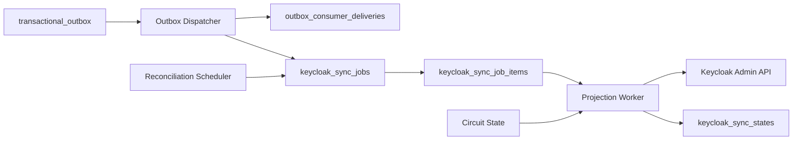
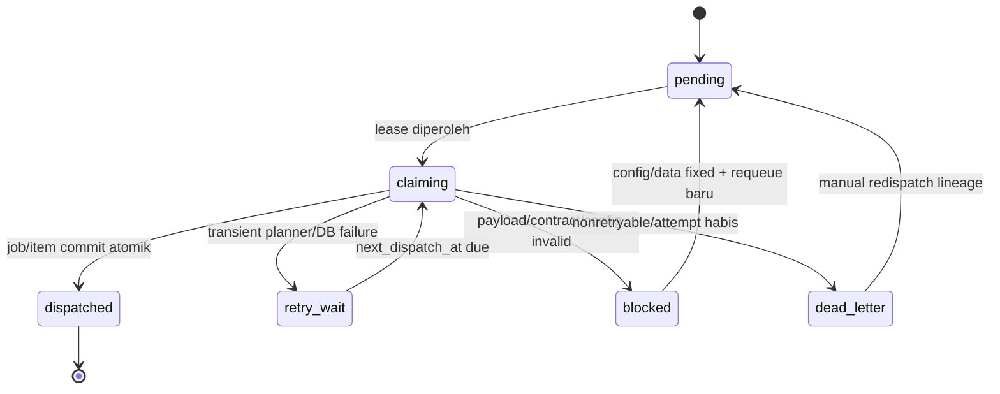
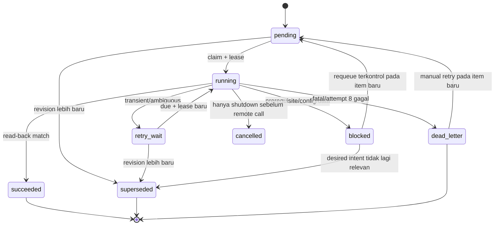
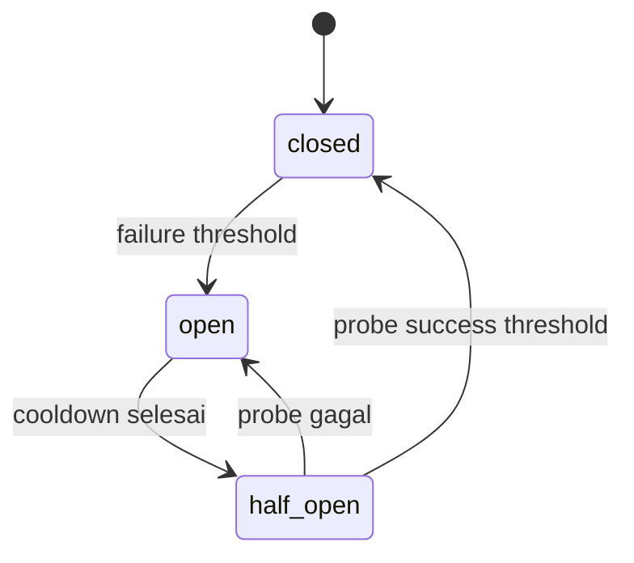

# 25 - IDP Pegawai Kontrak Outbox Consumer, Sync Jobs, Retry & Dead-Letter

Status: Draf kontrak rinci arsitektur, **bukan migration atau implementasi worker**  
Proyek: kumjabar_ecosystem  
Tanggal: 2026-08-29  
Bergantung pada:

- `24-idp-pegawai-desired-state-identity-link-projection-mapping-contract.md`
- `23-idp-pegawai-stage-4-keycloak-sync-projection-breakdown.md`
- `22-idp-pegawai-stage-3-review-checklist-open-decisions.md`
- `20-idp-pegawai-audit-event-privacy-retention-contract.md`
- `16-idp-pegawai-import-apply-materialization-contract.md`

## 1. Tujuan

Dokumen ini memperinci execution contract worker Tahap 4:

1. status pengiriman outbox khusus consumer Keycloak;
2. pemisahan dispatcher, job planner, dan projection executor;
3. lifecycle `keycloak_sync_jobs` dan `keycloak_sync_job_items`;
4. deduplication, coalescing, dan ordering lintas source version/projection revision;
5. claim queue memakai `FOR UPDATE SKIP LOCKED`;
6. lease, heartbeat, fencing token, dan crash recovery;
7. retry maksimum delapan attempts dengan exponential backoff dan full jitter;
8. penghormatan `Retry-After` dan klasifikasi error;
9. circuit breaker dan adaptive concurrency/rate control;
10. logical dead-letter queue tanpa broker terpisah;
11. manual retry/recovery dengan immutable lineage;
12. transaksi dispatcher/finalization tanpa remote call di dalam transaksi;
13. observability, privacy, retention, dan PostgreSQL test contract.

Prinsip:

> Delivery adalah pencatatan bahwa event telah diubah menjadi durable work. Execution adalah upaya konvergensi remote. Keduanya berbeda dan tidak boleh dipadatkan menjadi satu boolean `published`.

## 2. Boundary Dokumen

Dokumen 24 mengunci **apa** desired state-nya. Dokumen 25 mengunci **bagaimana work dijadwalkan dan dipulihkan**.

```text
transactional_outbox
-> consumer delivery
-> sync job
-> sync job item
-> worker attempt
-> remote Keycloak call
-> read-back
-> item terminal/retry
-> job summary
-> projection state
```

Detail endpoint Keycloak dan reconciliation algorithm lanjutan dibahas Dokumen 26.

## 3. Komponen Runtime



## 4. Tanggung Jawab Komponen

| Komponen | Tanggung Jawab | Tidak Boleh |
| --- | --- | --- |
| domain service | commit domain + audit + outbox | memanggil Keycloak |
| dispatcher | claim event, reserve delivery, membuat durable work | menjalankan remote mutation |
| planner | menentukan target/item dan desired revision terbaru | mempercayai payload sebagai full state |
| projection worker | claim item, recompute desired, apply/read-back | mengubah domain pegawai/grant |
| reconciliation scheduler | menjadwalkan scan/repair | auto-link/delete identity |
| circuit controller | pause/probe berdasarkan health | mengubah domain eligibility |
| manual recovery service | membuat retry/reconcile lineage baru | mengedit event/item lama |

## 5. Consumer Code

Consumer Keycloak mempunyai identifier stabil:

```text
keycloak_projection_v1
```

Identifier:

- bukan nama deployment instance;
- versioned bila delivery semantics berubah incompatible;
- masuk unique key delivery;
- tidak berasal dari request user;
- tidak menyimpan realm URL atau secret.

## 6. Mengapa Delivery Per Consumer Wajib

Satu outbox event dapat dikonsumsi oleh:

```text
Keycloak projection
consumer application delta feed
notification/analytics future
```

Status global `published=true` tidak membuktikan semua consumer telah memiliki durable work. Maka gunakan satu row delivery per pasangan:

```text
(outbox_event_id, consumer_code)
```

## 7. Tabel `outbox_consumer_deliveries`

Concern minimum:

```text
id / uuid
outbox_event_id
consumer_code
status
dispatch_attempt_count
next_dispatch_at
lease_owner
lease_until
lease_generation
last_error_code
last_error_at
dispatched_job_id
dispatched_at
created_at / updated_at
```

Status:

```text
pending
claiming
dispatched
retry_wait
blocked
dead_letter
```

`dispatched` berarti job/item durable sudah commit, bukan remote Keycloak sudah sukses.

## 8. Delivery State Machine



`claiming` tidak boleh menjadi state menggantung tanpa lease expiry/recovery.

## 9. Delivery Idempotency

Unique keys:

```text
UNIQUE(outbox_event_id, consumer_code)
UNIQUE(dispatched_job_id) WHERE dispatched_job_id IS NOT NULL
```

Dispatcher duplicate:

- menemukan delivery existing;
- bila `dispatched`, no-op;
- bila leased aktif, skip;
- bila lease expired, takeover dengan fencing;
- tidak membuat job kedua untuk source event/consumer yang sama.

## 10. Event Eligibility

Dispatcher hanya menerima event:

- contract version didukung;
- event type masuk allowlist;
- aggregate UUID valid;
- source/projection provenance minimum tersedia;
- tidak soft-invalid/corrupt;
- belum mempunyai dispatched delivery untuk consumer ini.

Event type awal:

```text
pegawai.created
pegawai.changed
access_grant.created
access_grant.revoked
access_grant.expired
org_unit.created
org_unit.changed
org_unit.deactivated
identity_link.changed
```

Nama final harus mengikuti satu event catalog terpusat dan versioned.

## 11. Payload Event Minimum

Dispatcher boleh membaca:

```text
event UUID
event type/contract version
aggregate type/UUID
source version nullable
change kinds
occurred_at
correlation/provenance UUID
```

Dilarang mengandalkan event untuk:

```text
current desired attributes
current grants
current group membership
current identity-link mode
current enabled policy
```

Semua state itu dihitung ulang dari PostgreSQL ketika planning/execution.

## 12. Transaction Dispatcher

```text
BEGIN
-> select/ensure delivery row
-> claim delivery dengan row lock + fencing generation
-> validate event envelope
-> reserve/upsert source job
-> create/deduplicate target item(s)
-> mark delivery dispatched + dispatched_job_id
-> COMMIT
```

Remote HTTP call tidak ada dalam transaksi ini.

## 13. Claim Delivery dengan `SKIP LOCKED`

Query konseptual:

```sql
SELECT id
FROM idp_pegawai.outbox_consumer_deliveries
WHERE consumer_code = 'keycloak_projection_v1'
  AND status IN ('pending', 'retry_wait')
  AND next_dispatch_at <= now()
  AND (lease_until IS NULL OR lease_until < now())
ORDER BY next_dispatch_at, id
FOR UPDATE SKIP LOCKED
LIMIT :batch_size;
```

Setelah claim:

```text
status = claiming
lease_owner = opaque worker instance ID
lease_until = DB now + delivery lease TTL
lease_generation = lease_generation + 1
```

## 14. Lazy Delivery Creation

Jika delivery rows tidak dibuat dalam domain transaction, dispatcher dapat membuatnya lazily dari outbox rows dengan:

```text
INSERT ... ON CONFLICT(outbox_event_id, consumer_code) DO NOTHING
```

Pilihan lazy creation menghindari domain service mengetahui daftar consumer. Tetapi scanner outbox harus durable, paginated, dan tidak bergantung pada satu global published flag.

## 15. Job Source Types

```text
outbox
reconciliation_incremental
reconciliation_full
manual_retry
manual_reconcile
onboarding
link_existing
unlink
profile_projection
```

Job adalah container operasional. Item adalah unit execution.

## 16. Tabel `keycloak_sync_jobs`

Concern minimum:

```text
id / uuid
source_type
source_event_id nullable
parent_job_id nullable
root_job_id
triggered_by_subject nullable
reason_code nullable
status
priority
total_items
pending_items
running_items
succeeded_items
retry_wait_items
blocked_items
dead_letter_items
superseded_items
created_at / started_at / finished_at
lock_version
```

Counters adalah cache dan harus dapat dihitung ulang dari item.

## 17. Job Status

```text
pending
processing
completed
partially_failed
failed
cancelled
superseded
```

Makna:

| Status | Makna |
| --- | --- |
| `pending` | mempunyai item belum diproses |
| `processing` | minimal satu item running atau pernah dimulai |
| `completed` | seluruh item `succeeded`/`superseded`, tanpa failure |
| `partially_failed` | kombinasi sukses dengan blocked/dead-letter |
| `failed` | semua item terminal gagal atau job-level invariant gagal |
| `cancelled` | hanya sebelum execution/untuk operasi yang aman dibatalkan |
| `superseded` | seluruh intent telah digantikan job revision lebih baru |

## 18. Job State Derivation

Job status tidak diubah secara bebas. Derive dari item + job-level guard:

```text
any running/retryable -> processing
all succeeded/superseded -> completed
some success + some blocked/dead_letter -> partially_failed
all blocked/dead_letter -> failed
all superseded -> superseded
```

Update counter/status memakai satu transaction setelah item transition atau periodic repair.

## 19. Source Job Uniqueness

Untuk source outbox:

```text
UNIQUE(source_type, source_event_id)
WHERE source_type = 'outbox'
```

Manual/reconciliation jobs memakai own UUID dan lineage; tidak berbagi source-event uniqueness.

## 20. Job Lineage

Fields:

```text
parent_job_id
root_job_id
source_event_id
triggered_by_subject
reason_code
```

Manual retry:

```text
old terminal item/job tetap immutable
-> new job dengan parent_job_id
-> root_job_id tetap
-> recompute desired state terkini
```

## 21. Tabel `keycloak_sync_job_items`

Concern minimum:

```text
id / uuid
job_id
target_type
target_uuid
operation_family
priority
projection_revision
desired_contract_version
desired_hash
status
attempt_count
max_attempts
next_attempt_at
lease_owner
lease_until
lease_generation
heartbeat_at
last_http_status
last_error_code
last_error_summary_masked
first_failed_at
last_failed_at
started_at
succeeded_at
terminal_at
superseded_by_item_id nullable
created_at / updated_at
lock_version
```

## 22. Target Types

```text
pegawai
org_unit
managed_catalog
```

`target_uuid` selalu UUID domain/public yang stabil. Jangan memakai NIP/email sebagai queue target key.

## 23. Operation Families

```text
recompute_projection
onboard_managed_user
link_existing_user
unlink_cleanup
reconcile_target
provision_group
reconcile_group
apply_profile_projection
```

Operation family menentukan adapter policy, timeout, dan error classifier; bukan arbitrary command string.

## 24. Item Status

```text
pending
running
retry_wait
succeeded
blocked
dead_letter
superseded
cancelled
```

`blocked` dan `dead_letter` berbeda:

- `blocked`: prasyarat/config/data dapat diperbaiki tanpa menghabiskan retry remote;
- `dead_letter`: nonretryable atau max attempts habis dan memerlukan manual decision.

## 25. Item State Machine



Tidak ada transition in-place `dead_letter -> running`; retry selalu membuat item/job baru.

## 26. Item Deduplication Key

Dedup semantic:

```text
consumer_code
target_type
target_uuid
operation_family
projection_revision
desired_contract_version
```

Untuk source event, item juga ditautkan ke job/delivery. Unique constraint harus mencegah exact same intent duplicate tanpa mencegah revision baru.

## 27. Coalescing Event

Beberapa event lama untuk target sama dapat collapse ke desired revision terbaru.

Aturan:

1. event tetap mempunyai delivery lineage;
2. planner membaca projection revision current;
3. bila item revision sama sudah pending/running, delivery menunjuk work tersebut atau job item superseded terjelaskan;
4. item revision lama yang belum running menjadi `superseded`;
5. item running lama tidak dibatalkan secara kasar; fencing mencegah stale finalize;
6. work terbaru tetap dijadwalkan.

Coalescing tidak menghapus outbox/delivery history.

## 28. Ordering per Target

Ordering authority:

```text
projection_revision bigint monotonic per target projection aggregate
```

`occurred_at` bukan ordering authority. `pegawai.source_version` tidak cukup karena grant/org/catalog juga dependency.

## 29. Priority

Urutan awal:

```text
10 security revoke/disable/unlink cleanup
20 coarse role removal
30 identity link/onboarding completion
40 eligibility enable/base role
50 org/group/profile update
80 incremental reconciliation
100 full reconciliation
```

Angka lebih kecil lebih prioritas. Priority tidak boleh mengalahkan per-target revision/fencing.

## 30. Queue Claim Query

```sql
SELECT id
FROM idp_pegawai.keycloak_sync_job_items
WHERE status IN ('pending', 'retry_wait')
  AND next_attempt_at <= now()
  AND (lease_until IS NULL OR lease_until < now())
ORDER BY priority ASC, next_attempt_at ASC, id ASC
FOR UPDATE SKIP LOCKED
LIMIT :claim_size;
```

Claim dan commit dilakukan cepat sebelum remote call.

## 31. Lease Contract

Parameter final v1:

```text
item lease TTL          = 90 detik
heartbeat interval      = 30 detik
connect timeout         = 5 detik
read timeout            = 20 detik
total attempt timeout   = 45 detik
```

Nilai ini menjadi kontrak v1 dan tetap wajib diuji melalui benchmark/fault injection. `lease_until` memakai DB time.

## 32. Lease Claim Transition

Dalam satu transaction:

```text
status = running
attempt_count = attempt_count + 1
lease_owner = instance ID
lease_generation = lease_generation + 1
lease_until = DB now + TTL
heartbeat_at = DB now
started_at = COALESCE(started_at, DB now)
```

Attempt dihitung saat worker benar-benar claim untuk execution. Circuit-open deferral sebelum claim tidak menghabiskan attempt.

## 33. Heartbeat

Heartbeat hanya jika remote workflow memang panjang dan masih current.

Update wajib match:

```text
item ID
status = running
lease_owner
lease_generation
```

Jika update count nol, worker kehilangan lease dan tidak boleh finalize item.

## 34. Fencing Token

`lease_generation` adalah fencing token monotonik per item.

Finalize condition:

```text
WHERE id = :item_id
  AND status = 'running'
  AND lease_owner = :owner
  AND lease_generation = :generation
  AND lock_version = :expected
```

Stale worker yang kembali setelah timeout tidak dapat menimpa result worker pengganti.

## 35. Per-Target Serialization

Queue item lease saja belum cukup jika revision berbeda untuk target yang sama.

Gunakan short transaction coordination pada `keycloak_sync_states`:

```text
claim/verify target projection revision
set active_item_id + active_generation/fence (conceptual)
commit
remote work
finalize dengan target fence
```

Alternatif advisory lock hanya boleh jika tidak ditahan sepanjang remote HTTP call. Jangan membuka transaksi panjang untuk memegang row/advisory lock saat network I/O.

## 36. Target Fencing

Projection state menyimpan minimum:

```text
current desired projection revision
active item UUID nullable
active target generation
last applied projection revision
```

Finalize sukses memerlukan:

```text
item lease fence masih current
AND target generation masih current
AND recomputed desired revision/hash belum berubah
AND read-back cocok
```

## 37. Remote Call Boundary

```text
Tx claim item -> COMMIT
load/recompute desired state read transaction singkat
remote Keycloak mutation/read-back tanpa DB transaction panjang
Tx finalize item/state/audit -> COMMIT
```

Jika desired state berubah di tengah remote call, finalize lama ditolak dan latest item memperbaiki remote state.

## 38. Attempt Record

Attempt history wajib disimpan pada tabel forensik bounded:

```text
keycloak_sync_attempts
```

Concern:

```text
item_id / attempt_no
lease_generation
started_at / finished_at
outcome
http_status nullable
safe_error_code
latency_ms
retry_delay_seconds nullable
```

Tidak menyimpan raw request/response/PII/secret. Keputusan wajib/tidak tabel attempt masih open review.

## 39. Retry Maksimum

Keputusan final Dokumen 23:

```text
max_attempts = 8
```

Attempt kedelapan gagal retryable menjadi `dead_letter`. Manual retry membuat item baru dengan attempt count mulai nol dan lineage ke item lama.

## 40. Exponential Backoff dengan Full Jitter

Untuk retry ke-`n` setelah failure:

```text
raw_cap_seconds = min(900, 5 * 2^(attempt_count - 1))
delay_seconds   = random_uniform(0, raw_cap_seconds)
next_attempt_at = DB now + delay_seconds
```

Catatan:

- attempt pertama segera;
- full jitter berarti rentang nol sampai cap;
- random menggunakan CSPRNG tidak wajib, PRNG runtime cukup untuk scheduling;
- nilai delay aktual disimpan untuk diagnosis;
- test memakai injected deterministic RNG.

## 41. Jadwal Cap

| Attempt yang Gagal | Cap Full Jitter |
| ---: | ---: |
| 1 | 5 detik |
| 2 | 10 detik |
| 3 | 20 detik |
| 4 | 40 detik |
| 5 | 80 detik |
| 6 | 160 detik |
| 7 | 320 detik |
| 8 | dead-letter |

Cap umum tetap 15 menit untuk configuration future; delapan attempts awal belum mencapai 15 menit.

## 42. `Retry-After`

Jika response 429/503 valid membawa `Retry-After`:

```text
server_delay = parse(delta-seconds atau HTTP-date)
chosen_delay = max(local_full_jitter_delay, server_delay)
```

Guard:

- malformed header diabaikan dengan safe metric;
- HTTP-date dihitung memakai trusted clock/DB-now approximation;
- negative menjadi nol;
- cap operasional maksimum default 24 jam agar poison header tidak membekukan queue tanpa alert;
- delay di atas 15 menit diperbolehkan karena explicit server instruction dan diaudit/diamati;
- circuit controller juga dapat pause consumer global.

## 43. Error Classification

| Kelas | Contoh | Item Result |
| --- | --- | --- |
| transient network | connect/read timeout, reset | `retry_wait` |
| transient DNS/TLS infra | temporary resolver/upstream | retry terbatas; TLS trust failure bisa blocked |
| rate limit | 429 | `retry_wait`, `Retry-After` |
| remote server | 500/502/503/504 | `retry_wait` |
| unauthorized | 401 | global circuit open + `blocked`/defer |
| forbidden | 403 | config/permission blocked + alert kritis |
| validation | 400/422 | `dead_letter` atau blocked data/catalog |
| missing linked user | 404 | blocked, jangan auto-create |
| conflict | 409 | read-back; retry atau blocked |
| ambiguous outcome | timeout setelah mutation | read-back sebelum retry mutation |
| duplicate identity | multiple stable UUID candidate | dead-letter/security review |
| stale desired | revision/hash berubah | superseded, bukan failure |

## 44. Ambiguous Outcome

Untuk operation mutating yang timeout:

```text
timeout/reset
-> GET actual managed subset
-> jika desired sudah tercapai: succeeded
-> jika belum dan safe retryable: retry_wait
-> jika actual ambigu/partial: blocked/dead-letter sesuai invariant
```

Blind retry create/link dilarang.

## 45. Nonretryable vs Blocked

Gunakan `blocked` bila perbaikan prasyarat dapat membuat item relevan lagi:

```text
service permission salah
client/role/group catalog belum tersedia
identity link missing/cache mismatch
primary org invalid
TLS trust config salah
```

Gunakan `dead_letter` bila:

```text
attempt 8 gagal
remote duplicate identity
invalid immutable identity
operation contract tidak didukung
response tidak dapat diverifikasi aman
manual review security wajib
```

## 46. Circuit Breaker Scope

Circuit key:

```text
consumer_code + realm/environment + operation family class
```

Minimal dua kelas:

```text
read
write
```

Jika write circuit terbuka, bounded read probe masih dapat diizinkan untuk diagnosis/read-back sesuai policy.

## 47. Circuit States

```text
closed
open
half_open
```



Circuit state operasional tidak mengubah domain/access state.

## 48. Circuit Threshold Awal

Rekomendasi awal:

```text
window                     = 60 detik
minimum requests           = 20
failure ratio threshold    = 50%
consecutive auth failures  = 3
open cooldown              = 60 detik
half-open probes           = 3
```

401/403 dapat membuka circuit lebih cepat daripada 5xx. Nilai final melalui integration/load test.

## 49. Circuit Persistence

Rekomendasi v1:

- durable lightweight state per consumer/realm/class pada PostgreSQL atau shared Redis hanya jika runtime multi-instance membutuhkannya;
- correctness queue tidak bergantung Redis;
- bila circuit state hilang saat restart, pending item tetap durable dan concurrency/rate cap mencegah storm;
- PostgreSQL menjadi pilihan default agar tetap lite.

## 50. Circuit-Open Behavior

- jangan claim batch besar;
- item tetap pending/retry_wait;
- tidak menambah attempt untuk item yang belum dieksekusi;
- set global next probe time;
- alert circuit open;
- half-open hanya sejumlah probe terbatas;
- security revoke tetap priority pertama setelah circuit pulih;
- local deny tetap langsung berlaku.

## 51. Adaptive Rate Control

Konfigurasi:

```text
max worker concurrency
max requests per second
claim batch size
HTTP connection pool
per-operation timeout
```

429:

- turunkan concurrency sementara;
- hormati `Retry-After`;
- hindari semua worker bangun bersamaan;
- metrics mencatat rate-limit episode.

## 52. Logical Dead-Letter Queue

DLQ adalah query terhadap:

```text
keycloak_sync_job_items.status = 'dead_letter'
```

Tidak ada copy event ke tabel/broker lain. Keuntungan:

- lineage job/item/outbox tetap utuh;
- tidak ada dual-write DLQ;
- manual retry dapat merujuk item asli;
- retention dan audit lebih sederhana.

## 53. Dead-Letter Invariants

Saat masuk dead-letter:

```text
terminal_at NOT NULL
last_error_code NOT NULL
last_failed_at NOT NULL
attempt_count BETWEEN 0 AND max_attempts
lease fields cleared
```

`attempt_count` dapat kurang dari 8 untuk fatal nonretryable.

## 54. Safe Diagnostic Fields

Boleh disimpan:

```text
HTTP status
safe error code
masked summary maksimum terbatas
first/last failure time
operation family
target UUID
job/item/correlation UUID
attempt count
```

Dilarang:

```text
access/refresh token
client secret
raw request/response
HTML error body
NIP/email/nama
password/action token
full user/group/role representation
stack trace/SQL parameter
```

## 55. Manual Retry

Input:

```text
dead-letter/blocked item UUID
reason code
free-text reason yang dibatasi dan disanitasi
Idempotency-Key
actor subject
```

Flow:

1. authorize capability;
2. safe 404 untuk item di luar scope;
3. lock/read original item;
4. pastikan terminal/blocked;
5. recompute desired current;
6. buat new job/item dengan parent/root lineage;
7. audit `keycloak.manual_retry_requested`;
8. original item immutable.

## 56. Manual Reconcile

Berbeda dari retry:

- retry menyatakan intent lama gagal dan mencoba desired current dengan lineage;
- reconcile membaca desired/actual tanpa mengasumsikan operation lama;
- operator memilih target, bukan mengedit payload;
- hasil bisa no-op, repair job, blocked, atau dead-letter baru.

## 57. Manual Acknowledge External Repair

Jika TI memperbaiki Keycloak lewat console:

- tidak ada tombol force-success;
- lakukan reconcile/read-back;
- jika actual cocok, item recovery baru berhasil;
- simpan actor/reason/audit;
- item dead-letter lama tetap terminal.

## 58. Cancellation

Cancellation hanya aman sebelum remote mutation dimulai.

- pending/retry_wait item boleh superseded/cancelled jika desired intent sudah tidak relevan;
- running item hanya cooperative cancellation sebelum remote call;
- setelah remote call dimulai, gunakan read-back/reconciliation;
- security revoke item tidak boleh dibatalkan oleh operator biasa.

## 59. Crash Recovery

Kasus:

| Crash Point | Recovery |
| --- | --- |
| sebelum delivery commit | delivery eligible lagi |
| setelah job/item commit | delivery dispatched; item durable |
| setelah item claim sebelum remote | lease expires, takeover |
| setelah remote mutation sebelum finalize | takeover melakukan read-back |
| setelah finalize success | replay sees terminal success |
| heartbeat berhenti | lease expiry + fencing |

## 60. Expired Lease Recovery

Sweeper bukan wajib untuk correctness karena claim query menerima expired lease. Namun periodic repair boleh:

```text
running + lease_until < now()
-> retry_wait atau langsung reclaim policy
-> clear owner
-> safe recovery code
```

Jangan menandai failed hanya karena worker mati.

## 61. Finalization Success Transaction

```text
BEGIN
-> verify item lease owner/generation/lock version
-> verify target fence/current projection revision/hash
-> update item succeeded + clear lease
-> update keycloak_sync_states applied hash/revision/status
-> insert audit success bila event material
-> recompute job counters/status
-> COMMIT
```

Jika verification gagal, rollback; stale worker tidak boleh menulis success.

## 62. Finalization Retry Transaction

```text
BEGIN
-> verify lease fence
-> classify failure
-> calculate delay / Retry-After
-> item retry_wait + next_attempt_at
-> clear lease
-> update safe diagnostics
-> update projection state retry_wait jika current
-> recompute job summary
-> COMMIT
```

## 63. Finalization Dead-Letter Transaction

```text
BEGIN
-> verify lease fence
-> item dead_letter + terminal metadata
-> clear lease
-> projection state dead_letter jika item current
-> durable audit dead-lettered
-> recompute job summary
-> COMMIT
```

Alert dapat dipublikasikan setelah commit melalui telemetry/outbox, bukan remote call di transaction.

## 64. Finalization Superseded

Item menjadi superseded bila desired revision/hash sudah lebih baru sebelum remote execution/finalization.

- bukan failure;
- tidak menambah retry;
- referensi `superseded_by_item_id` bila diketahui;
- delivery tetap dispatched;
- job status derived;
- latest item wajib ada atau dibuat atomik.

## 65. Projection State vs Queue State

`keycloak_sync_states` menyatakan convergence target saat ini. Item menyatakan historical execution intent.

```text
state.status = in_sync/retry_wait/blocked/dead_letter/drifted
item.status  = lifecycle satu execution intent
```

State tidak menyimpan lease/attempt authority. Queue item tidak menjadi authority authorization.

## 66. Job Counter Repair

Karena counter adalah cache:

- update atomic saat transition;
- periodic repair query menghitung ulang;
- mismatch menghasilkan metric/alert;
- job completion tidak boleh hanya percaya counter tanpa invariant query pada critical path;
- counter negatif atau melampaui total ditolak oleh constraint/service guard.

## 67. Reconciliation Scheduling

Keputusan final:

```text
event-driven utama
incremental setiap 15 menit
full managed scan harian di luar jam puncak
```

Scheduler membuat jobs paginated/chunked. Tidak ada satu item untuk seluruh realm.

## 68. Incremental Reconciliation

Candidate:

```text
next_reconcile_at <= now()
status drifted/retry relevant
last_verified_at stale
catalog revision changed
missed time-driven grant boundary
```

Keyset pagination, bounded page size, dan checkpoint durable.

## 69. Full Reconciliation

Run mempunyai cursor/checkpoint:

```text
run UUID
snapshot/cutoff started_at
last pegawai ID/UUID
page number optional
total scanned/repaired/blocked
status
```

Jika crash, lanjut dari checkpoint. Changes setelah cutoff tetap ditangani event/incremental path.

## 70. Reconciliation Job Isolation

- full scan priority paling rendah;
- tidak memenuhi queue dengan jutaan item sekaligus;
- materialize per bounded page;
- event-driven security item mendahului;
- same target/revision dedup/coalesce;
- circuit open menghentikan execution, bukan kehilangan checkpoint.

## 71. Time-Driven Grant Scheduler

Grant `valid_from`/`valid_until` memerlukan durable trigger.

Keputusan final:

- periodic due scan terhadap indexed grant boundaries;
- membuat outbox/projection revision saat boundary tercapai;
- 15-minute reconciliation adalah safety net, bukan target security latency expiry;
- expiry local authorization tetap memakai DB time langsung;
- coarse role cleanup queue priority tinggi.

Due-scan dijalankan setiap 1 menit. Nilai tersebut menjadi operational SLO dan diuji terhadap backlog/outage recovery.

## 72. Circuit State Table Konseptual

Concern:

```text
consumer_code
realm_key
operation_class
state
window_started_at
request_count
failure_count
consecutive_auth_failures
opened_at
next_probe_at
half_open_remaining
lock_version
updated_at
```

Tabel PostgreSQL ini wajib pada v1 agar circuit state konsisten lintas worker instance.

## 73. DDL Konseptual Delivery

```sql
CREATE TABLE idp_pegawai.outbox_consumer_deliveries (
    id bigint GENERATED BY DEFAULT AS IDENTITY PRIMARY KEY,
    uuid uuid NOT NULL DEFAULT gen_random_uuid(),
    outbox_event_id bigint NOT NULL,
    consumer_code varchar(80) NOT NULL,
    status varchar(30) NOT NULL DEFAULT 'pending',
    dispatch_attempt_count integer NOT NULL DEFAULT 0,
    next_dispatch_at timestamptz NOT NULL DEFAULT now(),
    lease_owner varchar(120),
    lease_until timestamptz,
    lease_generation bigint NOT NULL DEFAULT 0,
    last_error_code varchar(100),
    last_error_at timestamptz,
    dispatched_job_id bigint,
    dispatched_at timestamptz,
    created_at timestamptz NOT NULL DEFAULT now(),
    updated_at timestamptz NOT NULL DEFAULT now()
);
```

Preview belum lengkap: FK, unique, check, indexes, ownership, dan grants wajib ditambahkan migration final.

## 74. DDL Konseptual Job

```sql
CREATE TABLE idp_pegawai.keycloak_sync_jobs (
    id bigint GENERATED BY DEFAULT AS IDENTITY PRIMARY KEY,
    uuid uuid NOT NULL DEFAULT gen_random_uuid(),
    source_type varchar(40) NOT NULL,
    source_event_id bigint,
    parent_job_id bigint,
    root_job_id bigint,
    triggered_by_subject varchar(255),
    reason_code varchar(100),
    status varchar(30) NOT NULL DEFAULT 'pending',
    priority smallint NOT NULL DEFAULT 50,
    total_items integer NOT NULL DEFAULT 0,
    succeeded_items integer NOT NULL DEFAULT 0,
    blocked_items integer NOT NULL DEFAULT 0,
    dead_letter_items integer NOT NULL DEFAULT 0,
    superseded_items integer NOT NULL DEFAULT 0,
    created_at timestamptz NOT NULL DEFAULT now(),
    started_at timestamptz,
    finished_at timestamptz,
    lock_version integer NOT NULL DEFAULT 0
);
```

Counters lengkap ditentukan migration final; jangan menduplikasi semua status bila tidak dipakai query/UI.

## 75. DDL Konseptual Item

```sql
CREATE TABLE idp_pegawai.keycloak_sync_job_items (
    id bigint GENERATED BY DEFAULT AS IDENTITY PRIMARY KEY,
    uuid uuid NOT NULL DEFAULT gen_random_uuid(),
    job_id bigint NOT NULL,
    target_type varchar(30) NOT NULL,
    target_uuid uuid NOT NULL,
    operation_family varchar(50) NOT NULL,
    priority smallint NOT NULL DEFAULT 50,
    projection_revision bigint NOT NULL,
    desired_contract_version varchar(80) NOT NULL,
    desired_hash char(64) NOT NULL,
    status varchar(30) NOT NULL DEFAULT 'pending',
    attempt_count integer NOT NULL DEFAULT 0,
    max_attempts integer NOT NULL DEFAULT 8,
    next_attempt_at timestamptz NOT NULL DEFAULT now(),
    lease_owner varchar(120),
    lease_until timestamptz,
    lease_generation bigint NOT NULL DEFAULT 0,
    heartbeat_at timestamptz,
    last_http_status smallint,
    last_error_code varchar(100),
    last_error_summary_masked text,
    first_failed_at timestamptz,
    last_failed_at timestamptz,
    started_at timestamptz,
    succeeded_at timestamptz,
    terminal_at timestamptz,
    superseded_by_item_id bigint,
    created_at timestamptz NOT NULL DEFAULT now(),
    updated_at timestamptz NOT NULL DEFAULT now(),
    lock_version integer NOT NULL DEFAULT 0
);
```

Ini bukan migration siap-jalankan.

## 76. Constraint Wajib Delivery

```text
unique(uuid)
unique(outbox_event_id, consumer_code)
consumer_code nonblank/allowlist
status enum
attempt_count >= 0
lease_generation >= 0
claiming -> lease owner/until present
dispatched -> dispatched_job_id/dispatched_at present
terminal delivery -> lease cleared
FK outbox_event ON DELETE RESTRICT
FK dispatched_job ON DELETE RESTRICT
```

## 77. Constraint Wajib Job

```text
unique(uuid)
source job unique per outbox event
parent/root cannot self-reference
counts >= 0 and <= total
finished_at required terminal
nonterminal finished_at null
manual source -> actor/reason required
FK lineage ON DELETE RESTRICT
```

## 78. Constraint Wajib Item

```text
unique(uuid)
FK job ON DELETE RESTRICT
FK superseded item ON DELETE RESTRICT
projection_revision >= 0
hash regex ^[0-9a-f]{64}$
attempt_count between 0 and max_attempts
max_attempts = 8 v1 or policy-capped
running -> lease owner/until/generation present
retry_wait -> next_attempt_at present + lease cleared
succeeded -> succeeded_at/terminal_at + lease cleared
dead_letter -> terminal/error/failure timestamps + lease cleared
superseded -> terminal_at + lease cleared
last_http_status between 100 and 599
masked summary length cap
```

## 79. Dedup Index

Rekomendasi partial uniqueness untuk active exact work:

```text
(target_type, target_uuid, operation_family, projection_revision, desired_contract_version, desired_hash)
WHERE status IN ('pending','running','retry_wait')
```

History terminal boleh mempunyai same intent melalui manual lineage jika policy mengizinkan, tetapi idempotency key manual mencegah double-click duplicate.

## 80. Queue Index

```text
(priority, next_attempt_at, id)
WHERE status IN ('pending','retry_wait')
```

Lease expired filtering dapat memerlukan index tambahan berdasarkan benchmark. Jangan memasukkan terlalu banyak mutable columns ke index tanpa evidence.

## 81. Delivery Queue Index

```text
(consumer_code, next_dispatch_at, id)
WHERE status IN ('pending','retry_wait')
```

## 82. Retention

- outbox retained sesuai event governance;
- delivery/job/item terminal minimal cukup untuk operational/security audit lineage;
- dead-letter tidak dipurge sebelum resolved + retention policy;
- identity-link terminal tetap minimum 5 tahun sesuai Dokumen 24;
- audit logs mengikuti Stage 3 retention;
- purge memakai bounded manifest dan FK-safe order;
- tidak ada `ON DELETE CASCADE` yang menghilangkan lineage diam-diam.

## 83. Audit Events

```text
keycloak.delivery_dead_lettered
keycloak.job_created
keycloak.item_succeeded
keycloak.item_dead_lettered
keycloak.manual_retry_requested
keycloak.manual_reconcile_requested
keycloak.circuit_opened
keycloak.circuit_closed
keycloak.expired_lease_recovered
keycloak.stale_completion_rejected
```

High-volume retry individual cukup metric/log aman kecuali security-sensitive; jangan membanjiri persistent audit.

## 84. Metrics

```text
outbox_delivery_pending
outbox_delivery_oldest_age_seconds
sync_items_by_status
sync_item_attempts_total
sync_retry_delay_seconds
sync_dead_letter_total
sync_blocked_total
sync_lease_expired_total
sync_stale_finalize_total
sync_projection_lag_seconds
sync_circuit_state
sync_circuit_open_total
sync_rate_limit_total
sync_worker_concurrency
sync_reconciliation_checkpoint_age
```

## 85. Structured Logs

Boleh:

```text
request/correlation UUID
outbox/delivery/job/item UUID
target UUID
operation family
attempt/generation
HTTP status
safe error code
latency/delay
```

Tidak boleh PII/secret/raw payload.

## 86. Alerts

- oldest security revoke item melebihi SLO;
- oldest delivery pending meningkat;
- dead-letter/blocked spike;
- auth failure/circuit open;
- rate limit episode lama;
- expired leases berulang;
- stale completion tinggi;
- reconciliation checkpoint macet;
- job counter inconsistency;
- queue depth melebihi recovery capacity.

## 87. Admin UI Minimum

```text
job list/status/counts
item status dan safe diagnostics
attempt count/next retry
last success/error
manual retry/reconcile beralasan
lineage link
circuit/backlog summary untuk TI
```

Tidak ada raw event editor, force-success, token viewer, atau arbitrary Keycloak command.

## 88. API Manual Retry

Konseptual:

```text
POST /admin/api/v1/keycloak-sync/items/{item_uuid}/retry
Idempotency-Key: ...
```

Body:

```json
{
  "reason_code": "dependency_fixed",
  "reason": "Konfigurasi role sudah diperbaiki"
}
```

Backend reauthorize, safe 404, no-store, audit, dan membuat job baru.

## 89. API Manual Reconcile

```text
POST /admin/api/v1/keycloak-sync/targets/pegawai/{pegawai_uuid}/reconcile
Idempotency-Key: ...
```

Tidak menerima desired payload dari browser.

## 90. Threat-to-Control Closure

| Ancaman | Pengendalian |
| --- | --- |
| satu event hilang untuk consumer tertentu | per-consumer delivery unique row |
| dispatcher crash membuat job ganda | delivery+job atomic upsert/unique |
| worker ganda memproses item | SKIP LOCKED + lease |
| worker lama menimpa result baru | lease generation + target fencing |
| event lama menurunkan state | projection revision + supersede |
| retry storm | full jitter + circuit + rate cap |
| server meminta slowdown | validated `Retry-After` |
| poison item menghambat queue | per-item logical DLQ |
| manual retry menghapus sejarah | immutable old item + new lineage |
| remote success ambigu | mandatory read-back |
| long DB transaction saat network | claim/finalize transaction terpisah |
| DLQ mengandung PII/secret | safe diagnostic allowlist |
| full scan mengalahkan revoke | priority + bounded pagination |
| Redis outage menghilangkan queue | PostgreSQL durability authority |
| cascade delete menghilangkan lineage | FK `ON DELETE RESTRICT` + controlled purge |

## 91. Test Matrix - Delivery

- lazy delivery insert idempotent;
- unique event/consumer enforced;
- duplicate dispatcher membuat satu job;
- crash sebelum commit mengulang aman;
- crash setelah commit melihat dispatched;
- delivery retry/lease takeover;
- unsupported contract blocked/dead-letter;
- no global published boolean dependency;
- consumer v2 tidak mencuri delivery v1.

## 92. Test Matrix - Job dan Item

- source job unique;
- counter derivation benar;
- terminal timestamps valid;
- exact active item dedup;
- newer revision supersedes old pending;
- running old completion fenced;
- manual retry new lineage;
- ON DELETE RESTRICT menjaga history;
- target UUID, bukan NIP/email;
- job summary dapat direpair dari items.

## 93. Test Matrix - Lease dan Crash

- parallel SKIP LOCKED tidak overlap;
- claim increment attempt/generation atomik;
- heartbeat hanya owner/current generation;
- expired lease takeover;
- old owner finalize ditolak;
- crash setelah remote mutation recovered via read-back;
- DB time digunakan;
- no DB transaction held during network;
- graceful shutdown tidak false-fail.

## 94. Test Matrix - Retry

- attempt pertama immediate;
- deterministic injected RNG menghasilkan cap benar;
- full jitter range valid;
- attempt 8 failure dead-letter;
- 429 parses delta-seconds;
- 503 parses HTTP-date;
- `Retry-After` cacat atau negatif ditangani aman;
- `Retry-After` eksplisit dapat lebih dari 15 menit;
- manual retry resets attempt pada item baru;
- stale desired superseded bukan retry.

## 95. Test Matrix - Circuit

- threshold membuka circuit;
- auth failures membuka cepat;
- open circuit tidak menghabiskan attempt;
- cooldown ke half-open;
- probe limit enforced multi-worker;
- success menutup circuit;
- failed probe membuka lagi;
- queue tetap durable saat circuit open;
- local authorization tidak berubah;
- restart behavior tidak membuat storm.

## 96. Test Matrix - DLQ dan Recovery

- fatal error dead-letter sebelum attempt 8;
- retryable attempt 8 dead-letter;
- terminal lease cleared;
- diagnostics masked/capped;
- raw response/token/PII absent;
- manual retry capability/idempotency/audit;
- original item immutable;
- external repair memerlukan read-back;
- force-success endpoint tidak ada;
- resolved lineage navigable.

## 97. Test Matrix - Reconciliation

- incremental schedule 15 menit;
- full daily run checkpoint/resume;
- bounded page materialization;
- event-driven dedup dengan reconciliation;
- security priority mendahului full scan;
- catalog revision fan-out bounded;
- circuit open preserves checkpoint;
- missed grant expiry ditemukan;
- seluruh realm tidak pernah dimuat sekaligus ke memori.

## 98. PostgreSQL Test Harness

Wajib memakai PostgreSQL nyata untuk:

```text
partial unique indexes
FOR UPDATE SKIP LOCKED
row lock/fencing conditional updates
FK RESTRICT/self-reference
JSONB constraints bila dependency metadata dipakai
concurrent dispatcher/worker claims
transaction rollback failure injection
queue query plans/indexes
DB clock semantics
```

SQLite tidak menjadi bukti correctness.

## 99. Failure Injection

Inject crash/error pada:

1. setelah delivery claim;
2. setelah job insert sebelum delivery update;
3. setelah item claim;
4. sebelum remote call;
5. setelah remote mutation;
6. setelah read-back;
7. sebelum projection state update;
8. sebelum audit insert;
9. sebelum commit finalize;
10. setelah commit response hilang.

Setiap titik harus menghasilkan state recoverable tanpa duplicate unsafe mutation atau false success.

## 100. Performance Gates

Benchmark:

```text
dispatch batch size
worker claim size/concurrency
queue query latency pada backlog besar
index write amplification
lease/heartbeat load
full reconciliation throughput
recovery after outage 1/6/24 jam
rate-limit behavior
memory per item/read-back
```

Default production tidak ditetapkan hanya dari intuisi.

## 101. Pre-Implementation Gates

| Gate | Bukti Wajib |
| --- | --- |
| outbox schema compatibility | exact FK/event catalog/migration path |
| delivery semantics | concurrent dedup/crash tests |
| projection revision allocation | monotonic target fencing tests |
| lease parameters | timeout/heartbeat/load evidence |
| retry RNG/time | deterministic test clock/RNG |
| `Retry-After` | fixture delta/date/cacat/cap |
| circuit shared state | multi-instance probes/locking |
| dead-letter retention | policy + purge lineage |
| reconciliation checkpoint | crash/resume/load proof |
| index PostgreSQL | `EXPLAIN` dengan backlog representatif |
| audit/privasi | diagnosis aman dan kebijakan volume event |
| operational SLO | revoke lag, backlog age, recovery capacity |

## 102. Keputusan Final yang Dikunci

1. Consumer delivery wajib per `(outbox_event, consumer_code)`; tidak ada global published authority.
2. `dispatched` berarti durable job/item commit, bukan remote success.
3. Dispatcher tidak melakukan Keycloak call.
4. Source outbox job unique dan duplicate dispatch no-op.
5. Job adalah container; item adalah execution authority.
6. Item dedup memakai target/operation/projection revision/hash.
7. Projection revision, bukan event time, menjadi ordering authority.
8. Pending revision lama boleh superseded tanpa menghapus lineage.
9. Queue claim memakai PostgreSQL `FOR UPDATE SKIP LOCKED`.
10. Remote call berada di antara short claim/finalize transactions.
11. Lease generation + target fence wajib untuk stale completion safety.
12. DB time authoritative untuk lease/schedule.
13. Max attempts 8 dengan full jitter base 5 detik dan cap 15 menit.
14. Valid `Retry-After` mengalahkan local delay dan dapat melebihi 15 menit sampai safety cap 24 jam.
15. 401/403 membuka/menahan circuit lebih agresif.
16. Circuit-open deferral sebelum execution tidak menghabiskan attempt.
17. Logical DLQ adalah terminal item status, tanpa duplicate dead-letter table/broker.
18. Manual retry/reconcile membuat job/item baru; history lama immutable.
19. Tidak ada force-success; external repair harus read-back.
20. FK lineage memakai `ON DELETE RESTRICT`, purge terkontrol.
21. Reconciliation incremental 15 menit dan full daily menggunakan checkpoint/chunk.
22. Security revoke/unlink priority lebih tinggi dari reconciliation.
23. PostgreSQL adalah durability authority; Redis tidak wajib untuk queue correctness.
24. Raw Keycloak payload, secret, token, dan PII dilarang di delivery/job/item/attempt.

## 103. Resolusi Final Delapan Keputusan

Delapan pertanyaan arsitektur Dokumen 25 telah diselesaikan dan tidak lagi berstatus terbuka.

| Nomor | Keputusan Final | Kontrak yang Dikunci |
| --- | --- | --- |
| 1 | `keycloak_sync_attempts` wajib | Setiap attempt memiliki row forensik bounded berisi latency, HTTP status, safe error, dan retry delay tanpa raw payload/PII/secret. Unique `(item_id, attempt_no)` wajib. |
| 2 | Lease 90 detik, heartbeat 30 detik, total attempt timeout 45 detik | Connect timeout 5 detik dan read timeout 20 detik; total workflow remote dibatasi 45 detik agar heartbeat dan takeover tidak prematur. |
| 3 | Circuit state memakai PostgreSQL pada v1 | `keycloak_circuit_states` menjadi shared state multi-instance. Redis tidak menjadi dependency correctness. |
| 4 | Delivery dibuat lazily oleh dispatcher | Scanner menjalankan `INSERT ... ON CONFLICT DO NOTHING`; domain transaction hanya menulis transactional outbox. |
| 5 | Safety cap `Retry-After` adalah 24 jam | Nilai lebih panjang di-cap 24 jam dan memicu alert; item tetap durable/pending. |
| 6 | Due-scan grant berjalan setiap 1 menit | Due-scan menjadwalkan remote coarse-role cleanup; local authorization deny tetap langsung berdasarkan DB time. |
| 7 | Retensi job/item/dead-letter adalah 1 tahun umum dan 5 tahun security | `security_access` mencakup revocation, disable, unlink, identity conflict/recovery, dan security dead-letter. Legal hold dapat memperpanjang. |
| 8 | Cancellation hanya untuk pending non-security | Item security, `running`, dan item yang remote call-nya telah dimulai tidak dapat dibatalkan manual. |

### 103.1 Retensi Attempt

`keycloak_sync_attempts` mengikuti parent lineage tetapi boleh mempunyai retensi operasional lebih pendek hanya jika audit/security evidence yang wajib sudah dipersist secara terpisah. Default v1:

```text
attempt umum    = 90 hari
attempt security= 1 tahun
job/item umum   = 1 tahun
job/item security = 5 tahun
```

Tidak ada cascade delete; purge memakai manifest dan urutan FK-safe.

### 103.2 Cancellation Guard

```text
pending + non-security + remote_not_started
-> boleh cancelled dengan reason + audit

security priority / running / remote_started
-> cancellation ditolak
-> gunakan supersede/reconcile bila desired state berubah
```

## 104. Daftar Periksa Penerimaan Dokumen 25

### Delivery dan Planning

- [x] Per-consumer delivery dan lazy creation disetujui.
- [x] Dispatcher transaction/idempotency disetujui.
- [x] Job/item schema dan lineage disetujui.
- [x] Dedup/coalescing/revision ordering disetujui.

### Worker Reliability

- [x] SKIP LOCKED claim disetujui.
- [x] Lease/heartbeat/fencing disetujui.
- [x] Target serialization dan stale completion disetujui.
- [x] Crash/read-back recovery disetujui.

### Retry dan Circuit

- [x] Delapan attempts/full jitter disetujui.
- [x] Semantik `Retry-After` disetujui.
- [x] Error classification disetujui.
- [x] Circuit/rate control disetujui.

### DLQ dan Operasional

- [x] Logical DLQ dan terminal invariants disetujui.
- [x] Manual retry/reconcile lineage disetujui.
- [x] Retention/audit/privacy disetujui.
- [x] Reconciliation/checkpoint/due-scan disetujui.
- [x] PostgreSQL/performance/failure gates disetujui.

## 105. Dokumen Berikutnya

Setelah review Dokumen 25:

```text
26 - IDP Pegawai Kontrak Keycloak Admin API Adapter & Reconciliation
```

Dokumen 26 akan memperinci:

- token acquisition/cache/rotation;
- exact endpoint adapter semantics;
- user create/update/read-back;
- group/client/role ID resolution;
- HTTP status/error normalization;
- safe full-representation update behavior;
- reconciliation diff/repair algorithm;
- orphan/duplicate/group move handling;
- integration test realm fixtures.

## 106. Kesimpulan

Execution contract Tahap 4 menjadi:

```text
outbox authoritative event
-> per-consumer durable delivery
-> idempotent job/item planning
-> revision-aware coalescing
-> SKIP LOCKED + lease/fencing
-> bounded remote attempt
-> read-back recovery
-> full-jitter retry / circuit control
-> logical dead-letter
-> immutable manual recovery lineage
-> checkpointed reconciliation
```

Desain tetap:

- **ringan**: PostgreSQL sebagai queue/delivery/DLQ authority, tanpa broker wajib;
- **tangguh**: unique delivery, lease, fencing, coalescing, retry, circuit, checkpoint, dan crash recovery;
- **kuat**: remote call di luar transaksi, no force-success, immutable lineage, safe diagnostics, priority revoke, dan local authorization tetap authoritative.

Dokumen 25 tidak memberi izin coding, migration, worker execution, Redis provisioning, atau perubahan Keycloak.
