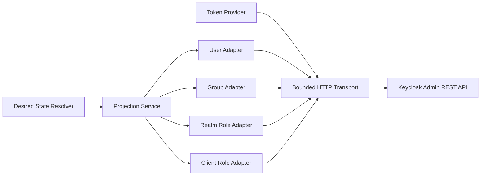
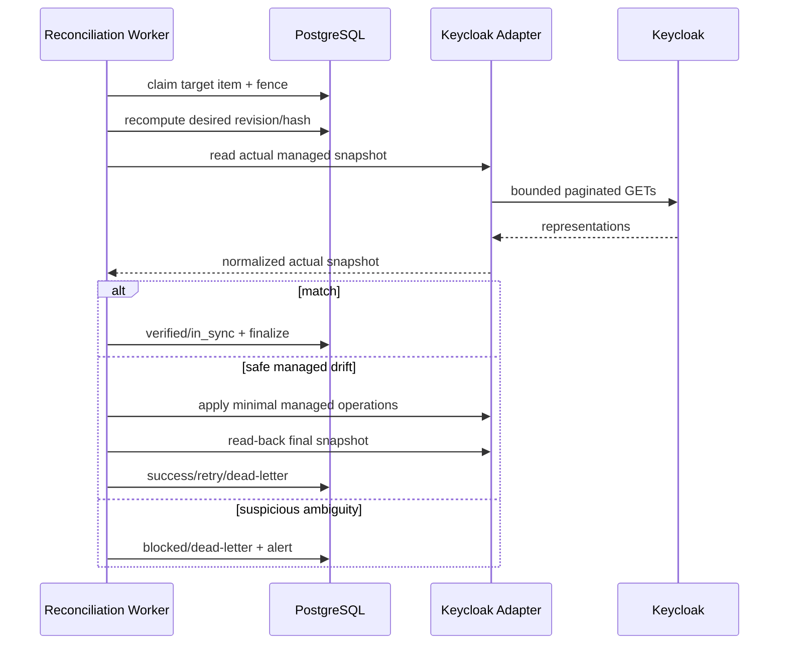

# 26 - IDP Pegawai Kontrak Keycloak Admin API Adapter & Reconciliation

Status: Draf kontrak rinci arsitektur, **bukan implementasi REST client atau konfigurasi realm**  
Proyek: kumjabar_ecosystem  
Tanggal: 2026-08-29  
Bergantung pada:

- `25-idp-pegawai-outbox-consumer-sync-jobs-retry-dead-letter-contract.md`
- `24-idp-pegawai-desired-state-identity-link-projection-mapping-contract.md`
- `23-idp-pegawai-stage-4-keycloak-sync-projection-breakdown.md`
- `20-idp-pegawai-audit-event-privacy-retention-contract.md`
- dokumentasi resmi [Keycloak Admin REST API](https://www.keycloak.org/docs-api/latest/rest-api/index.html)

## 1. Tujuan

Dokumen ini mengunci kontrak adapter HTTP dan rekonsiliasi Tahap 4:

1. perolehan, cache, dan rotasi access token service account;
2. transport HTTPS, connection pooling, timeout, dan batas response;
3. endpoint Keycloak Admin REST API yang diizinkan;
4. resolusi immutable user/group/client/role ID;
5. controlled user onboarding dan safe user update;
6. managed attributes, group memberships, realm roles, dan client roles;
7. normalisasi response serta klasifikasi 400/401/403/404/409/429/5xx;
8. mandatory read-back verification;
9. incremental reconciliation 15 menit dan full scan harian dengan checkpoint;
10. orphan user, duplicate candidate, conflicting group binding, dan group move;
11. least-privilege service account, privacy, observability, dan integration test realm.

Prinsip:

> Adapter menerjemahkan kontrak domain ke protokol Keycloak secara sempit. Adapter tidak mengambil keputusan eligibility, scope, identity ownership, atau authorization bisnis.

## 2. Sumber Kontrak Endpoint

Kontrak endpoint pada dokumen ini merujuk dokumentasi resmi Keycloak Admin REST API terbaru pada saat review. Endpoint families yang terverifikasi tersedia:

```text
/admin/realms/{realm}/users
/admin/realms/{realm}/users/{user-id}
/admin/realms/{realm}/users/{user-id}/groups
/admin/realms/{realm}/users/{user-id}/groups/{groupId}
/admin/realms/{realm}/users/{user-id}/role-mappings/realm
/admin/realms/{realm}/users/{user-id}/role-mappings/clients/{client-id}
/admin/realms/{realm}/groups
/admin/realms/{realm}/clients
```

Implementasi harus mem-pin dan menguji versi Keycloak aktual. Dokumentasi “latest” bukan jaminan kompatibilitas deployment production selamanya.

## 3. Boundary Adapter



## 4. Pembagian Tanggung Jawab

| Lapisan | Tanggung Jawab | Tidak Boleh |
| --- | --- | --- |
| desired resolver | menentukan managed desired state | menyusun URL/API call |
| projection service | diff, ordering, read-back orchestration | mengambil keputusan link berbasis email |
| token provider | client-credentials token/cache/refresh | mencatat token ke log |
| HTTP transport | TLS, pool, timeout, response cap | melakukan retry mutasi secara buta |
| resource adapter | endpoint/path/payload sempit | mengubah unmanaged namespace |
| reconciliation | compare/repair managed subset | hard-delete/auto-link orphan |

## 5. Konfigurasi Tepercaya

Hanya runtime configuration tepercaya yang menentukan:

```text
keycloak_base_url
realm_name = kumjabar
sync_client_id
client_secret reference
managed group root
managed client IDs
managed realm/client role catalog
TLS CA bundle
connection/time limits
```

Browser, event payload, dan database free-text tidak boleh memasok URL, realm, client ID, atau endpoint path.

## 6. Proteksi SSRF dan URL

- scheme wajib `https` pada production;
- host exact allowlist;
- tidak mengikuti redirect lintas host;
- redirect default ditolak;
- DNS resolution tidak boleh diarahkan oleh request user;
- realm/path segment di-URL-encode;
- base URL tidak menerima query/fragment;
- egress firewall hanya mengizinkan Keycloak/proxy yang disetujui;
- proxy environment variables tidak dipercaya tanpa konfigurasi eksplisit.

## 7. Service Account

Client:

```text
idp-pegawai-sync
```

Kontrak:

- confidential client dengan service account;
- client credentials;
- secret melalui secret manager/runtime injection;
- private network;
- fine-grained admin permission minimum;
- bukan akun manusia;
- bukan realm-admin penuh bila dapat dihindari;
- credential rotation diuji tanpa kehilangan queue work.

## 8. Token Endpoint

Token diperoleh melalui OIDC token endpoint realm:

```text
POST {base}/realms/{realm}/protocol/openid-connect/token
Content-Type: application/x-www-form-urlencoded

grant_type=client_credentials
client_id=idp-pegawai-sync
client_secret=[REDACTED]
```

Secret tidak pernah masuk URI, log, metric label, audit, exception, atau tracing body.

## 9. Token Cache

Cache key:

```text
realm + client_id + credential_generation
```

Simpan in-memory per process:

```text
access token
expires_at monotonic
credential generation
```

Aturan:

- tidak menyimpan refresh token;
- refresh sebelum expiry dengan safety margin;
- margin yang direkomendasikan `max(30 detik, 10% expires_in)`;
- single-flight refresh per process;
- multi-process boleh memperoleh token masing-masing;
- token tidak dipersist PostgreSQL/Redis;
- clock monotonic untuk local cache lifetime.

## 10. Token Refresh pada 401

Untuk satu API operation:

```text
request dengan token cached
-> 401
-> invalidate token cache
-> acquire token baru sekali
-> retry operation paling banyak sekali bila operation retry-safe/read-back guarded
-> 401 lagi: classify auth failure + circuit
```

Tidak ada infinite refresh loop.

## 11. Credential Rotation

- secret reference/version berubah;
- cache generation lama di-invalidasi;
- in-flight call boleh selesai;
- call berikut memakai secret baru;
- 401 burst saat rotasi dipantau;
- rollback secret mempunyai runbook;
- old secret dicabut setelah overlap window terkendali.

## 12. HTTP Client Pool

Satu process memakai pooled client yang thread-safe/async-safe sesuai runtime.

Parameter final dari Dokumen 25:

```text
connect timeout       = 5 detik
read timeout          = 20 detik
total attempt timeout = 45 detik
item lease TTL        = 90 detik
heartbeat             = 30 detik
```

Pool size dan keep-alive ditentukan load test, tidak melebihi worker concurrency/rate limit. Response body cap 2 MiB diterapkan pada bytes hasil dekompresi.

## 13. Transport Limits

Keputusan final v1:

```text
max response body       = 2 MiB per request biasa
max page size users     = 100
max page size groups    = 100
max redirects           = 0
request compression     = tidak diperlukan v1
```

Response melebihi cap menjadi safe failure. Full scan selalu pagination.

## 14. Header HTTP

Kirim minimum:

```text
Authorization: Bearer [REDACTED]
Accept: application/json
Content-Type: application/json  # jika body
User-Agent: idp-pegawai-sync/<version>
X-Correlation-ID: opaque UUID   # jika gateway mengizinkan
```

Jangan mengirim actor PII pada header.

## 15. Response Normalization

Adapter mengembalikan typed result/error:

```text
status code
operation family
resource type
safe error code
retry class
Retry-After parsed value
request correlation UUID
response metadata minimum
```

Raw body tidak melewati adapter boundary dan tidak dipersist.

## 16. Error Envelope Internal

```json
{
  "code": "kc_user_not_found",
  "category": "blocked",
  "http_status": 404,
  "retryable": false,
  "ambiguous_outcome": false,
  "correlation_id": "..."
}
```

Tidak memuat realm URL, token, raw body, username, email, atau NIP.

## 17. HTTP Classification Baseline

| HTTP/Failure | Klasifikasi Default |
| --- | --- |
| 2xx sesuai endpoint | candidate success; masih perlu read-back untuk mutation |
| 400/422 | validation/catalog/payload fatal atau blocked |
| 401 | refresh sekali, lalu auth circuit |
| 403 | permission/config blocked + critical alert |
| 404 | operation-specific blocked/no-op; tidak blind-create |
| 409 | conflict; read-back dan classify |
| 429 | retry dengan `Retry-After` |
| 500/502/503/504 | transient retry/circuit |
| timeout/reset | ambiguous bila mutation mungkin diterima |
| TLS trust failure | blocked/circuit, bukan insecure fallback |
| malformed/oversized JSON | blocked/dead-letter sesuai operation |

## 18. Endpoint User v1

| Operasi | Method/Path |
| --- | --- |
| create user | `POST /admin/realms/{realm}/users` |
| get user | `GET /admin/realms/{realm}/users/{user-id}` |
| update user | `PUT /admin/realms/{realm}/users/{user-id}` |
| search user | `GET /admin/realms/{realm}/users` dengan query terbatasi |
| list user groups | `GET /admin/realms/{realm}/users/{user-id}/groups` |

Delete user endpoint tidak masuk allowlist worker v1.

## 19. Create User Contract

Controlled onboarding mengirim representasi minimum:

```json
{
  "username": "198001012005011001",
  "enabled": false,
  "attributes": {
    "idp_pegawai_uuid": ["018f..."],
    "idp_source_version": ["14"]
  }
}
```

Tidak mengirim password, kredensial sementara, tindakan wajib (`required action`), role, group, atau email kecuali sub-kontrak profil menyatakannya.

## 20. Create Response

Create user umumnya menghasilkan success tanpa full representation. Adapter:

1. membaca HTTP status;
2. parse `Location` secara ketat bila tersedia;
3. memastikan URL masih host/base/realm yang sama;
4. mengambil final path segment sebagai candidate UUID;
5. selalu GET/read-back user;
6. memverifikasi `idp_pegawai_uuid` exact;
7. tidak mempercayai `Location` sebagai proof tunggal.

## 21. Ambiguous Create Recovery

Jika timeout/reset terjadi setelah request dikirim:

```text
search exact idp_pegawai_uuid
-> 0 kandidat: retry bounded
-> 1 kandidat: GET + verify disabled + marker; lanjut link
-> >1 kandidat: dead-letter/security incident
```

Username/email search bukan authority recovery.

## 22. Search by Managed Attribute

Jika deployment Keycloak mendukung query attribute yang dibutuhkan, gunakan exact search dengan post-filter strict. Jika tidak:

- gunakan controlled username lookup NIP hanya sebagai candidate discovery;
- GET candidate dan verifikasi `idp_pegawai_uuid` exact;
- jangan melakukan realm-wide unbounded search per onboarding;
- integration test wajib membuktikan query behavior versi Keycloak aktual.

## 23. Get User

`GET /users/{user-id}` adalah read-back authority actual remote identity.

Validate:

- ID UUID sesuai path;
- username/profile shape bounded;
- attributes object/arrays typed;
- managed UUID marker exact;
- response size cap;
- credentials tidak diminta/dipersist.

## 24. Safe User Update

Karena `PUT /users/{user-id}` menerima user representation, worker wajib:

1. GET current user;
2. copy typed allowlisted representation in memory;
3. ubah `enabled` hanya untuk `idp_managed`;
4. merge managed attributes tanpa menghapus unmanaged attributes;
5. tidak menyertakan credentials/federated identities/access fields;
6. PUT;
7. GET/read-back;
8. verify managed subset;
9. buang full representation dari memory secepat praktis.

## 25. Lost-Update Guard

Keycloak Admin REST user update tidak diasumsikan menyediakan ETag/If-Match yang dapat dijadikan concurrency authority.

Mitigasi:

- per-target serialization IDP;
- GET tepat sebelum PUT;
- merge hanya-managed;
- read-back setelah PUT;
- reconciliation;
- unmanaged writer coordination/governance;
- jangan mengklaim perlindungan sempurna terhadap concurrent external admin update.

## 26. Enabled Semantics

| Mode | Worker Behavior |
| --- | --- |
| `idp_managed` eligible | set `enabled=true` |
| `idp_managed` ineligible | set `enabled=false` |
| `linked_existing` | jangan mengirim perubahan enabled |

Untuk `linked_existing`, actual enabled state dikeluarkan dari managed comparison.

## 27. Managed Attributes

Worker hanya mengubah catalog Dokumen 24:

```text
idp_pegawai_uuid
idp_source_version
user_type
pegawai_status
primary_org_unit_code
primary_org_unit_path
org_unit_codes
org_group_paths
```

Profile attributes username/name/email berada di sub-kontrak terpisah.

## 28. Attribute Merge Algorithm

```text
current_attributes = response.attributes or {}
for each managed key:
    if desired key present: set exact desired string array
    else: remove managed key
preserve every non-managed key unchanged
```

Unknown actual managed-prefix key yang tidak ada catalog menjadi suspicious drift, bukan otomatis dihapus tanpa catalog migration decision.

## 29. Attribute Read-Back

Normalize actual:

- absent berbeda dari empty;
- values menjadi array string;
- NFC/trim sesuai catalog;
- sort/deduplicate set-like values;
- reject invalid type/oversize;
- compare exact managed catalog.

## 30. Endpoint Group v1

| Operasi | Method/Path |
| --- | --- |
| list/search groups | `GET /admin/realms/{realm}/groups` |
| get group | `GET /admin/realms/{realm}/groups/{group-id}` |
| create top-level group | `POST /admin/realms/{realm}/groups` |
| create child group | endpoint child-group resmi exact pinned Keycloak version |
| update group | `PUT /admin/realms/{realm}/groups/{group-id}` |
| add user membership | `PUT /admin/realms/{realm}/users/{user-id}/groups/{groupId}` |
| remove membership | `DELETE /admin/realms/{realm}/users/{user-id}/groups/{groupId}` |
| list user memberships | `GET /admin/realms/{realm}/users/{user-id}/groups` |

Delete group tidak masuk allowlist otomatis v1.

## 31. Group ID Binding

Local mapping minimum:

```text
org_unit_id/uuid
keycloak_group_id
bound_path
binding_status
last_verified_at
mapping_revision
```

Remote group ID immutable menjadi operation key setelah binding. Path hanya desired/display lookup, bukan authority tunggal.

## 32. Group Discovery

Saat binding awal:

1. traverse parent-first dari managed root;
2. cari child exact di parent yang benar;
3. GET candidate;
4. verifikasi full path/parent relationship;
5. tepat satu candidate → bind ID;
6. nol → create jika policy mengizinkan;
7. lebih dari satu/ambigu → blocked.

Name search global tidak cukup membuktikan identity group.

## 33. Group Create

- parent harus bound;
- create one level;
- response `Location` hanya candidate;
- list/get child dan read-back;
- verify name/path/parent;
- bind remote ID dalam transaksi lokal;
- timeout memakai parent-child exact read-back sebelum retry create.

## 34. Group Membership Diff

Desired v1 hanya primary group.

```text
actual managed memberships
vs desired managed group ID set
```

Operations:

- missing desired → PUT membership;
- obsolete managed → DELETE membership;
- unmanaged membership → preserve;
- read-back list groups sampai pagination selesai;
- compare managed subset by immutable group ID.

## 35. Group Membership 404

| Kasus | Perilaku |
| --- | --- |
| user missing | blocked identity link |
| desired group missing | blocked group binding |
| remove membership yang sudah absent | no-op idempoten setelah read-back |
| add membership pada target yang ada tetapi 404 | blocked; periksa permission/config |

## 36. Realm Role Endpoint

Endpoint family:

```text
GET/POST/DELETE /admin/realms/{realm}/users/{user-id}/role-mappings/realm
```

Managed realm role v1:

```text
pegawai
```

Role representation yang dikirim berasal dari trusted resolved catalog, bukan browser/event.

## 37. Client Role Endpoint

Endpoint family:

```text
GET/POST/DELETE /admin/realms/{realm}/users/{user-id}/role-mappings/clients/{client-id}
```

`client-id` pada path adalah internal Keycloak client UUID, bukan configured `clientId` string. Adapter harus resolve dan memverifikasi keduanya.

## 38. Client ID Resolution

Untuk configured client ID:

```text
idp-pegawai-admin
kabayanpasti-portal
s1-internal
```

Resolver:

1. query client dengan exact configured ID;
2. strict post-filter `clientId` exact;
3. tepat satu result;
4. cache internal client UUID dengan TTL;
5. GET/verify bila API tersedia;
6. zero/multiple → blocked + alert.

## 39. Role Resolution

Cache key:

```text
realm/client internal UUID + role name + catalog version
```

Validate:

- role name exact;
- remote role ID stable;
- ownership client/realm sesuai kontrak;
- bukan composite kecuali catalog mengizinkannya secara eksplisit;
- cache invalidated pada 404/catalog revision.

## 40. Role Mapping Diff

```text
desired managed role IDs
vs actual managed role IDs
```

- add missing via POST role representations;
- remove obsolete managed via DELETE role representations;
- preserve unmanaged roles;
- GET/read-back role mappings;
- compare managed subset by remote role ID/name binding.

## 41. Role Mapping 409/404

- add conflict: read-back; success jika role sudah present;
- remove 404/absent: read-back; success jika role absent;
- user 404: blocked identity;
- client/role 404: invalidate catalog cache lalu resolve sekali;
- tetap missing: blocked, bukan create arbitrary role.

## 42. Projection Operation Order

Default safe order untuk eligible user:

```text
1. verify identity/user
2. update managed attributes/profile sub-contract
3. add desired groups
4. add desired base/audience roles
5. set enabled=true terakhir untuk idp_managed
6. read-back all managed subsets
```

Untuk ineligible/revoke:

```text
1. remove coarse/security managed roles
2. remove managed organization groups/entitlements
3. disable idp_managed account
4. read-back
```

Jika partial remote operation terjadi, read-back + retry/reconciliation menyelesaikan konvergensi.

## 43. No Remote Transaction Assumption

Keycloak operations tidak atomic lintas attributes/groups/roles/enabled. Sistem menerima partial remote state sementara dengan pengendalian:

- local authorization authoritative;
- operation ordering aman;
- idempotent per-step operations;
- mandatory read-back;
- item retry/reconciliation;
- projection success hanya setelah seluruh managed subset match.

## 44. Read-Back Snapshot

Typed actual snapshot:

```json
{
  "user_id": "...",
  "enabled": true,
  "managed_attributes": {},
  "managed_group_ids": [],
  "managed_realm_role_ids": [],
  "managed_client_role_ids": {},
  "catalog_version": "keycloak-projection.v1"
}
```

Untuk `linked_existing`, `enabled` diset null/unmanaged pada comparison.

## 45. Read-Back Hash

Actual managed snapshot dipetakan ke shape canonical desired state lalu menggunakan canonicalization yang sama. Jangan hash raw Keycloak response.

Success:

```text
normalized managed actual hash == desired_hash
AND desired revision masih current
AND item/target fencing masih valid
```

## 46. Pagination Contract

Semua list memakai:

```text
first offset / max page size sesuai endpoint Keycloak
bounded max <= 100
loop sampai page lebih kecil dari max atau total exhausted
response count/cursor guard
maximum pages safety cap
```

Meskipun Keycloak memakai offset pagination, local reconciliation checkpoint tetap keyset pada domain IDP.

## 47. HTTP Call Budget

Per target normal:

```text
user GET                 1
user PUT                 0..1
membership list          1..N pages
membership mutations     0..N
role reads/mutations     bounded
final read-back           1 set
```

Budget operation dan page count dicatat metric. Fan-out tidak boleh unbounded.

## 48. Reconciliation Modes

```text
target/manual
event-driven post-failure
incremental scheduled 15 menit
full managed population harian
managed group catalog reconciliation
orphan scan
```

## 49. Incremental Candidate Query

Candidate lokal:

```text
next_reconcile_at <= DB now
status IN (drifted, retry_wait, blocked yang resolvable)
last_verified_at lebih lama dari policy
catalog revision mismatch
missed due-scan boundary
identity link verification due
```

Keyset order:

```text
(next_reconcile_at, id)
```

## 50. Incremental Checkpoint

Run menyimpan:

```text
run UUID
cutoff_at
last_next_reconcile_at
last_state_id
page count
scanned/repaired/blocked/noop counts
status
```

Changes setelah cutoff ditangani event/due-scan/run berikutnya.

## 51. Full Scan Contract

Jadwal final:

```text
sekali sehari di luar jam puncak
```

Source population:

- seluruh canonical linked Keycloak identities;
- active, inactive, disabling, blocked sesuai policy;
- tidak scan seluruh public realm sebagai primary source;
- remote orphan scan adalah mode terpisah dan dibatasi managed marker.

## 52. Full Scan Checkpoint

Keyset domain:

```text
ORDER BY pegawai.id ASC
WHERE pegawai.id > last_pegawai_id
AND id <= cutoff_max_id
LIMIT :page_size
```

Checkpoint durable setelah setiap page planning commit.

## 53. Reconciliation Planning

Untuk setiap target:

1. recompute desired/current projection revision;
2. dedup dengan active item revision/hash;
3. jika verification fresh dan no trigger, skip sesuai policy;
4. buat `reconcile_target` item priority rendah;
5. tidak melakukan HTTP di scheduler transaction;
6. circuit open mempertahankan checkpoint/work.

## 54. Reconciliation Execution



## 55. Drift Taxonomy

| Drift | Auto-Repair |
| --- | --- |
| managed attribute stale/missing | ya |
| managed group missing/obsolete | ya, hanya-managed |
| managed realm/client role missing/obsolete | ya, hanya allowlist |
| enabled mismatch `idp_managed` | ya |
| enabled mismatch `linked_existing` | tidak dikelola |
| user missing | tidak auto-create |
| remote UUID marker mismatch | tidak |
| duplicate user candidate | tidak |
| group binding ambiguous | tidak |
| client/role catalog missing | blocked |
| unmanaged state berbeda | preserve/telemetry |

## 56. Orphan User Definition

Orphan candidate:

```text
remote user memiliki idp_pegawai_uuid managed marker
AND tidak ada canonical local linked identity untuk marker/user UUID tersebut
```

Tidak semua user tanpa local link adalah orphan; hanya managed-marker namespace yang diperiksa.

## 57. Orphan Discovery

- query remote users berdasarkan managed marker jika versi mendukung;
- pagination dan strict post-filter;
- compare dengan local identity links;
- default harian setelah full scan; policy boleh menurunkan menjadi mingguan di luar jam puncak jika volume realm tidak aman;
- tidak mengekspor full remote population;
- tidak memasukkan public users tanpa marker.

## 58. Orphan Classification

| Kategori | Contoh | Tindakan |
| --- | --- | --- |
| onboarding ambiguous orphan | create disabled, local commit gagal | recovery exact command lineage |
| stale unlinked managed account | cleanup belum selesai | schedule unlink cleanup |
| unknown marker/no lineage | tidak dikenal | blocked security review |
| marker points pegawai lain | conflict | dead-letter/security incident |
| duplicate marker users | >1 remote user | dead-letter, jangan auto-link |

## 59. Orphan Safety

Dilarang otomatis:

```text
hard-delete user
auto-link berdasarkan email/NIP saja
enable orphan
memindahkan marker
menghapus unmanaged roles/groups
```

## 60. Conflicting Group Binding

Conflict bila:

- satu org unit terikat ke lebih dari satu remote group ID;
- satu remote group ID diklaim beberapa org units;
- bound path berada di luar managed root;
- parent remote ID tidak sesuai hierarchy;
- path lookup menghasilkan multiple candidates.

Hasil: `blocked`, tidak auto-create group tambahan.

## 61. Group Binding State

```text
unbound
bound
drifted
move_pending
blocked
retired
```

Mapping revision berubah ketika binding/path/parent contract berubah.

## 62. Group Rename

Rename label dalam parent sama:

- low/medium impact bila remote ID tetap;
- require authorized local org change;
- update remote group by ID;
- read-back name/path/parent;
- update binding snapshot;
- fan-out membership tidak diperlukan jika remote ID tetap.

## 63. Group Move

Move mengubah parent/path dan berpotensi token claim drift.

Kontrak v1:

1. move command terkontrol dan diaudit;
2. binding masuk `move_pending`;
3. verifikasi target parent bound;
4. jangan asumsikan API move semantics lintas versi;
5. jika versi Keycloak mendukung move aman, adapter version-specific menjalankannya;
6. jika tidak, migration runbook terkontrol—bukan create/delete otomatis;
7. membership dan claim read-back;
8. mapping revision increment;
9. affected pegawai projection fan-out bounded;
10. old group tidak auto-delete.

## 64. Group Move Rollback

Karena remote operations non-atomic:

- record pre-move binding snapshot;
- stop fan-out jika move verification gagal;
- attempt safe rollback hanya jika API/version behavior terbukti;
- selain itu blocked + operator runbook;
- local source-of-truth path tetap authoritative;
- consumer token claim discrepancy dimonitor.

## 65. Group Deactivation

- tidak menerima membership baru;
- remove managed memberships melalui bounded fan-out;
- remote group dipertahankan v1;
- tidak delete otomatis;
- binding status `retired` setelah cleanup verified;
- unmanaged members memicu review, bukan removal.

## 66. Client/Role Catalog Reconciliation

Startup/preflight dan periodic:

- resolve client ID yang diwajibkan;
- resolve role IDs;
- verify realm ownership;
- detect missing/duplicate/renamed role;
- cache catalog version;
- missing critical catalog opens blocked/circuit-like pause for affected operations;
- worker tidak membuat roles/clients otomatis v1.

## 67. Protocol Mapper Boundary

Dokumen 24 mengizinkan `pegawai_status` disimpan sebagai user attribute, tetapi claim release per client.

Adapter projection user tidak mengubah protocol mapper. Mapper configuration:

- infrastructure-as-code/manual controlled config;
- versioned catalog;
- tested in integration realm;
- drift dideteksi melalui rekonsiliasi hanya-baca;
- tidak auto-repair mapper v1 kecuali kontrak khusus disetujui.

## 68. Reconciliation `in_sync`

State menjadi `in_sync` hanya bila:

```text
identity link current
catalog bindings current
desired revision/hash current
actual managed snapshot exact match
read-back selesai
item/target fencing valid
```

Timestamp GET saja tidak cukup.

## 69. No-Op Verification

Jika match:

- update `last_verified_at`;
- update applied hash/revision bila comparable;
- tidak menulis persistent audit per no-op;
- metric increment;
- set next reconcile schedule;
- finalize item succeeded/no-op result.

## 70. Reconcile Repair Audit

Persistent audit hanya untuk material repair/security event:

```text
keycloak.reconciliation_repaired
keycloak.orphan_detected
keycloak.group_binding_blocked
keycloak.group_move_requested
keycloak.group_move_completed
keycloak.catalog_drift_detected
```

No-op scan tidak membanjiri audit.

## 71. Adapter Safe Error Codes

```text
kc_token_acquisition_failed
kc_token_unauthorized
kc_permission_denied
kc_tls_verification_failed
kc_response_oversized
kc_response_invalid_json
kc_user_not_found
kc_user_marker_mismatch
kc_user_duplicate_marker
kc_user_update_ambiguous
kc_group_not_found
kc_group_binding_conflict
kc_group_move_unsupported
kc_client_not_found
kc_client_ambiguous
kc_role_not_found
kc_role_ambiguous
kc_rate_limited
kc_server_unavailable
kc_readback_mismatch
kc_pagination_limit_exceeded
```

## 72. Privacy dan Logging

Dilarang:

```text
Authorization header/token
client secret
raw user representation
username/NIP/email/nama
raw attributes
unmanaged groups/roles
response body
Location penuh jika memuat host/path sensitif
```

Log hanya UUID internal/remote pseudonymous sesuai policy, operation family, status, safe code, latency, dan counts.

## 73. Telemetry Endpoint Labels

Jangan memakai:

```text
pegawai UUID
user UUID
org UUID
error body
```

sebagai metric labels ber-cardinality tinggi. Gunakan operation, HTTP class, error code, outcome, dan circuit state.

## 74. Connection/TLS Observability

Metrics:

```text
kc_token_acquire_duration
kc_token_refresh_total
kc_http_request_duration
kc_http_status_total
kc_connection_pool_wait
kc_response_size_bytes
kc_readback_mismatch_total
kc_pagination_pages
kc_catalog_resolution_failure
kc_orphan_candidate_total
kc_group_binding_conflict_total
kc_reconciliation_repair_total
```

## 75. Least-Privilege Verification

Test service account harus membuktikan:

- dapat read/update target users;
- dapat manage memberships pada managed groups;
- dapat map managed roles;
- tidak dapat mengelola realm settings;
- tidak dapat membaca secret/credential yang tidak diperlukan;
- tidak dapat delete user/group;
- tidak dapat mengubah unmanaged clients/roles bila fine-grained permission mendukung.

## 76. Integration Test Realm

Dedicated realm fixture, bukan production:

```text
realm: kumjabar-idp-test
client service account
managed clients/roles
managed group tree
unmanaged group/role/attribute fixtures
idp_managed user
linked_existing user
orphan/duplicate/conflict fixtures
rate/error proxy fixtures bila perlu
```

## 77. Adapter Contract Tests

- URL/path encoding;
- no redirect;
- TLS verification;
- token single-flight/cache margin;
- one refresh retry on 401;
- 403 blocked/circuit;
- 429 dan `Retry-After`;
- timeout ambiguity;
- oversized/malformed response;
- raw token/body absent logs;
- pool/timeouts configured.

## 78. User Tests

- create disabled minimum payload;
- Location parsed strictly;
- read-back marker exact;
- ambiguous create 0/1/>1 candidate;
- full PUT preserves unmanaged attributes;
- credentials omitted;
- linked-existing enabled untouched;
- user 404 tidak memicu auto-create;
- 409 read-back semantics;
- concurrent external unmanaged update preservation test.

## 79. Group Tests

- parent-first bind/create;
- exact parent-child discovery;
- duplicate candidate blocked;
- membership add/remove idempotent;
- unmanaged membership preserved;
- path outside root rejected;
- rename by immutable ID;
- move supported/unsupported fixture;
- deactivation no delete;
- paginated memberships complete.

## 80. Role Tests

- client string ID resolves one internal UUID;
- zero/multiple client blocked;
- role ID/name/ownership verified;
- add existing role read-back success;
- remove role yang absent menjadi no-op setelah read-back;
- unmanaged roles preserved;
- missing catalog role blocked;
- client/role cache invalidated on 404/revision.

## 81. Reconciliation Tests

- incremental keyset/cutoff/checkpoint;
- full scan max-ID checkpoint/resume;
- event dan rekonsiliasi melakukan dedup pada revision yang sama;
- circuit open preserves work;
- kondisi match hanya memperbarui verification;
- safe drift repair;
- suspicious drift blocked;
- no-op audit suppression;
- priority security work ahead of full scan;
- page safety cap.

## 82. Orphan/Conflict Tests

- managed marker orphan detection;
- public/no-marker users ignored;
- ambiguous onboarding recovery lineage;
- unknown orphan never auto-linked/deleted;
- duplicate marker security dead-letter;
- group one-to-one binding constraints;
- move partial failure runbook state;
- old group retained.

## 83. Failure Injection

Inject failure:

1. token endpoint timeout;
2. 401 lalu refresh success/fail;
3. user create response hilang;
4. user PUT response hilang;
5. group create response hilang;
6. membership add/remove timeout;
7. role mapping timeout;
8. read-back stale/mismatch;
9. pagination repeat/oversize;
10. circuit opens during reconciliation;
11. checkpoint commit failure;
12. group move partial completion.

## 84. Performance Gates

Benchmark:

```text
token cache contention
connection pool wait
requests per projection
user/group/role page count
incremental 15-minute completion
full daily scan window
outage backlog recovery
orphan scan cost
catalog cache hit ratio
managed full PUT size
```

## 85. Production Compatibility Gate

Sebelum coding selesai:

- pin Keycloak image/version;
- export/version REST docs/OpenAPI reference;
- integration tests terhadap exact version;
- verify endpoint status/body/Location behavior;
- verify user search attribute semantics;
- verify group child/move API behavior;
- verify fine-grained admin permissions;
- verifikasi perilaku `Retry-After` pada proxy/gateway;
- retest saat upgrade Keycloak.

## 86. DDL Delta Opsional

Dokumen 26 dapat membutuhkan mapping/run tables konseptual:

```text
keycloak_group_bindings
keycloak_reconciliation_runs
keycloak_reconciliation_checkpoints
```

Tidak membuat raw API cache table.

## 87. `keycloak_group_bindings`

Concern:

```text
org_unit_id/uuid
remote_group_id
bound_path
bound_parent_remote_id
status
mapping_revision
last_verified_at
last_error_code
lock_version
timestamps
```

Unique one active binding per org unit dan per remote group ID.

## 88. `keycloak_reconciliation_runs`

Concern:

```text
run UUID
type incremental/full/orphan/catalog
status
cutoff_at
started_at/finished_at
checkpoint fields
scanned/planned/noop/repaired/blocked counts
safe error code
lock_version
```

Counters cache dan dapat direkonstruksi dari job/items bila linkage disimpan.

## 89. Constraint Konseptual

- UUID unique;
- group binding FK `ON DELETE RESTRICT`;
- remote group ID unique untuk active/bound mapping;
- status/timestamps consistent;
- mapping revision nonnegative;
- run terminal membutuhkan finished timestamp;
- checkpoint monotonic;
- counts nonnegative;
- no cascade lineage deletion.

## 90. Database Principal Boundary

Adapter worker DB principal hanya:

- membaca desired projection melalui service/repository;
- claim/finalize jobs/items/attempt/state;
- membaca/menulis group binding dan reconciliation run;
- insert audit via controlled writer.

Tidak bebas mengubah pegawai, org unit, atau access grants.

## 91. Threat-to-Control Closure

| Ancaman | Pengendalian |
| --- | --- |
| token/secret bocor | secret injection + redaction + no persistence |
| SSRF | trusted base URL + host/egress allowlist |
| 401 retry loop | satu refresh retry + circuit |
| full PUT menghapus unmanaged attrs | GET/merge/preserve/read-back test |
| client string vs UUID tertukar | explicit resolver/binding |
| user duplicate setelah timeout | stable marker exact search/read-back |
| group duplicate setelah timeout | parent-child exact discovery/read-back |
| external writer race | target serialization + merge + reconciliation |
| partial remote mutation | ordered idempotent steps + read-back |
| linked-existing ter-disable | enabled dikeluarkan dari managed subset |
| orphan salah auto-link/delete | managed-marker detection + manual review |
| group move merusak claims | controlled move_pending + version adapter/runbook |
| full scan membebani realm | page/checkpoint/rate/circuit/priority |
| raw response menyimpan PII | typed normalization + body discard |
| Keycloak upgrade mematahkan semantics | pinned version integration gate |

## 92. Keputusan Final yang Dikunci

1. Adapter endpoint allowlist mengikuti official Keycloak Admin REST API dan exact deployed version tests.
2. Production wajib HTTPS, no redirect, host/egress allowlist, dan TLS verification.
3. Service account memakai client credentials dan least-privilege permissions.
4. Token hanya in-memory, single-flight, refresh margin, tanpa refresh token persistence.
5. 401 memperoleh satu refresh retry; kegagalan berikut membuka auth circuit.
6. HTTP pool memakai connect 5s/read 20s/total 45s sesuai Dokumen 25.
7. Mutation 2xx belum sukses sampai managed read-back match.
8. Create user disabled dan marker `idp_pegawai_uuid` exact.
9. `Location` hanya candidate remote ID dan wajib diverifikasi GET.
10. User update GET-merge-PUT menjaga unmanaged attributes dan tidak mengirim credentials.
11. `linked_existing` tidak pernah mengubah enabled state.
12. Group/client/role operations memakai immutable remote ID bindings.
13. Client path ID adalah internal client UUID, bukan configured client string ID.
14. Worker hanya add/remove managed group/role allowlist.
15. Delete user/group endpoint tidak masuk allowlist v1.
16. Projection success membutuhkan hash/revision/fencing/read-back current.
17. Incremental reconciliation tiap 15 menit dan full daily scan checkpointed.
18. Full scan bersumber dari local managed population, bukan seluruh public realm.
19. Orphan detection hanya managed marker; tidak auto-link/delete/enable.
20. Conflicting group binding selalu blocked.
21. Group move terkontrol, version-specific, old group tidak auto-delete.
22. Protocol mapper drift dideteksi tetapi tidak auto-repair v1.
23. No-op reconciliation tidak menulis persistent audit.
24. Exact Keycloak version compatibility menjadi pre-implementation/upgrade gate.

## 93. Resolusi Final Delapan Keputusan

Delapan pertanyaan arsitektur Dokumen 26 telah diselesaikan dan tidak lagi berstatus terbuka.

| Nomor | Keputusan Final | Kontrak yang Dikunci |
| --- | --- | --- |
| 1 | Token cache hanya in-memory per process | Tidak ada token cache di PostgreSQL/Redis; refresh single-flight dan margin `max(30 detik, 10% expires_in)`. |
| 2 | Response body maksimum 2 MiB per request | Transport menghentikan pembacaan melebihi cap dan menghasilkan `kc_response_oversized`; raw body tidak dipersist. |
| 3 | Service account boleh membuat group secara terbatas | Hanya managed root/child yang telah direncanakan di bawah `/pegawai/kanwil-jabar/**`; create di luar namespace dan delete group dilarang. |
| 4 | Group move default blocked/runbook | Status `move_pending`/`blocked` sampai exact pinned Keycloak version membuktikan API move aman; tidak ada create-delete otomatis. |
| 5 | Orphan scan dijalankan harian setelah full scan | Jika volume realm membuat window tidak aman, frekuensi boleh diturunkan menjadi mingguan di luar jam puncak melalui policy operasional; managed marker tetap wajib. |
| 6 | Protocol mapper drift tidak auto-repair pada v1 | Hanya detect + alert; repair melalui Infrastructure-as-Code atau konfigurasi admin terkontrol. |
| 7 | Page size maksimum 100 item | Keycloak REST memakai offset/limit maksimal 100; PostgreSQL memakai keyset cursor. Nilai aktual boleh diturunkan oleh rate control. |
| 8 | Remote group binding disimpan relasional | Gunakan `keycloak_group_bindings`; metadata JSONB bebas tidak menjadi authority binding. |

### 93.1 Response Cap

```text
max response body = 2 MiB per request
page size         = maksimum 100 item
oversize          = abort bounded read + kc_response_oversized
```

Cap diberlakukan pada bytes hasil dekompresi agar compression tidak menjadi jalur memory amplification.

### 93.2 Group Creation Boundary

```text
planned local org unit
+ bound parent di managed namespace
+ exact desired child
+ authorized operation family
-> create diperbolehkan
```

Tidak ada arbitrary group name/path dari browser, tidak ada create di luar managed root, dan tidak ada delete group.

### 93.3 Orphan Schedule

Urutan jadwal default:

```text
full managed scan harian selesai
-> orphan scan managed-marker-only
-> checkpoint + bounded page/rate
```

Kegagalan full scan tidak mengubah orphan scan menjadi realm-wide unbounded query.

## 94. Daftar Periksa Penerimaan Dokumen 26

### Transport dan Token

- [x] Trusted URL/TLS/SSRF boundary disetujui.
- [x] Token acquisition/cache/rotation disetujui.
- [x] Pool/timeout/response limits disetujui.
- [x] HTTP error normalization disetujui.

### User/Group/Role Adapter

- [x] User create/get/update/read-back disetujui.
- [x] Safe full PUT merge disetujui.
- [x] Group binding/membership contract disetujui.
- [x] Realm/client role resolver/mapping disetujui.
- [x] Larangan delete dan batas hanya-managed disetujui.

### Reconciliation

- [x] Incremental/full checkpoint contract disetujui.
- [x] Drift taxonomy/repair contract disetujui.
- [x] Orphan handling disetujui.
- [x] Group conflict/rename/move/deactivate disetujui.
- [x] Catalog/mapper drift boundary disetujui.

### Kesiapan

- [x] Privacy/audit/metrics disetujui.
- [x] Integration test realm disetujui.
- [x] Failure/performance/compatibility gates disetujui.
- [x] DDL mapping/reconciliation delta disetujui.

## 95. Dokumen Berikutnya

Setelah review Dokumen 26:

```text
27 - IDP Pegawai Kontrak Admin UI/API Operasional Sinkronisasi
```

Dokumen 27 akan memperinci:

- status projection di halaman pegawai;
- list/filter job/item/dead-letter;
- safe diagnostics;
- manual retry/reconcile/cancel boundary;
- onboarding/link/unlink four-eyes UI;
- polling, idempotency, `If-Match`, dan safe 404;
- circuit/backlog operational dashboard;
- accessibility dan Bahasa Indonesia operator.

## 96. Kesimpulan

Adapter dan reconciliation contract menjadi:

```text
trusted Keycloak config
-> least-privilege token provider
-> bounded pooled HTTP transport
-> narrow endpoint adapters
-> immutable resource ID resolution
-> managed-only diff operations
-> mandatory read-back
-> normalized actual snapshot/hash
-> checkpointed reconciliation
-> conservative orphan/group-move handling
```

Desain tetap:

- **ringan**: adapter sempit dan PostgreSQL checkpoint tanpa platform IAM tambahan;
- **tangguh**: pooled transport, bounded timeout, ID binding, idempotent operation, read-back, checkpoint, dan compatibility tests;
- **kuat**: TLS/SSRF guard, least privilege, no delete, unmanaged preservation, orphan fail-closed, dan privacy-safe normalization.

Dokumen 26 tidak memberi izin coding, Keycloak configuration, service-account provisioning, migration, atau deployment.
