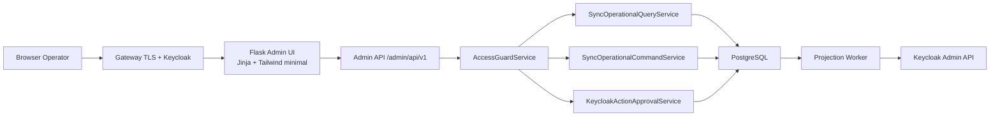
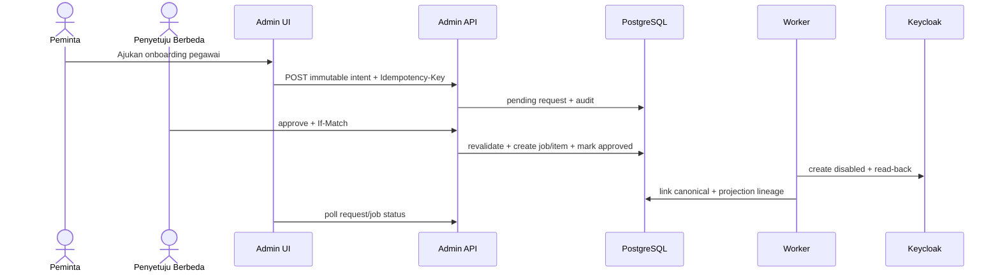
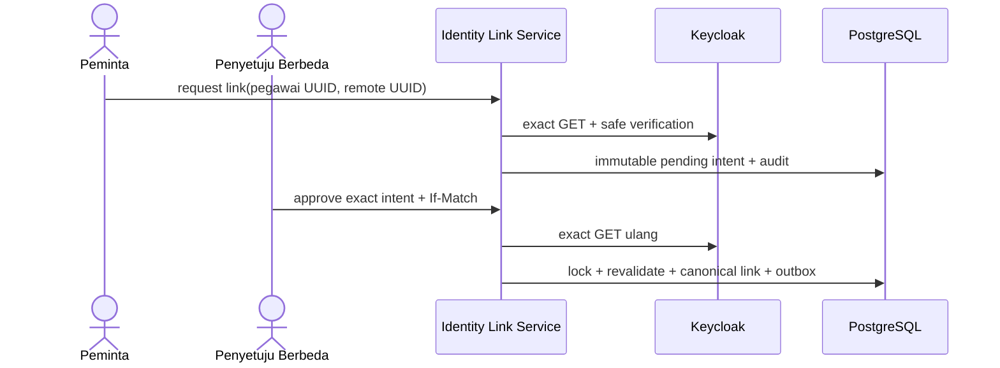
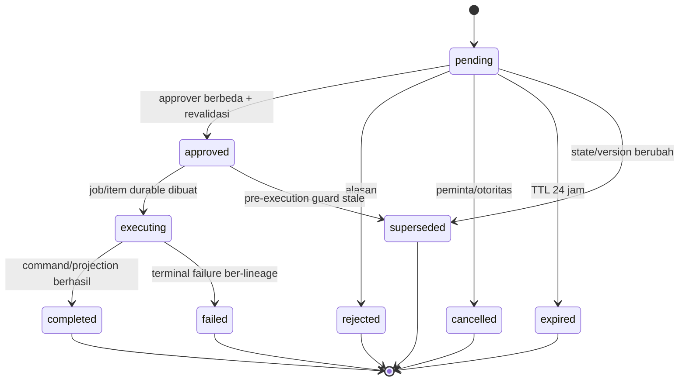

# 27 - IDP Pegawai Kontrak Admin UI/API Operasional Sinkronisasi

Status: Draf kontrak rinci arsitektur, **bukan implementasi UI/API**  
Proyek: kumjabar_ecosystem  
Tanggal: 2026-08-31  
Bergantung pada:

- `26-idp-pegawai-keycloak-admin-api-adapter-reconciliation-contract.md`
- `25-idp-pegawai-outbox-consumer-sync-jobs-retry-dead-letter-contract.md`
- `24-idp-pegawai-desired-state-identity-link-projection-mapping-contract.md`
- `21-idp-pegawai-access-audit-admin-ui-api-contract.md`
- `20-idp-pegawai-audit-event-privacy-retention-contract.md`
- `19-idp-pegawai-rbac-scoped-grants-service-guards-contract.md`

## 1. Tujuan

Dokumen ini menerjemahkan kontrak projection worker Tahap 4 menjadi antarmuka operator yang aman dan dapat ditindaklanjuti:

1. status sinkronisasi Keycloak pada halaman pegawai;
2. dashboard antrean, backlog, rekonsiliasi, dan circuit breaker;
3. daftar serta detail job/item/dead-letter;
4. diagnosis aman dalam Bahasa Indonesia;
5. manual reconcile, manual retry, dan cancellation boundary;
6. controlled onboarding dan `link_existing` dengan empat-mata;
7. unlink sebagai containment yang langsung efektif lokal;
8. REST API operasional dengan idempotensi dan optimistic concurrency;
9. keyset pagination, polling terbatas, dan safe 404;
10. audit, privasi, aksesibilitas, serta test contract.

Sasaran:

```text
mudah dipahami operator
+ tidak menjadi Keycloak Admin Console kedua
+ tidak membuka raw payload/PII/secret
+ backend guard tetap otoritatif
+ seluruh aksi berisiko mempunyai lineage
```

## 2. Batas Antarmuka

Admin UI hanya menjadi permukaan observability dan command terkontrol.

Dilarang menyediakan:

```text
raw Keycloak REST client
editor event/outbox payload
editor desired JSON
editor attributes/groups/roles
force-success
manual remote user ID overwrite
manual circuit close/reset
hard-delete user/group
arbitrary job creation
arbitrary SQL/filter JSON
credential/token viewer
```

## 3. Prinsip Otoritas

```text
Browser/UI          = menyampaikan intent operator
Admin API           = autentikasi, otorisasi, validasi, idempotensi
Domain service      = business/security guards
PostgreSQL          = authority state, command, audit, queue
Projection worker   = satu-satunya pelaksana remote mutation normal
Keycloak            = target projection
```

UI tidak memanggil Keycloak secara langsung.

## 4. Arsitektur UI/API



## 5. Penyelarasan dengan UI Tahap 3

Dokumen 21 tetap berlaku:

- Jinja + Tailwind minimal dan progressive enhancement;
- backend capability guard authoritative;
- `Idempotency-Key` untuk command/mutation;
- `If-Match` untuk existing mutable state/request;
- safe 404 untuk resource di luar scope;
- error Bahasa Indonesia;
- `Cache-Control: no-store` pada halaman/API sensitif;
- CSRF protection untuk browser session;
- tidak ada SPA, WebSocket, atau policy editor.

Dokumen 27 menambah operasi sinkronisasi tanpa membuat pola API/security kedua.

## 6. Istilah UI Bahasa Indonesia

| Identifier Internal | Label UI |
| --- | --- |
| `in_sync` | Sinkron |
| `pending` | Menunggu diproses |
| `syncing`/`running` | Sedang diproses |
| `retry_wait` | Akan dicoba kembali |
| `drifted` | Perlu penyelarasan |
| `blocked` | Tertahan—prasyarat belum terpenuhi |
| `dead_letter` | Perlu tindakan TI |
| `unlinked` | Belum tertaut |
| `superseded` | Digantikan pembaruan lebih baru |
| `cancelled` | Dibatalkan |
| circuit `open` | Koneksi otomatis dijeda |
| circuit `half_open` | Koneksi sedang diuji |
| circuit `closed` | Koneksi normal |

Identifier tetap dapat muncul pada “Detail teknis” untuk actor berwenang.

## 7. Status Lokal dan Keycloak Harus Terpisah

Halaman tidak boleh menggabungkan:

```text
Hak akses lokal : Dicabut — berlaku segera
Status Keycloak : Menunggu pencabutan peran
```

Dilarang menampilkan “Akses masih aktif” hanya karena projection remote tertunda. PostgreSQL local authorization tetap authority.

## 8. Navigasi

```text
Admin IDP
├── Dashboard
├── Pegawai
│   └── Detail Pegawai > Sinkronisasi Identitas
├── Sinkronisasi Keycloak
│   ├── Ringkasan Operasional
│   ├── Pekerjaan
│   ├── Item Antrean
│   ├── Perlu Tindakan TI
│   ├── Rekonsiliasi
│   ├── Kondisi Koneksi
│   └── Permintaan Tindakan
└── Audit
```

Menu hanya muncul berdasarkan capability. URL langsung tetap dijaga backend.

## 9. Capability Tetap

Capability baru dipetakan statis dalam code/config; tidak ada role builder.

```text
idp.keycloak_projection.view_summary
idp.keycloak_sync.view_operations
idp.keycloak_sync.view_safe_diagnostics
idp.keycloak_sync.reconcile
idp.keycloak_sync.retry.request
idp.keycloak_sync.retry.approve
idp.keycloak_sync.cancel_pending
idp.keycloak_identity.onboard.request
idp.keycloak_identity.onboard.approve
idp.keycloak_identity.link_existing.request
idp.keycloak_identity.link_existing.approve
idp.keycloak_identity.unlink
```

## 10. Pemetaan Role ke Capability

| Capability | viewer | access_admin | auditor | security_admin |
| --- | :---: | :---: | :---: | :---: |
| projection summary pada pegawai yang dapat dibaca | ✓ | ✓ | ✓ | ✓ |
| operational item/history bercakupan |  |  | ✓ | ✓ |
| safe diagnostics |  |  | ✓ | ✓ |
| reconcile target |  |  |  | ✓ |
| request/approve retry |  |  |  | ✓ |
| cancel pending non-security |  |  |  | ✓ |
| request/approve onboarding/link |  |  |  | ✓ |
| unlink containment |  |  |  | ✓ |
| circuit/global backlog |  |  | global auditor saja | ✓ |

`import_operator` dan `import_approver` tidak otomatis menerima capability sinkronisasi. Tumpukan grant tetap mengikuti anti-scope-laundering Dokumen 19.

## 11. Scope Enforcement

- projection summary mengikuti capability pembacaan pegawai yang relevan;
- auditor subtree hanya melihat item yang footprint target-nya sepenuhnya berada dalam subtree;
- job multi-target tidak ditampilkan sebagai detail global kepada auditor subtree; tampilkan item scoped atau ringkasan aman;
- circuit state dan global queue depth hanya untuk `security_admin` atau auditor global;
- mutation sinkronisasi v1 hanya `security_admin(global)`;
- scope dihitung backend dari current authoritative organization hierarchy;
- count/filter option juga scope-filtered.

## 12. Safe 404

Resource berikut memakai safe 404 jika tidak ada atau di luar scope:

```text
pegawai projection state
job/item/attempt
reconciliation run
action request
identity link candidate/detail
```

Response tidak membedakan “tidak ada” dari “tidak berwenang melihat”.

## 13. Halaman Detail Pegawai

Tambahkan kartu “Sinkronisasi Identitas” dengan:

```text
Status lokal
Status tautan identitas
Mode pengelolaan akun
Status sinkronisasi Keycloak
Pembaruan terakhir diminta
Verifikasi terakhir
Keberhasilan terakhir
Pembaruan berikutnya
ID bantuan
```

Default tidak menampilkan remote Keycloak UUID penuh, desired hash, atau error code mentah.

## 14. Kartu Status Projection

Contoh:

```text
Sinkronisasi Keycloak: Akan dicoba kembali
Hak akses lokal       : Aktif
Terakhir berhasil     : 31 Agu 2026 05:20 WIB
Percobaan berikutnya  : sekitar 05:25 WIB

Pembaruan lokal tetap tersimpan. Sistem akan mencoba kembali secara otomatis.
```

Untuk revocation:

```text
Hak akses lokal       : Sudah dicabut
Sinkronisasi Keycloak : Menunggu diproses

Pegawai sudah tidak dapat menggunakan hak lokal tersebut. Pembersihan peran Keycloak sedang berjalan.
```

## 15. Status Badge yang Aksesibel

Setiap status memakai:

- teks;
- ikon;
- warna;
- `aria-label` yang jelas;
- bukan warna saja;
- kontras minimum yang diuji;
- tooltip bukan satu-satunya sumber penjelasan.

## 16. Ringkasan Operasional

Kartu global untuk actor berwenang:

```text
Antrean menunggu
Sedang diproses
Akan dicoba kembali
Tertahan
Perlu tindakan TI
Pencabutan akses tertunda
Usia antrean tertua
Kondisi koneksi Keycloak
Rekonsiliasi terakhir
```

Count harus menjelaskan timestamp freshness dan tidak menjadi authority keamanan.

## 17. SLO Ringkas

UI menampilkan:

```text
Usia antrean tertua
Projection lag p50/p95 opsional
Pencabutan remote melewati target
Checkpoint rekonsiliasi terakhir
Waktu circuit dibuka
```

Tidak menampilkan metric labels ber-cardinality tinggi atau PII.

## 18. Dashboard Degraded State

Jika circuit open:

> Koneksi otomatis ke layanan identitas sedang dijeda. Perubahan lokal tetap berlaku. Sistem akan menguji koneksi kembali secara terbatas.

UI tidak menyediakan tombol “Paksa tutup circuit”.

## 19. Daftar Job

Kolom:

```text
Waktu dibuat
Sumber pekerjaan
Status
Prioritas
Jumlah item
Berhasil
Menunggu ulang
Tertahan
Perlu tindakan TI
Digantikan
Selesai pada
ID bantuan
```

Default urutan `created_at DESC, id DESC` dengan signed keyset cursor.

## 20. Filter Job

```text
source_type
status
created_at range
operation/risk class
has_dead_letter
root_job UUID
request/correlation UUID
```

Tidak ada pencarian raw payload, NIP, email, atau nama.

## 21. Detail Job

Menampilkan:

- provenance/source;
- parent/root lineage;
- counts;
- status derived;
- waktu mulai/selesai;
- item scoped;
- audit links;
- action request lineage bila ada;
- masked actor reference;
- safe operational explanation.

Counter adalah cache; UI tidak menyatakan hasil final yang bertentangan dengan item authority.

## 22. Daftar Item

Kolom:

```text
Waktu dibuat
Target aman
Jenis operasi
Status
Prioritas
Percobaan
Percobaan berikutnya
Terakhir berhasil/gagal
Kode diagnosis berlabel
Job/root lineage
Aksi yang tersedia
```

Target display memakai resolver aman; NIP hanya masked bila memang diperlukan.

## 23. Filter Item

```text
status
operation_family
priority class
created_at range
next_attempt_at range
error code category
target UUID autocomplete scoped
job/root UUID
```

Filter status dan operation memakai dropdown catalog, bukan input arbitrary string.

## 24. Detail Item

Bagian:

1. ringkasan manusia;
2. status dan timeline;
3. target/link projection;
4. attempts;
5. desired/applied revision dan hash tersamarkan;
6. safe diagnostics;
7. lineage;
8. tindakan yang diizinkan;
9. audit trail.

Tidak menampilkan desired JSON, raw Keycloak response, atau token.

## 25. Timeline Item

```text
Dibuat
Diambil worker
HTTP operation dimulai
Read-back selesai
Retry dijadwalkan / blocked / dead-letter
Manual request dibuat
Approval dieksekusi
Item recovery baru dibuat
```

Timestamp teknis ditampilkan dalam zona waktu lokal dengan UTC tersedia pada detail teknis.

## 26. Attempts

Tabel `keycloak_sync_attempts` ditampilkan sebagai:

```text
Nomor percobaan
Mulai/selesai
Durasi
Hasil
HTTP status class
Safe error label
Jeda sebelum percobaan berikutnya
Worker instance masked
```

Worker instance tidak menjadi tautan ke host internals.

## 27. Halaman “Perlu Tindakan TI”

Ini adalah logical DLQ view:

```text
keycloak_sync_job_items.status = dead_letter
```

Tab tambahan boleh menampilkan `blocked`. UI tidak membuat tabel atau antrean DLQ kedua.

## 28. Triage DLQ

Setiap item menampilkan:

```text
Apa yang gagal?
Apa dampaknya?
Apakah akses lokal sudah aman?
Apa yang perlu diperiksa?
Apakah retry tersedia?
Siapa yang terakhir bertindak?
ID bantuan
```

Diagnosis tidak boleh menyarankan operator mengedit remote ID secara langsung.

## 29. Katalog Diagnosis Aman

| Safe Error Code | Pesan Operator | Tindakan Aman |
| --- | --- | --- |
| `kc_token_unauthorized` | Kredensial layanan sinkronisasi ditolak | Hubungi pengelola konfigurasi rahasia |
| `kc_permission_denied` | Layanan tidak memiliki izin yang diperlukan | Periksa konfigurasi service account |
| `kc_user_not_found` | Akun tertaut tidak ditemukan di Keycloak | Verifikasi tautan identitas; jangan buat otomatis |
| `kc_user_marker_mismatch` | Penanda identitas akun tidak cocok | Hentikan dan lakukan review keamanan |
| `kc_group_binding_conflict` | Pemetaan grup organisasi bertentangan | Periksa binding unit dan grup |
| `kc_client_not_found` | Client Keycloak yang dikelola tidak ditemukan | Periksa katalog konfigurasi |
| `kc_role_not_found` | Peran Keycloak yang dikelola tidak ditemukan | Periksa katalog role |
| `kc_rate_limited` | Keycloak meminta sistem memperlambat permintaan | Tunggu retry otomatis |
| `kc_response_oversized` | Respons Keycloak melampaui batas aman | Periksa ukuran data/pagination |
| `kc_readback_mismatch` | Hasil Keycloak belum sesuai dengan state yang diharapkan | Jalankan review/reconcile |

Pesan tidak menyertakan raw body, URL internal, secret, token, NIP, atau email.

## 30. Detail Teknis

Hanya actor dengan `idp.keycloak_sync.view_safe_diagnostics` dapat membuka:

```text
job/item/attempt UUID
operation family
projection revision
desired/applied hash prefix 8 karakter; full hash hanya melalui guard detail teknis
HTTP status
safe error code
lease generation
correlation ID
timestamps
```

Pembukaan detail sensitif yang lebih tinggi harus diaudit dan tetap tidak menampilkan raw response/token.

## 31. Manual Reconcile

Manual reconcile:

- memilih target pegawai dari resource scoped;
- reason wajib;
- tidak menerima desired payload;
- menghitung ulang desired state current;
- membuat job/item `manual_reconcile`;
- tidak force-success;
- dapat menghasilkan no-op, repair, blocked, atau dead-letter;
- memerlukan `Idempotency-Key`;
- tidak memerlukan empat-mata pada rekomendasi awal karena hanya menjalankan resolver+managed diff yang sama.

## 32. Konfirmasi Manual Reconcile

```text
Anda akan memeriksa ulang sinkronisasi untuk:
Pegawai       : Pegawai ****1001
Status lokal  : Aktif
Status remote : Perlu penyelarasan

Sistem akan menghitung ulang state terbaru. Anda tidak dapat mengirim atribut, grup, atau role secara manual.
```

## 33. Manual Retry

Manual retry tidak menghidupkan item lama.

```text
item lama terminal/blocked
-> immutable action request
-> approval berbeda
-> recompute desired current
-> new job/item lineage
```

Manual retry tidak menerima raw event atau desired payload dari browser.

## 34. Empat-Mata Manual Retry

Keputusan final: seluruh manual retry `blocked/dead_letter` memakai empat-mata karena tindakan dapat mengulang remote mutation setelah intervensi operator.

Aturan:

- requester dan approver berbeda;
- keduanya `security_admin(global)` efektif;
- request TTL 24 jam;
- intent terikat UUID item asal, root lineage, UUID target, operation family, dan versi yang diharapkan terkini;
- approver tidak dapat mengedit intent;
- execution menghitung ulang desired state;
- stale intent ditolak atau membutuhkan request baru;
- approval tidak menjamin remote success.

## 35. Cancellation

Hanya diperbolehkan jika seluruh kondisi terpenuhi:

```text
status = pending
risk_class = non_security
remote_started_at IS NULL
operation_family di allowlist cancellable
```

Tidak dapat dibatalkan:

```text
running
retry_wait setelah remote mutation ambigu
revocation/disable/unlink
security recovery
onboarding/link execution
```

Cancellation memerlukan reason, `If-Match`, `Idempotency-Key`, dan audit.

## 36. Controlled Onboarding

Onboarding membuat akun `idp_managed` disabled terlebih dahulu dan wajib empat-mata pada UI.

Intent immutable:

```text
pegawai UUID
management_mode = idp_managed
username policy/version
masked username preview
desired projection revision
reason
requester
expires_at
```

Tidak menerima password atau credential.

## 37. Alur Onboarding Empat-Mata



## 38. `link_existing` Empat-Mata

Request harus menyertakan:

```text
pegawai UUID
exact remote Keycloak user UUID
management_mode = linked_existing
masked candidate snapshot reference
remote_verified_at
reason
expected pegawai/link version
```

Email/nama/NIP hanya untuk review tersamarkan, bukan authority link.

## 39. Verifikasi Kandidat Existing

Sebelum request disimpan:

- GET exact remote UUID;
- kandidat berada pada realm tepercaya;
- marker/conflict diperiksa;
- akun belum dimiliki pegawai lain;
- pegawai belum mempunyai active link;
- snapshot aman disimpan sebagai hash/reference, bukan full representation.

Sebelum approval execution, read-back dan seluruh invariant diulang.

## 40. Alur `link_existing`



## 41. Unlink sebagai Containment

Unlink tidak menunggu empat-mata agar containment tidak tertunda.

- hanya actor berwenang;
- reason wajib;
- konfirmasi dampak;
- local identity link masuk `disabling` secara atomik;
- akses lokal ditolak pada request berikutnya;
- cleanup remote asynchronous;
- account `linked_existing` tidak di-disable;
- audit dan outbox commit bersama;
- last-security-admin guard tetap berlaku bila relevan.

## 42. Permintaan Tindakan Keycloak

Gunakan aggregate fixed-purpose, bukan generic workflow engine:

```text
keycloak_action_requests
```

Action types v1:

```text
onboard_managed_user
link_existing_user
manual_retry
```

Manual reconcile dan unlink tidak memakai aggregate approval ini.

## 43. Lifecycle Action Request

```text
pending
approved
executing
completed
rejected
cancelled
expired
failed
superseded
```



## 44. Immutable Intent

Intent minimum:

```text
action_type
target pegawai UUID
identity link/remote UUID nullable
original item UUID nullable
management mode nullable
reason code/reason
expected target/link/item versions
intent contract version
canonical intent hash
requester
requested_at/expires_at
```

Action-specific shape divalidasi ketat; unknown field ditolak.

## 45. Four-Eyes Guards

- requester tidak dapat approve/reject sebagai approver;
- approver harus efektif saat approval;
- target dan scope diotorisasi ulang;
- versi yang diharapkan harus masih terkini;
- request belum terminal/kedaluwarsa;
- exact intent tidak dapat diedit;
- approval dan durable job/domain command dibuat atomik bila memungkinkan;
- double approval idempoten;
- self-onboarding/link melalui jalur administratif tetap dilarang.

## 46. TTL Action Request

Keputusan final:

```text
TTL = 24 jam
```

Selaras dengan critical access request Tahap 3. Expiry runtime authoritative; sweeper hanya merapikan persistence/audit secara idempoten.

## 47. Daftar Permintaan

Tab:

```text
Menunggu Persetujuan
Sedang Dieksekusi
Selesai
Ditolak
Dibatalkan
Kedaluwarsa
Gagal
Digantikan
```

Kolom menampilkan action label, target masked, requester, requested/expires time, status, dan aksi tersedia.

## 48. Halaman Approval

Menampilkan:

- jenis tindakan dan dampak;
- requester;
- target masked;
- remote candidate masked jika link;
- original item diagnosis jika retry;
- reason;
- immutable intent hash/reference;
- version dan expiry;
- checkbox review UX;
- approve/reject dengan `If-Match`.

Checkbox bukan security control.

## 49. API Namespace

```text
/admin/api/v1/keycloak-sync
/admin/api/v1/keycloak-actions
```

Tidak ada endpoint publik atau `/internal` yang dapat dipanggil browser.

## 50. Endpoint Projection Pegawai

```text
GET /admin/api/v1/pegawai/{pegawai_uuid}/keycloak-projection
```

Response masked/scoped:

```json
{
  "data": {
    "pegawai_uuid": "...",
    "local_access_status": "active",
    "identity_link_status": "linked",
    "management_mode": "idp_managed",
    "projection_status": "retry_wait",
    "last_verified_at": null,
    "last_success_at": "2026-08-31T05:20:00Z",
    "next_attempt_at": "2026-08-31T05:25:00Z",
    "safe_message": "Sistem akan mencoba kembali secara otomatis."
  },
  "meta": {"request_id": "..."}
}
```

## 51. Endpoint Dashboard

```text
GET /admin/api/v1/keycloak-sync/summary
GET /admin/api/v1/keycloak-sync/circuit-states
GET /admin/api/v1/keycloak-sync/reconciliation-runs
```

Summary selalu scope/capability-aware. Circuit state global tidak diberikan kepada actor subtree.

## 52. Endpoint Job dan Item

```text
GET /admin/api/v1/keycloak-sync/jobs
GET /admin/api/v1/keycloak-sync/jobs/{job_uuid}
GET /admin/api/v1/keycloak-sync/items
GET /admin/api/v1/keycloak-sync/items/{item_uuid}
GET /admin/api/v1/keycloak-sync/items/{item_uuid}/attempts
```

List memakai signed keyset cursor dan limit maksimum 100.

## 53. Endpoint Manual Reconcile

```text
POST /admin/api/v1/keycloak-sync/targets/pegawai/{pegawai_uuid}/reconcile
Idempotency-Key: <opaque>
```

Body:

```json
{
  "reason_code": "operator_verification",
  "reason": "Memeriksa ulang setelah konfigurasi grup diperbaiki"
}
```

Response `202 Accepted` dengan job/item reference atau no-op command result.

## 54. Endpoint Cancellation

```text
POST /admin/api/v1/keycloak-sync/items/{item_uuid}/cancel
Idempotency-Key: <opaque>
If-Match: "<lock_version>"
```

Server mengulang status/risk/remote-start checks di transaction.

## 55. Endpoint Action Request

```text
POST /admin/api/v1/keycloak-actions/requests
GET  /admin/api/v1/keycloak-actions/requests
GET  /admin/api/v1/keycloak-actions/requests/{request_uuid}
POST /admin/api/v1/keycloak-actions/requests/{request_uuid}/approve
POST /admin/api/v1/keycloak-actions/requests/{request_uuid}/reject
POST /admin/api/v1/keycloak-actions/requests/{request_uuid}/cancel
```

Create/approve/reject/cancel membutuhkan `Idempotency-Key`; transition existing membutuhkan `If-Match`.

## 56. Contoh Request Manual Retry

```json
{
  "action_type": "manual_retry",
  "target_uuid": "018f...",
  "original_item_uuid": "0190...",
  "reason_code": "dependency_fixed",
  "reason": "Konfigurasi managed role telah diperbaiki",
  "expected_item_version": 7
}
```

Tidak menerima desired hash sebagai source of truth; server menghitung intent hash.

## 57. Contoh Request Onboarding

```json
{
  "action_type": "onboard_managed_user",
  "target_uuid": "018f...",
  "management_mode": "idp_managed",
  "reason_code": "initial_internal_access",
  "reason": "Aktivasi identitas internal pegawai",
  "expected_target_version": 14
}
```

Username dihitung server dari policy NIP/fallback, bukan diketik bebas.

## 58. Contoh Request Link Existing

```json
{
  "action_type": "link_existing_user",
  "target_uuid": "018f...",
  "remote_user_id": "a9362239-03ad-40c0-a939-d4c58a7e8296",
  "management_mode": "linked_existing",
  "reason_code": "existing_shared_account",
  "reason": "Menautkan akun shared yang telah diverifikasi",
  "expected_target_version": 14
}
```

Remote UUID diverifikasi exact sebelum request diterima.

## 59. Endpoint Unlink

```text
POST /admin/api/v1/pegawai/{pegawai_uuid}/identity-links/keycloak/unlink
Idempotency-Key: <opaque>
If-Match: "<link_version>"
```

Body reason wajib. Response menjelaskan local containment sukses dan remote cleanup asynchronous.

## 60. Header Contract

| Header | Kewajiban |
| --- | --- |
| `Authorization`/session | autentikasi gateway/Keycloak |
| `Content-Type: application/json` | mutation |
| `Accept: application/json` | JSON response |
| `Idempotency-Key` | seluruh POST command |
| `If-Match` | transition existing request/item/link |
| `X-Request-ID` | dibuat server atau disanitasi |
| CSRF token | browser session mutation |

Actor subject tidak diterima dari payload.

## 61. `Idempotency-Key`

- opaque 128-bit minimum atau format ekuivalen;
- scoped ke actor + endpoint + intent hash;
- key reuse dengan intent berbeda → 409;
- exact replay mengembalikan result/reference sama;
- retention cukup melewati retry/browser uncertainty;
- tidak mengandung NIP/email/nama;
- tidak menggantikan database uniqueness.

## 62. `If-Match`

- missing → 428;
- malformed → 400;
- stale → 409;
- versi yang diharapkan tidak diterima hanya dari JSON body;
- response detail memuat current ETag bila actor masih berwenang;
- request approval/reject/cancel dan item cancellation wajib memakai header.

## 63. HTTP Status

| Status | Makna |
| ---: | --- |
| 200 | read atau replay result |
| 201 | action request berhasil dibuat |
| 202 | command/job diterima asynchronous |
| 400 | format/field invalid |
| 401 | unauthenticated |
| 403 | authenticated tetapi capability umum tidak ada |
| 404 | resource tidak ada atau di luar scope |
| 409 | stale/conflict/idempotency mismatch |
| 422 | business invariant invalid |
| 428 | `If-Match` wajib tetapi tidak ada |
| 429 | rate limited |

## 64. Error Envelope

```json
{
  "error": {
    "code": "sync_action_stale",
    "message": "Data telah berubah. Muat ulang halaman sebelum melanjutkan.",
    "field_errors": {},
    "request_id": "...",
    "retryable": false
  }
}
```

Pesan user-facing dari catalog Bahasa Indonesia; exception/raw body tidak dikirim.

## 65. Stable API Error Codes

```text
projection_not_available
sync_item_not_actionable
sync_item_security_cancel_forbidden
sync_item_remote_already_started
sync_action_stale
sync_action_self_approval_forbidden
sync_action_not_pending
sync_action_expired
sync_action_intent_mismatch
sync_target_out_of_scope
sync_identity_conflict
sync_retry_not_permitted
sync_circuit_paused
sync_rate_limited
```

## 66. Polling

Gunakan pola Dokumen 21:

```text
poll_after_seconds awal = 3
dynamic bounded backoff = 3..30 detik
```

- hormati server `poll_after_seconds`;
- pause saat tab tidak terlihat;
- segera refresh saat tab kembali terlihat dengan rate guard;
- hentikan pada terminal state;
- 429 memakai `Retry-After`;
- tidak ada WebSocket/SSE v1.

## 67. Keyset Pagination

Cursor list job/item/action request mengikat:

```text
sort tuple
filter hash
scope hash
actor capability context version
cursor version
HMAC/signature
```

Default 50, maksimum 100. Cursor filter/scope berbeda ditolak.

## 68. Cache Policy

Halaman dan API sensitif:

```text
Cache-Control: no-store, private
Pragma: no-cache
Referrer-Policy: no-referrer atau strict policy gateway
```

Browser history tidak menjadi tempat raw diagnosis atau remote ID.

## 69. CSRF dan CORS

- mutation browser session membutuhkan CSRF token;
- SameSite/secure cookie;
- CORS tidak dibuka lintas origin secara wildcard;
- JSON content type strict;
- GET tidak mengubah state;
- confirmation page tidak menjadi substitute backend guard.

## 70. Rate Limiting Operator

Pisahkan:

```text
read/list rate
manual command rate
action request rate
approval rate
sensitive detail rate
```

Rate limit berdasarkan actor/session/client context tanpa memasukkan PII ke key/log. Rate limiting tidak boleh menghambat unlink containment secara tidak aman; gunakan dedicated bounded lane.

## 71. Audit Events

```text
keycloak.sync_summary_viewed_sensitive
keycloak.sync_item_viewed_sensitive
keycloak.manual_reconcile_requested
keycloak.item_cancelled
keycloak.action_request_created
keycloak.action_request_approved
keycloak.action_request_rejected
keycloak.action_request_cancelled
keycloak.action_request_expired
keycloak.identity_onboarding_requested
keycloak.identity_link_requested
keycloak.identity_unlinked
```

Read list biasa tidak selalu perlu persistent audit; sensitive detail dan mutations wajib.

## 72. Audit Payload

Simpan minimum:

```text
action/request/job/item/target UUID
action type
outcome
actor subject reference
scope snapshot
reason code
changed fields
intent hash/version
correlation ID
```

Dilarang full remote response, NIP, email, nama, token, secret, dan desired payload.

## 73. Reason Fields

- `reason_code` dropdown fixed catalog;
- `reason` manusia wajib, panjang dibatasi;
- trim/control-character validation;
- tidak boleh meminta operator menempel token/raw error;
- formula/HTML escaping pada display/export;
- reason tidak menjadi tempat menyimpan PII yang tidak perlu.

## 74. UI Capability Flags

Page bootstrap memuat capability flags dari backend:

```json
{
  "can_view_operations": true,
  "can_view_safe_diagnostics": true,
  "can_reconcile": false,
  "can_request_retry": false,
  "can_approve_retry": false,
  "can_cancel_pending": false,
  "can_manage_identity_links": false
}
```

Template tidak hard-code role string. API tetap mengulang guard.

## 75. Disabled Actions

Tombol disabled menjelaskan alasan:

```text
Tidak dapat dibatalkan karena pekerjaan sudah dijalankan.
Persetujuan tidak tersedia karena Anda adalah peminta.
Retry belum tersedia karena sistem masih akan mencoba otomatis.
Aksi ini memerlukan Admin Keamanan global.
```

Jangan hanya menyembunyikan semua konteks; tetap hindari existence leak.

## 76. Progressive Disclosure

Tingkat 1:

- status manusia;
- dampak;
- tindakan aman.

Tingkat 2 “Detail teknis”:

- UUID/correlation;
- operation/status code;
- attempt/revision/hash;
- timestamps.

Tingkat 3 raw payload tidak tersedia di UI.

## 77. Empty dan Loading State

```text
Belum ada pekerjaan yang perlu ditangani.
Tidak ada hasil dalam cakupan Anda.
Status sedang dimuat ulang.
Data terakhir diperbarui pada ...
```

Loading tidak menghapus status lama tanpa label stale.

## 78. Accessibility

- keyboard navigation penuh;
- focus management setelah modal/submit;
- live region untuk perubahan status polling;
- tabel mempunyai header/caption;
- pagination berlabel;
- confirmation summary dapat dibaca screen reader;
- status tidak bergantung warna;
- waktu dan angka mempunyai format terbaca;
- modal tidak menjebak fokus secara rusak.

## 79. Mobile/Responsive Boundary

UI responsif untuk pemantauan ringan, tetapi approval kritis harus tetap menampilkan seluruh intent dengan jelas. Tidak ada native mobile application v1.

## 80. DDL Konseptual `keycloak_action_requests`

```sql
CREATE TABLE idp_pegawai.keycloak_action_requests (
    id bigint GENERATED BY DEFAULT AS IDENTITY PRIMARY KEY,
    uuid uuid NOT NULL DEFAULT gen_random_uuid(),
    action_type varchar(40) NOT NULL,
    status varchar(30) NOT NULL DEFAULT 'pending',
    target_pegawai_id bigint NOT NULL,
    identity_link_id bigint,
    remote_user_id varchar(255),
    original_item_id bigint,
    management_mode varchar(30),
    reason_code varchar(100) NOT NULL,
    reason text NOT NULL,
    intent_contract_version varchar(80) NOT NULL,
    intent_payload jsonb NOT NULL,
    intent_hash char(64) NOT NULL,
    expected_target_version bigint,
    expected_resource_version bigint,
    requested_by_subject varchar(255) NOT NULL,
    requested_at timestamptz NOT NULL DEFAULT now(),
    expires_at timestamptz NOT NULL,
    approved_by_subject varchar(255),
    approved_at timestamptz,
    rejected_by_subject varchar(255),
    rejected_at timestamptz,
    rejection_reason text,
    cancelled_by_subject varchar(255),
    cancelled_at timestamptz,
    cancellation_reason text,
    execution_job_id bigint,
    completed_at timestamptz,
    terminal_error_code varchar(100),
    lock_version integer NOT NULL DEFAULT 0,
    created_at timestamptz NOT NULL DEFAULT now(),
    updated_at timestamptz NOT NULL DEFAULT now()
);
```

Ini preview konseptual, bukan migration siap-jalankan.

## 81. `intent_payload` Bukan JSON Bebas

JSONB hanya untuk immutable typed action snapshot:

- schema per `action_type`;
- unknown keys ditolak;
- canonicalized + SHA-256;
- size cap;
- tanpa nama/email/NIP/raw response;
- tidak dapat diedit setelah insert;
- field query/constraint penting tetap relasional.

## 82. Constraint Wajib Action Request

```text
unique(uuid)
action_type fixed enum
status fixed enum
intent_hash regex ^[0-9a-f]{64}$
expires_at > requested_at
requester != approver
pending -> no approval/execution terminal fields
approved/executing/completed -> approver + approved_at
rejected -> reject actor/time/reason
cancelled -> cancel actor/time/reason
completed -> execution_job_id + completed_at
manual_retry -> original_item_id required
link_existing -> remote_user_id + management_mode linked_existing required
onboard -> management_mode idp_managed + remote_user_id absent
FK target/link/item/job ON DELETE RESTRICT
```

Distinct requester/approver juga wajib diverifikasi service karena nullable/status semantics kompleks.

## 83. Partial Unique Intent

Mencegah active duplicate:

```text
(action_type, target_pegawai_id, intent_hash)
WHERE status IN ('pending','approved','executing')
```

Untuk manual retry, exact active original item intent hanya satu.

## 84. Action Request Queue Boundary

Approval tidak menjalankan HTTP Keycloak dalam request transaction.

```text
BEGIN
-> lock request
-> reauthorize/revalidate/distinct actor/version
-> mark approved/executing sesuai contract
-> create durable job/item
-> write audit
-> COMMIT
```

Worker kemudian menjalankan remote operation.

## 85. Projection Read Model

UI query tidak melakukan live Keycloak call. Ia membaca:

```text
keycloak_sync_states
identity link canonical
latest job/item/attempt summary
reconciliation run
circuit state
safe diagnostics catalog
```

Tombol “Muat ulang” hanya memuat read model; “Rekonsiliasi sekarang” adalah command terpisah.

## 86. Staleness Indicator

Tampilkan:

```text
Diverifikasi terakhir: ...
Data operasional diperbarui: ...
Status mungkin tertunda jika koneksi sedang dijeda.
```

Jangan menyamakan `updated_at` row dengan remote verification.

## 87. Circuit UI

Menampilkan:

```text
state
operation class read/write
opened_at
next_probe_at
safe reason category
recent failure ratio/count
```

Tidak menampilkan secret, realm URL internal, worker host, atau tombol override.

## 88. Rekonsiliasi UI

Daftar run:

```text
run type
status
cutoff
checkpoint/progress
scanned/planned/noop/repaired/blocked
started/finished
safe error
```

Progress counter adalah observability cache dan diberi label estimasi bila total tidak diketahui.

## 89. Orphan UI

Orphan candidate hanya terlihat `security_admin(global)`.

Tampilkan:

- managed marker conflict category;
- remote UUID masked/pseudonymous;
- local link result;
- onboarding/root lineage jika ada;
- safe action: review/reconcile/recovery request.

Tidak ada tombol auto-link atau delete.

## 90. Group Binding UI

Menampilkan:

```text
unit organisasi
remote group ID masked
bound path
status
mapping revision
last verified
safe error
```

Aksi v1 hanya review dan controlled move request/runbook link; tidak ada editor path bebas atau delete.

## 91. Security Headers

Selain gateway defaults:

```text
Content-Security-Policy ketat
X-Content-Type-Options: nosniff
frame-ancestors melalui CSP
Permissions-Policy minimum
Cache-Control: no-store
```

Inline script/style mengikuti nonce/hash bila diperlukan oleh server-rendered UI.

## 92. Threat-to-Control Closure

| Ancaman | Pengendalian |
| --- | --- |
| UI menjadi Keycloak console | narrow commands, tanpa raw editor |
| coarse role memberi akses operasi | local capability + scope guard |
| subtree melihat global backlog | scoped counts + global dashboard guard |
| target existence leak | safe 404 |
| double-click membuat command ganda | `Idempotency-Key` + uniqueness |
| stale approval mengeksekusi intent lama | `If-Match` + revalidation + intent hash |
| requester menyetujui sendiri | distinct actor constraint/service guard |
| retry mengulang mutation berbahaya | empat-mata + recompute + read-back |
| operator force-success | endpoint tidak ada |
| cancellation menghentikan revoke | risk/status/remote-start guard |
| raw error membocorkan PII/secret | safe diagnostics catalog |
| polling overload | bounded 3–30 detik + visibility pause |
| action request menjadi generic workflow | fixed action types dan typed schema |
| browser mengirim desired state | server recompute, payload ditolak |
| circuit di-override sembarang | UI circuit hanya-baca |
| approval sukses dianggap projection sukses | action/job/projection status terpisah |

## 93. Test Matrix - Authorization

- menu dan capability flags sesuai effective grants;
- direct URL backend guarded;
- viewer hanya projection summary dalam scope;
- auditor subtree tidak melihat global counts/job targets;
- auditor global hanya-baca;
- security admin mutation global;
- anti-scope-laundering;
- safe 404 untuk target/job/item/request out-of-scope;
- revoked grant berlaku pada request berikutnya.

## 94. Test Matrix - Projection UI

- local access dan remote projection status terpisah;
- semua status mempunyai label/ikon/teks;
- stale/read-back timestamps benar;
- no raw UUID/default PII;
- next retry dan terminal state jelas;
- empty/loading/error state aksesibel;
- circuit message tidak menyatakan local access gagal.

## 95. Test Matrix - API

- `Idempotency-Key` missing/replay/mismatch;
- `If-Match` missing/malformed/stale/current;
- 400/401/403/404/409/422/428/429 envelopes;
- CSRF/session/CORS/content-type;
- signed cursor terikat filter/scope;
- limit maksimum 100;
- no-store headers;
- actor identity tidak dapat dipalsukan payload/header.

## 96. Test Matrix - Four-Eyes

- requester tidak dapat approve;
- approver berbeda tetapi tidak berwenang ditolak;
- expiry 24 jam;
- immutable intent;
- changed target/link/item version menjadi stale;
- duplicate approval idempoten;
- approval atomically creates durable work;
- remote failure tidak mengubah approval menjadi projection success;
- rejected/cancelled/expired terminal;
- audit requester/approver lengkap tetapi minimized.

## 97. Test Matrix - Manual Operations

- reconcile tidak menerima desired payload;
- retry selalu item/job baru;
- original dead-letter immutable;
- retry empat-mata;
- external repair tetap read-back;
- force-success route tidak ada;
- cancellation hanya pending non-security;
- running/security/remote-start cancellation ditolak;
- unlink langsung efektif lokal;
- linked-existing unlink tidak disable global account.

## 98. Test Matrix - Privacy dan Diagnosis

- raw request/response/token/secret tidak pernah dirender;
- NIP/email/nama tidak masuk diagnosis;
- error code diterjemahkan ke Bahasa Indonesia;
- HTML escaping reason/error;
- sensitive detail audit;
- no high-cardinality metrics pada UI API;
- logs memakai UUID/correlation aman;
- browser cache/history tidak menyimpan raw technical payload.

## 99. Test Matrix - Accessibility

- alur hanya-keyboard;
- focus setelah validation/submit/modal;
- screen-reader status polling;
- color-independent badges;
- table headings/captions;
- confirmation intent terbaca penuh;
- error terhubung ke field;
- reduced-motion bila animasi digunakan;
- responsive approval tidak menyembunyikan intent.

## 100. PostgreSQL Test Harness

Wajib membuktikan:

```text
partial unique active action intent
requester/approver guards
status/timestamp checks
FK ON DELETE RESTRICT
concurrent approvals
idempotency races
approval + job/audit atomic rollback
expiry vs approval race
cancel vs worker claim race
signed cursor query ordering
```

SQLite bukan bukti correctness.

## 101. Pre-Implementation Gates

| Gate | Bukti Wajib |
| --- | --- |
| capability mapping | fixed role map + scope tests |
| projection read model | representative query plan/backlog |
| action request schema | typed intent fixtures + canonical hash |
| four-eyes concurrency | requester/approver/expiry race tests |
| API idempotency | replay/mismatch/concurrent POST tests |
| optimistic concurrency | 428/400/409/current fixtures |
| privacy | response/log/template inspection |
| safe diagnosis catalog | all stable worker errors mapped |
| accessibility | keyboard/screen-reader/contrast review |
| polling/load | 3–30 detik + 429/visibility tests |
| security headers | gateway/app integration tests |
| operational runbook | circuit, orphan, group move, dead-letter |

## 102. Keputusan Final yang Dikunci

1. UI tetap server-rendered Jinja + Tailwind dengan progressive enhancement.
2. Status local authorization dan remote projection selalu ditampilkan terpisah.
3. Viewer hanya melihat projection summary untuk pegawai dalam scope.
4. Auditor melihat riwayat/diagnosis aman secara hanya-baca sesuai scope.
5. Mutation sinkronisasi dan identity actions hanya `security_admin(global)` v1.
6. Tidak ada role baru `sync_operator` pada v1.
7. Circuit/global backlog hanya security admin atau auditor global.
8. Manual reconcile single-actor dengan reason; tidak dapat mengirim desired payload.
9. Manual retry blocked/dead-letter wajib empat-mata.
10. Controlled onboarding dan `link_existing` wajib empat-mata.
11. Unlink containment tidak menunggu empat-mata dan langsung efektif lokal.
12. Action request TTL 24 jam dan immutable typed intent.
13. Cancellation hanya pending non-security sebelum remote call.
14. Tidak ada force-success, raw payload editor, remote ID overwrite, atau circuit override UI.
15. List memakai signed keyset cursor, default 50 maksimum 100.
16. Polling awal 3 detik dengan bounded backoff sampai 30 detik; tanpa SSE/WebSocket.
17. Semua POST command memakai `Idempotency-Key`; transitions memakai `If-Match`.
18. Safe 404 diterapkan pada projection/job/item/request/link di luar scope.
19. Detail diagnosis memakai catalog Bahasa Indonesia dan tidak menampilkan raw Keycloak data.
20. `keycloak_action_requests` adalah fixed-purpose aggregate, bukan generic workflow engine.
21. UI membaca local read model dan tidak membuat live Keycloak GET.
22. UI circuit hanya-baca; repair/override melalui runbook/infra.
23. Action approval success tidak sama dengan projection success.
24. Seluruh DDL pada dokumen ini tetap konseptual hingga implementation plan.

## 103. Resolusi Final Delapan Keputusan

Delapan pertanyaan arsitektur Dokumen 27 telah diselesaikan dan tidak lagi berstatus terbuka.

| Nomor | Keputusan Final | Kontrak yang Dikunci |
| --- | --- | --- |
| 1 | Manual retry `blocked`/`dead_letter` wajib empat-mata | Retry otomatis tetap tanpa approval. Requester dan approver berbeda; desired state dihitung ulang dan item lama immutable. |
| 2 | Manual reconcile tidak memerlukan empat-mata | Satu `security_admin(global)` dengan alasan wajib; browser hanya memasok target/reason dan resolver/diff/read-back tetap authoritative. |
| 3 | Tidak ada role `sync_operator` pada v1 | Mutation memakai `security_admin(global)`; auditor hanya-baca sesuai scope agar fixed RBAC Tahap 3 tetap sederhana. |
| 4 | TTL action request adalah 24 jam | Expiry dihitung dari DB time dan authoritative saat request; sweeper hanya merapikan persistence/audit. |
| 5 | Retensi action request: 5 tahun security, 1 tahun umum | Onboarding, link existing, dan security retry masuk kelas 5 tahun; legal hold dapat memperpanjang. |
| 6 | Default UI menampilkan prefix hash 8 karakter | Hash 64 karakter hanya melalui detail teknis untuk capability `idp.keycloak_sync.view_safe_diagnostics`; hash bukan secret tetapi tetap tidak perlu dibuka default. |
| 7 | Circuit breaker tidak dapat di-reset dari UI v1 | UI hanya-baca. Pemulihan melalui half-open probing otomatis atau runbook/IaC terkontrol. |
| 8 | Orphan dan group binding mempunyai halaman khusus | Hanya untuk `security_admin(global)`, default hanya-baca dengan recovery command terkontrol; tidak ada auto-link atau hard-delete. |

### 103.1 Tampilan Hash

```text
default/help ID = 8 karakter pertama lowercase desired_hash
full hash       = detail teknis berwenang + no-store
raw desired JSON= tidak tersedia
```

Prefix hash hanya alat korelasi operator, bukan identifier authority atau bukti integritas mandiri.

### 103.2 Retensi Action Request

```text
onboarding/link/security retry = 5 tahun
non-security action request     = 1 tahun
legal hold                      = dapat memperpanjang
purge                           = manifest + FK-safe + audit policy
```

### 103.3 Halaman Orphan dan Group Binding

Halaman khusus menyediakan observability, filtering aman, dan navigasi lineage. Command recovery tetap fixed-purpose, diaudit, dan tidak menerima remote payload/path bebas.

## 104. Daftar Periksa Penerimaan Dokumen 27

### UI dan Otorisasi

- [x] Navigasi/status Bahasa Indonesia disetujui.
- [x] Capability/role/scope mapping disetujui.
- [x] Projection summary/detail/job/item/DLQ UI disetujui.
- [x] Safe diagnostics dan progressive disclosure disetujui.

### Command dan Empat-Mata

- [x] Manual reconcile/retry/cancel boundary disetujui.
- [x] Onboarding/link/unlink boundary disetujui.
- [x] Action request lifecycle/TTL/intent disetujui.
- [x] Distinct actor/revalidation/lineage disetujui.

### API dan Security

- [x] Endpoint/status/error envelope disetujui.
- [x] Idempotency/If-Match/safe 404 disetujui.
- [x] Cursor/polling/rate limit disetujui.
- [x] CSRF/CORS/no-store/security headers disetujui.

### Operasional dan Kesiapan

- [x] Circuit/reconciliation/orphan/group binding UI disetujui.
- [x] Audit/privacy/retention disetujui.
- [x] Accessibility test contract disetujui.
- [x] DDL/action request/PostgreSQL gates disetujui.

## 105. Dokumen Berikutnya

Setelah review Dokumen 27:

```text
28 - IDP Pegawai Tahap 4 Review Checklist, Open Decisions & Implementation Gate
```

Dokumen 28 akan:

- mengonsolidasikan Dokumen 23–27;
- menutup seluruh pertanyaan arsitektur Tahap 4;
- menetapkan persistence delta final;
- menetapkan pre-implementation PostgreSQL/Keycloak/security gates;
- mengaudit konsistensi Tahap 1–4;
- menyatakan apakah Tahap 4 architecture-complete/implementation-ready;
- tetap tidak memberi izin coding tanpa perintah eksplisit.

## 106. Kesimpulan

Kontrak operasional menjadi:

```text
capability-aware server-rendered UI
-> scoped projection/read models
-> safe Bahasa Indonesia diagnostics
-> idempotent command API
-> immutable four-eyes action request
-> durable job/item lineage
-> polling local state
-> worker-managed remote execution
-> read-back verified outcome
```

Desain tetap:

- **ringan**: tanpa SPA, WebSocket, generic workflow engine, atau role baru;
- **tangguh**: idempotensi, optimistic concurrency, lineage, polling terbatas, cursor, dan read model;
- **kuat**: local capability guards, four-eyes identity/retry, safe 404, no force-success, no raw data, dan unlink containment.

Dokumen 27 tidak memberi izin coding, migration, provisioning, Keycloak configuration, atau deployment.
