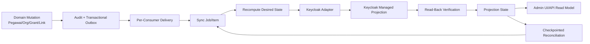

# 28 - IDP Pegawai Tahap 4 Review Checklist, Keputusan Final & Implementation Gate

Status: **Architecture-complete / approved**, implementation-ready setelah gate dipenuhi; **bukan izin coding atau provisioning**  
Proyek: kumjabar_ecosystem  
Tanggal: 2026-08-31  
Mengonsolidasikan:

- `23-idp-pegawai-stage-4-keycloak-sync-projection-breakdown.md`
- `24-idp-pegawai-desired-state-identity-link-projection-mapping-contract.md`
- `25-idp-pegawai-outbox-consumer-sync-jobs-retry-dead-letter-contract.md`
- `26-idp-pegawai-keycloak-admin-api-adapter-reconciliation-contract.md`
- `27-idp-pegawai-admin-ui-api-operasional-sinkronisasi-contract.md`

Referensi lintas tahap:

- `22-idp-pegawai-stage-3-review-checklist-open-decisions.md`
- `17-idp-pegawai-stage-2-review-checklist-open-decisions.md`
- `10-idp-pegawai-stage-1-review-checklist-open-decisions.md`

## 1. Tujuan Review Gate

Dokumen ini:

1. mengaudit konsistensi Dokumen 23–27;
2. mengunci seluruh keputusan arsitektur Tahap 4;
3. menetapkan persistence delta final secara semantik;
4. menetapkan matriks constraint, transaksi, dan keamanan;
5. memisahkan architecture readiness dari implementation evidence;
6. mendefinisikan gate sebelum coding completion dan production;
7. menetapkan urutan implementasi jika kelak diminta eksplisit;
8. menutup Tahap 4 secara arsitektural tanpa menjalankan implementasi.

## 2. Keputusan Penutupan

```text
Tahap 4 design                   = CLOSED / APPROVED
Dokumen 23–27                    = ARCHITECTURE-COMPLETE
Architecture open questions      = NONE
Implementation plan eligibility  = YES, WHEN EXPLICITLY REQUESTED
Coding authorization             = NO
Migration authorization          = NO
Keycloak provisioning/config     = NO
Production readiness             = NO, evidence gates belum dijalankan
```

## 3. Prinsip Inti Tahap 4

```text
PostgreSQL IDP = authoritative desired state
Keycloak       = managed projection target
Outbox         = durable trigger/provenance
Worker         = recompute + managed diff + read-back
Admin UI/API   = observability + controlled commands
```

Tidak satu pun status queue, projection, Keycloak role, atau UI badge menjadi authority fine-grained local authorization.

## 4. Architecture-Complete Flow



## 5. Boundary Otoritas Final

| Concern | Authority | Non-Authority |
| --- | --- | --- |
| status/eligibility ASN | PostgreSQL `pegawai` | Keycloak enabled/attribute |
| organisasi utama | PostgreSQL org/assignment | Keycloak group |
| identity link ownership | `pegawai_identity_links` | email, username, remote search |
| management mode | canonical identity link | duplicate cache/state field |
| local role/scope/capability | `access_grants` + static map | Keycloak coarse role |
| desired managed state | typed resolver PostgreSQL | event payload/browser |
| ordering projection | monotonic projection revision | event timestamp |
| actual remote managed state | normalized Keycloak read-back | HTTP mutation status saja |
| queue execution | job item + lease/fence | job counter/status cache |
| operator intent | typed command/action request | arbitrary JSON/editor |
| authorization keputusan UI/API | backend guard | hidden/disabled button |

## 6. Local Authorization vs Remote Projection

```text
local grant revoked/expired
-> request berikutnya ditolak backend

remote Keycloak cleanup
-> eventual asynchronous projection
```

Projection lag, circuit open, queue backlog, atau dead-letter tidak pernah mengubah local deny menjadi allow.

## 7. Coarse Admin Entry Final

```text
pegawai aktif/eligible
+ canonical linked identity
+ minimal satu effective local human access_grant
-> desired idp-pegawai-admin:user
```

`idp-pegawai-admin:user` hanya pintu masuk kasar. Pembacaan tetap memerlukan:

```text
viewer(global)
atau
viewer(org_unit_subtree)
```

Scope tidak diproyeksikan ke Keycloak.

## 8. Identity Link Final

Canonical identity:

```text
provider         = keycloak
provider_subject = immutable remote Keycloak user UUID
```

Lifecycle:

```text
reserved -> linked -> disabling -> unlinked
              |             |
              +-> blocked <-+
```

Aturan:

- satu pegawai maksimal satu active Keycloak link v1;
- satu remote subject hanya untuk satu pegawai;
- terminal row tidak diaktifkan ulang;
- relink membuat row baru;
- email/nama/NIP bukan authority link;
- hard-delete identity lineage dilarang;
- terminal link minimum disimpan lima tahun, legal hold dapat memperpanjang.

## 9. Account Management Mode

| Mode | Enabled State | Managed Entitlement |
| --- | --- | --- |
| `idp_managed` | dikelola IDP | dikelola allowlist |
| `linked_existing` | tidak dikelola IDP | hanya entitlement internal yang dikelola |

Pegawai ineligible pada `linked_existing` tidak menyebabkan global account disable.

## 10. Controlled Identity Actions

| Tindakan | Approval | Hasil Lokal/Remote |
| --- | --- | --- |
| onboarding managed user | empat-mata | create disabled, read-back, link, projection |
| link existing | empat-mata | exact remote UUID, reverify, canonical link |
| manual retry blocked/dead-letter | empat-mata | new job/item lineage, desired recompute |
| manual reconcile | satu security admin + reason | managed resolver/diff/read-back |
| unlink | tidak menunggu empat-mata | local containment langsung, remote cleanup async |

## 11. Desired State Contract

Contract:

```text
keycloak-projection.v1
desired-state-c14n.v1
```

Desired state typed mencakup:

- aggregate/contract identity;
- canonical identity link;
- management semantics;
- allowlisted managed attributes;
- primary managed organization group;
- fixed managed realm/client roles;
- source/projection dependency versions.

Unknown properties ditolak.

## 12. Canonical Hash

```text
desired_hash = lowercase_hex(SHA256(canonical_json_utf8_bytes))
```

Canonicalization:

- sorted object keys;
- sorted/deduplicated set-like arrays;
- UTF-8 tanpa BOM;
- Unicode NFC;
- UUID lowercase canonical;
- no insignificant whitespace;
- no NaN/Infinity/floating point;
- exact contract version.

Hash bukan signature/HMAC dan tidak menggantikan projection revision.

## 13. Projection Revision

Revision mencakup dependency:

```text
pegawai_source_version
access_grant_revision
org_mapping_revision
catalog_version
```

Final representation:

- `desired_projection_revision`: bigint monotonik;
- `desired_dependency_versions`: typed/allowlisted JSONB diagnosis;
- `desired_hash`: equality/no-op/drift evidence.

## 14. Managed Namespace Final

Managed attributes v1:

```text
idp_pegawai_uuid
idp_source_version
user_type
pegawai_status
primary_org_unit_code
primary_org_unit_path
org_unit_codes
org_group_paths
```

Managed group root:

```text
/pegawai/kanwil-jabar/**
```

Managed roles:

```text
realm: pegawai
client: kabayanpasti-portal:user
client: s1-internal:user
client: idp-pegawai-admin:user
```

## 15. Data yang Dilarang Diproyeksikan

```text
jabatan
jenis/label jabatan
PLT/PLH
histori jabatan
fine-grained role/scope/capability
access grant reason
nomor HP
full NIP sebagai general claim
raw audit/import payload
secret/token/credential
```

Nama/email berada pada sub-kontrak profile terpisah dari entitlement hash.

## 16. Group Projection Final

- primary organization wajib;
- additional affiliations tidak masuk v1;
- binding memakai immutable remote group ID;
- `keycloak_group_bindings` menjadi authority binding relasional;
- group create hanya planned child di managed namespace;
- group ambiguity menjadi blocked;
- move default blocked/runbook sampai pinned version terbukti aman;
- deactivation/rename/move tidak auto-delete old group;
- unmanaged members dipertahankan/review.

## 17. Event dan Delivery Contract

Transactional outbox event:

- commit bersama domain mutation;
- payload minimum/PII-safe;
- event hanya trigger/provenance;
- delivery at-least-once;
- worker recompute desired state current;
- out-of-order/stale event tidak menurunkan state.

Per-consumer delivery key:

```text
(outbox_event_id, consumer_code=keycloak_projection_v1)
```

Delivery dibuat lazily oleh dispatcher dengan `ON CONFLICT DO NOTHING`.

## 18. Job/Item Execution Contract

```text
job  = container/provenance/summary
item = execution authority satu intent
```

Item dedup:

```text
target_type
target_uuid
operation_family
projection_revision
desired_contract_version
desired_hash
```

Revision lama boleh `superseded` tanpa menghapus lineage.

## 19. Queue dan Lease

PostgreSQL queue claim:

```sql
SELECT id
FROM idp_pegawai.keycloak_sync_job_items
WHERE status IN ('pending', 'retry_wait')
  AND next_attempt_at <= now()
  AND (lease_until IS NULL OR lease_until < now())
ORDER BY priority, next_attempt_at, id
FOR UPDATE SKIP LOCKED
LIMIT :claim_size;
```

Final parameters:

```text
lease TTL             = 90 detik
heartbeat             = 30 detik
connect timeout       = 5 detik
read timeout          = 20 detik
total attempt timeout = 45 detik
```

DB time authoritative untuk lease/schedule.

## 20. Transaction Boundary

```text
Tx A: claim + lease + fence -> COMMIT
network: desired load + Keycloak calls + read-back
Tx B: fence check + item/state/attempt/audit/job finalize -> COMMIT
```

Remote HTTP tidak pernah berada dalam transaksi database panjang.

## 21. Fencing dan Serialization

Success finalization memerlukan:

```text
lease owner/generation current
+ lock version current
+ target generation current
+ desired revision/hash current
+ read-back match
```

Stale worker tidak dapat menimpa hasil worker baru.

## 22. Retry Final

```text
max attempts = 8
base delay   = 5 detik
multiplier   = 2
local cap    = 15 menit
jitter       = full
```

```text
raw_cap = min(900, 5 * 2^(attempt_count - 1))
delay   = uniform(0, raw_cap)
```

Attempt kedelapan retryable yang gagal menjadi dead-letter.

## 23. `Retry-After`

```text
chosen delay = max(local full-jitter delay, valid Retry-After)
safety cap   = 24 jam
```

Nilai di atas 24 jam di-cap dan memicu alert. Header cacat ditangani aman.

## 24. Circuit Breaker

State:

```text
closed -> open -> half_open -> closed/open
```

- shared state PostgreSQL v1;
- read/write operation classes;
- circuit-open deferral sebelum execution tidak memakai attempt;
- UI hanya-baca;
- recovery via half-open probe atau runbook/IaC;
- Redis bukan correctness dependency.

## 25. Logical Dead-Letter

```text
keycloak_sync_job_items.status = dead_letter
```

Tidak ada duplicate DLQ table/broker. Item terminal menyimpan safe diagnostics dan immutable lineage. Manual retry membuat job/item baru.

## 26. Attempt History

`keycloak_sync_attempts` wajib.

Retensi:

```text
attempt umum       = 90 hari
attempt security   = 1 tahun
job/item umum      = 1 tahun
job/item security  = 5 tahun
```

Attempt tidak menyimpan raw request/response/PII/secret.

## 27. Adapter HTTP Final

- pinned Keycloak version;
- HTTPS/TLS verification;
- exact host/egress allowlist;
- no redirect;
- client-credentials least-privilege service account;
- token cache in-memory per process;
- single-flight refresh;
- satu refresh retry pada 401;
- response body cap 2 MiB hasil dekompresi;
- page size maksimum 100;
- typed error normalization.

## 28. Safe User Update

```text
GET current representation
-> preserve unmanaged fields
-> mutate managed subset only
-> omit credentials/federated/access fields
-> PUT
-> GET final read-back
-> normalized managed compare
```

`linked_existing` tidak mengubah enabled state.

## 29. User Create Safety

- hanya controlled onboarding;
- username utama NIP resmi ASN;
- fallback ID terstruktur non-email via policy;
- create disabled;
- stable `idp_pegawai_uuid` marker;
- `Location` hanya candidate UUID;
- exact GET/read-back;
- ambiguous timeout melakukan marker recovery search;
- zero/one/multiple candidate handling;
- tidak ada blind create.

## 30. Client/Role Binding

Configured client string ID berbeda dari internal Keycloak client UUID. Adapter resolve exact, strict post-filter, bind/cache, dan block zero/multiple result.

Worker hanya menambah/menghapus allowlisted managed roles. Client/role tidak dibuat otomatis.

## 31. Read-Back Success

HTTP 2xx bukan success final.

```text
normalized managed actual hash == desired_hash
+ desired revision current
+ item/target fence current
-> in_sync/succeeded
```

Raw Keycloak response tidak di-hash atau dipersist.

## 32. Reconciliation Final

```text
event-driven         = jalur utama
due-scan grant       = setiap 1 menit
incremental          = setiap 15 menit
full managed scan    = harian off-peak
orphan scan          = harian setelah full scan; policy dapat mingguan off-peak
```

Semua scan paginated, checkpointed, resumable, rate-limited, dan circuit-aware.

## 33. Orphan/Conflict Handling

Orphan hanya remote user yang mempunyai managed marker tetapi tidak memiliki canonical local link.

Dilarang:

- auto-link;
- auto-enable;
- hard-delete;
- memindahkan marker;
- menghapus unmanaged entitlements.

Duplicate marker, ownership conflict, dan group-binding ambiguity menjadi blocked/dead-letter dan security review.

## 34. Admin UI/API Final

- Jinja + Tailwind server-rendered;
- progressive enhancement;
- local-vs-remote status terpisah;
- safe diagnostics Bahasa Indonesia;
- capability/scope-aware;
- viewer summary scoped;
- auditor melihat riwayat/diagnosis hanya-baca sesuai scope;
- mutation hanya `security_admin(global)` v1;
- tidak ada role `sync_operator`;
- UI membaca local read model, bukan live Keycloak;
- no SPA/WebSocket/SSE.

## 35. Action Request Final

`keycloak_action_requests` fixed-purpose action types:

```text
onboard_managed_user
link_existing_user
manual_retry
```

- empat-mata;
- typed immutable intent;
- canonical hash;
- TTL 24 jam;
- distinct requester/approver;
- versi yang diharapkan;
- durable job lineage;
- approval tidak sama dengan projection success.

## 36. Action Request Retention

```text
onboarding/link/security retry = 5 tahun
non-security action request     = 1 tahun
legal hold                      = dapat memperpanjang
```

Default UI hanya menampilkan prefix hash delapan karakter. Full hash hanya melalui safe-diagnostics guard dan no-store.

## 37. Manual Operation Final

| Operation | Actor | Approval | Payload Browser |
| --- | --- | --- | --- |
| reconcile target | security admin global | satu actor | target + reason |
| retry blocked/DLQ | dua security admin berbeda | empat-mata | original item + reason |
| cancel item | security admin global | satu actor | pending non-security + reason/version |
| onboarding | dua security admin berbeda | empat-mata | target + reason/version |
| link existing | dua security admin berbeda | empat-mata | target + exact remote UUID + reason/version |
| unlink | security admin global | containment langsung | target link + reason/version |

## 38. API Security Final

- namespace `/admin/api/v1`;
- all POST commands require `Idempotency-Key`;
- transition resource existing membutuhkan `If-Match`;
- missing/malformed/stale: 428/400/409;
- safe 404 untuk out-of-scope;
- CSRF untuk browser session;
- no wildcard CORS;
- `Cache-Control: no-store`;
- signed/HMAC keyset cursor;
- default/max list 50/100;
- polling 3–30 detik, visibility-aware;
- 429 menghormati `Retry-After`.

## 39. UI Prohibitions

```text
force-success
raw desired/event/Keycloak editor
remote ID overwrite
circuit reset
hard-delete
auto-link orphan
arbitrary group path create
raw token/secret/response viewer
generic workflow builder
```

## 40. Persistence Delta Final

| Tabel/Delta | Status | Fungsi |
| --- | --- | --- |
| `pegawai_identity_links` delta | wajib | lifecycle, management mode, canonical remote subject, provenance |
| `keycloak_sync_states` | wajib | current projection/convergence state per target |
| `outbox_consumer_deliveries` | wajib | durable delivery per outbox consumer |
| `keycloak_sync_jobs` | wajib | source/manual/reconciliation job container dan lineage |
| `keycloak_sync_job_items` | wajib | execution authority, status, lease, fencing, retry, DLQ |
| `keycloak_sync_attempts` | wajib | bounded forensic attempt history |
| `keycloak_circuit_states` | wajib | shared multi-instance circuit state PostgreSQL |
| `keycloak_group_bindings` | wajib | one-to-one local org ↔ remote group binding |
| `keycloak_reconciliation_runs` | wajib | checkpoint/progress/summary reconciliation runs |
| `keycloak_action_requests` | wajib | four-eyes onboarding/link/manual-retry intent |
| projection revision mechanism | wajib | monotonic target ordering lintas dependencies |
| event catalog/outbox integration delta | wajib | grant/org/link/profile/time-boundary triggers |

Tidak dibuat:

```text
separate dead_letter table
Kafka/RabbitMQ dependency
Redis queue authority
raw Keycloak representation cache
custom policy/workflow tables
sync_operator role table
remote credential/token table
```

## 41. `pegawai_identity_links` Delta

Fields semantic minimum:

```text
management_mode
link_status
link_version
linked_by_subject
unlinked_at/unlinked_by_subject/unlink_reason_code
remote_verified_at
```

Constraint:

- partial unique active subject;
- partial unique active link per pegawai/provider;
- field wajib sesuai status;
- remote subject UUID-valid;
- terminal row retained;
- cache compatibility tidak menjadi writer kedua.

## 42. `keycloak_sync_states`

Semantic minimum:

```text
pegawai/link references
remote user ID cache/reference
status
desired revision/dependency versions/hash/contract
applied revision/hash/contract
active target fence
last verified/success/error
next reconcile
lock version/timestamps
```

Satu current state per projection target. State bukan authorization authority.

## 43. Delivery/Job/Item Constraints

- UUID unique;
- source outbox job unique;
- event-consumer delivery unique;
- active exact item dedup partial unique;
- status/timestamp/lease consistency;
- counters nonnegative dan repairable;
- attempt count bounded;
- desired hash regex;
- lease generation nonnegative;
- parent/root/superseded lineage `ON DELETE RESTRICT`;
- no silent cascade deletion.

## 44. Attempt/Circuit Constraints

Attempt:

```text
unique(item_id, attempt_no)
attempt_no > 0
latency/retry delay nonnegative
HTTP status 100..599 nullable
finished_at >= started_at
safe error only
```

Circuit:

```text
unique(consumer_code, realm_key, operation_class)
state closed/open/half_open
counts nonnegative
open/half-open timestamp consistency
half_open_remaining nonnegative
lock version
```

## 45. Group Binding Constraints

- UUID unique;
- FK org unit `ON DELETE RESTRICT`;
- one active/bound binding per org unit;
- one active/bound claim per remote group ID;
- path berada di bawah managed root;
- parent binding consistency;
- mapping revision nonnegative;
- status/timestamp consistency;
- historical retired rows retained sesuai retention.

## 46. Reconciliation Run Constraints

- UUID unique;
- fixed run type/status;
- cutoff/checkpoint immutable/monotonic;
- run terminal membutuhkan `finished_at`;
- run gagal membutuhkan safe error code;
- counts nonnegative;
- one active run per type jika scheduler contract menetapkannya;
- linkage ke generated jobs/items bila diperlukan;
- `ON DELETE RESTRICT`.

## 47. Action Request Constraints

- UUID unique;
- fixed action/status catalog;
- typed JSONB intent, unknown key rejected;
- canonical SHA-256 hash;
- TTL 24 jam;
- requester berbeda approver;
- status/timestamp consistency;
- field wajib sesuai action;
- active exact intent partial unique;
- execution job linkage;
- fencing berdasarkan versi yang diharapkan;
- `ON DELETE RESTRICT`.

## 48. Idempotency Persistence

`Idempotency-Key` harus dipersist pada command/action aggregate atau shared command registry yang sudah ditetapkan implementation plan. Tidak perlu membuat generic global idempotency platform jika aggregate-specific uniqueness cukup.

Minimum semantics:

```text
actor + endpoint/command type + idempotency key unique
canonical intent hash
same key/same intent -> replay same result
same key/different intent -> 409
retention melewati client retry uncertainty
```

Bentuk tabel final dipilih pada implementation plan tanpa mengubah semantics.

## 49. Projection Revision Allocation Gate

Architecture mengunci kebutuhan revision monotonik, tetapi exact allocator wajib dipilih sebelum migration final:

```text
row-local counter pada projection aggregate
atau dedicated per-target projection revision row
```

Yang wajib dibuktikan:

- pegawai/grant/org/catalog mutation menaikkan revision;
- concurrent dependency mutations tidak kehilangan increment;
- time-driven grant boundary menghasilkan revision;
- stale item tidak finalize current state;
- backfill mempunyai deterministic baseline.

Ini technical implementation gate, bukan open architecture question.

## 50. Transaction Matrix

| Operasi | Satu Transaksi Lokal | Remote Call dalam Tx |
| --- | --- | --- |
| domain change + audit + outbox | ya | tidak |
| delivery + source job/item planning | ya | tidak |
| item claim + lease/fence | ya | tidak |
| Keycloak operation/read-back | tidak | di luar DB tx |
| item/state/attempt/job finalize | ya | tidak |
| action approval + audit + durable job | ya | tidak |
| unlink local containment + audit + outbox | ya | tidak |
| reconciliation checkpoint page commit | ya | tidak |

## 51. Database Principal Matrix

| Principal | Hak Minimum |
| --- | --- |
| migration owner | DDL/schema ownership, tidak dipakai runtime |
| domain application | domain mutation + audit/outbox via service |
| dispatcher | read outbox, manage consumer delivery/jobs/items |
| projection worker | claim/finalize queue/state/attempt/binding/reconciliation; read desired state |
| Admin API | scoped read models + controlled action requests/commands |
| audit writer | jalur audit terkontrol hanya-INSERT |
| observability hanya-baca | view/metric terbatas bila diperlukan |

Projection worker tidak bebas mengubah pegawai, org unit, atau access grants.

## 52. PostgreSQL Evidence Matrix

Wajib diuji pada PostgreSQL nyata:

- partial unique indexes;
- JSONB validators/typed intent;
- `FOR UPDATE SKIP LOCKED` parallel claims;
- row locks dan conditional fencing updates;
- advisory lock bila akhirnya dipakai;
- FK `ON DELETE RESTRICT` dan self-lineage guards;
- concurrent action approvals;
- lease expiry/takeover;
- projection revision concurrent increments;
- transaction rollback/failure injection;
- keyset query plans;
- DB clock semantics;
- privilege boundary.

SQLite tidak menjadi bukti correctness.

## 53. Keycloak Compatibility Evidence Matrix

Exact pinned Keycloak version harus membuktikan:

- token endpoint/client credentials;
- fine-grained service account permissions;
- user create status dan `Location` behavior;
- exact user GET/update representation;
- user attribute search semantics;
- safe GET-merge-PUT preservation;
- group parent/child/create/update semantics;
- group move support atau default blocked runbook;
- membership add/remove/list pagination;
- realm/client role mapping semantics;
- internal client UUID resolution;
- 400/401/403/404/409/429/5xx behavior;
- response size/pagination bounds;
- `Retry-After` melalui gateway/proxy;
- protocol mapper drift detection;
- upgrade compatibility regression suite.

## 54. Security Evidence Matrix

- secret manager/runtime injection;
- no token/secret in logs/state/traces;
- TLS verification/CA rotation;
- host/egress allowlist dan no redirect;
- least-privilege service account;
- service account cannot delete user/group;
- managed namespace enforcement;
- linked-existing global enabled preservation;
- safe 404/no existence leak;
- CSRF/CORS/session/cookie/security headers;
- HMAC cursor rotation/versioning;
- action four-eyes/self-approval prevention;
- no force-success/raw editor paths;
- audit payload minimization;
- local revoke saat remote outage.

## 55. Privacy Evidence Matrix

Dilarang muncul pada event/job/item/attempt/state/log/UI diagnosis:

```text
full NIP
raw email/nama
password/credential/action token
client secret/access token/refresh token
raw Keycloak response/request
full unmanaged roles/groups/attributes
full desired state payload
```

Controlled sensitive-detail path tetap tidak boleh membuka secret/token/raw response.

## 56. Reliability/Failure Injection Matrix

Inject failure:

1. domain commit/outbox insert rollback;
2. dispatcher crash sebelum/selepas commit;
3. worker crash sebelum remote call;
4. timeout setelah remote mutation;
5. read-back mismatch;
6. stale lease completion;
7. circuit open saat backlog;
8. reconciliation checkpoint commit failure;
9. ambiguous create/group mutation;
10. action approval/job creation rollback;
11. expiry vs approval race;
12. unlink local commit vs remote outage;
13. Keycloak 429/401/403/5xx storm;
14. PostgreSQL failover/restart;
15. restore dari backup dengan expired retention/requests.

## 57. Performance/Sizing Gates

Benchmark sebelum production defaults:

```text
dispatch/claim batch size
worker concurrency/RPS
HTTP connection pool
queue query latency pada backlog besar
full scan completion window
incremental scan 15-minute window
outage recovery 1/6/24 jam
response body/page size
managed user PUT size
index write amplification
attempt/log/audit volume
Admin UI list/query latency
```

## 58. Operational SLO Gates

Wajib ditetapkan sebelum production:

- local revoke enforcement SLO;
- remote revoke projection lag target;
- oldest queue age warning/critical;
- dead-letter/blocked thresholds;
- full/incremental reconciliation completion;
- circuit open escalation;
- orphan/conflict response time;
- due-scan schedule drift;
- backlog recovery capacity;
- on-call/escalation ownership.

Architecture tidak mengarang angka SLO tanpa load/operational evidence.

## 59. Monitoring dan Alert Gates

Dashboard/alert minimum:

```text
outbox delivery pending/oldest age
items by status/priority
security revoke lag
attempt/retry/dead-letter counts
lease expiry/stale finalize
circuit state/rate limit/auth failures
reconciliation checkpoint age
orphan/group binding conflict
catalog/mapper drift
job counter inconsistency
```

Runbook harus terhubung ke alert, bukan sekadar metric tersedia.

## 60. Retention Final

| Data | Retensi Dasar |
| --- | --- |
| terminal identity link | minimum 5 tahun |
| sync job/item umum | 1 tahun |
| sync job/item security | 5 tahun |
| attempt umum | 90 hari |
| attempt security | 1 tahun |
| action request security | 5 tahun |
| action request non-security | 1 tahun |
| audit events | sesuai kelas Dokumen 20 |
| reconciliation runs | policy operasional minimum untuk trend/forensic, final pada retention plan |
| group bindings | selama binding/historical provenance diperlukan |

Legal hold dapat memperpanjang. Purge memakai manifest, FK-safe order, dan restore catch-up.

## 61. Migration Review Gates

Sebelum migration final:

- exact table/column/constraint/index names;
- identifier length ≤ PostgreSQL limits;
- varchar/text bounds berdasarkan evidence;
- generated identity/UUID defaults;
- extension ownership (`pgcrypto`);
- FK targets dan delete actions;
- partial unique predicates;
- check constraint expressions;
- timestamp/default/trigger strategy;
- updated_at semantics;
- online/backfill strategy;
- rollback/forward-fix procedure;
- representative `EXPLAIN` plans;
- database roles/grants.

## 62. Backfill Gates

- inventory `pegawai.keycloak_user_id` existing values;
- validate remote UUID format/existence;
- identify duplicate/conflicting links;
- klasifikasikan `idp_managed` vs `linked_existing` dengan evidence yang ditandatangani;
- buat canonical identity link tanpa email auto-link;
- establish projection revision baseline;
- populate sync state;
- bind managed groups exactly;
- jangan enable/create/delete remote account selama dry-run inventory;
- ambiguous records become blocked/manual review.

## 63. Keycloak Configuration Gates

- realm/client IDs pinned;
- service account created least-privilege;
- managed role catalog created/verified;
- managed group root verified;
- protocol mapper allowlist reviewed per client;
- TLS/private network/gateway configured;
- secret rotation tested;
- test realm fixtures complete;
- production change/recovery rollback plan approved.

Tidak ada konfigurasi tersebut dilakukan oleh dokumen ini.

## 64. UI/API Evidence Gates

- capability flags vs backend guard tests;
- subtree/global count leakage tests;
- safe 404 shape equivalence;
- `Idempotency-Key` races/replay/mismatch;
- `If-Match` 428/400/409/current;
- signed cursor tamper/filter/scope tests;
- polling 3–30 detik/429/tab visibility;
- no-store/no localStorage raw payload;
- keyboard/focus/screen-reader/contrast;
- Bahasa Indonesia diagnosis catalog completeness;
- UI circuit/orphan/group tidak mempunyai command terlarang.

## 65. Governance Gates

- identity onboarding/link/unlink authority;
- security retry four-eyes responsibility;
- bootstrap/last-security-admin recovery;
- service account credential custody;
- retention/legal hold/purge policy;
- group move/rename/deactivate runbook;
- orphan/conflict incident procedure;
- production on-call/escalation;
- acceptable use of full safe diagnostic hash;
- Keycloak upgrade/change management.

## 66. Architecture Review Matrix Dokumen 23–27

| Area | Dokumen Utama | Status |
| --- | --- | --- |
| boundary/source of truth | 23 | dikunci |
| desired state/identity/mapping | 24 | dikunci |
| delivery/jobs/retry/DLQ | 25 | dikunci |
| adapter/read-back/reconciliation | 26 | dikunci |
| Admin UI/API/four-eyes | 27 | dikunci |
| PostgreSQL persistence semantics | 23–27 | dikunci secara arsitektural |
| exact migration syntax | implementation gate |
| pinned Keycloak runtime proof | implementation/production gate |
| production SLO/runbook | production gate |

## 67. Consistency Matrix Tahap 1–4

| Concern | Tahap 1–3 | Tahap 4 | Hasil |
| --- | --- | --- | --- |
| PostgreSQL source of truth | domain identity/access | desired projection | konsisten |
| NIP ownership | business key ASN | username onboarding, bukan link authority | konsisten |
| jabatan forbidden | tidak disimpan IDP | tidak diproyeksikan | konsisten |
| RBAC/scope lokal | fixed grants/global-subtree | hanya coarse role | konsisten |
| revoke | immediate local | eventual remote cleanup | konsisten |
| audit | hanya-tambah dan minimal | tindakan operasional/keamanan | konsisten |
| remote calls | di luar domain tx | claim/finalize split | konsisten |
| idempotency | import/access commands | delivery/items/actions | konsisten |
| UI | server-rendered safe | same patterns | konsisten |
| overengineering | no policy/workflow platform | no broker/generic workflow | konsisten |

## 68. Threat-to-Control Closure

| Ancaman | Pengendalian Final |
| --- | --- |
| Keycloak outage menyandera domain | transactional outbox + async worker |
| duplicate/out-of-order event | recompute current desired + revision/hash |
| stale worker overwrite | lease generation + target fencing |
| retry storm | full jitter + `Retry-After` + circuit/rate control |
| shared account disable | `linked_existing` enabled unmanaged |
| state admin remote terhapus | GET-merge-PUT hanya-managed |
| identity hijack | immutable UUID + four-eyes link + no email auto-link |
| orphan salah dihapus/ditautkan | managed-marker detection + fail-closed review |
| group ambiguity | relational binding + blocked conflict |
| operator mengirim desired JSON | server recompute + strict schemas |
| force-success | route/UI tidak ada + read-back mandatory |
| local revoke tertunda | backend local grant check immediate |
| PII/secret leak | typed minimized data + no raw payload/log/UI |
| global telemetry bocor ke subtree | capability/scope-filtered read models |
| generic workflow creep | fixed action types + static RBAC |

## 69. Risiko yang Dibawa ke Implementasi

| Risiko | Klasifikasi | Gate/Mitigasi |
| --- | --- | --- |
| exact DDL belum final | teknis | migration review + PostgreSQL harness |
| projection revision allocator belum dipilih | teknis | concurrency/backfill proof |
| Keycloak version behavior berbeda | integrasi | pinned-version integration tests |
| fine-grained admin permission tidak cukup sempit | keamanan | compensate network/allowlist/audit + review |
| external admin concurrent update | integrasi | GET-merge-PUT + governance + reconciliation |
| full scan/rate limit mahal | operasional | pagination/rate/circuit/load benchmark |
| retention growth besar | operasional | capacity model + controlled purge |
| action request idempotency shape final | teknis | aggregate/shared registry decision in plan |
| group move API unsafe | integrasi | default blocked + runbook |
| SLO belum mempunyai angka | governance/operasional | load test + owner approval |

Tidak ada risiko di atas yang membuka kembali architecture boundary. Semuanya menjadi implementation/production evidence gate.

## 70. Future / Bukan MVP

```text
Kafka/RabbitMQ mandatory broker
Redis queue/circuit correctness authority
generic IAM workflow engine
sync_operator/custom role builder
policy/ABAC editor
live Keycloak console proxy
hard-delete user/group
orphan auto-link
automatic group move without pinned-version evidence
unmanaged realm cleanup
WebSocket/SSE status stream
raw payload/debug console
multi-realm orchestration platform
```

## 71. Architecture Acceptance Checklist

### Boundary dan Identity

- [x] PostgreSQL/Keycloak authority boundary dikunci.
- [x] Identity link UUID/lifecycle/mode dikunci.
- [x] Controlled onboarding/link/unlink dikunci.
- [x] No email auto-link/no hard-delete dikunci.

### Desired State dan Mapping

- [x] Typed desired state/canonicalization/hash dikunci.
- [x] Projection revision/dependency semantics dikunci.
- [x] Managed attribute/group/role allowlist dikunci.
- [x] Privacy/claim release boundary dikunci.

### Worker dan Reliability

- [x] Consumer delivery/job/item semantics dikunci.
- [x] Lease/fencing/coalescing/crash recovery dikunci.
- [x] Retry/`Retry-After`/circuit/DLQ dikunci.
- [x] Reconciliation/orphan/group move dikunci.

### Adapter dan UI/API

- [x] Keycloak adapter/read-back contract dikunci.
- [x] Admin UI/API capability/scope dikunci.
- [x] Four-eyes/action request/idempotency dikunci.
- [x] Safe diagnostics/accessibility/security dikunci.

## 72. Wajib sebelum Coding Completion

- [ ] Implementation plan TDD rinci dibuat dan direview.
- [ ] Exact migration DDL/constraints/indexes direview.
- [ ] Projection revision allocator dipilih dan dibuktikan.
- [ ] PostgreSQL concurrency/failure harness tersedia.
- [ ] Canonical desired/intent hash fixtures dibekukan.
- [ ] Keycloak exact-version integration test realm tersedia.
- [ ] Adapter typed models/error catalog lengkap.
- [ ] Idempotency persistence strategy dikunci.
- [ ] Role-capability/scope fixtures diperbarui.
- [ ] UI/API security/accessibility test harness tersedia.
- [ ] Retention/purge/legal-hold implementation contract dikunci.
- [ ] Operational configuration defaults dan policy caps terdokumentasi.

## 73. Wajib sebelum Production

- [ ] Migration rehearsal/rollback/forward-fix lulus.
- [ ] Backfill identity/mode/group binding dry-run lulus.
- [ ] Keycloak least-privilege/negative permission tests lulus.
- [ ] TLS/egress/secret rotation tests lulus.
- [ ] Concurrency/crash/ambiguous-outcome tests lulus.
- [ ] Outage recovery 1/6/24 jam dan load tests lulus.
- [ ] Reconciliation full/incremental/orphan window lulus.
- [ ] Security/privacy/adversarial tests lulus.
- [ ] Backup/purge/restore/legal-hold drill lulus.
- [ ] Monitoring/alerts/on-call/runbooks lulus.
- [ ] UI operator/accessibility review lulus.
- [ ] Governance dan SLO ditandatangani owner terkait.

## 74. Urutan Implementasi Jika Diizinkan

Jangan mulai dari UI atau Keycloak remote calls.

```text
1. implementation plan TDD terpisah
2. exact migration + PostgreSQL roles/constraints/indexes
3. canonical desired state/hash/revision primitives
4. identity link/action request/domain services
5. outbox delivery + job/item/attempt/circuit repositories
6. worker claim/lease/fencing/retry engine
7. typed Keycloak transport/token/adapters
8. projection orchestration + mandatory read-back
9. reconciliation/group binding/orphan services
10. Admin API read models/commands
11. Jinja/Tailwind operational UI
12. failure/concurrency/security/privacy/load/upgrade verification
13. staged production rehearsal dan rollback drill
```

Setiap slice wajib RED–GREEN–REFACTOR, PostgreSQL proof, dan commit kecil ketika repository Git tersedia.

## 75. Rekomendasi Slice Implementation Plan

### Slice 1 — Migration/Schema

- exact tables/deltas;
- constraints/indexes/FKs;
- DB roles/privileges;
- backfill dry-run;
- PostgreSQL tests.

### Slice 2 — Contract Primitives

- typed desired state;
- canonicalization/hash fixtures;
- projection revision;
- error/status catalogs;
- action intent schemas.

### Slice 3 — Durable Queue

- delivery/job/item/attempt/circuit;
- SKIP LOCKED;
- lease/fencing;
- retry/DLQ;
- failure injection.

### Slice 4 — Keycloak Adapter

- token/transport;
- user/group/role adapters;
- read-back models;
- exact-version integration tests.

### Slice 5 — Projection/Reconciliation

- managed diff;
- orchestration;
- checkpoint scans;
- orphan/group binding;
- operational telemetry.

### Slice 6 — Admin API/UI

- read models;
- four-eyes actions;
- idempotency/concurrency;
- Jinja/Tailwind views;
- accessibility/security tests.

## 76. Handoff Artefak Implementasi

Implementation plan kelak wajib menyebut exact paths untuk:

```text
Alembic revisions
SQLAlchemy models
repositories
services/resolvers
worker commands/processes
Keycloak adapters
Admin API routes/schemas
Jinja templates
Tailwind/components
PostgreSQL/integration/security tests
runbooks/configuration
```

Path tidak boleh ditebak sebelum codebase implementation root diinspeksi saat user memberi izin.

## 77. Architecture Readiness vs Production Readiness

| Tingkat | Status |
| --- | --- |
| boundary dan ownership | selesai |
| lifecycle/status/state machines | selesai |
| persistence semantics | selesai |
| transaction/idempotency/concurrency semantics | selesai |
| security/privacy/UI contract | selesai |
| exact DDL/code/API implementation | belum |
| PostgreSQL/Keycloak runtime evidence | belum |
| load/failure/upgrade evidence | belum |
| production governance/runbook/SLO | belum |

“Implementation-ready secara arsitektural” tidak berarti “production-ready”.

## 78. No Open Architecture Decisions

Seluruh pertanyaan pada Dokumen 23–27 telah diberi resolusi final. Hal berikut bukan open architecture decision, tetapi evidence/configuration gate:

- exact identifier lengths dan constraint names;
- queue batch/concurrency/RPS berdasarkan benchmark;
- projection revision implementation mechanism;
- idempotency persistence placement;
- exact Keycloak image/version;
- service account fine-grained permission realization;
- production SLO thresholds;
- retention capacity/partition timing;
- runbook owners dan escalation contacts.

## 79. Keputusan Penutupan Tahap 4

```text
Tahap 4 Keycloak Sync & Projection = ARCHITECTURE-COMPLETE / APPROVED
Dokumen 23–27                    = FINAL ARCHITECTURE PACKAGE
Open architecture decisions      = 0
Implementation plan              = BOLEH DISUSUN JIKA DIMINTA EKSPLISIT
Coding/migration/provisioning     = TIDAK DIIZINKAN OLEH DOKUMEN INI
Production claim                 = DILARANG SAMPAI EVIDENCE GATES LULUS
```

## 80. Tahap Berikutnya

Dua jalur yang sah:

```text
A. tetap melanjutkan brainstorming Tahap 5
atau
B. user memberi perintah eksplisit menyusun implementation plan Tahap 1–4
```

Perpindahan tahap tidak memberi izin coding secara implisit.

## 81. Kesimpulan

Tahap 4 membentuk sistem proyeksi identitas yang tertutup:

```text
authoritative local identity/access
-> atomic audit + outbox
-> per-consumer delivery
-> revision-aware durable queue
-> leased/fenced worker
-> least-privilege managed-only adapter
-> mandatory read-back
-> checkpointed reconciliation
-> safe operational UI/API
-> governed four-eyes recovery
```

Paket tetap:

- **ringan**: PostgreSQL queue/DLQ, fixed catalogs/actions, tanpa broker/generic workflow/SPA;
- **tangguh**: revision/hash, idempotensi, lease/fencing, retry/circuit, read-back, checkpoint, dan recovery lineage;
- **kuat**: local authorization authority, least privilege, managed namespace, no delete/auto-link/force-success, empat-mata terpilih, safe diagnostics, dan PII minimization.

Dengan Dokumen 28, **Tahap 4 Sinkronisasi Keycloak & Proyeksi resmi architecture-complete dan ditutup secara arsitektural**. Dokumen ini tidak menjalankan atau mengizinkan coding, migration, provisioning, konfigurasi Keycloak, atau deployment.