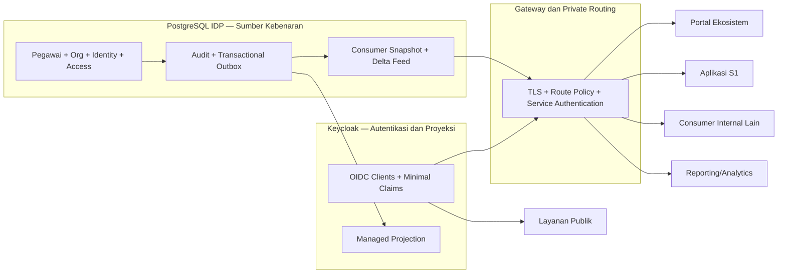
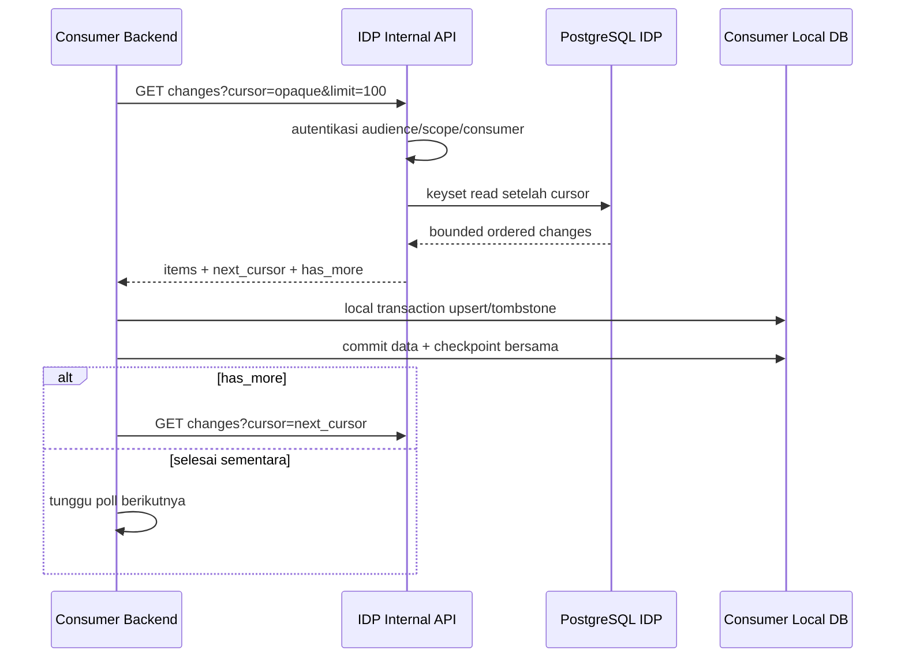
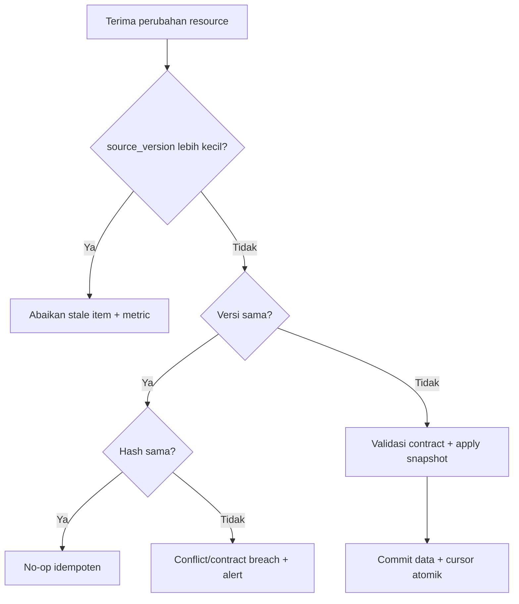
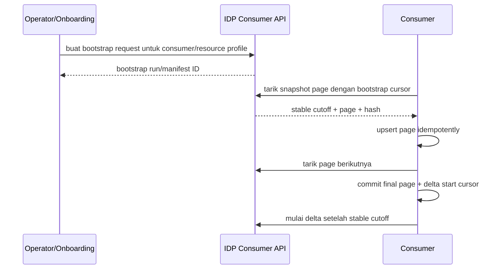
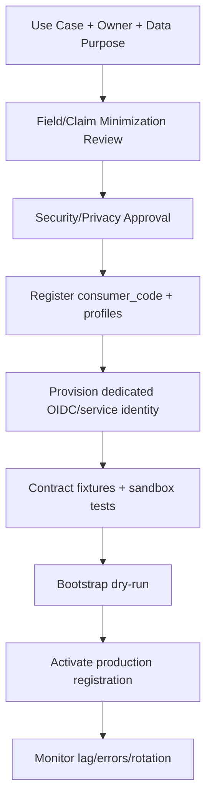
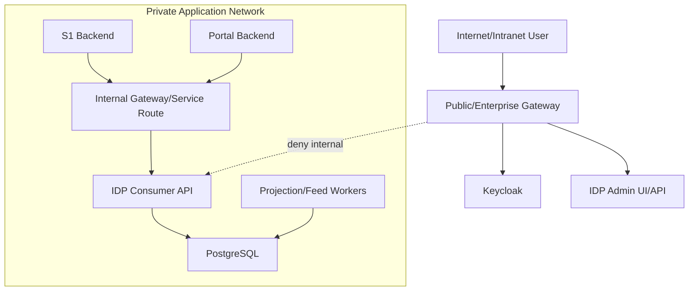

# 29 - IDP Pegawai Tahap 5 Integrasi Consumer, Distribusi Internal & Deployment Hardening Breakdown

Status: Draf brainstorming arsitektur, **bukan implementasi API, gateway, consumer, atau provisioning**  
Proyek: kumjabar_ecosystem  
Tanggal: 2026-08-31  
Melanjutkan:

- `28-idp-pegawai-stage-4-review-checklist-implementation-gate.md`
- `09-idp-pegawai-stage-1-admin-ui-internal-api-contract.md`
- `08-idp-pegawai-stage-1-repository-service-contract.md`
- `03-keycloak-matrix-and-org-unit-seed.md`

## 1. Tujuan Dokumen

Dokumen ini membuka Tahap 5 dan menetapkan breakdown awal untuk:

1. integrasi aplikasi consumer internal;
2. distribusi snapshot identitas ASN secara private;
3. delta feed, cursor, replay, bootstrap, dan reconciliation;
4. OIDC client, audience, dan claim release per consumer;
5. gateway, TLS, routing, dan service authentication;
6. onboarding, observability, recovery, serta decommission consumer;
7. penutupan seluruh peta arsitektur Tahap 1–5 sebelum implementation plan.

Semua masih brainstorming. Tidak ada kode, migration, Keycloak client, Nginx config, DNS, certificate, secret, atau deployment yang dibuat.

## 2. Koreksi dan Perluasan Roadmap Historis

Roadmap awal menempatkan:

```text
Tahap 4 = Keycloak & Consumer Sync
Tahap 5 = Harden Routing
```

Setelah Dokumen 23–28, Tahap 4 telah mengunci **projection engine ke Keycloak**, sedangkan consumer data distribution belum dirinci. Karena itu Tahap 5 diperluas tanpa mengubah arah awal:

```text
Tahap 5 = Integrasi Consumer
          + Distribusi Internal
          + OIDC Claim Release
          + Gateway/Deployment Hardening
```

Ini amendment roadmap, bukan pembukaan ulang Tahap 4.

## 3. Nama Resmi Tahap 5

```text
Tahap 5 — Integrasi Consumer, Distribusi Internal & Deployment Hardening
```

Tiga kata kunci kualitas tetap:

- **ringan**: pull feed PostgreSQL-first, tanpa broker wajib;
- **tangguh**: cursor, checkpoint, replay, bootstrap, reconciliation, versioning;
- **kuat**: private API, least privilege, consumer-specific allowlist, PII minimal.

## 4. Status Awal Tahap 5

```text
Tahap 1 Core Identity              = CLOSED / APPROVED
Tahap 2 Import Pipeline            = CLOSED / APPROVED
Tahap 3 Access & Audit             = CLOSED / APPROVED
Tahap 4 Keycloak Projection        = CLOSED / APPROVED
Tahap 5 Consumer + Hardening       = OPEN / BRAINSTORMING
Coding/migration/provisioning      = NOT AUTHORIZED
```

## 5. Arsitektur Konseptual Tahap 5



## 6. Boundary Fundamental

```text
Keycloak token = autentikasi + coarse entry claims
Private feed   = distribusi canonical identity snapshot
Consumer DB    = cache/snapshot + domain milik consumer
IDP DB         = authority field identitas ASN
```

Token OIDC tidak menjadi bulk master pegawai. Consumer tidak membaca database IDP secara langsung.

## 7. Field Ownership Final yang Dibawa ke Tahap 5

| Field/Concern | Authority |
| --- | --- |
| UUID pegawai | IDP Pegawai |
| NIP resmi ASN | IDP Pegawai |
| nama identitas ASN | IDP Pegawai |
| email dinas/Google terkelola | IDP Pegawai sesuai kontrak field |
| lifecycle/status/eligibility | IDP Pegawai |
| identity links | IDP Pegawai |
| unit/afiliasi organisasi | IDP Pegawai |
| jabatan/jenis/label jabatan | consumer kepegawaian seperti S1 |
| PLT/PLH | consumer kepegawaian seperti S1 |
| histori jabatan | consumer kepegawaian seperti S1 |
| transaksi bisnis | consumer masing-masing |
| fine-grained authorization | aplikasi consumer/local grants sesuai boundary |

## 8. Kelas Consumer Awal

| Kelas Consumer | Contoh | Kebutuhan Utama |
| --- | --- | --- |
| portal internal | Portal Ekosistem | OIDC, coarse navigation, identity summary |
| modul kepegawaian | S1 | OIDC + canonical snapshot/delta |
| aplikasi internal | sistem merit/hukdis/monitoring | OIDC + payload allowlist |
| reporting internal | analytics/reporting | service auth + minimized snapshot/delta |
| aplikasi publik | layanan masyarakat | OIDC/public identity boundary, bukan master ASN |
| operational tooling | health/monitoring/admin tooling | telemetry minimum, bukan PII feed |

Consumer exact pertama perlu dikunci saat review: rekomendasi `portal-ekosistem` dan `s1-internal`.

## 9. Consumer Bukan Satu Entitas Universal

Setiap consumer mempunyai kontrak terpisah:

```text
consumer_code
audience
service identity
allowed resource families
allowed field profile
allowed claim profile
rate/size policy
retention classification
owner dan contact
status lifecycle
```

Satu “internal API token super-admin” untuk semua aplikasi dilarang.

## 10. Persona Manusia vs Service Identity

| Persona | Jalur | Credential |
| --- | --- | --- |
| pegawai pengguna aplikasi | browser → gateway → consumer | OIDC authorization code + PKCE bila public client |
| server consumer menarik feed | private network → Internal API | dedicated confidential client/service account |
| projection worker | private network → Keycloak Admin API | dedicated `idp-pegawai-sync` service account |
| operator IDP | browser → Admin UI | OIDC + local access grants |
| monitoring | private telemetry path | dedicated restricted identity |

Projection worker credential tidak boleh dipakai consumer feed.

## 11. Dua Kanal yang Berbeda

### 11.1 Kanal Login/OIDC

```text
browser
-> consumer
-> Keycloak OIDC
-> minimal token claims
-> consumer local authorization
```

### 11.2 Kanal Data/Sync

```text
consumer backend
-> private Internal API
-> snapshot/delta feed
-> idempotent local transaction
-> durable consumer checkpoint
```

Kedua kanal mempunyai audience dan credential berbeda.

## 12. Minimal OIDC Claims

Baseline candidate:

```text
iss
sub
aud
azp
exp/iat/auth_time
sid
preferred_username bila perlu
pegawai_uuid pseudonymous correlation
user_type
coarse client roles
minimal organization claim bila consumer approved
```

Tidak semua client menerima semua claim.

## 13. Claim yang Tidak Boleh Menjadi Default Global

```text
full NIP
email pribadi/Google
status lifecycle detail
full organization tree
jabatan/PLT/PLH
fine-grained local grants/scope
identity link/provider subject
source payload/hash internal
alamat/nomor telepon
raw metadata
```

Per-client mapper allowlist wajib.

## 14. Token Bukan Database Snapshot

Token memiliki keterbatasan:

- ukuran header/cookie/proxy;
- stale sampai refresh/re-login;
- tersebar ke browser/log/debugger;
- claim release harus minimal;
- tidak cocok untuk bootstrap, replay, atau bulk reconciliation.

Karena itu data consumer yang dapat berubah memakai private API/feed.

## 15. Strategi Distribusi v1

Keputusan awal yang direkomendasikan:

```text
Primary delivery = pull-based delta feed
Bootstrap         = checkpointed full snapshot
Recovery          = replay atau rebootstrap
Webhook           = optional wake-up hint, bukan authority
Message broker    = tidak wajib v1
```

## 16. Alur Pull Delta Feed



## 17. Mengapa Pull First

- consumer mengontrol kecepatan;
- outage consumer tidak memerlukan retry push kompleks;
- replay mudah;
- tidak perlu publik callback endpoint;
- checkpoint atomic di consumer;
- lebih sederhana untuk sedikit consumer internal;
- PostgreSQL tetap correctness authority.

## 18. Webhook sebagai Wake-Up Hint

Jika kelak diperlukan:

```text
IDP webhook -> “ada perubahan untuk consumer X”
consumer     -> tarik delta feed dari cursor terakhir
```

Webhook:

- tidak membawa full PII;
- boleh hilang/duplikat;
- signed dan replay-protected;
- tidak menggeser cursor;
- tidak menjadi source of truth;
- bukan scope wajib v1 sebelum use case nyata.

## 19. Resource Family Candidate

```text
pegawai
org_units
identity_eligibility_summary
```

Tidak masuk feed IDP:

```text
jabatan
PLT/PLH
histori jabatan
consumer transactions
Keycloak raw users/roles/groups
access grant reasons
raw audit logs
```

## 20. Canonical Consumer Contract

Versi kandidat:

```text
pegawai-consumer.v1
org-unit-consumer.v1
consumer-change.v1
consumer-cursor.v1
```

Nama final dikunci pada Dokumen 30–31.

## 21. Snapshot Pegawai Candidate

```json
{
  "contract_version": "pegawai-consumer.v1",
  "resource_type": "pegawai",
  "resource_uuid": "018f0000-0000-7000-8000-000000000001",
  "source_version": 14,
  "source_updated_at": "2026-08-31T01:30:00Z",
  "payload_hash": "0123456789abcdef0123456789abcdef0123456789abcdef0123456789abcdef",
  "data": {
    "pegawai_uuid": "018f0000-0000-7000-8000-000000000001",
    "nama_lengkap": "Nama Pegawai",
    "status_pegawai": "aktif",
    "is_active": true,
    "primary_org_unit": {
      "uuid": "018f0000-0000-7000-8000-000000000010",
      "code": "TUM_TI"
    }
  }
}
```

Ini contoh brainstorming, belum final field allowlist.

## 22. NIP pada Consumer Contract

NIP adalah business key authoritative, tetapi juga PII identifier berisiko tinggi.

Rekomendasi:

- tidak masuk semua consumer secara default;
- hanya consumer dengan use case resmi dan data classification sesuai;
- `pegawai_uuid` menjadi correlation key utama;
- NIP tidak dipakai cursor, URL list, telemetry, atau claim default;
- masked display untuk operator bila full NIP tidak diperlukan.

## 23. Snapshot Lokal Consumer

Consumer boleh menyimpan:

```text
pegawai_uuid
approved identity fields
primary_org_unit_uuid/code
status/eligibility yang dibutuhkan
source_version
source_hash
source_updated_at
last_synced_at
contract_version
```

Snapshot tidak boleh dianggap authoritative dan tidak boleh diedit manual sebagai master.

## 24. Consumer-Owned Fields

Consumer menyimpan domain lokal terpisah:

```text
consumer_pegawai_snapshot    = salinan field IDP
consumer_business_entity     = authority consumer
consumer_assignment/job data = authority consumer bila sesuai boundary
```

Consumer tidak boleh menulis balik field IDP melalui feed endpoint.

## 25. Freshness Decision



## 26. Delta Item Candidate

```json
{
  "change_id": 90001,
  "resource_type": "pegawai",
  "resource_uuid": "018f0000-0000-7000-8000-000000000001",
  "change_type": "upsert",
  "source_version": 14,
  "contract_version": "consumer-change.v1",
  "payload_hash": "0123456789abcdef0123456789abcdef0123456789abcdef0123456789abcdef",
  "occurred_at": "2026-08-31T01:30:00Z"
}
```

`change_id` internal dapat digunakan dalam signed opaque cursor tetapi tidak harus diekspos sebagai authority publik.

## 27. Payload Inline vs Delta Hanya-Metadata

Dua pola:

| Pola | Kelebihan | Kekurangan |
| --- | --- | --- |
| metadata delta + GET snapshot | kecil, snapshot selalu current | N+1 request dan race current-state |
| inline canonical snapshot | atomic event-view, efisien batch | payload lebih besar, retention/privacy lebih berat |

Rekomendasi awal **hybrid bounded**:

- delta membawa canonical consumer payload minimal untuk `upsert`;
- detail besar/sensitif tidak inline;
- snapshot endpoint tersedia untuk recovery/reconciliation;
- tombstone membawa identifier/version/reason class minimal.

Keputusan final masuk Dokumen 30–31.

## 28. Change Types

Kandidat fixed catalog:

```text
upsert
deactivate
retire
tombstone
```

Perlu diputuskan apakah `deactivate/retire` cukup direpresentasikan sebagai `upsert` status inactive. Rekomendasi: `upsert` untuk lifecycle yang masih boleh disimpan; `tombstone` hanya bila resource tidak boleh lagi muncul dalam active snapshot atau telah dipurge sesuai policy.

## 29. Delete Semantics

Hard-delete business resource bukan delivery normal.

```text
pegawai inactive/retired -> upsert status authoritative
legal purge              -> governed tombstone setelah retention
org unit inactive        -> upsert is_active=false
```

Consumer tidak menghapus histori/transaksi lokal secara otomatis hanya karena tombstone.

## 30. Ordering Authority

Timestamp tidak cukup untuk ordering.

Kandidat:

```text
change_sequence bigint monotonik global
```

Atau reuse outbox integer ordering bila kontrak retention/replay memenuhi.

Requirement:

- total ordering feed;
- stable keyset pagination;
- duplicate/out-of-order safe;
- replay window jelas;
- tidak bergantung jam antar-host;
- cursor tidak mengandung filter bebas yang dapat dimanipulasi.

## 31. Hubungan dengan Transactional Outbox

Rekomendasi:

```text
domain mutation + audit + outbox commit atomik
consumer feed projector membaca outbox
consumer change record durable dibuat idempoten
feed membaca consumer change log/read model
```

Feed tidak sebaiknya membaca outbox mentah langsung jika payload outbox tidak dirancang sebagai public consumer contract.

## 32. Mengapa Perlu Consumer Change Log

Outbox event mempunyai tujuan internal dan retention berbeda. Consumer change log memungkinkan:

- contract version stabil;
- consumer-specific allowlist;
- replay window;
- tombstone retention;
- keyset ordering;
- separation dari event implementation detail;
- audit/checkpoint operasional.

Namun tabel final belum dikunci pada Dokumen 29.

## 33. Persistence Candidate Tahap 5

| Kandidat | Status Awal | Fungsi |
| --- | --- | --- |
| `consumer_registrations` | direkomendasikan | registry consumer fixed/governed |
| `consumer_change_log` | direkomendasikan | ordered durable feed records |
| `consumer_checkpoints` | opsional pada provider | observability acknowledgment, bukan authority consumer apply |
| `consumer_bootstrap_runs` | direkomendasikan bila bootstrap async | manifest/checkpoint/artifact/run lineage |
| `consumer_delivery_hints` | future | optional webhook wake-up history |
| `consumer_schema_versions` | mungkin config/code saja | compatibility catalog |

Exact persistence ditutup pada Dokumen 31/34/35.

## 34. Consumer Registration Lifecycle

Kandidat:

```text
proposed -> active -> suspended -> retired
```

Registration memuat:

- stable `consumer_code`;
- owner/unit/contact;
- audience/client binding;
- resource/field profile yang diizinkan;
- environment yang diizinkan;
- rate/pagination policy;
- retention classification;
- onboarding/rotation timestamps;
- status/reason;
- audit lineage.

## 35. Registration Authority

Jangan membuat generic self-service marketplace v1.

Rekomendasi:

- registration melalui controlled configuration/migration atau fixed admin process;
- `security_admin(global)` tidak otomatis dapat memperluas data contract tanpa architecture/security review;
- client secret tidak disimpan di registration table;
- dynamic field-expression/JSON policy dilarang;
- allowlist profile mapped in code/config.

## 36. Provider-Side Checkpoint vs Consumer Checkpoint

Authority keberhasilan apply berada di consumer DB:

```text
consumer local transaction
= apply items + advance consumer-owned checkpoint
```

Provider boleh menyimpan `last_seen_cursor`/ack untuk observability, tetapi tidak boleh mengklaim consumer telah menerapkan data hanya karena HTTP 200 feed berhasil.

## 37. Cursor Contract

Cursor harus:

- opaque;
- signed/HMAC;
- versioned;
- terikat consumer, audience, resource family, field profile, dan query shape;
- memuat/merujuk ordering position;
- mempunyai tamper detection;
- tidak menyimpan PII;
- tidak boleh dipindah antar-consumer;
- dapat dirotasi signing key secara versioned.

## 38. Cursor Expiry

Cursor expiry berbeda dari token expiry.

Jika cursor di luar replay window:

```text
HTTP 410 Gone
error code = consumer_cursor_expired
recovery   = controlled rebootstrap
```

Tidak boleh diam-diam mulai dari awal atau posisi terbaru.

## 39. Pagination

Rekomendasi awal:

```text
default limit = 100
maximum limit = 500
ordering      = change_sequence ASC
pagination    = keyset cursor
```

Nilai final harus melalui response-size/load benchmark. Maximum 500 bukan keputusan final.

## 40. Polling

Candidate:

```text
active backlog   -> poll segera/pendek dengan server hint
caught up        -> 15–60 detik sesuai consumer class
429/503          -> Retry-After + bounded jitter
```

Tidak ada long polling, SSE, atau WebSocket v1 tanpa use case.

## 41. Bootstrap

Consumer baru tidak memulai dari delta history tak terbatas.



## 42. Stable Bootstrap Cutoff

Bootstrap harus mengikat:

```text
cutoff_sequence
contract version
field profile version
resource filters
consumer identity
```

Setelah snapshot hingga cutoff selesai, consumer melanjutkan delta `> cutoff_sequence`. Ini menghindari gap antara snapshot dan perubahan berjalan.

## 43. Bootstrap Delivery

Dua kandidat:

1. paginated API langsung;
2. private artifact ber-manifest untuk dataset besar.

Rekomendasi v1: paginated API dulu bila volume ASN Kanwil masih aman; artifact hanya setelah benchmark membuktikan perlu.

## 44. Reconciliation Consumer

Reconciliation membandingkan:

```text
IDP authoritative resource UUID/version/hash
vs
consumer local snapshot UUID/version/hash
```

Provider dapat menyediakan metadata page; consumer menghasilkan mismatch report. Tidak ada remote write dari IDP ke consumer DB.

## 45. Consumer Apply Algorithm

Untuk setiap item:

1. validate contract version;
2. validate schema/unknown fields;
3. compare source version;
4. same version + same hash = no-op;
5. same version + different hash = breach/alert;
6. lower version = stale duplicate;
7. higher version = apply transaction;
8. advance cursor hanya bersama commit seluruh page atau deterministic item checkpoint;
9. failure tidak melompati item diam-diam;
10. consumer domain-owned fields tidak ditimpa.

## 46. Partial Page Failure

Rekomendasi:

```text
satu page apply = satu local transaction consumer
```

Jika satu item gagal schema/business snapshot validation:

- rollback page;
- simpan safe local diagnostic;
- jangan advance checkpoint;
- quarantine/ops flow harus dirancang consumer;
- retry tidak menghasilkan reorder.

Untuk consumer dengan page terlalu besar, item-level checkpoint boleh dipertimbangkan tetapi kontraknya harus eksplisit.

## 47. Schema Evolution

Rules:

- additive optional field dalam compatible minor profile;
- perubahan wajib/semantik/penghapusan/penggantian nama membutuhkan contract version baru;
- unknown field default fail-closed atau ignored hanya bila contract menyatakan forward-compatible;
- consumer mengirim supported contract versions saat onboarding/config;
- provider menjalankan overlap window;
- deprecation diberi owner/tanggal/telemetry;
- tidak ada silent breaking change.

## 48. Consumer-Specific Field Profiles

Kandidat:

```text
pegawai.portal.v1
pegawai.s1.v1
pegawai.reporting-minimal.v1
org-unit.internal.v1
```

Profile mengontrol field, bukan query `fields=` bebas dari consumer.

## 49. Portal Ekosistem Boundary

Portal direkomendasikan menerima:

- OIDC subject;
- pegawai UUID;
- `user_type`;
- coarse portal role;
- display name minimal jika approved;
- primary org summary hanya bila diperlukan navigasi.

Portal tidak perlu full delta feed jika hanya launcher. Jika menyimpan directory/search, gunakan dedicated approved profile.

## 50. S1 Boundary

S1 dapat menerima snapshot/delta:

- pegawai UUID;
- identity display fields approved;
- lifecycle/eligibility;
- primary org dan afiliasi approved;
- source version/hash/time.

S1 tetap authoritative untuk:

- jabatan;
- jenis/label jabatan;
- PLT/PLH;
- histori jabatan;
- workflow kepegawaian;
- transaksi aplikasi S1.

## 51. Reporting Boundary

Reporting tidak otomatis mendapat PII lengkap.

Rekomendasi:

- aggregated/minimized profile jika detail tidak diperlukan;
- pseudonymous pegawai UUID;
- no NIP/email default;
- purpose/retention owner;
- export bukan pengganti feed;
- analytics materialization memiliki freshness metadata.

## 52. Public Application Boundary

Aplikasi publik:

- tidak menarik internal ASN master feed secara default;
- public persona tetap dikelola domain aplikasi;
- `/publik/masyarakat` tidak membuka internal employee claims;
- jika pegawai juga menjadi pengguna publik, claim disclosure mengikuti client context;
- audience isolation wajib.

## 53. Internal API Namespace

Kandidat canonical:

```text
/internal/api/v1/consumer/pegawai/snapshots
/internal/api/v1/consumer/pegawai/changes
/internal/api/v1/consumer/org-units/snapshots
/internal/api/v1/consumer/org-units/changes
/internal/api/v1/consumer/bootstrap-runs/{uuid}
```

Nama endpoint final dikunci setelah kontrak payload/cursor. Legacy preview `/internal/pegawai/*` pada Dokumen 09 harus diberi compatibility/supersession plan, bukan dipertahankan tanpa review.

## 54. Endpoint Candidate

| Method | Endpoint | Tujuan |
| --- | --- | --- |
| GET | `/internal/api/v1/consumer/pegawai/{uuid}` | canonical current snapshot |
| GET | `/internal/api/v1/consumer/pegawai/changes` | delta feed |
| GET | `/internal/api/v1/consumer/pegawai/snapshot-pages` | full bootstrap/reconciliation page |
| GET | `/internal/api/v1/consumer/org-units/{uuid}` | org unit snapshot |
| GET | `/internal/api/v1/consumer/org-units/changes` | org delta feed |
| GET | `/internal/api/v1/consumer/schema` | supported contract metadata |
| POST | `/internal/api/v1/consumer/acks` | optional observability acknowledgment |

POST ack bukan authority apply dan dapat ditunda v1.

## 55. Response Envelope Candidate

```json
{
  "data": [],
  "sync": {
    "contract_version": "consumer-change.v1",
    "field_profile": "pegawai.s1.v1",
    "cutoff_sequence": 90100
  },
  "meta": {
    "request_id": "018f0000-0000-7000-8000-000000000099",
    "next_cursor": "opaque-signed-cursor",
    "has_more": false,
    "poll_after_seconds": 30
  }
}
```

## 56. Error Envelope Candidate

```json
{
  "error": {
    "code": "consumer_cursor_expired",
    "message": "Posisi sinkronisasi sudah di luar masa pemutaran ulang. Lakukan bootstrap ulang terkontrol.",
    "details": {}
  },
  "meta": {
    "request_id": "018f0000-0000-7000-8000-000000000099"
  }
}
```

Error tidak membocorkan registration, consumer lain, atau PII.

## 57. Service Authentication

Pilihan:

| Mekanisme | Kegunaan | Catatan |
| --- | --- | --- |
| OAuth2 client credentials | baseline service identity | dedicated client, audience/scope restricted |
| mTLS | defense-in-depth high-trust network | certificate lifecycle lebih kompleks |
| private network allowlist | tambahan | tidak menggantikan identity authentication |
| static API key | tidak direkomendasikan | lemah untuk audience/scope/rotation |

Rekomendasi awal: client credentials + private network; mTLS diputuskan berdasarkan infra readiness/risk.

## 58. Token Validation Internal API

Wajib:

```text
signature
issuer exact
audience exact
azp/client binding
exp/nbf/iat with bounded skew
allowed algorithm
service subject/client status
scope/resource profile
consumer registration status
```

Token manusia tidak otomatis valid untuk feed service-to-service.

## 59. Consumer Scope Candidate

```text
idp.consumer.pegawai.read
idp.consumer.pegawai.delta
idp.consumer.org-units.read
idp.consumer.org-units.delta
idp.consumer.bootstrap.read
idp.consumer.schema.read
```

Scope token masih harus di-intersect dengan registration allowlist server-side.

## 60. Gateway Route Classes

| Route Class | Exposure | Authentication |
| --- | --- | --- |
| `/idp-pegawai/admin/*` | melalui gateway | human OIDC + local grant |
| `/idp-pegawai/admin/api/*` | melalui gateway | session/CSRF/local capability |
| `/idp-pegawai/internal/*` | tidak publik | service JWT + private network/mTLS candidate |
| `/idp-pegawai/health/live` | internal/load balancer minimal | no sensitive dependency detail |
| `/idp-pegawai/health/ready` | internal orchestrator | bounded dependency readiness |
| Keycloak Admin API | private worker path | dedicated projection credential |
| public OIDC endpoints | gateway sesuai Keycloak contract | protocol-specific |

## 61. Path-Based Fallback

Jika subdomain dedicated tidak tersedia:

```text
https://sso-jabar.kemenkum.go.id/idp-pegawai/admin/*
```

Tetapi:

```text
https://sso-jabar.kemenkum.go.id/idp-pegawai/internal/*
= deny dari public ingress
```

Internal consumer memakai private DNS/service address, bukan mengandalkan path publik dengan secret.

## 62. Reverse Proxy Contract

Gateway wajib menjaga:

- trusted proxy chain;
- canonical external scheme/host/prefix;
- strip/set forwarding headers terkontrol;
- reject spoofed `X-Forwarded-*` dari untrusted source;
- base-path correctness;
- body/header size caps;
- timeout per route class;
- no arbitrary upstream routing;
- request ID generation/propagation;
- structured access logs tanpa token/query PII.

## 63. TLS Contract

- TLS wajib di setiap untrusted hop;
- internal plaintext hanya jika explicitly accepted private boundary, namun TLS tetap direkomendasikan;
- certificate hostname verification;
- approved protocols/ciphers berdasarkan baseline organisasi;
- certificate renewal monitoring;
- CA trust rotation;
- no insecure verify bypass;
- HSTS hanya pada host yang benar-benar siap;
- OCSP/stapling sesuai infra capability.

## 64. CORS dan CSRF

Internal feed:

```text
no browser CORS
no cookie/session authentication
Bearer service credential
```

Admin UI:

```text
same-origin session
CSRF token untuk mutation
secure HttpOnly SameSite cookies
```

Public OIDC redirect origins menggunakan exact allowlist.

## 65. Rate dan Resource Limits

Per route/consumer:

- request rate;
- concurrent request cap;
- page size;
- response decompressed size;
- query timeout;
- upstream/app timeout;
- token validation/JWKS cache policy;
- bootstrap concurrency;
- retry hints.

Nilai final melalui benchmark, bukan tebakan Dokumen 29.

## 66. Cache Policy

| Response | Cache Policy |
| --- | --- |
| pegawai detail/delta | `private, no-store` default |
| schema metadata non-PII | bounded private cache/ETag candidate |
| org reference minimal | bounded private cache candidate |
| errors | no-store |
| bootstrap artifact | private, short-lived, signed access bila dipakai |

Shared public CDN dilarang untuk consumer feed.

## 67. Compression

Compression dapat membantu feed tetapi perlu:

- decompressed response cap;
- disable/mitigate cross-secret compression risks;
- secret tidak direfleksikan bersama konten yang dikendalikan penyerang;
- benchmark CPU/memory;
- response hash dihitung atas canonical payload, bukan compressed bytes.

## 68. Observability

Provider metrics minimum:

```text
requests by consumer/resource/status
items/bytes served
oldest available sequence
cursor expired count
consumer observed lag
bootstrap runs/progress/failure
schema version usage
401/403/404/409/410/429/5xx
latency and query time
rate-limit actions
```

PII, token, cursor raw, NIP, email, dan payload tidak menjadi metric label.

## 69. Consumer Lag

Provider hanya dapat mengukur:

- last requested/acknowledged sequence;
- current head sequence;
- request recency.

Provider tidak boleh menyatakan “data telah diterapkan” tanpa consumer acknowledgment yang semantiknya jelas. Bahkan ack tetap observability, bukan bukti domain correctness consumer.

## 70. Audit Events Candidate

```text
consumer.registered
consumer.activated
consumer.suspended
consumer.retired
consumer.credential_rotated_reference
consumer.bootstrap_requested/completed/failed
consumer.replay_authorized
consumer.cursor_expired
consumer.contract_changed
consumer.sensitive_profile_accessed
```

Audit tidak menyimpan credential/raw payload.

## 71. Alert Candidate

- consumer authentication failure storm;
- unexpected audience/scope;
- cursor expiration berulang;
- lag melewati SLO;
- bootstrap gagal/stuck;
- response size cap terlampaui;
- schema version mendekati end-of-support;
- full-feed scraping anomaly;
- retired/suspended consumer masih mencoba akses;
- Keycloak mapper drift terkait client consumer.

## 72. Consumer Onboarding Flow



## 73. Consumer Onboarding Evidence

- named business/technical owner;
- tujuan dan dasar legal/organisasi;
- exact fields/claims;
- perilaku retensi dan penghapusan;
- target environment/network;
- authentication/audience/scope;
- contract version support;
- idempotent apply test;
- bootstrap/replay test;
- incident contact;
- credential rotation proof;
- decommission plan.

## 74. Credential Rotation

- dedicated client per consumer/environment;
- secret tidak disimpan dalam tabel bisnis IDP/repository;
- overlap rotation window jika platform mendukung;
- revoke old credential setelah verification;
- audit reference, bukan secret value;
- emergency suspension path;
- no shared credential across dev/staging/prod.

## 75. Environment Isolation

```text
dev consumer -> dev IDP/Keycloak
staging       -> staging
production    -> production
```

Production identity/data tidak disalin ke lower environment tanpa sanitization/governance.

## 76. Replay Authorization

Normal replay dalam retention window dengan cursor valid tidak perlu manual approval. Controlled replay/backfill yang memperluas window/profile membutuhkan:

- authorized service/operator;
- reason;
- consumer registration current;
- bounded range/cutoff;
- audit;
- rate control;
- no arbitrary resource query.

Four-eyes hanya dipertimbangkan untuk bulk sensitive replay, bukan semua retry polling.

## 77. Suspension

Consumer dapat disuspensi karena:

- credential compromise;
- owner tidak valid;
- contract violation;
- excessive failure/scraping;
- privacy incident;
- decommission process.

Suspension menolak token/feed segera. Data yang sudah tersalin ditangani melalui consumer retention/incident runbook.

## 78. Decommission

```text
stop new access
revoke service credential
retire OIDC client/redirects
record final checkpoint
apply retention/deletion obligation
preserve audit/legal hold
remove monitoring after closure evidence
```

Consumer code/history tidak didaur ulang.

## 79. Threat Model Ringkas

| Ancaman | Guardrail |
| --- | --- |
| consumer menarik data melebihi kebutuhan | field profile fixed + server registration intersect |
| token dicuri | short-lived token, audience, TLS, rotation, network boundary |
| cursor dipindah ke consumer lain | HMAC binding ke consumer/profile/query |
| timestamp skip/duplicate | sequence ordering + keyset cursor |
| consumer offline | replay window + checkpoint + rebootstrap |
| snapshot menjadi master baru | ownership contract + immutable source metadata |
| public route mencapai feed | ingress deny + private DNS/network + service auth |
| token membengkak/PII bocor | minimal per-client claim release |
| webhook hilang | webhook hanya hint; pull feed tetap authority |
| breaking schema change | version overlap + fixtures + telemetry |
| stale data dianggap current | version/hash + lag/reconciliation |
| service credential dipakai lintas env | dedicated client/environment binding |

## 80. Failure Matrix

| Failure | Provider/Consumer Behavior |
| --- | --- |
| IDP unavailable | consumer mempertahankan last known snapshot dengan stale indicator sesuai domain |
| consumer unavailable | tidak ada push retry storm; cursor tetap |
| page apply gagal | rollback page, cursor tidak maju |
| duplicate page | idempotent source version/hash |
| same version different hash | breach alert, fail-closed |
| cursor expired | 410 + controlled rebootstrap |
| contract unsupported | 409/422 stable error + no cursor advance |
| token expired | refresh service token, bounded retry |
| 429 | honor `Retry-After` + jitter |
| gateway timeout setelah hasil tidak pasti | replay cursor yang sama aman |
| bootstrap interrupted | resume signed checkpoint/cursor |

## 81. Availability Semantics Consumer

Consumer harus menentukan per use case:

- boleh memakai last-known snapshot saat IDP down atau tidak;
- batas stale maksimum;
- operasi apa yang tetap diizinkan;
- operasi security-sensitive yang wajib fail-closed;
- UI indicator stale;
- reconciliation setelah recovery.

IDP tidak boleh mengarang satu kebijakan availability untuk semua consumer.

## 82. Security-Sensitive Local Decision

Consumer local authorization tidak boleh bergantung pada live feed call per request.

Rekomendasi:

- local authorization state diproyeksikan/diatur consumer sesuai kontrak;
- consumer memeriksa token/audience dan local policy;
- stale/disabled identity handling ditentukan aman;
- critical revalidation dapat memakai targeted API jika contract menetapkan;
- outage tidak boleh otomatis menjadi allow.

## 83. Data Classification

Profile minimal:

| Kelas | Contoh | Kontrol |
| --- | --- | --- |
| internal identifier | pegawai UUID | private distribution |
| direct identifier sensitif | NIP/email | need-to-know, audit, retention |
| organization | unit code/path | per-purpose release |
| lifecycle | status/eligibility | security-sensitive internal |
| technical freshness | version/hash/cursor | no PII tetapi integrity-sensitive |
| credential/secret | token/client secret | tidak masuk payload/persistence/log |

## 84. Privacy Principles

- purpose limitation;
- data minimization;
- per-consumer allowlist;
- retention ownership;
- masked operational UI;
- no PII query strings bila dapat dihindari;
- no raw payload logging;
- no cursor/token logging;
- legal hold dan penanganan insiden;
- consumer deletion/decommission evidence.

## 85. Consumer Reconciliation Metadata Endpoint

Kandidat halaman yang hanya berisi metadata:

```text
GET /internal/api/v1/consumer/pegawai/reconciliation-metadata
```

Item:

```text
resource_uuid
source_version
payload_hash
is_active/tombstone class
```

Endpoint tetap profile/consumer scoped dan paginated. Tidak membuka full NIP/email.

## 86. OIDC Client Contract per Consumer

Setiap client mengunci:

- client type public/confidential;
- exact redirect URI;
- exact post-logout redirect URI;
- web origins exact;
- authorization code flow;
- PKCE requirement;
- secret/private key policy;
- audience/client role;
- mapper allowlist;
- token/session lifetimes;
- logout/backchannel capability;
- environment binding.

## 87. Portal OIDC Candidate

Portal web server-side:

- confidential client jika server dapat menjaga secret;
- authorization code flow;
- exact redirect URI;
- secure session cookie;
- minimal token storage server-side;
- no implicit flow;
- coarse portal role;
- no broad offline token default.

Jika SPA dipilih kelak, public client + PKCE dan browser token threat model terpisah wajib.

## 88. Laravel S1 OIDC Candidate

- confidential web client;
- authorization code flow;
- exact callback/logout;
- local session;
- dedicated service client terpisah untuk feed;
- human client secret tidak dipakai feed;
- role domain lokal tetap authoritative untuk fitur S1;
- pegawai UUID menjadi linkage.

## 89. Protocol Mapper Drift

Tahap 4 mengunci deteksi+alert saja pada v1. Tahap 5 menambahkan katalog mapper yang diharapkan per client:

```text
client ID
audience
claim name/source/type
in ID token?
in access token?
in userinfo?
required/optional
privacy classification
```

Repair tetap melalui IaC/admin runbook, bukan consumer API.

## 90. Logout dan Session

Perlu dikunci pada Dokumen 32:

- RP-initiated logout;
- frontchannel/backchannel capability per app;
- local session invalidation;
- Keycloak SSO session vs app session;
- user deactivation propagation lag;
- refresh token policy;
- offline access prohibition/default;
- session cookie scope pada path-based deployment.

## 91. Health Endpoint

`live`:

- proses hidup;
- tidak memeriksa dependency berat;
- tidak membuka build/secrets.

`ready`:

- DB/service dependency minimum;
- bounded timeout;
- status generic;
- hanya internal.

Consumer feed status detail masuk authenticated observability, bukan public health.

## 92. Logging

Structured fields candidate:

```text
request_id
consumer_code (safe internal code)
route template
resource family
status code
item count
bytes
latency
contract/profile version
cursor position bucket, bukan raw cursor
```

Dilarang:

```text
authorization header
token claims full
client secret
raw cursor
NIP/email/nama
response payload
query PII
```

## 93. Trace Propagation

- W3C trace context candidate;
- hanya menerima header valid dan terbatas;
- generate trusted internal trace ID;
- trace baggage tidak digunakan untuk PII/authorization;
- propagate request ID to consumer response;
- trace sampling lebih tinggi untuk errors tanpa raw body.

## 94. Backup/Restore

Tahap 5 persistence harus mempertimbangkan:

- consumer change log replay window;
- restore dapat menghidupkan kembali feed record/registration kedaluwarsa;
- post-restore retention catch-up;
- cursor behavior terhadap restored timeline;
- immutable sequence uniqueness;
- consumer rebootstrap runbook;
- secret tidak dipulihkan dari business DB karena tidak disimpan di sana.

## 95. Retention Candidate

Belum final:

| Data | Rekomendasi Awal |
| --- | --- |
| consumer registration history | 5 tahun setelah retired untuk governance |
| consumer change log | 30–90 hari berdasarkan offline/replay SLO |
| bootstrap runs/manifests | 1 tahun umum; lebih lama jika security incident |
| optional ack/checkpoint observability | 90 hari–1 tahun |
| webhook hint attempts | pendek, misalnya 30–90 hari bila fitur ada |
| audit | mengikuti kelas Dokumen 20 |

Ukuran/replay needs dan policy legal menentukan final.

## 96. Sequence Retention Invariant

Purge change log tidak boleh membuat cursor aktif diam-diam menunjuk gap. Sebelum purge:

- hitung minimum retained sequence;
- identifikasi active consumer lag;
- alert sebelum expiry;
- jangan memperpanjang tak terbatas tanpa policy;
- cursor lama setelah purge menghasilkan 410;
- manifest purge mencatat range/count/cutoff.

## 97. Consumer Contract Testing

Provider menyediakan fixtures untuk:

- representative upsert active/inactive;
- org move/rename/inactive;
- optional/null field;
- Unicode/nama/gelar;
- source version progression;
- duplicate/stale/same-version-different-hash;
- tombstone;
- cursor tamper/expiry;
- unsupported contract;
- maximum page/response;
- authorization negative cases.

Fixtures tersanitasi dan tidak memakai data ASN nyata.

## 98. Sandbox/Staging

Consumer onboarding sebelum production:

```text
register staging client
load sanitized fixtures
bootstrap
process delta
simulate duplicate/out-of-order
simulate cursor expiry
rotate credential
suspend/reactivate
reconcile hashes
```

## 99. Deployment Topology Candidate



## 100. Deployment Unit Question

Consumer API dapat berada:

1. dalam service IDP Flask yang sama dengan route/worker process terpisah; atau
2. deployment terpisah tetapi memakai domain/service library yang sama.

Rekomendasi awal v1: modular monolith/deployment sederhana, route class dan process separation; jangan microservice split tanpa load/security need. Exact process topology masuk implementation plan.

## 101. Scaling

Scale candidates:

- stateless API instances;
- PostgreSQL read/query indexes;
- bounded connection pools;
- per-consumer rate limits;
- cache hanya untuk referensi schema/org non-sensitif bila terbukti perlu;
- no Redis correctness dependency;
- separate heavy bootstrap concurrency;
- partition change log hanya setelah volume evidence.

## 102. No Direct Database Access

Consumer dilarang:

- memakai PostgreSQL credentials IDP;
- membuat replica sendiri dari schema internal;
- query `transactional_outbox` langsung;
- bergantung internal integer IDs;
- membaca JSONB internal/raw import/audit;
- menjalankan cross-database joins ke IDP.

API contract menjadi anti-corruption boundary.

## 103. No Reverse Mutation via Feed

Distribusi consumer Tahap 5 bersifat hanya-baca. Jika kelak consumer perlu mengajukan koreksi:

- endpoint/workflow terpisah;
- ownership check;
- audit;
- validation;
- tidak overwrite otomatis;
- bukan bagian delta acknowledgment.

## 104. Batas Webhook dan Broker

Tidak masuk v1 tanpa use case terukur:

```text
Kafka/RabbitMQ mandatory
per-consumer push delivery queue
public webhooks membawa PII
exactly-once claim
change-data-capture publik
consumer-defined event subscriptions/predicates
```

## 105. Exactly-Once

Kontrak realistis:

```text
provider delivery = at-least-once/replayable read
consumer apply    = idempotent transaction
checkpoint        = atomic dengan apply
```

Tidak mengklaim network exactly-once.

## 106. Consumer Outage Recovery

```text
short outage, cursor retained  -> resume delta
long outage within retention   -> bounded replay
cursor expired                 -> controlled bootstrap
contract too old               -> upgrade + bootstrap/replay
credential compromise          -> suspend + rotate + assess/rebootstrap
```

## 107. Ownership Operasional

| Area | Owner Candidate |
| --- | --- |
| IDP domain/payload | tim IDP/Kepegawaian |
| consumer integration | owner aplikasi consumer |
| Keycloak OIDC/client | IAM/TI |
| gateway/TLS/network | Infra/TI |
| privacy/retention | records/privacy/security owner |
| SLO/on-call | service owners lintas tim |
| schema compatibility | IDP + consumer technical owners |

Nama personal/contact final masuk runbook/config, bukan dokumen publik.

## 108. SLO yang Harus Ditentukan

- feed API availability;
- p95/p99 response latency;
- maximum consumer lag;
- replay retention window;
- bootstrap completion target;
- cursor expiry warning horizon;
- credential rotation window;
- incident suspension time;
- schema deprecation notice;
- stale snapshot tolerance per consumer.

Angka ditetapkan setelah benchmark dan owner agreement.

## 109. Dokumen Tahap 5

```text
29 - Breakdown Integrasi Consumer, Distribusi Internal & Hardening
30 - Kontrak Canonical Consumer Snapshot, Field Ownership & Freshness
31 - Kontrak Delta Feed, Cursor, Replay & Consumer Checkpoint
32 - Kontrak OIDC Client, Audience, Mapper & Claim Release
33 - Kontrak Gateway, Private Routing & Service Authentication
34 - Kontrak Consumer Onboarding, Bootstrap, Reconciliation & Operations
35 - Tahap 5 Review Checklist, Keputusan Final & Implementation Gate
```

## 110. Fokus Dokumen 30

Dokumen 30 mengunci:

- typed payload pegawai/org;
- exact field ownership;
- consumer-specific profiles;
- canonicalization/hash/version;
- NIP/email/PII release;
- status/tombstone semantics;
- snapshot endpoint;
- schema evolution compatibility.

## 111. Fokus Dokumen 31

Dokumen 31 mengunci:

- source sequence/change log;
- feed endpoint;
- cursor HMAC;
- page transaction/checkpoint;
- bootstrap cutoff;
- replay/expiry/410;
- reconciliation metadata;
- persistence delta;
- polling/rate/resource limits.

## 112. Fokus Dokumen 32

Dokumen 32 mengunci:

- Portal/S1 OIDC clients;
- public/confidential classification;
- redirect/logout URIs;
- authorization code/PKCE;
- audience/scope/client roles;
- per-client mapper catalog;
- token/session lifetime;
- logout/offline access;
- mapper drift fixtures.

## 113. Fokus Dokumen 33

Dokumen 33 mengunci:

- route exposure matrix;
- subdomain/path fallback;
- internal/public ingress split;
- service authentication/mTLS decision;
- TLS/proxy headers;
- CORS/CSRF/cookies;
- rate/timeout/body/header limits;
- health/logging/tracing;
- secret/certificate rotation.

## 114. Fokus Dokumen 34

Dokumen 34 mengunci:

- registration lifecycle;
- onboarding evidence;
- bootstrap/replay approval;
- consumer lag/alerts;
- suspension/decommission;
- schema deprecation;
- incident/recovery;
- retention/legal hold;
- operational ownership/SLO.

## 115. Fokus Dokumen 35

Dokumen 35:

- mengaudit Tahap 1–5;
- menutup seluruh pertanyaan Dokumen 29–34;
- menetapkan persistence/configuration delta final;
- menyusun PostgreSQL/OIDC/gateway/security/load gates;
- menentukan architecture-complete keseluruhan;
- tetap tidak mengizinkan coding kecuali user memberi instruksi eksplisit berikutnya.

## 116. Pertanyaan Terbuka Dokumen 29

| No. | Pertanyaan | Rekomendasi Awal |
| ---: | --- | --- |
| 1 | Consumer pertama yang dikunci? | `portal-ekosistem` dan `s1-internal`; lainnya profile-driven setelah onboarding. |
| 2 | Delivery utama? | Pull delta feed; webhook hanya future wake-up hint. |
| 3 | Delta membawa payload inline atau hanya metadata? | Hybrid terbatas: payload minimal inline + snapshot endpoint. |
| 4 | Ordering source? | Global monotonic consumer change sequence, bukan timestamp. |
| 5 | Perlu consumer change log terpisah dari outbox? | Ya, karena contract/retention/replay berbeda. |
| 6 | Page default/maksimum? | 100/500 candidate, final setelah benchmark. |
| 7 | Replay retention? | 30–90 hari candidate berdasarkan SLO offline consumer. |
| 8 | Service auth baseline? | Dedicated OAuth2 client credentials + private network; mTLS risk/infra based. |
| 9 | Provider checkpoint authoritative? | Tidak; consumer local atomic checkpoint adalah authority apply. |
| 10 | Bootstrap format? | Paginated API dulu; artifact hanya jika benchmark perlu. |
| 11 | NIP masuk profile mana? | Hanya consumer approved need-to-know; bukan default Portal/reporting. |
| 12 | `upsert` vs explicit lifecycle change types? | `upsert` untuk lifecycle; tombstone hanya governed disappearance/purge. |
| 13 | Consumer registry config atau DB? | Relational registration untuk governance; field profiles static code/config. |
| 14 | Deployment consumer API? | Modular monolith/process separated v1; bukan microservice wajib. |
| 15 | Apakah webhook masuk v1? | Tidak, kecuali polling load/latency use case membuktikan perlu. |
| 16 | mTLS wajib? | Belum; client credentials + private network baseline, mTLS sebagai defense-in-depth decision. |

## 117. Daftar Periksa Penerimaan Dokumen 29

### Boundary

- [ ] Nama/scope Tahap 5 disetujui.
- [ ] OIDC vs data distribution separation disetujui.
- [ ] Field ownership dan consumer snapshot non-authority disetujui.
- [ ] Consumer classes/initial consumers disetujui.

### Distribution

- [ ] Arah pull sebagai jalur utama dan webhook hanya sebagai hint disetujui.
- [ ] Snapshot/delta/hybrid payload direction disetujui.
- [ ] Sequence/cursor/checkpoint/bootstrap direction disetujui.
- [ ] Consumer change log direction disetujui.

### Security dan Routing

- [ ] Service identity/audience/scope direction disetujui.
- [ ] Private/public route boundary disetujui.
- [ ] Minimal token/per-client claims direction disetujui.
- [ ] Gateway/TLS/proxy hardening scope disetujui.

### Operasional

- [ ] Onboarding/suspension/decommission direction disetujui.
- [ ] Schema evolution/reconciliation direction disetujui.
- [ ] Observability/retention/SLO gates disetujui.
- [ ] Dokumen 30–35 sequence disetujui.

## 118. Risiko Awal Tahap 5

| Risiko | Dampak | Mitigasi Arsitektur |
| --- | --- | --- |
| feed menjadi bulk PII API | kebocoran massal | per-consumer profile, private auth, page/rate cap |
| consumer snapshot menjadi master baru | ownership drift | explicit ownership, source version/hash, no reverse mutation |
| outbox dipakai langsung sebagai public contract | coupling/breaking retention | dedicated consumer change log |
| cursor timestamp melewatkan data | inconsistency | monotonic sequence + keyset/HMAC cursor |
| polling terlalu agresif | load IDP | server poll hint, rate limit, lag-aware interval |
| replay window terlalu pendek | frequent rebootstrap | SLO + warning + benchmark/capacity |
| token terlalu banyak claim | privacy/size/staleness | per-client mapper minimal |
| internal route salah terekspos | bulk compromise | public ingress deny + private service auth |
| service credentials dibagi | blast radius | dedicated client per consumer/environment |
| schema berubah tanpa overlap | consumer outage | versioning, fixtures, deprecation telemetry |
| bootstrap memiliki gap | stale snapshot | stable cutoff + delta continuation |
| IDP mengklaim consumer sudah apply | kepastian semu | checkpoint milik consumer; ack provider hanya observability |

## 119. Future / Bukan v1

```text
Kafka/RabbitMQ mandatory
generic webhook platform
consumer self-service marketplace
dynamic field-policy DSL
GraphQL arbitrary field selection
CDC publik
direct DB replica untuk consumer
exactly-once network claim
public bulk ASN directory
OIDC token sebagai full master data
WebSocket/SSE/long polling
multi-region active-active distribution
auto-provision every consumer from registration UI
```

## 120. Keputusan yang Diusulkan untuk Dikunci

1. Tahap 5 resmi mencakup consumer integration dan deployment hardening.
2. OIDC login dan consumer data sync adalah kanal terpisah.
3. Pull-based delta feed menjadi primary distribution v1.
4. Webhook tidak wajib dan hanya wake-up hint bila kelak ada.
5. PostgreSQL/outbox memicu durable consumer change log; outbox raw bukan public contract.
6. Global monotonic sequence menjadi ordering authority candidate.
7. Consumer checkpoint authoritative disimpan atomik di consumer DB.
8. Cursor signed/HMAC dan terikat consumer/profile/query.
9. Cursor di luar replay window menghasilkan 410 + controlled bootstrap.
10. Bootstrap memakai stable cutoff lalu lanjut delta tanpa gap.
11. Field profiles fixed per consumer; tidak ada arbitrary field selection.
12. NIP/email tidak menjadi field global/default.
13. Service auth baseline dedicated client credentials + private network.
14. Internal feed tidak mempunyai public ingress/CORS.
15. Portal dan S1 memakai human OIDC client dan feed service client terpisah.
16. Deployment v1 tetap modular/simple; tidak memaksa microservice/broker.
17. Provider ack/checkpoint hanya observability, bukan proof of consumer apply.
18. Consumer apply wajib idempoten menggunakan version/hash.
19. Schema contract versioned dengan overlap/deprecation.
20. Tidak ada coding/provisioning sampai seluruh Tahap 5 direview dan user mengizinkan eksplisit.

## 121. Gate untuk Masuk Dokumen 30

Sebelum Dokumen 30 difinalkan, review perlu memilih atau mengonfirmasi:

- consumer awal;
- resource families;
- inline/hybrid payload;
- PII profiles terutama NIP/email;
- lifecycle/tombstone semantics;
- canonical contract names;
- ownership boundary S1/Portal.

## 122. Status Coding dan Infrastruktur

```text
Dokumen 29             = BRAINSTORMING DRAFT
Dokumen 30–35          = BELUM DISUSUN
Application code       = BELUM DIUBAH
Migration              = BELUM DIBUAT
Keycloak client/mapper = BELUM DIKONFIGURASI
Nginx/gateway config   = BELUM DIUBAH
DNS/TLS/certificate    = BELUM DIPROVISION
Consumer integration   = BELUM DIJALANKAN
```

## 123. Kesimpulan

Tahap 5 menjembatani sistem authoritative yang telah selesai dirancang dengan aplikasi nyata yang akan mengonsumsinya:

```text
PostgreSQL authoritative identity
-> transactional change signal
-> consumer-specific canonical change log
-> private pull feed
-> version/hash/cursor/checkpoint
-> consumer local snapshot
-> OIDC minimal identity context
-> gateway/TLS/service boundary
-> onboarding/reconciliation/operations
```

Desain awal tetap:

- **ringan**: pull API, static profiles, modular deployment, tanpa broker/webhook platform;
- **tangguh**: monotonic sequence, idempotent apply, atomic checkpoint, bootstrap cutoff, replay, reconciliation;
- **kuat**: hanya-private, audience/profile per consumer, claim/PII minimal, tanpa akses DB langsung atau mutasi balik.

Dokumen 29 membuka Tahap 5 untuk review. Dokumen berikutnya adalah:

```text
30 - IDP Pegawai Kontrak Canonical Consumer Snapshot,
     Field Ownership & Freshness
```

Dokumen ini tidak memberi izin coding, migration, provisioning, konfigurasi Keycloak/Nginx, atau deployment.