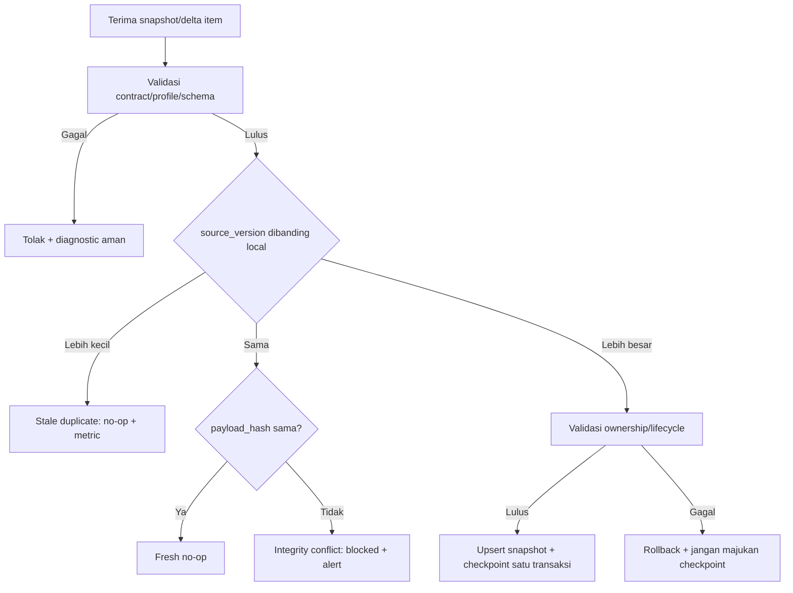

# 30 - IDP Pegawai Kontrak Canonical Consumer Snapshot, Field Ownership & Freshness

Status: Draf kontrak brainstorming arsitektur, **bukan implementasi API, model, migration, atau provisioning**  
Proyek: kumjabar_ecosystem  
Tanggal: 2026-08-31  
Melanjutkan: Dokumen 29 — Integrasi Consumer, Distribusi Internal & Deployment Hardening

## 1. Tujuan

Dokumen ini mengunci rancangan awal kontrak snapshot kanonis yang dikonsumsi aplikasi internal. Fokusnya adalah:

1. payload `pegawai-consumer.v1`;
2. payload `org-unit-consumer.v1`;
3. kepemilikan setiap field;
4. profil pelepasan PII per consumer;
5. canonicalization dan hash;
6. freshness/source-version comparison;
7. status lifecycle dan tombstone;
8. schema evolution serta compatibility boundary.

Dokumen ini tidak membangun delta feed, consumer checkpoint, OIDC mapper, gateway, migration, atau kode aplikasi.

## 2. Posisi Kontrak

```text
IDP PostgreSQL       = sumber kebenaran field milik IDP
Consumer snapshot    = salinan terkontrol, bukan master baru
Consumer domain data = tetap milik aplikasi consumer
Keycloak token       = konteks autentikasi minimal, bukan snapshot
```

## 3. Status Keputusan Dokumen 30

```text
Dokumen 30 = OPEN / BRAINSTORMING
Dokumen 29 = APPROVED untuk membuka Tahap 5
Coding     = BELUM DIIZINKAN
Migration  = BELUM DIBUAT
```

## 4. Kontrak Dasar Snapshot

Setiap snapshot wajib mempunyai envelope:

```text
contract_version
resource_type
resource_uuid
source_version
source_updated_at
payload_hash
data
```

`request_id`, cursor, token, dan informasi transport tidak menjadi bagian dari hash payload.

## 5. Tipe Resource

```text
pegawai
org_unit
```

Nama `org_units` pada tabel internal dapat dipetakan ke `org_unit` pada kontrak API agar singular dan konsisten sebagai resource type.

## 6. Snapshot Pegawai Kanonis

Versi kandidat final:

```text
pegawai-consumer.v1
```

Contoh bentuk:

```json
{
  "contract_version": "pegawai-consumer.v1",
  "resource_type": "pegawai",
  "resource_uuid": "018f0000-0000-7000-8000-000000000001",
  "source_version": 14,
  "source_updated_at": "2026-08-31T01:30:00Z",
  "payload_hash": "0123456789abcdef0123456789abcdef0123456789abcdef0123456789abcdef",
  "data": {
    "pegawai_uuid": "018f0000-0000-7000-8000-000000000001",
    "nama_lengkap": "Nama Pegawai",
    "status_pegawai": "aktif",
    "is_active": true,
    "primary_org_unit": {
      "uuid": "018f0000-0000-7000-8000-000000000010",
      "code": "TUM_TI"
    }
  }
}
```

Contoh ini tidak otomatis berarti seluruh field dirilis kepada setiap consumer.

## 7. Field Pegawai Kandidat

| Field | Status | Klasifikasi | Catatan |
| --- | --- | --- | --- |
| `pegawai_uuid` | wajib | internal identifier | correlation key utama |
| `nama_lengkap` | profile | direct identifier | hanya bila consumer memerlukan display |
| `nip` | restricted | sensitive direct identifier | need-to-know, bukan default |
| `email_dinas` | restricted | contact PII | hanya profile yang disetujui |
| `email_google` | restricted | contact PII | bukan identity-link authority |
| `status_pegawai` | disetujui internal | lifecycle | authority field IDP |
| `is_active` | disetujui internal | eligibility | diturunkan dari status |
| `primary_org_unit` | disetujui internal | organization | object minimal |
| `org_affiliations` | profile | organization | hanya jika use case perlu |
| `identity_link_summary` | restricted | security metadata | bukan provider subject mentah |
| `source_version` | wajib envelope | kesegaran teknis | bukan domain field consumer |
| `source_updated_at` | wajib envelope | kesegaran teknis | timestamp authority |
| `payload_hash` | wajib envelope | integrity metadata | canonical hash |

## 8. Field yang Dilarang

Tidak boleh muncul di `pegawai-consumer.v1` maupun profile turunannya:

```text
jabatan
jabatan_type
label jabatan
PLT/PLH
histori jabatan
access grant reason
fine-grained role/scope/capability
raw provider_subject
Keycloak access/refresh token
credential/secret
raw audit payload
raw import payload
internal integer ID
```

## 9. Snapshot Org Unit Kanonis

Versi kandidat:

```text
org-unit-consumer.v1
```

Contoh:

```json
{
  "contract_version": "org-unit-consumer.v1",
  "resource_type": "org_unit",
  "resource_uuid": "018f0000-0000-7000-8000-000000000010",
  "source_version": 8,
  "source_updated_at": "2026-08-31T01:20:00Z",
  "payload_hash": "abcdef0123456789abcdef0123456789abcdef0123456789abcdef0123456789",
  "data": {
    "org_unit_uuid": "018f0000-0000-7000-8000-000000000010",
    "code": "TUM_TI",
    "name": "Teknologi dan Informasi",
    "short_name": "TI",
    "unit_type": "tim",
    "parent_org_unit_uuid": "018f0000-0000-7000-8000-000000000002",
    "path": "/kanwil-jabar/tum/ti",
    "is_active": true
  }
}
```

## 10. Field Org Unit

| Field | Status | Catatan |
| --- | --- | --- |
| `org_unit_uuid` | wajib | correlation key |
| `code` | wajib | stable business key |
| `name` | approved | display resmi |
| `short_name` | optional | display ringkas |
| `unit_type` | approved | klasifikasi struktur |
| `parent_org_unit_uuid` | approved | relasi parent |
| `path` | profile | struktur navigasi |
| `keycloak_group_path` | restricted | hanya consumer teknis yang memerlukan |
| `is_active` | approved | lifecycle unit |
| `level` | optional | hanya bila perlu tree UI |
| `sort_order` | optional | bukan authority permission |

## 11. Organization Data Boundary

Consumer boleh memakai struktur organisasi untuk:

- navigasi;
- filter domain;
- pelaporan sesuai scope;
- snapshot historis transaksi.

Consumer tidak boleh menyimpulkan fine-grained access hanya dari `org_unit_code` tanpa policy lokalnya sendiri.

## 12. Matriks Kepemilikan Field

| Domain | IDP Pegawai | S1/Consumer |
| --- | --- | --- |
| UUID ASN | authoritative | snapshot/reference |
| NIP | authoritative | restricted snapshot bila disetujui |
| nama/email terkelola | authoritative sesuai field | snapshot terbatas |
| status/lifecycle ASN | authoritative | local cache/snapshot |
| eligibility internal | authoritative | local enforcement sesuai kontrak |
| identity link | authoritative | reference, bukan writer |
| unit/afiliasi | authoritative | snapshot untuk kebutuhan domain |
| jabatan | tidak memiliki | authoritative S1 |
| jenis/label jabatan | tidak memiliki | authoritative S1 |
| PLT/PLH | tidak memiliki | authoritative S1 |
| histori jabatan | tidak memiliki | authoritative S1 |
| transaksi bisnis | tidak memiliki | authoritative consumer |
| role/capability lokal | tidak memiliki sebagai consumer policy | authoritative consumer |

## 13. Ownership Rule

```text
field authority -> source version -> consumer snapshot
```

Tidak boleh terjadi:

```text
consumer edit snapshot
-> push back menjadi IDP truth
```

Koreksi field IDP harus melalui workflow pemilik IDP, bukan consumer feed.

## 14. Consumer Field Profiles

Field profile adalah allowlist yang telah diberi nama, bukan parameter bebas:

```text
pegawai.portal-minimal.v1
pegawai.s1-operational.v1
pegawai.reporting-minimal.v1
org-unit.internal-minimal.v1
org-unit.navigation.v1
```

Profile minimalnya didefinisikan dalam code/config yang direview. Consumer tidak mengirim `fields=nama,nip,email` secara bebas untuk memperluas akses.

## 15. Profile Portal Minimal

Kandidat `pegawai.portal-minimal.v1`:

```text
pegawai_uuid
nama_lengkap bila display perlu
status_pegawai bila routing perlu
is_active bila diperlukan
primary_org_unit.code bila navigasi perlu
```

Tidak termasuk default:

```text
nip
email_google
identity link detail
full org affiliations
source internals
```

## 16. Profile S1 Operational

Kandidat `pegawai.s1-operational.v1`:

```text
pegawai_uuid
nama_lengkap
status_pegawai
is_active
primary_org_unit
org affiliations yang disetujui
source_version
source_updated_at
payload_hash
```

NIP dan email dinas tetap restricted. Inclusion harus mempunyai use case, owner, dan approval terpisah.

## 17. Profile Reporting Minimal

Kandidat:

```text
pegawai_uuid pseudonymous
status class sesuai kebutuhan
org unit code sesuai agregasi
source_version
source_updated_at
payload_hash
```

Default tidak memuat nama, NIP, email, atau provider subject.

## 18. PII Release Matrix

| Data | Portal | S1 | Reporting | Default |
| --- | --- | --- | --- | --- |
| `pegawai_uuid` | ya | ya | pseudonymous/ya | approved |
| nama lengkap | bila perlu | ya bila perlu | tidak | restricted |
| NIP | tidak | need-to-know | tidak | ditolak |
| email dinas | tidak default | need-to-know | tidak | ditolak |
| email Google | tidak | exceptional | tidak | ditolak |
| status | bila perlu | ya | class/agregat | internal |
| org utama | bila perlu | ya | agregat | internal |
| identity metadata | tidak | tidak default | tidak | ditolak |

## 19. Persetujuan PII

Profile restricted harus mencatat:

- consumer;
- field;
- purpose;
- owner;
- environment;
- retention;
- access capability;
- approved_at;
- expiry/review date;
- audit reference.

Persetujuan field tidak boleh diperluas oleh operator consumer melalui query.

## 20. NIP Policy

NIP tetap business key IDP, tetapi bukan correlation key default distribusi.

```text
pegawai_uuid = correlation default
NIP          = restricted need-to-know
```

NIP tidak boleh muncul pada:

- URL;
- cursor;
- metric label;
- log normal;
- token default;
- nama file artifact;
- error message.

## 21. Email Policy

Email dinas dan Google:

- dinormalisasi di IDP;
- tidak menjadi identity-link authority;
- tidak dirilis global;
- tidak digunakan sebagai cursor key;
- tidak dimasukkan ke log normal;
- inclusion perlu profile dan purpose;
- perubahan email menghasilkan source version baru jika field authoritative berubah.

## 22. Canonical Data Rules

Untuk `data`:

- object keys sorted;
- arrays set-like sorted dan deduplicated;
- array ordered hanya bila urutan bermakna;
- UUID lowercase canonical;
- string Unicode NFC;
- whitespace sesuai field policy;
- email lowercase/normalized sesuai kontrak;
- timestamp RFC 3339 UTC;
- boolean/number typed;
- null hanya bila kontrak mengizinkan;
- unknown field ditolak;
- NaN/Infinity ditolak.

## 23. Hash Formula

```text
canonical_data_bytes = UTF-8(canonical_json(data))
payload_hash         = lowercase_hex(SHA256(canonical_data_bytes))
```

Envelope metadata seperti `request_id`, cursor, token, dan response timestamp tidak ikut hash.

## 24. Hash Scope

Hash profile-specific:

```text
hash(pegawai.portal-minimal.v1 payload)
!=
hash(pegawai.s1-operational.v1 payload)
```

Provider tidak boleh membandingkan hash profile berbeda sebagai equality evidence.

## 25. Freshness Metadata

Envelope wajib:

```text
source_version
source_updated_at
payload_hash
contract_version
field_profile
```

Opsional:

```text
snapshot_generated_at
source_sequence
```

`source_sequence` distribusi final dibahas Dokumen 31.

## 26. Source Version

`source_version` adalah versi logis authoritative, bukan timestamp.

Requirement:

- monotonik per aggregate/resource atau semantik global yang dijelaskan;
- tidak turun;
- tidak dibuat dari jam client;
- naik saat perubahan authoritative yang relevan;
- tidak naik untuk noop;
- perubahan time-boundary tetap memicu versi sesuai Dokumen 24.

## 27. Source Updated At

`source_updated_at` membantu operator memahami waktu perubahan, tetapi tidak digunakan sebagai ordering tunggal.

Perbedaan timezone dinormalisasi ke UTC pada wire contract.

## 28. Consumer Freshness State

Kandidat state lokal consumer:

```text
fresh
stale
unknown
blocked
contract_incompatible
```

Makna:

| State | Makna |
| --- | --- |
| `fresh` | versi/hash local sesuai source terakhir diterima |
| `stale` | local lebih lama dari source/lag melewati policy |
| `unknown` | belum ada bukti source terbaru |
| `blocked` | apply dihentikan karena conflict/security issue |
| `contract_incompatible` | versi payload tidak didukung |

## 29. Freshness Algorithm



## 30. Same Version Different Hash

Kondisi ini tidak boleh diperlakukan sebagai perubahan biasa.

```text
same source_version
+ different payload_hash
= contract/integrity breach candidate
```

Consumer:

- tidak menimpa snapshot;
- tidak memajukan checkpoint melewati item;
- mencatat safe diagnostic;
- mengirim alert internal;
- menunggu provider investigation/reconciliation.

## 31. Out-of-Order Items

Item dengan versi lebih rendah boleh muncul karena at-least-once/replay. Consumer mengabaikannya secara idempoten setelah memastikan resource/profile sama.

Provider tidak boleh menjanjikan network exactly-once.

## 32. Profile Change

Perubahan field profile dapat menyebabkan hash berbeda tanpa perubahan field source yang sama. Karena itu consumer menyimpan:

```text
field_profile
contract_version
payload_hash
source_version
```

Hash hanya dibandingkan dalam profile dan contract yang sama.

## 33. Lifecycle Pegawai

Kandidat representasi:

```text
status_pegawai = aktif/mutasi/pensiun/nonaktif/meninggal
is_active      = derived boolean
```

Status lifecycle dikirim sebagai `upsert` selama resource masih diperlukan untuk histori/rekonsiliasi.

## 34. Inactive vs Tombstone

```text
inactive/retired ASN -> upsert dengan status authoritative
legal purge         -> governed tombstone
```

Consumer tidak boleh menghapus transaksi/histori lokal otomatis karena pegawai inactive atau retired.

## 35. Tombstone Contract

Tombstone minimal:

```json
{
  "contract_version": "consumer-change.v1",
  "resource_type": "pegawai",
  "resource_uuid": "018f0000-0000-7000-8000-000000000001",
  "source_version": 22,
  "source_updated_at": "2026-08-31T02:00:00Z",
  "payload_hash": "0000000000000000000000000000000000000000000000000000000000000000",
  "change_type": "tombstone",
  "data": {
    "tombstone_reason_class": "retention_purge"
  }
}
```

Tombstone tidak membawa detail PII dan tidak berarti consumer boleh menghapus histori tanpa policy lokal.

## 36. Tombstone Ordering

Tombstone harus mempunyai `source_version` lebih tinggi daripada snapshot terakhir yang digantikannya. Consumer yang menerima snapshot lebih lama setelah tombstone tidak boleh menghidupkan kembali resource.

## 37. Org Unit Lifecycle

Unit inactive dikirim sebagai snapshot `is_active=false` selama dibutuhkan untuk histori atau referensi. Pemindahan path/rename adalah update authoritative dan tidak boleh dianggap sebagai delete otomatis.

## 38. Snapshot Endpoint Contract

Kandidat endpoint:

```text
GET /internal/api/v1/consumer/pegawai/{uuid}
GET /internal/api/v1/consumer/org-units/{uuid}
```

Response harus profile-aware dan tidak mengembalikan field di luar registration allowlist.

## 39. List Snapshot Contract

Kandidat:

```text
GET /internal/api/v1/consumer/pegawai/snapshot-pages
GET /internal/api/v1/consumer/org-units/snapshot-pages
```

Pagination, stable cutoff, dan cursor final dibahas Dokumen 31. Dokumen ini hanya mengunci bentuk resource snapshot.

## 40. Error Contract

Error minimal:

```text
consumer_profile_not_allowed
consumer_contract_unsupported
consumer_field_forbidden
consumer_snapshot_not_found
consumer_snapshot_conflict
consumer_source_version_invalid
consumer_tombstone_stale
```

Pesan operator Bahasa Indonesia; detail internal tidak memuat PII/raw payload.

## 41. Compatibility Rules

| Perubahan | Compatibility |
| --- | --- |
| tambah optional field | compatible bila profile menyatakan forward-compatible |
| tambah field wajib | versi contract/profile baru |
| rename field | version baru atau alias transition eksplisit |
| ubah arti field | version baru wajib |
| hapus field | deprecation + version overlap |
| ubah enum semantics | review dan version baru |
| ubah hash canonicalization | canonicalization version baru |
| ubah ownership | architecture/security review |

## 42. Contract Versioning

Format kandidat:

```text
pegawai-consumer.v1
org-unit-consumer.v1
consumer-change.v1
```

Canonicalization version harus eksplisit bila aturan hash berubah:

```text
data-c14n.v1
```

## 43. Unknown Field Policy

Provider dan consumer wajib mempunyai aturan eksplisit:

- strict profile: unknown field ditolak;
- forward-compatible profile: unknown optional field boleh diabaikan dengan metric;
- field yang ditulis ke snapshot harus allowlisted;
- unknown field tidak boleh ikut hash bila diabaikan.

Rekomendasi awal: strict untuk security-sensitive profile, forward-compatible terbatas untuk profile internal non-sensitive.

## 44. Null dan Absent

Kontrak membedakan:

```text
absent = field tidak ada dalam profile
null   = field ada tetapi nilainya kosong secara sah
value  = field tersedia
```

Consumer tidak boleh menafsirkan absent sebagai instruksi menghapus field domain lokal tanpa kontrak eksplisit.

## 45. Consumer Local Schema

Consumer sebaiknya memisahkan:

```text
identity snapshot columns
source metadata columns
consumer-owned domain columns
```

Jangan menyimpan seluruh payload sebagai satu JSONB tanpa typed columns untuk field yang sering dipakai filter/authorization.

## 46. Snapshot Update Boundary

Satu local transaction consumer idealnya mengubah:

```text
snapshot row
source metadata
freshness state
consumer checkpoint
```

Field domain-owned consumer tidak disentuh oleh snapshot applier.

## 47. Stale Policy per Consumer

Setiap consumer harus menetapkan:

- max stale age;
- operasi yang boleh saat stale;
- operasi yang fail-closed;
- alert threshold;
- reconciliation interval;
- bootstrap threshold.

Tidak ada satu angka stale universal untuk semua consumer.

## 48. Availability Matrix Kandidat

| Consumer | Last-known snapshot | Critical action saat stale |
| --- | --- | --- |
| Portal | boleh untuk display dengan badge stale | ditentukan policy Portal |
| S1 | boleh untuk histori/reporting | security-sensitive action fail-closed |
| Reporting | boleh dengan freshness label | publish report sesuai cutoff |
| Public app | tidak menerima internal snapshot | tidak berlaku |

## 49. PII in Transit dan At Rest

- TLS/service auth untuk in transit;
- consumer menentukan encryption/secret policy at rest;
- provider tidak mengirim PII di query string bila body/header dapat dipakai;
- log/metric/tracing tidak memuat payload;
- backup mengikuti classification dan retention;
- profile restricted mempunyai review expiry.

## 50. Snapshot Hash Display

Hash teknis boleh ditampilkan kepada operator berwenang sebagai:

```text
prefix 8 karakter = default assistance ID
full hash         = safe diagnostics capability + no-store
```

Consumer service tidak menjadikan hash sebagai secret atau authorization credential.

## 51. Canonical Fixture Requirements

Fixture wajib mencakup:

- Unicode NFC/non-NFC;
- null/absent/provided;
- email normalization;
- UUID casing;
- array ordering;
- org hierarchy;
- inactive lifecycle;
- restricted profile;
- tombstone;
- same-version hash conflict;
- source version progression;
- canonicalization version change.

Fixture harus tersanitasi dan deterministic.

## 52. Privacy Threat Matrix

| Ancaman | Kontrol |
| --- | --- |
| consumer meminta semua field | fixed profile + registration intersection |
| token menjadi master dump | minimal OIDC claims |
| NIP bocor di cursor/log | UUID correlation + opaque cursor |
| snapshot dipakai sebagai master | ownership contract + no reverse mutation |
| old snapshot dianggap current | version/hash/freshness state |
| tombstone menghapus histori | consumer retention/local policy |
| profile berbeda dibanding hash | hash scoped profile/contract |
| error membocorkan PII | safe error catalog |

## 53. Kontrak untuk Dokumen 31

Dokumen berikutnya mengunci:

```text
consumer_change_log
change_sequence
cursor HMAC
replay window 30 hari
snapshot cutoff
bootstrap continuation
consumer checkpoint
page size 100/500
410 cursor expiry
```

Dokumen 30 hanya mendefinisikan isi resource dan freshness semantics.

## 54. Kontrak untuk Dokumen 32

Dokumen 32 mengunci:

```text
OIDC claims per client
field vs claim distinction
audience/scope
protocol mapper catalog
token/session/logout
```

Field snapshot tidak otomatis menjadi OIDC claim.

## 55. Kontrak untuk Dokumen 33

Dokumen 33 mengunci:

```text
private route
TLS/gateway
service authentication
CORS/CSRF
rate/body/timeout limit
health/logging/tracing
```

## 56. Kontrak untuk Dokumen 34

Dokumen 34 mengunci:

```text
consumer registration
profile approval
bootstrap/replay operations
lag/reconciliation
suspension/decommission
retention/SLO/ownership
```

## 57. Open Questions Dokumen 30

| No. | Pertanyaan | Rekomendasi Awal |
| ---: | --- | --- |
| 1 | Nama final resource type? | `pegawai` dan `org_unit`. |
| 2 | Field wajib profile Portal? | UUID + display/status minimal sesuai use case. |
| 3 | S1 perlu NIP? | Restricted; hanya setelah need-to-know disetujui. |
| 4 | Email dinas perlu di S1? | Restricted dan purpose-bound. |
| 5 | Inline hash scope? | Hash profile-specific, bukan hash universal lintas profile. |
| 6 | Canonicalization version? | `data-c14n.v1`. |
| 7 | Unknown field policy? | Strict security profile; limited forward-compatible internal profile. |
| 8 | Tombstone payload? | Minimal, tanpa PII; hanya legal purge/governed deletion. |
| 9 | Consumer stale tolerance? | Per consumer, tidak universal. |
| 10 | Profile config vs DB? | Profile field allowlist code/config; registration relational. |
| 11 | `source_version` scope? | Monotonik sesuai aggregate/resource semantics; final ordering di Doc 31. |
| 12 | `org_affiliations` default? | Tidak default Portal; approved profile S1 bila perlu. |

## 58. Checklist Review Dokumen 30

### Payload dan Ownership

- [ ] Envelope snapshot disetujui.
- [ ] Field pegawai/org unit disetujui.
- [ ] Field forbidden disetujui.
- [ ] Ownership IDP vs S1/consumer disetujui.

### PII dan Profile

- [ ] Portal/S1/reporting profiles disetujui.
- [ ] NIP policy disetujui.
- [ ] Email policy disetujui.
- [ ] Restricted profile approval/retention disetujui.

### Freshness dan Lifecycle

- [ ] Canonicalization/hash disetujui.
- [ ] Source version semantics disetujui.
- [ ] Freshness state/algorithm disetujui.
- [ ] Same-version conflict disetujui.
- [ ] Inactive/tombstone disetujui.

### Compatibility dan Consumer Schema

- [ ] Versioning/unknown field policy disetujui.
- [ ] Null/absent semantics disetujui.
- [ ] Consumer typed snapshot boundary disetujui.
- [ ] Dokumen 31 handoff disetujui.

## 59. Risiko Awal

| Risiko | Dampak | Mitigasi |
| --- | --- | --- |
| profile terlalu luas | PII exposure | allowlist + approval + expiry |
| source_version tidak benar-benar monotonik | stale overwrite | allocator/concurrency proof |
| hash profile tercampur | false fresh/conflict | profile-scoped hash |
| consumer menulis balik snapshot | kerusakan ownership | boundary distribusi hanya-baca |
| tombstone terlalu agresif | histori hilang | governed retention/purge |
| schema change tanpa overlap | consumer outage | version/deprecation window |
| absent dianggap clear | data consumer hilang | explicit presence semantics |
| full payload disimpan JSONB | query/auth ambiguity | typed columns + bounded payload |

## 60. Future / Bukan v1

```text
arbitrary fields query
GraphQL dynamic projection
full employee data in token
consumer direct database access
consumer reverse mutation via feed
automatic PII approval
universal global hash lintas profile
CDC raw outbox exposure
anonymous public directory
```

## 61. Keputusan yang Diusulkan untuk Dikunci

1. Snapshot menggunakan envelope typed dengan contract/profile version.
2. Resource type canonical adalah `pegawai` dan `org_unit`.
3. `pegawai_uuid` menjadi correlation key default.
4. NIP/email restricted need-to-know, bukan default.
5. jabatan/PLT/PLH/histori jabatan tetap milik S1/consumer.
6. Field profiles fixed allowlist, bukan arbitrary query.
7. Hash SHA-256 dihitung atas canonical `data` profile-specific.
8. Canonicalization awal `data-c14n.v1`.
9. Source version adalah ordering/freshness metadata logis, timestamp hanya informasi.
10. Same version + different hash adalah integrity conflict dan fail-closed.
11. Inactive/retired memakai upsert; tombstone hanya governed legal purge.
12. Tombstone minimal dan tanpa PII.
13. Consumer snapshot bukan source of truth dan tidak dapat ditulis balik.
14. Consumer menyimpan snapshot, source metadata, dan domain fields secara terpisah.
15. Unknown field strict untuk security profile dan terbatas forward-compatible untuk internal profile tertentu.
16. Absent berbeda dari null.
17. Stale tolerance ditentukan per consumer.
18. Field snapshot tidak otomatis menjadi OIDC claim.
19. Dokumen 31 mengunci sequencing/cursor/bootstrap/checkpoint.
20. Seluruh keputusan masih brainstorming sampai review eksplisit selesai.

## 62. Status dan Langkah Berikutnya

```text
Dokumen 29 = APPROVED membuka Tahap 5
Dokumen 30 = BRAINSTORMING DRAFT / SIAP DIREVIEW
Dokumen 31 = berikutnya: Delta Feed, Cursor, Replay & Consumer Checkpoint
```

Tidak ada coding, migration, API deployment, Keycloak mapper, gateway, DNS, TLS, atau consumer integration yang dijalankan.

## 63. Kesimpulan

Kontrak snapshot Tahap 5 diarahkan menjadi:

```text
authoritative IDP field
-> consumer-specific fixed profile
-> canonical typed payload
-> profile-scoped SHA-256 hash
-> source version/freshness metadata
-> idempotent consumer snapshot
-> consumer-owned domain boundary
```

Desain ini menjaga IDP tetap ringan, mencegah rilis PII berlebihan, mempertahankan kepemilikan S1, dan memberi dasar kuat untuk Dokumen 31.

Dokumen ini tidak memberi izin coding, migration, provisioning, konfigurasi Keycloak/Nginx, atau deployment.
