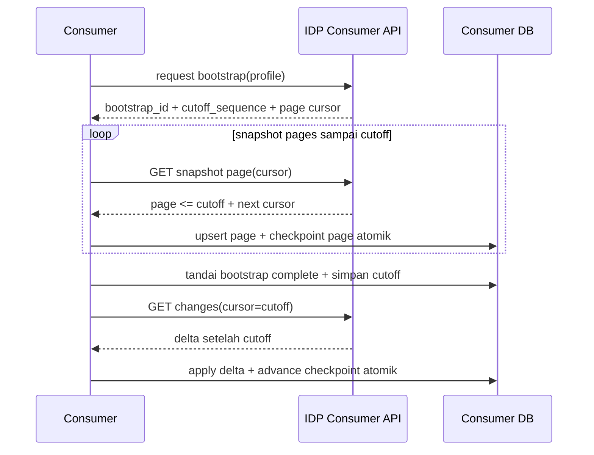

# 31 - IDP Pegawai Kontrak Delta Feed, Cursor, Replay & Consumer Checkpoint

Status: Draf kontrak brainstorming arsitektur, **bukan implementasi API, model, migration, atau deployment**  
Proyek: kumjabar_ecosystem  
Tanggal: 2026-08-31  
Melanjutkan: Dokumen 30 — Canonical Consumer Snapshot, Field Ownership & Freshness

## 1. Tujuan

Dokumen ini mengunci rancangan awal distribusi perubahan dari IDP Pegawai kepada consumer internal:

1. `consumer_change_log` dan `change_sequence`;
2. delta feed berbasis pull dan keyset cursor;
3. cursor opaque bertanda tangan HMAC;
4. replay window 30 hari;
5. bootstrap snapshot dengan stable cutoff;
6. consumer-owned atomic checkpoint;
7. duplicate, out-of-order, retry, dan failure semantics;
8. batas ukuran, retention, reconciliation, dan observability.

Dokumen ini tidak membuat endpoint, migration, consumer code, gateway, OIDC mapper, atau service credential.

## 2. Hubungan dengan Dokumen 29–30

```text
Dokumen 29 = boundary consumer, pull-first, registry, hardening
Dokumen 30 = isi snapshot, ownership, PII, hash, freshness
Dokumen 31 = urutan perubahan, cursor, replay, bootstrap, checkpoint
```

## 3. Status Keputusan

```text
Dokumen 29 = APPROVED
Dokumen 30 = BRAINSTORMING DRAFT / SIAP DIREVIEW
Dokumen 31 = OPEN / BRAINSTORMING
Coding     = BELUM DIIZINKAN
Migration  = BELUM DIBUAT
```

## 4. Prinsip Distribusi

```text
provider delivery = at-least-once/replayable read
consumer apply    = idempotent local transaction
checkpoint        = atomic bersama apply
```

Tidak ada klaim network exactly-once.

## 5. Authority Matrix

| Concern | Authority |
| --- | --- |
| perubahan identity/org | IDP PostgreSQL |
| urutan feed v1 | `change_sequence` pada IDP PostgreSQL |
| posisi apply berhasil | database consumer |
| provider delivery observability | IDP acknowledgement/metric opsional |
| data domain consumer | database consumer |
| field profile | registration + fixed code/config |
| snapshot integrity | `source_version` + profile-scoped `payload_hash` |
| cursor validity | IDP signer + consumer/profile binding |

HTTP 200 dari feed tidak membuktikan consumer telah commit data.

## 6. Change Sequence Scope

`change_sequence` memakai `BIGINT` monotonik **global dalam boundary satu database PostgreSQL IDP v1**.

Artinya:

- setiap row baru memperoleh nomor lebih besar daripada row yang dialokasikan sebelumnya;
- sequence tidak dipakai ulang;
- consumer membaca dengan urutan ascending;
- timestamp tidak menjadi ordering authority;
- restart PostgreSQL tidak boleh mereset sequence;
- rollback transaksi dapat meninggalkan gap sequence dan gap tersebut sah;
- gap bukan berarti data hilang.

Lintas region/sharding memerlukan kontrak baru dan tidak masuk v1.

## 7. Mengapa Timestamp Tidak Cukup

Timestamp dapat sama, terlambat commit, dipengaruhi clock skew, atau berubah karena precision. Karena itu:

```text
ORDER BY change_sequence ASC
```

menjadi ordering feed. `occurred_at` hanya metadata diagnosis dan audit.

## 8. Consumer Change Log

`consumer_change_log` adalah kontrak distribusi terkurasi, bukan salinan raw transactional outbox.

Projector melakukan:

```text
outbox event
-> resolve current/approved consumer profile
-> build canonical payload
-> assign change_sequence
-> insert consumer_change_log
```

Projector harus idempoten terhadap sumber yang sama dan tidak boleh menerbitkan payload di luar profile allowlist.

## 9. Satu Resource, Banyak Consumer Profile

Jika dua consumer mempunyai profile berbeda, provider dapat menerbitkan row berbeda atau response diproyeksikan dari profile yang sama sesuai desain final.

Requirement minimum:

```text
profile-specific payload
profile-specific hash
consumer/profile authorization
```

Hash profile berbeda tidak dibandingkan lintas profile.

## 10. Candidate DDL `consumer_registrations`

```sql
CREATE TABLE idp_pegawai.consumer_registrations (
    id BIGSERIAL PRIMARY KEY,
    uuid UUID NOT NULL DEFAULT gen_random_uuid(),
    consumer_code VARCHAR(80) NOT NULL,
    consumer_name VARCHAR(150) NOT NULL,
    owner_unit VARCHAR(150) NOT NULL,
    contact_email VARCHAR(255) NOT NULL,
    service_client_id VARCHAR(120) NOT NULL,
    allowed_resource_families TEXT[] NOT NULL,
    allowed_field_profile VARCHAR(80) NOT NULL,
    status VARCHAR(30) NOT NULL DEFAULT 'proposed',
    max_page_size INT NOT NULL DEFAULT 100,
    replay_window_days INT NOT NULL DEFAULT 30,
    lock_version INT NOT NULL DEFAULT 0,
    created_at TIMESTAMPTZ NOT NULL DEFAULT CURRENT_TIMESTAMP,
    updated_at TIMESTAMPTZ NOT NULL DEFAULT CURRENT_TIMESTAMP,
    CONSTRAINT uq_consumer_registrations_uuid UNIQUE (uuid),
    CONSTRAINT uq_consumer_registrations_code UNIQUE (consumer_code),
    CONSTRAINT uq_consumer_registrations_client UNIQUE (service_client_id)
);
```

DDL hanya preview. Constraint, array, katalog profile, timestamp status, dan lineage audit final masuk migration gate.

## 11. Candidate DDL `consumer_change_log`

```sql
CREATE TABLE idp_pegawai.consumer_change_log (
    change_sequence BIGINT GENERATED BY DEFAULT AS IDENTITY PRIMARY KEY,
    uuid UUID NOT NULL DEFAULT gen_random_uuid(),
    resource_type VARCHAR(50) NOT NULL,
    resource_uuid UUID NOT NULL,
    change_type VARCHAR(30) NOT NULL,
    source_version BIGINT NOT NULL,
    contract_version VARCHAR(80) NOT NULL,
    field_profile VARCHAR(80) NOT NULL,
    payload_hash CHAR(64) NOT NULL,
    payload JSONB,
    source_outbox_event_id BIGINT,
    occurred_at TIMESTAMPTZ NOT NULL,
    created_at TIMESTAMPTZ NOT NULL DEFAULT CURRENT_TIMESTAMP,
    CONSTRAINT uq_consumer_change_log_uuid UNIQUE (uuid),
    CONSTRAINT chk_consumer_change_log_hash
        CHECK (payload_hash ~ '^[0-9a-f]{64}$')
);
```

`payload` dapat nullable untuk tombstone. Jika inline payload wajib untuk `upsert`, constraint action-specific harus menolaknya kosong.

## 12. Candidate Indexes

```sql
CREATE INDEX idx_consumer_change_log_sequence
    ON idp_pegawai.consumer_change_log(change_sequence ASC);

CREATE INDEX idx_consumer_change_log_resource
    ON idp_pegawai.consumer_change_log(resource_type, resource_uuid, change_sequence);

CREATE INDEX idx_consumer_change_log_created
    ON idp_pegawai.consumer_change_log(created_at);
```

Primary key sudah menyediakan ordering lookup; index tambahan hanya dipertahankan bila query plan membuktikan manfaatnya.

## 13. Producer Idempotency

Projector tidak boleh menggandakan row karena retry internal.

Idempotency candidate:

```text
source_outbox_event_id
+ consumer_code/profile
+ contract_version
+ source_version/hash
```

Jika satu event menghasilkan beberapa profile, uniqueness harus membedakan profile. Jika payload profile berubah karena policy version, contract/profile version harus ikut berubah.

## 14. Consumer Change Log Lifecycle

```text
planned -> published -> retained -> purged
```

Row yang sudah published immutable. Koreksi payload tidak mengedit row lama; provider menerbitkan versi perubahan baru atau melakukan rebootstrap terkontrol.

## 15. Change Types Final Candidate

```text
upsert
tombstone
```

- perubahan identitas/status/org = `upsert`;
- legal purge = `tombstone`;
- tombstone tidak membawa PII;
- row tombstone tetap mempunyai sequence dan source version;
- tidak ada hard-delete sebagai normal feed operation.

## 16. Delta Endpoint Candidate

```text
GET /internal/api/v1/consumer/pegawai/changes
GET /internal/api/v1/consumer/org-units/changes
```

Endpoint final, route prefix, dan resource grouping masih menunggu review Dokumen 33. Dokumen ini mengunci semantics, bukan nama route final.

## 17. Query Input Candidate

```text
cursor=<opaque signed cursor>
limit=<1..registration.max_page_size>
```

Tidak tersedia:

```text
fields=<arbitrary list>
source_sequence=<unsigned raw position>
consumer_code=<spoofable override>
include_pii=true
order_by=<client supplied>
```

Consumer identity berasal dari token service yang tervalidasi dan registration server-side.

## 18. Limit Resolution

```text
requested_limit
-> minimum(requested_limit, registration.max_page_size, global_hard_cap)
```

Default:

```text
registration default = 100
global hard cap      = 500
```

Nilai page/response final tetap harus melewati benchmark.

## 19. Keyset Query Semantics

Secara konseptual:

```sql
SELECT ...
FROM idp_pegawai.consumer_change_log
WHERE change_sequence > :cursor_sequence
  AND change_sequence <= :upper_bound
ORDER BY change_sequence ASC
LIMIT :effective_limit;
```

`upper_bound` menjaga satu page atau satu polling window tidak bergerak mundur/maju secara ambigu. Cursor berikutnya menunjuk sequence terakhir yang dikembalikan.

## 20. Cursor Payload Internal

Payload sebelum tanda tangan kandidat:

```json
{
  "cursor_version": 1,
  "consumer_code": "s1-internal",
  "registration_uuid": "018f0000-0000-7000-8000-000000000020",
  "resource_family": "pegawai",
  "field_profile": "pegawai.s1-operational.v1",
  "contract_version": "consumer-change.v1",
  "query_shape": "changes_v1",
  "position": 90100,
  "issued_at": "2026-08-31T02:00:00Z",
  "expires_at": "2026-09-30T02:00:00Z",
  "key_id": "feed-cursor-2026-01"
}
```

Payload ini tidak boleh memuat NIP, email, nama, access token, atau raw filter.

## 21. Cursor Encoding

Rekomendasi awal:

```text
canonical JSON
-> UTF-8 bytes
-> base64url(payload)
-> HMAC-SHA-256(secret key version, payload)
-> base64url(payload.signature)
```

Cursor bersifat opaque bagi consumer. Consumer tidak boleh membuat atau mengedit cursor sendiri.

## 22. HMAC Key Management

- key disimpan di secret manager, bukan database business;
- `key_id` memilih versi kunci;
- verifikasi menerima key aktif dan overlap key lama;
- penerbitan hanya memakai key aktif;
- rotasi tidak langsung membatalkan seluruh cursor valid;
- key revoked menyebabkan cursor invalid dengan error aman;
- raw key tidak masuk log/traces/response.

## 23. Cursor Binding

Signature saja tidak cukup. Server memeriksa:

```text
consumer identity == cursor.consumer_code
registration UUID current
resource family sama
field profile sama
contract version compatible
query shape sama
position valid
expiry valid
```

Cursor dipindahkan antar-consumer harus ditolak.

## 24. Cursor Error Catalog

| Kondisi | HTTP | Kode |
| --- | ---: | --- |
| tidak ada credential | 401 | `consumer_auth_required` |
| credential invalid | 401 | `consumer_auth_invalid` |
| consumer suspended/retired | 403 | `consumer_registration_inactive` |
| profile tidak diizinkan | 403 | `consumer_profile_forbidden` |
| cursor cacat/tanda tangan invalid | 400 | `consumer_cursor_invalid` |
| cursor binding mismatch | 400 | `consumer_cursor_binding_invalid` |
| cursor kadaluarsa karena retention | 410 | `consumer_cursor_expired` |
| cursor version tidak didukung | 400 | `consumer_cursor_version_unsupported` |
| limit di atas policy | 400/422 | `consumer_page_limit_invalid` |
| provider overload | 429/503 | `consumer_feed_temporarily_limited` |

Error tidak membocorkan sequence head, consumer lain, atau resource existence di luar scope.

## 25. Replay Window

Keputusan v1:

```text
replay window default = 30 hari
```

Window dihitung dari retention policy provider, bukan semata `issued_at` cursor. Cursor yang posisinya lebih tua daripada sequence minimum yang masih dipertahankan menjadi expired.

## 26. Retention Boundary

Provider harus menentukan:

```text
oldest_retained_sequence
oldest_retained_created_at
current_head_sequence
```

Feed hanya melayani cursor yang dapat diteruskan tanpa gap berdasarkan retention boundary.

## 27. Retention Purge Safety

Sebelum purge:

1. hitung oldest active consumer position bila telemetry tersedia;
2. alert consumer yang mendekati batas;
3. jangan menghapus row di bawah window aktif yang diwajibkan tanpa policy;
4. catat range sequence yang dipurge;
5. cursor lama menghasilkan 410, bukan response kosong;
6. sediakan bootstrap recovery.

## 28. Purge dan Legal Hold

Change log retention adalah policy feed, bukan penghapusan domain source.

Legal hold dapat menahan purge row tertentu atau range tertentu. Jika hold membuat range tidak kontigu, provider harus tetap menjaga query feed deterministic atau menerbitkan rebootstrap requirement.

## 29. No Silent Cursor Reset

Dilarang:

```text
cursor expired -> mulai dari sequence terbaru diam-diam
cursor invalid -> mulai dari 0
cursor mismatch -> memakai cursor dari request body
```

Consumer harus menerima error eksplisit dan masuk controlled recovery.

## 30. Bootstrap Contract

Bootstrap memakai snapshot paginated dengan stable cutoff:

```text
start bootstrap
-> allocate cutoff_sequence
-> read snapshot pages <= cutoff
-> consumer commit snapshot + bootstrap checkpoint
-> switch to changes > cutoff_sequence
```

Snapshot tidak boleh mengambil data yang berubah tanpa batas selama bootstrap.

## 31. Bootstrap Start Response Candidate

```json
{
  "data": {
    "bootstrap_id": "018f0000-0000-7000-8000-000000000050",
    "resource_type": "pegawai",
    "field_profile": "pegawai.s1-operational.v1",
    "contract_version": "pegawai-consumer.v1",
    "cutoff_sequence": 90100,
    "source_version_head": 88
  },
  "meta": {
    "bootstrap_cursor": "opaque-signed-cursor",
    "page_size_default": 100,
    "page_size_max": 500
  }
}
```

`source_version_head` hanya informasi. `cutoff_sequence` menjadi boundary feed.

## 32. Bootstrap Page Semantics

Setiap page:

```text
sequence/order dalam snapshot stabil
cutoff_sequence tetap
next_page_cursor opaque
has_more
page hash/manifest metadata bila diperlukan
```

Page cursor berbeda dari delta cursor secara `cursor_type` dan query binding.

## 33. Bootstrap Continuation



## 34. Bootstrap Crash Recovery

Jika consumer crash:

- page yang sudah commit tidak diulang secara destruktif;
- page yang belum commit ditarik ulang dari cursor terakhir;
- duplicate page harus idempoten;
- checkpoint tidak maju sebelum data commit;
- cutoff tidak berubah selama bootstrap run;
- bootstrap expired memerlukan run baru atau recovery policy eksplisit.

## 35. Bootstrap vs Current Snapshot

Bootstrap membaca snapshot source pada cutoff. Detail yang berubah setelah cutoff tidak boleh masuk snapshot page. Perubahan tersebut hanya masuk delta `> cutoff_sequence`.

## 36. Delta Apply Transaction Consumer

Consumer wajib memperlakukan page sebagai unit transaksi awal:

```text
begin
-> validate all items
-> upsert snapshots/tombstones
-> update source metadata/freshness
-> advance checkpoint
-> commit
```

Jika satu item gagal, rollback page dan jangan majukan checkpoint melewati item tersebut.

## 37. Consumer Checkpoint Minimum

Consumer checkpoint menyimpan minimum:

```text
provider identity/feed name
consumer code
resource family
field profile
contract version
last_applied_sequence
last_applied_at
last_source_version
status
error marker
lock version
```

Bentuk tabel milik consumer, bukan tabel IDP Tahap 5 provider.

## 38. Checkpoint Authority

```text
snapshot apply COMMIT
+ checkpoint advance COMMIT
= bukti apply lokal
```

Provider boleh memiliki telemetry `last_requested_sequence` atau ack, tetapi tidak boleh menyamakan requested dengan applied.

## 39. Concurrent Consumer Pollers

Satu consumer/feed profile idealnya mempunyai satu applier aktif. Bila ada beberapa instance:

- consumer DB memakai row/advisory lock;
- hanya satu transaction boleh mengubah checkpoint;
- duplicate fetch aman;
- lower sequence tidak menurunkan checkpoint;
- split-brain applier menimbulkan alert dan fail-safe.

## 40. Duplicate Delivery

Duplicate item/page ditangani:

```text
same resource + same version + same hash -> no-op
same resource + lower version            -> stale no-op
same resource + same version + diff hash -> blocked/conflict
```

Sequence duplicate yang sama tidak boleh menghasilkan efek domain ganda.

## 41. Out-of-Order Delivery

Network/provider retry dapat membuat item lama tiba setelah item baru. Consumer tidak boleh mundur.

```text
incoming source_version < local source_version
-> ignore as stale duplicate
```

Jika source version tidak comparable untuk resource tertentu, contract/profile tersebut harus ditolak sampai semantics diperbaiki.

## 42. Tombstone Apply

Tombstone diterapkan hanya jika:

```text
incoming source_version > local source_version
```

Tombstone lebih lama ditolak. Tombstone tidak menghapus domain history consumer kecuali policy consumer secara eksplisit mengaturnya.

## 43. Same Version Different Hash

```text
same source_version + different payload_hash
-> stop item/profile
-> no checkpoint past conflict
-> safe diagnostic + alert
```

Provider harus menyediakan reconciliation path; consumer tidak memilih salah satu payload secara arbitrer.

## 44. Contract Version Mismatch

Jika contract tidak didukung:

- consumer tidak memajukan checkpoint;
- provider mengembalikan error stabil;
- consumer upgrade atau meminta bootstrap profile baru;
- overlap version diperlukan sebelum breaking change;
- tidak ada silent field drop untuk security-sensitive profile.

## 45. Presence Semantics

Payload consumer mempertahankan:

```text
absent = tidak dirilis oleh profile
null   = dirilis tetapi kosong sah
value  = tersedia
```

Applier tidak boleh menghapus field local hanya karena field absent.

## 46. Rate Limit dan Polling

Polling v1:

```text
caught up       = 15–60 detik sesuai consumer policy
active backlog  = lebih cepat sesuai server hint
429/503         = Retry-After + bounded jitter
```

Tidak ada long polling, SSE, atau WebSocket v1.

## 47. Response/Resource Limits

```text
default page = 100
maximum page = 500
```

Selain page count, provider membatasi:

- response bytes setelah dekompresi;
- query execution time;
- request timeout;
- concurrent bootstrap;
- per-consumer request rate;
- payload item size;
- total page memory.

Global cap final mengikuti benchmark.

## 48. HTTP Cache Policy

Feed response bersifat:

```text
private, no-store
```

Cache shared/CDN publik dilarang. ETag/conditional request hanya dipertimbangkan untuk metadata non-sensitif dan tidak menggantikan cursor.

## 49. Response Envelope

Candidate:

```json
{
  "data": [],
  "sync": {
    "contract_version": "consumer-change.v1",
    "field_profile": "pegawai.s1-operational.v1",
    "resource_type": "pegawai",
    "cutoff_sequence": 90100
  },
  "meta": {
    "next_cursor": "opaque-signed-cursor",
    "has_more": true,
    "poll_after_seconds": 30,
    "request_id": "018f0000-0000-7000-8000-000000000099"
  }
}
```

Sequence mentah boleh tidak ditampilkan bila cursor menjadi satu-satunya position authority. Jika ditampilkan, klasifikasinya technical metadata dan tidak boleh menjadi request input bebas.

## 50. Empty Feed

Empty feed yang valid:

```json
{
  "data": [],
  "meta": {
    "next_cursor": "opaque-signed-cursor",
    "has_more": false,
    "poll_after_seconds": 30
  }
}
```

Empty bukan berarti cursor invalid atau consumer sudah menerapkan semua data secara domain.

## 51. Provider Acknowledgment

Jika ack endpoint kelak dibuat:

```text
POST /internal/api/v1/consumer/acks
```

Ack hanya menyimpan telemetry:

```text
consumer requested/applied sequence claim
observed_at
client version
```

Provider tidak mempercayai ack sebagai authorization atau proof tanpa kontrak governance. Ack bukan scope wajib v1.

## 52. Consumer Reconciliation

Consumer menjalankan rekonsiliasi:

```text
current provider head/metadata
vs
local last checkpoint + snapshot version/hash
```

Jika gap masih dalam replay window, lanjut delta. Jika di luar window, controlled bootstrap.

## 53. Provider Reconciliation Metadata

Kandidat metadata:

```text
oldest_retained_sequence
current_head_sequence
contract/profile version
retention boundary
```

Tidak perlu membuka payload atau PII.

## 54. Stale Consumer Alert

Alert threshold candidate:

```text
warning = mendekati 30 hari
critical = cursor sudah expired
```

Nilai waktu final mengikuti SLO dan retention policy. Consumer owner menerima metric/alert sebelum kehilangan replay window.

## 55. Replay Authorization

Normal resume/replay dengan cursor valid tidak perlu approval manual. Controlled replay:

- range bounded;
- profile fixed;
- reason;
- authorized service identity;
- audit;
- rate limit;
- tidak dapat membaca resource di luar registration.

Bulk sensitive replay dapat memerlukan governance/four-eyes di Dokumen 34.

## 56. Feed Projector Failure

Jika projector gagal:

- raw outbox tetap durable;
- feed head berhenti atau tertunda;
- consumer mempertahankan checkpoint terakhir;
- provider alert projector lag;
- recovery melanjutkan idempoten;
- tidak menerbitkan sequence palsu;
- tidak memajukan consumer cursor secara otomatis.

## 57. Sequence Gap Semantics

Gap sequence karena alokasi yang di-rollback diperbolehkan. Consumer hanya memerlukan `>` cursor, bukan sequence tanpa celah.

Jika gap disebabkan row hilang setelah published, itu breach dan harus memicu reconciliation/incident, bukan dianggap normal.

## 58. Deletion/Purge Feed

Purge change log provider tidak menghapus source `pegawai`/`org_units`. Purge hanya membatasi replay. Tombstone dikirim sebelum data tombstone sendiri masuk retention purge sesuai policy.

## 59. Consumer Data Retention

Provider tidak menentukan retention consumer snapshot. Consumer wajib menentukan:

- snapshot retention;
- transaction/history retention;
- tombstone retention;
- source metadata retention;
- stale snapshot deletion;
- legal hold.

## 60. Security Controls

- service token audience exact;
- registration status check;
- profile allowlist intersection;
- HMAC cursor binding;
- no raw cursor/token logging;
- no PII query parameter;
- no public ingress;
- no direct database access;
- no arbitrary resource/filter selection;
- response `no-store`;
- bounded page/bytes/time;
- audit registration/replay/suspension.

## 61. Privacy Controls

Tidak masuk feed default:

```text
NIP
email
provider_subject
raw metadata
raw audit/import payload
jabatan/PLT/PLH
```

Profile restricted memerlukan purpose, approval, retention, dan review expiry seperti Dokumen 30.

## 62. Observability Metrics

Provider:

```text
change log head sequence
oldest retained sequence
projector lag
feed request rate/status
items/bytes served
cursor invalid/expired count
bootstrap count/duration/failure
consumer request recency/lag bila tersedia
429/503 rate
```

Consumer:

```text
last applied sequence
current source head
lag count/age
apply success/failure
same-version hash conflict
stale duplicate
bootstrap progress
cursor expiry
```

Metric label tidak memuat PII, raw cursor, atau full payload.

## 63. Database Privileges

Provider process yang menyajikan feed hanya perlu:

```text
SELECT curated consumer_change_log/read views
SELECT active consumer registrations
```

Projector process membutuhkan INSERT/update state sesuai contract. Consumer tidak mendapat kredensial PostgreSQL IDP.

## 64. Candidate Read View

Feed API sebaiknya membaca curated view/service projection agar:

- column exposure eksplisit;
- raw outbox tidak ikut;
- profile allowlist konsisten;
- field forbidden sulit bocor;
- query plan dapat diuji;
- payload size dapat dibatasi.

## 65. Bootstrap/Delta Contract Compatibility

Bootstrap dan delta untuk profile yang sama wajib memakai:

```text
same contract_version
same field_profile
same canonicalization version
compatible hash semantics
```

Jika berubah di tengah bootstrap, run harus dihentikan atau provider mempertahankan versi lama sampai selesai.

## 66. Profile Retirement

Profile retired:

- tidak menerima bootstrap baru;
- consumer existing mendapat deprecation notice/metric;
- delta overlap window sesuai policy;
- cursor lama dapat berjalan selama contract masih supported;
- setelah expiry, 410/upgrade/rebootstrap;
- tidak ada silent fallback ke profile lebih luas.

## 67. Consumer Registration Interaction

Feed authorization memakai:

```text
validated service identity
-> active consumer_registration
-> allowed resource family
-> allowed field profile
-> route policy
-> cursor binding
```

Payload token tidak boleh menggantikan registration DB allowlist.

## 68. Request Replay Safety

Retry HTTP GET dengan cursor sama harus menghasilkan page semantik yang sama selama:

- row belum dipurge;
- profile/contract masih aktif;
- source projection immutable;
- cursor belum expired.

Provider boleh menghasilkan envelope/request ID berbeda.

## 69. Page Atomicity Recommendation

Consumer page apply adalah default atomic unit. Untuk page besar atau payload profile sensitif, consumer dapat memakai sub-batch tetapi harus menyimpan checkpoint item-level yang jelas. Tidak boleh mengklaim checkpoint page sudah maju bila hanya sebagian item committed.

## 70. Backpressure

Provider memberi `poll_after_seconds`. Consumer harus:

- menghormati delay;
- mengurangi polling saat caught up;
- backoff saat 429/503;
- membatasi concurrent request;
- tidak melakukan busy loop saat empty feed;
- tidak mengakumulasi page tanpa apply.

## 71. Error Recovery Matrix

| Error | Consumer Response |
| --- | --- |
| `consumer_cursor_invalid` | hentikan retry buta; buat cursor dari checkpoint tervalidasi |
| `consumer_cursor_expired` | controlled bootstrap |
| `consumer_contract_unsupported` | upgrade/profile overlap; no advance |
| 401 | refresh service token; bounded retry |
| 403 | suspend local pull + alert owner |
| 429 | `Retry-After` + jitter |
| 503 | bounded backoff + alert bila berulang |
| same-version hash conflict | blocked item/profile + provider review |
| malformed payload | rollback page + no checkpoint advance |
| provider empty | tunggu hint; bukan data loss |

## 72. Disaster Recovery

Provider restore:

- sequence allocation harus tetap monotonic atau recovery mode jelas;
- duplicate published rows tidak boleh mengubah semantics;
- retention purge catch-up wajib;
- cursor terhadap restored range diverifikasi;
- consumer dapat rebootstrap bila continuity diragukan.

Consumer restore:

- checkpoint dan snapshot dipulihkan secara atomik atau dianggap belum apply;
- resume/replay dari checkpoint terakhir;
- jika checkpoint hilang, controlled bootstrap;
- local domain history tidak dihapus otomatis.

## 73. Load/Sizing Gates

Sebelum menetapkan default produksi, benchmark:

- 100 vs 500 item page;
- bytes per profile;
- p95/p99 feed latency;
- DB query plan pada 30 hari;
- projector throughput;
- bootstrap completion window;
- concurrent consumer polling;
- 429/backpressure behavior;
- purge impact;
- replay recovery 1/6/24 jam.

## 74. Test Matrix Arsitektural

Wajib dibuktikan pada PostgreSQL/integration harness:

- monotonik sequence dengan rollback/gap;
- producer idempotency;
- keyset page boundary;
- cursor sign/verify/tamper;
- cursor binding cross-consumer;
- cursor expiry 410;
- key rotation overlap;
- active/suspended/retired registration;
- profile authorization;
- stable bootstrap cutoff;
- bootstrap crash/resume;
- page atomicity;
- duplicate/out-of-order apply;
- same-version hash conflict;
- tombstone ordering;
- contract mismatch;
- retention purge boundary;
- provider/consumer restore;
- concurrent consumer appliers;
- no PII/raw token in logs.

## 75. Open Questions Dokumen 31

| No. | Pertanyaan | Rekomendasi Awal |
| ---: | --- | --- |
| 1 | Sequence global satu DB atau distributed? | Global dalam single PostgreSQL v1; distributed bukan v1. |
| 2 | Page max final? | 500 candidate, final benchmark. |
| 3 | Replay window final? | 30 hari v1; harus selaras SLO/offline consumer. |
| 4 | Consumer checkpoint table provider? | Tidak untuk authority; telemetry optional. |
| 5 | Ack endpoint v1? | Tidak wajib. |
| 6 | Payload inline vs hanya metadata? | Hybrid minimal inline + snapshot endpoint. |
| 7 | Tombstone retention? | Mengikuti replay/legal policy; tanpa PII. |
| 8 | Cursor key rotation overlap? | Ya, key aktif + overlap key lama. |
| 9 | Page apply atomicity? | Satu page satu transaksi consumer. |
| 10 | Bootstrap artifact? | Tidak v1; paginated API. |
| 11 | Projector profile fan-out? | Provider-curated profile projection; exact mechanism implementation gate. |
| 12 | Same-version conflict response? | Fail-closed, no checkpoint past item. |

## 76. Checklist Review Dokumen 31

### Sequence dan Change Log

- [ ] `change_sequence` scope dan gap semantics disetujui.
- [ ] `consumer_change_log` boundary dari raw outbox disetujui.
- [ ] Projector idempotency disetujui.
- [ ] Change types `upsert`/`tombstone` disetujui.

### Cursor dan Replay

- [ ] Keyset query semantics disetujui.
- [ ] HMAC cursor payload/binding disetujui.
- [ ] Key rotation overlap disetujui.
- [ ] Replay window 30 hari disetujui.
- [ ] 410 cursor expiry disetujui.
- [ ] No silent cursor reset disetujui.

### Bootstrap dan Checkpoint

- [ ] Stable cutoff disetujui.
- [ ] Bootstrap continuation disetujui.
- [ ] Crash recovery disetujui.
- [ ] Consumer atomic checkpoint disetujui.
- [ ] Duplicate/out-of-order/hash conflict disetujui.

### Limits dan Operasional

- [ ] Page default 100/maksimum 500 disetujui.
- [ ] Polling/backpressure disetujui.
- [ ] Retention/purge/legal hold disetujui.
- [ ] Reconciliation/observability disetujui.
- [ ] PostgreSQL/integration test matrix disetujui.

## 77. Risiko Awal

| Risiko | Dampak | Mitigasi |
| --- | --- | --- |
| sequence bukan global lintas region | ordering ambiguity | single DB boundary v1; architecture review bila scale-out |
| projector duplicate | duplicate snapshot | source/profile idempotency key |
| cursor key bocor | feed traversal | secret manager, rotation, no log |
| cursor retention terlalu pendek | rebootstrap sering | lag alert + SLO/capacity review |
| bootstrap gap | snapshot tidak lengkap | stable cutoff + delta continuation |
| consumer checkpoint palsu | false apply assurance | checkpoint atomic di consumer DB |
| same-version hash conflict | data corruption | fail-closed/no advance |
| page terlalu besar | memory/load spike | cap 500 + bytes/time limit |
| raw outbox bocor | internal coupling/PII | curated change log/read view |
| tombstone salah tafsir | histori terhapus | governed legal purge + consumer policy |
| profile berubah saat bootstrap | inconsistent hash | version pin/overlap |

## 78. Future / Bukan v1

```text
multi-region global sequence
Kafka/RabbitMQ mandatory
consumer push delivery queue
anonymous/public feed
arbitrary field projection
GraphQL feed
exactly-once network guarantee
long polling/SSE/WebSocket
bootstrap artifact sebelum benchmark perlu
provider-owned consumer apply checkpoint
automatic profile fallback yang memperluas data
```

## 79. Keputusan yang Diusulkan untuk Dikunci

1. Pull delta feed menjadi kanal distribusi utama.
2. `consumer_change_log` terpisah dari raw outbox.
3. `change_sequence` monotonik global dalam boundary single PostgreSQL v1.
4. Gap sequence akibat rollback diperbolehkan dan tidak berarti kehilangan data.
5. Timestamp bukan ordering authority.
6. Default page 100 dan maksimum 500 sebagai contract candidate.
7. Cursor opaque, signed HMAC, versioned, dan terikat consumer/profile/query.
8. Cursor expired di luar replay boundary menghasilkan HTTP 410.
9. Replay window default 30 hari.
10. Tidak ada silent cursor reset.
11. Bootstrap memakai stable cutoff dan melanjutkan delta `> cutoff_sequence`.
12. Bootstrap menggunakan paginated API, bukan artifact pada v1.
13. Consumer checkpoint adalah authority apply dan commit atomik bersama snapshot.
14. Provider ack/checkpoint hanya observability.
15. Duplicate/out-of-order aman melalui version/hash idempotency.
16. Same version + different hash fail-closed.
17. Tombstone minimal tanpa PII dan hanya governed legal purge.
18. Page apply default satu page satu transaksi consumer.
19. Pull feed hanya-private dengan profile/registration allowlist.
20. Webhook, broker, dan push delivery tidak masuk v1.

## 80. Handoff ke Dokumen 32–34

```text
Dokumen 32 = OIDC Client, Audience, Mapper & Claim Release
Dokumen 33 = Gateway, Private Routing & Service Authentication
Dokumen 34 = Consumer Onboarding, Bootstrap, Reconciliation & Operations
```

Dokumen 31 mengunci feed semantics. Dokumen 32 mengunci token claims; Dokumen 33 mengunci transport boundary; Dokumen 34 mengunci governance consumer dan operations.

## 81. Status Implementasi

```text
Dokumen 29 = APPROVED
Dokumen 30 = BRAINSTORMING DRAFT / SIAP DIREVIEW
Dokumen 31 = BRAINSTORMING DRAFT / SIAP DIREVIEW
Dokumen 32–35 = BELUM DISUSUN

Kode aplikasi       = BELUM DIUBAH
Migration           = BELUM DIBUAT
consumer_change_log = BELUM DIBUAT
Cursor HMAC         = BELUM DIKONFIGURASI
Consumer checkpoint = BELUM DIIMPLEMENTASIKAN
```

## 82. Kesimpulan

Kontrak distribusi Tahap 5 menjadi:

```text
transactional outbox
-> curated consumer change log
-> monotonic sequence
-> HMAC-bound keyset cursor
-> 30-day replay boundary
-> stable-cutoff bootstrap
-> private pull feed
-> consumer atomic snapshot/checkpoint
-> version/hash reconciliation
```

Desain ini mempertahankan IDP tetap ringan, mencegah kehilangan perubahan saat consumer offline, menghindari silent reset, dan memastikan provider tidak mengklaim keberhasilan apply yang hanya dapat dibuktikan oleh transaksi consumer.

Dokumen ini tidak memberi izin coding, migration, provisioning, konfigurasi Keycloak/Nginx, atau deployment.
