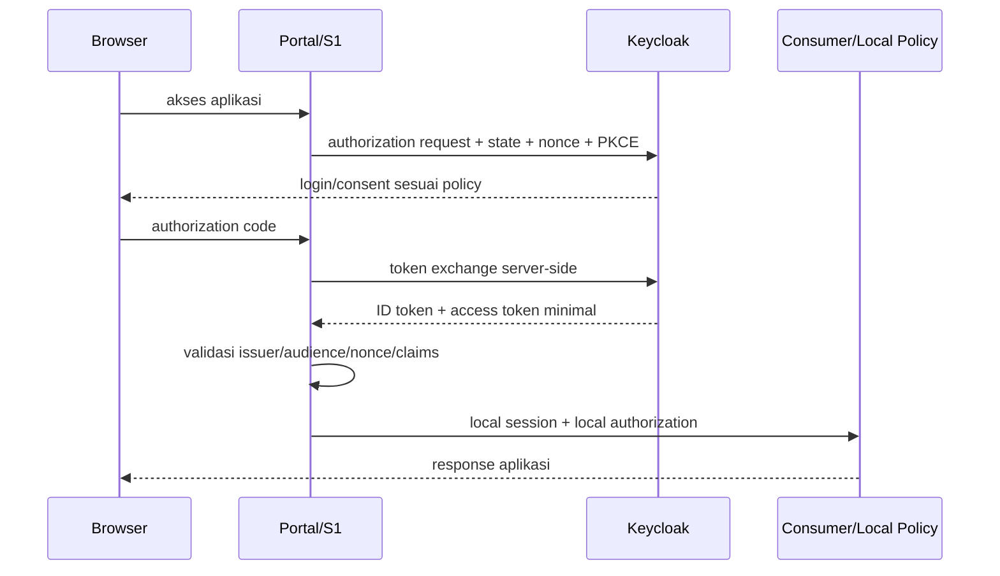

# 32 - IDP Pegawai Kontrak OIDC Client, Audience, Mapper & Claim Release

Status: Draf kontrak brainstorming arsitektur, **bukan konfigurasi Keycloak atau implementasi aplikasi**  
Proyek: kumjabar_ecosystem  
Tanggal: 2026-08-31  
Melanjutkan: Dokumen 31 — Delta Feed, Cursor, Replay & Consumer Checkpoint

## 1. Tujuan

Dokumen ini mengunci rancangan awal autentikasi OpenID Connect (OIDC) untuk consumer IDP Pegawai:

1. pemisahan human client dan service client;
2. audience, scope, dan client role;
3. katalog claim minimum per client;
4. protocol mapper dan privacy boundary;
5. alur login, session, refresh, dan logout;
6. hubungan token dengan private consumer feed;
7. protocol mapper drift dan upgrade compatibility.

Dokumen ini tidak melakukan konfigurasi realm/client, membuat mapper, menerbitkan credential, atau mengubah Keycloak.

## 2. Hubungan dengan Dokumen 29–31

```text
Dokumen 29 = consumer boundary + private distribution
Dokumen 30 = snapshot field/profile/freshness
Dokumen 31 = delta/cursor/bootstrap/checkpoint
Dokumen 32 = OIDC client/audience/mapper/claim release
```

## 3. Status

```text
Dokumen 29 = APPROVED
Dokumen 30 = BRAINSTORMING DRAFT
Dokumen 31 = BRAINSTORMING DRAFT
Dokumen 32 = OPEN / BRAINSTORMING
Coding/configuration = BELUM DIIZINKAN
```

## 4. Boundary Utama

```text
OIDC token       = autentikasi + identitas minimum + coarse entry
Private feed     = snapshot/delta data internal
Consumer policy  = authorization detail lokal
Keycloak Admin API= projection worker saja
```

Token tidak menjadi master data pegawai dan tidak menggantikan `access_grants` lokal.

## 5. Realm

Realm kandidat yang sudah ditetapkan:

```text
kumjabar
```

Nama realm tetap harus diverifikasi terhadap environment target sebelum konfigurasi nyata.

## 6. Kelas Client

| Kelas | Contoh | Fungsi | Credential |
| --- | --- | --- | --- |
| Human web client | `portal-ekosistem`, `s1-internal` | login pengguna browser | confidential client + authorization code |
| Human public client | SPA bila kelak ada | browser tanpa secret aman | public client + PKCE |
| Consumer feed client | `portal-feed`, `s1-feed` | menarik snapshot/delta | client credentials |
| Projection client | `idp-pegawai-sync` | Keycloak Admin API | dedicated service account |
| Monitoring client | restricted tooling | observability minimum | dedicated restricted identity |

Human client dan feed service client untuk aplikasi yang sama harus dipisahkan.

## 7. Portal Client Candidate

```text
client_id              = portal-ekosistem
client_type            = confidential web client
flow                   = authorization code
PKCE                   = direkomendasikan/wajib sesuai client policy
redirect_uris          = exact allowlist
post_logout_redirect   = exact allowlist
web_origins            = exact allowlist
service feed client    = terpisah
```

Portal hanya menerima claim yang dibutuhkan untuk session dan navigasi.

## 8. S1 Client Candidate

```text
client_id              = s1-internal
client_type            = confidential web client
flow                   = authorization code
PKCE                   = direkomendasikan/wajib sesuai client policy
redirect_uris          = exact allowlist
post_logout_redirect   = exact allowlist
service feed client    = s1-feed terpisah
```

S1 tetap menggunakan policy lokal untuk authorization detail dan jabatan.

## 9. Feed Service Client

Setiap consumer feed memiliki client terpisah:

```text
portal-feed
s1-feed
```

Aturan:

- client credentials hanya untuk server-to-server;
- tidak pernah dikirim ke browser;
- audience feed API exact;
- scope sesuai resource/field profile;
- secret tidak disimpan di database bisnis;
- environment binding wajib;
- rotasi dan suspend harus tersedia.

## 10. Projection Client

`idp-pegawai-sync` hanya untuk Keycloak Admin API dan tidak boleh mengakses consumer feed sebagai consumer biasa.

```text
projection client != human client
projection client != feed client
```

Least privilege, private network, dan managed namespace mengikuti Dokumen 26.

## 11. Audience

Audience wajib membedakan resource:

```text
aud:portal-ekosistem
aud:s1-internal
au:idp-consumer-feed
au:keycloak-admin-projection
```

Penamaan final harus konsisten dan tidak boleh menggunakan audience wildcard.

Typo correction: identifier canonical menggunakan `aud:portal-ekosistem`, `aud:s1-internal`, `aud:idp-consumer-feed`, dan `aud:keycloak-admin-projection`.

## 12. Audience Validation

Consumer harus memvalidasi:

```text
iss exact
aud exact
azp/client binding
signature
algorithm allowlist
exp/nbf/iat
service/client status
```

Token valid secara kriptografis tetapi audience salah tetap ditolak.

## 13. Scope

Kandidat scope feed:

```text
idp.consumer.pegawai.read
idp.consumer.pegawai.delta
idp.consumer.org_unit.read
idp.consumer.org_unit.delta
idp.consumer.bootstrap.read
idp.consumer.schema.read
```

Scope token harus di-intersect dengan `consumer_registrations` dan fixed field profile server-side.

## 14. Human Scope

Scope login manusia tidak otomatis menjadi scope data feed.

```text
human OIDC scope = identity/session context
feed scope       = service-to-service data permission
local capability = consumer authorization detail
```

`openid`, `profile`, dan `email` tidak boleh dianggap izin membaca master pegawai.

## 15. Claim Minimum Global

Kandidat claim standar:

```text
iss
sub
aud
azp
exp
nbf
iat
auth_time
sid
```

`nonce` dipakai sesuai flow OIDC dan validasi client.

## 16. Claim IDP Minimum

Kandidat claim tambahan per client:

```text
user_type
pegawai_uuid
coarse client role
```

Tidak semua client menerima semua claim. `pegawai_uuid` adalah correlation key pseudonymous, bukan grant detail.

## 17. Claim Portal Minimal

Profile kandidat:

```text
sub
iss
aud
azp
user_type
pegawai_uuid bila portal perlu identity context
coarse portal role
```

Nama display hanya dirilis bila use case portal disetujui. NIP, email Google, full organization, grant detail, dan identity link tidak default.

## 18. Claim S1 Minimal

Profile kandidat:

```text
sub
iss
aud
azp
user_type
pegawai_uuid
coarse s1 entry role bila diperlukan
```

Snapshot identitas, status, organisasi, NIP, dan email tetap melalui private feed sesuai profile; tidak otomatis dimasukkan token.

## 19. Public Client Boundary

Client publik tidak menerima claim ASN internal hanya karena user berhasil login.

```text
/public/consumer
!=
/internal/employee consumer
```

Group `/publik/masyarakat` tidak membuka claim internal pegawai.

## 20. Tidak Ada Full Master Data Token

Dilarang sebagai default token:

```text
full NIP
email dinas/Google
full org tree
org affiliations lengkap
jabatan/PLT/PLH
source_version/hash/cursor
identity provider subject
access grant/scope/capability detail
raw metadata
```

Token size dan browser exposure membuat token tidak cocok untuk data directory.

## 21. Claim vs Snapshot Feed

| Kebutuhan | Kanal |
| --- | --- |
| Login/authentication | OIDC |
| Subject correlation | OIDC `sub`/`pegawai_uuid` |
| coarse application entry | client role |
| identity display minimal | claim bila approved |
| lifecycle/status | private feed bila diperlukan |
| org affiliations | private feed profile |
| NIP/email | restricted private feed |
| replay/bootstrap/freshness | private feed |
| local fine-grained authorization | consumer DB/policy |

## 22. Protocol Mapper Catalog

Setiap mapper harus mempunyai:

```text
client_id
mapper_name
claim_name
source
claim_type
ID token flag
access token flag
userinfo flag
required/optional
profile classification
owner
version
```

Mapper catalog bersifat fixed/configured, bukan self-service dynamic editor.

## 23. Mapper Kandidat

| Mapper | Claim | Client | Status |
| --- | --- | --- | --- |
| subject standard | `sub` | semua sesuai OIDC | wajib |
| user type | `user_type` | internal approved | candidate |
| pegawai correlation | `pegawai_uuid` | Portal/S1 internal approved | candidate |
| coarse role | roles | client tertentu | wajib bila entry membutuhkan |
| display name | `name` | client approved | restricted |
| email | `email` | client approved | restricted, tidak default |
| organization summary | `org_unit_code` | client approved | restricted |

## 24. Source of Claim

| Claim | Sumber |
| --- | --- |
| `sub` | Keycloak immutable subject |
| `user_type` | managed Keycloak attribute dari IDP projection |
| `pegawai_uuid` | managed Keycloak marker dari IDP projection |
| coarse role | Keycloak client role projection sesuai local grant boundary |
| `name` | profile data sesuai policy |
| `email` | verified/profile data sesuai policy |
| organization summary | managed projection hanya bila disetujui |

Keycloak claim source bukan authority local fine-grained access.

## 25. Coarse Role Boundary

```text
idp-pegawai-admin:user
```

Role tersebut hanya menjadi entry gate kasar. Consumer tetap memeriksa policy/grant lokalnya sendiri.

## 26. Role vs Group Claim

Group path internal tidak boleh dirilis sebagai claim global default karena:

- membocorkan struktur organisasi;
- token dapat membesar;
- group bukan fine-grained authorization;
- perubahan group stale sampai token baru;
- consumer dapat salah menafsirkan hierarchy.

Jika client tertentu perlu ringkasan organisasi, gunakan claim minimal fixed profile.

## 27. OIDC Authorization Code Flow



## 28. State, Nonce, PKCE

Human client wajib:

- random `state`;
- OIDC `nonce`;
- PKCE untuk public client dan direkomendasikan untuk web client;
- exact redirect URI;
- server-side code exchange untuk confidential client;
- reject replay/duplicate code;
- secure session cookie;
- no token in URL setelah callback.

## 29. Token Storage

Untuk web server:

```text
server-side session preferred
HttpOnly + Secure + SameSite cookie
no access token localStorage default
no refresh token browser storage default
```

Untuk SPA masa depan, public client + PKCE dan threat model terpisah wajib direview.

## 30. Session Boundary

Session aplikasi dan session SSO Keycloak berbeda:

```text
app session expired
≠
Keycloak SSO session expired
```

Consumer harus menetapkan idle timeout, absolute timeout, session rotation, dan reauthentication untuk operasi sensitif.

## 31. Refresh Token

Rekomendasi:

- offline access tidak default;
- refresh token hanya bila client/use case perlu;
- rotation/reuse detection bila didukung platform;
- refresh token tidak pernah masuk log;
- revocation saat logout/compromise;
- service client memakai token lifetime sesuai feed polling, bukan refresh token browser.

## 32. Access Token Validation

Resource server consumer memvalidasi:

```text
signature/JWKS
issuer exact
audience exact
algorithm allowlist
exp/nbf/iat dengan clock skew bounded
azp/client binding
required scope/role
client/registration status
```

Tidak boleh hanya melakukan decode tanpa verification.

## 33. ID Token vs Access Token

```text
ID token    = untuk client mengenali hasil autentikasi user
access token= untuk resource server
```

Consumer tidak memakai ID token sebagai bearer token untuk API. Claim yang sama pada kedua token harus diputuskan per mapper/client.

## 34. UserInfo

UserInfo endpoint hanya digunakan bila diperlukan. Jika aktif:

- audience/client binding tetap berlaku;
- response mengikuti profile allowlist;
- tidak menjadi bypass claim policy token;
- PII tetap restricted;
- cache/no-store mengikuti classification.

## 35. Logout

Kandidat flow:

```text
app local logout
-> revoke/clear local session
-> RP-initiated logout Keycloak bila perlu
-> exact post_logout_redirect_uri
```

Logout lokal tidak otomatis menjamin semua token bearer yang sudah diterbitkan langsung tidak valid sampai expiry/revocation policy berlaku.

## 36. Backchannel/Frontchannel Logout

Per client perlu diputuskan:

- RP-initiated logout;
- backchannel logout bila consumer mendukung;
- frontchannel hanya bila threat/performance diterima;
- session `sid` handling;
- local session invalidation;
- logout failure fallback.

## 37. Deactivation Semantics

Status pegawai tidak otomatis membuat token lama hilang seketika. Untuk operasi security-sensitive:

- local consumer policy memeriksa eligibility/snapshot state;
- local revoke berlaku segera;
- remote Keycloak projection asynchronous;
- short token/session lifetime dipilih sesuai risk;
- targeted revalidation hanya bila use case disetujui.

## 38. OIDC dan Private Feed Separation

```text
browser user login -> OIDC human client
consumer backend   -> feed client credentials
projection worker  -> Keycloak Admin client
```

Credential dan audience tidak boleh saling dipertukarkan.

## 39. Feed Token Claims

Feed access token tidak perlu membawa payload pegawai. Ia cukup membawa:

```text
iss
sub/azp
 aud
scope
exp/nbf/iat
client identity
```

Registration DB menentukan field profile dan resource family.

## 40. Audience Isolation Matrix

| Token | Audience | Boleh ke |
| --- | --- | --- |
| Portal user | `aud:portal-ekosistem` | Portal API |
| S1 user | `aud:s1-internal` | S1 API |
| Portal feed | `aud:idp-consumer-feed` | profile Portal yang terdaftar |
| S1 feed | `aud:idp-consumer-feed` | profile S1 yang terdaftar |
| Projection | `aud:keycloak-admin-projection`/Admin API | Keycloak allowlist |

Satu audience feed tetap dibatasi oleh client/registration/profile.

## 41. JWKS dan Key Rotation

Resource server harus:

- mengambil JWKS dari issuer trusted;
- cache dengan TTL bounded;
- menerima overlap key;
- refresh saat `kid` baru;
- mencegah SSRF pada JWKS URL melalui konfigurasi trusted;
- fail-closed bila signature tidak dapat diverifikasi;
- mengaudit konfigurasi issuer/key rotation.

## 42. Client Secret Rotation

- dedicated per client/environment;
- secret manager;
- overlap bila tersedia;
- revoke old secret setelah verification;
- tidak ada secret dalam repo/log/database bisnis;
- emergency suspend;
- audit reference tanpa nilai secret.

## 43. Mapper Drift

Dokumen 26 menetapkan deteksi drift + alert saja pada v1. Dokumen 32 menambahkan katalog mapper yang diharapkan:

```text
client_id
claim
source
flags
profile
version
```

Perbaikan dilakukan melalui IaC/admin runbook, bukan consumer API dan bukan edit bebas operator aplikasi.

## 44. Token Size Budget

Token claim profile wajib mempunyai budget:

```text
header size
payload size
cookie/session size
proxy limit
application framework limit
```

Jika budget terlampaui, kurangi claim atau pindahkan data ke private feed. Jangan menaikkan limit tanpa threat/load review.

## 45. Privacy Matrix

| Data | Human token | Feed |
| --- | --- | --- |
| `sub` | wajib | technical |
| `pegawai_uuid` | approved internal | approved profile |
| nama | restricted | profile need-to-know |
| NIP | tidak default | restricted approval |
| email | tidak default | restricted approval |
| status | tidak default | internal profile |
| organisasi | minimal bila perlu | profile approved |
| jabatan/PLT/PLH | dilarang | dilarang |
| access grant detail | dilarang | dilarang |
| credential/token | dilarang | dilarang |

## 46. Claim Release Decision

Mapper tidak boleh hanya memeriksa keberadaan attribute. Ia harus memeriksa:

```text
client_id
user eligibility
management/link state
approved claim profile
environment
```

User yang tidak eligible tidak memperoleh claim internal hanya karena memiliki email cocok.

## 47. Multiple Client Login

Jika user login ke Portal dan S1:

- token masing-masing audience/client;
- claim profile dapat berbeda;
- tidak ada reuse access token lintas audience;
- session aplikasi terpisah;
- logout behavior ditentukan per client;
- local authorization tetap diperiksa di masing-masing consumer.

## 48. Error Semantics

Resource server tidak membocorkan detail internal:

```text
invalid_token
insufficient_scope
invalid_audience
session_expired
```

Log internal memakai request ID dan safe error code, tanpa token/claim PII lengkap.

## 49. Browser Security

- exact redirect URI;
- exact web origins;
- no wildcard production origin;
- secure cookies;
- CSRF protection untuk session mutation;
- CSP/frame-ancestors;
- no token in URL/log;
- referrer policy;
- clickjacking protection;
- logout CSRF protection.

## 50. Service-to-Service Security

- private network;
- OAuth2 client credentials;
- audience exact;
- scope/profile registration;
- TLS verification;
- rate/body/timeout limit;
- no CORS browser;
- credential rotation;
- suspension/revocation.

## 51. Consumer Local Authorization

OIDC hanya mengautentikasi. Consumer tetap memutuskan:

```text
local role/grant
resource scope
business state
status eligibility
feature permission
```

Keycloak coarse role tidak boleh diperlakukan sebagai seluruh policy S1/Portal.

## 52. Public vs Internal Claims

```text
public client     = public profile only
internal Portal   = approved internal profile
internal S1       = approved S1 profile
service feed      = approved field profile via API
```

Cross-client claim leakage dicegah melalui mapper profile per client.

## 53. Test Matrix OIDC

Wajib dibuktikan pada integration harness sebelum production:

- code flow/state/nonce/PKCE;
- exact redirect/logout URI;
- issuer/audience/azp/signature;
- `kid` rotation/JWKS cache;
- expired/not-before/perbedaan waktu;
- wrong audience;
- wrong client;
- missing scope;
- suspended consumer;
- public client internal claim denial;
- katalog mapper yang diharapkan;
- token size budget;
- no token/PII logs;
- local session/logout;
- refresh rotation/reuse detection;
- deactivated pegawai behavior;
- credential feed tidak valid untuk Keycloak Admin API.

## 54. Compatibility Matrix

| Perubahan | Perlakuan |
| --- | --- |
| tambah optional claim | profile/client review + budget test |
| tambah claim wajib | client contract version baru |
| rename claim | overlap alias + deprecation |
| ubah claim type | version baru |
| ubah audience | coordinated client/resource rollout |
| ubah mapper source | drift alert + review |
| rotate signing key | overlap JWKS |
| remove client | suspend, revoke, decommission |

## 55. Operational Runbook Candidate

```text
wrong audience       -> inspect client/resource mapping
mapper drift         -> alert + IaC/admin correction
secret compromise    -> suspend client + rotate + audit
JWKS kid unknown     -> bounded refresh, fail-closed jika gagal
claim over-release   -> suspend mapper/client + incident review
user deactivated     -> local deny + async projection tracking
logout anomaly       -> invalidate local session + investigate SSO state
```

## 56. Persistence Candidate

Dokumen 32 tidak memerlukan tabel mapper dinamis. Kandidat persistence tetap:

```text
consumer_registrations = service/client/profile binding
static mapper catalog  = code/config/IaC
OIDC client metadata    = governed config/secret manager
audit events            = audit boundary existing
```

Tidak membuat tabel credential atau generic claim policy engine v1.

## 57. Configuration Separation

Pisahkan:

```text
realm/client configuration
service secret material
katalog mapper yang diharapkan
consumer registration
runtime validation policy
```

Satu file JSON bebas tidak boleh menjadi source of truth untuk seluruh security configuration tanpa versioning/review.

## 58. SLO Candidate

- token validation latency;
- JWKS refresh availability;
- login callback success;
- logout completion;
- feed token issuance;
- deactivation-to-local-deny latency;
- claim drift detection time;
- credential rotation window.

Angka final melalui benchmark dan owner approval.

## 59. Open Questions Dokumen 32

| No. | Pertanyaan | Rekomendasi Awal |
| ---: | --- | --- |
| 1 | Client Portal confidential atau public? | Confidential web client bila server menjaga secret. |
| 2 | Client S1? | Confidential web client + service feed client terpisah. |
| 3 | PKCE web client? | Wajib sesuai baseline keamanan sesuai baseline security. |
| 4 | `pegawai_uuid` masuk token? | Hanya client internal approved yang perlu correlation context. |
| 5 | Nama/email masuk token? | Tidak default; private feed lebih tepat. |
| 6 | Scope feed? | Resource/scope fixed + registration intersection. |
| 7 | Audience feed satu atau per consumer? | Candidate satu audience feed + client/profile binding; final review. |
| 8 | Offline access? | Tidak default. |
| 9 | Backchannel logout? | Evaluasi per consumer capability. |
| 10 | mTLS feed? | Dokumen 33 berdasarkan risk/infra. |
| 11 | Mapper catalog code/config atau DB? | Static code/config/IaC, bukan dynamic table. |
| 12 | Token size budget? | Wajib benchmark per gateway/framework. |

## 60. Checklist Review Dokumen 32

### Client dan Audience

- [ ] Kelas client human/feed/projection disetujui.
- [ ] Portal dan S1 client boundary disetujui.
- [ ] Audience validation disetujui.
- [ ] Scope/resource separation disetujui.

### Claim dan Mapper

- [ ] Claim minimum global disetujui.
- [ ] Claim Portal/S1 disetujui.
- [ ] Public/internal claim boundary disetujui.
- [ ] Mapper catalog disetujui.
- [ ] Token size budget disetujui.

### Flow dan Session

- [ ] Authorization code/state/nonce/PKCE disetujui.
- [ ] Token storage/session disetujui.
- [ ] Refresh/offline access disetujui.
- [ ] Logout/backchannel behavior disetujui.

### Security dan Operasional

- [ ] JWKS/signing key rotation disetujui.
- [ ] Secret rotation disetujui.
- [ ] Mapper drift handling disetujui.
- [ ] Local authorization vs OIDC boundary disetujui.
- [ ] Test/compatibility/runbook disetujui.

## 61. Risiko Awal

| Risiko | Dampak | Mitigasi |
| --- | --- | --- |
| token claim terlalu luas | PII leakage/token bloat | per-client fixed mapper profile |
| audience salah | token dipakai lintas API | exact audience/azp validation |
| access token dipakai sebagai ID token | semantic/security error | strict token type handling |
| refresh token browser bocor | session takeover | server session, no browser storage default |
| JWKS rotation gagal | login/API outage | overlap key + bounded cache refresh |
| mapper drift | claim salah/bocor | katalog yang diharapkan + alert saja |
| coarse role dianggap full policy | otorisasi berlebihan | consumer local grants/policy |
| deactivated user tetap punya token valid | stale access | local deny + short lifetime/risk policy |
| client secret shared | blast radius | dedicated per client/environment |
| redirect wildcard | code/token interception | exact allowlist |

## 62. Future / Bukan v1

```text
custom Keycloak SPI untuk live IDP lookup
full master data dalam token
dynamic mapper/claim editor
wildcard audience
offline access default
public employee directory
browser feed client credentials
shared secret lintas consumer
universal logout guarantee sebelum platform support
multi-realm claim federation
```

## 63. Keputusan yang Diusulkan untuk Dikunci

1. OIDC dan private consumer feed adalah kanal terpisah.
2. Human client dan feed service client selalu berbeda.
3. Projection client Keycloak Admin API terisolasi dari semua client lain.
4. Portal dan S1 memakai confidential authorization-code client bila server menjaga secret.
5. Public client masa depan wajib PKCE.
6. Audience dan issuer divalidasi exact; wildcard dilarang.
7. Feed scope di-intersect dengan registration/profile server-side.
8. Claim minimum hanya identity context/coarse entry.
9. `pegawai_uuid` hanya dirilis ke approved internal client bila perlu.
10. NIP/email tidak masuk token default.
11. Jabatan/PLT/PLH/grant detail tidak masuk claim maupun feed.
12. Field snapshot tetap didistribusikan lewat private feed.
13. Protocol mapper catalog fixed code/config/IaC, bukan generic DB editor.
14. Mapper deteksi drift + alert saja pada v1.
15. Token disimpan server-side untuk web client; localStorage/refresh browser bukan default.
16. Offline access bukan default.
17. Logout local/SSO semantics dibedakan.
18. JWKS/signing key dan secret rotation memakai overlap.
19. Deactivation tetap local deny segera, remote/token revocation mengikuti risk/session policy.
20. Dokumen 33 membahas gateway, private routing, TLS, dan service authentication.

## 64. Status dan Handoff

```text
Dokumen 29 = APPROVED
Dokumen 30 = BRAINSTORMING DRAFT
Dokumen 31 = BRAINSTORMING DRAFT
Dokumen 32 = BRAINSTORMING DRAFT / SIAP DIREVIEW
Dokumen 33 = berikutnya: Gateway, Private Routing & Service Authentication
```

Tidak ada konfigurasi Keycloak, client, mapper, secret, kode aplikasi, migration, gateway, TLS, DNS, atau deployment yang dijalankan.

## 65. Kesimpulan

Kontrak OIDC Tahap 5 diarahkan menjadi:

```text
exact human client
-> authorization code + state/nonce/PKCE
-> minimal client-scoped claims
-> local consumer authorization

separate feed client credentials
-> exact audience/scope
-> private snapshot/delta API
-> fixed profile allowlist
```

Desain ini mencegah token berubah menjadi master data dump, menjaga isolasi audience/credential, mempertahankan authorization lokal consumer, dan memberi dasar untuk Dokumen 33.

Dokumen ini tidak memberi izin coding, konfigurasi Keycloak, migration, provisioning, konfigurasi gateway/TLS, atau deployment.
