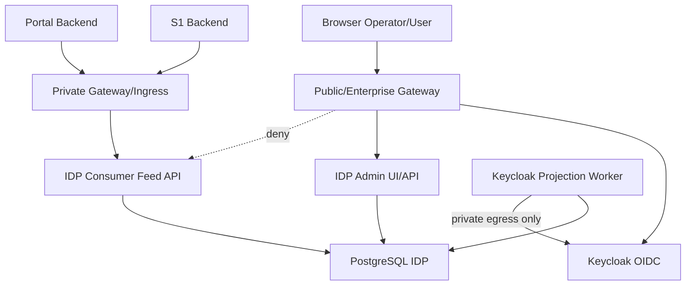

# 33 - IDP Pegawai Kontrak Gateway, Private Routing, TLS & Service Authentication

Status: Draf kontrak brainstorming arsitektur, **bukan konfigurasi gateway, TLS, Keycloak, atau deployment**  
Proyek: kumjabar_ecosystem  
Tanggal: 2026-08-31  
Melanjutkan: Dokumen 32 — OIDC Client, Audience, Mapper & Claim Release

## 1. Tujuan

Dokumen ini mengunci rancangan awal batas transport dan deployment untuk IDP Pegawai:

1. klasifikasi route publik, admin, dan internal;
2. topologi ingress dan private network;
3. TLS termination dan trusted proxy;
4. service-to-service authentication;
5. mTLS sebagai defense-in-depth;
6. CORS, CSRF, cookie, rate limit, body, header, dan timeout;
7. health check;
8. logging dan tracing tanpa PII;
9. secret/certificate rotation;
10. fail-closed behavior dan handoff operasional.

Dokumen ini tidak membuat konfigurasi Nginx, gateway, certificate, DNS, secret, firewall, container, atau service deployment.

## 2. Hubungan dengan Dokumen 29–32

```text
Dokumen 29 = consumer/private distribution boundary
Dokumen 30 = snapshot field/profile/PII
Dokumen 31 = feed cursor/replay/checkpoint
Dokumen 32 = OIDC client/audience/mapper/claim
Dokumen 33 = transport ingress/TLS/service authentication
```

## 3. Status

```text
Dokumen 29 = APPROVED
Dokumen 30 = BRAINSTORMING DRAFT
Dokumen 31 = BRAINSTORMING DRAFT
Dokumen 32 = BRAINSTORMING DRAFT
Dokumen 33 = OPEN / BRAINSTORMING
Coding/deployment = BELUM DIIZINKAN
```

## 4. Boundary Utama

```text
Gateway      = enforcement transport/ingress
IDP backend  = authority authorization/resource guard
Private net  = network boundary, bukan pengganti identity auth
Admin UI     = human OIDC + local capability + CSRF
Feed API     = service identity + audience/scope + profile allowlist
Keycloak Admin API = worker network saja
```

Gateway tidak boleh menjadi satu-satunya authorization layer.

## 5. Topologi Kandidat



## 6. Route Classes

| Route Class | Contoh | Exposure | Auth |
| --- | --- | --- | --- |
| public OIDC | `/realms/kumjabar/*` sesuai contract | gateway terkontrol | protocol OIDC |
| admin UI | `/idp-pegawai/admin/*` | gateway | human OIDC + local grant |
| admin API | `/idp-pegawai/admin/api/*` | gateway | session + CSRF + capability |
| internal feed | `/idp-pegawai/internal/api/v1/consumer/*` | private only | service JWT + registration |
| worker callback/internal | internal process/private | private only | service identity + network |
| liveness | `/health/live` | internal/load balancer | minimal/no sensitive data |
| readiness | `/health/ready` | internal orchestrator | bounded dependency check |
| metrics | `/metrics` | private/observability | restricted telemetry identity |

## 7. Public Ingress Deny

Public ingress wajib menolak:

```text
/idp-pegawai/internal/*
consumer feed endpoints
worker control endpoints
raw metrics tanpa auth
admin database/debug routes
```

Penolakan harus terjadi sebelum request mencapai aplikasi feed.

## 8. Path-Based Fallback

Jika subdomain khusus tidak tersedia:

```text
https://sso-jabar.kemenkum.go.id/idp-pegawai/admin/*
https://sso-jabar.kemenkum.go.id/idp-pegawai/internal/*
```

Aturan:

```text
/admin/*       -> public gateway + human auth
/internal/*    -> public ingress deny + private service route
```

Private consumer tidak memakai path publik sebagai security boundary utama.

## 9. Subdomain Candidate

Jika DNS mendukung, pemisahan dapat berupa:

```text
sso-jabar.kemenkum.go.id       = public OIDC/consumer-facing entry
admin-idp-jabar.internal       = Admin UI private/enterprise
idp-feed.internal              = feed API private
```

Subdomain tidak otomatis aman. Route policy, identity auth, TLS, dan backend guard tetap wajib.

## 10. Trusted Proxy

Backend hanya mempercayai header proxy dari hop yang dikonfigurasi:

```text
X-Forwarded-For
X-Forwarded-Proto
X-Forwarded-Host
X-Forwarded-Prefix
```

Gateway wajib:

- menghapus header spoofed dari client;
- menulis ulang nilai canonical;
- membatasi trusted proxy chain;
- meneruskan request ID terkontrol;
- menjaga scheme/host/prefix konsisten;
- tidak meneruskan header authorization ke log.

## 11. Forwarded Host/Scheme

Application URL generation harus memakai konfigurasi trusted proxy yang tepat. Mixed scheme/host dapat merusak:

- redirect OIDC;
- cookie `Secure`;
- callback URL;
- post-logout redirect;
- signed cursor/link;
- CSRF origin checks.

## 12. TLS Boundary

TLS wajib pada:

```text
browser -> gateway
operator/consumer -> private gateway bila melewati untrusted hop
gateway -> application bila jaringan tidak sepenuhnya trusted
worker -> Keycloak
service -> feed API bila private transport policy mewajibkan
```

Plaintext internal hanya boleh menjadi exception terdokumentasi dan tetap tidak menggantikan service authentication.

## 13. TLS Verification

Wajib:

- hostname verification;
- certificate chain trusted;
- approved protocol/cipher baseline;
- no `verify=false` production;
- certificate expiry monitoring;
- CA rotation plan;
- SNI correctness;
- no insecure redirect downgrade.

## 14. TLS Termination

Kandidat:

| Model | Kelebihan | Risiko/Trade-off |
| --- | --- | --- |
| terminate di gateway | sederhana, centralized policy | hop internal perlu dinilai |
| re-encrypt ke app | defense-in-depth | certificate management lebih berat |
| end-to-end TLS | boundary kuat | debugging/rotation lebih kompleks |
| mTLS internal | identity transport tambahan | PKI lifecycle/automation |

Rekomendasi awal: terminate di gateway untuk public edge, gunakan TLS pada hop sensitif/private bila infra siap. mTLS dibahas sebagai defense-in-depth, bukan baseline wajib.

## 15. mTLS Decision

Keputusan awal Dokumen 29/32:

```text
OAuth2 client credentials + private network = baseline wajib
mTLS                                    = opsional defense-in-depth
```

mTLS menjadi wajib hanya jika risk assessment, policy organisasi, atau topology evidence membuktikan network/service JWT belum cukup.

## 16. Service Authentication Baseline

Feed API menerima hanya:

```text
OAuth2 client credentials
+ exact issuer
+ exact audience
+ allowed scope
+ active consumer_registration
+ private network policy
```

Static API key tidak menjadi baseline.

## 17. Token Validation di Feed API

Validasi:

```text
signature/JWKS
issuer
audience
azp/client_id
exp/nbf/iat dengan bounded clock skew
algorithm allowlist
required scope
consumer registration status
field profile/resource family intersection
```

Token valid tetapi audience atau registration salah ditolak.

## 18. Projection Worker Authentication

Worker memakai credential berbeda:

```text
projection worker -> Keycloak Admin API
consumer feed client -> IDP Feed API
human web client -> consumer application
```

Worker tidak memakai feed client dan consumer tidak memakai projection credential.

## 19. Credential Storage

Dilarang menyimpan credential di:

```text
repo
frontend bundle
consumer payload
business table
audit payload
request log
trace baggage
```

Credential disuplai runtime melalui secret manager/environment mechanism yang diaudit.

## 20. Secret Rotation

- dedicated per environment/client;
- overlap window bila platform mendukung;
- verifikasi credential baru sebelum revoke lama;
- audit reference tanpa nilai secret;
- emergency suspension;
- no shared dev/staging/production secret;
- runbook untuk failed rotation.

## 21. JWKS Rotation

Resource server:

- cache JWKS dengan TTL terbatas;
- refresh saat `kid` baru;
- menerima overlap key;
- trusted issuer URL statis/configured;
- mencegah SSRF pada JWKS fetch;
- fail-closed jika signature tidak valid;
- metric refresh/error tanpa key material.

## 22. Admin UI Authentication

```text
browser -> gateway -> OIDC human client -> Admin UI
```

Admin UI tetap melakukan:

```text
local access grant
capability
scope
CSRF
session policy
```

Gateway login sukses bukan bukti operator memiliki capability bisnis.

## 23. Feed Tidak untuk Browser

Feed API:

- tidak memakai cookie/session human;
- tidak memiliki browser CORS;
- tidak menerima credential dari JavaScript frontend;
- hanya backend consumer private;
- response `private, no-store`;
- tidak memakai query PII.

## 24. CORS

```text
internal feed = CORS disabled/no browser access
Admin UI      = same-origin
public OIDC   = exact origins sesuai client
```

Wildcard production origin dilarang.

## 25. CSRF

Admin UI/API berbasis browser session wajib:

- CSRF token untuk mutation;
- same-origin validation;
- secure HttpOnly SameSite cookie;
- reject cross-site mutation;
- safe method semantics;
- logout CSRF consideration.

Bearer service API tidak memakai CSRF cookie flow.

## 26. Cookie Policy

```text
Secure
HttpOnly
SameSite=Lax/Strict sesuai flow
Path sesuai deployment base path
Domain tidak wildcard
```

Cookie tidak memuat raw access token jika server-side session dapat digunakan.

## 27. Rate Limit Classes

| Kelas | Contoh | Kebijakan |
| --- | --- | --- |
| OIDC login | authorize/token/callback | abuse/rate protection |
| Admin read | list/detail | user/scope bounded |
| Admin mutation | action/reconcile | stricter + audit |
| Feed delta | changes | per consumer registration |
| Bootstrap | snapshot pages | concurrency/throughput cap |
| Health | live/ready | low-cost, internal |
| Metrics | telemetry | restricted and bounded |

Nilai angka final melalui benchmark dan SLO.

## 28. Response Limits

Per route harus memiliki:

```text
max request body
max header size
max response bytes setelah dekompresi
max page size
query timeout
application timeout
upstream timeout
concurrency limit
```

Feed page maksimum mengikuti Dokumen 31: 500 candidate/final benchmark.

## 29. Timeout Hierarchy

```text
client timeout
> gateway timeout
> application timeout
> database/query timeout
> upstream timeout
```

Timeout luar tidak boleh lebih pendek secara tidak sengaja daripada timeout inner yang penting. Exact values harus dikontrak pada implementation plan.

## 30. Request Body Policy

- Admin JSON mutation strict content type;
- feed GET tidak menerima body sebagai filter;
- body limit kecil untuk command;
- bulk bootstrap memakai paginated response, bukan upload body;
- reject unknown/oversized content;
- compressed request handling harus memiliki decompressed cap;
- multipart tidak tersedia kecuali use case terpisah.

## 31. Header Policy

Gateway/application:

- batasi total header size;
- batasi cookie size;
- reject duplicate security-sensitive headers;
- normalisasi request ID;
- jangan log Authorization/Cookie;
- jangan mempercayai forwarded headers dari public client;
- response security headers konsisten.

## 32. Security Headers

Candidate minimum:

```text
Cache-Control: no-store untuk data sensitif
X-Content-Type-Options: nosniff
Content-Security-Policy
Referrer-Policy
Permissions-Policy
frame-ancestors melalui CSP
Strict-Transport-Security bila deployment siap
```

Nilai CSP/HSTS final harus diuji terhadap OIDC callback dan asset policy.

## 33. Health Live

`/health/live` hanya menjawab bahwa proses hidup:

- tidak query dependency berat;
- tidak menampilkan version/secret/config;
- tidak membocorkan DB/Keycloak state;
- response bounded;
- exposure dibatasi load balancer/internal network.

## 34. Health Ready

`/health/ready` memeriksa dependency minimum dengan timeout terbatas:

```text
DB connectivity
required configuration presence
critical internal dependency bila memang wajib
```

Tidak menampilkan raw error. Readiness bukan pengganti circuit breaker atau SLO monitoring.

## 35. Metrics Endpoint

Metrics hanya private/restricted. Label tidak boleh memuat:

```text
NIP
email
nama
pegawai UUID
raw cursor
token
query PII
```

Gunakan label bounded seperti `consumer_code`, `resource_family`, `route_template`, dan `status_class` bila aman.

## 36. Logging Policy

Structured log minimum:

```text
request_id
trace_id
route_template
consumer_code bila aman
status_code
latency
bytes class
profile/contract version
```

Jangan log:

```text
Authorization
Cookie
access/refresh token
client secret
raw cursor
NIP/email/nama
payload snapshot
raw Keycloak response
```

## 37. Error Response

Error eksternal stabil dan minimal:

```json
{
  "error": {
    "code": "consumer_auth_invalid",
    "message": "Autentikasi layanan tidak valid.",
    "details": {}
  },
  "meta": {
    "request_id": "018f0000-0000-7000-0000-000000000001"
  }
}
```

Tidak membocorkan apakah consumer lain, resource, registration, atau upstream tertentu ada.

## 38. Distributed Tracing

Kandidat:

```text
W3C traceparent
request_id internal
```

Rules:

- validasi panjang/format header;
- generate trusted trace ID bila invalid;
- tidak memasukkan PII pada baggage;
- sampling lebih tinggi untuk error;
- span name memakai route template;
- raw payload tidak menjadi span attribute;
- token/secret tidak menjadi baggage.

## 39. Request ID

Request ID:

- dibuat gateway bila tidak ada;
- format opaque bounded;
- tidak berasal dari NIP/email;
- diteruskan secara aman ke backend/consumer;
- ditampilkan pada error untuk bantuan operator;
- dipakai sebagai correlation, bukan authorization.

## 40. Public OIDC Endpoint

Public OIDC route hanya membuka endpoint yang diperlukan Keycloak/OIDC. Jangan mengekspos:

```text
Admin API
internal feed
worker control
DB diagnostics
raw management endpoint
```

Exact Keycloak route mengikuti deployment resmi dan gateway allowlist.

## 41. Internal DNS dan Network Policy

- consumer hanya resolve private feed address;
- public DNS tidak menunjuk feed private;
- network policy membatasi source/destination/port;
- worker egress hanya ke Keycloak host yang diizinkan;
- Admin UI tidak mendapat egress bebas ke internet;
- deny-by-default antar service;
- egress/ingress changes diaudit.

## 42. Egress Allowlist

Minimum:

```text
IDP app -> PostgreSQL
IDP feed -> PostgreSQL
feed service -> issuer/JWKS/token endpoint sesuai kebutuhan
projection worker -> Keycloak Admin API exact host
```

Tidak ada arbitrary URL dari request, payload, registration, atau consumer.

## 43. Gateway Retry

Gateway tidak boleh retry mutation secara buta. Untuk feed GET, retry hanya bila:

- method aman;
- timeout policy mengizinkan;
- upstream idempotency semantics jelas;
- `Retry-After` dihormati;
- retry budget terbatas.

Gateway retry tidak menggantikan consumer checkpoint/replay.

## 44. Compression

Compression:

- benchmark CPU/memory;
- response cap setelah dekompresi;
- jangan mencampur secret dengan attacker-controlled reflection;
- tidak mengompresi payload sensitif tanpa risk review;
- canonical hash atas payload sebelum compression;
- gateway dan app limit konsisten.

## 45. Deployment Process Separation

Modular monolith boleh tetap satu codebase, tetapi process/route separation direkomendasikan:

```text
web/admin process
feed API process
projection worker process
scheduler/reconciliation process
```

Process separation membatasi credential, egress, resource, dan blast radius tanpa memaksa microservice.

## 46. Worker Network Boundary

Projection worker:

- tidak menerima request publik;
- tidak punya route admin browser;
- egress hanya Keycloak allowlist;
- database privilege worker terbatas;
- credential tidak dibagikan feed API;
- metrics private;
- shutdown/lease recovery mengikuti Dokumen 25.

## 47. Database Boundary

Gateway tidak memberi consumer akses PostgreSQL. Feed API membaca curated view/service projection dengan privilege minimum.

```text
consumer -> feed API -> curated read model -> PostgreSQL
```

Tidak ada cross-database join atau schema credential consumer.

## 48. Environment Isolation

```text
dev gateway -> dev IDP/Keycloak
staging     -> staging
production  -> production
```

Tidak ada reuse client secret, certificate private key, signing key, atau database credential lintas environment.

## 49. Configuration Management

Configuration dipisahkan:

```text
route policy
TLS/certificate reference
OIDC issuer/client metadata
service audience/scope
consumer registration/profile
rate/timeout limits
secret references
```

Configuration production harus versioned/reviewed tanpa menyimpan secret value di repo.

## 50. Certificate Rotation

- monitor expiry;
- overlap certificate bila memungkinkan;
- test chain/hostname sebelum cutover;
- rollback certificate reference;
- audit perubahan;
- emergency revoke;
- jangan mematikan verification sebagai workaround.

## 51. Fail-Closed Matrix

| Kondisi | Respons |
| --- | --- |
| route class tidak dikenal | reject |
| internal request dari public ingress | reject |
| token signature invalid | reject |
| audience mismatch | reject |
| consumer suspended | reject |
| profile tidak terdaftar | reject |
| TLS verification gagal | fail closed |
| forwarded header tidak trusted | normalize/reject |
| secret missing | not ready, tidak start permissive |
| dependency timeout | bounded error, bukan allow |
| health dependency detail | generic response |

## 52. Public Error dan Enumeration

Out-of-scope internal route dari public ingress sebaiknya menghasilkan response generik yang tidak membedakan:

```text
route tidak ada
route ada tetapi private
consumer registration ada/tidak
resource ada/tidak
```

Admin/feed backend tetap dapat memakai safe 404 sesuai kontraknya.

## 53. CORS/CSRF Matrix

| Jalur | CORS | CSRF |
| --- | --- | --- |
| Admin browser | same-origin only | wajib mutation |
| Human consumer app | exact app origin | sesuai session app |
| Feed backend | disabled | tidak memakai cookie flow |
| Keycloak OIDC | exact configured origins | protocol/client policy |
| Health/metrics | private/restricted | service auth/network |

## 54. Rate/Timeout Governance

Setiap angka limit wajib mempunyai:

- owner;
- reason;
- benchmark;
- alert threshold;
- change approval;
- rollback value;
- environment override policy;
- documentation.

Tidak boleh ada per-route override tersembunyi.

## 55. Security Test Matrix

- public ingress internal route denial;
- path-based prefix bypass;
- host/header spoofing;
- TLS invalid/expired/wrong hostname;
- audience/issuer/azp mismatch;
- expired token/JWKS rotation;
- suspended registration;
- profile over-release;
- browser CORS feed denial;
- CSRF mutation rejection;
- cookie flag/path/domain;
- body/header/response limits;
- timeout/retry storm;
- gateway mutation retry prevention;
- request ID/trace PII inspection;
- credential/secret log scan;
- health endpoint leakage;
- egress allowlist;
- dev/prod credential separation;
- graceful shutdown/worker network isolation.

## 56. Operational Runbook Candidate

```text
certificate near expiry
secret rotation failure
JWKS kid unknown
feed route exposed
consumer auth storm
Keycloak egress unavailable
public/internal route mismatch
proxy header spoofing
health ready false
trace/log PII incident
rate limit overload
emergency consumer suspension
```

## 57. Observability Minimum

Dashboard minimum:

```text
route requests/status/latency
feed bytes/items/rate
consumer auth failures
cursor errors/410
bootstrap requests/failures
DB/query timeout
TLS/certificate expiry
JWKS refresh errors
public internal-route deny count
network egress deny
health state
```

## 58. Availability Semantics

- liveness failure → restart/recovery;
- readiness failure → remove from traffic;
- feed outage → consumer resume/replay;
- Keycloak outage → worker circuit/retry;
- gateway outage → failover/recovery plan;
- local IDP DB outage → no false allow;
- certificate/secret failure → fail closed, alert owner.

## 59. Resource Exhaustion

Saat limit tercapai:

```text
reject bounded request
return safe 413/429/503 sesuai kondisi
set Retry-After bila relevan
metric + alert
jangan menaikkan limit otomatis
```

## 60. Upgrade/Change Management

Perubahan gateway/TLS/OIDC:

1. staging test;
2. contract/security regression;
3. compatibility check client/feed;
4. rollout bertahap;
5. observe metrics;
6. rollback plan;
7. audit evidence.

## 61. Handoff ke Dokumen 34

Dokumen 34 mengunci:

```text
consumer registration approval
bootstrap/replay governance
lag/reconciliation
suspension/decommission
retention/SLO/owner
```

Dokumen 33 hanya mengunci transport dan service boundary.

## 62. Open Questions Dokumen 33

| No. | Pertanyaan | Rekomendasi Awal |
| ---: | --- | --- |
| 1 | Public subdomain atau path fallback? | Subdomain bila tersedia; path `/idp-pegawai/` sebagai fallback aman. |
| 2 | Feed API public ingress? | Ditolak sepenuhnya; private route only. |
| 3 | Baseline service auth? | OAuth2 client credentials + private network. |
| 4 | mTLS wajib? | Opsional defense-in-depth, risk/infra based. |
| 5 | TLS termination? | Gateway edge; re-encrypt hop sensitif bila siap. |
| 6 | Consumer API satu process dengan web? | Codebase modular monolith; process/route isolation direkomendasikan. |
| 7 | CORS feed? | Disabled/no browser CORS. |
| 8 | CSRF admin? | Wajib untuk browser session mutation. |
| 9 | Health public? | Tidak; internal/load balancer dengan output minimal. |
| 10 | Metrics public? | Tidak; private/restricted. |
| 11 | Gateway retry mutation? | Dilarang blind retry. |
| 12 | Nilai rate/body/timeout final? | Benchmark/SLO gate, bukan angka tebak. |
| 13 | HSTS wajib sejak awal? | Setelah TLS/base-host readiness terbukti. |
| 14 | mTLS certificate authority? | Ditentukan bila mTLS dipilih pada implementation/infra review. |

## 63. Checklist Review Dokumen 33

### Route dan Topologi

- [ ] Route classes disetujui.
- [ ] Public ingress deny disetujui.
- [ ] Path/subdomain strategy disetujui.
- [ ] Worker/feed/admin process boundary disetujui.

### TLS dan Authentication

- [ ] TLS termination/re-encryption disetujui.
- [ ] Trusted proxy/forwarded header disetujui.
- [ ] OAuth2 service authentication disetujui.
- [ ] mTLS decision disetujui.
- [ ] Secret/JWKS/certificate rotation disetujui.

### Browser dan Resource Controls

- [ ] CORS/CSRF/cookie policy disetujui.
- [ ] Body/header/response limits disetujui.
- [ ] Timeout hierarchy disetujui.
- [ ] Rate limit classes disetujui.
- [ ] Security headers disetujui.

### Operations dan Evidence

- [ ] Health/live/ready boundary disetujui.
- [ ] Logging/tracing/request ID disetujui.
- [ ] Metrics/alerts disetujui.
- [ ] Fail-closed matrix disetujui.
- [ ] Security test/runbook disetujui.

## 64. Risiko Awal

| Risiko | Dampak | Mitigasi |
| --- | --- | --- |
| private feed terekspos public ingress | bulk PII compromise | deny route + private DNS/network + service auth |
| proxy header spoofing | redirect/auth/cookie error | trusted chain + normalize headers |
| TLS verification dimatikan | MITM | fail closed + certificate runbook |
| shared credential | blast radius | dedicated client/environment |
| gateway menjadi satu guard | bypass authorization | backend guard tetap wajib |
| CORS feed terbuka | browser data extraction | disabled/no browser CORS |
| blind gateway retry | duplicate/mutation storm | method-aware retry policy |
| limit tidak konsisten | memory/timeout failure | hierarchy + benchmark |
| health membocorkan dependency | reconnaissance | generic bounded output |
| logs/traces PII | privacy incident | structured allowlist + scan |
| token/JWKS outage | broad app outage | overlap keys + bounded refresh |
| process credential terlalu luas | lateral movement | process/egress/DB privilege separation |

## 65. Future / Bukan v1

```text
public consumer feed
wildcard CORS
static API key sebagai auth utama
shared secret lintas consumer
blind gateway retry
anonymous metrics/debug
service mesh wajib
multi-region ingress active-active
centralized generic policy gateway
full mTLS PKI platform sebelum need terbukti
```

## 66. Keputusan yang Diusulkan untuk Dikunci

1. Feed API internal tidak mempunyai public ingress.
2. Path fallback memakai `/idp-pegawai/` dengan `/internal/*` tetap ditolak public ingress.
3. Gateway adalah transport/ingress enforcement, bukan pengganti backend guard.
4. Baseline service auth adalah OAuth2 client credentials + private network.
5. mTLS opsional sebagai defense-in-depth berdasarkan risk/infra.
6. Human Admin UI memakai OIDC session dan CSRF.
7. Feed memakai bearer service token, tanpa cookie dan tanpa browser CORS.
8. Audience/issuer/azp/scope/registration/profile divalidasi exact.
9. TLS hostname verification dan certificate chain wajib.
10. Trusted proxy header hanya diterima dari configured hop.
11. Credential, certificate key, token, cursor, dan PII tidak masuk log/trace.
12. Health/metrics private atau restricted dan output minimal.
13. Gateway tidak blind retry mutation.
14. Body/header/response/page/timeout/rate limit bounded dan benchmark-driven.
15. Web/feed/worker process dapat dipisahkan tanpa memaksa microservice.
16. Environment credential/certificate/issuer terisolasi.
17. Public error tidak membocorkan internal route/resource existence.
18. Dokumen 34 membahas onboarding, governance, reconciliation, suspension, decommission, retention, dan SLO.

## 67. Status dan Handoff

```text
Dokumen 29 = APPROVED
Dokumen 30 = BRAINSTORMING DRAFT
Dokumen 31 = BRAINSTORMING DRAFT
Dokumen 32 = BRAINSTORMING DRAFT
Dokumen 33 = BRAINSTORMING DRAFT / SIAP DIREVIEW
Dokumen 34 = berikutnya: Consumer Onboarding, Bootstrap, Reconciliation & Operations
```

Tidak ada konfigurasi gateway, Nginx, TLS, DNS, Keycloak, secret, firewall, container, kode aplikasi, migration, atau deployment yang dijalankan.

## 68. Kesimpulan

Kontrak hardening Tahap 5 diarahkan menjadi:

```text
route classification
-> public/private ingress enforcement
-> trusted TLS/proxy boundary
-> exact service identity validation
-> backend authorization guard
-> bounded resource/retry policy
-> private health/metrics
-> PII-safe logging/tracing
-> rotation/recovery runbook
```

Desain ini menjaga feed consumer tetap private, memisahkan credential dan egress worker, mencegah browser mengakses master data, dan mempertahankan fail-closed behavior saat dependency atau konfigurasi keamanan gagal.

Dokumen ini tidak memberi izin coding, migration, provisioning, konfigurasi Keycloak/Nginx, DNS, TLS, atau deployment.
