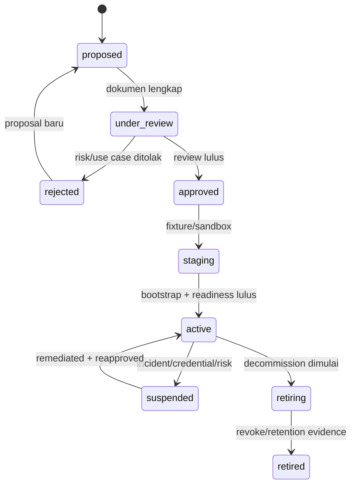
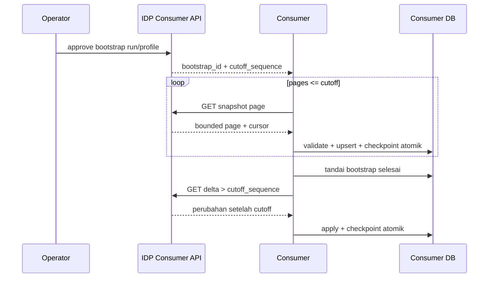
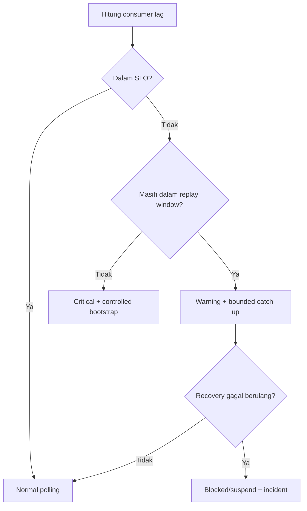
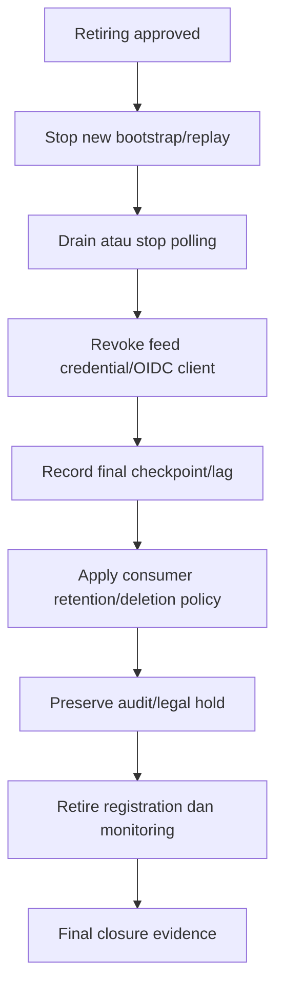

# 34 - IDP Pegawai Kontrak Consumer Onboarding, Bootstrap, Reconciliation & Operations

Status: Draf kontrak brainstorming arsitektur, **bukan implementasi onboarding, migration, provisioning, atau deployment**  
Proyek: kumjabar_ecosystem  
Tanggal: 2026-08-31  
Melanjutkan: Dokumen 33 — Gateway, Private Routing, TLS & Service Authentication

## 1. Tujuan

Dokumen ini mengunci rancangan operasional consumer internal IDP Pegawai:

1. pendaftaran dan persetujuan consumer;
2. persetujuan field profile dan claim profile;
3. bootstrap awal dan perpindahan ke delta;
4. reconciliation dan penanganan lag;
5. suspension, credential compromise, dan decommission;
6. retention, legal hold, backup, dan restore;
7. SLO, metric, alert, on-call, dan ownership;
8. evidence yang wajib tersedia sebelum consumer aktif.

Dokumen ini tidak membuat consumer registration, client Keycloak, secret, endpoint, database, konfigurasi gateway, atau deployment.

## 2. Hubungan dengan Dokumen 29–33

```text
Dokumen 29 = consumer boundary dan delivery direction
Dokumen 30 = snapshot, field ownership, PII profile
Dokumen 31 = sequence, cursor, replay, bootstrap checkpoint
Dokumen 32 = OIDC client, audience, mapper, claim
Dokumen 33 = gateway, private routing, TLS, service auth
Dokumen 34 = governance dan operasi consumer
```

## 3. Status

```text
Dokumen 29 = APPROVED
Dokumen 30 = BRAINSTORMING DRAFT
Dokumen 31 = BRAINSTORMING DRAFT
Dokumen 32 = BRAINSTORMING DRAFT
Dokumen 33 = BRAINSTORMING DRAFT
Dokumen 34 = OPEN / BRAINSTORMING
Coding/operation = BELUM DIIZINKAN
```

## 4. Boundary Operasional

```text
IDP          = authority field identitas ASN
Feed provider= menyajikan approved profile/delta
Consumer     = apply snapshot + checkpoint milik sendiri
Provider ack = observability, bukan proof apply
Consumer app = authority domain dan policy lokalnya
```

## 5. Prinsip Onboarding

Consumer tidak aktif hanya karena tabel registration dibuat. Aktivasi memerlukan:

```text
use case
-> owner
-> purpose/PII review
-> field/claim profile
-> auth/network design
-> contract fixtures
-> sandbox test
-> bootstrap dry-run
-> operational readiness
-> approval
-> activation
```

## 6. Peran Onboarding

| Peran | Tanggung Jawab |
| --- | --- |
| Business owner | tujuan penggunaan dan kebutuhan data |
| Consumer technical owner | implementasi apply/checkpoint/reconcile |
| IDP owner | authority payload dan feed availability |
| IAM owner | OIDC client, audience, mapper, credential |
| Infra/network owner | private route, TLS, gateway, egress |
| Security/privacy owner | threat, PII, retention, approval |
| Operations/on-call | alert, incident, recovery |
| Approver | menyetujui activation sesuai governance |

Satu orang boleh memegang beberapa peran hanya jika governance mengizinkan dan konflik approval tetap dicatat.

## 7. Registration Lifecycle



## 8. `consumer_registrations` Semantics

Registration menyimpan governance reference, bukan secret material:

```text
consumer_code
owner/contact
client binding reference
environment
resource family
field profile
contract versions
status
rate/page policy
replay policy reference
retention class
lock/audit lineage
```

Client secret, private key, token, dan HMAC cursor key tidak disimpan di tabel ini.

## 9. Consumer Code

`consumer_code` harus:

- stabil sepanjang lifecycle consumer;
- unik dalam environment/authority boundary;
- tidak mengandung PII;
- tidak didaur ulang setelah retired;
- dipakai sebagai binding cursor/metric/audit yang aman;
- tidak diterima dari query sebagai pengganti token identity.

## 10. Use Case Review

Proposal wajib menjawab:

```text
mengapa data dibutuhkan
siapa subjek datanya
field apa yang diperlukan
berapa lama disimpan
operasi apa yang diizinkan saat stale
siapa owner-nya
bagaimana incident response
kapan review ulang
```

“Untuk berjaga-jaga” bukan alasan rilis field sensitif.

## 11. Field Profile Approval

Profile disetujui sebagai fixed allowlist:

```text
pegawai.portal-minimal.v1
pegawai.s1-operational.v1
pegawai.reporting-minimal.v1
org-unit.internal-minimal.v1
```

Review memeriksa:

- exact field;
- classification;
- purpose;
- environment;
- retention;
- downstream sharing;
- source/version/hash semantics;
- expiry/review date.

## 12. Claim Profile Approval

Claim OIDC terpisah dari field feed. Proposal claim memuat:

```text
client
claim
source
token type
required/optional
privacy class
size budget
local authorization impact
```

Claim tidak boleh memperluas field feed secara implisit.

## 13. Security/Privacy Review Gate

Consumer belum dapat aktif sebelum tersedia:

- threat model;
- data-flow diagram;
- PII classification;
- access/credential design;
- retention/deletion plan;
- incident contact;
- backup/restore impact;
- contract/security test result;
- owner approval.

## 14. Environment Registration

Registration terpisah:

```text
portal-ekosistem-dev
portal-ekosistem-staging
portal-ekosistem-prod
```

Jangan menggunakan satu client/secret untuk semua environment.

## 15. Authentication Evidence

Wajib tersedia:

```text
issuer exact
audience exact
client binding
scope/profile intersection
private route proof
TLS proof
secret rotation proof
suspension/revocation proof
```

Private network tanpa identity validation bukan evidence yang cukup.

## 16. Bootstrap Preconditions

Sebelum bootstrap:

- registration approved/staging;
- supported contract/profile tersedia;
- consumer DB schema siap;
- snapshot applier idempoten;
- checkpoint persistence siap;
- stable cutoff support tersedia;
- retention/replay window dipahami;
- observability aktif;
- rollback/rebootstrap runbook tersedia.

## 17. Bootstrap Flow



## 18. Bootstrap Readiness Checklist

- [ ] profile exact cocok dengan registration;
- [ ] page limit tidak melebihi policy;
- [ ] consumer dapat memvalidasi hash/version;
- [ ] duplicate page aman;
- [ ] crash resume diuji;
- [ ] checkpoint dan data commit atomik;
- [ ] cutoff tidak berubah;
- [ ] delta continuation diuji;
- [ ] PII logging scan lulus;
- [ ] lag/alert dashboard aktif.

## 19. Stable Cutoff

Bootstrap mengikat:

```text
bootstrap_id
consumer_code
resource family
field profile
contract version
cutoff_sequence
issued_at/expiry
```

Page setelah cutoff tidak boleh memasukkan perubahan berjalan yang sequence-nya lebih besar.

## 20. Bootstrap Completion

Consumer hanya boleh menyatakan bootstrap selesai bila:

```text
seluruh page sampai cutoff committed
+ checkpoint menunjuk cutoff
+ snapshot count/hash manifest sesuai bila tersedia
+ contract/profile konsisten
+ delta continuation siap
```

HTTP 200 page terakhir tanpa local commit bukan completion.

## 21. Bootstrap Failure

| Failure | Tindakan |
| --- | --- |
| page validation gagal | rollback page, checkpoint tidak maju |
| DB commit gagal | retry page yang sama |
| cursor invalid | hentikan, jangan reset diam-diam |
| cutoff expired | bootstrap run baru/recovery policy |
| profile berubah | hentikan dan minta versioned bootstrap |
| credential gagal | suspend pull, rotate/review |
| provider 429 | honor Retry-After/backoff |
| consumer crash | resume dari checkpoint |

## 22. Delta Operations

Setelah bootstrap:

```text
poll cursor terakhir
-> validate page
-> apply idempoten
-> commit snapshot + checkpoint
-> schedule berikutnya
```

Polling tidak boleh mengubah profile atau query shape secara bebas.

## 23. Lag Classification

Kandidat:

```text
normal
warning
critical
expired
blocked
```

Dasar klasifikasi:

- sequence lag;
- age lag;
- oldest retained boundary;
- consumer SLO;
- security sensitivity;
- active incident.

Nilai angka final mengikuti SLO owner.

## 24. Lag Response



## 25. Reconciliation Types

| Type | Tujuan |
| --- | --- |
| cursor continuity | menemukan gap/invalid sequence |
| snapshot hash | membandingkan source vs local |
| source version | mendeteksi stale/out-of-order |
| schema/profile | mendeteksi contract drift |
| tombstone | memastikan resource purge tidak hidup kembali |
| full bootstrap | memulihkan setelah replay expired |
| operational | mengukur lag/checkpoint/health |

## 26. Consumer Reconciliation

Consumer wajib dapat:

- membandingkan last applied sequence;
- membandingkan source version/hash;
- menemukan snapshot missing/extra;
- menangani inactive/tombstone;
- menghasilkan mismatch report;
- memperbaiki melalui delta/replay/bootstrap;
- tidak mengubah field domain-owned consumer.

## 27. Provider Reconciliation Support

Provider menyediakan metadata minimum:

```text
current_head_sequence
oldest_retained_sequence
contract/profile support
retention boundary
```

Provider tidak mengambil alih consumer DB atau mengklaim apply success tanpa evidence consumer.

## 28. Stale Data Policy

Setiap consumer harus mendefinisikan:

```text
max_stale_age
allowed operations saat stale
fail-closed operations
alert threshold
reconciliation interval
bootstrap threshold
```

Portal boleh menampilkan last-known dengan label stale bila policy mengizinkan. S1 wajib fail-closed untuk operasi security-sensitive.

## 29. Incident Classes

```text
INC-CRED      credential compromise
INC-ROUTE     public/private route exposure
INC-CLAIM     over-release/mapping drift
INC-FEED      feed integrity/availability
INC-LAG       consumer stale/expired
INC-SCHEMA    incompatible contract
INC-PII       suspected data leakage
INC-RESTORE   backup/restore inconsistency
```

## 30. Credential Compromise

```text
detect
-> suspend registration/client
-> revoke/rotate credential
-> preserve audit evidence
-> assess accessed ranges/profile
-> notify owner/security
-> test replacement
-> re-activate dengan approval
```

Consumer tidak boleh meneruskan polling memakai credential yang dicurigai.

## 31. Public Route Exposure

Jika feed/internal route terekspos:

1. block route di gateway segera;
2. suspend consumer identities terkait;
3. cek access logs tanpa PII tambahan;
4. preserve evidence;
5. rotate credential bila perlu;
6. assess data exposure;
7. remediate/test ingress deny;
8. re-activate setelah security approval.

## 32. Claim Over-Release

Jika mapper merilis claim berlebih:

```text
suspend/disable mapper atau client
-> revoke/rotate jika perlu
-> audit token exposure window
-> correct via IaC/admin runbook
-> regression test
-> staged reactivation
```

Tidak ada auto-repair mapper oleh consumer.

## 33. Feed Integrity Incident

Pemicu:

- same-version different-hash;
- sequence continuity breach;
- unauthorized profile payload;
- raw outbox leakage;
- tombstone resurrection;
- unexpected field.

Respons:

```text
stop affected profile/consumer apply
-> preserve checkpoint
-> alert IDP/security/consumer owner
-> compare source/read model
-> decide replay/bootstrap
-> record incident/audit
```

## 34. Suspension Semantics

Suspension segera:

- menolak feed token baru;
- menolak feed request berikutnya;
- menghentikan bootstrap/replay baru;
- menandai registration suspended;
- mempertahankan audit/retention evidence.

Data yang telah tersalin tidak otomatis dihapus tanpa consumer retention/incident policy.

## 35. Reactivation

Reactivation memerlukan:

- root cause resolved;
- credential/network/claim test;
- profile masih approved;
- consumer version compatible;
- checkpoint/reconciliation plan;
- owner/security approval;
- staged resume;
- monitoring diperketat sementara.

## 36. Decommission Trigger

Consumer masuk retiring karena:

- aplikasi diganti;
- use case berakhir;
- owner tidak valid;
- contract tidak dipelihara;
- incident permanen;
- data purpose tidak lagi sah;
- environment retired.

## 37. Decommission Flow



## 38. Decommission Evidence

- final checkpoint;
- final sync/reconciliation report;
- credential revoked;
- OIDC redirect/client retired;
- private route removed/blocked;
- local snapshot retention action;
- backup impact assessed;
- legal hold checked;
- monitoring removed setelah closure;
- owner sign-off.

## 39. Retention Classes

| Data | Candidate Baseline |
| --- | --- |
| registration history | 5 tahun setelah retired |
| consumer change log | 30 hari replay minimum v1 |
| bootstrap run/manifest | 1 tahun umum |
| security incident evidence | 5 tahun atau policy lebih panjang |
| consumer checkpoint telemetry | 90 hari–1 tahun |
| consumer snapshot | ditentukan consumer/purpose |
| audit | mengikuti Dokumen 20 |

Nilai final memerlukan records/privacy owner.

## 40. Legal Hold

Legal hold dapat menahan:

- registration history;
- change log range;
- bootstrap manifest;
- incident evidence;
- audit event;
- consumer deletion artifact.

Legal hold tidak boleh memperluas akses baca. Release hold memerlukan authority, case reference, dan audit.

## 41. Backup/Restore

Provider dan consumer wajib memiliki:

- backup classification;
- restore test;
- retention catch-up;
- sequence/cursor continuity check;
- credential non-restoration dari business DB;
- rebootstrap fallback;
- post-restore monitoring.

Restore yang menghidupkan data kedaluwarsa harus segera menjalankan retention catch-up.

## 42. Monitoring Metrics

Provider:

```text
active consumer count
feed head/oldest sequence
projector lag
requests/items/bytes per consumer
cursor invalid/expired
bootstrap success/failure/duration
429/5xx/auth failures
registration status
```

Consumer:

```text
last applied sequence
head lag/age
apply rate/failure
same-version conflicts
stale duplicates
checkpoint age
bootstrap progress
reconciliation mismatch
```

Label tidak memuat PII, raw cursor, token, atau payload.

## 43. Alert Severity

| Severity | Contoh |
| --- | --- |
| Info | consumer caught up, rotation planned |
| Warning | lag mendekati replay boundary, retry meningkat |
| Critical | cursor expired, integrity conflict, route exposure |
| Security incident | credential/PII/claim compromise |

Setiap alert memiliki owner, runbook, dan escalation target.

## 44. Consumer SLO Candidate

| SLO | Owner Candidate |
| --- | --- |
| feed availability | IDP/operations |
| feed p95 latency | IDP/infra |
| maximum normal lag | consumer + IDP |
| bootstrap completion | consumer |
| recovery after cursor expiry | consumer + IDP |
| credential rotation | IAM/consumer |
| incident suspension | security/operations |
| schema deprecation notice | IDP + consumer |
| stale snapshot tolerance | consumer product owner |

Angka final tidak dikarang sebelum benchmark dan owner agreement.

## 45. On-Call Matrix

```text
feed/API outage       -> IDP operations
DB/query degradation  -> database/infra owner
OIDC/JWKS/client      -> IAM owner
TLS/gateway/network   -> infra/network owner
consumer apply error  -> consumer technical owner
PII/security incident -> security/privacy owner
schema incompatibility-> IDP + consumer owners
```

## 46. Runbook Minimum

Setiap consumer aktif harus mempunyai runbook:

```text
normal polling
bootstrap
replay
cursor expired
same-version conflict
credential rotation
suspension
reactivation
decommission
backup restore
```

Runbook mencantumkan command/tool path saat implementasi, tetapi Dokumen 34 tidak menjalankan command tersebut.

## 47. Contract Upgrade

Upgrade profile/contract:

1. publish version baru;
2. consumer staging test;
3. overlap support;
4. migrate/bootstrap bila perlu;
5. monitor old/new usage;
6. deprecation notice;
7. retire version setelah semua consumer compliant.

Tidak ada breaking change tanpa owner coordination.

## 48. Registration Audit

Audit event minimum:

```text
proposed
approved/rejected
activated
profile_changed
credential_rotated_reference
suspended/reactivated
bootstrap_started/completed/failed
replay_requested
cursor_expired
contract_deprecated
retired
```

Audit tidak menyimpan secret, token, raw payload, atau full PII.

## 49. Operational API Boundary

Admin UI/API operasional hanya boleh:

- membaca status registration/lag/bootstrap;
- mengajukan controlled action sesuai capability;
- menampilkan safe diagnostics;
- memicu approved bootstrap/replay workflow;
- suspend melalui emergency procedure bila authorized;
- tidak mengedit cursor, payload, claim, atau checkpoint consumer secara paksa.

## 50. Manual Checkpoint Reset

Manual checkpoint reset berisiko tinggi dan bukan operasi rutin.

Jika diperlukan:

```text
incident/reason
+ bounded target/profile
+ backup current state
+ authorized approval
+ consumer owner confirmation
+ reset/rebootstrap evidence
+ audit
```

Provider tidak boleh mengubah checkpoint di database consumer secara langsung.

## 51. Data Deletion Request

Permintaan penghapusan data consumer harus membedakan:

```text
snapshot consumer
consumer transaction/history
provider change log
audit/legal hold
backup copy
```

Penghapusan snapshot tidak otomatis menghapus transaksi legal atau audit. Consumer owner bertanggung jawab atas domain lokalnya.

## 52. Capacity Review

Review berkala:

- active registrations;
- change log growth;
- replay storage;
- bootstrap concurrency;
- API/database load;
- token/JWKS cache;
- audit/incident retention;
- backup size/restore window;
- oldest consumer lag.

Jika threshold tercapai, lakukan architecture/capacity review, bukan menaikkan limit diam-diam.

## 53. Consumer Contract Testing

Setiap consumer wajib menguji:

- schema/profile validation;
- version/hash ordering;
- duplicate/out-of-order;
- page atomicity;
- cursor expiry;
- bootstrap cutoff;
- crash/resume;
- tombstone;
- contract upgrade;
- auth/audience/scope;
- suspension/reactivation;
- no PII/token/cursor log.

## 54. Production Activation Gate

Sebelum status `active`:

- [ ] owner dan purpose approved;
- [ ] field/claim profile approved;
- [ ] registration/client binding verified;
- [ ] private route/TLS/auth evidence verified;
- [ ] sandbox contract tests pass;
- [ ] bootstrap dry-run pass;
- [ ] delta/replay tests pass;
- [ ] reconciliation report pass;
- [ ] retention/deletion/legal hold reviewed;
- [ ] incident/runbook/on-call ready;
- [ ] monitoring/alert ready;
- [ ] activation approval recorded.

## 55. Open Questions Dokumen 34

| No. | Pertanyaan | Rekomendasi Awal |
| ---: | --- | --- |
| 1 | Siapa consumer pertama production? | `portal-ekosistem` dan `s1-internal`, staging lebih dahulu. |
| 2 | Perlu approval empat-mata onboarding consumer? | Ya untuk profile restricted/high-impact; governance final. |
| 3 | Registration config atau tabel? | Relational `consumer_registrations`, profile static code/config. |
| 4 | Replay 30 hari cukup? | Baseline v1; sesuaikan SLO/offline evidence. |
| 5 | Provider ack wajib? | Tidak; telemetry optional. |
| 6 | Bootstrap artifact? | Tidak v1; paginated API. |
| 7 | mTLS wajib? | Tidak baseline; risk/infra review. |
| 8 | Manual checkpoint reset? | Exception only, controlled and audited. |
| 9 | Consumer snapshot retention? | Consumer owner + privacy/records policy. |
| 10 | Lag SLO final? | Owner agreement setelah benchmark. |
| 11 | Suspension activation approval? | Security/operations owner berdasarkan incident class. |
| 12 | Multi-region sequence? | Bukan v1; architecture review baru. |

## 56. Checklist Review Dokumen 34

### Governance

- [ ] Registration lifecycle disetujui.
- [ ] Owner/purpose/approval disetujui.
- [ ] Field/claim profile governance disetujui.
- [ ] Environment isolation disetujui.

### Bootstrap dan Reconciliation

- [ ] Bootstrap preconditions disetujui.
- [ ] Stable cutoff/completion disetujui.
- [ ] Failure/recovery disetujui.
- [ ] Lag classification/response disetujui.
- [ ] Reconciliation types disetujui.

### Security dan Incident

- [ ] Credential compromise flow disetujui.
- [ ] Route exposure flow disetujui.
- [ ] Claim/feed integrity incident disetujui.
- [ ] Suspension/reactivation disetujui.
- [ ] Decommission disetujui.

### Retention dan Operasi

- [ ] Retention/legal hold disetujui.
- [ ] Backup/restore disetujui.
- [ ] Metrics/alerts disetujui.
- [ ] SLO/on-call disetujui.
- [ ] Runbook/contract testing disetujui.
- [ ] Production activation gate disetujui.

## 57. Risiko Awal

| Risiko | Dampak | Mitigasi |
| --- | --- | --- |
| consumer aktif tanpa owner | incident tidak tertangani | activation gate + owner sign-off |
| profile terlalu luas | PII exposure | fixed allowlist + privacy approval |
| checkpoint palsu | false freshness | consumer atomic transaction |
| cursor expired terlambat diketahui | rebootstrap mendadak | lag warning + retention metric |
| credential tidak dirotasi | compromise berkepanjangan | rotation SLO + suspension runbook |
| decommission tidak lengkap | akses/data tertinggal | final closure evidence |
| backup menghidupkan data expired | retention breach | post-restore catch-up |
| incident response tidak jelas | recovery lambat | class-specific runbook/on-call |
| schema breaking change | consumer outage | overlap/deprecation |
| manual reset disalahgunakan | data gap/corruption | exception approval + audit |

## 58. Future / Bukan v1

```text
consumer self-service marketplace
arbitrary field query
public feed
automatic PII approval
exactly-once network delivery
mandatory webhook/broker
multi-region global sequence
provider direct mutation ke consumer DB
automatic checkpoint reset
universal cross-consumer policy engine
full SIEM/SOAR platform
```

## 59. Keputusan yang Diusulkan untuk Dikunci

1. Consumer registration memakai lifecycle proposed → review → approved → staging → active → suspended/retired.
2. Activation memerlukan owner, purpose, profile, security, sandbox, bootstrap, dan operational evidence.
3. `consumer_code` stabil dan tidak didaur ulang.
4. Profile/claim allowlist fixed; secret/token tidak di registration.
5. Bootstrap memakai stable cutoff dan page apply atomik.
6. HTTP 200 tidak membuktikan local consumer apply.
7. Consumer checkpoint adalah authority apply.
8. Lag diklasifikasikan normal/warning/critical/expired/blocked.
9. Replay dalam 30 hari; expired memerlukan controlled bootstrap.
10. Same-version hash conflict menghentikan apply.
11. Suspension menolak request/token baru tetapi tidak otomatis menghapus snapshot lama.
12. Credential compromise memicu suspend, rotate, assess, dan reapproval.
13. Decommission memerlukan revoke, final checkpoint, retention action, dan closure evidence.
14. Retention/legal hold dan backup restore menjadi tanggung jawab bersama yang terdokumentasi.
15. Provider/consumer metrics tidak memuat PII/token/cursor/raw payload.
16. SLO, on-call, dan runbook wajib sebelum production activation.
17. Manual checkpoint reset hanya exception controlled dan audited.
18. Contract upgrade memakai overlap/deprecation.
19. Consumer tidak mendapat direct DB access atau reverse mutation.
20. Dokumen 35 menjadi review gate penutup Tahap 5.

## 60. Status dan Handoff

```text
Dokumen 29 = APPROVED
Dokumen 30 = BRAINSTORMING DRAFT
Dokumen 31 = BRAINSTORMING DRAFT
Dokumen 32 = BRAINSTORMING DRAFT
Dokumen 33 = BRAINSTORMING DRAFT
Dokumen 34 = BRAINSTORMING DRAFT / SIAP DIREVIEW
Dokumen 35 = berikutnya: Tahap 5 Review Checklist, Keputusan Final & Implementation Gate
```

Tidak ada consumer registration, client/secret, API, migration, gateway, TLS, DNS, Keycloak, backup, atau deployment yang dijalankan.

## 61. Kesimpulan

Kontrak operasi consumer Tahap 5 diarahkan menjadi:

```text
purpose/owner governance
-> fixed profile approval
-> private auth/network evidence
-> stable-cutoff bootstrap
-> atomic consumer checkpoint
-> lag/reconciliation control
-> incident suspension
-> retention-safe decommission
-> SLO/runbook ownership
```

Dengan pola ini, consumer dapat memperoleh data IDP secara aman tanpa mengambil alih authority, tanpa menjadikan provider ack sebagai bukti apply, dan tanpa membuat jalur distribusi PII yang tidak terkontrol.

Dokumen ini tidak memberi izin coding, migration, provisioning, konfigurasi Keycloak/Nginx, DNS, TLS, atau deployment.
