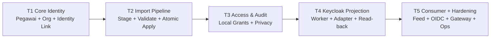

# 35 - IDP Pegawai Tahap 5 Review Checklist, Keputusan Final & Implementation Gate

Status: **Architecture-complete / approved**, implementation-ready setelah evidence gate; **bukan izin coding, migration, provisioning, atau deployment**  
Proyek: kumjabar_ecosystem  
Tanggal: 2026-08-31  
Mengonsolidasikan Dokumen 29–34.

## 1. Tujuan Review

Dokumen ini menjadi gerbang penutup Tahap 5 dan konsolidasi akhir rancangan IDP Pegawai Tahap 1–5. Tujuannya:

1. memverifikasi integrasi consumer, distribusi internal, OIDC, gateway, dan operasi;
2. mengunci seluruh keputusan arsitektur Tahap 5;
3. mengaudit konsistensi dengan Tahap 1–4;
4. menetapkan persistence/configuration delta secara semantik;
5. menetapkan evidence gate sebelum coding completion;
6. menetapkan production activation gate untuk consumer;
7. membedakan kesiapan arsitektur dari kesiapan produksi;
8. menutup rangkaian brainstorming tanpa menjalankan implementasi.

## 2. Dokumen yang Dikonsolidasikan

```text
29 - Integrasi Consumer, Distribusi Internal & Deployment Hardening
30 - Canonical Consumer Snapshot, Field Ownership & Freshness
31 - Delta Feed, Cursor, Replay & Consumer Checkpoint
32 - OIDC Client, Audience, Mapper & Claim Release
33 - Gateway, Private Routing, TLS & Service Authentication
34 - Consumer Onboarding, Bootstrap, Reconciliation & Operations
```

Referensi lintas tahap:

```text
10 - Tahap 1 Review Checklist
17 - Tahap 2 Review Checklist
22 - Tahap 3 Review Checklist
28 - Tahap 4 Review Checklist & Implementation Gate
```

## 3. Keputusan Penutupan Tahap 5

```text
Tahap 5 design                  = CLOSED / APPROVED
Dokumen 29–34                   = FINAL ARCHITECTURE PACKAGE
Open architecture decisions     = 0
Implementation plan eligibility = YES, jika diminta eksplisit
Coding authorization            = NO
Migration authorization         = NO
Infrastructure authorization    = NO
Production readiness            = NO, evidence gate belum dijalankan
```

## 4. Prinsip Konsolidasi

```text
IDP PostgreSQL = authority field identitas ASN
Keycloak       = authentication + managed projection
OIDC token     = identity context minimal
Consumer feed  = private canonical snapshot/delta
Consumer DB    = local snapshot + checkpoint + domain authority
Gateway        = transport/ingress enforcement
Worker         = asynchronous projection/reconciliation
```

## 5. Arsitektur Utuh Tahap 1–5



## 6. Authority Matrix Final

| Concern | Authority | Tidak Boleh Digantikan Oleh |
| --- | --- | --- |
| identitas ASN | IDP PostgreSQL | token/snapshot consumer |
| NIP | IDP Pegawai | email/username consumer |
| status/lifecycle/eligibility | IDP Pegawai | Keycloak enabled saja |
| organisasi/afiliasi | IDP Pegawai | group token consumer |
| identity link | IDP `pegawai_identity_links` | email matching |
| local role/scope | `access_grants` + consumer policy | coarse Keycloak role |
| desired state Keycloak | resolver IDP | raw outbox/browser payload |
| actual Keycloak state | normalized read-back | HTTP 2xx saja |
| consumer snapshot apply | consumer DB transaction | provider HTTP 200/ack |
| consumer domain | consumer application | IDP feed |
| transport ingress | gateway policy | application assumption saja |

## 7. Field Ownership Final

```text
IDP owns: UUID, NIP, identity profile, status, eligibility,
identity links, org units, org affiliations.

S1/consumer owns: jabatan, jenis/label jabatan, PLT/PLH,
histori jabatan, workflow kepegawaian, business transactions,
consumer-specific authorization policy.
```

Field yang bukan milik IDP tidak boleh diselundupkan melalui `metadata`, JSONB, token, snapshot, atau feed.

## 8. Tahap 4 ke Tahap 5 Handoff

```text
T4 outbox/worker -> Keycloak managed projection
T5 outbox/projector -> consumer_change_log
T5 OIDC          -> human authentication context
T5 gateway       -> route/network/service enforcement
T5 consumer      -> local apply/checkpoint/domain policy
```

Kedua proyeksi berbeda:

```text
IDP -> Keycloak = identity/authentication projection
IDP -> Consumer = approved data distribution projection
```

## 9. Consumer Pertama

Keputusan final:

```text
portal-ekosistem
s1-internal
```

Keduanya wajib melalui staging sebelum production. Portal menguji human OIDC dan claim minimal. S1 menguji snapshot, delta feed, freshness, dan checkpoint consumer.

## 10. OIDC dan Feed Separation

```text
Human web client -> authorization code + PKCE + app session
Feed client     -> OAuth2 client credentials + private feed
Projection      -> dedicated Keycloak Admin API credential
```

Tidak ada pertukaran credential atau audience antarkanal.

## 11. Consumer Snapshot Contract

Resource type final:

```text
pegawai
org_unit
```

Envelope:

```text
contract_version
resource_type
resource_uuid
source_version
source_updated_at
payload_hash
field_profile
data
```

`pegawai_uuid` adalah correlation key default. NIP/email hanya restricted need-to-know.

## 12. Consumer Field Profiles

Profile adalah fixed allowlist:

```text
pegawai.portal-minimal.v1
pegawai.s1-operational.v1
pegawai.reporting-minimal.v1
org-unit.internal-minimal.v1
org-unit.navigation.v1
```

Tidak tersedia arbitrary `fields=` untuk memperluas data.

## 13. Canonicalization dan Hash

```text
data-c14n.v1
payload_hash = lowercase_hex(SHA-256(canonical_data_bytes))
```

Rules:

- sorted object keys;
- set-like arrays sorted/deduplicated;
- UUID lowercase;
- Unicode NFC;
- timestamp RFC 3339 UTC;
- typed boolean/number;
- no NaN/Infinity;
- absent berbeda dari null;
- hash scoped pada contract/profile.

## 14. Freshness Final

```text
source_version < local
-> stale duplicate/no-op

source_version == local + hash sama
-> fresh/no-op

source_version == local + hash berbeda
-> integrity conflict/fail-closed

source_version > local
-> validate + apply + checkpoint atomik
```

Consumer tidak boleh memilih payload arbitrer saat same-version hash conflict.

## 15. Lifecycle dan Tombstone

```text
inactive/retired -> upsert dengan status authoritative
legal purge      -> tombstone minimal tanpa PII
```

Tombstone tidak menghapus histori/transaksi lokal secara otomatis.

## 16. Consumer Change Log

`consumer_change_log` wajib menjadi curated contract yang terpisah dari raw transactional outbox.

```text
outbox event
-> profile projection
-> monotonic change_sequence
-> curated change row
-> private feed
```

`change_sequence` monotonik global dalam boundary single PostgreSQL IDP v1. Gap akibat rollback alokasi diperbolehkan.

## 17. Delta Feed Final

```text
primary delivery = pull-based delta feed
page default     = 100
page maksimum    = 500
provider         = at-least-once
consumer apply   = idempotent
webhook           = ditolak v1
broker            = tidak wajib v1
```

Tombstone dan upsert adalah dua change type final.

## 18. Cursor Final

Cursor:

- opaque;
- HMAC-SHA-256;
- versioned;
- terikat consumer/registration/resource/profile/contract/query shape;
- tidak memuat PII;
- key rotation memakai active+overlap key;
- tidak dibuat atau diedit consumer.

Cursor di luar replay window:

```text
HTTP 410 Gone
consumer_cursor_expired
-> controlled rebootstrap
```

Replay window final v1 adalah 30 hari.

## 19. Bootstrap Final

```text
stable cutoff_sequence
-> paginated snapshot <= cutoff
-> consumer atomic apply/checkpoint
-> delta > cutoff_sequence
```

Bootstrap artifact statis tidak digunakan pada v1.

## 20. Consumer Checkpoint Final

Otoritas apply berada di consumer DB:

```text
snapshot/tombstone apply
+ freshness metadata
+ checkpoint advance
= satu transaksi lokal
```

Provider ack, bila kelak ada, hanya observability.

## 21. Duplicate dan Conflict Final

| Kondisi | Respons Consumer |
| --- | --- |
| version/hash sama | No-op |
| version lebih rendah | Stale no-op |
| version lebih tinggi | Validate + apply |
| same version/hash berbeda | Fail-closed, no checkpoint past item |
| tombstone lebih lama | Reject |
| page malformed | Rollback page |
| contract unsupported | No checkpoint advance |

## 22. OIDC Client Taxonomy

| Client | Flow | Audience | Fungsi |
| --- | --- | --- | --- |
| `portal-ekosistem` | authorization code + PKCE | `aud:portal-ekosistem` | human login Portal |
| `s1-internal` | authorization code + PKCE | `aud:s1-internal` | human login S1 |
| `portal-feed` | client credentials | `aud:idp-consumer-feed` | Portal backend feed |
| `s1-feed` | client credentials | `aud:idp-consumer-feed` | S1 backend feed |
| `idp-pegawai-sync` | dedicated service account | `aud:keycloak-admin-projection` | Keycloak projection |

## 23. Claim Release Final

Claim minimum kandidat:

```text
iss sub aud azp exp nbf iat auth_time sid
user_type
pegawai_uuid bila approved internal need
coarse client role
```

Dilarang sebagai default:

```text
full NIP
email dinas/Google
full organization tree
jabatan/PLT/PLH
fine-grained grants/scope
identity link subject
source hash/cursor
raw metadata
```

## 24. Audience dan Scope

Audience, issuer, `azp`, signature, algorithm, expiry, not-before, issued-at, scope, dan client binding wajib divalidasi exact.

Feed scope tetap di-intersect dengan:

```text
consumer registration
resource family
field profile
environment
```

Wildcard audience dan wildcard production redirect dilarang.

## 25. Session dan Logout

Human web client:

- state dan nonce;
- PKCE;
- server-side session;
- Secure/HttpOnly/SameSite cookie;
- no token di URL/localStorage default;
- offline access tidak default;
- RP-initiated logout;
- exact post-logout redirect;
- backchannel/frontchannel sesuai kemampuan consumer.

App session dan SSO session berbeda.

## 26. Gateway Route Matrix

| Route | Exposure | Guard |
| --- | --- | --- |
| public OIDC | gateway | OIDC protocol/client policy |
| `/idp-pegawai/admin/*` | gateway | human OIDC + local grant |
| `/idp-pegawai/admin/api/*` | gateway | session + CSRF + capability |
| `/idp-pegawai/internal/*` | private only | service JWT + registration |
| `/health/live` | internal/LB | liveness minimal |
| `/health/ready` | internal/orchestrator | bounded readiness |
| `/metrics` | private/restricted | telemetry identity |
| Keycloak Admin API | worker network | projection credential |

Public ingress wajib menolak internal feed dan worker control route.

## 27. TLS dan Proxy

- TLS hostname/chain verification;
- no insecure verification bypass;
- certificate expiry/CA rotation;
- trusted proxy hop explicit;
- forwarded header spoofing ditolak/dinormalisasi;
- no downgrade redirect;
- re-encryption hop sensitif bila siap;
- mTLS opsional defense-in-depth.

Baseline service auth tetap:

```text
OAuth2 client credentials + private network
```

## 28. Browser dan Service Boundary

```text
Admin browser = same-origin session + CSRF
Feed backend  = bearer service token + no browser CORS
Worker        = private egress + dedicated Keycloak identity
```

Feed tidak menerima cookie manusia atau credential dari JavaScript.

## 29. Resource dan Retry Limits

Setiap route mempunyai batas:

```text
body size
header/cookie size
response decompressed bytes
page size
query/application/upstream timeout
concurrency
request rate
```

Gateway tidak melakukan blind retry terhadap mutation. Feed GET hanya boleh retry dengan budget, method safety, dan `Retry-After` policy.

## 30. Health, Metrics, Logging, Tracing

Health output minimal dan private. Metrics/log/trace tidak memuat:

```text
NIP/email/nama
Authorization/Cookie
access/refresh token
client secret
raw cursor
raw payload
raw Keycloak response
```

Label hanya bounded: route template, status class, consumer code, resource family, profile/contract version.

## 31. Consumer Registration Lifecycle

```text
proposed
-> under_review
-> approved
-> staging
-> active
-> suspended
-> active atau retiring
-> retired
```

`consumer_code` stabil dan tidak didaur ulang.

## 32. Production Activation Gate

Consumer hanya berstatus `active` setelah:

- owner/purpose disetujui;
- field/claim profile disetujui;
- registration/client binding diverifikasi;
- private route/TLS/auth terbukti;
- sandbox contract test lulus;
- bootstrap dry-run lulus;
- delta/replay/reconciliation test lulus;
- retention/legal hold direview;
- incident/runbook/on-call siap;
- monitoring/alert siap;
- activation approval tercatat.

## 33. Suspension dan Incident

Suspension segera:

- menolak token/feed baru;
- menghentikan bootstrap/replay baru;
- mempertahankan audit evidence;
- tidak otomatis menghapus snapshot lama.

Incident class final:

```text
INC-CRED
INC-ROUTE
INC-CLAIM
INC-FEED
INC-LAG
INC-SCHEMA
INC-PII
INC-RESTORE
```

Credential compromise:

```text
suspend -> rotate -> assess accessed range/profile -> test -> reapprove
```

## 34. Decommission

```text
retiring
-> stop bootstrap/replay/polling
-> revoke credential/OIDC client
-> record final checkpoint/lag
-> apply retention/deletion policy
-> preserve audit/legal hold
-> retire registration/monitoring
-> closure evidence
```

## 35. SLO dan Ownership

SLO wajib ditentukan oleh owner setelah benchmark:

```text
feed availability
feed p95 latency
maximum normal lag
bootstrap completion
cursor-expiry recovery
credential rotation
incident suspension
schema deprecation
stale snapshot tolerance
```

Ownership:

| Area | Owner |
| --- | --- |
| IDP payload/feed | IDP operations |
| consumer apply | consumer technical owner |
| OIDC/JWKS/client | IAM owner |
| gateway/TLS/network | infra/network owner |
| PII/retention/legal hold | security/privacy/records owner |
| SLO/on-call | IDP + consumer owner |
| incident response | security/operations |
| schema compatibility | IDP + consumer technical owner |

## 36. Persistence Delta Final Tahap 5

| Delta | Status | Fungsi |
| --- | --- | --- |
| `consumer_registrations` | wajib | registry consumer, client/profile/policy binding |
| `consumer_change_log` | wajib | curated ordered change contract |
| `consumer_bootstrap_runs` | wajib bila bootstrap async | cutoff, progress, manifest, lineage |
| consumer registration audit lineage | wajib | governance lifecycle |
| provider ack/checkpoint | tidak wajib | telemetry observability saja |
| dynamic mapper table | tidak dibuat | mapper code/config/IaC |
| credential/token table | tidak dibuat | secret manager/runtime |
| webhook delivery table | tidak dibuat v1 | webhook ditolak v1 |

Consumer checkpoint utama tetap berada di database aplikasi consumer, bukan schema IDP.

## 37. Constraint dan Invariant Gate

Migration final wajib memverifikasi:

- `UNIQUE(uuid)` dan `UNIQUE(consumer_code)`;
- `consumer_code` tidak didaur ulang;
- active registration/client binding unik;
- resource/profile/status catalog fixed;
- page 1–500 dan replay window positif;
- sequence BIGINT tidak turun;
- payload hash lowercase SHA-256;
- `source_version` positif/monotonik sesuai resource semantics;
- upsert/tombstone action-specific payload rule;
- source outbox provenance FK bila digunakan;
- registration status/timestamp consistency;
- profile exposure tidak melewati allowlist;
- purge/retention legal hold tidak membuat silent cursor gap;
- audit lineage `ON DELETE RESTRICT`.

## 38. Consumer-Side Constraint Gate

Consumer implementation wajib membuktikan:

- snapshot typed columns untuk field filter/authorization;
- source metadata terpisah;
- domain-owned fields terpisah;
- checkpoint row unique per provider/consumer/resource/profile;
- page apply + checkpoint atomic;
- lower version tidak menimpa higher version;
- same-version hash conflict menghentikan advance;
- tombstone tidak menghapus histori tanpa policy;
- retry page aman;
- bootstrap cutoff continuation tidak memiliki gap.

## 39. PostgreSQL Evidence Gate

Wajib memakai PostgreSQL nyata untuk:

- sequence allocation/rollback gap;
- projector idempotency;
- keyset query;
- registration uniqueness;
- retention/purge boundary;
- audit lineage;
- concurrent feed projection;
- transaction rollback;
- privilege/read-view boundary;
- query plan pada replay window;
- backup/restore continuity.

SQLite tidak menjadi bukti correctness.

## 40. OIDC/Keycloak Evidence Gate

Exact pinned Keycloak/environment wajib membuktikan:

- authorization code + PKCE;
- state/nonce validation;
- exact redirect/logout URI;
- issuer/audience/azp validation;
- JWKS `kid` rotation overlap;
- wrong audience/client rejection;
- scope/profile intersection;
- mapper expected catalog;
- claim minimization/token size;
- secret rotation;
- offline access policy;
- logout/session behavior;
- public client internal claim denial;
- feed credential tidak valid untuk Admin API;
- mapper drift detect+alert.

## 41. Gateway/Network Evidence Gate

- public ingress internal route denial;
- path-prefix bypass denial;
- trusted proxy spoof test;
- TLS invalid/expired/wrong-host test;
- private DNS/network policy;
- egress allowlist;
- service JWT audience/scope;
- mTLS decision evidence;
- CORS/CSRF/cookie;
- body/header/response/time/rate limits;
- no blind mutation retry;
- health/metrics isolation;
- no PII/token/cursor logs;
- certificate/secret rotation.

## 42. Consumer Operations Evidence Gate

- owner/purpose/profile approval;
- staging bootstrap;
- stable cutoff continuation;
- duplicate/out-of-order;
- same-version hash conflict;
- 410 cursor expiry;
- replay/rebootstrap;
- lag warning/critical;
- suspension/reactivation;
- credential compromise;
- route exposure;
- schema upgrade overlap;
- backup/restore;
- decommission closure;
- on-call/runbook drill.

## 43. Security and Privacy Closure

```text
no public feed
no direct DB access
no arbitrary fields
no full master token
no shared credential
no wildcard audience/redirect
no raw payload/token/cursor log
no reverse mutation
no silent cursor reset
no auto profile expansion
no consumer authority takeover
```

## 44. Performance and Sizing Gate

Benchmark wajib mencakup:

- page 100 vs 500;
- response bytes tiap profile;
- feed p95/p99;
- query plan 30-day replay;
- projector throughput;
- bootstrap completion window;
- concurrent consumers;
- rate limiting/backpressure;
- purge impact;
- recovery 1/6/24 jam;
- token header/cookie size;
- gateway timeout budget.

## 45. Governance Gate

Sebelum production:

- owner dan purpose ditandatangani;
- PII/restricted profile approval;
- retention/legal hold disahkan;
- SLO/on-call disahkan;
- credential/certificate custody disahkan;
- incident escalation disahkan;
- Keycloak change management disahkan;
- gateway/network change management disahkan;
- decommission authority disahkan.

## 46. Risks Carried Forward

| Risiko | Jenis | Mitigasi |
| --- | --- | --- |
| exact DDL/constraint names belum final | teknis | migration review |
| page/timeout/rate default belum benchmark | operasional | sizing gate |
| source sequence multi-region belum tersedia | arsitektural future | single DB v1 |
| mTLS belum dipilih | infra/security | risk review |
| consumer checkpoint provider hanya telemetry | governance | consumer atomic evidence |
| profile restricted terlalu luas | privacy | purpose/approval/expiry |
| bootstrap gap | reliability | stable cutoff + test |
| cursor retention terlalu pendek | operasional | lag alert + rebootstrap |
| schema breaking change | integrasi | overlap/deprecation |
| owner/on-call tidak aktif | governance | activation gate |

Risiko tersebut tidak membuka kembali boundary arsitektur Tahap 1–5; semuanya menjadi evidence atau governance gate.

## 47. Future / Bukan MVP

```text
multi-region distributed sequence
Kafka/RabbitMQ mandatory
webhook delivery platform
consumer self-service marketplace
dynamic field/claim policy DSL
public bulk employee feed
OIDC token sebagai master data
consumer direct database replica
exactly-once network claim
automatic checkpoint reset
universal cross-consumer policy engine
mandatory mTLS PKI platform
full SIEM/SOAR platform
```

## 48. Architecture Acceptance Checklist

### Tahap 1–2 Foundation

- [x] Core identity/organization ownership konsisten.
- [x] NIP 18 digit dan scope ASN tetap konsisten.
- [x] Jabatan/PLT/PLH tetap di consumer kepegawaian.
- [x] Import atomic, outbox, dan source version tetap konsisten.
- [x] Tidak ada remote call dalam transaksi domain.

### Tahap 3 Access dan Audit

- [x] Local grant menjadi authority authorization.
- [x] Coarse Keycloak role bukan fine-grained policy.
- [x] Revoke lokal immediate.
- [x] Audit/privacy/retention boundary tetap berlaku.
- [x] Fixed RBAC dan scope tidak diperluas menjadi generic policy engine.

### Tahap 4 Projection

- [x] Managed-only Keycloak projection.
- [x] GET-merge-PUT/read-back verification.
- [x] Lease/fencing/retry/circuit/DLQ.
- [x] Identity link UUID dan no hard-delete.
- [x] Reconciliation/orphan/group safety.

### Tahap 5 Consumer dan Hardening

- [x] OIDC/feed separation.
- [x] Snapshot/profile/ownership/hash.
- [x] Delta/cursor/replay/checkpoint.
- [x] Gateway/private/TLS/service auth.
- [x] Onboarding/bootstrap/reconciliation/incident/decommission.

## 49. Wajib sebelum Coding Completion

- [ ] Implementation plan TDD terpisah dan direview.
- [ ] Exact migration schema/constraint/index review.
- [ ] Consumer change projector dan idempotency strategy.
- [ ] Cursor signing/key rotation implementation contract.
- [ ] Profile/claim fixtures dibekukan.
- [ ] PostgreSQL concurrency/failure harness.
- [ ] OIDC exact-version integration harness.
- [ ] Gateway/TLS/network test harness.
- [ ] Consumer checkpoint/bootstrap test harness.
- [ ] Error/status/incident catalog lengkap.
- [ ] Retention/purge/legal-hold implementation contract.
- [ ] Monitoring/alert/runbook contract.
- [ ] Secret/certificate rotation procedure.
- [ ] Consumer activation evidence template.

## 50. Wajib sebelum Production

- [ ] Migration/backfill rehearsal dan rollback.
- [ ] Exact Keycloak negative permission/claim tests.
- [ ] OIDC/JWKS/secret/certificate rotation tests.
- [ ] Public/private route penetration test.
- [ ] PostgreSQL concurrency/crash/restore drill.
- [ ] Consumer bootstrap/replay/410/conflict drill.
- [ ] Load/sizing/rate/backpressure benchmark.
- [ ] PII/privacy/adversarial logging scan.
- [ ] Lag/SLO/incident/suspension drill.
- [ ] Decommission/retention/legal-hold drill.
- [ ] Monitoring/on-call/runbook sign-off.
- [ ] Governance owner approval.

## 51. Implementation Sequence jika Diizinkan

Jangan mulai dari UI atau mengubah Keycloak production terlebih dahulu.

```text
1. implementation plan TDD
2. exact PostgreSQL schema/roles/constraints/indexes
3. canonical snapshot/profile/hash/revision primitives
4. consumer registration/change-log projector
5. cursor signer/verifier/replay boundary
6. consumer bootstrap/checkpoint contract fixtures
7. OIDC client/claim validation and mapper catalog
8. gateway/private routing/TLS/service auth
9. consumer onboarding/reconciliation/incident services
10. Admin API/read models
11. Admin UI/operational views
12. PostgreSQL/integration/security/load verification
13. staging activation and production rehearsal
```

Setiap slice wajib memiliki RED–GREEN–REFACTOR, evidence, dan commit kecil ketika repository implementasi tersedia.

## 52. Implementation Handoff Artifacts

Implementation plan kelak wajib menyebut exact path untuk:

```text
Alembic revisions
SQLAlchemy models
consumer feed/projector services
cursor signer/verifier
OIDC validation/config adapters
gateway/config templates
Admin API routes/schemas
consumer test fixtures
PostgreSQL integration tests
Keycloak test realm
security/load tests
runbooks/monitoring/configuration
```

Path tidak boleh ditebak sebelum codebase implementation root diinspeksi.

## 53. Architecture vs Production Readiness

| Area | Architecture | Production |
| --- | --- | --- |
| boundary/ownership | selesai | evidence deployment |
| payload/profile/hash | selesai secara kontrak | fixture/runtime proof |
| sequence/cursor/checkpoint | selesai secara semantik | PostgreSQL/consumer test |
| OIDC/client/mapper | selesai secara desain | exact Keycloak proof |
| gateway/TLS/network | selesai secara desain | penetration/rotation proof |
| onboarding/incident/decom | selesai secara desain | drill/runbook proof |
| exact DDL/code | belum | wajib implementation |
| load/SLO | candidate/owner-based | benchmark/sign-off |
| production activation | belum | seluruh gate wajib lulus |

## 54. No Open Architecture Decisions

Seluruh pertanyaan Dokumen 29–34 telah diberi keputusan final. Hal berikut bukan open architecture decision:

- exact migration names/lengths;
- benchmark-derived page/rate/timeout values;
- exact mTLS activation;
- exact owner/contact;
- exact Keycloak image/environment;
- exact SLO numeric thresholds;
- idempotency persistence placement bila semantics tetap sama;
- implementation process topology bila boundary tetap sama.

## 55. Keputusan Penutupan Tahap 5

```text
Tahap 5 Consumer Integration & Deployment Hardening
= ARCHITECTURE-COMPLETE / APPROVED

Dokumen 29–34
= FINAL ARCHITECTURE PACKAGE

Open architecture decisions
= 0

Implementation plan
= BOLEH DISUSUN JIKA DIMINTA EKSPLISIT

Coding/migration/provisioning/deployment
= TIDAK DIIZINKAN OLEH DOKUMEN INI

Production readiness
= BELUM, sampai evidence gates lulus
```

## 56. Handoff Setelah Tahap 5

Dua jalur yang sah:

```text
A. berhenti di architecture package Tahap 1–5
B. user meminta Implementation Plan TDD Tahap 1–5 secara eksplisit
```

Jika jalur B dipilih:

```text
inspeksi codebase
-> implementation plan dengan path nyata
-> review plan
-> coding bertahap setelah otorisasi eksplisit
```

## 57. Kesimpulan

Paket IDP Pegawai Tahap 1–5 membentuk sistem:

```text
authoritative ASN identity
-> atomic import/access/audit changes
-> Keycloak managed projection
-> curated consumer change log
-> HMAC-bound pull feed
-> stable bootstrap cutoff
-> consumer atomic checkpoint
-> minimal OIDC claims
-> private gateway/TLS/service boundary
-> governed onboarding/reconciliation/incident/decommission
```

Desain tetap:

- **ringan**: fixed profiles, PostgreSQL-first, pull feed, modular deployment, tanpa broker wajib;
- **tangguh**: version/hash, cursor/replay, checkpoint atomik, bootstrap, reconciliation, suspension, dan recovery;
- **kuat**: local authority, least privilege, PII minimization, private routing, exact audience, no direct DB, no silent reset, dan governance activation.

Dengan Dokumen 35, **Tahap 5 resmi ditutup secara arsitektural sebagai `ARCHITECTURE-COMPLETE / APPROVED`**. Dokumen ini tidak menjalankan atau mengizinkan coding, migration, provisioning, konfigurasi Keycloak/Nginx, DNS, TLS, maupun deployment.

## 58. Lampiran Hasil Verifikasi Dokumen 35

```text
Section count             = 58
Mermaid diagrams          = 4
Architecture checklist    = 20 item checked
Coding completion gates   = 14 item pending by design
Production gates          = 12 item pending by design
Open architecture items  = 0
Cross-stage matrix        = PASS
Authority boundary       = PASS
OIDC/feed separation     = PASS
Cursor/bootstrap         = PASS
Consumer checkpoint      = PASS
Gateway/TLS/auth         = PASS
Onboarding/incidents     = PASS
Retention/decommission   = PASS
No-coding boundary       = PASS
```

Dokumen 35 adalah checkpoint akhir brainstorming Tahap 5 dan menjadi dasar satu-satunya untuk Implementation Plan TDD apabila user menginstruksikannya secara eksplisit.