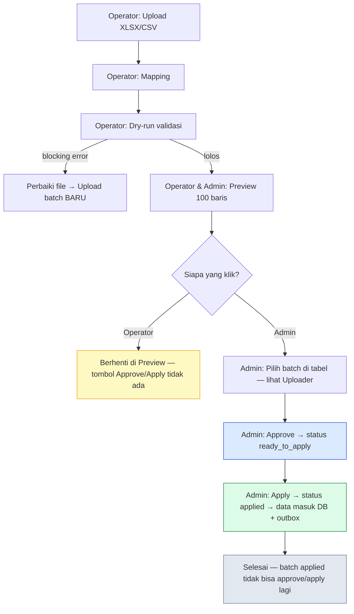
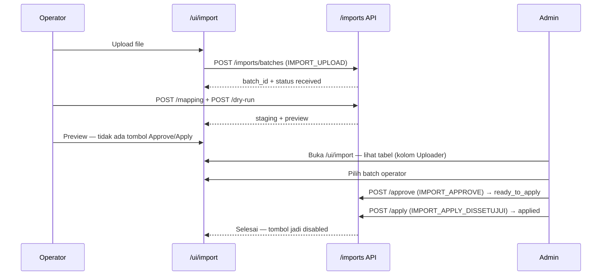

# 38 - Kontrak Alur Import per Role (Operator vs Admin) — Penyempurna Dok 37

Status: **BEKU — melengkapi Dok 37 §8** | Tanggal: 2026-10-01
Melanjutkan: Dok 12-16 (import), Dok 19 (RBAC), Dok 37 (local auth + RBAC tipis)

> Dok 37 sudah benar untuk 2 role, tapi §8 belum eksplisit memisah tombol & status per role.
> Dok 38 membekukan itu biar `/ui/import` tidak muter-muter lagi.

## 1. Bahasa Bayi

Bayangin **dapur restoran**:

- **Operator = koki**: boleh belanja bahan (upload), potong & cicip (mapping, dry-run, preview). Tidak boleh buka kasir.
- **Admin = kasir + manajer**: lihat belanjaan koki, cek struk (preview), cap **SETUJU** (approve), baru **MASUKKAN ke stok** (apply). Sekali masuk stok, struk jadi `applied` — tidak bisa di-stempel lagi.

## 2. Keputusan Beku (melengkapi Dok 37 §8)

| Fitur | operator | admin |
|---|:---:|:---:|
| Login + captcha | ✅ | ✅ |
| Lihat `/ui/import` | ✅ | ✅ |
| Upload XLSX/CSV | ✅ | ✅* |
| Mapping + Dry-run | ✅ | ✅ (darurat) |
| Preview (100 baris) | ✅ | ✅ |
| **Approve** | ❌ **tombol hilang** | ✅ |
| **Apply** | ❌ **tombol hilang** | ✅ |
| Lihat kolom Uploader | ✅ | ✅ |
| Kelola users / org unit | ❌ | ✅ |

`*` Admin boleh upload darurat, tapi flow ideal: upload tetap operator, admin hanya approve→apply.

**Aturan status** (satu batch, satu arah maju):

```
received → mapped → staging → ready_to_apply (approved) → applied
                      ↘ mapped (jika blocking error, perbaiki file lalu upload batch baru)
```

- `applied` = terminal. Approve/apply lagi → `409 already_applied`, tombol disabled + pesan "Sudah diterapkan".
- Batch `applied` tetap muncul di daftar (audit), tidak hilang.

## 3. Diagram Alur — Bahasa Bayi (Mermaid)





## 4. Kontrak UI

- `GET /ui/import` kirim `current_role` ke template (`session["role"]`).
- Jika `role == operator`: **jangan render** tombol `#approve-import` dan `#apply-import` sama sekali (bukan cuma disabled). JS juga skip binding.
- Jika `role == admin`: render semua tombol, tapi disable/enable sesuai `status` batch terpilih:
  - `staging` → Approve enabled, Apply disabled
  - `ready_to_apply` → Approve disabled, Apply enabled
  - `applied` → keduanya disabled + notice "Sudah diterapkan — gunakan batch baru jika perlu koreksi"
- Kolom `Uploader` wajib tampil (dari `uploaded_by` → `session username` saat upload).

## 5. Kontrak API (tidak berubah, hanya penegasan)

- `POST /imports/batches` butuh `IMPORT_UPLOAD` (operator & admin boleh).
- `POST /imports/batches/:id/approve` butuh `IMPORT_APPROVE` (hanya admin/approver).
- `POST /imports/batches/:id/apply` butuh `IMPORT_APPLY_DISSETUJUI` (hanya admin/approver).
- `GET /imports/batches` butuh `IMPORT_VIEW`, response `uploader` = `uploaded_by`.

## 6. Yang Tidak Dilakukan

- Tidak bikin role baru. Tetap 2 role `admin`/`operator` + mapping `catalog.py`.
- Tidak ubah status `applied` bisa di-approve ulang.
- Tidak hapus batch `applied` dari daftar.

## 7. Acceptance

- [ ] Operator login → `/ui/import` tidak ada tombol Approve/Apply
- [ ] Operator upload→mapping→preview tetap jalan
- [ ] Admin login → lihat tabel batch + kolom Uploader = username operator
- [ ] Admin pilih batch `staging` → Approve → `ready_to_apply` → Apply → `applied`
- [ ] Batch `applied` dipilih admin → kedua tombol disabled + pesan sudah diterapkan
