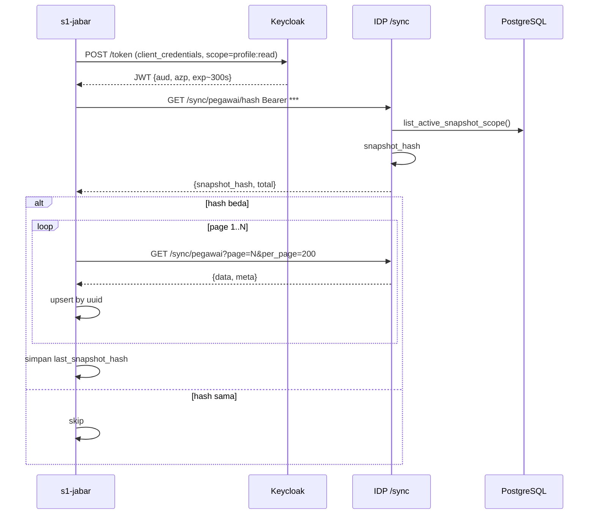
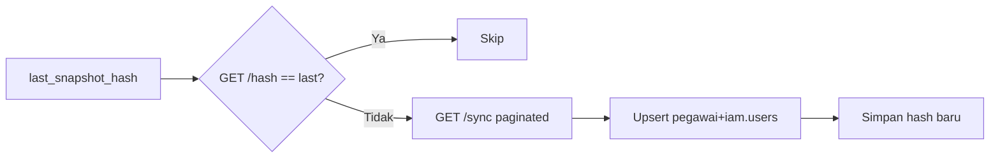

# 40 — IDP Pegawai Bulk Sync untuk s1-jabar

Status: **BEKU** | Tanggal: 2026-10-06 | Melengkapi: Dok 30, 31, 36

> s1-jabar butuh tarik **semua pegawai** sekaligus (bukan cuma 1 profil yang login via `/consumer/profile`).
> Dok ini membekukan endpoint bulk, hash snapshot, dan polling ringan — reuse auth `profile:read`.

## 1. Endpoint

| Endpoint | Fungsi |
|---|---|
| `GET /idp-pegawai/internal/api/v1/sync/pegawai` | Bulk snapshot semua pegawai (paginated, filter delta) |
| `GET /idp-pegawai/internal/api/v1/sync/pegawai/hash` | Polling ringan — hanya `snapshot_hash + total` |

Blueprint: `idp_pegawai/api/sync.py` → `sync_bp` (prefix `/idp-pegawai/internal/api/v1/sync`), diregister di `idp_pegawai/__init__.py`.

### Auth — reuse INTERNAL_PROFILE_AUTHORIZER (sama persis dengan `/consumer/profile`)

```
Authorization: Bearer <JWT Keycloak>
  aud = "idp-pegawai-internal"      (INTERNAL_PROFILE_AUDIENCE)
  azp = "s1-jabar-token-exchange"   (INTERNAL_PROFILE_CLIENT)
  scope mengandung "profile:read"
  registration status=active, allowed_resource_families=["pegawai-profile"], allowed_field_profile in {"pegawai-profile.v1","pegawai-internal"}
```

- Tanpa header / signature invalid / `exp` lewat → `401 {code:"service_token_invalid"}`
- Salah audience/scope/client/registration → `403 {code:"consumer_not_allowed" | "profile_not_allowed"}`

### JWT leeway — toleransi clock skew

`idp_pegawai/__init__.py :: profile_authorizer` sekarang pakai:

```python
leeway = int(app.config.get("INTERNAL_PROFILE_LEEWAY", 60) or 60)
validate_token(..., require_nbf=False, leeway=leeway)
```

- Default **60 detik** — token yang baru expired 0-60s masih diterima (jam container geser).
- Expired >60s tetap 401 — fail-closed. `validator.py` sudah handle `leeway` di `jwt.decode` + `now` check.
- Alasan: log `ExpiredSignatureError` pada 2026-10-06 karena s1-jabar reuse `access_token` tanpa refresh. Fix sisi s1-jabar: refresh `client_credentials` tiap `expires_in - 30s` (lihat §5).

## 2. Query & Response

### Query (`GET /sync/pegawai`)

| Param | Default | Keterangan |
|---|---|---|
| `page` | 1 | halaman (1-indexed) |
| `per_page` | 100 | max 500, `min(max(1,per_page),500)` |
| `updated_since` | - | ISO8601 — filter `updated_at >= value` (delta) |
| `hash_only` | 0 | `1/true/yes` → response hanya `{"meta": {...}}` tanpa `data` (alias `GET /pegawai/hash`) |

### Response

```json
{
  "data": [
    {
      "uuid": "11111111-1111-4111-8111-111111111111",
      "nama": "Budi",
      "nip": "123456789012345678",
      "email_google": "budi@google.com",
      "email_dinas": "budi@dinas.go.id",
      "org_units": [{"code": "KANWIL", "name": "Kanwil", "path": "/kanwil"}],
      "updated_at": "2026-10-06T12:00:00+00:00"
    }
  ],
  "meta": {
    "total": 2,
    "page": 1,
    "per_page": 100,
    "snapshot_hash": "584249a09d943c01a67bd0c2c00bf2023...",
    "generated_at": "2026-10-06T12:00:00Z",
    "contract_version": "pegawai-sync.v1"
  }
}
```

`GET /sync/pegawai/hash` → `{"snapshot_hash","total","generated_at","contract_version"}` (tanpa paginasi data).

### Hash

```
row_hash      = sha256(uuid|nama|nip|email_google|email_dinas|org_unit_code)
snapshot_hash = sha256(sorted(row_hash per pegawai) join "|")
              = sha256("") bila 0 rows
```

Deterministik & order-independent (`sorted`). Service: `idp_pegawai/services/pegawai_sync_service.py` — `row_hash()`, `snapshot_hash()`, `PegawaiSyncService.snapshot()`.

### Field Mapping

| s1 field | IDP source |
|---|---|
| `uuid` | `pegawai.uuid` |
| `nama` | `pegawai.nama_lengkap` |
| `nip` | `pegawai.nip` |
| `email_google` | `pegawai.email_google` |
| `email_dinas` | `pegawai.email_dinas` |
| `org_units` | `pegawai.primary_org_unit → [{code,name,path}]` (MVP primary saja) |
| `updated_at` | `pegawai.updated_at` |

Idempotent by `uuid` (nip sebagai second key di sisi s1-jabar).

## 3. UI — Dashboard `/ui`

Card **"Sync ke s1-jabar"** di `templates/ui/dashboard.html`:

- `fetch /sync/pegawai/hash` → tampil `snapshot_hash` (16 char) + `total`.
- Bandingkan dengan `localStorage s1_last_snapshot_hash`:
  - Beda → badge kuning `⚠ ada pembaruan — harap sinkronisasi`
  - Sama → badge hijau `✓ sinkron`, tombol disabled
- Tombol **Sync sekarang** → `localStorage.setItem(key, hash)` + refresh badge.
- Endpoint butuh `Authorization` — tanpa token akan `401`; UI tulis "gagal memuat (butuh auth)" — by design (private route).

## 4. Diagram (Mermaid) — untuk forward ke agent s1-jabar





## 5. Cara Pakai di s1-jabar (copy-paste)

```python
_token, _exp_at = None, 0
def service_token():
    global _token, _exp_at
    if _token and time.time() < _exp_at - 30:
        return _token
    j = requests.post(f"{KC}/realms/{REALM}/protocol/openid-connect/token",
        data={"grant_type":"client_credentials","client_id":"s1-jabar-token-exchange",
              "client_secret": SECRET, "scope":"profile:read"}).json()
    _token, _exp_at = j["access_token"], time.time() + int(j["expires_in"])
    return _token

h = requests.get(f"{IDP}/idp-pegawai/internal/api/v1/sync/pegawai/hash",
     headers={"Authorization": f"Bearer {service_token()}"}).json()
if h["snapshot_hash"] != local_last_hash:
    page=1
    while True:
        r = requests.get(f"{IDP}/idp-pegawai/internal/api/v1/sync/pegawai",
            params={"page":page,"per_page":200}, headers={"Authorization": f"Bearer {service_token()}"}).json()
        for row in r["data"]: upsert(row)
        if page*200 >= r["meta"]["total"]: break
        page+=1
    local_last_hash = h["snapshot_hash"]
```

## 6. Verifikasi

```bash
# IDP — leeway aktif
grep -n INTERNAL_PROFILE_LEEWAY idp-pegawai/idp_pegawai/__init__.py
# decode token — cek exp/azp/aud
echo $TOKEN | cut -d. -f2 | base64 -d | jq '{exp,azp,aud,scope}'
# tembak — harus 200 bila token fresh, 401 bila expired >60s
curl -H "Authorization: Bearer $TOKEN" $IDP/idp-pegawai/internal/api/v1/sync/pegawai/hash -i
```

Ad-hoc verification 2026-10-06: 4 cek PASS (leeway 0/60, expired 30s vs 120s, authorizer integration) — script `hermes-verify-*` dibersihkan.

## 7. Yang Tidak Dilakukan

- Tidak menambah scope/audience baru — reuse `profile:read`.
- Tidak materialize hash ke DB — hash dihitung per-request dari snapshot aktif (MVP). Cache/ETag bisa ditambah bila data >10k rows.
- Tidak mengganti evidence correctness — tetap PostgreSQL (`global_postgresql`), bukan SQLite.
