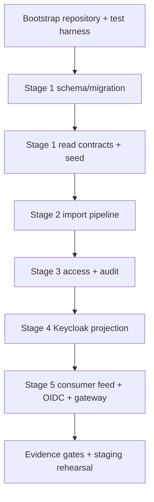

# IDP Pegawai Jalur B Implementation Plan TDD

> **For Hermes:** Use subagent-driven-development skill to implement this plan task-by-task.

**Goal:** Membangun fondasi IDP Pegawai Flask + PostgreSQL secara bertahap dengan TDD, dimulai dari Stage 1 core identity/organization, lalu import, authorization/audit, Keycloak projection, dan consumer distribution.

**Architecture:** IDP Pegawai menjadi authority untuk identitas ASN, eligibility/lifecycle, identity link, serta afiliasi organisasi. Keycloak hanya menjadi authentication dan managed projection; consumer menerima curated snapshot/delta dan tetap memiliki domain fields serta checkpoint lokalnya sendiri. Implementasi dimulai dari migration/schema, contract tests, lalu thin vertical slices; tidak ada perubahan Keycloak production, gateway production, DNS, TLS, atau deployment sebelum evidence gate terpenuhi.

**Tech Stack:** Python 3.11, Flask, SQLAlchemy, Alembic, PostgreSQL nyata, pytest, Redis hanya bila dibutuhkan oleh worker contract, Keycloak exact pinned version untuk integration test, gateway configuration sebagai artifact terpisah.

---

## 1. Status eksekusi

- [x] Phase 0.1 — bootstrap repository, Flask factory, pytest harness (`6f05eee`).
- [x] Phase 0.2 — PostgreSQL SQLAlchemy harness dan marker (`4f180c6`).
- [ ] PostgreSQL integration evidence dengan `TEST_DATABASE_URL` — menunggu environment PostgreSQL nyata.
- [x] Phase 1.1 — Alembic foundation dan identity schema migration (`a07a1c6`).
- [ ] PostgreSQL migration evidence dengan `TEST_DATABASE_URL` — menunggu environment PostgreSQL nyata.
- [x] Phase 1.2 — model mixins dan `OrgUnit` (`daf72bf`, regression metadata diperbaiki).
- [x] Phase 1.3 — model `Pegawai` dan identity link (`3d8c496`).
- [x] Phase 1.4 — repository contracts (`ae5993d`).
- [x] Phase 1.5 — service lifecycle dan seed organisasi (`6bfb966`, test fixture fix `153e31b`).
- [x] Phase 1.6a — read-only `GET /admin/org-units` (`65f7c96`).
- [x] Phase 1.6b — read-only `GET /admin/pegawai` (`e7bf5a0`).
- [x] Phase 1.7a — migration review gate/reversible index fix (`90b2620`).
- [ ] Phase 1.7b — PostgreSQL evidence dengan `TEST_DATABASE_URL`.
- [x] Phase 2.1 — secure file intake dan batch registration (`7ed4c29`).
- [x] Phase 2.2 — template detection, mapping, dan typed normalization (`31cb43e`, `bf46602`).
- [x] Phase 2.3 — row validation dan dry-run plan (`35fbda8`).
- [x] Phase 2.4a — error workbook (`e489543`).
- [x] Phase 2.4b — atomic apply (`af156c6`).
- [x] Phase 2.5 — outbox provenance setelah apply (`ab05565`).
- [x] Phase 2.6a — Stage 2 review gate (`59 passed, 2 skipped`).
- [ ] Phase 2.6b — PostgreSQL evidence dengan `TEST_DATABASE_URL`.
- [x] Phase 3.1 — fixed role/capability catalog (`eb3df1e`).
- [x] Intake hardening — XLSX/ZIP security regression (`dee2d29`).
- [x] Phase 3.2a — core authorization guard (`b4da495`).
- [x] Phase 3.2b — API authorization decorator boundary (`bcd07a2`).
- [x] Phase 3.3 — audit event, privacy, dan retention (`6c9dbb7`).
- [x] Phase 3.4a — Stage 3 review gate (PASS bersyarat; tidak ada gap kritis konkret).
- [ ] Phase 3.4b — PostgreSQL evidence dengan `TEST_DATABASE_URL`.
- [x] Phase 4 evidence harness — probe non-production Keycloak client-credentials + Admin API GET users, secret/token hygiene, dan explicit-dev HTTP guard (unit contract GREEN).
- [x] Phase 4 runtime evidence — manual non-production evidence dilaporkan GREEN: PostgreSQL migration sukses, PostgreSQL integration 4 passed, Keycloak client-credentials sukses, GET synthetic user HTTP 200, PUT managed fields HTTP 204, dan read-back sukses.
- [ ] Phase 4 staging evidence — exact pinned Keycloak image, HTTPS, JWKS/PKCE/state/nonce, rotation, mapper drift, dan operational rollback masih pending.
- [x] Phase 5 consumer operational rehearsal — contract/unit fixture rehearsal GREEN; lifecycle suspension/reactivation/decommission and external consumer runtime evidence remain pending.
- [x] Phase 5 HMAC rotation rehearsal — active/overlap verification and revoked-key rejection covered by local fixture tests; production key rotation evidence pending.
- [x] Phase 5 privacy/security scan — redaction and curated-feed PII guards covered by local tests; runtime log/trace/metrics scan pending.
- [ ] Phase 5 staging readiness review — local artifact validation reports Keycloak `:latest`, dev HTTP, and missing runtime TLS/OIDC/gateway evidence as blockers.
- [ ] Refactor opsional — evaluasi migrasi dari Alembic CLI langsung ke Flask-Migrate tanpa mengubah schema atau mereset database.

## 2.1 Catatan verifikasi terakhir

### Roadmap lanjutan (evidence lokal, synthetic fixture)

Test readiness menggunakan synthetic fixture saja dan bukan runtime/external evidence. `pytest tests/unit tests/contract -q` menghasilkan 192 passed, 1 warning. `docker compose config --quiet` GREEN. Full suite lokal menghasilkan 198 passed, 2 gagal karena `global_postgresql` tidak dapat di-resolve dari environment ini; ini blocker environment, bukan bukti PostgreSQL gagal. Docker `python3-base:latest` wajib dijalankan ulang pada environment yang menyediakan dependency dan network PostgreSQL.

Staging artifact review menemukan blocker aktual: `docker-compose.yml` memakai `quay.io/keycloak/keycloak:latest`, `start-dev`, dan HTTP enabled. Gateway artifact sudah memisahkan public/private route, service JWT, scope, bounded limits, serta redaction, tetapi verifikasi HTTPS/JWKS/PKCE/state/nonce dan evidence eksternal tetap pending.

Perintah:

```bash
.venv/bin/pytest -q
```

Hasil:

```text
87 passed, 2 skipped in 0.52s
```

Review Stage 3 (dokumen arsitektur 18–22) lulus secara implementasi/unit-contract. Dua test integration PostgreSQL masih dilewati karena `TEST_DATABASE_URL` belum dikonfigurasi. Evidence migration, constraint, transaction, concurrency, dan retention terhadap PostgreSQL nyata tetap pending dan tidak boleh digantikan SQLite.

## 1. Baseline hasil inspeksi

- Project root: `/home/user/projects/kumjabar-sso`.
- Folder implementasi saat ini kosong; belum ada `.git`, `pyproject.toml`, source code, test suite, atau `AGENTS.md`.
- Architecture package telah tersedia di `docs/architecture/`, sebanyak 35 file Markdown (`01`–`35`).
- Dokumen `35-idp-pegawai-stage-5-review-checklist-implementation-gate.md` menutup architecture package Tahap 1–5 sebagai `ARCHITECTURE-COMPLETE / APPROVED`, tetapi secara eksplisit belum memberi izin coding/migration/provisioning/deployment.
- Jalur B yang dipilih user berarti: inspeksi codebase → implementation plan dengan path nyata → coding bertahap setelah instruksi eksplisit.
- Karena codebase belum ada, path implementasi di bawah adalah target structure yang harus dibekukan melalui bootstrap task pertama, bukan asumsi tentang file existing.

## 2. Authority dan boundary yang wajib dipertahankan

| Concern | Authority |
|---|---|
| Identitas ASN, NIP, status, eligibility | IDP PostgreSQL |
| Org unit dan afiliasi organisasi | IDP PostgreSQL |
| Jabatan, jenis/label jabatan, PLT/PLH, histori jabatan | Consumer/domain kepegawaian; bukan IDP |
| Human authentication | Keycloak |
| Coarse application entry roles | Keycloak |
| Fine-grained role/scope/capability | Local `access_grants` dan policy aplikasi |
| Keycloak desired state | Resolver IDP |
| Keycloak actual state | Adapter read-back/reconciliation |
| Consumer snapshot/delta apply | Database consumer + checkpoint atomik |
| Transport/private ingress | Gateway/network policy |

## 3. Urutan Jalur B



Setiap slice mengikuti:

```text
RED: tulis satu test perilaku dan jalankan sampai gagal
GREEN: implementasi minimum sampai test lulus
REFACTOR: rapikan tanpa mengubah behavior
REGRESSION: pytest seluruh suite
EVIDENCE: catat output, database, dan boundary yang terbukti
COMMIT: satu commit kecil per slice
```

---

# Phase 0 — Repository Bootstrap dan Test Harness

### Task 0.1: Bekukan project metadata dan package layout

**Files:**
- Create: `pyproject.toml`
- Create: `src/idp_pegawai/__init__.py`
- Create: `src/idp_pegawai/config.py`
- Create: `tests/conftest.py`
- Create: `tests/unit/test_bootstrap.py`

**TDD:**
1. Tulis `test_package_exposes_application_factory` yang mengharapkan factory callable.
2. Jalankan `pytest tests/unit/test_bootstrap.py -q`; expected RED karena package belum ada.
3. Tambahkan package minimal dan factory Flask.
4. Jalankan ulang; expected GREEN.
5. Jalankan `pytest -q`; expected seluruh test pass.

**Verification:** import package, factory test, lint/type checks bila ditambahkan ke metadata.

### Task 0.2: Tambahkan konfigurasi database dan test markers

**Files:**
- Modify: `pyproject.toml`
- Create: `src/idp_pegawai/extensions.py`
- Modify: `tests/conftest.py`
- Create: `tests/integration/test_postgresql_connection.py`

**Constraint:** PostgreSQL nyata wajib menjadi bukti correctness; SQLite tidak boleh dipakai sebagai pengganti integration evidence.

**RED→GREEN:** test membaca `TEST_DATABASE_URL`, membuka koneksi, menjalankan query sederhana, lalu rollback/cleanup.

---

# Phase 1 — Stage 1 Core Identity and Organization

### Task 1.1: Buat migration identity dan shared columns

**Files:**
- Create: `migrations/env.py`
- Create: `migrations/versions/0001_create_identity_schema.py`
- Create: `tests/integration/test_migration_identity.py`

**Contract:** `org_units`, `pegawai`, `pegawai_org_assignments`, `pegawai_identity_links`; integer PK + UUID unique, timestamps, soft-delete fields, FK/index/unique constraints sesuai dokumen `05`–`10`.

**RED→GREEN:** migration test memverifikasi tabel, UUID uniqueness, NIP tepat 18 digit, FK, effective dates, dan downgrade bersih.

### Task 1.2: Implement model mixins dan `OrgUnit`

**Files:**
- Create: `src/idp_pegawai/models/base.py`
- Create: `src/idp_pegawai/models/org_unit.py`
- Create: `tests/unit/models/test_org_unit.py`
- Create: `tests/integration/models/test_org_unit_constraints.py`

**RED→GREEN:** valid root/child unit lulus; parent cycle, duplicate code/path, invalid level, dan inactive/effective-date contradiction ditolak.

### Task 1.3: Implement `Pegawai` dan identity link

**Files:**
- Create: `src/idp_pegawai/models/pegawai.py`
- Create: `src/idp_pegawai/models/identity_link.py`
- Create: `tests/unit/models/test_pegawai.py`
- Create: `tests/integration/models/test_pegawai_constraints.py`

**Boundary:** metadata tidak boleh menjadi tempat jabatan/PLT/PLH. Identity link tidak boleh dicari melalui email matching sebagai authority.

**RED→GREEN:** NIP PNS/PPPK valid; NIP non-18-digit/non-digit ditolak; pegawai inactive tidak eligible; provider subject uniqueness terbukti.

### Task 1.4: Implement repository contracts

**Files:**
- Create: `src/idp_pegawai/repositories/org_unit_repository.py`
- Create: `src/idp_pegawai/repositories/pegawai_repository.py`
- Create: `tests/integration/repositories/test_org_unit_repository.py`
- Create: `tests/integration/repositories/test_pegawai_repository.py`

**Contract methods minimum:** `get_by_uuid`, `get_by_code`, `get_by_path`, `list_children`, `list_active`; pegawai lookup by UUID/NIP/identity link dan query snapshot scope.

**RED→GREEN:** repository hanya query/loading; tidak mengambil business decision atau remote call.

### Task 1.5: Implement service lifecycle dan seed organisasi

**Files:**
- Create: `src/idp_pegawai/services/org_unit_service.py`
- Create: `src/idp_pegawai/services/pegawai_service.py`
- Create: `src/idp_pegawai/seeds/org_units.py`
- Create: `tests/unit/services/test_org_unit_service.py`
- Create: `tests/integration/seeds/test_org_unit_seed.py`

**RED→GREEN:** create/update/deactivate menjaga invariants; seed idempotent; primary assignment konsisten; tidak ada hard delete.

### Task 1.6: Tambahkan read-only internal API Stage 1

**Files:**
- Create: `src/idp_pegawai/api/__init__.py`
- Create: `src/idp_pegawai/api/admin.py`
- Create: `src/idp_pegawai/schemas/org_unit.py`
- Create: `src/idp_pegawai/schemas/pegawai.py`
- Create: `tests/contract/api/test_stage1_read_api.py`

**Contract:** `/admin/org-units`, `/admin/pegawai`, detail/filter/pagination; base-path aware; response tidak membocorkan restricted fields ke role yang tidak berwenang.

**RED→GREEN:** contract test untuk status code, shape, pagination, filtering, empty result, dan denial mutation endpoint.

---

# Phase 2 — Stage 2 Import Pipeline

### Task 2.1: Implement secure file intake dan batch registration

**Files:**
- Create: `src/idp_pegawai/imports/intake.py`
- Create: `src/idp_pegawai/models/import_batch.py`
- Create: `migrations/versions/0002_create_import_tables.py`
- Create: `tests/unit/imports/test_intake_security.py`
- Create: `tests/integration/imports/test_batch_registration.py`

**Contract:** CSV/XLSX, signature/MIME/size validation, opaque storage key, no public path/blob DB, safe ZIP extraction boundary.

### Task 2.2: Implement template detection, mapping, dan normalization

**Files:**
- Create: `src/idp_pegawai/imports/template.py`
- Create: `src/idp_pegawai/imports/mapping.py`
- Create: `src/idp_pegawai/imports/normalization.py`
- Create: `tests/unit/imports/test_mapping.py`
- Create: `tests/unit/imports/test_normalization.py`

**RED→GREEN:** mixed date/datetime (`dd/mm/yyyy`, `yyyy-mm-dd`, `dd-mm-yyyy`, spreadsheet serial), numeric, boolean dinormalisasi ke canonical type; parse failure menjadi validation error eksplisit; raw/mapped/normalized values tetap dapat diaudit.

### Task 2.3: Implement row validation dan dry-run plan

**Files:**
- Create: `src/idp_pegawai/imports/validation.py`
- Create: `src/idp_pegawai/imports/dry_run.py`
- Create: `src/idp_pegawai/models/import_row.py`
- Create: `tests/unit/imports/test_validation.py`
- Create: `tests/integration/imports/test_dry_run.py`

**Contract:** duplicate NIP, unknown org code, invalid lifecycle, forbidden fields, formula injection, error catalog, warning vs blocking error.

### Task 2.4: Implement error workbook dan atomic apply

**Files:**
- Create: `src/idp_pegawai/imports/error_workbook.py`
- Create: `src/idp_pegawai/imports/apply.py`
- Create: `tests/integration/imports/test_error_workbook.py`
- Create: `tests/integration/imports/test_atomic_apply.py`

**RED→GREEN:** error workbook self-contained; retry loop mempertahankan lineage; apply all-or-nothing; crash/rollback tidak meninggalkan persisted `applying` state.

### Task 2.5: Implement outbox provenance setelah apply

**Files:**
- Create: `src/idp_pegawai/models/outbox_event.py`
- Create: `migrations/versions/0003_create_outbox.py`
- Create: `src/idp_pegawai/services/outbox_service.py`
- Create: `tests/integration/test_outbox_transaction.py`

**Contract:** domain mutation + outbox event satu transaksi; tidak ada remote call di transaction domain; payload tidak memuat data terlarang.

---

# Phase 3 — Access, Scoped Grants, Audit, Privacy

### Task 3.1: Implement fixed role/capability catalog

**Files:**
- Create: `src/idp_pegawai/access/catalog.py`
- Create: `src/idp_pegawai/access/grants.py`
- Create: `migrations/versions/0004_create_access_tables.py`
- Create: `tests/unit/access/test_catalog.py`
- Create: `tests/integration/access/test_grant_constraints.py`

**Contract:** fixed RBAC v1, scoped grant, explicit expiry/revoke; bukan generic policy DSL.

### Task 3.2: Implement authorization guards

**Files:**
- Create: `src/idp_pegawai/access/guards.py`
- Create: `src/idp_pegawai/api/decorators.py`
- Create: `tests/unit/access/test_guards.py`
- Create: `tests/contract/api/test_authorization_contract.py`

**RED→GREEN:** deny by default, scope intersection, immediate local revoke, expired grant denial, Keycloak coarse role tidak cukup untuk capability detail.

### Task 3.3: Implement audit event, privacy, retention boundary

**Files:**
- Create: `src/idp_pegawai/audit/events.py`
- Create: `src/idp_pegawai/audit/redaction.py`
- Create: `src/idp_pegawai/audit/retention.py`
- Create: `migrations/versions/0005_create_audit_events.py`
- Create: `tests/unit/audit/test_redaction.py`
- Create: `tests/integration/audit/test_retention_boundary.py`

**Contract:** actor/resource/scope snapshot, restricted payload, no token/password/raw payload, legal hold prevents purge, audit lineage restricts destructive delete.

---

# Phase 4 — Keycloak Managed Projection

### Task 4.1: Implement desired-state resolver

**Files:**
- Create: `src/idp_pegawai/projection/desired_state.py`
- Create: `src/idp_pegawai/projection/mapping_catalog.py`
- Create: `tests/unit/projection/test_desired_state.py`
- Create: `tests/contract/projection/test_projection_mapping_contract.py`

**Contract:** managed prefix/catalog only; org group path berasal dari canonical org unit; role tidak diturunkan otomatis dari jabatan; no arbitrary remote path.

### Task 4.2: Implement identity-link projection records

**Files:**
- Modify: `src/idp_pegawai/models/identity_link.py`
- Create: `src/idp_pegawai/projection/identity_links.py`
- Create: `tests/integration/projection/test_identity_link_projection.py`

**RED→GREEN:** UUID correlation, no hard-delete, stale event no-op, identity-link conflict fail-closed.

### Task 4.3: Implement outbox delivery state machine

**Files:**
- Create: `src/idp_pegawai/models/outbox_delivery.py`
- Create: `src/idp_pegawai/workers/projection_worker.py`
- Create: `migrations/versions/0006_create_projection_delivery.py`
- Create: `tests/integration/workers/test_delivery_state_machine.py`

**Contract:** per-consumer delivery, lease/fencing, retry budget, circuit breaker, dead-letter, idempotency, crash recovery.

### Task 4.4: Implement narrow Keycloak adapter dan read-back reconciliation

**Files:**
- Create: `src/idp_pegawai/integrations/keycloak/client.py`
- Create: `src/idp_pegawai/integrations/keycloak/adapter.py`
- Create: `src/idp_pegawai/integrations/keycloak/reconciliation.py`
- Create: `tests/unit/integrations/test_keycloak_url_policy.py`
- Create: `tests/contract/integrations/test_keycloak_adapter.py`

**Security:** exact configured endpoint/realm/client, URL encoding, SSRF deny, dedicated projection credential, no browser/event/database free-text URL.

**Evidence:** GET-merge-PUT, read-back normalization, unmanaged drift tidak dihapus otomatis, wrong audience/credential ditolak.

---

# Phase 5 — Consumer Distribution, OIDC, Gateway, Operations

### Task 5.1: Implement canonical snapshot/profile projector

**Files:**
- Create: `src/idp_pegawai/consumer/profiles.py`
- Create: `src/idp_pegawai/consumer/canonicalize.py`
- Create: `src/idp_pegawai/consumer/projector.py`
- Create: `tests/unit/consumer/test_canonicalize.py`
- Create: `tests/contract/consumer/test_profiles.py`

**Contract:** fixed profiles (`pegawai.portal-minimal.v1`, `pegawai.s1-operational.v1`, `org-unit.navigation.v1`), no arbitrary `fields=`, SHA-256 canonical hash, absent berbeda dari null, no PII leakage.

### Task 5.2: Implement consumer registration dan ordered change log

**Files:**
- Create: `src/idp_pegawai/models/consumer_registration.py`
- Create: `src/idp_pegawai/models/consumer_change_log.py`
- Create: `migrations/versions/0007_create_consumer_distribution.py`
- Create: `tests/integration/consumer/test_registration_constraints.py`
- Create: `tests/integration/consumer/test_change_sequence.py`

**Contract:** `consumer_code` stabil/non-reusable, active binding unik, monotonic BIGINT sequence, upsert/tombstone action-specific payload, curated log terpisah dari raw outbox.

### Task 5.3: Implement HMAC cursor, replay window, dan delta API

**Files:**
- Create: `src/idp_pegawai/consumer/cursor.py`
- Create: `src/idp_pegawai/api/internal_feed.py`
- Create: `tests/unit/consumer/test_cursor.py`
- Create: `tests/contract/api/test_delta_feed.py`

**RED→GREEN:** cursor opaque/versioned/bound consumer-resource-profile-query; active+overlap key rotation; invalid/tampered cursor 400/401; expired replay window HTTP 410; page 1–500; no PII in cursor.

### Task 5.4: Implement OIDC validation dan claim release catalog

**Files:**
- Create: `src/idp_pegawai/integrations/oidc/validator.py`
- Create: `src/idp_pegawai/integrations/oidc/claims.py`
- Create: `tests/unit/oidc/test_claim_release.py`
- Create: `tests/contract/oidc/test_token_validation.py`

**Contract:** issuer/audience/azp/signature/algorithm/exp/nbf/iat exact; state/nonce/PKCE contract; minimum claims; no default full NIP/email/org tree/jabatan/grants/cursor.

### Task 5.5: Implement bootstrap, checkpoint, freshness, conflict handling

**Files:**
- Create: `src/idp_pegawai/consumer/bootstrap.py`
- Create: `src/idp_pegawai/consumer/freshness.py`
- Create: `tests/contract/consumer/test_bootstrap_cutoff.py`
- Create: `tests/contract/consumer/test_freshness_conflicts.py`

**Boundary:** checkpoint utama berada di database consumer. Provider tidak boleh menganggap HTTP 200 sebagai atomic apply. Test fixture harus membuktikan duplicate, out-of-order, same-version hash conflict, tombstone, rollback page, dan continuation setelah cutoff.

### Task 5.6: Tulis gateway/config/runbook artifacts tanpa aktivasi produksi

**Files:**
- Create: `deploy/gateway/routes.yaml`
- Create: `deploy/gateway/security-baseline.yaml`
- Create: `docs/runbooks/consumer-onboarding.md`
- Create: `docs/runbooks/incident-response.md`
- Create: `tests/contract/gateway/test_private_route_policy.py`

**Contract:** public ingress menolak feed/internal/worker route; trusted proxy explicit; TLS verification wajib; body/header/timeout/rate limits bounded; no blind mutation retry; logs tidak memuat PII/token/cursor/payload.

---

# 4. Evidence gates sebelum coding completion

1. PostgreSQL nyata: migration, constraint, sequence gap, transaction rollback, concurrency, query plan, retention/legal hold, backup/restore.
2. Contract fixtures: profile, claim, mapping, error/status/incident catalog dibekukan.
3. Keycloak exact pinned environment: PKCE, state/nonce, audience/azp, JWKS rotation, mapper drift, logout, wrong client/feed credential rejection.
4. Gateway/network: public/private deny, path-prefix bypass, trusted proxy spoof, TLS invalid host/cert, egress allowlist, CORS/CSRF/cookie, limits.
5. Consumer operations: bootstrap cutoff, replay/410, duplicate/conflict, lag, suspension/reactivation, credential compromise, schema overlap, decommission.
6. Privacy/security scan: tidak ada NIP/email/nama/token/secret/raw payload/raw cursor pada log, metrics, trace, error response.

# 5. Perintah verifikasi standar

```bash
# Unit/contract cepat
pytest tests/unit tests/contract -q

# Integration dengan PostgreSQL nyata
TEST_DATABASE_URL=postgresql+psycopg://... pytest tests/integration -q

# Seluruh suite
TEST_DATABASE_URL=postgresql+psycopg://... pytest -q

# Migration check
alembic upgrade head
alembic downgrade base
alembic upgrade head

# Security-focused suite
pytest tests/contract/oidc tests/contract/gateway tests/contract/consumer -q
```

Nilai `...` wajib berasal dari environment/secret manager; jangan menulis credential nyata ke repository atau plan execution log.

# 6. Aturan commit

Setiap tracer bullet menghasilkan commit kecil, misalnya:

```text
chore: bootstrap idp pegawai test harness
feat: add org unit identity schema
feat: add pegawai identity link lifecycle
feat: add stage 1 read contracts
feat: add secure import validation
feat: add local scoped grants and audit
feat: add managed keycloak projection
feat: add canonical consumer delta feed
feat: add oidc and gateway contract tests
```

Jangan menggabungkan UI, worker, migration, dan integration deployment dalam satu commit.

# 7. Definition of Done Jalur B

- [ ] Setiap production behavior mempunyai test yang lebih dulu terlihat RED.
- [ ] Semua test GREEN dan full regression pass.
- [ ] Migration reversible serta diverifikasi di PostgreSQL nyata.
- [ ] Authority/ownership boundary tetap eksplisit.
- [ ] Tidak ada remote call dalam transaksi domain.
- [ ] Tidak ada arbitrary fields/claim/group path.
- [ ] Consumer checkpoint atomic di sisi consumer.
- [ ] Negative security tests lulus.
- [ ] Evidence artifacts, runbook, dan approval gate terdokumentasi.
- [ ] Staging rehearsal selesai sebelum production activation.

# 8. Handoff coding

Plan ini sudah siap menjadi input implementasi, tetapi repository masih kosong sehingga coding harus dimulai dari Phase 0. Eksekusi berikutnya sebaiknya memakai `subagent-driven-development`: satu worker per task, review spec-compliance lalu code-quality, dan berhenti bila contract/evidence gate gagal.

Tidak ada Keycloak production change, migration deployment, gateway activation, DNS/TLS change, atau production consumer activation yang termasuk dalam plan ini tanpa otorisasi dan evidence terpisah.
